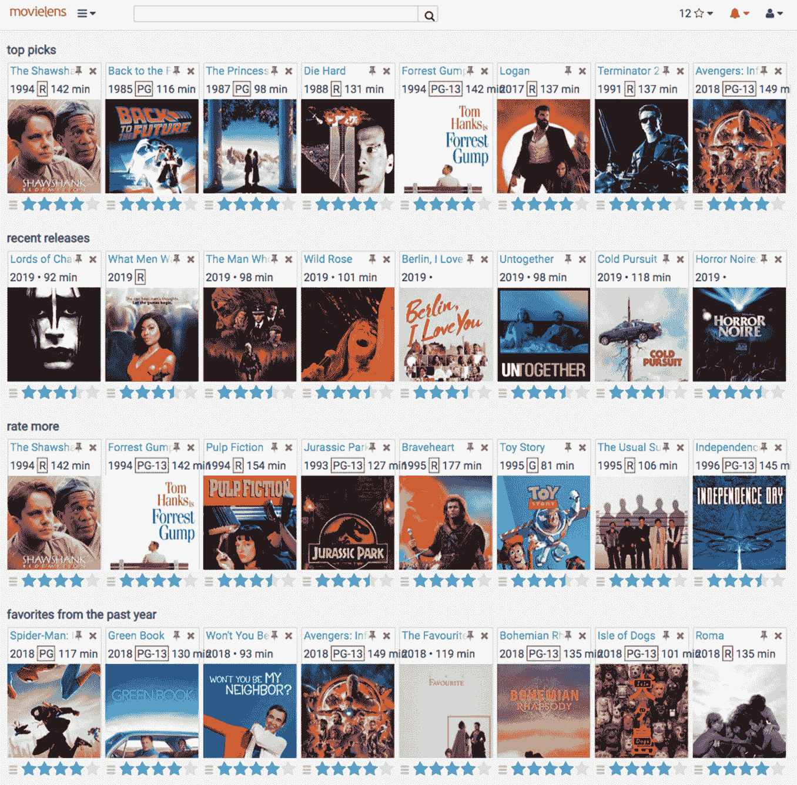
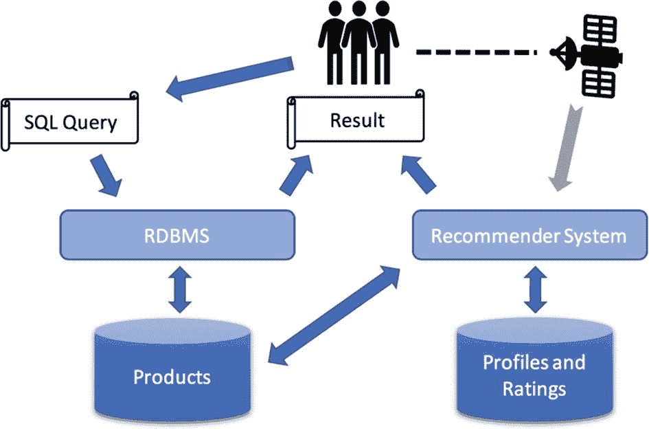
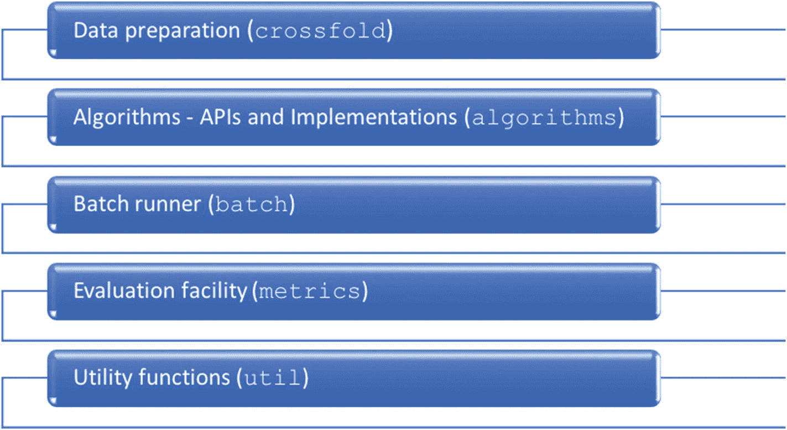
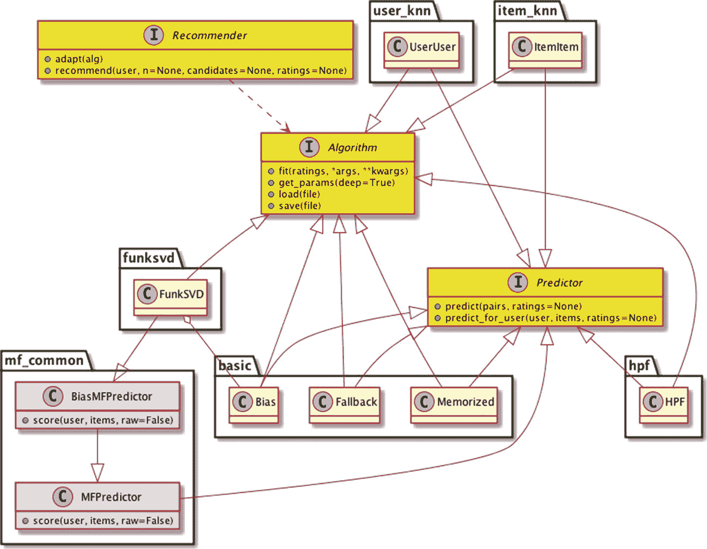
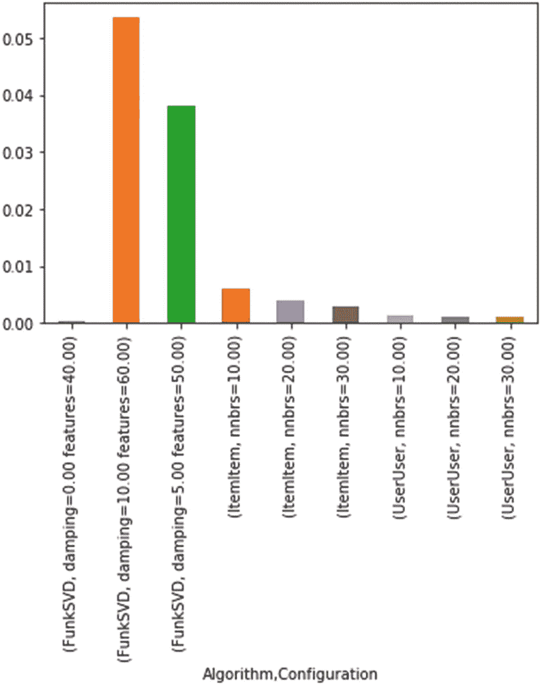

# 8. 推荐系统

当人们问及机器学习在工业领域有哪些广泛应用时，推荐系统是一个典型的答案。事实上，这类系统无处不在，我们非常依赖它们。亚马逊或许是运用多种推荐系统来提升用户体验、帮助用户快速找到所需商品的最佳电商网站示例。专注于音乐领域的 Spotify 则是另一个很好的例子。尽管大量使用了机器学习，但推荐系统在以下两个关键方面与传统训练的机器学习系统有所不同：

-   除了基础内容外，它们还尝试结合许多额外线索，以提供更具个性化的选择。
-   它们倾向于偏好可变性而非可预测性，以激发用户的兴奋感。试想一个推荐系统，其推荐内容从不包含令人意外的项目。

这些特性使得评估推荐系统的指标完全不同。如果你试图仅通过标准均方根误差来优化预测准确性，那么你的系统在实践中很可能表现不佳，会被认为很乏味。本章将简要介绍推荐系统，并解释一些核心概念及相关技术。

## 推荐系统简介

要熟悉推荐系统，可以试试无商业负担、免费使用的 MovieLens 项目（`https://movielens.org`）。¹⁹ MovieLens 提供个性化电影推荐。创建账户后，它立即会要求你在六种电影类型中分配三分，以生成初始档案。之后，随着你对电影进行评分和标记，它会进一步了解你，并提供更合适的电影。这是推荐系统中的典型案例：数据越多，系统就能创建关于你的更精细的档案，从而更成功地筛选内容。在这方面，高质量的输入应带来高质量的输出。图 8-1 展示了 MovieLens 主用户界面的部分内容。尝试给几部电影评分，观察系统如何适应你更新的档案。

与 MovieLens 类似，大多数推荐系统收集两种类型的数据：

-   **显式数据**：由用户自愿提供。例如，每次你对电影评分时，都是有意提供反馈。收集大量显式数据需要系统设计者找到巧妙的方法来吸引用户响应，例如提供激励措施。当然，如果你恰当地评价电影，你理应获得更好的推荐，这是任何人愿意费心评价产品的最小激励。
-   **隐式数据**：系统在监控用户活动时自动收集的数据（例如点击、购买等）。甚至时间事件也可能有价值；例如，如果用户在某部特定电影剧本的页面上花费的时间比其他电影页面更长，这可能表明对该电影有更高的兴趣。另一种收集隐式数据的方法是追踪关于电影的推文，以评估它们的总体流行度。总而言之，众多来源可以组合成一个单一的偏好公式。自然，获取隐式数据比获取显式数据更容易，因为它不需要用户的主动参与。



图 8-1

`MovieLens` 的推荐以行表示不同类别进行展示

为了始终让用户有机会发现新内容，推荐是个性化内容和非个性化内容（例如总体热门项目）的混合。后者可以基于一般人口统计信息（例如年龄组、性别等）进行定制。另一个考虑是，有时你只想探索一些东西，而无需“干扰”你的个人档案（请记住，每次操作都会被追踪，包括浏览和点击，这可能会影响未来的推荐）。在 `MovieLens` 中，可以通过 `MovieExplorer` 功能实现这一点（该功能可能会随时间变化，因为在撰写本书时它纯粹是试验性的）。无论如何，在设计时请考虑为客户提供类似的“不追踪”选项。

图 8-2 突出了推荐系统与传统数据库及其他信息检索系统的另一个不同之处。推荐系统基于学习到的偏好筛选项目，而数据库则试图尽可能快地回答临时查询。`MovieLens` 执行的查询集相当静态（例如，列出用户的热门电影、列出最受欢迎的电影等），如图 8-1 所示，尽管你会得到不同的结果。如果你对关系数据库系统执行相同的查询，无论你喜欢与否，你都会得到相同的输出（假设基础内容没有改变）。



图 8-2

### 推荐系统

在信息检索系统中，用户必须明确识别她正在寻找的内容（例如，在关系数据库中，这是通过发出 SQL 查询来完成的）。

推荐系统会学习用户的喜好和厌恶，并相应地修改底层查询。输出反映了当前的用户画像（即，假设个性化解决方案，结果与用户的口味产生共鸣）。通常，在推荐系统中，你不会经常更改输出类别；它们随着时间的推移是相当稳定的。基于内容的推荐系统可以使用产品数据库来显示项目的详细信息，因此它可以根据项目的属性来编码用户的品味。

与推荐系统相关的有三种主要接口：

-   **过滤功能**：尝试从流数据源（如新闻、推文、电子邮件等）中移除不感兴趣的主题（根据用户画像）。例如，个性化新闻推荐引擎可能只挑选对您重要的文章。
-   **推荐接口**：呈现您可能喜欢的一组项目，如前文图 8-1 所示。通常，现代推荐系统是混合系统，利用不同的推荐算法来生成混合内容。例如，它既可以为您提供与您品味相匹配的特定项目，也可以为您提供当前流行的项目建议。此外，系统可能仅使用其自身的初始推荐来触发基于对话的交互，其中来自用户的额外反馈可能有助于缩小最终选择范围。
-   **预测接口**：尝试准确预测您对某些产品的喜爱程度（例如，您会为一部未看过的电影打多少星）。当然，这些值是估计值，有时可能不准确。总的来说，您给一个项目打 5 星还是 4.5 星并没有那么重要。更重要的是提供您认为有价值的东西。

如今，大多数推荐系统都基于协同过滤技术。协同意味着利用其他用户的数据为您定制推荐。系统可能会将您的品味与其他用户关联起来，这样您就能根据这些用户的喜好和厌恶获得推荐。这是 `user-user` 类型的过滤。也可以根据评分关联项目，这构成了 `item-item` 类型的过滤；这是当今大多数系统中首选的可扩展模型。最后，还可以使用“购买了该商品的用户也购买了……”形式的产品关联规则来推荐项目。

基于上下文的系统还使用上下文和环境数据来微调结果（例如，根据您的心情，系统可能在您的一般偏好模型之上提供不同的音乐）。这些数据可以从您的智能手机收集；系统可能使用位置信息将列表缩小到您附近的物体。

## 简单电影推荐器案例研究

我们将构建一个非常简单的混搭应用，用于推荐与用户输入的电影相似的电影。此示例的灵感来自参考文献[3]。该程序将使用两个公共服务并合并它们的结果；这种安排被称为*混搭*。

`TasteDive`（[`tastedive.com`](https://tastedive.com)，这也是其 API 的基础 URL）是一个推荐引擎，根据您的品味推荐相似的音乐、电影、电视节目、书籍、作者、游戏和播客。它提供了一个资源 API（REST Level 2），以编程方式获取相似物（该 API 文档位于`/read/api`）。如果您直接访问`/api/similar`端点（无需输入访问密钥或提供任何其他参数），您将收到以下简化的 JSON 响应（内容可能会随时间变化）：

```json
```

```json
{
  "Similar": {
    "Info": [
      {
        "Name": "!!!",
        "Type": "music"
      }
    ],
    "Results": [
      {
        "Name": "Meeting Of Important People",
        "Type": "music"
      },
      {
        "Name": "The Vanity Project",
        "Type": "music"
      },
      ...
    ]
  }
}
```

您可以免费发出几个 HTTP 请求。您需要一个访问密钥才能将未来的推荐服务投入生产。清单 8-1 显示了从 `TasteDive` 获取物的类。这个程序完全独立于我们的最终服务。它也可以在许多其他上下文中重用。作为额外的练习，将 `requests` 模块更改为 `requests_with_caching`（请查阅参考文献[3]的第[24 章](https://doi.org/10.1007/978-1-4842-4859-1_24)）。

```python
import requests

class TasteDiveService:
    SUPPORTED_ARTIFACTS = ['music', 'movies', 'shows', 'podcasts', 'books', 'authors', 'games']
    API_URL = 'https://tastedive.com/api/similar'

    def __init__(self, artifact_type = 'movies'):
        assert artifact_type in TasteDiveService.SUPPORTED_ARTIFACTS, 'Invalid artifact type'
        self._artifact_type = artifact_type

    def _retrieve_artifacts(self, name, limit):
        params = {'q': name, 'type': self._artifact_type, 'limit': limit}
        return requests.get(TasteDiveService.API_URL, params).json()

    @staticmethod
    def _extract_titles(response):
        artifacts = response['Similar']['Results']
        return [artifact['Name'] for artifact in artifacts]

    def similar_titles(self, titles, limit = 5):
        """
        Returns a set of similar titles up to the defined limit. Each instance of this class is supposed to work only with one artifact type. This type is specified during object construction.
        """
        assert 0 < limit <= 50, 'Limit must be in range (0, 50].'
        return {similar_title
                for title in titles
                for similar_title in TasteDiveService._extract_titles(
                    self._retrieve_artifacts(title, limit))}
```

清单 8-1 `tastedrive_service.py` 模块（位于 `simple_recommender` 文件夹中），用于从 `TasteDive` 获取相似物

以下是如何接收与终结者相似的电影的示例：

```python
>> td.similar_titles(['Terminator'])
{'Aliens', 'Commando', 'First Blood', 'Predator', 'Terminator Salvation'}
```

`OMDb` 服务（请参阅 [`www.omdbapi.com`](http://www.omdbapi.com)）提供了一个资源 API 来获取电影信息。我们将使用它来获取电影的评分，以便我们能够根据此标准对来自 `TasteDive` 的最终结果进行排序。清单 8-2 显示了与 `OMDb` 通信的类。

```python
import requests

class OMDbService:
    API_URL = 'http://www.omdbapi.com/'

    def __init__(self, api_key):
        self._api_key = api_key

    def retrieve_info(self, title):
        """Returns information about the movie title in JSON format."""
        params = {'apikey': self._api_key, 't': title, 'type': 'movie', 'r': 'json'}
        return requests.get(OMDbService.API_URL, params).json()
```

清单 8-2 `omdb_service.py` 模块，用于帮助与 `OMDb` 服务通信

您需要获取一个 API 密钥才能使用 `OMDb`。幸运的是，您可以在其网站上申请一个免费密钥（每日限制 1000 次请求）（点击首页上的 `API Key` 标签页）。以下是获取电影 Terminator 信息的示例：

```
>> omdb = OMDbService('YOUR API KEY HERE')
>> omdb.retrieve_info('Terminator')
{'Title': 'Terminator',
 'Year': '1991',
 'Rated': 'N/A',
 'Released': 'N/A',
 'Runtime': '39 min',
 'Genre': 'Short, Action, Sci-Fi',
 'Director': 'Ben Hernandez',
 'Writer': 'James Cameron (characters), James Cameron (concept), Ben Hernandez (screenplay)',
 'Actors': 'Loris Basso, James Callahan, Debbie Medows, Michelle Kovach',
 'Plot': 'A cyborg comes from the future, to kill a girl named Sarah Lee.',
 'Language': 'English',
 'Country': 'USA',
 'Awards': 'N/A',
 'Poster': 'N/A',
 'Ratings': [{'Source': 'Internet Movie Database', 'Value': '6.2/10'}],
 'Metascore': 'N/A',
 'imdbRating': '6.2',
 'imdbVotes': '23',
 'imdbID': 'tt5817168',
 'Type': 'movie',
 'DVD': 'N/A',
 'BoxOffice': 'N/A',
 'Production': 'N/A',
 'Website': 'N/A',
 'Response': 'True'}
```

现在我们准备创建自定义电影推荐器，该推荐器将根据评分对推荐内容进行排序。可以使用多种数据源。我们将以互联网电影数据库（Internet Movie Database）作为主要来源，并在必要时回退到 `imdbRating`。您也可以利用其他来源（例如烂番茄（Rotten Tomatoes））。清单 8-3 展示了这个简单的推荐混搭服务。

```python
from tastedive_service import TasteDiveService
from omdb_service import OMDbService

class SimpleMovieRecommender:
    PRIMARY_SOURCE = 'Internet Movie Database'
    def __init__(self, omdb_api_key):
        self._omdb = OMDbService(omdb_api_key)
        self._td = TasteDiveService()
```

# simple_movie_recommender.py 模块：提供排序后的相似电影推荐

## SimpleMovieRecommender 类实现

@staticmethod
`def _retrieve_rating(omdb_response):`
对于 `omdb_response['Ratings']` 中的每个 `rating`：
如果 `rating['Source'] == SimpleMovieRecommender.PRIMARY_SOURCE`：
返回 `float(rating['Value'].split('/')[0])`
返回 `float(omdb_response['imdbRating'])`

`def recommendations(self, titles, limit = 5):`
"""
返回按评分排序（从高到低）、数量不超过指定限制的推荐电影标题列表。
"""
`similar_titles = self._td.similar_titles(titles, limit)`
`ratings = map(`
`lambda title:`
`SimpleMovieRecommender._retrieve_rating(self._omdb.retrieve_info(title)),`
`similar_titles)`
`return list(map(lambda item: item[1],`
`sorted(zip(ratings, similar_titles), reverse = True)))`

**Listing 8-3**
`simple_movie_recommender.py` 模块：提供排序后的相似电影推荐

```python
@staticmethod

def _retrieve_rating(omdb_response):

for rating in omdb_response['Ratings']:

if rating['Source'] == SimpleMovieRecommender.PRIMARY_SOURCE:

return float(rating['Value'].split('/')[0])

return float(omdb_response['imdbRating'])

def recommendations(self, titles, limit = 5):

"""

Return a list of recommended movie titles up to the specified limit.

The items are ordered according to their ratings (from top to bottom).

"""

similar_titles = self._td.similar_titles(titles, limit)

ratings = map(

lambda title:

SimpleMovieRecommender._retrieve_rating(self._omdb.retrieve_info(title)),

similar_titles)

return list(map(lambda item: item[1],

sorted(zip(ratings, similar_titles), reverse = True)))
```

以下是一次会话，获取 `Terminator` 的 10 个按排序顺序排列的推荐结果：

```python
>> smr = SimpleMovieRecommender('YOUR API KEY')

>> smr.recommendations(['Terminator'], 10)

['Aliens',

'Die Hard',

'Predator',

'First Blood',

'Robocop',

'Lethal Weapon',

'Commando',

'Terminator Salvation',

'Alien: Resurrection',

'Robocop 2']
```

## LensKit for Python 简介

LensKit for Python (LKPY) 是一个用于进行离线推荐实验的开源框架。它具有高度模块化的设计，利用了 PyData 生态系统（[`pydata.org`](https://pydata.org)）。LensKit 使您能够快速启动推荐系统，并使用各种算法和评估策略进行实验。它还集成了外部推荐工具，以提供包括指标和配置在内的通用控制平面。在本节中，我们将演示使用 LensKit 进行研究和教育实验是多么容易。您可以通过执行 `conda install -c lenskit lenskit` 来安装 LensKit。

图 8-3 描述了 LensKit 的包结构，而图 8-4 展示了 `algorithms` 包的部分 UML 类图。LensKit 非常灵活，使您能够添加新的算法或指标，这些新内容应能基于对 PyData 标准化数据结构和框架的依赖，与现有组件无缝集成。与之前基于 Java 的 LensKit 系统相比，这是一个重大突破，因为旧系统引入了专有数据格式，并将许多内容（如固化的评估流程、隐式特性和间接配置）隐藏在工具内部。



**Figure 8-3**
LensKit 的包结构（根包是 `lenskit`），各包之间具有定义良好的 API。

`metrics` 包接受 Pandas `Series` 对象作为输入，因此它可以与任何外部框架结合使用。存在一个细微的不一致之处：缺少一个简单的 `knn` 包装包，因为 `user_knn` 和 `item_knn` 只是最近邻搜索的不同实现（这一点已反映在相应的类名中）。针对 `implicit` 外部框架还有两个额外的包装类，此处省略。`Fallback` 类是一个简单的混合类，它将返回从一组作为输入传入的预测器中获得的第一个结果。当更复杂的算法难以计算结果时，这会很方便，因为一个更简单的版本可能会提供替代答案。我建议您阅读参考文献 [4]，以全面了解实现推荐引擎的各种方法（所有示例均在 RapidMiner 中实现，并带有推荐系统的扩展）。

下一个示例使用小型 MovieLens 数据集，您可以从 [`http://files.grouplens.org/datasets/movielens/ml-latest-small.zip`](http://files.grouplens.org/datasets/movielens/ml-latest-small.zip) 下载该数据集。您应将压缩包解压到 `data` 子文件夹中（相对于本章源代码目录）。我建议您阅读随压缩包附带的 `README.txt` 文件，以熟悉其内容。



**Figure 8-4**
所有具体算法类共享的通用 API 遵循 SciPy 风格，这使得无论算法内部细节如何，都能对其进行统一处理。

我们将在此演示使用 LensKit 进行各种推荐引擎实验的好处（另请参见参考文献 [2]）。只需在 IPython 控制台中输入以下语句（确保您位于本章的源代码目录中）；所有步骤都记录在 `lkpy_demo.py` 文件中，因此您可以通过执行 `%load lkpy_demo.py` 轻松地一次性执行它们。我们从导入必要的包开始：

```python
from itertools import tee

import pandas as pd

from lenskit import batch

from lenskit import crossfold as xf

from lenskit.algorithms import funksvd, item_knn, user_knn

from lenskit.metrics import topn
```

接下来，我们加载数据集并创建一个 Pandas `DataFrame` 对象：

```python
ratings = pd.read_csv('data/ratings.csv')

ratings.rename({'userId': 'user', 'movieId': 'item'}, axis = 'columns', inplace = True)

print(ratings.head())
```

```
user  item  rating  timestamp
0     1     1     4.0  964982703
1     1     3     4.0  964981247
2     1     6     4.0  964982224
3     1    47     5.0  964983815
4     1    50     5.0  964982931
```

如上所示，重命名列非常重要。该框架期望用户标识位于 `user` 列下，项目标识位于 `item` 列下。接下来，我们生成一个用于基于用户的五折交叉验证的数据集：

```python
xf_dataset_batch, xf_dataset_test = tee(xf.partition_users(ratings[['user', 'item', 'rating']]

, 5, xf.SampleFrac(0.2)))

truth = pd.concat([test for _, test in xf_dataset_test], ignore_index = True)
```

`tee` 函数会生成底层生成器的两个副本。一个用于批量评估，另一个用于创建完整的测试数据。此函数后续将用于计算用户的理想 DCG（折损累计增益）。

接下来，我们配置多种不同参数的算法。`MultiEval` 工具非常适合遍历各种配置参数并生成推荐结果。每种算法的输出结果会保存在一个组合 Parquet 文件内的指定子文件夹中（你也可以生成单独的文件，然后通过调用 `collect_results` 进行汇总）。随后，我们可以计算各种指标来评估所达到的复杂程度。

```python
runner = batch.MultiEval('result', False, nprocs = 4)

runner.add_algorithms(

[item_knn.ItemItem(10), item_knn.ItemItem(20), item_knn.ItemItem(30)],
```

```
False, ['nnbrs']) runner.add_algorithms([user_knn.UserUser(10), user_knn.UserUser(20), user_knn.UserUser(30)], True, ['nnbrs']) runner.add_algorithms([funksvd.FunkSVD(40, damping = 0, range = (1, 5)), funksvd.FunkSVD(50, damping = 5, range = (1, 5)), funksvd.FunkSVD(60, damping = 10, range = (1, 5))], False, ['features', 'damping']) runner.add_datasets(xf_dataset_batch) runner.run()
```

`UserUser`算法比其他两种算法慢得多。这就是为什么你非常有必要并行运行它的原因。对于每种算法，你可以收集相关属性来追踪其配置。接下来的几条语句会加载结果并将其合并到一个统一、整洁的记录结构中：

```python
runs = pd.read_parquet('result/runs.parquet', columns = ('AlgoClass','RunId','damping','features','nnbrs')) runs.rename({'AlgoClass': 'Algorithm'}, axis = 'columns', inplace = True) def extract_config(x): from math import isnan damping, features, nnbrs = x result = "" if not isnan(damping): result = "damping=%.2f " % damping if not isnan(features): result += "features=%.2f " % features if not isnan(nnbrs): result += "nnbrs=%.2f" % nnbrs return result.strip() runs['Configuration'] = runs[['damping','features','nnbrs']].apply(extract_config, axis = 1) runs.drop(columns = ['damping','features','nnbrs'], inplace = True) recs = pd.read_parquet('result/recommendations.parquet') recs = recs.merge(runs, on = 'RunId') recs.drop(columns = ['RunId'], inplace = True) print(recs.head(10))
```

```
    item     score  user  rank  rating Algorithm Configuration
0   98154  5.273100     3     1     0.0  ItemItem   nnbrs=10.00
1    4429  5.027890     3     2     0.0  ItemItem   nnbrs=10.00
2    1341  5.002217     3     3     0.0  ItemItem   nnbrs=10.00
3  165103  4.991935     3     4     0.0  ItemItem   nnbrs=10.00
4    4634  4.871810     3     5     0.0  ItemItem   nnbrs=10.00
5   98279  4.871810     3     6     0.0  ItemItem   nnbrs=10.00
6    7008  4.869243     3     7     0.0  ItemItem   nnbrs=10.00
7    6530  4.777890     3     8     0.0  ItemItem   nnbrs=10.00
8   32770  4.777890     3     9     0.0  ItemItem   nnbrs=10.00
9    4956  4.777890     3    10     0.0  ItemItem   nnbrs=10.00
```

`extract_config`方法会收集每种算法相关的配置信息。我们将算法及其配置分组，以判断哪种组合效果最佳。接下来的几行代码计算了 `nDCG` Top-N 准确率指标（另请参见练习 8-1）：

```python
user_dcg = recs.groupby(['Algorithm', 'Configuration', 'user']).rating.apply(topn.dcg) user_dcg = user_dcg.reset_index(name='DCG') ideal_dcg = topn.compute_ideal_dcgs(truth) user_ndcg = pd.merge(user_dcg, ideal_dcg) user_ndcg['nDCG'] = user_ndcg.DCG / user_ndcg.ideal_dcg user_ndcg = user_ndcg.groupby(['Algorithm', 'Configuration']).nDCG.mean()
```

接下来的两行代码生成了条形图，如图 8-5 所示：



图 8-5 — 每种算法与配置组合对应的平均 nDCG

```python
%matplotlib inline user_ndcg.plot.bar()
```


LensKit 帮助你试验各种推荐算法，并以标准化的方式对其进行评估。看看 LensKit 未来是否会支持预测模型标记语言（参见 `http://dmg.org`）作为交换推荐模型的一种方式，这将非常有趣。与其手动编写管道代码，不如使用根据 PMML 模式格式化的 XML 输入。PMML 序列化模型可以通过 GUI 工具（如 RapidMiner，它甚至可以通过通用优化器——包括基于遗传算法的优化器——来调整模型参数）进行管理，这进一步简化了整个流程。

## 练习 8-1. 报告预测准确率

请阅读 [LKPY](https://lkpy.lenskit.org/en/stable/) 文档（`https://lkpy.lenskit.org/en/stable/`）中关于预测准确率指标的内容。注意，我们调用评估器时使用了 `batch.MultiEval('result', False, nprocs = 4)`。将第二个参数改为 `True` 以启用预测功能。你需要使用 `lenskit.metrics.predict` 包中提供的指标来评估准确率。

这也是尝试使用 `Fallback` 算法来处理缺失数据的好机会。

## 练习 8-2. 实现一个新指标

在 Top-N 准确率指标中，你会发现两个分类指标（也称为决策支持指标）：精确率（P）和召回率（R）。前者报告有多少推荐元素是相关的，而后者报告推荐系统涵盖了有多少相关项目。召回率至关重要，因为它关系到推荐系统是否真的能通过合适的推荐给用户带来“惊喜”（即避免遗漏有用的内容）。这可能缓解一个被称为*过滤气泡*的已知问题，即推荐系统因用户对特定项目的稀疏输入而产生偏见。许多项目缺少评分这一事实并不意味着它们对用户毫无价值。

通常，我们希望平衡精确率和召回率。简单地将所有内容都返回就能最大化召回率，这很容易做到。F 值指标为我们提供了均衡的解决方案。采用与我们实现 `nDCG` 类似的方式，实现 `F1 = 2PR / (P + R)`。根据这个新指标对算法进行排名。

## 摘要

在网络世界中，信息与产品供给极为丰富，推荐系统堪称救星。它能筛选出符合我们兴趣的条目（新闻文章、书籍、电影、音乐等，假设为个性化版本）并推荐给我们。为使推荐列表多样化，大多数推荐系统采用混合模式，将高度定制化条目与通用条目相结合。此外，许多系统还会考虑当前情境以缩小推荐范围。推荐系统的整体影响力可通过执行 A/B 测试并监测用户行为是否发生统计学上的显著变化来评估。

然而，有两个重要议题必须妥善处理：

*   **用户偏好数据的隐私与保密性**，因为推荐系统可能基于显式与隐式输入积累大量事实信息。必须告知用户这些数据如何处理，以及为何推荐特定条目（这与机器学习模型的可解释性密切相关），并且用户应能管理偏好数据（例如，你应能从系统中删除关于自己的某些事实）。第 9 章深入讨论了隐私与保密性问题。

*   **基于机器品味塑造所产生的负面偏差**。令人略感不安的是，已有艺术家（以及帮助他们的咨询公司）试图创作迎合主流推荐系统的内容。另一方面，为启动基于内容的引擎，部分系统机械地预处理并从内容中提取特征（例如，对音频数据进行信号处理，以发现歌曲的节奏、音高和印象）。我们绝不愿看到任何分布长尾上的条目仅仅因为对推荐系统不友好而消失。


