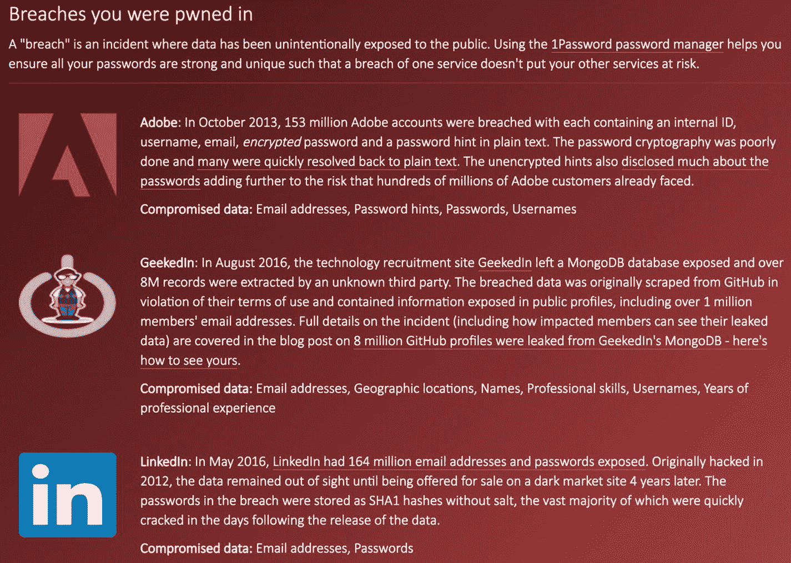
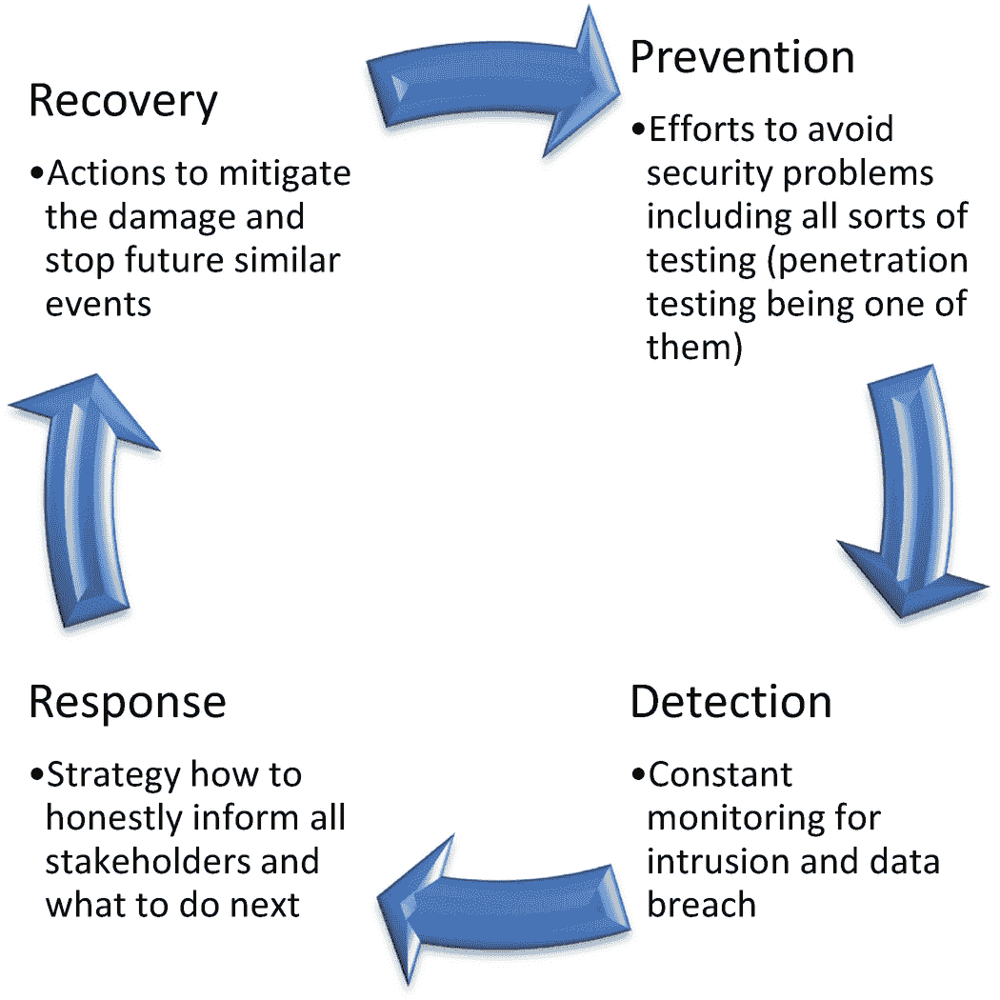
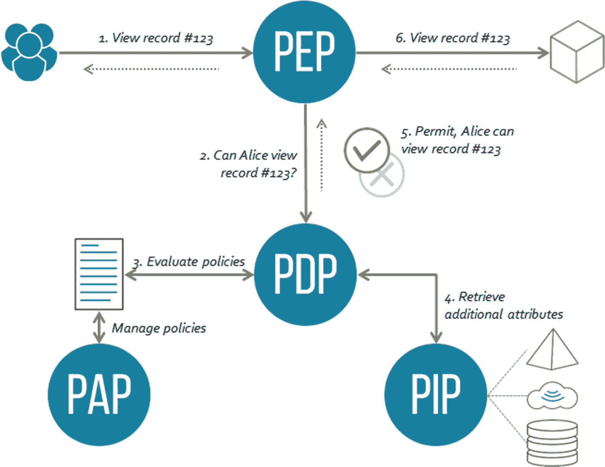
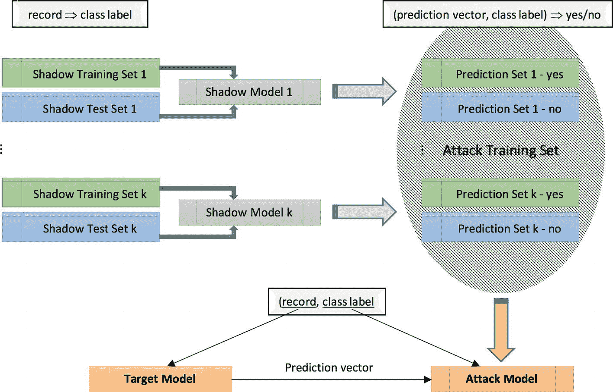
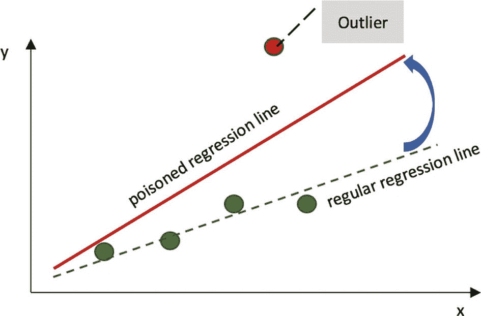

# 9. 数据安全

数据科学的核心是数据，而这不可避免地包含关于个人、组织、政府机构等的敏感信息。任何机密信息都必须以最高谨慎程度处理，并对恶意者保密。保护隐私与从数据中榨取价值是相互对立的力量，类似于在尽力优化软件系统性能的同时保障其安全性。一方改善，另一方就会削弱。作为数据科学家，我们既要确保数据得到妥善保护，又要保证数据科学产品能够抵御滥用及非预期使用（例如，防止其被用于通过推荐特定条目或说服用户以某种特定方式行动来操纵他人）。所有保护措施都应与数据科学产品的实用性良好配合；否则，开发该产品便毫无意义。

鉴于数据安全是广泛的安全工程领域的一部分，本章的目标仅是引导你关注那些你需要知晓的众多细节。本章包含大量小示例，以务实的方式解释概念。先从攻击类型及应对工具概览入手。接着，为让你了解需要关注的数据隐私法规类型，本章详细阐述了欧盟的《通用数据保护条例》（GDPR），该条例影响所有处理欧盟公民数据的解决方案。最后，本章讨论了如何保护机器学习模型以尊重隐私。

## 检查是否遭遇泄露

为理解隐私的实际含义，建议访问网站 `';--have i been pwned?`（[`https://haveibeenpwned.com`](https://haveibeenpwned.com)），输入你的电子邮箱地址，检查是否有账户在数据泄露事件中遭到入侵。你可能会对结果感到惊讶。图 9-1 展示了我其中一个邮箱的查询报告，显示了三起事件。报告甚至包含链接，指向详细解释泄露事件发生经过的文章。如果你的报告显示未发现泄露，建议务必点击链接阅读报告，了解“真实场景”中的运作方式。

**图 9-1**
显示与我的邮箱相关事件的报告

如果你的地址遭到“入侵”，主要存在两大问题：

*   由于安全措施不当，你的私人详细信息可能已泄露给恶意人员。

*   你从未联系过的第三方掌握了你的一些信息。以我为例，尽管我的邮箱被注册在 GeekedIn 系统中，但我从未访问过该网站；他们通过不当抓取公开的 GitHub 个人资料收集了关于用户的数据。

此案例凸显了收集个人数据的实体与提供个人数据的用户之间重要的相互责任。一方面，实体必须尽最大努力遵守安全标准；另一方面，用户必须了解相关风险，并遵循通用的互联网安全建议。例如，用户应知晓绝不在多个网站上使用相同的账号/密码组合（另请参阅参考文献[1]），绝不通过不安全的连接提供敏感数据，绝不点击可疑邮件中的链接（如何识别垃圾邮件和钓鱼网站本身就是一个话题），等等。现代世界中的计算要求所有参与者具备足够的安全意识。这就像在交通中作为行人一样，无论你是否持有驾照，都需要遵守基本规则。当然，若你立志驾驶机动车，则必须积累足够经验并取得合法驾照。某些大型车辆仅能由专业司机驾驶。数据科学领域亦是如此。随着你积累的数据越来越多，必须确保自身安全技能达到足够水平，因为潜在的数据泄露不仅影响你个人。数据科学的许多领域受到严格监管，公司需要从权威机构获取证书才能处理敏感数据。不同政府机构针对数据安全制定了各种不同的法律法规（下一节我们将以 GDPR 为例进行探讨）。请参阅参考文献[2]，了解一项覆盖整个网络的、旨在建立互联网透明度与自由的有趣倡议。

大多数数据科学产品通过 API 进行远程访问，这实现了高效的数据交换场景以及混搭应用的创建（见第 8 章）。在任何情况下，数据在传输中和静态存储时都必须受到保护。因此，外部网络通常是公共网络上的某种安全覆盖层（例如，安全的 HTTPS 通道、专用虚拟专用网络等）。互联网环境充满敌意，你的产品最终会成为攻击目标，尤其当它包含珍贵的机密数据时。

有许多组织致力于分享各种技术的最佳安全实践，你应该至少访问其中几个网站。例如，开放 Web 应用程序安全项目（OWASP）专注于通过推广成熟实践和标准来改善软件安全性（请访问 [`https://www.owasp.org`](https://www.owasp.org) ）。[SecTools.org](http://sectools.org) （ [`https://sectools.org`](https://sectools.org) ）将许多优秀的网络安全工具汇集在一处。（关于开发安全解决方案的良好概述，请参考参考文献[3]、[4]和[5]。）其他优秀的资源还有专注于开发安全产品的专业会议 SecAppDev（ [`https://secappdev.org`](https://secappdev.org) ），以及 ISO/IEC 27000 系列标准，该标准规定了组织保护信息资产安全的技术（请访问 [`https://www.iso.org/isoiec-27001-information-security.html`](https://www.iso.org/isoiec-27001-information-security.html) ）。

很多时候，你会依赖开源软件来实现你的数据科学产品（另请阅读边栏“OSS 供应链攻击”）。你已经接触过许多免费可用的 `Python` 数据科学框架。即使理论上你一切都做对了，仅仅通过使用第三方库，仍有可能在你的产品中引入安全漏洞。以下是一些在这方面可能有用的工具示例：

- `Burp Suite`（ [`https://portswigger.net`](https://portswigger.net) ）有助于发现 Web 安全问题。
- `Snort`（ [`https://www.snort.org`](https://www.snort.org) ）是一个入侵防御系统，能够实时监控网络并根据预定义规则采取行动。
- `Snyk`（ [`https://snyk.io`](https://snyk.io) ）自动化查找和修复依赖项中的漏洞。它支持多种编程语言，包括 Python。
- `Clair`（ [`https://github.com/coreos/clair`](https://github.com/coreos/clair) ）对应用容器中的漏洞进行静态分析（支持 Docker）。
- `Docker Bench for Security`（ [`https://github.com/docker/docker-bench-security`](https://github.com/docker/docker-bench-security) ）就如何使你打包的 Docker 应用程序更安全提供了宝贵建议。
- `Gitrob`（ [`https://github.com/michenriksen/gitrob`](https://github.com/michenriksen/gitrob) ）是一个帮助查找推送到 GitHub 公共仓库中的潜在敏感文件的工具。这种疏忽非常常见，尤其是在部署过程混乱的情况下。
- `Vault`（ [`https://www.hashicorp.com/products/vault`](https://www.hashicorp.com/products/vault) ）是一个用于解决 `Gitrob` 试图检测的问题的工具（参考上一项）。

### OSS 供应链攻击

开源软件（OSS）是一种新的攻击向量，其中社会工程学扮演着核心角色（参考[6]）。一个坏人通过向开源项目做出有价值的贡献开始他的旅程，直到获得项目发起人和其他贡献者的信任。一旦他获得了适当的凭证，他就会直接向开源组件的供应链植入漏洞。例如，曾发生过一起已知的 `PyPI`（SSH Decorator）被攻破事件，未来我们很可能会看到更多此类攻击。由于流行的开源框架下载量巨大，虚假代码的传播速度可能非常惊人。别忘了，如果你将开源组件整合到自己的数据科学产品中，你仍然要为产品的安全性承担法律责任；你是责任链的最后一环。因此，始终要检查你考虑使用的任何开源组件的安全状况。

应对这个问题的一种方法是抵制急于寻找最新版本 OSS 的诱惑。版本升级应该以可控的方式进行，可能由集中式企业风险管理（ERM）工具支持；一个好的选择是 `JFrog Artifactory`（参见 [`https://jfrog.com/artifactory`](https://jfrog.com/artifactory) ），它有一个免费的社区版。ERM 引入了一个重要的间接层，并且还可以通过缓存工件来提高可用性。开发人员应该只检索经 QA 部门批准的组件。

安全的许多方面都受到各种标准和工具的覆盖。图 9-2 展示了在数据科学产品生命周期中持续发生的四个全局类别的安全活动。还有安全模型可以作为组织安全工作的模板。例如，你可能想了解一下微软安全开发生命周期（ [`https://www.microsoft.com/en-us/sdl`](https://www.microsoft.com/en-us/sdl) ）。

图 9-2

处理安全事件的主要阶段

在一切正常运行时就提前计划好这些至关重要。例如，你必须在首次恢复尝试之前验证备份流程（假设你确实建立了这样一个流程，这是高优先级事项）。你对客户的回应必须在平静时期就制定好；永远不要试图掩盖问题！实际上，正如你稍后将看到的，`GDPR` 甚至强制要求按照第 33 条和第 34 条的规定进行适当通知（条款是 `GDPR` 中作为强制性规则处理的陈述）。

公司获取你信息的主要方式有三种：披露、收集和推断（另见参考文献[7]的第 10 节，并阅读边栏“什么是隐私？”）。让我们以推荐系统为例（在第 8 章中介绍）。如果你明确给一部电影评分，那么你就是在自愿披露信息。披露是最明显的数据收集形式，因为用户完全知情并控制着这个过程。收集则稍微特殊一些。也就是说，当你点击电影描述时，系统会记录这些事件并相应地更改你的个人资料。此外，*不*点击推荐的电影也是一个有用的输入，就像你在页面上阅读电影介绍所花的时间一样；观看预告片则是另一个强烈的信号，表明你被该项目所吸引。最后，推断相当神秘。它指的是机器基于看似无害的数据发现关于你的事实的能力。最大的挑战是如何控制这种推断出的信息，防止其被进一步滥用。换句话说，如果你是一些基本事实的所有者，那么你也应该保留对衍生值的所有权。参考文献[8]中给出了一个旨在解决这个难题的好提案。

### 什么是隐私？

术语 `privacy`（隐私）根据视角不同具有不同含义（即它是一个主观概念）。隐私的一个共同属性是与**控制**相关的预期。如果你从未同意接收未经请求的营销信息（电子邮件、短信、通知等），并且没有选择将自己的姓名从相应地址簿中删除的选项，你可能会认为这是一种隐私侵犯。从这个角度来看，**控制权的有无**决定了你是否会将那些信息归类为垃圾邮件。

在隐私级别与数据科学产品的实用性/能力之间存在一个微妙的临界点。在一个极端，只有不存在的（已删除的）数据才是绝对隐私的。当然，在这种情况下，你无法从数据科学服务中获得任何有价值的东西。例如，如果你从未在电影推荐网站上给任何电影评分或执行任何其他活动，那么当你获得完全非个性化的内容时，就不应感到惊讶。另一个极端是**公共数据**，它显然包含最高级别的信息内容，并且完全缺乏隐私。因此，数据科学领域的所有利益相关者都必须在**隐私与效用**之间取得平衡。如果用户能够保持控制权并改变他们关于隐私级别的决定，那么基础就得以妥善建立。

在她的著作 *Privacy in Context: Technology, Policy, and the Integrity of Social Life*（*情境中的隐私：技术、政策与社会生活的完整性*）（斯坦福大学出版社，2009 年）中，海伦·尼森鲍姆教授提出，隐私关乎**情境完整性**。在某些情境下，你假设你私下透露的任何个人信息都不会被以意想不到的方式使用，或在未经你授权的情况下被分享。例如，如果你告诉医生你的健康问题，你假设医生不会将这些细节分享给你的雇主。因此，任何与特定行为规范紧密相关的事物在某种程度上都是一种隐私。

## GDPR 简介

探究这部影响所有处理欧盟公民个人数据（包括在其大数据解决方案中）的组织的欧盟法律是很有趣的（也可以考虑观看[9]中的视频课程）。该法律既适用于总部位于欧盟的组织（无论数据处理发生在何处），也适用于处理欧盟公民数据的非欧盟组织（在本文其余部分，“欧盟”指欧盟和欧洲经济区国家）。GDPR 是先前数据保护法的一项渐进式演进，以适应近期的技术进步（例如物联网、大数据、电子商务等）。本质上，它是一部试图规范组织行为模式以确保它们尊重人们隐私的法律。作为一部法律，它受到当地数据保护机构的严格监督，这些机构负责追究数据安全漏洞的责任。其理念是促成具有共享数据隐私预期的可互操作数据科学解决方案。即使你不在欧盟国家工作，你的组织也有可能代表一家欧盟公司处理数据。此外，审视隐私如何被制定为法律也是有益的。GDPR 并非安全标准，因此如何实施的具体技术细节超出了本书的范畴。

GDPR 由两种类型的条目组成：99 条**条款**和 173 条**序言**。前者可近似视为业务需求，而后者则作为解释条款缘由的原则。我喜欢 [`https://gdpr-info.eu`](https://gdpr-info.eu) 上呈现 GDPR 的方式，它还有一种额外的**关键问题**元素类型（该类型描述了一些应用 GDPR 时的常见问题，并附有条款和序言的引用）。我建议你在研读 GDPR 时，始终打开**第 4 条**，因为它包含关键术语的定义（如数据主体、个人数据、控制者、处理者等）。

GDPR 的主要贡献在于将数据与**控制和处理方面**的权利进行映射，这体现在**序言第 1 条**？请参见 [`https://gdpr-info.eu/recitals/no-1/`](https://gdpr-info.eu/recitals/no-1/)：“在处理个人数据方面保护自然人是一项基本权利。”其理念是在人们的基本权利与自由同个人数据处理之间取得平衡，其中包括控制者的权利（任何决定对你的个人数据进行操作的组织的权利）。例如，如果一家公司拥有关于你的极其敏感的数据，那么数据泄露可能会危及你的一些基本权利，例如你保护私人生活和家庭生活的权利（想想那些受 2015 年 Ashley Madison 网站——一个为寻求婚外情的已婚人士提供的约会网站——黑客事件影响的用户）。

**第 5 条**规定了与个人数据处理相关的原则。从某种意义上说，这应该是你进入 GDPR 的切入点。**第 6 条**详细解释了**合法处理**的含义（处理个人数据有六种法律理由）。第 5 条和第 6 条涵盖了数据的基本类别。**第 9 条**还规定了特殊的个人数据类别以及更严格的处理规则。

### 注意

确保始终遵循记录完善的过程来处理与个人数据处理相关的任何决策。任何控制者都必须向监管机构证明已建立适当的治理机制，并且所有保护隐私的措施都得到严格遵守。这是**问责原则**的一部分。

#### 提示

遵守 GDPR 有助于优化你的数据处理流程。第 5 条第 1 款第 c 项就个人数据处理作出如下规定：“个人数据应充分、相关且仅限于实现处理目的所必需的范围（‘数据最小化’）。”因此，你将不得不重新审视静态数据和传输中数据的量级。无论数据安全要求如何，减少数据量都绝对是有益的。

数据主体可依据第 12-23 条向控制者发送与其数据相关的请求。这些请求可主张以下权利：

*   数据主体的访问权，包括获取所有数据及元数据的副本（例如，关于数据来源或处理方式的谱系信息）。
*   更正权，以便数据主体修正数据中的错误。
*   删除权（被遗忘权），以便即使在保留期结束前也可删除数据。当然，出于法律原因，某些删除请求可能无法满足。
*   限制处理权，直至错误数据得到修正或删除。
*   数据可携权，允许控制者之间高效地交换数据（例如，当数据主体选择以自动化方式将数据从一个控制者转移到另一个控制者），并保证能够以标准机器可读格式从控制者处接收数据。
*   反对处理权，该权利基于数据处理可能危及某些基本个人权利与自由的理由。
*   不受包括用户画像在内的自动化决策制约的权利。

控制者必须在一个月内对任何请求做出回应，且不得收费。毫无疑问，在可能的情况下，将许多任务自动化是划算的。一种特别危险的做法是，始终允许人们远程管理其个人数据。与此相关的第 63 条序言建议是：“在可能的情况下，控制者应能够提供对一个安全系统的远程访问，使数据主体能够直接访问其个人数据。”任何通过互联网的远程访问都会立即引发一系列安全问题，一个错误可能是灾难性的。

还有另一组条款，即第 24-43 条，规定了控制者与处理者的义务。这些可视为数据保护要求。第 32 条涉及处理安全，其中包含了控制者和处理者需要实施的具体技术与措施（例如假名化和数据加密）。为了更好地理解 GDPR 的信息安全措施，可将第 63 条序言视为第 32 条的简要总结：

> *为了维护安全并防止违反本条例的处理行为，控制者或处理者应评估处理过程中固有的风险，并实施措施来减轻这些风险，例如加密。这些措施应确保适当的安全水平，包括保密性，同时考虑到技术发展水平以及实施成本与要保护的个人数据的风险及性质之间的关系。在评估数据安全风险时，应考虑个人数据处理所带来的风险，例如意外或非法的破坏、丢失、篡改、未经授权的披露或对传输、存储或以其他方式处理的个人数据的访问，这些可能导致物理、物质或非物质损害。*
>
> ——《通用数据保护条例》(GDPR) 第 83 条序言

GDPR 倡导一种**以人为本、基于风险**的安全体系。理解这一点至关重要，因为任何绝对化的方法都必将失败。像 `ISO 27001`、`NIST` 等安全标准可能会为适当的技术提供指导，但在发生安全事件时，它们应结合对数据主体（而非组织）基本权利和自由的影响来应用。因此，GDPR 第 32 条的核心是风险管理，这是一个适用于任何软件开发项目的广泛主题。这里的主要区别在于，评估风险的严重性必须包括可能受到攻击影响的数据主体数量。此外，需注意数据量会影响风险的概率和影响，因此将风险简单地计算为概率、影响和数据量的乘积是不精确的。换言之，`risk = probability(volume) × impact(volume)`；这两个量都是数据量的函数，并且可能具有非线性关系。例如，你的系统存储的记录越多，它成为攻击目标的可能性就越大。此外，任何数据泄露的影响也会更大，因为会波及更多的数据主体。由于很难将这些量表示为实数，你可以改用序数（借鉴敏捷用户故事估算中的 T 恤尺码法）。例如，低概率和低影响的风险将具有低严重性。

### 注意

不要被数字蒙蔽。如果存在可能危及他人生命的威胁，则应适用最高风险等级。我之前已提到过 Ashley Madison 约会网站的数据泄露事件。至少有两人在数据曝光后自杀身亡，因此任何类似的系统都应将与数据盗窃相关的风险视为严重风险。

所有风险都应登记并存储在一个中心位置。它们应根据某种优先级策略来处理，这与从产品待办列表中选取用户故事的方式非常相似。关键区别在于，IT 团队需要与组织的治理/法律部门密切合作，而不是让产品负责人与客户沟通。以下是一个便捷的清单，可帮助避免忽视那些根据《通用数据保护条例》（GDPR）非常重要的风险：

图 9-3

该架构的主要组件包括策略执行点 (PEP)、策略决策点 (PDP) 和策略信息点 (PIP)，如 David Brossard 在 [*http://bit.ly/abac_architecture*](http://bit.ly/abac_architecture) 中所述。

*   你删除多余数据的能力是否可操作？GDPR 规定，所有数据必须在指定的保留期后或数据主体提出请求时予以删除。作为控制者，你必须注意在任何外部处理者（尤其是在欧盟之外）处强制执行和监督数据删除。

*   你是否存在自认为可能不符合 GDPR 的领域？这是一种特殊的风险类型，你应该根据条款编号来评估风险。换句话说，编号较低的条款比后续列举的条款更为重要。这意味着违反第 5 条中定义的核心原则比不遵守第 32 条更为严重。

*   你对处理者是否有足够的控制？你是否已安排好与处理者合同终止后的事宜？你必须注意在合同完成后取回数据或确保数据被完全擦除。

*   你是否规划了足够的能力来及时响应数据主体的请求？从某种意义上说，这是大多数组织已有的常规客户支持的延伸。

*   你的访问控制机制是否足够灵活，以支持所有与数据处理相关的用例？你可能希望应用一个基于属性的访问控制模型，该模型带有一个推荐的架构，如图 9-3 所示（另请参见参考文献 [10]）。

*   你是否有记录在案的响应计划？你必须在意识到数据泄露事件后的 72 小时内做出响应。当然，该事件可能发生得更早，但 72 小时的期限是从你意识到该事件时才开始计算的。即使在最初的这一期限之后，也应继续调查问题，以纳入防御机制来防止将来此类事件的发生。监管机构通常会协助决定是否以及如何联系数据主体。

*   对员工活动的监控是否符合 GDPR？员工也是组织内部的数据主体，因此过度收集他们活动的数据可能会引发隐私问题。

*   是否按照第 30 条的规定定义并实施了数据处理活动的审计？

参照图 9-2，`PEP` 可以是 `API` 网关的一部分，它拦截请求并将相应的授权请求传递给 `PDP`。`PDP` 根据预定义的策略决定是否批准每个请求。这些策略由另一个独立组件——策略编写点 (`PAP`) 进行编辑。`PDP` 可以从 `PIP` 收集额外的属性，`PIP` 是一个从各种外部来源收集属性的中心枢纽。

一个可行的启发式方法是研究公认的行业标准，并确保你的实践与类似企业相匹配。如果你打算开展与医疗保健相关的研究，那么你可能会在该领域找到许多同行公司。只需确保不要落后于它们。同样，这取决于具体情境，所以如果你处理的是 GDPR 中描述的特殊类别数据，请务必小心。

第 32 条还阐述了服务可用性对数据主体的影响。这正是领域驱动设计，尤其是微服务可以大显身手的地方。拥有单一数据库可能构成巨大的安全隐患，因为它可能成为单点故障（在此情况下，是数据泄露的目标）。微服务可以选择不同的技术来处理数据，因此针对特定技术的攻击范围将是有限的。微服务可以作为分布式系统提高可用性，从而实现分区的概念。最后，由于每个微服务负责一个专门的业务领域（即，具有明确限定的上下文），因此可以逐案选择适当的安全措施。例如，医疗保健系统可能拥有独立于核心服务的辅助分区，这些分区不需要与患者记录同等级别的保护。有关构建基于微服务的安全系统的更多信息，请观看参考文献 [5] 中的视频。

依赖微服务交付安全的数据科学产品的另一个好处，或者说积极副作用，是高度关注自动化和 DevOps 范式。集中式日志记录、监控和分布式追踪（全部由工具支持），以及主动执行健壮性和安全性测试（甚至在生产环境中），有助于遵守第 32 条，该条包含有关安全措施的操作意识和有效性的章节。这些默认情况下是 DevOps 文化的一部分，该文化支持在生产环境中运行大规模基于微服务的系统。

## 机器学习与安全

对人工智能 (AI) 系统的攻击是现实存在的。如参考文献 [11] 所述，研究人员成功修改了医疗保健领域 AI 系统所用图像上极为微小的一部分，从而欺骗系统认为存在某种健康问题，或者反过来。在参考文献 [12] 中，研究人员展示了图像识别技术如何以多种方式被欺骗。从机器学习 (ML) 模型中挖掘个人详细信息也是可能的。这给安全增加了另一个需要注意的维度。评估基于 ML 系统的安全风险的主要困难在于，我们无法确切掌握训练好的模型内部包含什么。这与模型的可解释性有关，而大多数模型（包括神经网络使用的模型）都很难理解。因此，无法保证训练好的模型能对某种逆向工程完全免疫。类似的推理也适用于 ML 算法（即，它们也是不同攻击的受害者）。

若想更详细地了解 ML 安全性这一主题，建议阅读参考文献 [13]。另一个极好的知识来源是 EvadeML 项目（访问 [`https://evademl.org`](https://evademl.org)），该项目旨在研究如何使 ML 方法在面对攻击者时更具鲁棒性。在接下来的几个小节中，我将介绍两种攻击类型及其工作原理：决策时攻击（针对模型的攻击）和训练时攻击（针对算法的攻击，通常称为*中毒*攻击）。为使文本更易读并适用于广泛的受众，我将在准确性方面稍作权衡，以使问题更易于理解。

### 成员推断攻击

我们来看一种黑盒攻击（发表于[14]），其目的是判断某个目标模型是否使用监督学习方法，并以给定的部分记录进行了训练。这个案例研究之所以有趣，是因为它利用机器学习的对抗性用途，训练了另一个能够对初始系统预测结果进行分类的机器学习系统。显然，机器学习被用来对抗机器学习，以从目标模型中挤压出信息。机器学习模型对此类攻击的脆弱性是普遍存在的。如今，像亚马逊、谷歌、微软和 BigML 这样的大型云提供商都在提供*机器学习即服务（MLaaS）*，他们的服务产品也容易受到此类攻击（实际上，它们正是[14]中所述攻击的主要目标）。因此，如果对机器学习的安全性抱有不切实际的期望，可能会使你的系统面临风险。当然，许多弱点是可以缓解的，前提是你意识到了这些问题。

其基本思路是向目标模型发送一个查询，并将其预测结果输入对抗系统。最终的输出将是一个信号，指示该查询中的数据是否属于训练数据集的一部分。发送查询并收集预测结果是唯一允许与目标模型进行的交互。（白盒攻击依赖于了解目标模型的内部结构细节，因此它比黑盒变体更容易解决。）其前提是，目标模型在接收到来自训练数据集的输入时的行为，与接收到系统从未见过的数据时的行为存在显著差异。从某种意义上说，这种攻击属于侧信道攻击家族。

我们为什么要关注这个呢？假设我们已经获得某人同意参与一个数据科学项目（同意是 GDPR 中处理个人数据的法律依据之一）。我们向她出示了隐私声明，声明她的数据将仅用于模型训练目的，并将永久安全保管。一旦她同意，任何来自成员推断攻击的潜在数据泄露都会自动成为隐私问题。如果我们的数据科学项目存储了特殊类别的数据，例如健康、财务或类似敏感领域的数据，那么我们必须对此潜在问题保持高度警惕。请注意，你不能声称这种泄露不是你的错，因为你使用的是商业云服务，从而逃避责任。根据 GDPR，作为数据控制者，你对处理者执行的任何数据处理行为负有完全的责任和义务。

这里的侧信道在哪里？在第七章中，我们讨论了过拟合模型的现象。当我们急切地试图减少训练预测误差时，就会发生这种情况。因此，模型会从训练集中拾取那些与泛化无关的微小细节。一个过拟合的模型，会因为你提供的是来自训练数据集的记录还是全新的记录而表现出不同的行为。成员推断攻击正是依赖这种行为差异来将输入分类为属于或不属于训练数据集（过拟合并非唯一可能性，但为简单起见，假设就是它）。显然，避免过拟合有助于防止成员推断攻击，而正则化是实现这一点的一种方法（详见第七章）。因此，改进我们的机器学习系统以获得更好的泛化能力，从安全角度来看也是有益的。

#### 影子训练

影子训练是一种独特的技术，其架构如图 9-4 所示。它与大卫·惠勒提出的*软件工程基本定理*产生了很好的共鸣：“计算机科学中的所有问题都可以通过增加一个间接层来解决。”在影子训练中，影子模型使用与目标模型相同的机器学习平台进行训练。目标系统对我们来说是完全不透明的，包括其私有的训练数据集。影子模型使用合成训练集进行训练。生成影子训练集的一个简单方法是依赖关于目标模型训练数据集来源总体的统计知识。更具体地说，我们需要知道各个特征的边际分布，然后从这些分布中进行采样。最终结果是在统计上有效的、代表目标模型私有训练数据集的样本。我们生成多个具有不同配置的影子模型以提高准确性。影子测试集也以类似方式生成。

第 i 个影子训练集用于生成第 i 个影子模型。该训练数据集包含记录及其真实标签。对于来自匹配训练数据集的每个输入，影子模型的输出都被添加到所谓的攻击训练数据集中（用于训练最终的攻击模型）。测试集则用于在攻击训练数据集中创建表示影子模型对未见数据响应的记录。

攻击模型是一个简单的二分类器，仅用于指示输入是否属于目标的训练数据集。实际上，攻击模型是一组模型，每个输出类对应一个模型（不过，这个细节目前并不那么重要）。要执行攻击，你需要将一个已知记录传递给目标模型，并收集其预测向量。这是一个概率向量，表示类别标签的分布。得分最高的标签被视为预测类别。攻击模型接收这个预测向量和真实的类别标签。这些就是它在训练过程中的输入（见图 9-4）。然后，攻击模型根据它认为给定记录是否属于目标训练数据集的一部分，输出“是”或“否”。

图 9-4

如[14]所述，影子训练过程的整体结构及其执行流程

### 投毒攻击

在此类攻击中，攻击者会修改训练数据集，从而使模型发生偏移。通常，每次修改都伴随着相应的成本。攻击主要分为以下四类：

- **标签修改攻击**：攻击者试图修改数据集中的标签。显然，这仅适用于监督学习方法。对于二元分类器而言，此类操作被称为*标签翻转*。
- **投毒插入攻击**：攻击者试图通过添加虚假记录来污染有限数量的任意特征向量。
- **数据修改攻击**：攻击者试图修改任意数量的记录（包括特征和标签）。
- **温水煮蛙攻击**：攻击者在每次训练迭代中逐步注入带毒记录。其思路是保持增量变化足够小，以避免被检测到。当然，随着时间的推移，累积效应可能非常显著。此攻击名称源自一则寓言：如果将青蛙放入温水中并缓慢加热，青蛙会被煮熟而不会跳出锅；但若直接将其投入沸水中，它则会立刻跳出来。

图 9-5 展示了一个简单线性回归模型如何因插入异常值而被误导的示例。在这种情况下，显而易见的补救措施是移除异常值，这也是一种良好的实践做法。

**图 9-5** 即便仅一个异常值，也可能使回归线严重偏离预期方向。

### 练习 9-1：研究隐私政策

Bitly（请参阅 `http://bit.ly`）是一款用于缩短长链接的热门服务。它还能让你跟踪链接的相关使用指标。该服务提供免费套餐，因此你可以开始尝试使用该网站。显然，由于它会收集你的信息（毕竟，你的自定义链接已经透露了大量关于你兴趣的信息），隐私是一个重要问题。

请阅读 Bitly 的隐私政策文档，网址为 `https://bitly.com/pages/privacy`。尽管是法律文本，但其风格平易近人。除了了解 Bitly 如何处理你的个人信息外，你还可以从中获得关于如何为自身数据科学产品构建类似文档的思路。

## 本章小结

数据保护是数据科学的核心，因为数据点是个人和组织的代理标志。网络攻击无处不在，随着智能设备承担更重要的职责，这个问题将变得更加普遍。本章仅触及数据安全的皮毛，旨在引导你关注这一重要领域。有大量免费资源可供你进一步扩展知识并积累安全工程经验。一个轻量级的框架是常识安全框架（`https://commonsenseframework.org`），你可以以此为基础来实现安全的解决方案。你还应尝试使用 `Foolbox`，这是一个用于生成对抗样本以欺骗神经网络的 Python 工具包。它附带大量代码片段，可用于尝试各种攻击（可在 `https://github.com/bethgelab/foolbox` 获取）。

作为一名数据科学家，你必须了解技术的局限性，尤其是其安全性方面。对可能影响人类决策的机器抱有不合理的信任是非常危险的。我们正处于人工智能时代的黎明，未来必将出现类似的攻击，并进一步揭示这些技术的可能性和弱点。紧跟学术界最新的 AI 研究至关重要，因为大多数新型攻击都会在已发表的研究论文中描述。

