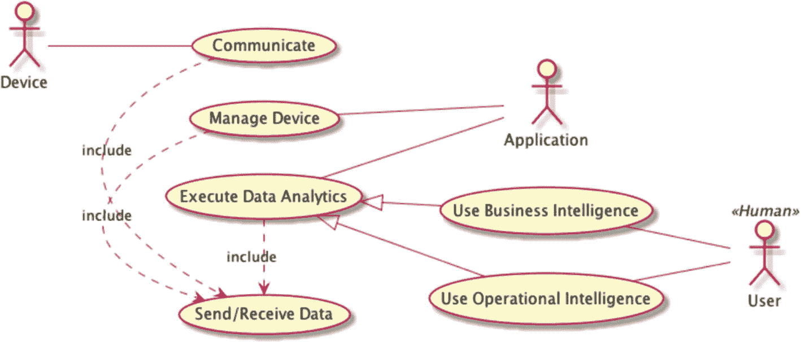
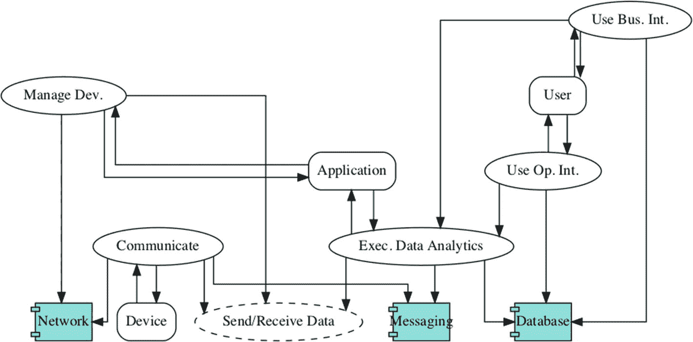
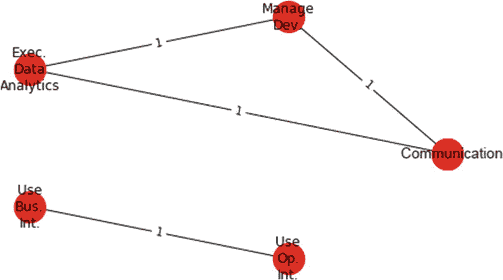
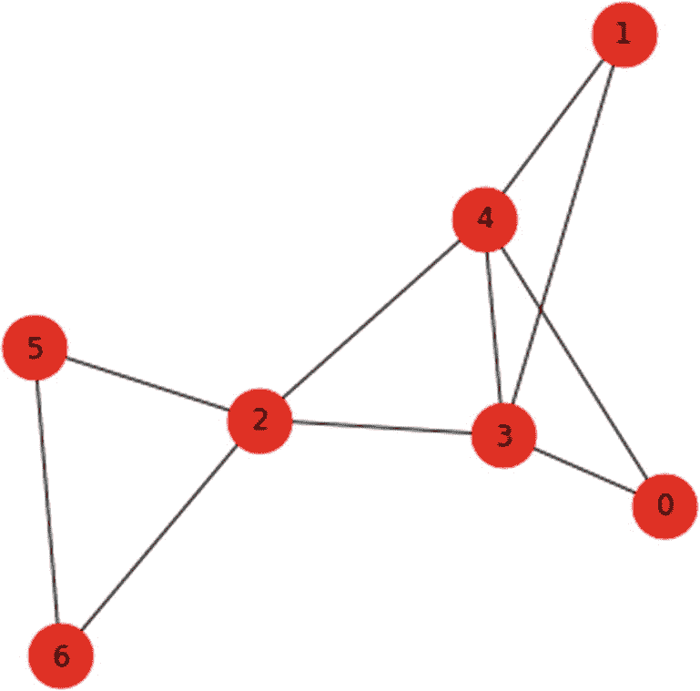
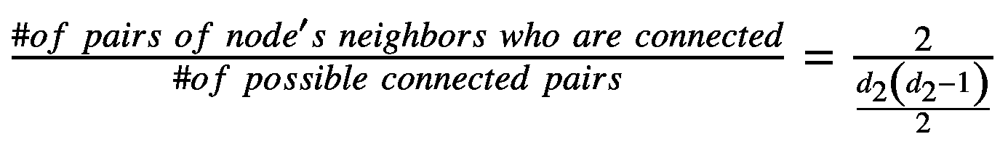
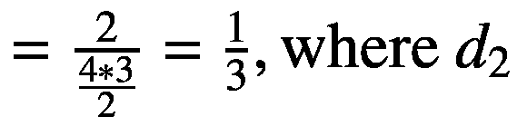
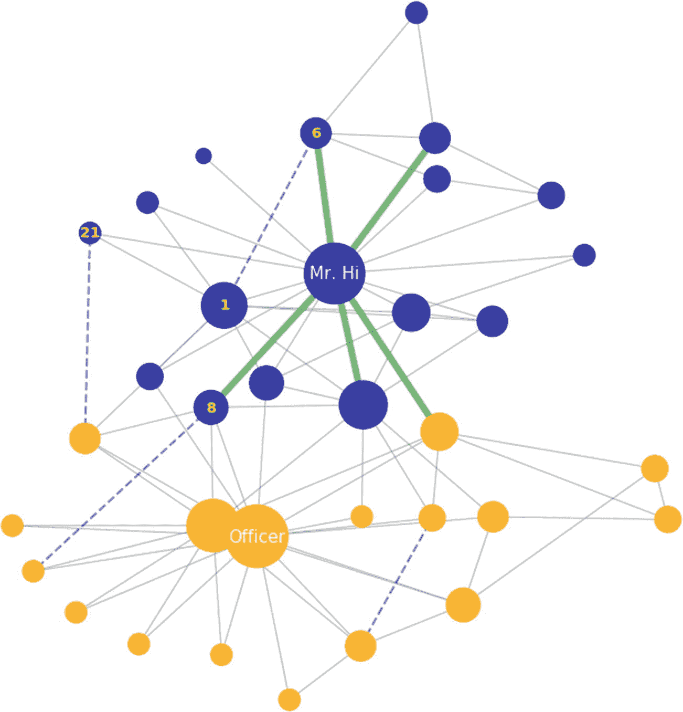

# 10. 图分析

图是表示不同类型网络（例如有向图、无向图、加权图、符号图和二分图）的主要数据结构。网络最自然地表现为一组节点以及节点之间的链接。社交网络是其中非常突出的一类网络。互联网是最大的现实世界网络，很容易被编码成图结构。此外，道路网络及相关路径规划算法同样基于图。本章介绍图的基本元素，展示如何使用强大的 Python 框架 `NetworkX` 来操作图，并举例说明如何将各种问题转化为图问题。本章还将揭示用于评估图及其关联网络特性的相关度量指标。我们将特别关注二分图及其对应的算法，如图投影。此外，我们还将介绍一些生成具有预定义属性的人工网络的方法。

将现实世界的现象表示为抽象网络（图）的主要原因在于，通过分析该网络的结构来回答关于目标领域的问题。例如，如果将城市表示为节点，城市之间的道路表示为链接，那么我们就可以轻松使用多种算法来计算城市之间的各种路径。其标准可以是寻找最短、最快或最便宜的路线。在社交网络中，发现最具影响力的人是一个有趣的问题，这可以映射到图中节点的中心性概念。能够将问题空间与匹配的图结构关联起来，就已经解决了问题的一半。

## 将使用矩阵视为图问题

理解图的类型和元素的最佳方法是使用 `NetworkX`（`https://networkx.github.io`）进行实践操作。图 10-1 展示了一个通用物联网平台的主要用例。假设你想使用名为 *使用矩阵* 的分析框架来优化系统。该框架为定位代码库调优机会提供了指导。该技术适用于许多场景，包括数据科学产品。表 10-1 描述了使用矩阵的模板。列表示各个用例或功能，行表示资源或数据节点。表 10-2 展示了使用矩阵的一个实例（其中的数值仅为说明该技术而虚构）。

对列 `j` 求和表示由该用例引起的所有资源访问的相对量。对行 `i` 求和表示由所有用例引起的对该资源的访问相对量。异常值标记了可作为优化候选的列/行集合；也就是说，根据边际递减定律，应优先对这些相应的用例和/或资源进行性能调优。特定单元格的值计算公式为 `a[ij] = freq[ij]*n[ij]*p[j]`，其中 `freq[ij]` 表示用例 `j` 关于资源 `i` 的频率（单位时间内用例 `j` 访问该资源的次数），`n[ij]` 表示每次访问的访问次数，`p[j]` 是用例 `j` 的相对优先级。

我们可以将优化任务重新表述为一个图问题。节点（顶点）是用例和资源，而链接（边）根据用例对资源的影响赋予权重。“影响”关系是单向的（从用例指向资源）。该图也展示了其他关系。例如，存在表示用例之间特定 `include` 和 `extend` UML 结构的有向边。最后，参与者也通过“交互”双向关系与用例相关联。总的来说，一个节点可能有多条并行链接的图被称为 *多重图*；我们的图是一个加权有向多重图。所有链接都是双向的且具有某种默认权重的图，则是无向图的一个例子。

现在，计算列/行总和的对应值就很容易了。具体来说，关联到一个资源节点的链接之和表示该行的总和（同理可用于用例节点）。我们也可以提出许多有趣的问题。参与者 1 对系统的使用是否比参与者 2 的使用对资源有更高影响？哪个参与者对资源的利用最密集？哪个参与者与最多的用例交互（直接或间接）？所有这些答案都可以通过使用已有的图算法处理底层图来获得。

### 表 10-2：使用矩阵模板的样本实例

| | 行总计 | 通信 | 管理开发 | 执行数据分析 | 使用商业智能 | 使用运营智能 |
| --- | --- | --- | --- | --- | --- | --- |
| 网络 | **615** | 120*1*5=600 | 5*3*1=15 | 0 | 0 | 0 |
| 消息传递 | **700** | 120*1*5=600 | 0 | 20*2*3=100 | 0 | 0 |
| 数据库 | **2660** | 0 | 0 | 30*10*3=900 | 40*10*2=800 | 80*3*4=960 |
| 列总计 | | **1200** | 15 | 1000 | 800 | 960 |

### 表 10-1：使用矩阵的通用模板

| | *UC*[1] | *UC*[*j*] | *UC*[*n*] |
| --- | --- | --- | --- |
| ***R***[**1**] | | | |
| ***R***[***i***] | | ***a***[**ij**] | |
| ***R***[***m***] | | | |



**图 10-1：** 物联网平台中的主要用例和参与者，以 UML 用例图形式呈现（更多信息请参见参考文献 [1]）。使用矩阵聚焦于用例及其对资源的影响。

表 10-2 中的具体数字是虚构的，并不重要。发送/接收用例未在表 10-2 中明确列出，因为它是其他用例的一部分。当然，你可以以不同的方式构建表格。无论如何，该用例将通过专用关系类型与其他用例关联。请注意，UML 的扩展机制与 Python 中的子类化不同，我们在这里不讨论继承。基于此表，我们可以看到优化数据库（可能对实时数据采集和分析使用不同的技术）是最有益的。

清单 10-1 展示了使用 `NetworkX` 生成匹配图的代码。请注意，我忽略了权重为零的边。该脚本非常简单，展示了使用 `NetworkX` 构建网络的便捷性。通常的惯例是使用大写字母命名引用图的变量。在执行清单 10-1 之前，你需要安装 `pydot`（在 shell 中运行 `conda install pydot` 来部署 `pydot`）。图 10-2 显示了生成的图（另请参见练习 10-1）。

```python
```

import networkx as nx

G = nx.MultiDiGraph()

##### 添加所有节点及其角色和标签。你可以直接使用标签，但使用简短的节点标识符可以让代码保持整洁。

G.add_node(0, role='use-case', label="通信")

G.add_node(1, role='use-case', label='管理开发')

G.add_node(2, role='use-case', label='执行数据分析')

G.add_node(3, role='use-case', label='使用商业智能')

G.add_node(4, role='use-case', label='使用运营智能')

G.add_node(5, role='use-case', label='发送/接收数据')

G.add_node(6, role="resource", label="网络")

G.add_node(7, role="resource", label="消息传递")

G.add_node(8, role="resource", label="数据库")

G.add_node(9, role="actor", label="设备")

G.add_node(10, role="actor", label="应用程序")

G.add_node(11, role="actor", label="用户")

##### 添加“影响”关系的边。

G.add_edge(0, 6, weight=600, relation="impact")

G.add_edge(0, 7, weight=600, relation="impact")

G.add_edge(1, 6, weight=15, relation="impact")

G.add_edge(2, 7, weight=100, relation="impact")

G.add_edge(2, 8, weight=900, relation="impact")

G.add_edge(3, 8, weight=800, relation="impact")

G.add_edge(4, 8, weight=960, relation="impact")

##### 添加“包含”关系的边。

G.add_edge(0, 5, relation="include")

G.add_edge(1, 5, relation="include")

G.add_edge(2, 5, relation="include")

##### 添加“扩展”关系的边。

G.add_edge(3, 2, relation="extend")

G.add_edge(4, 2, relation="extend")

##### 添加“交互”关系的边。

G.add_edge(9, 0, relation="interact")

G.add_edge(0, 9, relation="interact")

G.add_edge(10, 1, relation="interact")

G.add_edge(1, 10, relation="interact")

G.add_edge(10, 2, relation="interact")

G.add_edge(2, 10, relation="interact")

G.add_edge(11, 3, relation="interact")

G.add_edge(3, 11, relation="interact")

G.add_edge(11, 4, relation="interact")

G.add_edge(4, 11, relation="interact")

##### 使用 pydot 和 Graphviz 可视化生成的图形。

from networkx.drawing.nx_pydot import write_dot

##### 默认情况下，NetworkX 返回源图的深拷贝。

H = G.copy()

##### 为特定节点设置一些显示属性并提取标签。

node_labels = {}

for node_id in H.nodes():

    node_labels[node_id] = H.node[node_id]['label']

    role = H.node[node_id]['role']

    if role == 'resource':

        H.node[node_id]['style'] = 'filled'

        H.node[node_id]['fillcolor'] = 'cyan'

        H.node[node_id]['shape'] = 'component'

        H.node[node_id]['fixedsize'] = 'shape'

    elif role == 'use-case':

        H.node[node_id]['shape'] = 'oval'

    elif role == 'actor':

        H.node[node_id]['style'] = 'rounded'

        H.node[node_id]['shape'] = 'box'

H.node[5]['style'] = 'dashed'

nx.relabel_nodes(H, node_labels, copy=False)

pos = nx.nx_pydot.graphviz_layout(H)

nx.draw(H, pos=pos, with_labels=True, font_weight="bold")

write_dot(H, 'usage_matrix.dot')

**清单 10-1** `usage_matrix.py` 模块的内容

该脚本在当前目录下创建`'usage_matrix.dot'`文件。它包含使用 Graphviz ([`www.graphviz.org`](https://www.graphviz.org)) 渲染图形的指令。要生成最终图形，你需要安装此工具。在 shell 窗口中执行以下命令：

```
dot usage_matrix.dot -Tpng -Gsplines=ortho > usage_matrix.png
```

### 注意事项

建议你在添加视觉效果和重新标记节点之前复制一份图形（使用 `copy` 参数进行原地操作）。如果对此不仔细，你可能会花大量时间尝试理解代码其余部分（这些代码是使用之前的标签编写的）发生了什么。保持原始图形整洁，因为它应作为事实来源。



**图 10-2**

想象一下，如果你不能利用 NetworkX 和 Graphviz，需要花多少时间在这张图上。

对于基本绘图，你可以依赖内置的 matplotlib 引擎。但是，你不应该将其用于更复杂的绘图，因为，例如，在 matplotlib 中控制节点框的大小和形状相当繁琐。此外，正如你稍后将遇到的，Graphviz 允许你可视化图形并运行控制布局的算法。找出哪个资源受影响最大，归结为使用图的 `in_degree` 方法计算资源节点的度数（请记住边的方向性）。唯一需要注意的是，你必须指定 `weight` 参数（在我们的案例中，它将指向相关边的自定义 `weight` 属性）。在无向图中，你只需使用 `degree` 方法。

### 对立的质量属性

众所周知，你无法在一个产品中实现所有质量属性（完整列表请参见 [bit.ly/iso-25010](http://bit.ly/iso-25010) 的 ISO/IEC 25010:2011 质量模型）。因此，任何优化工作都必须在相互竞争的力量之间找到平衡。例如，可维护性支持可靠性，反之亦然。性能几乎与所有质量特性相竞争（这就是你应该避免过早优化以及由此产生不必要的意外复杂性的原因）。使用一种称为*符号图*的特殊图形来映射这些关系非常方便，这种图的边根据匹配节点是相互支持还是相互对立，分别用加号或减号标记。NetworkX 允许你将任意属性附加到节点和边（我们已经看到过类似的例子，如 `role`、`label`、`relation` 等）。清单 10-2 展示了如何对可维护性、可靠性和性能之间的相互关系进行建模（注意，这里处理的是无向图）。

```python
import networkx as nx

G = nx.Graph()

G.add_node(0, role='quality-attribute', label="可维护性")

G.add_node(1, role='quality-attribute', label="可靠性")

G.add_node(2, role='quality-attribute', label="性能")

G.add_edge(0, 1, sign='+')
```


`G.add_edge(0, 2, sign='-')`

`G.add_edge(1, 2, sign='-')`

```
清单 10-2 `signed_graph.py` 模块构建了质量属性之间的关系模型（参见练习 10-2）
```

### 将模型划分为二分图

图的一个重要类别是二分图，其中节点可以被划分为两个不相交的集合：`L`（左）和`R`（右）。边只允许连接不同集合中的节点；也就是说，不可以存在连接集合`L`或`R`中两个节点的边。例如，在推荐系统中，一组用户和一组电影构成了“`已评分`”关系的二分图。两个用户或两部电影之间互相评分是没有意义的。因此，只有当某个用户对某部电影进行过评分时，用户和电影之间才存在一条边。该边的权重即为实际的评分值。

现在，让我们在第一个多重图`G`中的`Communicate`用例和`Application`参与者之间添加一条新边（参见清单 10-1）：

```
G.add_edge(0, 10, relation="interact")
G.add_edge(10, 0, relation="interact")
```

这模拟了在联邦物联网网络中，一个物联网平台可以像虚拟设备一样运行的情况。即，它可以充当一组从属设备的聚合器，并从更高级别子系统的视角表现为一个新设备。参与者和用例的集合应形成一个二分图。清单 10-3 演示了使用 `NetworkX` 创建这种类型图的过程。这里，`bipartite.py` 通过只选择相关的节点和边，从原始多重图创建了一个二分图。（请注意，此代码假定你已经运行过 `usage_matrix.py`，因此所有设置均已就绪。）

```
from networkx.algorithms import bipartite

#### 按先前所述添加两条新边。
G.add_edge(0, 10, relation="interact")
G.add_edge(10, 0, relation="interact")
```


### 从 G 中选出所有参与 'interact' 关系的节点和边，并基于它们创建一个无向图。

```python
H = nx.Graph()
H.add_edges_from((u, v) for u, v, r in G.edges(data='relation') if r == 'interact')
```

#### 附加一个标记，用于指定哪些节点属于哪个组。

```python
for node_id in H.nodes():
    H.node[node_id]['bipartite'] = G.node[node_id]['role'] == 'actor'
nx.relabel_nodes(H, {n: G.node[n]['label'].replace(' ', '\n') for n in H.nodes()}, copy=False)
print("验证 H 是否为二分图：", bipartite.is_bipartite(H))
```

#### 这是一个图投影操作。这里，我们旨在找出哪些用例拥有共同的参与者。权重代表共同性因子。

```python
W = bipartite.weighted_projected_graph(H, [n for n, r in H.nodes(data='bipartite') if r == 0])
```

#### 在底层使用 `matplotlib` 绘制图形。

```python
pos = nx.shell_layout(W)
nx.draw(W, pos=pos, with_labels=True, node_size=800, font_size=12)
nx.draw_networkx_edge_labels(W, pos=pos,
    edge_labels={(u, v): d['weight'] for u, v, d in W.edges(data=True)})
```

```
清单 10-3 模块 `bipartite.py` – 从原始多重图创建二分图
```

NetworkX 并未使用独立的图类型来表示二分图。相反，它使用一种适用于常规图类型的算法。图 10-3 展示了加权投影图。



**图 10-3**

`Application` 参与者使用了图示为三角形的所有三个用例。因此，这三个用例都有一个共同的参与者。另外两个用例则由 `User` 参与者访问。

### 可扩展的图加载

到目前为止，我们纯粹通过代码构建了图。这对于小示例来说没问题，但在现实世界中，你的网络会非常庞大。更好的方法是直接从外部源（例如文本文件或数据库）加载图定义。在本节中，我们将研究如何结合 `Pandas` 和 `NetworkX` 来生成一个其结构保存在 CSV 文件中的图（另请参阅侧边栏“图序列化格式”）。

### 图序列化格式

图通常使用以下主要格式进行序列化：

- **邻接（关联）矩阵**：其结构与我们使用的矩阵非常相似，其中行和列表示节点。在行 `i` 和列 `j` 的每个交叉点，都有一个值 `0`（节点 `i` 和 `j` 之间不存在边）或 `1`（节点 `i` 和 `j` 之间存在边）。你可以在创建新图时将此矩阵作为初始化参数传入。这种矩阵不适合指定额外的节点/边属性，并且非常占用内存。图通常是稀疏的，因此会有很多占据空间的零值。

- **邻接列表**：每个节点对应一行。在一行内，包含邻居节点的标识符。这种格式节省空间，因为只列出了存在的边。孤立的节点则会有一个空行。使用这种格式无法定义额外的属性。`NetworkX` 有一个 `read_adjlist` 方法，用于读取以邻接列表形式保存的图。你可以通过指定 `nodetype` 参数将节点转换为指定的类型。`create_using` 参数是指向所需工厂的指针（例如，你可以强制 `NetworkX` 将图加载为多重图）。文本文件可能包含注释，可以通过为 `comments` 参数传递值来跳过这些注释。

- **边列表**：每一行代表一条边，包含源节点和目标节点的标识符。你可以附加其他项作为边的属性（如权重、关系等）。可以在专门的 `read_edgelist` 方法中为这些属性指定数据类型。请注意，仅凭这种格式无法表示孤立的节点。

- **GraphML**：这是一种全面的标记语言，用于表示各种类型的图（请访问[`http://graphml.graphdrawing.org`](http://graphml.graphdrawing.org)）。`NetworkX` 有一个 `read_graphml` 方法，用于读取以此文件格式保存的图。

我们将准备两个文件：`nodes.csv` 用于存储节点（参见清单 10-4），以及 `edges.edgelist` 用于描述边（参见清单 10-5）。第一个是 CSV 文件，我们将使用 `Pandas` 读取它，以便为节点附加属性。另一个文本文件是带有相应边属性的边列表。清单 10-6 展示了从这些文件加载图的完整代码（参见模块 `load_graph.py`）。`NetworkX` 有一个名为 `from_pandas_dataframe` 的方法，但你无法使用它来分配节点属性（它只支持边属性）。

```python
import networkx as nx
import pandas as pd

G = nx.read_edgelist('edges.edgelist',
    create_using=nx.MultiDiGraph,
    nodetype=int,
    data=(('weight', int), ('relation', str)))

df = pd.read_csv('nodes.csv', index_col=0)
for row in df.itertuples():
    G.node[row.Index]['role'] = row.Role
    G.node[row.Index]['label'] = row.Label

# 生成一份小型报告。
print("节点：\n", G.nodes(data=True), sep="")
print("-" * 20, "\n 边：\n", G.edges(data=True), sep="")
```

```
清单 10-6 – 从 `nodes.csv` 和 `edges.edgelist` 加载图的完整代码
```

# 为 `impact` 关系添加边。

0 6 600 `impact`
0 7 600 `impact`
1 6 15 `impact`
2 7 100 `impact`
2 8 900 `impact`
3 8 800 `impact`
4 8 960 `impact`

# 为 'include' 关系添加边。权重占位符设置为 1。
`0 5 1 include`
`1 5 1 include`
`2 5 1 include`

# 为 'extend' 关系添加边。

`3 2 1 extend`

`4 2 1 extend`

# 为 `interact` 关系添加边

```
9 0 1 interact
0 9 1 interact
10 1 1 interact
1 10 1 interact
10 2 1 interact
2 10 1 interact
11 3 1 interact
3 11 1 interact
11 4 1 interact
4 11 1 interact
0 10 1 interact
10 0 1 interact
```

清单 10-5 – `edges.edgelist` 以标准边列表格式存储边

```
Id,Role,Label
0,use-case,Communicate
1,use-case,Manage Dev.
2,use-case,Exec. Data Analytics
3,use-case,Use Bus. Int.
4,use-case,Use Op. Int.
5,use-case,Send/Receive Data
6,resource,Network
7,resource,Messaging
8,resource,Database
9,actor,Device
10,actor,Application
11,actor,User
```

清单 10-4 包含正确标题行的 `nodes.csv` 文件内容

运行此文件将产生以下报告，确认所有内容已正确加载：

```
Nodes:
[(0, {'role': 'use-case', 'label': 'Communicate'}), (6, {'role': 'resource', 'label': 'Network'}), (7, {'role': 'resource', 'label': 'Messaging'}), (1, {'role': 'use-case', 'label': 'Manage Dev.'}), (2, {'role': 'use-case', 'label': 'Exec. Data Analytics'}), (8, {'role': 'resource', 'label': 'Database'}), (3, {'role': 'use-case', 'label': 'Use Bus. Int.'}), (4, {'role': 'use-case', 'label': 'Use Op. Int.'}), (5, {'role': 'use-case', 'label': 'Send/Receive Data'}), (9, {'role': 'actor', 'label': 'Device'}), (10, {'role': 'actor', 'label': 'Application'}), (11, {'role': 'actor', 'label': 'User'})]

Edges:
[(0, 6, {'weight': 600, 'relation': 'impact'}), (0, 7, {'weight': 600, 'relation': 'impact'}), (0, 5, {'weight': 1, 'relation': 'include'}), (0, 9, {'weight': 1, 'relation': 'interact'}), (0, 10, {'weight': 1, 'relation': 'interact'}), (1, 6, {'weight': 15, 'relation': 'impact'}), (1, 5, {'weight': 1, 'relation': 'include'}), (1, 10, {'weight': 1, 'relation': 'interact'}), (2, 7, {'weight': 100, 'relation': 'impact'}), (2, 8, {'weight': 900, 'relation': 'impact'}), (2, 5, {'weight': 1, 'relation': 'include'}), (2, 10, {'weight': 1, 'relation': 'interact'}), (3, 8, {'weight': 800, 'relation': 'impact'}), (3, 2, {'weight': 1, 'relation': 'extend'}), (3, 11, {'weight': 1, 'relation': 'interact'}), (4, 8, {'weight': 960, 'relation': 'impact'}), (4, 2, {'weight': 1, 'relation': 'extend'}), (4, 11, {'weight': 1, 'relation': 'interact'}), (9, 0, {'weight': 1, 'relation': 'interact'}), (10, 1, {'weight': 1, 'relation': 'interact'}), (10, 2, {'weight': 1, 'relation': 'interact'}), (10, 0, {'weight': 1, 'relation': 'interact'}), (11, 3, {'weight': 1, 'relation': 'interact'}), (11, 4, {'weight': 1, 'relation': 'interact'})]
```

您还可以通过调用 `nx.non_edges(G)` 来遍历图 `G` 中不存在的边。返回节点 `n` 在图 `G` 中的非邻居的类似函数是 `nx.non_neighbors(G, n)`。

## 社交网络

描述社交网络的方法有很多种，但我们在本节中假设：*社交网络* 指的是任何人群网络，其中个体特征和关系对于理解现实世界的动态都至关重要。在数据科学中，我们希望从数据中产生可操作的见解。故事总是始于一个引人入胜的问题。为了推理现实并回答这个问题，我们需要一个模型。事实证明，将人表示为节点，将其关系表示为图中的边，是一个可行的模型。有许多指标可以评估图的各种属性（包括局部和全局）。从中我们可以推断出必要的规则并综合知识。此外，图的度量可以用作机器学习系统中的特征（例如，基于训练数据集中已知事实预测新链接的创建）。

清单 10-7 展示了一个简单的脚本，用于可视化来自图集的一个人工图（参见参考文献[2]），并呈现一些距离和中心性度量。关于图论的全面讲解，请阅读参考文献[3]和[4]。`NetworkX` 的文档是关于度量的额外信息的极好来源（请参阅有关算法的部分，您将在其中找到关于各种度量的子章节）。

```python
import pandas as pd
import networkx as nx
from networkx.generators.atlas import graph_atlas
import matplotlib.pyplot as plt

G = graph_atlas(681)

### Visualize the graph using the draw_networkx routine.
plt.figure(figsize=(5,5))
nx.draw_networkx(G, node_size=700)
plt.axis('off')
plt.tight_layout();
plt.show()

### Create a data frame to store various centrality measures.
df = pd.DataFrame(index=G.nodes())
df['lcc'] = pd.Series(nx.clustering(G))
df['eccent'] = pd.Series(nx.eccentricity(G))
df['deg-cent'] = pd.Series(nx.degree_centrality(G))
df['clos-cent'] = pd.Series(nx.closeness_centrality(G))
df['btwn-cent'] = pd.Series(nx.betweenness_centrality(G, normalized=True, endpoints=False))

print(df)
print('\nAverage clustering coefficient:', nx.average_clustering(G))
print('Transitivity:', nx.transitivity(G))
print('Radius:', nx.radius(G))
print('Diameter:', nx.diameter(G))
print('Peripherial nodes:', nx.periphery(G))
print('Central nodes:', nx.center(G))
```

清单 10-7 模块 `artificial_network.py`，演示一些局部和全局图度量

以下是此程序产生的文本输出，图 10-4 显示了结果图：



图 10-4

显然，您不能仅依赖单个度量来决定图的某个方面。

```
lcc  eccent  deg-cent  clos-cent  btwn-cent
0  1.000000       3  0.333333       0.50   0.000000
1  1.000000       3  0.333333       0.50   0.000000
2  0.333333       2  0.666667       0.75   0.533333
3  0.500000       2  0.666667       0.75   0.233333
4  0.500000       2  0.666667       0.75   0.233333
5  1.000000       3  0.333333       0.50   0.000000
6  1.000000       3  0.333333       0.50   0.000000
平均聚类系数: 0.761904761904762
传递性: 0.5454545454545454
半径: 2
直径: 3
外围节点: [0, 1, 5, 6]
中心节点: [2, 3, 4]
```

例如，节点 2、3 和 4 都具有相同的中介中心性。尽管如此，介数中心性优先考虑节点 2，因为它在网络中位于更多最短路径上。通过明智地选择和组合不同的度量，您可以得出良好的网络指标。

节点的*局部聚类系数*（`LCC`）表示该节点邻居之间相互连接的对数所占的比例。节点 2 的`LCC`为：


是节点 2 的度数。`LCC`体现了人们形成聚类的倾向；换言之，如果两个人之间存在连接，那么他们也倾向于相互连接（也称为*三元闭包*）。

节点 2、3 和 4 被认为是中心节点，因为它们到其他任意节点的最大最短路径（在我们的衡量标准中，即路径中的跳数）等于网络的半径。图的半径是所有节点中最小离心率的值。节点的*离心率*是该节点与所有其他节点之间的最大距离。图的*直径*是任意节点对之间的最大距离。外围节点的离心率等于直径。需要注意的是，这些度量与平均值一样，极易受到离群值的影响。通过在网络外围添加一连串节点，我们可以轻易地将中心节点向这些新节点偏移。这就是为何使用不同的中心性度量来描述社交网络更为合适。

*平均聚类系数*简单来说是各节点个体聚类系数的均值。*传递性*是另一种全局聚类指标，其计算方式为网络中三角形与*开放三元组*的比例。例如，由节点 2、5 和 4 组成的集合形成一个开放三元组（节点 5 和 4 之间缺失一条形成三角形的边）。传递性更看重高度数节点，这就是为什么它通常低于平均聚类系数（中心节点 2、3 和 4 因未形成三角形而受到更重的惩罚）。

中心性度量试图指示网络中节点的重要性。*度中心性*衡量一个节点与其他节点连接的数量；有影响力的节点通常连接密集。*紧密度中心性*认为重要的节点是那些与其他节点距离近的节点。*介数中心性*通过包含该节点的网络中最短路径的比例来定义节点的重要性。对于边也存在类似的介数中心性概念。

清单 10-8 介绍了社交网络中的一种“Hello World”——空手道俱乐部网络（这个网络非常著名，`NetworkX`已将其作为标准库的一部分），如图 10-5 所示。



**图 10-5**

空手道俱乐部社交网络，该图清晰地突显了俱乐部一分为二的分裂情况。节点的大小反映了它们的度数。最重要的五个连接以绿色高亮显示。虚线表示候选边。节点的颜色根据它们所属的俱乐部进行着色。

```python
import operator
import pandas as pd
import networkx as nx
import matplotlib.pyplot as plt

G = nx.karate_club_graph()
node_colors = ['orange' if props['club'] == 'Officer' else 'blue'
               for _, props in G.nodes(data=True)]
node_sizes = [180 * G.degree(u) for u in G]

plt.figure(figsize=(10, 10))
pos = nx.kamada_kawai_layout(G)
nx.draw_networkx(G, pos,
                 node_size=node_sizes,
                 node_color=node_colors, alpha=0.8,
                 with_labels=False,
                 edge_color='.6')

main_conns = nx.edge_betweenness_centrality(G, normalized=True)
main_conns = sorted(main_conns.items(), key=operator.itemgetter(1), reverse=True)[:5]
main_conns = tuple(map(operator.itemgetter(0), main_conns))
nx.draw_networkx_edges(G, pos, edgelist=main_conns, edge_color="green", alpha=0.5, width=6)

nx.draw_networkx_labels(G, pos,
                        labels={0: G.node[0]['club'], 33: G.node[33]['club']},
                        font_size=15, font_color="white")

candidate_edges = ((8, 15), (30, 21), (29, 28), (1, 6))
nx.draw_networkx_edges(G, pos, edgelist=candidate_edges,
                       edge_color='blue', alpha=0.5, width=2, style="dashed")
nx.draw_networkx_labels(G, pos,
                        labels={u: u for t in candidate_edges for u in t},
                        font_size=13, font_weight="bold", font_color="yellow")
plt.axis('off')
plt.tight_layout();
plt.show()
```

### Create a data frame to store various centrality measures.
```python
df = pd.DataFrame(index=candidate_edges)
```

### Add generic and community aware edge features for potential machine learning classification.
```python
df['pref-att'] = list(map(operator.itemgetter(2),
                     nx.preferential_attachment(G, candidate_edges)))
df['jaccard-c'] = list(map(operator.itemgetter(2),
                     nx.jaccard_coefficient(G, candidate_edges)))
df['aa-idx'] = list(map(operator.itemgetter(2),
                   nx.adamic_adar_index(G, candidate_edges)))
df['ccn'] = list(map(operator.itemgetter(2),
                nx.cn_soundarajan_hopcroft(G, candidate_edges, 'club')))
df['cra'] = list(map(operator.itemgetter(2),
                nx.ra_index_soundarajan_hopcroft(G, candidate_edges, 'club')))
```

nx.ra_index_soundarajan_hopcroft(G, candidate_edges, 'club'))
print(df)

## Listing 10-8

karate-network.py Module Exemplifying the Well-Known Karate Club Network (see Exercise 10-3)

运行此程序后，您将得到以下报告：

```
pref-att  jaccard-c    aa-idx  ccn       cra
8  15        10   0.400000  0.755386    2  0.000000
30 21         8   0.200000  0.455120    1  0.000000
29 28        12   0.166667  0.352956    2  0.058824
1  6         36   0.083333  0.360674    2  0.062500
```

列名指定了以下链接预测度量（顺序同上，从右至左）：

- `优先连接`：倾向于度数中心性高的节点。这就是节点`1`和`6`的得分远高于其他节点的原因。
- `Jaccard 系数`：公共邻居数除以邻居总数后的归一化值。
- `Adamic-Adar 指数`：分母中包含一个对数，与资源分配指数类似。对于节点`A`和`B`，该指数表示通过公共邻居的信息流分散程度。从某种意义上讲，想要连接的节点倾向于直接通信。如果公共邻居具有高度数中心性，那么这种信息流会被分散。
- `社区公共邻居数`：公共邻居的数量，对于属于同一社区的邻居会额外加分。
- `社区资源分配`：类似于资源分配指数，但只统计同一社区内的节点。注意，候选边`(9, 15)`和`(30, 21)`获得的社区资源为零，因为它们来自不同的空手道俱乐部。

在`NetworkX`中（在本文撰写时），还有另外三个真实的社交网络可用。您可以像我们在这里所做的那样，尝试使用它们进行分析。可视化部分可以轻松复用。

在研究社交网络时，生成逼真的网络模型是一个有趣的选择。这些网络旨在模拟所研究真实世界的相关属性。`NetworkX`内部提供了许多网络生成器，包括流行的优先连接模型（遵循`幂律`）和小世界网络（具有较高的聚类系数和较短的平均路径长度）。后者试图模仿`六度分隔`的概念。一旦拥有了一个模型，您就可以将其与来自真实世界的观测（样本）进行比较。如果模型的估计参数（如优先连接模型中的指数`α`和常数`C`）能很好地生成接近真实世界的网络，那么就可以利用图论和计算来分析真实世界现象。例如，您可以使用网络特征（如我们的度量指标）训练分类器，来预测未来连接的概率。

### 练习 10-1\. 美化显示的图网络，第一部分

`NetworkX` 与 `Graphviz` 结合使用，为您提供了丰富的选项来定制图的视觉外观。在图 10-2 中，关系类型或权重之间没有区分。以一种有意义的方式呈现这些信息会很有帮助。以下是一段代码片段，用于遍历有向多重图 `G` 中的边：
```python
for i, j, k in G.edges(keys=True):
    print(G.adj[i][j][k])
```

尝试设置边的视觉属性（我们已为节点设置了一些属性）。例如，你可以用不同的颜色标记关系，并将线宽设置为关系的权重。作为附加练习，尝试为演员节点附加自定义图像。这可以通过混入 HTML 内容并使用 `img` 标签引用图像来实现。

### 练习 10-2\. 美化显示的图网络，第二部分

基于在练习 10-1 中获得的经验，可视化一个有符号图（比如我们用来建模质量属性之间关系的那种图）。你可能希望为每条边显示加号或减号，并用不同的颜色进行标记。

你可以通过调用 `G.edges(data=True)` 来遍历无向图 `G` 的边，该调用会返回所有边及其属性。要显示符号，请使用 `G.edge[node_1][node_2]['sign']` 表达式，其中 `node_1` 和 `node_2` 是此边的节点标识符。

### 练习 10-3\. 生成一个 Erdös-Rényi 网络

阅读 `nx.generators.random_graphs.erdos_renyi_graph` 函数的文档，了解如何生成这种随机图。该模型以概率 `p` 选择每条可能的边，它是二项式图的同义词（因为它遵循伯努利概率分布）。

生成的网络与现实世界的网络并不相似（事实上，小世界网络模型在这方面也做得不够好）。尽管如此，该模型极其简单，并且二项式图被用作图论证明的基础。

## 本章小结

现实世界的网络规模巨大，因此它们需要比本文介绍的方法更具可扩展性的方法。一个可行的选择是利用斯坦福网络分析平台（SNAP）框架（访问 [`http://snap.stanford.edu`](http://snap.stanford.edu) ），它也有一个 Python API。存储大型图也是一个问题。有专门用于存储图的数据库系统以及更多图格式（其中大部分都由 `NetworkX` 记录和支持）。图数据库的一个可选方案是 Neo4j（参见 [`https://neo4j.com/developer/python`](https://neo4j.com/developer/python) ）。

图被用来判断现实世界网络（如万维网、交通基础设施、电网等）的鲁棒性。鲁棒性是一种质量属性，它表明网络在遭受故障或攻击（当节点和/或边消失时）保持其核心结构特性的能力。基本的结构特性是连通性。为此目的，`NetworkX` 提供了多个函数（用于评估节点和边）：`nx.node_connectivity`、`nx.minimum_node_cut`、`nx.edge_connectivity`、`nx.minimum_edge_cut` 和 `nx.all_simple_paths`。这些函数既适用于无向图也适用于有向图。图也是人工智能中各类搜索问题的基础。


