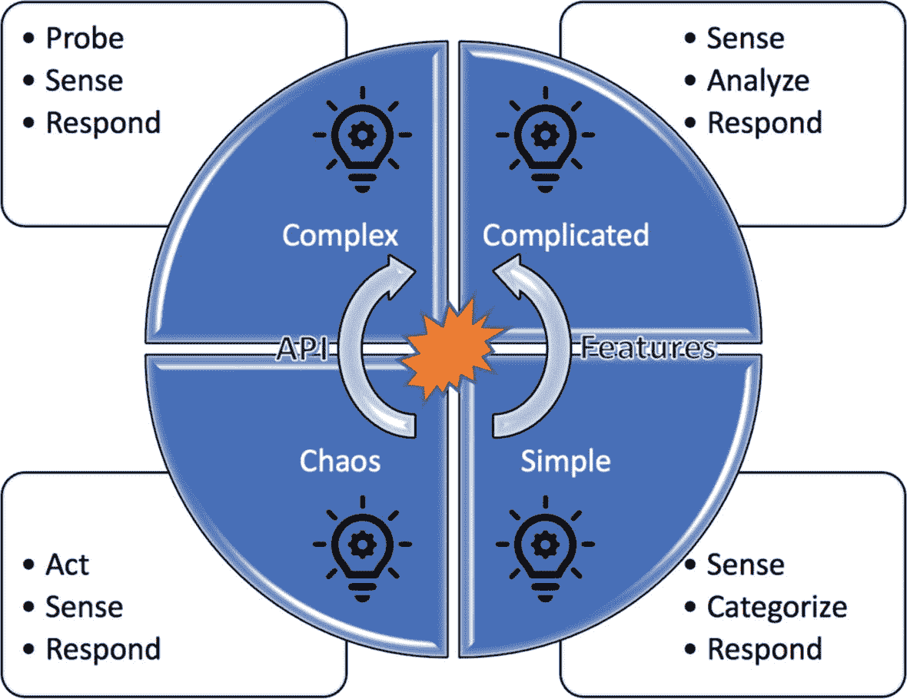
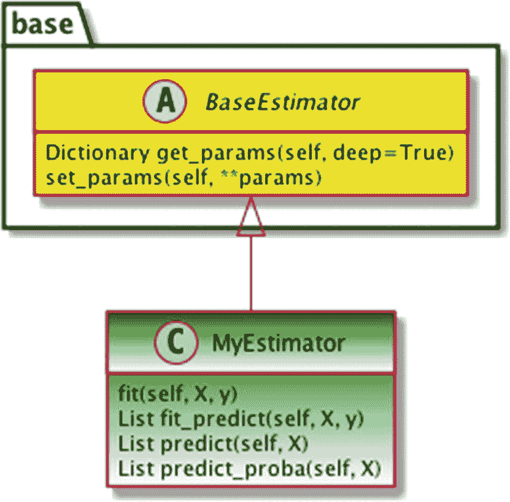
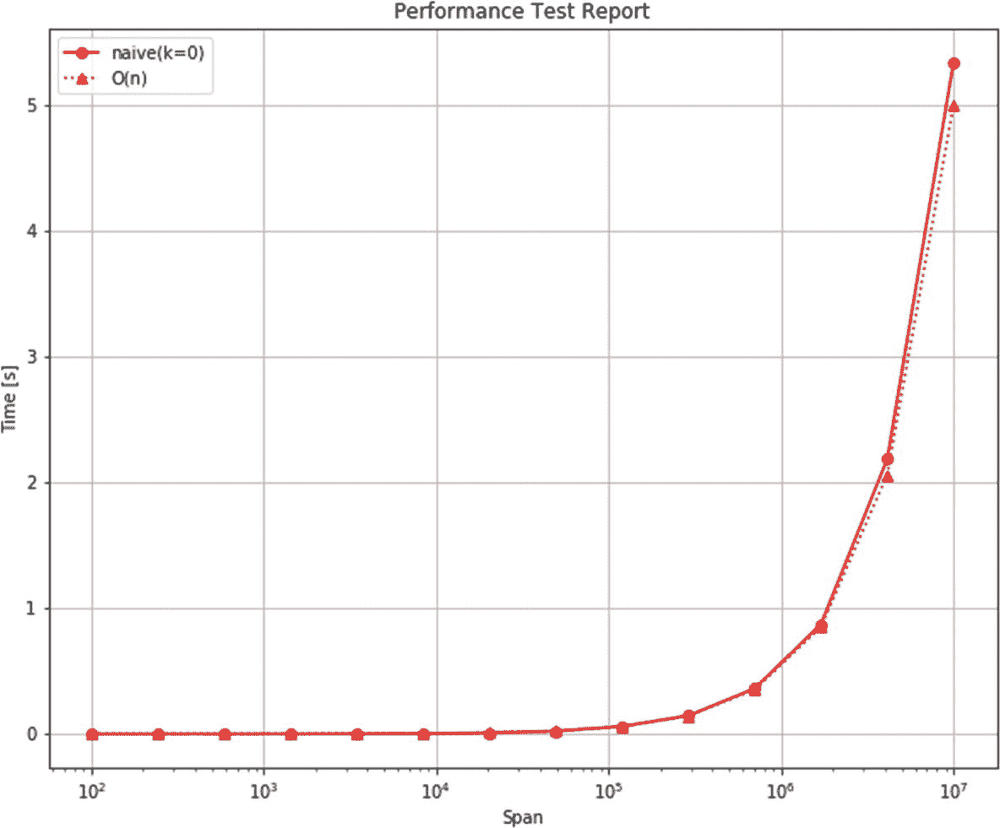
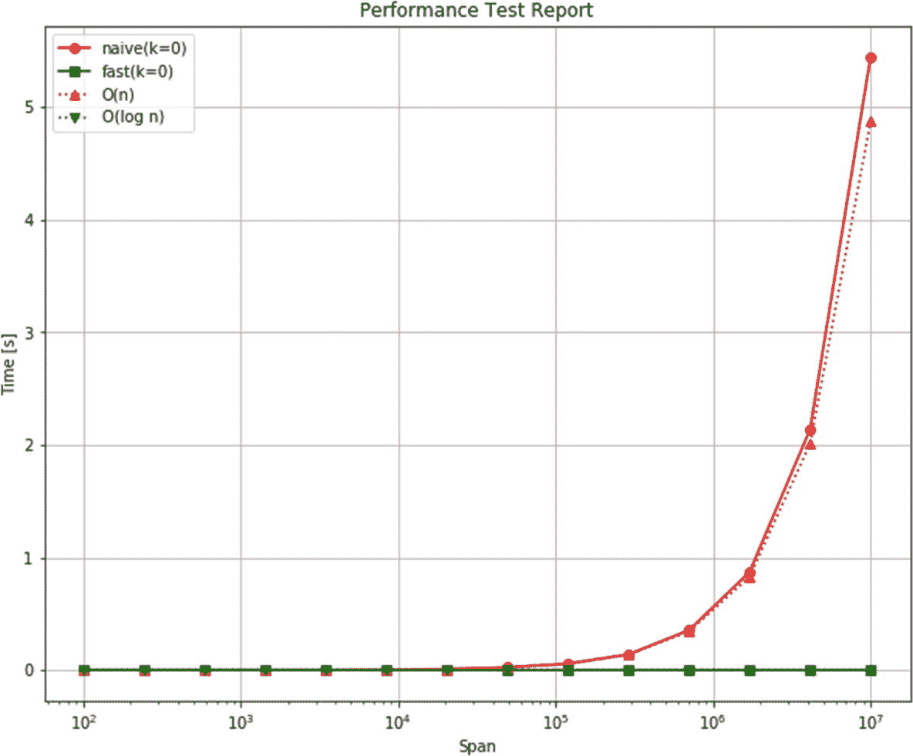
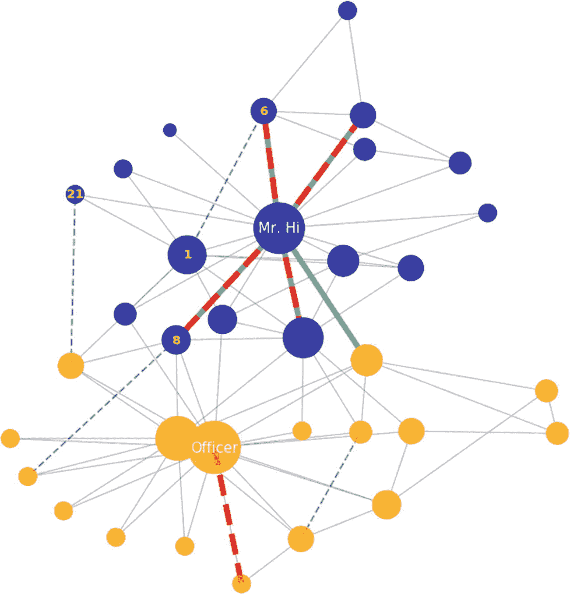
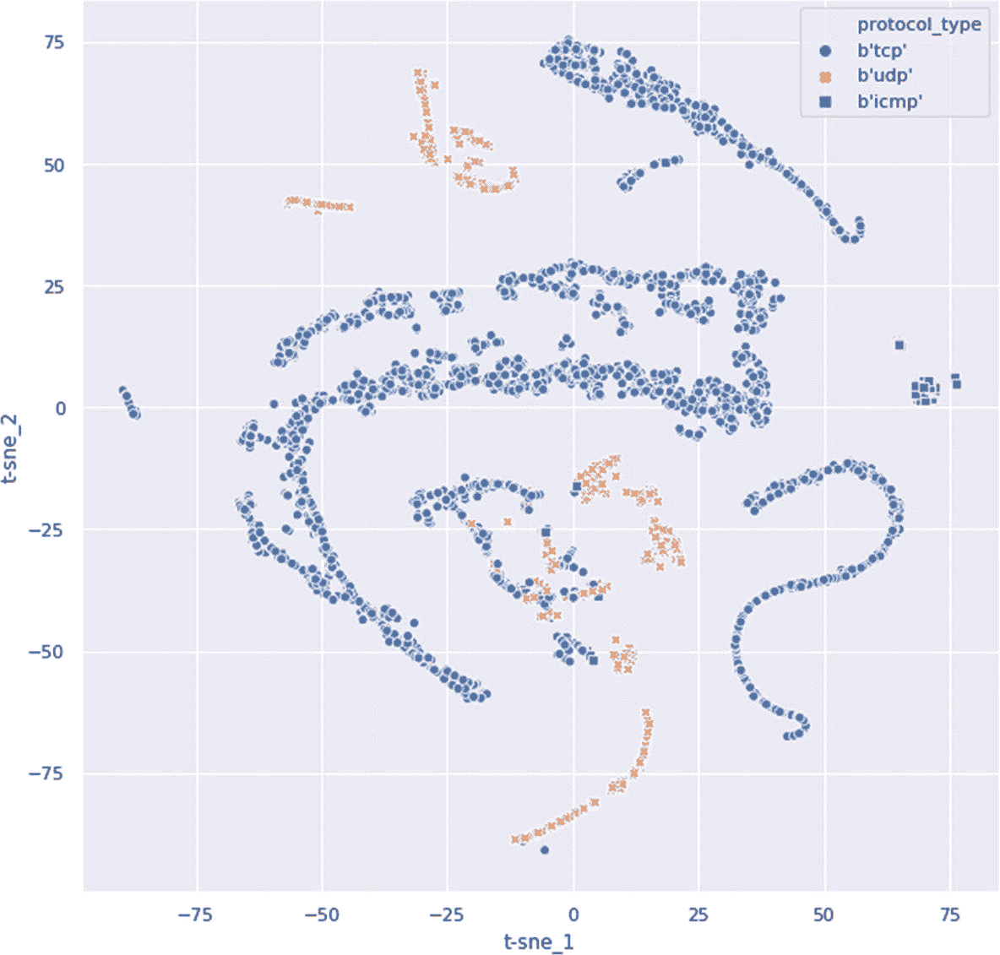

# 11\. 复杂性与启发式方法

作为数据科学家，您必须以经济的方式解决基本问题，同时考虑到所有约束条件和功能需求。最大的错误是对某种特定技术产生情感依赖，并试图寻找“合适”的问题来应用它；这充其量只是伪科学。当您试图采用某种复杂方法，而存在更简单、更优雅的方法时，也会出现类似的问题。我无数次看到这两个反复出现的主题。例如，逻辑回归（一种直观的技术）在分类任务中通常可以胜过核化支持向量机，而特征工程中的一点小聪明可能完全省去了使用不透明的神经网络方法的需要。从简单开始并保持简单，或许是给任何数据科学家最好的建议。为了实现简单，您必须投入大量的精力和时间，但最终的结果将是超值的（尤其是在考虑长期效益时）。与简单相伴的是实用主义——在大多数场景中，足够好通常比完美更好。本章将举例说明对简单和实用主义的偏好，并让您了解复杂性和启发式方法的概念。它包含许多小型用例，每个用例都突出了与数据产品的简洁性和有效性相关的特定主题。

在解决问题的同时完全满足客户需求需要两件事：一般的解决问题能力，以及一套将寻找解决方案置于更广阔背景下的规则和原则。前者围绕以下四个步骤（参见参考文献 [1]），如果后来产品添加了新功能，这些步骤通常构成一个永无止境的循环：

1.  理解问题
2.  制定计划
3.  执行计划
4.  回顾并反思结果

许多从业者都熟知并理解这一策略。通常较少被认识到的是，定义并接受一个框架的重要性，该框架将在解决问题的努力中提供系统性指导。我更喜欢 Cynefin 框架（如图 11-1 所示），它是一个用于辅助决策的概念模型。问题解决与决策之间存在紧密关联，因此形成一个处理这两个主题的组合体至关重要。了解框架的当前领域有助于您选择最佳策略；您可能更倾向于在*复杂*领域内选择启发式方法，而在*简单*领域内则不愿应用此类方法。**启发式**是一种技术，您用它来交换一个绝对确定且精确的解决方案，换成一个能充分完成任务的方案。令人惊讶的是，近似解的表现通常与完全计算出来的方法一样好。有时，输入数据本身噪声很大，以至于超过某个阈值的精确度已毫无意义。



图 11-1 Cynefin 框架的四个象限（中心是混沌）：简单、繁杂、复杂和混乱

如果没有情境意识，您就会陷入无序状态并做出错误判断。应用 Cynefin 框架还会带来一个伴随的结果。也就是说，要了解您当前的领域，您必须思考测量和度量。例如，达到一个合适的性能特征可能会将您从*简单*领域转移到*繁杂*或*复杂*领域。但是，您会知道为什么在那里，以及您手头有哪些选项。换句话说，您需要就切换决策边界做出深思熟虑的决定。

## 从简单到复杂：应用 Cynefin 框架方法

在图 11-1 的中心区域有一个被称为"混乱"的特殊区域；它代表了你尚不清楚问题所属域的情况，因此需要进一步探索。每个象限都对应一种独立的问题解决方法。简单域要求采用最佳实践，强调该领域已被充分掌握。复杂域需要良好实践，有时可能成为最优解。复合域指向解决方案的涌现特性，你可以运用各种启发式方法找到合适的解决方案。混沌域要求立即采取行动，事后才分析因果关系。请注意，该框架对"复杂"和"复合"两词的定义与《Python 之禅》相反（如图[3-2](https://doi.org/10.1007/978-1-4842-4859-1_3Fig#2)在第三章所示："复合优于复杂"）。

情况会随时间变化，可能导致不同域之间的迁移。新的需求和约束需要不同的解决方案，因此转换会以逆时针方向进行。随着获得更多知识和经验，你可以设计出更简单的解决方案，从而以顺时针方向向其他域移动。通过引入应用程序编程接口形式的强大抽象来隐藏复杂性，是简化客户端事务的有效策略。这意味着不同利益相关者会从不同视角看待整个问题-解决方案空间。最典型的例子可能是 scikit-learn 的通用估计器 API。你可以统一管理多种机器学习算法，无需关心底层实现细节，如图 11-2 所示。



图 11-2 估计器是处理模型训练与使用的对象

基类 `BaseEstimator` 实现了辅助方法，用于获取和设置估计器实例的参数。`fit`、`fit_predict`、`predict` 和 `predict_proba` 方法构成了统一 API 的一部分，允许你以相同方式处理不同估计器。`MyEstimator` 遵循 Python 的鸭子类型约定，提供一致的接口。

### 从简单到复杂

本节提出应对复杂域的三大策略：改进算法的渐近运行时间、应用随机化与采样、以及使用并行/分布式计算。在构建下一个数据科学产品时，这些都应成为可选方案。从最简单的解决方案开始并逐步优化至关重要。为此你需要完整的性能测试工具，此处将进行演示。我选择接下来几个示例，是因为它们既足够简单又能阐明核心要点。

#### 统计数字出现的次数

假设需要统计区间[1, n]内数字 `d` 出现的次数，其中 *n*∈ℕ∧*n*≤10⁵⁰。你可以从清单 11-1 所示的朴素方法开始。不要低估这种暴力程序的价值。它能为更高级的解决方案提供良好的测试生成器（真实数据的来源）。

```python
k, n = tuple(map(int, input().split()))

def count_occurrences_digit_naive(k, n):
    k = str(k)
    count = 0
    for i in range(n + 1):
        count += str(i).count(k)
    return count

print(count_occurrences_digit_naive(k, n))
```

**清单 11-1**  
当`n`小于 10⁷ 时表现合理的简单算法

根据非功能性需求（用户不应等待数十年才获得结果），我们显然不能接受这个程序。它运行时间大致呈线性，实在太慢，因此必须像 Cynefin 框架建议的那样超越简单情况。此时正是围绕性能测试构建适当基础设施的时机。测试数据输入到产品中也需要类似工作，这正是数据工程的一部分。我们将使用可视化来追踪时间测量结果。清单 11-2 展示了用于比较不同程序变体的工具。函数以粗体显示构成了此脚本的可重用部分。驱动程序代码位于末尾的条件块中。你只需提供适当的配置。`attach_model`函数会找到与基础模型匹配的正确常数。

```python
import time

import numpy as np

import pandas as pd

def measure(f, num_repetitions=5):

    measurements = np.array([])

    for _ in range(num_repetitions):

        start = time.clock()

        f()

        measurements = np.append(measurements, time.clock() - start)

    return measurements.mean()

def execute(config):

    execution_times = {}

    for config_name in config['functions']:

        execution_times[config_name] = np.array([])

    for x in config['span']:

        for config_name in config['functions']:

            execution_times[config_name] = np.append(

                execution_times[config_name],

                measure(lambda: config['functions'][config_name](x)))

    return execution_times

def attach_model(execution_times, config, function_name, model_name):

    model_vals = np.vectorize(config['models'][model_name])(config['span'])

    c = np.mean(execution_times[function_name] / model_vals)

    execution_times[model_name] = c * model_vals

def report(execution_times, x_vals, **plot_kwargs):

    df = pd.DataFrame(execution_times)

    df.index = x_vals

    ax = df.plot.line(

        figsize=(10, 8),

        title='Performance Test Report',

        grid=True,

        **plot_kwargs

    )

    ax.set_xlabel('Span')

    ax.set_ylabel('Time [s]')

    return df

if __name__ == '__main__':

    from count_occurrences_digit_naive import count_occurrences_digit_naive

    config = {

        'functions': {

            'naive(k=0)': lambda n: count_occurrences_digit_naive(0, n)

        },

        'models': {

            'O(n)': lambda n: n

        },

        'span': np.geomspace(10**2, 10**7, num=14, dtype=int)

    }

    execution_times = execute(config)

    attach_model(execution_times, config, 'naive(k=0)', 'O(n)')

    print(report(execution_times, config['span'], logx=True, style=['-ro', ':r^']))

```

**清单 11-2**  
用于追踪时间测量结果并可视化的性能测试工具

执行此代码后，你将获得以下报告以及折线图，如图 11-3 所示：



**图 11-3**  
朴素算法及其关联的 `O(n)` 模型的运行时间折线图。x 轴采用对数刻度。

```
naive(k=0)      O(n)
100         0.000073  0.000050
242         0.000111  0.000121
587         0.000251  0.000293
1425        0.000608  0.000712
3455        0.001539  0.001725
8376        0.003793  0.004183
20309       0.009700  0.010141
49238       0.023221  0.024587
119377      0.060661  0.059611
289426      0.145676  0.144526
701703      0.361976  0.350397
1701254     0.872631  0.849525
4124626     2.182770  2.059641
10000000    5.334004  4.993522
```

`O(n)` 模型略微低估了实际复杂度，因为代码清单 11-1 的循环体确实依赖于输入规模。尽管如此，当输入规模非常大时（此时运行时间更适合建模为 `O(n log n)`），我们甚至无法等待测试完成。

代码清单 11-3 展示了一个快得多的 `O(log n)` 算法，它通过分析区间 `[1, 10^i - 1]`（`∀ i ∈ ℕ ∧ i ≤ 50`）中数字位数的重复模式得出。数字 1 到 9 遵循相同的模式，而数字 0 略有不同（需要忽略前导零，因此公式更具挑战性）。将驱动程序代码修改为包含这种更快变体后，我们得到了如图 11-4 所示的折线图。执行时间上的差异确实令人震惊。你可以调整测试运行以覆盖完整范围（应省略朴素算法，因为当 `n > 10⁷` 时，其性能无法接受）。将代码推广到处理任意进制（如 16 进制）并不困难。



**图 11-4**
新算法的执行时间极小，以至于在此尺度下均显示为零。`O(log n)` 模型与测量值完全吻合。

```python
def setup():
    MAX_EXPONENT = 50
    # 存储数字 k 在区间 [0, (10**i) - 1] 中出现的次数，i > 0。
    # 如果区间是部分的（复合键的第一部分为 False），则忽略前导零（这是 k == 0 时的特殊情况）。
    table_of_occurrences = {(False, 0): 0, (False, 1): 1,
                            (True, 0): 0, (True, 1): 1}
    for i in range(2, MAX_EXPONENT + 1):
        table_of_occurrences[(True, i)] = i * 10**(i - 1)
        table_of_occurrences[(False, i)] = \
            10**(i - 1) + 10 * table_of_occurrences[(False, i - 1)] - 10
    return table_of_occurrences
```

## 估计边介数中心性

在第 10 章的图分析部分，我们研究了社交网络中的一些中心性指标，其中就包括边介数中心性。精确计算该指标需要大量 CPU 资源。当网络规模庞大，且只需求得足够好的结果时，**采样**是一个可行的选择。其思路非常简单：基于 N 个样本而非整个网络来计算指标。这通常能给出几乎相同的结果，但耗时大幅缩短。`NetworkX` 已内置对此方法的支持。

**代码清单 11-4** 展示了对比绝对准确结果与采样结果的代码。你可以尝试调整代码，增加样本数量。显然，随着样本量增加，结果会更精确，但运行时间也会增加。你需要通过实验找到最佳平衡点。

```python
import operator
import networkx as nx
import matplotlib.pyplot as plt

G = nx.karate_club_graph()
node_colors = ['orange' if props['club'] == 'Officer' else 'blue'
               for _, props in G.nodes(data=True)]
node_sizes = [180 * G.degree(u) for u in G]

plt.figure(figsize=(10, 10))
pos = nx.kamada_kawai_layout(G)
nx.draw_networkx(G, pos,
                 node_size=node_sizes,
                 node_color=node_colors, alpha=0.8,
                 with_labels=False,
                 edge_color='.6')

### 计算绝对的边介数中心性。
main_conns = nx.edge_betweenness_centrality(G, normalized=True)
main_conns = sorted(main_conns.items(), key=operator.itemgetter(1), reverse=True)[:5]
main_conns = tuple(map(operator.itemgetter(0), main_conns))
nx.draw_networkx_edges(G, pos, edgelist=main_conns, edge_color="green", alpha=0.5, width=6)

### 通过采样 40% 的节点来估计边介数中心性。
NUM_SAMPLES = int(0.4 * len(G))
est_main_conns = nx.edge_betweenness_centrality(G, k=NUM_SAMPLES, normalized=True, seed=10)
est_main_conns = sorted(est_main_conns.items(), key=operator.itemgetter(1), reverse=True)[:5]
est_main_conns = tuple(map(operator.itemgetter(0), est_main_conns))
nx.draw_networkx_edges(G, pos, edgelist=est_main_conns,
                       edge_color='red', alpha=0.9, width=6, style="dashed")
```

*为简洁起见，仅重复代码的第一部分，该部分与原始版本略有不同。请注意使用 40% 节点评估 `est_main_conns` 的部分。空手道俱乐部网络非常小，采样在大型网络中才真正有效。但原理是相同的。*

请注意，我设置了 `seed` 参数。这对于其他人使用随机化方法复现结果至关重要。图 11-5 展示了新图。



红色的虚线边是通过采样计算得出的。其中大部分与原始边重合，只有一条被误判。

本案例研究展示了如何用准确性换取更好性能。这种随机化方法属于**蒙特卡洛方法**。**拉斯维加斯模型**总能产生准确结果，但在极少数情况下可能运行较慢（快速排序就是一个很好的例子）。无论如何，新代码在不依赖计算集群的情况下运行得更快（参见练习 11-2）。

## 可整除数的计数

假设你需要找出区间 `[a, b]`（其中 `0 < a < b < 10¹⁸`）内所有能够被自然数 `c ≤ 10¹⁸` 整除的自然数。清单 11-5 展示了解决该问题的 `num_divisible` 函数。该函数的运行速度已接近极限，这意味着你无法显著加快其速度。如果没有额外的需求，比如以下两点，你甚至可以在此时停止：

- 你需要处理的海量三元组 `(a, b, c)` 数量巨大。
- 这些数据无法同时存入内存。

这些条件是很好的信号，表明有必要考虑技术层面的转变，此时应用并行和分布式计算确实合情合理。你可以利用 `Dask` 框架来处理与上述约束相关的用例。

**代码清单 11-5** 阐释了利用 `Dask` 数组背后的核心思想。示例精简到了最核心的要素，以便你更容易理解底层机制（例如，在实际操作中你会处理更大的数据块）。

`Dask` 提供了用于并行化自定义应用的结构（`delayed` 任务和 futures）。清单 11-5 将输入数组划分为若干数据块，并将它们作为独立块分别处理。这使得它们能够被并行计算。`Dask` 还以透明的方式处理数组与外部数据之间的所有映射关系。`Dask` 数组是原始 `Numpy` 数组网格的一个虚拟视图（`Dask` 数据帧与底层 `Pandas` 数据帧的关系也是如此）。你的操作方式就如同所有数据都存储在机器内存中一样。

```python
import numpy as np
import dask.array as da

def num_divisible(a, b, c):
    r = a % c
    if r == 0:
        start = a
    else:
        start = a + (c - r)
    if start > b:
        return 0
    else:
        return 1 + (b - start) // c

num_divisible_vect = np.vectorize(num_divisible)
x = da.asanyarray([(1, 100, 10), (16789, 445267839, 7), (34, 10**18, 3000), (3, 7, 9)])
x = x.rechunk(chunks=(2, -1))
```

# 清单 11-5

Dask 提供了其自有的数组和数据帧数据结构，其 API 模仿了 Numpy 和 Pandas 中的相应接口。

```python
y = x.map_blocks(lambda block: num_divisible_vect(*block.T),
                 chunks=(-1,),
                 drop_axis=1,
                 dtype='i8')
print(y.compute())
```

运行上述程序后，你将收到以下输出，这是一个包含四个值的数组，分别对应每个输入的三元组：

```
[             10        63607293 333333333333333             0]
```

本案例研究表明，一旦你真正明确自己需要并行和分布式计算，它就是一项强大的选择。

## 从失序到复杂

复杂域的特点是*已知的未知*，而复合域则关乎*未知的未知*。失序应是一个暂时的状态，用于探索问题空间以理解其归属。从这个意义上说，失序是探索性数据分析的催化剂。

高维数据集是最初困惑的最可能原因。经典的可视化方法在此并不适用，因为你甚至不知道如何表示这些维度。高维数据中存在大量重复且无信息量的特征（例如，那些方差极低或为零的特征）。这些特征应从数据集中剔除。此外，许多特征将被证明与目标变量无关，因此也应作为不相关特征移除。主要目标是降低维度，以便你能“见树又见林”。黄金标准是*主成分分析（PCA）*方法，它应用特征提取，用正交的主成分来描述数据。

### 注意

任何最终使用特征值和特征向量的方法（`SVD`、`PCA`、谱方法等）都不可避免地落入复合域。这些实践的主要难点在于它们的输出通常难以解释。你可以推测每个特征向量的含义，但肯定无法准确解读它们。

在本节中，我们将只关注一种名为 `t-SNE` 的特殊可视化技术，以便一窥高维数据的面貌；关于该主题的精彩互动介绍以及如何避免常见陷阱，请参阅参考文献 [2]。从某种意义上说，这是 Cynefin 框架的一个元应用，因为我们必须将可视化视为复合/复杂，而非简单。

顺便提一下，你也应该尝试使用标准技术窥探数据集，例如，对 Pandas 数据帧使用 `describe` 方法。方差接近零的列是移除的良好候选。此外，你可以使用 Seaborn 中的 `pairplot` 函数对列进行成对可视化。高度相关的列是冗余的，应避免使用。这些操作都与特征选择相关。其中一部分也可以自动化完成。例如，你可以使用实现特征选择算法的 `sklearn.feature_selection` 模块。对于修剪低方差特征，你可以使用 `VarianceThreshold` 类。无论如何，所有这些方法对于低维数据集（列数/特征数少于十个的数据集）都是适用的。

当创建新特征时，特征提取是对特征选择的补充。例如，将实例分箱（这个过程称为*分箱*）就是创建新分类特征的一个例子。我们在第 2 章中已经遇到过这种情况，当时我们按年龄范围对用户进行分组。

### 探索 KDD Cup 1999 数据集

正如 KDD Cup 1999 数据官方网站（参见 [`https://kdd.ics.uci.edu/databases/kddcup99/kddcup99.html`](https://kdd.ics.uci.edu/databases/kddcup99/kddcup99.html)）所述：

- 该数据集用于第三届国际知识发现与数据挖掘工具竞赛，该竞赛与 KDD-99 第五届知识发现与数据挖掘国际会议同期举行。竞赛任务是构建一个网络入侵检测器，即一个能够区分“不良”连接（称为入侵或攻击）与“正常”连接的预测模型。该数据库包含一套标准的审计数据，其中涵盖了在军事网络环境中模拟的各种入侵行为。

清单 11-6 展示了 `t-SNE` 在揭示 KDD Cup 数据集中的某些模式方面的应用（`scikit-learn` 已完整封装对该数据集的支持）。总共有 41 个特征。其中，34 个为数值型特征，这是 `t-SNE` 唯一能接受的特征类型。类别变量应被取消选择或进行编码。`t-SNE` 方法即使对微小的变化也非常敏感。清单 11-6 中的两个辅助方法会从官方网站下载列描述符（另请参见图 11-6）。



图 11-6

值得注意的是，`t-SNE` 成功地将 34 个特征压缩为 2 个分量，清晰地突出了数据中的关键模式。

清单 11-6

展示 `t-SNE` 强大功能的代码，不过你需要耐心尝试许多不同的参数设置（学习率、随机状态、困惑度、`t-SNE` 组件数量等）。

```python
from sklearn.datasets import fetch_kddcup99
from sklearn.manifold import TSNE
import pandas as pd
import matplotlib.pyplot as plt
import seaborn as sns

def retrieve_column_desc():
    import requests
    r = requests.get('https://kdd.ics.uci.edu/databases/kddcup99/kddcup.names')
    column_desc = {}
    for row in r.text.split('\n')[1:]:
        if row.find(':') > 0:
            col_name, col_type = row[:-1].split(':')
            column_desc[col_name] = col_type.strip()
    return column_desc

def get_numeric_columns(column_desc):
    return [name for name in column_desc if column_desc[name] == 'continuous']

column_desc = retrieve_column_desc()
numeric_columns = get_numeric_columns(column_desc)
print('Number of numeric columns:', len(numeric_columns))

X, _ = fetch_kddcup99(subset='SA', random_state=10, return_X_y=True)
X = pd.DataFrame(X, columns=column_desc.keys())
X[numeric_columns] = X[numeric_columns].apply(pd.to_numeric)

# We need to work on a small sample to get results in any reasonable time frame.
X = X.sample(frac=0.05, random_state=10)
m = TSNE(learning_rate=150, random_state=10)
X_tsne = m.fit_transform(X[numeric_columns])
print('First 10 rows of the TSNE reduced dataset:')
print(X_tsne[:10, :])

X['t-sne_1'] = X_tsne[:, 0]
X['t-sne_2'] = X_tsne[:, 1]
sns.set(rc={'figure.figsize': (10, 10)})
sns.scatterplot(x='t-sne_1', y='t-sne_2',
                hue='protocol_type', style="protocol_type",
                data=X[numeric_columns + ['protocol_type', 't-sne_1', 't-sne_2']])
plt.show()
```

```
符号变量`protocol_type`用于标记不同的组（观察右侧绿色的 icmp 集群），各组之间的行为存在良好分离。再一次，t-SNE 在未查看`protocol_type`特征的情况下成功地提取出了这些模式。

本案例研究阐明了进行探索性数据分析的重要性，这是判断你的数据科学问题属于 Cynefin 框架中哪个领域的一部分。一旦你确定需要执行特征提取及相关降维操作，就可以通过应用 PCA 或类似技术继续推进。降维有助于你的机器学习工作，因为降维后的数据集无需巨大的存储空间或处理时间，并且能降低模型过拟合的风险。

## Cynefin 与数据科学

前面的一些例子对你来说可能有些抽象，因此本节通过一个具体的数据科学产品来阐述 Cynefin 领域。第 8 章已经介绍了推荐系统，所以这里我们也将使用它。以下列表举例说明了适用于前三个 Cynefin 象限的推荐引擎类型：

- 简单: 非个性化推荐系统根据产品的整体流行度来提供推荐，或根据当前用户的行为进行各种类型的关联分析。例如，如果用户正在浏览特定类型的产品，推荐系统可能会提供相似的产品。如果用户将某件商品放入购物车，推荐系统可能会提供常与该商品一起购买的其他产品。这是你在网页上看到“购买此商品的顾客也购买了...”版块时的典型情况。

- 复杂: 结合了协同过滤和基于内容过滤的个性化推荐系统比其非个性化版本更精细、更有用。它们试图通过建立用户画像来对客户进行建模。如今，大多数推荐引擎至少属于该领域。

- 复合: 多维度和上下文感知的混合推荐系统则更为强大。例如，这些推荐系统可能会根据用户当前的情绪来推荐内容。该领域寻求创新性解决方案，并且经常需要应用启发式算法和近似算法。

## 练习 11-1. 理解算法

对于给定的闭区间`[a, b]`（其中`0 <= a <= b <= 10⁸`），以下朴素算法会找出所有各位数字不重复的数字，并输出它们的个数：

```python
a, b = tuple(map(int, input().split()))
count = 0
for i in range(a, b + 1):
    s = str(i)
    if len(set(s)) == len(s):
        count += 1
print(count)
```

如果你输入数字`0`和`1000`，你会得到计数`739`。这是一个简单但低效的程序，其时间复杂度为`O((b − a) log b)`。下面是一个快得多的`O((log b)³)`算法：

```python
import math
a, b = tuple(map(int, input().split()))

def variation_without_repetition(n, k):
    return math.factorial(n) // math.factorial(n - k)

# 找出 [0, k] 中有多少个各位数字不重复的数字。
def count_numbers_with_non_repeating_digits(k):
    if k < 0:
        return 0
    if k == 0:
        return 1
    # 我们可以用组合数学找出大部分数字。
    digits = str(k)
    num_digits = len(digits)
    first_digit = int(digits[0])
    span = 10 ** (num_digits - 1)
    s = (first_digit - 1) * variation_without_repetition(9, num_digits - 1)
    # 我们必须小心处理关于前导零的较低区间。
    s += count_numbers_with_non_repeating_digits(span - 1)
    # 我们继续搜索较高部分。
    used_digits = {first_digit}
    t = num_digits == 1
    for i in range(1, num_digits):
        first_digit = int(digits[i])
        allowed_digits = set(range(first_digit + 1)) - used_digits
        v = variation_without_repetition(9 - i, num_digits - 1 - i)
        used_digits.add(first_digit)
        if first_digit not in allowed_digits:
            if len(allowed_digits) == 0 and i == 1:
                t = 0
            else:
                t += len(allowed_digits) * v
            break
        else:
            t += (len(allowed_digits) - (i != num_digits - 1)) * v
    return s + t

print(count_numbers_with_non_repeating_digits(b) - \
      count_numbers_with_non_repeating_digits(a - 1))
```


请尝试完全理解这个程序的工作原理。显然，任何激进的性能调优都会损害代码库的可维护性。不过，如果你能指数级地加速你的算法，那就可以省去使用昂贵且复杂的分布式解决方案的必要。

**加分题：** 你能将这个程序泛化，使其能处理任意进制（例如，十六进制）的数字吗？一旦你理解了前面的代码，这应该不难。这正是先前的朴素算法会立刻失效的地方（对于大于十的进制，搜索空间会急剧增加）。

### 练习 11-2. 数据流式处理

假设你需要生成一个数据流的直方图（即描述流中数值的频率分布）。这听起来只是另一个计数任务。毕竟，对于一组数值，只需使用 `Numpy` 的 `histogram` 函数即可。唯一的难点是，这个流是无限的，并且数值持续不断地到来。无法将它们全部存储在内存中。这又是一个需要将 `Cynefin` 域从简单域转变为复杂域的场景。

一个非常流行的解决此问题的算法叫做 `Count Sketch`。这是一种概率性的蒙特卡洛风格的数据结构。其核心思想是使用一个二维数组和一组通用哈希函数来对项目进行计数。基于计数器的值，你可以估算出频率。更多信息，请阅读 [`http://bit.ly/count-sketch`](http://bit.ly/count-sketch)。

请实现一个 `Count-Sketch` 数据结构，或找到一个开源项目并尝试这种方法。你可以使用 Python 的生成器函数来模拟一个流。

### 练习 11-3. 审视混沌

混沌域需要即时行动。一个很好的例子是异常检测系统，它必须在检测到异常行为的瞬间做出反应。`KDD Cup 1999` 数据集是练习构建自动化入侵检测设施的绝佳素材。在这个练习中，你将做一些更简单但同样有启发性的内容。

物理学中的胡克定律模拟了当你将弹簧拉伸一定距离时，由具有某种弹性系数 `k` 的弹簧产生的力。公式是 `F = −k∆x`，其中负号表示与拉伸方向相反的力。每个弹簧的弹簧常数 `k` 都是独一无二的。

假设你已经收集了一组在不同位移 `∆x` 下的力的读数。只要弹簧在正常工作状态下，我们的弹簧模型就是正确的。不幸的是，如果你过度拉伸弹簧，可能会损坏它。从那时起，你将无法再使用该模型。

请为弹簧实现一个异常检测应用。你的系统应预先记录正常工作条件下的数据，以便能够识别异常。你可能需要查看 `sklearn.neighbors.LocalOutlierFactor` 类。当弹簧损坏时，它产生的数据点将不再靠近正常工作状态下的数据点。这便是你的分类器触发警报的时机。你应该明白，误报（无效警报）是可能发生的。毕竟，在正常使用中，也许从未有人试图将弹簧拉伸到极限。即使没有发生任何坏事，你的系统也可能认为出了问题。这是混沌域的基本特性。在你行动之前，没有太多时间思考。

## 总结

知道某种方法何时合适且可行，是成为一名成功数据科学家的基石。你必须抵制那种为了尝试新事物而围绕某一新兴技术构建产品的炒作和诱惑。算法与数理统计一同，是处理大数据的核心。本章阐述了 `Cynefin` 框架如何为更好的决策和选择正确的解决方案提供背景。


