# 12. 深度学习

深度学习是机器学习的一个领域，它真正实现了人工智能领域的尖端成就。*深度*一词意味着一种复杂结构，旨在通过密集的并行计算（主要利用配备 `GPU` 的机器集群）来处理海量数据集。在此上下文中，*学习*一词意味着特征工程和模型参数的定制都留给机器去完成。在实践中，将这些术语组合成*深度学习*则意味着多层神经网络。神经网络广泛应用于图像分类、语音识别/合成、时间序列分析等任务。神经网络倾向于模仿我们的大脑细胞在决策活动中协同工作的方式。本章将向你介绍神经网络以及如何使用 `PyTorch` 来构建它们。`PyTorch` 是一个开源的 Python 框架（请访问 [`https://pytorch.org`](https://pytorch.org)），它拥有对于熟悉 `Numpy` 的人来说非常相似的 API。此外，作为本书的最后一章，它举例说明了数据科学生命周期模型的许多阶段（数据准备、特征工程、数据可视化、数据分析和数据产品部署）。不过，首先，让我们思考一下*智能*的概念，以及它何时、如何以及为何如此重要。

## 智能机器

*智能*一词的含义是主观的，并随着历史变迁而改变。在 18、19 世纪，人们为机械装置和自动化蒸汽机感到惊叹，这是完全可以理解的；当我参观伦敦塔桥时，对其燃煤蒸汽机系统中存在的自动化程度印象深刻——这套系统直到 1974 年仍用于操控这座开启式桥梁。当塔桥于 1894 年投入运行时，许多伦敦人可能认为塔桥发动机室内的机器是“智能的”。当然，如今没有人会再认为任何类型的蒸汽机具备智能属性。这是为什么？原因在于，随着人们对某项技术背后机理的理解变得普及，其带来的惊奇程度也会相应下降。因此，我们可以在*智能*与我们对某项技术的兴奋程度之间建立关联。以下是一些值得思考的问题：

- 什么让汽车变得智能？自动驾驶汽车是智能的吗？自动泊车汽车也是智能的吗（尽管其智能程度不及完全自动驾驶汽车）？配备定速巡航系统的汽车到底算不算智能？分界线在哪里？
- 普通果蝇是智能的吗？一只人造的、能自我复制的果蝇，是否是 2019 年之后人工智能的*最先进水平*？
- 是否存在间接的智能迹象？（请查看稍后会讨论的图 12-1。）

假设你有一台“愚蠢”的洗衣机，它内部没有内置任何模糊逻辑或类似的智能算法。此外，假设你偶然发现了一款“智能”洗衣粉（例如在[`https://www.skip.co.za/product-format`](https://www.skip.co.za/product-format)上销售的那种）。不要花太多时间思考洗衣粉中的智能体现在何处，或者模糊逻辑如何能让你的机器变得更聪明。这些方面目前并不重要。相反，试着回答以下问题：将“智能”洗衣粉倒入你“愚蠢”的洗衣机中这一简单行为，就能让它变智能吗？你该如何做出判断？你是否会仅仅根据洗衣机清洗后衣物的洁净程度来评估结果？你还会监控洗衣机的运行方式吗？你会拆解洗衣机，分别分析各个部件（包括洗衣粉），希望能从中找到智能吗？


图 12-1
你和你的团队正在执行寻找宜居行星的任务

想象一下，你和你的团队正在邻近的太阳系中搜寻宜居行星。你们接近了一个很有希望的候选行星，但遇到了一个问题。你们注意到沙滩上有一把铲子。你们不敢降落，不是因为害怕铲子本身，而是害怕它所代表的意义。这是智能生命存在的明确标志，而他们可能不欢迎你们。甚至，这颗行星是由智能生物还是由机器人殖民都无关紧要。重要的是这种间接的智能迹象，它引发了某种程度的敬畏。参考文献[1]对这一观点进行了精彩的阐述，我们将在本章中进一步展开讨论。

长期以来，评估人类和机器的智能水平一直是一个众所周知的难题。解决这个问题的一种方法体现在图灵测试中，该测试衡量机器表现出与人类无法区分的智能行为的能力，如图 12-2 所示。这绝对是一个黑盒测试，它试图仅通过观察外部属性和结果来回答问题。

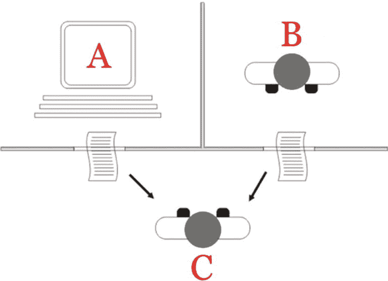
图 12-2
图灵测试设置（来源：[`https://commons.wikimedia.org/wiki/File:Test_de_Turing.jpg`](https://commons.wikimedia.org/wiki/File:Test_de_Turing.jpg)）。询问者（`C`）试图仅通过提问和查看书面回答来揭示哪个参与者（`A` 或 `B`）是人类。

图灵测试旨在为“什么构成智能机器”确立终极标准。也许有一天我们能够达到如此复杂的程度。在那之前，我们必须将注意力集中在更实际的目标上。回到我们洗衣机示例，我们真的关心是谁或什么清洗了一件衣服吗？真正的问题是：“我们能否区分衣服是由人工手洗还是洗衣机洗的？”如果没有区别，那么洗衣机就是一种有用的器具，能让我们更高效，并让我们从琐碎的任务中解脱出来。这就是人机交互的全部意义。从这个意义上说，智能只是一个与我们要处理的任务复杂度相关的必要评分，无论是否借助机器。对于更高级的工作，我们需要采用更先进的技术、方法和工具。我们通常不关心机器所期望的智能水平是来自“愚蠢的硬件+超级智能的软件”、“超智能硬件+愚蠢的软件”，还是“精明的硬件和软件”。有时，即使是一台普通的计算器，也足以让我们在规定时间内以所需的精度解决问题。

### 注意

本着前文的精神，我只在更简单、更易解释的解决方案无法实现时，才考虑使用深度神经网络。深度神经网络对外部观察者来说可能显得神秘，但在内部，它们大致只是线性代数和微积分。尽管如此，在其背后投入的研究和人力是惊人的（开发训练深度神经网络的算法花费了大约 30 年时间，凝聚了许多科学家的共同努力）。关于智能以及看待事物的不同方式，你可能还想查阅参考文献[2]和[3]。

神经网络令人着迷且有趣的成就之一体现在 20Q 游戏（更多细节请阅读参考文献[4]）。该产品在用户玩游戏时不断学习。关于神经网络何时适用的例子以及学习 `Keras`（本章我将介绍 `PyTorch`），你也可以查阅参考文献[5]。

## 智能作为符号的掌握

我思考了很久，如何最好地举例说明神经网络内部发生的事情。我认为立刻跳到节点、权重、层和激活函数是不合适的。幸运的是，我设法在 Topcoder 上找到了一个合适的问题陈述，针对一个名为 `AToughGame` 的游戏，用以演示抽象如何在创造看似智能的行为中相互作用（要跟进此讨论，你必须先阅读其规范；点击[`https://www.topcoder.com/blog/how-to-come-up-with-problem-ideas`](https://www.topcoder.com/blog/how-to-come-up-with-problem-ideas)上的 `AToughGame` 链接）。如参考文献[1]所述，智能可以被视为在多个粒度级别上掌握产生符号（抽象）的能力。抽象层次结构被积累并相互构建，直到最终解决方案可以用它们来简单描述为止。

### 手动特征工程

图 12-3 以状态图的形式展示了 `AToughGame` 问题的通用结构。玩家根据给定的概率从一个关卡推进到下一个关卡。主要思路是成对处理状态。这样一来，每次迭代后状态数量就会减少一个。这是一种典型的贪心算法，其安全操作是聚合两个状态。唯一实际的工作就是使用 `combine` 运算符来实现该算法。难点在于要找出所有可能完成这两个关卡（即这一对关卡）的方式中，宝物的期望值。联合概率仅仅是各个关卡概率的乘积。总而言之，这产生了一个非常快速的线性算法（每个状态只需访问一次就足够了）。

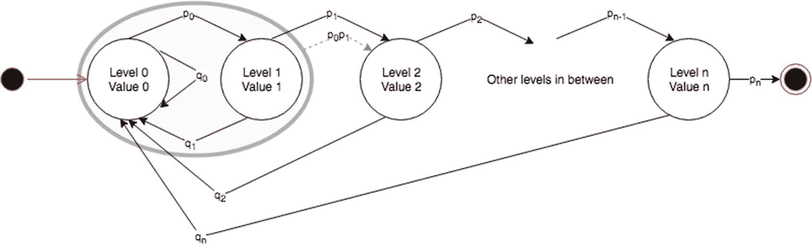

**图 12-3** — 问题的总体状态图

如果通过某个关卡的概率是 `p`，那么相反的结果就是 `q = 1 – p`。最终状态是获胜状态。目标是计算完成所有关卡后收集到的宝物的期望数量。图中显示的是将要首先聚合的初始状态对。

#### 对聚合状态进行建模

关于组合后的状态，有两个问题需要回答：

- 新状态的联合概率是多少？
- 新状态的联合价值（我将用 `v` 表示价值）是多少？

我们已经回答了第一个问题，如图 12-3 所示。新价值是最后一个价值加上考虑到所有可能离开这两个状态的方式后的期望宝物数量之和。最简单的情况是连续通过两个状态，没有在任何一关死亡。下一种可能性是在第 0 关死亡一次，然后连续完成两个状态。第三种情况是在第 0 关连续死亡两次，然后连续完成两个状态。这种模式会无限延续下去。我们可以用公式 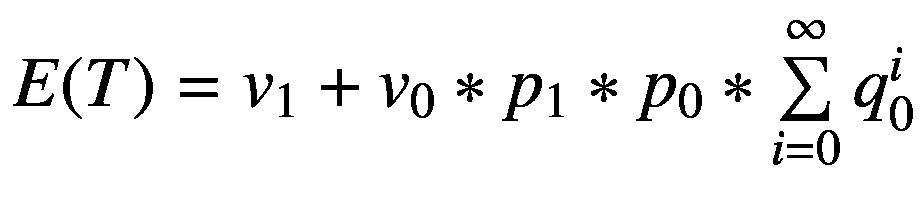 来描述所有这些情况，其中 `E(T)` 是期望宝物数量。

最后一个表达式已经包含了两个强大的抽象。我们现在应该将它们综合起来。别忘了，完成这两个关卡的途径还有很多，这意味着直接操作原始概率很快就会变得笨拙。第一个抽象来自代数，它提供了一个求和的封闭解。这被称为几何级数求和 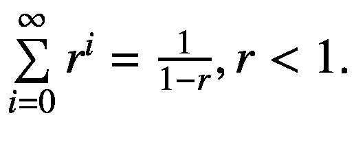。在我们的例子中，参数 `r` 总是一个非负实数。为抽象命名很重要，这个求和将被记为 `series1(r)`。我们的第二个抽象是 `γ = p[0] * series1(q[0])`，其含义是“离开第 0 关的概率”。注意，我们可以不死亡就离开这一关，也可以死亡一次、两次等等再离开。

离开这两个关卡的另一种情况由以下伪代码描述：

```

重复任意多次：

```
以任何方式离开第 0 关
在第 1 关死亡
至少死亡一次后离开第 0 关
通过第 1 关
```

得益于之前引入的抽象，我们可以用简洁的方式将上述用例的联合概率表示为 `series1(γ * q[1]) * q[0] * γ * p[1]`。注意 `γ` 是如何嵌套在 `series1` 内部的。

下一个用例与在不死于第 0 关的情况下，通过在第 1 关多次死亡来积累财富的能力有关。换句话说，这个场景由以下伪代码描述：

```
重复任意多次：
    通过第 0 关
    在第 1 关死亡
    通过第 0 关
    通过第 1 关
```

在这种情况下，每次迭代后，留在第 1 关的宝物数量等于 `v[0] * m`，其中 `m` 是迭代次数。为了有效地描述这种情况，我们需要一个新的抽象，它是几何级数求和的衍生形式：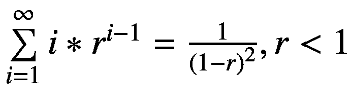。我们将这个抽象命名为 `series2(r)`。因此，联合概率由 `series2(p[0] * q[1]) * p[0] * p[1]` 给出。

最后一点是，最后一个用例也可以与第二个用例相关联。换句话说，可以先积累财富，然后在最后一轮，因为至少死亡一次才离开第 0 关而失去所有财富。

## 将所有部分整合在一起

在重构了每个用例的公式后，完整的解决方案如代码清单 12-1 所示。`combine` 函数接收两个连续关卡的原始概率和价值作为输入，并返回聚合后的概率和宝物的期望值。在此过程中，它从原始数据中构建抽象。这与神经网络从原始输入节点开始，通过隐藏层创建抽象层级，最终输出结果的方式非常相似。

我们可以去掉 `γ`，因为它等于 1。此外，我们可以直接内联 `series1` 和 `series2`，并将表达式 `series1(q1)` 简化为 `1 / p1`。最终结果与展开后的版本几乎完全不同。优化应该作为最后一步。这类优化也同样发生在神经网络内部。并非所有由隐藏层产生的特征都同样有用，也不会以独立的方式被使用（许多特征会被整合到更高级的抽象中）。

```python
class AToughGame:
    def expectedGain(self, prob, value):
        def combine(level0, level1):
            p0, v0, p1, v1 = level0[0], level0[1], level1[0], level1[1]
            q0, q1 = 1 - p0, 1 - p1
            return p0 * p1, v1 + v0 * p1 * (p0 + q0 / p1) * (1 - p0 * q1) ** -2
        from functools import reduce
        return reduce(combine, zip(map(lambda p: p / 1000, prob), value))[1]
```

**代码清单 12-1** — `AToughGame.py` 模块，实现了 Topcoder 问题 `AToughGame`

类名和唯一的方法签名是需求规范的一部分（参见练习 12-1）。尽管所有抽象都是手动创建的，但其中的内部细节对于没有阅读过前述说明的人来说是难以理解的。因此，你务必为压缩后的代码附上合适的设计文档。

看看前面的代码，你可能会好奇这九行代码（包括样板代码和空行）中的智慧何在。也许你运行它，看到它在几纳秒内就给出解决方案，会惊叹于它的巧妙。你能想象它包含了所有必要的知识，来考虑玩家可能完成游戏的所有方式吗？这个程序很好地说明了 1990 年代之前 AI 的状况。当时的软件解决方案预先配备了所有必要的启发式规则。

现在，想象一个软件魔法师，它能够解读处理问题所需的所有抽象。这正是神经网络大放异彩的地方。你只需定义解决方案的架构，然后将生成更高级符号的艰巨任务交给网络。上层网络会复用来自下层的抽象。层数越多，产生的特征就越复杂。

### 基于机器的特征工程

现在我们将构建两个版本的神经网络，以演示自动特征工程及其工作原理。第一个版本将从零开始构建，第二个版本将使用 `PyTorch`。你在第 7 章（关于机器学习）中已经看到过线性回归，其中输出被估计为 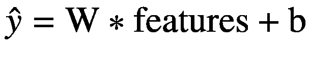（`W` 是特征的权重，`b` 是偏置项）。不过，特征可能包含非线性成分。可以为这个输出关联一个激活函数；这样做可以将线性回归转变为用于分类的逻辑回归。激活函数甚至可以是一个简单的阶跃函数，当 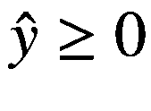 时输出 1，否则输出 0。事实上，任何具有某种阈值来区分正负样本的函数都可以用作激活函数。

图 12-4 展示了一个具有一个输入层、一个隐藏层和一个输出层的神经网络通用结构。输入层的节点数量等于不同特征的数量（此处为两个），再加上一个额外的常数节点来表示偏置。隐藏层的节点数量是可配置的。输出层的节点数量等于目标变量的数量（此处仅有一个）。

隐藏层中带阴影的节点由一个聚合器和一个激活函数组成。节点的聚合器计算匹配的输入权重与输入的乘积，而激活函数则对聚合器的输出值进行变换。当你进行的是分类而非回归任务时，最终的输出节点也可能应用一个激活函数。在图 12-4 中，激活函数是 `Sigmoid` 函数，其公式也在图中给出（你可以看到其关于输入的导数非常简洁）。

每个神经网络在使用前都必须经过训练，训练本质上是一个寻找合适权重的迭代增量过程。开始时，权重被初始化为一些较小的随机值。一个训练周期（迭代）由两部分组成：前向传播（计算最终输出）和反向传播（通过网络回传误差来更新权重）。周期会重复进行，直到网络收敛到稳定的权重。每次迭代传统上被称为一个*轮次*。

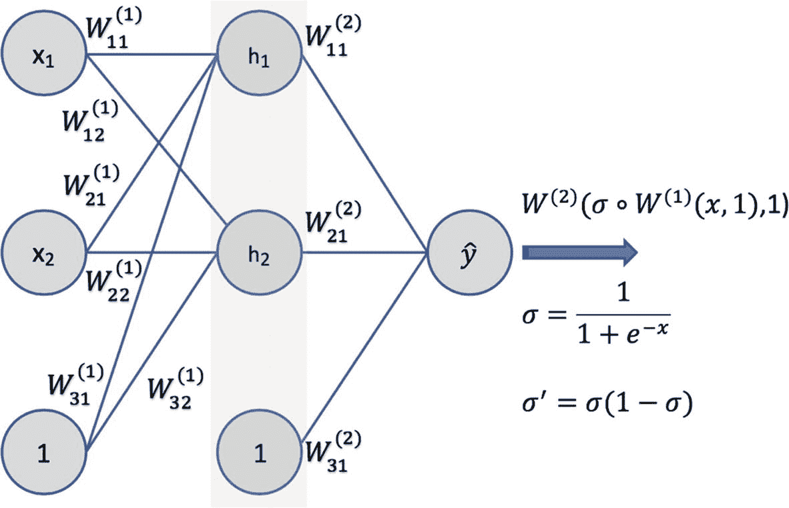

*图 12-4 用于回归任务的具有一个隐藏层的简单神经网络架构*

误差是真值与预测值之间的差，表示为 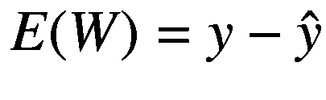。该误差函数对权重的一组偏导数为我们提供了更新权重所需的梯度；这是梯度下降方法的核心。更新权重 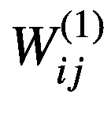 的量是 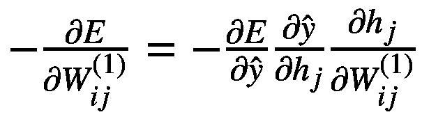，这是链式法则在导数计算中的应用。如果最终输出也应用了激活函数，上述表达式会多出一项。无论如何，这些偏导数只有在激活函数（或多个激活函数；你可以在每一层使用不同的函数）是连续且可微时才是可行的。此外，为了避免深度神经网络中出现的梯度消失问题（当所有偏导数的乘积变得非常小时），激活函数应该将输出分布在一个更大的范围内。在这方面，`Sigmoid` 函数表现不佳。这就是你会看到双曲正切函数（`tanh`）或线性整流单元（`ReLU`）在发挥作用的原因。后者是隐藏层的默认选择。

为了避免权重突变，存在一个称为*学习率*的超参数。每个梯度都会乘以这个量，从而使优化过程谨慎地朝着最小值（通常是良好的局部最小值）移动。

神经网络的能力源于隐藏节点输出的非线性。在深度神经网络中，随着每一层重复使用前一层的输出，可以从原始输入中创建出复杂的特征。美妙之处在于，你无需担心网络如何以简洁的方式描述问题。当然，缺点是你会很难解释网络的决策过程。还有一个令人惊叹的项目，可以从深度神经网络创建的中间特征中产生视觉效果（请访问 [`https://github.com/google/deepdream`](https://github.com/google/deepdream)）。

#### 从零开始的实现

清单 12-2 提供了一份仅使用 NumPy 数组的简单神经网络完整实现。这段代码实际上是我在 [`http://bit.ly/project-bikes`](http://bit.ly/project-bikes) 上完成的 Udacity 共享单车项目解决方案（我也推荐 Udacity 上免费的优秀课程《使用 PyTorch 入门深度学习》）。

```python
import numpy as np

class NeuralNetwork:
    def __init__(self, input_nodes, hidden_nodes, output_nodes, learning_rate):
        self.input_nodes = input_nodes
        self.hidden_nodes = hidden_nodes
        self.output_nodes = output_nodes
        # 使用正态分布将权重初始化为较小的随机值。
        self.weights_input_to_hidden = np.random.normal(
            scale=self.input_nodes ** -0.5,
            size=(self.input_nodes, self.hidden_nodes))
        self.weights_hidden_to_output = np.random.normal(
            scale=self.hidden_nodes ** -0.5,
            size=(self.hidden_nodes, self.output_nodes))
        self.lr = learning_rate
        self.activation_function = lambda x: 1 / (1 + np.exp(-x))  # sigmoid

    def train(self, features, targets):
        delta_weights_i_h = np.zeros(self.weights_input_to_hidden.shape)
        delta_weights_h_o = np.zeros(self.weights_hidden_to_output.shape)
        for X, y in zip(features, targets):
            y_hat, hidden_outputs = self.__forward(X)
            delta_weights_i_h, delta_weights_h_o = self.__backward(
                y_hat, hidden_outputs, X, y, delta_weights_i_h, delta_weights_h_o)
        self.__update_weights(delta_weights_i_h, delta_weights_h_o)

    def run(self, X):
        return self.__forward(X)[0]

    def __forward(self, X):
        hidden_inputs = np.dot(X, self.weights_input_to_hidden)
```

### 清单 12-2
`hidden_outputs = self.activation_function(hidden_inputs)`

`final_inputs = np.dot(hidden_outputs, self.weights_hidden_to_output)`

`y_hat = final_inputs`

return `y_hat`, `hidden_outputs`

def `__backward(self, y_hat, hidden_outputs, X, y, delta_weights_i_h, delta_weights_h_o)`:

error = y - `y_hat`

`hidden_error = np.dot(self.weights_hidden_to_output, error)`

output_error_term = error

`hidden_error_term = hidden_error * hidden_outputs * (1 - hidden_outputs)`

`delta_weights_i_h += np.dot(X[:, np.newaxis], hidden_error_term[np.newaxis, :])`

`delta_weights_h_o += np.dot(hidden_outputs[:, np.newaxis], output_error_term[np.newaxis, :])`

return `delta_weights_i_h`, `delta_weights_h_o`

def `__update_weights(self, delta_weights_i_h, delta_weights_h_o)`:

`self.weights_hidden_to_output += self.lr * delta_weights_h_o`

`self.weights_input_to_hidden += self.lr * delta_weights_i_h`

`面向图 12-4 所示回归任务的简单神经网络实现（不含偏置）`

该类有两个公有方法：`train` 和 `run`。私有的 `__update_weights` 方法并不计算 delta 权重的平均值，而是假设已提供的学习率包含了这一因子。这是一种常见做法，因为该参数本身就是一个需要针对每个问题单独调整的任意数值。

权重使用标准差为 `sqrt(n)` 的正态分布初始化为较小的随机值（其中 `n` 是匹配层的输入节点数）。这被称为 Xavier 初始化，你可以在 [`http://bit.ly/xavier-init`](http://bit.ly/xavier-init) 了解更多信息。这是缓解梯度消失问题的另一种方式。

以下是一份简单的操作指南，用于观察这个网络的运行效果：

1. 执行 `git clone` [`https://github.com/udacity/deep-learning-v2-pytorch.git`](https://github.com/udacity/deep-learning-v2-pytorch.git) 克隆课程仓库。
2. 进入 `project-bikesharing` 文件夹，将本章源代码中的 `simple_network1.py` 文件复制到该目录下。
3. 删除 `my_answers.py` 文件，并将 `simple_network1.py` 重命名为 `my_answers.py`。
4. 在 Jupyter notebook 实例中打开 `Predicting_bike_sharing_data.ipynb`，并按照说明进行操作。

`simple_network1.py` 文件中的超参数设置如下：

```python
iterations = 1000
learning_rate = 0.005
hidden_nodes = 20
output_nodes = 1
```

所有单元测试均应通过，并且你会得到如图 12-5 所示的测试数据折线图。该模型对数据的预测效果相当好，除了年度的最后一周。你可以看到，在 12 月 22 日到年底这段时间内，预测值高于实际数据。网络没有经过充分的训练来识别这个大多数人在圣诞节休假的时期。如果你仔细观察笔记本，会发现测试数据并未覆盖一个典型的时段，而这一关键时期在训练过程中被移除了。此外，`workingday` 这一特征也被从数据中删除了。

### 使用 PyTorch 实现

清单 12-3 提供了我们简单神经网络的完整实现，但这次使用的是 PyTorch。PyTorch 帮助你减少需要编写的代码量，从而使产品更易于维护。同时，你在实现中引入微妙错误的可能性也更小。最重要的是，PyTorch 拥有大量强大的功能，例如对深度神经网络的支持，包括卷积网络、循环网络、门控循环网络和长短期记忆网络。由于训练深度神经网络的计算量相当大，PyTorch 允许你利用机器上的 GPU（只要你的环境也支持 CUDA 编程模型）。

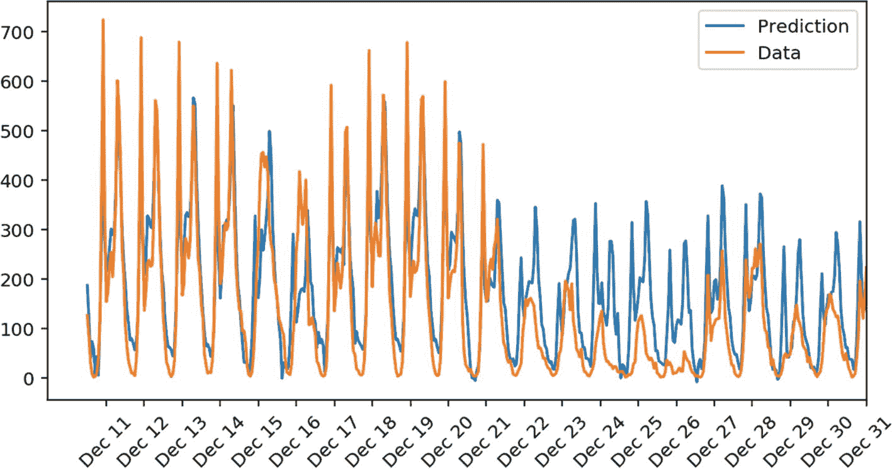

图 12-5 测试数据的实际输出和预测输出

```python
from collections import OrderedDict
import torch
from torch import nn

class NeuralNetwork:
    def __init__(self, input_nodes, hidden_nodes, output_nodes, learning_rate):
        self.model = nn.Sequential(OrderedDict([
            ('fc', nn.Linear(input_nodes, hidden_nodes)),
            ('sigmoid', nn.Sigmoid()),
            ('output', nn.Linear(hidden_nodes, output_nodes))]))
        self.device = torch.device("cuda" if torch.cuda.is_available() else "cpu")
        self.model.to(self.device)
        self.criterion = nn.MSELoss()
        self.optimizer = torch.optim.SGD(self.model.parameters(), lr = learning_rate)

    def train(self, features, targets):
        features, targets = features.to(self.device), targets.to(self.device)
        self.model.train()
        self.optimizer.zero_grad()
        output = self.model(features)
        loss = self.criterion(output, targets)
        loss.backward()
        self.optimizer.step()

    def run(self, x):
        self.model.eval()
        with torch.no_grad():
            return self.model(torch.tensor(x.values, dtype = torch.float) \
                .to(self.device)).cpu().numpy()
```

清单 12-3 使用 PyTorch（若可用则利用 GPU）实现的网络版本。超参数也已更改（请参阅 `simple_network2.py` 模块）。

`NeuralNetwork` 类通过鸭子类型优先使用组合而非继承，并将 PyTorch 网络对象保存为内部属性 `model`。`OrderedDict` 对于命名网络的每一层非常有用。你可以稍后通过输入 `self.model.<名称>` 轻松引用它们。整个代码只是一系列声明，而不是底层的实现细节。你可以立即从 `train` 方法的主体中读出高级反向传播算法：

1. 将梯度归零（与我们之前在清单 12-2 中所做的相同）。
2. 通过网络进行前向传播。
3. 计算误差。
4. 反向传播误差以找到用于更新权重的适当增量。
5. 更新权重。

PyTorch 使用张量进行操作，张量是 n 维向量。要运行这个新版本，你需要在 `Predicting_bike_sharing_data.ipynb` 笔记本中修改用于训练网络的代码单元格。不要尝试运行单元测试，因为它们与此代码不兼容（你可以将其作为额外练习进行调整）。清单 12-4 显示了使用 PyTorch `DataLoader` 类的更新脚本（以粗体显示的行是对原始版本的补充，并且删除了一些行）。

```python
import sys
```

```
import torch.utils.data as data_utils

from my_answers import iterations, learning_rate, hidden_nodes, output_nodes

print("Is CUDA available?", "Yes" if torch.cuda.is_available() else "No")

N_i = train_features.shape[1]

network = NeuralNetwork(N_i, hidden_nodes, output_nodes, learning_rate)

losses = {'train':[], 'validation':[]}

train = data_utils.TensorDataset(torch.Tensor(np.array(train_features)),

torch.Tensor(np.array(train_targets)))

train_loader = data_utils.DataLoader(train, batch_size = 128, shuffle = True)

for epoch in range(1, iterations + 1):

for X, y in train_loader:

network.train(X, y)

##### Printing out the training progress

train_loss = MSE(network.run(train_features).T, train_targets['cnt'].values)

val_loss = MSE(network.run(val_features).T, val_targets['cnt'].values)

sys.stdout.write("\rProgress: {:2.1f}".format(100 * epoch / iterations) \

+ "% ... Training loss: " + str(train_loss)[:5] \

+ " ... Validation loss: " + str(val_loss)[:5])

sys.stdout.flush()

losses['train'].append(train_loss)

losses['validation'].append(val_loss)
```

## 清单 12-4

使用`PyTorch DataLoader`类的更新脚本

图 12-6 显示了训练损失和验证损失随时间的变化。大约 200 个周期后，这两个数值都没有显著改善。你绝对应该在配备 GPU 的高性能机器上训练你的网络，否则完成训练将需要相当长的时间。

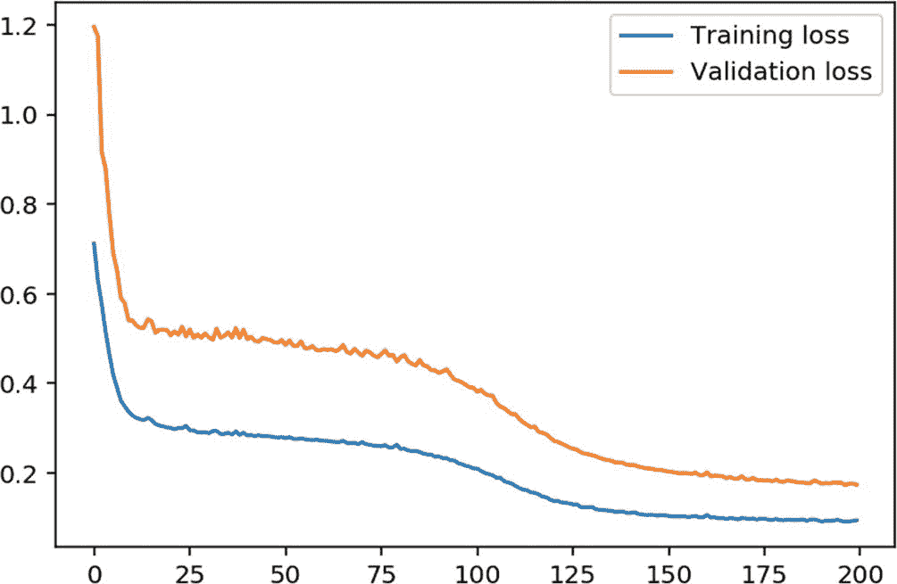

图 12-6

训练过程的效率。你应该始终监控验证损失曲线。如果它开始上升，则说明你的网络过拟合。如果训练损失没有下降，则说明你欠拟合。

## 练习 12-1. 自定义并行化

在第 11 章中，我们应用 `Dask` 对数组执行并行操作。在某些情况下，这种形式的并发是不可行的。`Dask` 还提供了一个选项，可以通过 `dask.delayed` 接口对自定义算法进行并行化。

`expectedGain` 函数返回游戏结束时的预期宝藏数量。假设你想简单地返回连续通过所有级别的总概率。这当前作为最终元组中的第一个元素返回。创建一个新方法 `totalProbability`，该方法仅并行计算这个数量。

查看关于树求和（归约）的示例代码：[`https://examples.dask.org/delayed.html`](https://examples.dask.org/delayed.html)。你将使用乘法来合并节点，而不是使用 `Dask` 教程中的 `add` 操作。对于这种简单的树归约情况，你不需要自定义过程，但目的是尝试使用 `dask.delayed` 接口并监控 `Dask` 仪表盘中计算是如何执行的。

## 练习 12-2. 部署到生产环境

`PyTorch`（从 1.0 版本开始）提供了将 Python 模型转换为中间格式的能力，该格式可以在 C++ 环境中使用。通过这种方式，你可以用 Python 开发解决方案，然后将其部署为 C++ 应用程序。这种方法满足了与生产环境设置相关的性能要求。

查阅关于在 C++ 中加载 `PyTorch` 模型的教程：[`https://pytorch.org/tutorials/advanced/cpp_export.html`](https://pytorch.org/tutorials/advanced/cpp_export.html)。在我们的案例中，由于前向实现是统一的（没有基于输入的条件逻辑），你可以通过跟踪将 `PyTorch` 模型转换为 Torch Script。

## 总结

使用 `PyTorch` 或其他神经网络框架对于应对深度神经网络固有的复杂性至关重要。`PyTorch` 提供了许多现成的附加选项来优化训练过程：dropout、批归一化、各种先进的优化器、不同的激活函数等等。`PyTorch` 还允许你将网络持久化存储到外部存储中以便日后使用。你可能希望在每次成功降低验证损失时保存模型。最后，你可以选出性能最佳的版本。

`PyTorch` 捆绑了两个主要扩展：`pytorchvision`（用于图像处理）和 `pytorchtext`（用于处理文本，例如进行情感分析）。你还可以重用公开可用的预训练模型来实现迁移学习的概念。例如，有些模型是在 `ImageNet`（`http://www.image-net.org`）的图像上训练的，具有出色的图像分类功能。

有一个名为 `PyTorch Hub`（`https://pytorch.org/hub`）的有趣倡议，旨在高效共享预训练模型，从而实现迁移学习的愿景。神经网络在物联网边缘端也是非常流行的选择。为此，你需要一个超轻量级的预封装引擎。一个例子是英特尔的 `神经计算棒`（`http://bit.ly/neural-stick`）。总而言之，每个用例和领域都有非常创新和有趣的方法。

# 索引

### A

`主动学习` `Adamic-Adar 指数` `算法` `Alpha Vantage API` `Anaconda` 发行版 管理包 `Miniconda` 复制环境 `Spyder` 启动 `Apache Arrow` `Apache Parquet` `应用程序编程接口(API)` `CDC` 斐波那契数列 通用序列函数 收益递减规律 角色 `AToughGame` 问题 `attach_model` 函数 `增强型球体下落` 问题 规格说明 v1.1 边界与运动 寻路引擎 回顾 卫星图像数据集 v1.2 增强输入子系统 增强输出子系统 回顾 v1.3 方法 基线 非递归简单寻路器 `ParallelSimplePathFinder` 类 性能优化 回顾 基于复用的软件工程 特征 测试地形函数 `平均聚类系数`

### B

`中介中心性` `球体下落项目` 数据模型 代码 矩阵函数 `NumPy` print 语句 问题规格说明 模拟器 测试自动化 `伯努利概率分布` `偏差-方差权衡` `大数据` 四 V 特征 LHC (大型强子对撞机) MOOC (大规模开放在线课程) 旧式 *vs.* 现代数据科学项目 `二分图` 应用 角色 `bipartite.py` 模块 IoT 平台 评分关系 `煮蛙攻击` `布尔索引` 技术 `棕牛模型` `暴力程序`

### C

`接近中心性` `混沌域` `点击率(CTR)` `最近点对算法` 以 API 为中心和面向对象的开发 `欧几里得距离` 交互式信息辐射器 仪表盘 DSL 表格呈现 数据 v1.0 `暴力` 实现 `SnakeViz` v2.0 分治技术 v3.0 `FastClosestPair` `类` 排序函数 可视化调用层次结构 `Collect_mse` 内部函数 `combine` 函数 `社区` 共同邻居 `社区资源分配` `复杂域` `繁琐域` `概念/技术` 机器学习 共线性 `data_generator.py` 模块 误差项 `evaluate_model` 函数 特征 *vs.* 输出 高斯随机变量 MSE 正态分布 `observer.py` 模块 过拟合 真实世界过程 正则化 `残差` 图 `demo_residuals` 函数 `evaluate_model` 函数 `fit` 方法 `set_params()` 方法 运行时模型 `scikit-learn` 框架 `session.py` 模块 琐碎训练过程 欠拟合 警告模块 `%connect_info` 魔术命令 `消费者驱动契约(CDC)` `交叉验证(CV)分数` `圈复杂度` 升序 内建函数 执行流程 全局评估分数 排序例程 `spyder` `Cynefin` 域 象限 `Cynefin 框架`

### D

`Dask` 数组 `Dask` 数据框 `Dask` 交付 `Dask` 框架 `数据工程师` `DataLoader` 类 `数据修改攻击` `数据准备` `数据预处理` 金融模型 特征 `AAPL` 价格对数 `data_preprocessing.py` `模块` `data_visualization.py` 模块 `driver.py` 模块 直方图 对数收益率 归一化 异常值 收益率 波动率 `IPython` 控制台 `Pandas` 数据框 样式参数 时间序列 `AAPL` 收盘水平 移动平均 缩放 时间戳 `数据处理抽象` *对比* 潜在特征 增强型球体下落案例研究 `参见增强型球体下落` 压缩评分矩阵 `数据科学项目` `棕牛模型` 案例研究 (霍乱) 学习领域知识 领域相关术语 编程经验 旧式 *vs.* 现代 阶段 `数据安全` 备份程序 收集 泄露事件 关于电子邮件的推断 `微软安全开发生命周期` `OWASP` 阶段 问题 可疑电子邮件 工具样本 不安全的连接 `数据流` `数据类型` `数据可视化` 最近点对案例研究 `参见最近点对算法` `matplotlib` 架构 案例研究 地理地图 高级组件 绘制温度 `数据整理` `深度学习` `度中心性` `demo_metrics_and_mse` 函数 `demo_regularization` 函数 `数字` 计数 `失序` `分治` 技术 `可除数` 计数 `文档结构` 摘要 数据科学生命周期 阶段 数据集 缺点 未来工作 动机 项目 `参见维基百科编辑项目` 参考文献 `领域特定语言(DSL)` `driver.py` 脚本 程序 重构 可复用性

### E

`电子商务` 客户细分 CSV 格式 EDA 营销领域 项目在 `Spyder` 中 `参见 Spyder 项目` 结构化数据 `边中介中心性` `欧几里得距离` `欧洲经济区(EEA)` `expectedGain` 函数 `探索性数据分析(EDA)` `extract_config` 方法

### F

`特征工程` 列类型 自定义 `Age_Group` 柱状图 CTR 多层数据框 `NaN` 非零方法 点击次数已定义 `describe` 方法 哑变量 电子商务 已登出类别 `pandas` 包 散点图 `SciPy` `summarize` 函数 `信息茧房` `金融建模` 数据预处理 `参见数据预处理，金融模型` 数据检索 特征工程 相关矩阵 创建特征 `feature_engineering.py` `模块` 热力图 绘制 对数收益率 均值回归 散点图 `TA-Lib` 目标特征 时间序列分析 添加时间戳 `find_path` 方法 `修复缺陷` 软件方法 敏捷方法 正确版本 代码 业务语言 缺陷代码 改进后的修复 单元测试 向量化版本 业务相关参数 经典参数 `NumPy` 框架 `全批量学习` `趣味电梯` 案例研究 分治范式 社会经济/社会技术方面 测试 未优化变体

### G

`通用数据保护条例(GDPR)` 绝对主义方法 架构 基于属性的访问控制模型 行为模式 控制者/处理者 法规 数据泄露 `DevOps` 范式 领域驱动设计 欧盟组织 基本权利 医疗系统 合法处理 微服务 远程访问 请求 风险管理 安全措施 `generate_points` 方法 `地理编码 API` `GitHub` 仓库 `全球历史气候学网络-每日(GHCN-Daily)` `图分析` 二分图 质量属性 社交网络 使用矩阵 内建 `matplotlib` 引擎 通用模板 `Graphviz` 多重图 `NetworkX` 优化任务 样本实例 `用例` `UML` 用例图 `usage_matrix.py` `模块` 同意

### H

`高维数据集` `同方差输出`

### I

`in_degree` 方法 `智能机器` `IPyWidgets` `第 i 个影子模型`

### J

`Jaccard coefficient` `JupyterHub` `JupyterLab` `Anaconda Navigator` `code execution` `abrupt stoppage` `cells` `doctest` `tests` `error message` `Hanoi Tower Solver` `HTML` `notebook` `output` `project` `SeeBall Descend` `project` `screen simulator` `notebook` `Jupyter Notebook` `Jupyter project` `notebook` `principal components` `tools` `Jupyter widgets` 和 `notebook extensions`

### K

`Kafka` `Kaggle` `KDD Cup 1999 Data` `Kernel` `K-fold CV`

### L

`Local clustering coefficient (LCC)` `Label flipping` `Label modification attack` `Large Hadron Collider (LHC)` `Large-scale software system` `adaptive maintenance` `corrective maintenance` `definition` `fixing bugs` `holistic approach` `knowledge areas` `life cycle model` `preparation/planning phase` `preventive correction` `preventive maintenance` `scope` `tournament chess game, analogy` `types` `Las Vegas model` `Lehman’s laws of software evolution` `LensKit for Python (LKPY)` `extract_config` 方法 `Fallback` 类 `knn` 包装包 `lkpy_demo.py` 文件 `MultiEval` 设施 `nDCG` `Top-N accuracy` 指标 `package structure` `PMML` 序列化模型 `README.txt` 文件 `SciPy` 风格 `UML class diagram` `UserUser` 算法 `Linear regression` `nonparametric` `parametric` `semiparametric` `%load lkpy_demo.py` `Logistic regression` `Log returns`

### M

`Machine-based feature engineering` `implementation from scratch` `implementation with PyTorch` `Machine learning` `big data` `concepts/techniques` `SeeConcepts/techniques, machine learning` `methods` `styles` `Machine learning as a service (MLaaS)` `Manual feature engineering` `aggregated state` `combine function` `Massive open online course (MOOC)` `Mean squared error (MSE)` `Membership inference attack` `black-box` `MLaaS` `overfitted model` `training dataset` `white-box` `Mini-batch learning` `Miniconda distribution` `Monstrous models`

### N

`Naive algorithm` `Naming abstractions` `nbconvert` `nbviewer` `NetworkX` `next_neighbor` 方法 `Not a Number (NaN)` `NumPy` 包

### O

`Old vs. Modern data science projects` `Online learning` `Open-source software (OSS)` `OpenStreetMap` `Open triads` `Open Web Application Security Project (OWASP)`

### P

`pairplot` 函数 `Path finder` `find_path` 函数 `terrain` `top-down decomposition` `wall` 函数 `Perl` 模块 `plot_mse` 函数 `Poisoning attack` `categories` `linear regression model` `Poison insertion attack` `Policy authoring point (PAP)` `Policy decision point (PDP)` `Policy enforcement point (PEP)` `Policy information point (PIP)` `Prediction accuracy` 指标 `Predictive Model Markup Language (PMML)` `predict_proba` 方法 `Preferential attachment` `Principal component analysis (PCA)` 方法 `Privacy, meaning` `Problem-solving ability` `Public data sources` `data analysis` `Internet, accessible` `%pwd` 魔法命令 `scikit-learn`

### Q

`Quandl` `Quantitative data`

### R

`read_csv` 函数 `Recommender systems` `machine learning, usage` `mashup` `movie` `JSON` 响应 `OMDb` 服务 `simple_movie_recommender.py` 模块 `tastedrive_service.py` 模块 `MovieLens` `categories` `collaborative filtering` `content-based` `context-based` 系统 `information retrieval` `system interfaces` `relational database` `system types` `untracked option` `standard` `root mean squared error` `Reinforcement learning` `requests` 包 `Resilient distributed dataset (RDD)` `Ridge regression` `runtime model`

### S

`Scalable graph loading` `CSV file` `load graph` `nodes.csv` 文件，内容 `standard edge list format` `Scaled percent returns` `Scatter matrix plot` `SciPy ecosystem` `Semi-supervised learning` `Shadow training` `attack model` `highest-scored label` `overall structure` `target system` `test sets` `Simple domain` `Simple moving average (SMA)` `sklearn.feature_selection` 模块 `Social network` `centrality` `eccentricity` `karate club network` `LCC` `local/global graph metrics` `machine learning systems` `NetworkX’s documentation` `prediction measures` `single metric graph` `six degrees of separation` `Socio-∗ pieces of software` `production` `socio-economic aspects` `socio-technical aspects` `Software engineering` `agile principles` `application` `bug free` `legacy code` `context awareness and communication` `bug` `SeeFixing bug, software engineering` `cone of uncertainty` `constant feedback loop` `context and knowledge oblivious` `cyclomatic complexity` `knowledgeable` `conventions` `faculty code` `large-scale software systems` `legacy code` `Python ecosystem` `quality assurance tools` `risk` `rules and principles` `Software engineering vs. data science` `Source lines of code (SLOC)` `Spyder` `project` `chunk data` `code restructure, CSV file` `dataset download` `feature, association` `SeeFeature engineering` `file sizes` `IPython console` `shell-related magic commands` `driver code` `folder structure` `nyt_data.py` 脚本 `results` `Apache Parquet` `driver.py` `multilevel index` `Parquet engine` `summarize` 函数 `test pipeline` `click-through rate` `get_file_number` 函数 `number of clicks` `traverse` 函数 `UI` `Staged processing` `Stochastic gradient descent` `Streaming linear regression` `Apache Spark’s MLlib` `framework` `driver.py` 模块 `RDD` `setIntercept` 方法 `streaming_regression.py` 模块 `training and test streams` `StreamingLinearRegressionWithSGD` 类 `Streaming system` `Stream processing` `Structured data` `style` 参数 `Sum of squared errors (SSE)` `Supervised learning` `Systems/software development life cycle (SDLC)`

### T

`TA-Lib` `Total cost of ownership (TCO)` `Transitivity` `t-SNE` 方法 `features and components` `power variables` `Turing test` `setup`

### U

`UCI Machine Learning Repository` `Unbiased minimal variance estimator` `Unsupervised learning` `Use cases (UCs)`

### V

`VarianceThreshold` 类 `Variety` `Velocity` `Veracity` `Visualization` `Volume`

### W, X, Y

`Wikipedia edits` `project` `abstract` `data drawbacks` `JupyterLab notebook` `motivation` `specification` `fixing`

### Z

`zipfile` 包

# 地标

1.  封面
2.  目录
3.  正文