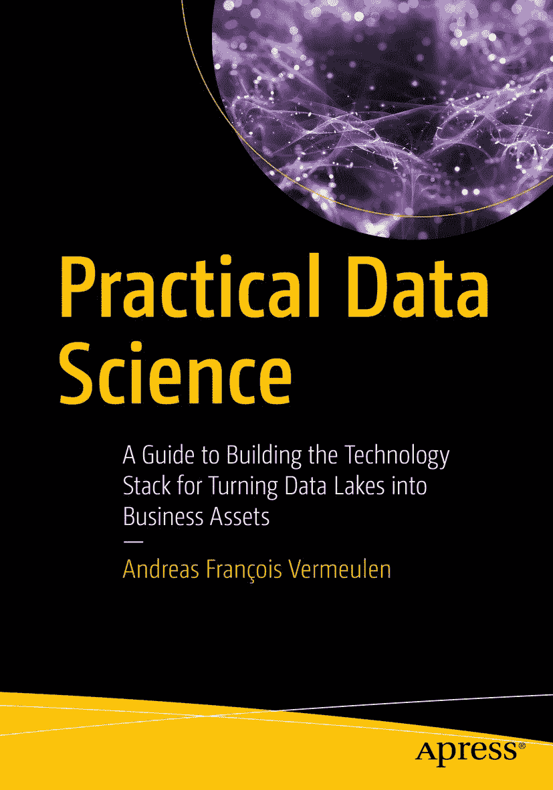

# 实用数据科学：构建将数据湖转化为商业资产的技术栈指南

安德烈亚斯·弗朗索瓦·弗穆伦

作者在本书中引用的任何源代码或其他补充材料，读者均可通过本书在 GitHub 上的产品页面获取，网址为 [www.apress.com/9781484230534](http://www.apress.com/9781484230534)。如需更详细信息，请访问 [www.apress.com/source-code](http://www.apress.com/source-code)。

ISBN 978-1-4842-3053-4  
电子书 ISBN 978-1-4842-3054-1  
[`doi.org/10.1007/978-1-4842-3054-1`](https://doi.org/10.1007/978-1-4842-3054-1)  
美国国会图书馆控制号：2018934681

© 安德烈亚斯·弗朗索瓦·弗穆伦 2018

本作品受版权保护。出版商保留所有权利，无论涉及全部或部分材料，具体包括翻译、重印、插图复用、朗诵、广播、微缩胶片或其他物理形式的复制、传输或信息存储与检索、电子改编、计算机软件，或现今已知或未来开发的类似或不同方法的权利。

本书中可能出现商标名称、徽标和图像。我们并非在每次出现商标名称、徽标或图像时都使用商标符号，而是仅以编辑方式并使用这些名称、徽标和图像，以维护商标所有者的利益，无意侵犯商标权。本出版物中使用商品名称、商标、服务标志及类似术语，即使未被明确标识，也不应被视为对其是否受专有权利保护的表达。

尽管本书中的建议和信息在出版时被认为是真实准确的，但作者、编辑和出版商均不对可能存在的任何错误或遗漏承担法律责任。出版商对本书所含内容不作任何明示或暗示的保证。

采用无酸纸印刷。

由 Springer Science+Business Media New York 在全球图书贸易中发行，地址：233 Spring Street, 6th Floor, New York, NY 10013。电话：1-800-SPRINGER，传真：(201) 348-4505，电子邮件：orders-ny@springer-sbm.com，或访问 www.springeronline.com。Apress Media, LLC 是加利福尼亚州有限责任公司，其唯一成员（所有者）是 Springer Science+Business Media Finance Inc (SSBM Finance Inc)。SSBM Finance Inc 是特拉华州公司。