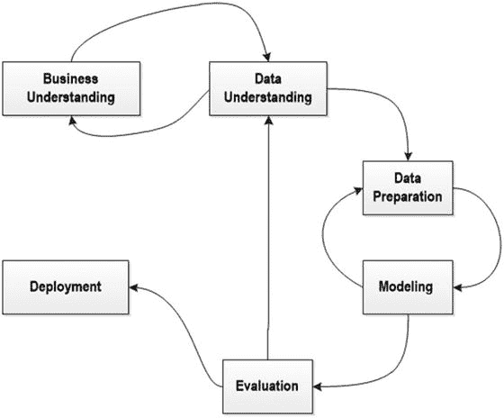

# 3. 分层框架

在本章中，我将向你介绍一些新概念，使我们能够基于共同的理解和术语来分享见解。我将详细定义数据科学框架，同时引入递归统一模式的同构本体论（HORUS）。我将带你从高层次概览框架的顶层，解释业务层、效用层、运营管理层以及审计、平衡和控制层的基本原理。

我将讨论，当你与大型团队并行处理通用业务需求时，如何构建一个分层框架来提升数据科学的质量。

**警告** 如果你正在进行小规模的数据科学工作，你可能会试图直接对现有数据进行快速分析或试点，而不遵循建议的框架。请谨慎行事。我曾花费无数小时重构那些在转移至大规模生产生态系统时引发问题的小规模数据科学试点项目。

我并不是建议你只为小型项目构建完整的层级体系，而是希望确保你的项目能够无缝融入大规模数据处理世界中的数据科学生产。你必须明白，成功的数据科学建立在从试点项目快速进入生产阶段的能力之上。

**注意** 当你展示出能为企业节省数百万美元的尖端数据科学发现后，不要对面临要求在数小时内部署的情况感到惊讶。能够完成这一壮举是一项备受珍视的技能。此处推荐的框架将助你轻松实现这一点！

## 数据科学框架的定义

数据科学是一系列的发现过程。你致力于实现一个整体业务策略：将数据湖中的原始非结构化数据转化为可操作的业务数据。这个过程是一个循环，让你不断发现并深化对所处理数据的理解，为你提供所需的元数据。

我的建议是，构建一个用于数据处理的基础框架。这将使你能够构建一个数据科学解决方案，然后轻松地将其迁移到你的数据工程环境中。

我在自己的项目中使用了以下框架。它适用于从小型部门项目到大规模国际分布式部署的各种项目，因为该框架包含一系列层级，使你能够遵循一个逻辑构建流程，然后在多个项目中使用你的数据处理成果和发现。

### 跨行业数据挖掘标准流程 (CRISP-DM)

CRISP-DM 于 1996 年诞生，到 1997 年，它在 ESPRIT 资助计划下，通过一个欧盟项目得到扩展。直到 2015 年年中，它都是数据科学家主要的支持基础。曾经推动该兴趣小组的网站于 2015 年 6 月 30 日消失，后来又重新开放。然而，从那以后，它开始在其他定制建模方法的竞争下失去优势。该流程背后的基本概念仍然有效，但你会发现，大多数公司在任何项目中都不会原封不动地使用它，而是会采用某种形式的修改版本作为内部标准。

图 3-1 提供了其基本概述。

图 3-1 CRISP-DM 流程图

### 业务理解

如图 3-1 所示，这个初始阶段关注从业务角度发现数据科学的目标和需求。我将在第 4 章讨论我采用的方法。

许多企业使用基于决策模型与表示法（DMN）标准的决策模型或流程映射工具。DMN 是由[对象管理组织](https://en.wikipedia.org/wiki/Object_Management_Group%23Object%20Management%20Group)（参见 [`www.omg.org/spec/DMN/`](http://www.omg.org/spec/DMN/)）发布的标准。DMN 标准为企业提供了一种描述决策管理流程和业务规则的建模表示法。本书不会深入探讨这种表示法，但请注意它，因为我曾注意到我的客户在使用它。

### 数据理解

图 3-1 中提到的数据理解阶段始于初始数据收集，并持续进行以发现数据特征的活动。该阶段识别数据质量问题并洞察数据。

在第 7 至 11 章中，我将讨论我使用的方法，以帮助你理解数据，并通过数据科学驱动的发现方法，帮助你确定所需的数据源及其特征。

### 数据准备

图 3-1 所示的数据准备阶段涵盖了为建模工具构建最终数据集的所有活动。此阶段与建模阶段以循环方式结合使用，以完成模型。

这确保了你拥有数据科学所需的所有数据。在第 7 章和第 8 章中，我将讨论我用于准备数据以通过数据科学模型进行处理的方法。

### 建模

在此（图 3-1 所示的）阶段，会根据业务需求，提名并评估不同的数据科学建模技术，以实现预定的结果。它会以循环方式返回到数据准备阶段，直到流程成功。在第 9 至 11 章中，我将讨论我用于制定和构建适用于数据集的不同模型的方法。

### 评估

在此（图 3-1 所示的）阶段，流程应交付高质量的数据科学成果。在最终部署数据科学之前，需要验证所提出的数据科学解决方案是否达到了业务目标。如果验证失败，则流程返回到数据理解阶段，以改进交付成果。

## 部署

数据科学的创建通常不是项目的终点。一旦数据科学完成了开发和试点阶段，就必须进入生产环境。在本书的其余部分，我将讨论如何成功实现最终目标：将实用的数据科学解决方案交付到生产环境。至此，你应该对 CRISP-DM 有了基本了解，现在我们可以继续审视我成功创建数据科学项目所遵循的流程。接下来，我将介绍我所使用的核心框架。

