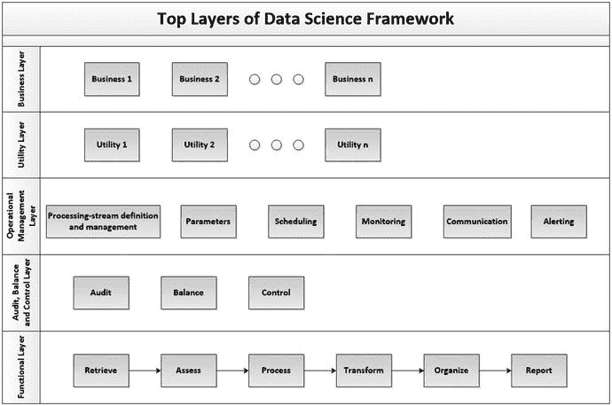

# 递归统一模式的同构本体论

递归统一模式的同构本体论（HORUS）作为一种内部数据格式结构，用于减少框架所需的转换排列组合。采用 HORUS 方法论会形成一种轴辐式数据转换方法。外部数据格式先转换为 HORUS 格式，随后 HORUS 格式可再转换为任何其他外部格式。

其基本概念是获取原生原始数据，然后先将其转换为单一格式。这意味着文本文件只有一种格式，JSON 或 XML 只有一种格式，图像和视频也只有一种格式。因此，为了实现任意格式之间的转换覆盖，框架只需要两种转换器：数据格式到 HORUS 的转换器，以及 HORUS 到数据格式的转换器。

表 3-1 展示了如何通过对文本文件采用轴辐式方法来减少实现有效数据科学解决方案所需的转换脚本数量。可以看出，仅处理 100 个文本数据集时，与非轴辐式框架相比就能节省 98%的脚本。我建议您投入时间让轴辐式框架在您的环境中运行起来，因为您每一次的投入都会因节省而得到回报。通过精简其他数据类型也能实现类似的推断。

**表 3-1** 采用轴辐式数据转换的优势

| 数据格式数 | 所需常规转换器数 | 所需 HORUS 转换器数（轴辐式） | 节省百分比 |
| --- | --- | --- | --- |
| 2 | 4 | 4 | 0.00% |
| 3 | 9 | 6 | 33.33% |
| 4 | 16 | 8 | 50.00% |
| 5 | 25 | 10 | 60.00% |
| 6 | 36 | 12 | 66.67% |
| 7 | 49 | 14 | 71.43% |
| 8 | 64 | 16 | 75.00% |
| 9 | 81 | 18 | 77.78% |
| 10 | 100 | 20 | 80.00% |
| 25 | 625 | 50 | 92.00% |
| 50 | 2500 | 100 | 96.00% |
| 100 | 10000 | 200 | 98.00% |

关于 HORUS 需求的详细内容将在后续章节中介绍。此时此刻，只需注意，您需要在数据科学流程内部拥有某种通用数据格式，以便将数据从一种格式传递到另一种格式。我主要将 HORUS 用于数据处理，并且多年来取得了成功。

## 分层框架的顶层

顶层旨在支持创建数据科学卓越中心的长期战略。图 3-1 所示的各层使您能够跟踪所完成的所有处理过程和发现。

如果您在团队环境中工作，则必须使用卓越中心框架。使用该框架将使您做好准备，在多个数据科学家共同处理同一生态系统的环境中工作。

如果您只是对少数几个数据文件进行数据整理，并且您的数据科学技能需要快速产出洞见，我建议您从整个框架中挑选出您需要的内容。请记住：所有大型系统在某个时刻都曾是一个小试点。该框架将使您能够将小项目转变为大成功，而无需在通往生产环境的道路上进行重大重构。

让我们来讨论这个框架（图 3-2）。

**图 3-2** 数据科学框架的顶层

现在您已经看到了它们，让我们更详细地了解这些层。

### 业务层基础

图 3-2 中所示的业务层是数据科学家和工程师进行数据处理所需的需求和业务信息的主要来源。

> **提示** 关于您业务详细特征和需求的信息，再详细也不为过。

数据科学已经成熟。过去提供快速、不成熟的分析，然后匆忙进行下一个分析的时代在很大程度上已经结束了。现在，您需要确保分析具有与处理任何其他业务方面相同的高质量和一致性。

> **谨记** 您受雇于业务部门。照顾好它，它也会照顾好您。

业务层中应包含的材料包括：

- 最新的组织结构图
- 您正在调查的业务流程的业务描述
- 您的主题专家列表
- 项目计划
- 预算
- 功能需求
- 非功能需求
- 数据项标准

> **谨记** 数据科学应遵循与软件工程和统计数据研究相同的规则集。我将在第 4 章详细讨论业务层并分享我的经验。

### 实用程序层基础

我将实用程序定义为一个被许多数据科学项目用来实现通用处理方法的过程。如图 3-2 所示，实用程序层是一个公共区域，您可以在其中存储所有实用程序。您经常会遇到即时需求，要求您修复数据中的某些问题或运行您的“神奇”算法。您可能花了好几个小时为此做准备，却发现自己找不到那个出色的实用程序，或者您拥有的某个版本无法确保它能正常工作。我曾经也遇到过这种情况——并且留下了证明这一点的伤痕。

> **提示** 将您的实用程序（包括源代码）收集在一个中心位置。详细记录每个版本。

如果您有经常使用的数据算法，我强烈建议您保存任何能够证明该过程是高质量且业界公认算法的证据和凭证。痛苦的经历向我证明，您将会受到考验，而百分之百地支持您的数据科学是至关重要的。由此创造的额外价值是能够让多个团队并行开展项目，并且知道每位数据科学家或工程师都在按照明确的标准工作。

在第 5 章中，我将讨论我认为每位数据科学家都有责任了解的一些有趣且有用的实用程序。

### 运营管理层基础

如图 3-2 所示，运营管理是生态系统中涉及设计和控制生产环境流程链以及重新设计业务流程的一个领域。该层存储了您打算处理的内容。正是在这里，您规划数据科学处理流水线。

运营管理层用于记录：

- 处理流的定义和管理
- 参数
- 调度
- 监控
- 通信
- 警报

运营管理层是您存储为数据科学创建的任何处理链的公共位置。

> **注意** 运营管理是您将数据科学实验转化为长期业务收益的方式。

我将在第 6 章中讨论关于运营管理的许多子组件的细节。

### 审计、平衡与控制层基础

审计、平衡与控制层，如图 3-2 所示，是您能够观察数据科学环境中当前运行内容的区域。它记录：

- 流程执行统计信息
- 平衡与控制
- 拒绝与错误处理
- 代码管理

这三个子区域的使用方式如下。

#### 审计

如图 3-2 所示的审计子层，用于记录环境中运行的任何进程。数据科学家和工程师会利用这些信息来理解并规划对处理流程的改进。

> **提示** 请确保你的算法和处理流程能够生成良好且完整的审计追踪。

我的经验告诉我，良好的审计追踪至关重要。利用数据科学技术栈的原生审计能力，将为你的审计工作提供一个快速有效的基础。我在第 6 章中详细讨论了那些我认为至关重要且实用的审计信息。以下是对该主题内容的简要介绍。

#### 平衡

图 3-2 中的平衡子层确保生态系统在可用处理能力之间保持平衡，或者在处理高峰期具备补充处理能力的能力。为此，云生态系统的按需处理能力非常理想。

> **提示** 将你的能力规划为常驻处理与补充处理的组合。这样，你就能从处理周期中获得最大生产力。

利用审计追踪，可以适应不断变化的需求，并预测完成你提交给生态系统的工作计划所需的条件。

在你能够构建的常驻与补充生态系统中，你可以通过在处理管道中动态地移除或添加资源来平衡处理需求。我建议你尽可能频繁地让你的代码平衡其生态系统。例如，在月末处理期间，你可以将处理容量增加到六十个节点，以应对月末运行的额外需求。当月的其余时间，你可以在营业时间内以二十个节点运行。在周末和其他非高峰时段，你只需用五个节点运行。通过这种方式可以节省大量成本。

#### 控制

如图 3-2 所示的控制子层，负责在生产生态系统中控制当前活跃数据科学流程的执行。控制元素是数据科学技术栈中各个工具的控制元素与用于控制主工作流的自定义界面的结合。控制还确保当处理过程遇到错误时，可以根据你的需求尝试恢复，或者调度清理工具来撤销错误。第 6 章将更详细地讨论你需要特定接口和工具的原因、内容及方式。

我的大多数大客户都建立了独立的探索环境，你可以在其中运行作业，而无需受任何限制性控制机制的约束。这使得数据科学家能够专注于模型和处理，而不必遵从更严格的生产要求。

## 功能层基础

图 3-2 所示的数据科学生态系统功能层是所需编程的主要层次。功能层是执行全面数据科学的生态系统部分。它由几个结构组成。

- 数据模型
- 处理算法
- 基础设施的配置

我的处理算法分布在以下六个处理超级步骤中：

1. **检索**：此超级步骤包含通过更结构化的格式从原始数据湖检索数据的所有处理链。
2. **评估**：此超级步骤包含用于质量保证和额外数据增强的所有处理链。
3. **处理**：此超级步骤包含用于构建数据仓库的所有处理链。
4. **转换**：此超级步骤包含用于构建数据仓库的所有处理链。
5. **组织**：此超级步骤包含用于构建数据集市的所有处理链。
6. **报告**：此超级步骤包含用于构建虚拟化和报告可操作知识的所有处理链。

这些超级步骤将在专门章节（第 6 章至第 11 章）中详细讨论，使您能够掌握各个超级步骤以及数据科学技术栈中相关的工具。

## 高级数据科学与工程的分层框架

我在本书中引用的任何源代码或其他补充材料，读者均可通过本书的产品页面在 GitHub 上获取，地址为 [`www.apress.com/9781484230534`](http://www.apress.com/9781484230534)。

分层框架由以下结构构建而成。以下脚本将为你创建一个完整的框架，如果你使用的是 Windows 系统，该框架位于`C:\VKHCG\05-DS\00-Framework`目录下；如果你使用的是 Linux 环境，则位于`./VKHCG/05-DS/00-Framework`目录下。

### Windows

如果你偏好 Windows 和 Python，在第 2 章的源代码中，你会找到相关的 Python 脚本，标识为`Build_Win_Framework.py`。

如果你偏好 Windows 和 R，在第 2 章的源代码中，你会找到相关的 R 脚本，标识为`Build_Win_Framework.r`。

### Linux

如果你偏好 Linux 和 Python，在第 2 章的源代码中，你会找到相关的 Python 脚本，标识为`Build_Linux_Framework.py`。

如果你偏好 Linux 和 R，在第 2 章的源代码中，你会找到相关的 R 脚本，标识为`Build_Linux_Framework.r`。

## 总结

我已经解释了数据科学解决方案所需的基本分层框架。对于如何整合你的解决方案以在你的数据科学项目中取得成功，你应该有了一个总体的高层理解。

在接下来的章节中，我将通过实际案例，提供各个组件的详细信息。