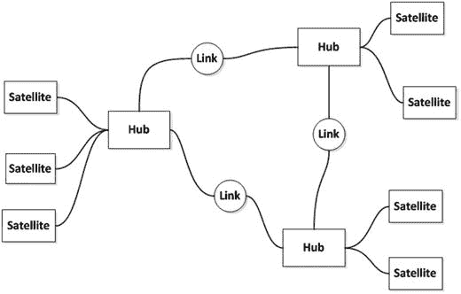
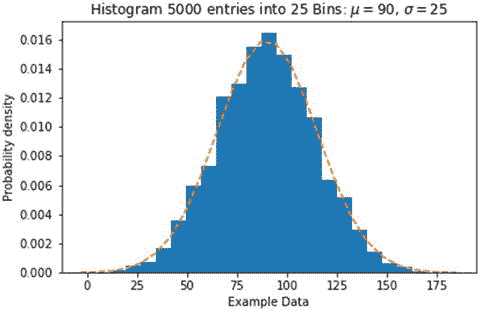

# 流程工具

本超步骤中的工具包含构建数据仓库所需的所有处理链。在第 9 章中，我将提供这些工具的具体实现。

我将在功能层的流程超步骤（第 9 章）中详细讨论数据仓库（`时间`、`人员`、`对象`、`地点`、`事件`）的设计、模型和内部工作原理。

就本章而言，我将在此时将数据仓库介绍为一种数据结构，它采用结构化设计来存储具有完整历史记录的数据。数据仓库的基本要素是枢纽、卫星和链接。关于结构以及如何构建数据仓库的完整细节将在第 9 章（涵盖流程超步骤）中解释。

在本章中，我仅会介绍一些基本概念。共有三个基本流程工具。

## 数据仓库工具

数据仓库是一种高度专业化的数据存储技术，由丹·林斯泰特设计。数据仓库是一组面向细节、追踪历史且唯一关联的规范化表，支持一个或多个业务功能领域。它是一种混合方法，结合了第三范式（3NF）和星型模式的最佳实践。我将在第 9 章中详细讨论此配置的使用。图 5-2 展示了一个基本示例。



图 5-2

简单数据仓库

### 枢纽工具

枢纽工具确保数据仓库（`时间`、`人员`、`对象`、`地点`、`事件`）枢纽的完整性达到 100%正确，以验证数据仓库是否按设计运行。

### 卫星工具

卫星工具确保特定卫星及其关联枢纽的完整性。

### 链接工具

链接工具确保特定链接及其关联枢纽的完整性。由于数据仓库是一种高度结构化的数据模型，功能层流程超步骤（参见第 9 章）中的工具将帮助您构建自己的解决方案。

## 转换工具

本超步骤中的工具包含根据实际数据科学结果构建数据仓库所需的所有处理链。在第 10 章中，我将提供这些工具的具体实现。

我将在第 10 章中详细讨论数据科学和数据仓库的设计、模型和内部工作原理。因此，在本章中我仅会介绍一些基本的数据仓库概念。

在转换超步骤中，系统通过结构化数据配置构建维度和事实，以准备数据仓库，供数据科学中的算法使用，从而产生数据科学发现。共有两个基本转换工具。

### 维度工具

维度使用多种工具来确保维度结构的完整性。诸如一致维度、退化维度、角色扮演维度、微维度、支架维度、缓慢变化维度、迟到维度以及维度类型（0、1、2、3）等概念将在第 10 章中详细讨论。它们都需要特定的工具来确保维度结构的 100%完整性。

纯数据科学算法在解决方案的此阶段使用最为频繁。我将在第 10 章中广泛讨论执行实际数据科学所需的数据科学算法。我将确认其中最先进的算法是标准算法，这将产生通用的工具。

### 事实工具

这些工具包含一系列确保维度结构和事实完整性的工具。有多种统计和数据科学算法可应用于事实，从而产生额外的工具。

**注意：** 对于您的数据科学而言，最重要的工具将是转换工具，因为它们包含了您的解决方案成功所需的经认可的数据科学。

### 数据科学工具

在数据处理生态系统中，您需要使用几种数据科学特定工具才能取得成功。

### 数据分箱或分组

分箱是一种数据预处理技术，用于减少细微观察误差的影响。统计数据分箱是一种将多个或多或少连续的值分组为较少数量的“箱子”的方法。

示例：打开您的 Python 编辑器，在目录 `C:\VKHCG\05-DS\4000-UL\0200-DU` 中创建一个名为 `DU-Histogram.py` 的文件。然后将以下代码复制到该文件中：

```python
import numpy as np
import matplotlib.mlab as mlab
import matplotlib.pyplot as plt
np.random.seed(0)
# example data
mu = 90  # mean of distribution
sigma = 25  # standard deviation of distribution
x = mu + sigma * np.random.randn(5000)
num_bins = 25
fig, ax = plt.subplots()
# the histogram of the data
n, bins, patches = ax.hist(x, num_bins, normed=1)
# add a 'best fit' line
y = mlab.normpdf(bins, mu, sigma)
ax.plot(bins, y, '--')
ax.set_xlabel('Example Data')
ax.set_ylabel('Probability density')
sTitle=r'Histogram ' + str(len(x)) + ' entries into ' + str(num_bins) + ' Bins: $\mu=' + str(mu) + '$, $\sigma=' + str(sigma) + '$'
ax.set_title(sTitle)
fig.tight_layout()
plt.show()
```

如图 5-3 所示，分箱将 5000 个数据条目减少到仅 25 个，且数值接近真实值。



图 5-3

显示细微观察误差减少的直方图

### 数据平均化

使用特征值平均化能够以受控方式减少数据量，从而提高数据处理效率。

示例：打开您的 Python 编辑器，在目录 `C:\VKHCG\05-DS\4000-UL\0200-DU` 中创建一个名为 `DU-Mean.py` 的文件。以下代码将数据量从 3562 条减少到 3 条数据条目，相当于减少了 99.91%。

```python
################################################################
import pandas as pd
################################################################
InputFileName='IP_DATA_CORE.csv'
OutputFileName='Retrieve_Router_Location.csv'
################################################################
Base='C:/VKHCG'
sFileName=Base + '/01-Vermeulen/00-RawData/' + InputFileName
print('Loading :',sFileName)
IP_DATA_ALL=pd.read_csv(sFileName,header=0,low_memory=False,
usecols=['Country','Place Name','Latitude','Longitude'], encoding="latin-1")
IP_DATA_ALL.rename(columns={'Place Name': 'Place_Name'}, inplace=True)
AllData=IP_DATA_ALL[['Country', 'Place_Name','Latitude']]
print(AllData)
MeanData=AllData.groupby(['Country', 'Place_Name'])['Latitude'].mean()
print(MeanData)
################################################################
```

这种技术还能帮助数据科学避免一种常见问题——模型过拟合；我将在第 10 章中详细讨论此问题。


### 异常值检测

异常值是数据集中与其他数据差异极大的数据，可能是由数据源错误引起的。有一种称为异常值检测的技术，配合良好的数据科学实践，可以识别出这些异常值。

示例：打开你的 Python 编辑器，在目录 `C:\VKHCG\05-DS\4000-UL\0200-DU` 中创建一个文件 `DU-Outliers.py`。

```
################################################################
import pandas as pd
################################################################
InputFileName='IP_DATA_CORE.csv'
OutputFileName='Retrieve_Router_Location.csv'
################################################################
Base='C:/VKHCG'
sFileName=Base + '/01-Vermeulen/00-RawData/' + InputFileName
print('Loading :',sFileName)
IP_DATA_ALL=pd.read_csv(sFileName,header=0,low_memory=False,
usecols=['Country','Place Name','Latitude','Longitude'], encoding="latin-1")
IP_DATA_ALL.rename(columns={'Place Name': 'Place_Name'}, inplace=True)
LondonData=IP_DATA_ALL.loc[IP_DATA_ALL['Place_Name']=='London']
AllData=LondonData[['Country', 'Place_Name','Latitude']]
print('All Data')
print(AllData)
MeanData=AllData.groupby(['Country', 'Place_Name'])['Latitude'].mean()
StdData=AllData.groupby(['Country', 'Place_Name'])['Latitude'].std()
print('Outliers')
UpperBound=float(MeanData+StdData)
print('Higher than ', UpperBound)
OutliersHigher=AllData[AllData.Latitude>UpperBound]
print(OutliersHigher)
LowerBound=float(MeanData-StdData)
print('Lower than ', LowerBound)
OutliersLower=AllData[AllData.Latitude=LowerBound) & (AllData.Latitude<=UpperBound)]
print(OutliersNot)
################################################################
```

### 组织工具

此超步骤的工具包含用于构建数据集市的所有处理链。组织工具主要用于根据存储在数据仓库维度和事实中的数据科学结果来创建数据集市。相关详细信息请参见第 11 章。

### 报告工具

此超步骤的工具包含用于构建可操作知识的虚拟化和报告的所有处理链。报告工具主要用于根据存储在数据集市中的数据科学结果来创建数据虚拟化。相关详细信息请参见第 11 章。

### 维护工具

您正在构建的数据科学解决方案是一个标准的数据系统，因此，与任何其他系统一样，它也需要维护工具。数据工程师和数据科学家必须协同工作，以确保生态系统始终以最高效的水平运行。

工具涵盖以下几个领域。

### 备份和恢复工具

这些工具为解决方案执行不同类型的数据库备份和恢复。它们是任何计算机系统的标配。对于特定的工具，我建议您与您自己的系统管理员或客户的系统管理员进行深入讨论。我通常会为特定工具提供一个封装器，以便在我的数据科学生态系统中调用，而无需直接暴露于每个客户的自定义需求。

### 数据完整性检查工具

这些工具检查整个生态系统中数据库对象和索引的分配和结构完整性，以确保数据被准确地处理成知识。我将在第 7 至 11 章中讨论具体的工具。

### 历史记录清理工具

这些工具归档并删除数据库中历史表中的条目。我将在第 7 至 11 章中讨论具体的清理工具。

**备注**

世界上多个国家的“被遗忘权”法规为数据科学领域提出了多方面的要求，以便能够实施选择性数据处理。

**警告**

我建议您详细了解您所在地区的信息保护法，因为当前通过数据科学处理数据的方式风险极高，许多国家/地区对错误处理这些规则的行为会处以罚款。

### 维护清理工具

这些工具会移除与维护计划和数据库备份文件相关的工件。我将在第 6 章中详细讨论这些工具。

### 通知操作员工具

向运维团队发送系统状态通知消息的工具对于任何数据科学工厂都至关重要。这些工具将在第 6 章中详细讨论。

### 重建数据结构工具

这些工具重建数据库表和视图，以确保所有开发都符合设计要求。我将在第 6 至 11 章中讨论具体的重建工具。

### 重新组织索引工具

这些工具重新组织数据库表和视图中的索引。当您的数据湖以海量且高速的方式增长时，这是一个重要的运维流程。数据类型的多样性也增加了将索引应用于复杂数据结构的难度。我将在第 6 至 11 章中讨论具体的重建工具。

作为数据科学家，您必须了解数据源何时以及如何发生变化。不清晰的索引策略可能会在您不知情的情况下拖慢算法，并且由于未能处理数据流的高速特性，您可能会丢失数据。

### 收缩/移动数据结构工具

这些工具减少数据库数据及相关日志文件的占用空间，以确保解决方案以最优方式运行。我将在第 6 至 11 章中讨论具体的重建工具。

### 解决方案统计工具

这些工具更新关于数据科学工件的信息，以确保您的数据结构被记录在案。可以称之为数据科学之上的数据科学。这些工具将在第 6 章中详细讨论。

上述列表是全面的，但并非穷尽。我建议您与您所在组织的开发和运维人员沟通，以确保您的数据科学解决方案能够融入组织的整体数据处理架构中。

### 处理工具

您所构建的数据科学解决方案需要处理工具来执行标准的系统处理。数据科学环境需要两种基本的处理工具类型。

### 调度工具

我使用的调度工具基于基本的敏捷调度原则。

#### 待办项池工具

待办项池工具接受系统中新的处理请求，并使其准备好待未来的处理周期进行处理。

#### 待处理工具

待处理工具从待办项池中选取一个子集，用于在下一个处理周期中进行处理。它们使用分类标签（例如优先级和父子关系）来决定下一个周期运行哪些进程。

#### 处理中工具

处理中工具执行当前周期的请求。

#### 已完成工具

已完成工具确认已完成的请求执行了预期的处理。

### 监控工具

监控工具确保整个系统按预期工作。


