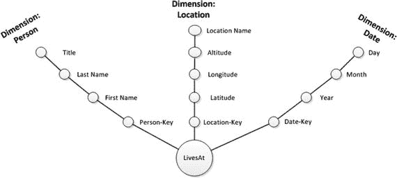
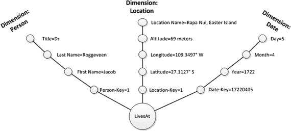
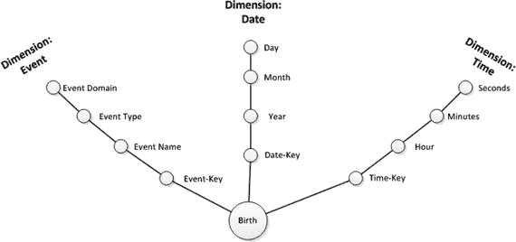
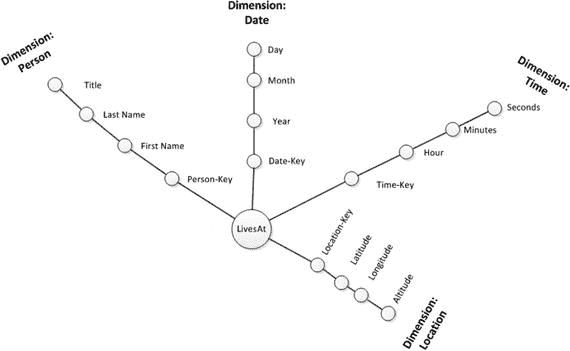
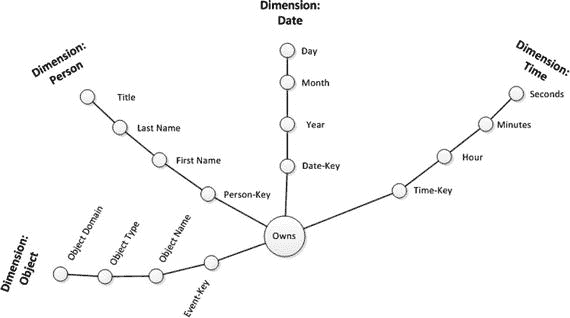
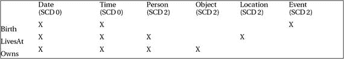
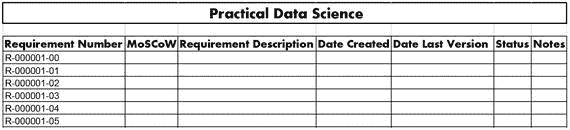
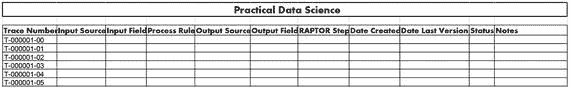

# 4. 业务层

在本章中，我将详细定义业务层，阐明数据科学解决方案中存在的功能性及非功能性需求的原因、位置和内容。通过示例，我将帮助你构建一个实用的业务层，并在详细解释该层以及讨论帮助你执行良好数据科学的方法时，为你提供建议。

业务层是非技术性业务需求与愿望同实际数据科学之间的过渡点。我猜想，本书大多数读者可能倾向于将职业生涯投入到他们眼中更有趣的数据科学工作中。业务层并非完全属于数据科学家，通常，它的成功是业务领域专家、业务分析师、硬件架构师和数据科学家等专业人士共同努力的结果。

## 业务层

业务层是我们记录与业务交互的地方。在这里，我们将业务需求转化为数据科学需求。

如果你想利用令人印象深刻的数据科学技能来处理数据和进行数据整理，那么本章可能不是你期望中一本关于实用数据科学书籍的开端。然而，我建议你阅读本章，如果你想在一个成功的数据科学团队中工作。作为数据科学家，你无法控制业务的方方面面，但有责任确保识别出真正的需求。

> **警告**
> 我见过太多数据科学家因为需求收集不善而导致的糟糕科学成果而受到指责。

## 功能需求

功能需求记录了在与数据科学生态系统交互时，为实现业务在真实环境中的愿景所必须遵守的详细标准。这些需求是业务对系统的看法，也可称为“业务意志”。

> **提示**
> 记录所有业务的愿景，让每个人都提供其输入。你不想遗漏任何内容，因为后续的补充对于所有参与者来说既昂贵又痛苦。

我使用莫斯科（`MoSCoW`）方法（表 4-1）作为优先排序技术，以表明每个需求对业务的重要性。在每个开发周期之前，我都会重新审视所有未完成的需求，以确保专注于当前对业务影响最大的需求。因为业务在发展，你必须了解其真实需求。

**表 4-1**
`MoSCoW` 选项

| 优先级 | 描述 |
| :--- | :--- |
| 必须做 | 优先级为“必须做”的需求对当前交付周期至关重要。 |
| 应该做 | 优先级为“应该做”的需求很重要，但对当前交付周期并非必需。 |
| 可以做 | 优先级为“可以做”的需求是可取但非必要的，即对当前交付周期来说，这些需求能够改善用户体验。 |
| 不做 | 优先级为“不做”的需求是利益相关者认为最不重要、回报最低，或在当前交付周期中不合适的请求。 |

### 通用功能需求

作为一名 `[用户角色]`，我希望实现 `[目标]`，以便达成 `[业务价值]`。

### 具体功能需求

以下针对数据科学环境的具体需求将帮助你创建需求，从而能够将业务愿景转化为技术描述性需求。我发现这些技术在使需求与业务客户保持一致方面非常高效，同时我可以轻松地将它们转换或扩展为高度技术性的开发需求。

### 数据映射矩阵

数据映射矩阵是数据科学中使用的核心功能需求记录技术之一。它追踪数据源中可用的每一个数据项。我建议在处理各层数据时，保持这份实用的矩阵持续更新。

### 太阳模型

基础太阳模型流程由马克·怀特霍恩教授（`www.penguinsoft.co.uk/mark.html`）开发，我在硕士课程中学习了这一方法。（谢谢，马克。）

我对其进行了修改，并在自己的咨询实践中融合了拉尔夫·金博尔博士的智慧、比尔·因蒙的指导，以及我在职业生涯中遇到的几位杰出人士的深刻见解，从而演变出新的流程。

这些技术将随着数据科学的波动而持续演变，我们必须去适应。因此，这里介绍的是 2.0 版的太阳模型。

> **提示**
> 学会不断进化方能生存！

太阳模型是一种需求映射技术，它能帮助你在一个非技术用户也能理解分析意图的层面上记录需求，同时让你能够轻松过渡到数据科学家和数据工程师所需的详细技术建模。

> **注意**
> 在接下来的几页中，我将介绍几个新概念。请继续阅读，因为这一部分将有助于解释完整的流程。

我将以一个示例草拟一套太阳模型，并解释它如何指导你的开发和知识洞察。首先，我必须引导你掌握以下基础知识，以确保你具备阅读后续章节所需的背景知识。

这个太阳模型用于事实 `居住地点`，并支持三个维度：人员、地点和日期。图 4-1 展示了一个典型的太阳模型。

**图 4-1**
典型的太阳模型

该模型可用于存储这样一个事实：某个特定人员从某个特定日期起居住在某个特定地点。因此，如果你想记录雅各布·罗格文博士自 1722 年 4 月 5 日起居住在复活节岛拉帕努伊岛，你的数据将符合这个太阳模型，如图 4-2 所示。

**图 4-2**
太阳模型中的雅各布·罗格文博士记录

看看你是否能将自己的信息记录到同一个太阳模型中。接下来，我将讨论太阳模型的组成部分。

### 维度

维度是一种对事实和度量进行分类的结构，帮助您解答业务问题。缓慢变化维度是一种数据结构，它会在数据湖的整个生命周期内，完整存储维度结构中每次数据加载的历史记录。数据仓库设计工具包中包含了多种类型的缓慢变化维度（`SCD`），它们可以实现不同的维度历史记录规则。

#### SCD 类型 1——仅更新

此维度仅包含特定业务信息的最新值。

**示例**：雅各布·罗格文博士曾居住在复活节岛的拉帕努伊，但现在住在荷兰的米德尔堡。

| 加载 | 名字 | 姓氏 | 地址 |
| :--- | :--- | :--- | :--- |
| 1 | 雅各布 | 罗格文 | 复活节岛，拉帕努伊 |
| 2 | 雅各布 | 罗格文 | 荷兰，米德尔堡 |

`SCD 类型 1` 仅记录雅各布·罗格文博士最初居住的地方，并忽略第二次加载的变化。

| 人员 | | 地点 |
| :--- | :--- | :--- |
| 名字 | 姓氏 | 地址 |
| 雅各布 | 罗格文 | 复活节岛，拉帕努伊 |

我发现这对于存储用户首次注册的地址，或他/她购买的第一个产品非常有用。

#### SCD 类型 2——保持完整历史

此维度包含特定业务信息的完整历史。构建 `SCD 类型 2` 有三种方式。

1. **版本化**：`SCD` 会记录版本号的日志，允许您按变更发生的顺序回读数据。
2. **标记**：`SCD` 将业务数据行的最新版本标记为 `1`，其余标记为 `0`。这样，您可以随时获取最新的行。
3. **生效日期**：`SCD` 会记录特定值对业务数据行有效的时段。

> **提示**：对数据科学来说，最佳的 `SCD` 是带有生效日期的 `SCD 类型 2`。

**示例**：雅各布·罗格文博士曾住在荷兰的米德尔堡，然后住在复活节岛的拉帕努伊，但现在又住在荷兰的米德尔堡。

| 加载 | 名字 | 姓氏 | 地址 |
| :--- | :--- | :--- | :--- |
| 1 | 雅各布 | 罗格文 | 荷兰，米德尔堡 |
| 2 | 雅各布 | 罗格文 | 复活节岛，拉帕努伊 |
| 3 | 雅各布 | 罗格文 | 荷兰，米德尔堡 |

`SCD 类型 2` 在加载三次数据时，仅记录雅各布·罗格文博士居住地点的变化，并使用版本化。

| 人员 | | | 地点 | |
| :--- | :--- | :--- | :--- | :--- |
| 名字 | 姓氏 | 版本 | 地址 | 版本 |
| 雅各布 | 罗格文 | 1 | 荷兰，米德尔堡 | 1 |
| | | | 复活节岛，拉帕努伊 | 2 |
| | | | 荷兰，米德尔堡 | 3 |

我发现这对于存储客户曾居住过的所有地址非常有用，即使不知道他/她在每个地址的具体起止日期。

`SCD 类型 2` 在每次加载三次数据时，仅记录雅各布·罗格文博士居住地点的变化，并使用标记。

| 人员 | | | 地点 | |
| :--- | :--- | :--- | :--- | :--- |
| 名字 | 姓氏 | 标记 | 地址 | 标记 |
| 雅各布 | 罗格文 | 1 | 荷兰，米德尔堡 | 0 |
| | | | 复活节岛，拉帕努伊 | 0 |
| | | | 荷兰，米德尔堡 | 1 |

当我想存储客户曾居住过的所有地址，但不知道他/她在每个地址的具体起止日期或居住顺序时，我发现这很有用。标记仅指示最新的地址是什么。

`SCD 类型 2` 在加载三次数据时，仅记录雅各布·罗格文博士居住地点的变化，并使用生效日期。

| 人员 | | | 地点 | |
| :--- | :--- | :--- | :--- | :--- |
| 名字 | 姓氏 | 生效日期 | 地址 | 生效日期 |
| 雅各布 | 罗格文 | 1722 年 4 月 5 日 | 荷兰，米德尔堡 | 1659 年 2 月 1 日 |
| | | | 复活节岛，拉帕努伊 | 1722 年 4 月 5 日 |
| | | | 荷兰，米德尔堡 | 1729 年 1 月 31 日 |

当我想按客户居住的顺序存储其所有地址，以及他们搬到该地址的时间时，我发现这很有用。

#### SCD 类型 3——过渡维度

此维度仅记录特定业务信息的过渡变化。

**示例**：雅各布·罗格文博士曾住在荷兰的米德尔堡，然后住在复活节岛的拉帕努伊，但现在又住在荷兰的米德尔堡。

| 加载 | 名字 | 姓氏 | 地址 |
| --- | --- | --- | --- |
| 1 | 雅各布 | 罗格文 | 荷兰，米德尔堡 |
| 2 | 雅各布 | 罗格文 | 复活节岛，拉帕努伊 |
| 3 | 雅各布 | 罗格文 | 荷兰，米德尔堡 |

过渡维度通过保存一条记录，其中包含上次变化的值和当前值，从而仅记录最后一次地址变更。三个加载步骤如下：

**步骤 1**：居住在荷兰的米德尔堡

| 地点 |   |
| --- | --- |
| 先前地址 | 地址 |
|   | 荷兰，米德尔堡 |

**步骤 2**：从荷兰的米德尔堡搬到复活节岛的拉帕努伊

| 地点 |   |
| --- | --- |
| 先前地址 | 地址 |
| 荷兰，米德尔堡 | 复活节岛，拉帕努伊 |

**步骤 3**：从复活节岛的拉帕努伊搬到荷兰的米德尔堡

| 地点 |   |
| --- | --- |
| 先前地址 | 地址 |
| 复活节岛，拉帕努伊 | 荷兰，米德尔堡 |

我使用`SCD 类型 3`来记录客户当前值的过渡变化。

### SCD 类型 4——快速增长维度

此维度用于处理变化率高的特定业务信息。这使得数据能够跟踪快速变化，而不会使存储需求不堪重负。

在第 9 章中，我将向您展示如何为您的数据科学设计和部署这些维度。

## 事实

事实是一种度量，象征着现实世界中受管理实体的某个事实。在第 9 章中，我将向您展示如何为数据科学生态系统设计并部署事实。

## 太阳模型内整合矩阵

太阳模型内整合矩阵是一种工具，可帮助您识别不同太阳模型之间的通用维度。假设我们完整的太阳模型集只包含三个模型。

**提示**：在起草太阳模型时，宁可多起草也不要少起草。用它们来详细记录您的需求。

### 太阳模型一

第一个太阳模型（图 4-3）记录了“出生”关系，它直接依赖于选择器“事件”、“日期”和“时间”。

**图 4-3** 太阳模型一

### 太阳模型二

第二个太阳模型（图 4-4）记录了“居住于”关系，它直接依赖于选择器“人员”、“日期”、“时间”和“地点”。

**图 4-4** 太阳模型二

### 太阳模型三

第三个太阳模型（图 4-5）记录了“拥有”关系，它直接依赖于选择器“对象”、“人员”、“日期”和“时间”。

**图 4-5** 太阳模型三

然后，我将不同的维度和事实整合到一个矩阵中（图 4-6）。

**图 4-6** 太阳模型内链接矩阵

该矩阵将在第 10 章中使用，用于设计和实现数据科学的转换过程。

因此，既然您已经知道如何使用太阳模型来捕获功能性需求，那么理解如何实现对非功能性需求的收集也同样重要。

## 非功能性需求

非功能性需求记录了用于评估数据科学生态系统运行的精确标准。

### 无障碍需求

无障碍可被理解为“能够访问”并受益于某个系统或实体的能力。该概念的核心在于让残障人士、有特殊需求的人士能够访问，或通过辅助技术实现访问。

辅助技术涵盖以下方面：

*   视力障碍支持等级：必须能够增加字体大小或类型，以帮助受影响人群阅读
*   色盲支持等级：必须能够更改配色方案以匹配个人需求
*   使用语音激活命令协助残障人士：必须能够为无法正常输入命令或使用鼠标的人提供语音命令

### 审计与管控需求

审计是指能够调查系统的使用情况，并报告任何违反系统数据处理规则的行为。管控则是确保系统按照预先批准的方式和授权用户来使用。

一种称为基于角色的访问控制（RBAC）的方法，是限制系统访问权限、仅允许授权用户访问的最常用方法。RBAC 是一种围绕角色和权限制定的访问控制机制。其组成部分包括角色权限、用户角色以及角色之间的关系，这些共同描述了系统的访问策略。

根据隐私和数据处理的相关法规，这些审计与管控要求也是强制性的。请咨询当地的信息官，以确认具体适用哪些规则。我将在第 6 章中详细讨论过去几年中我见过的一些法律法规。

### 可用性需求

可用性是指系统预期正常运行时间与总停机时间的比率。例如，如果你的营业时间是上午 9:00 至下午 5:00，并且在此期间停机时间不得超过 1 小时，那么你需要 87.5% 的可用性。

请注意，你需要精确指定在哪个节点衡量可用性。如果你在数据湖的边缘进行测量，很可能轻松实现 99.99999% 的可用性。数据湖技术的分布式和容错特性将确保其高可用性。但如果你在业务关键节点进行测量，你会发现这些关键业务点的可用性要求更为具体。

请按以下格式记录你的需求：

`组件 C 在连续测量周期 D 天内，将有 P% 的时间完全可用。`

与之前一些客户使用的笼统的“24/7”或“营业时间”术语相比，你的客户将更容易理解这种表述。没有系统能够满足那些笼统的需求陈述。

业务在一天、一周、一个月或一年中的特定时段也会有高可用性需求。例如，每周一早上，周例会所需的数据科学结果必须可用。这可以记录为：

`每周报告必须在每周一每个办公室的 06:00 至 10:00 之间，100% 的时间完全可用。`

> **注**
> 请思考这对跨越多个时区、拥有全球办公室的客户意味着什么。务必全面理解每一项需求！

正确的需求是：

*   伦敦的每周报告必须在每周一的 06:00 至 10:00（格林威治标准时间或英国夏令时）之间，100% 的时间完全可用。
*   纽约的每周报告必须在每周一的 06:00 至 10:00（东部标准时间或东部夏令时）之间，100% 的时间完全可用。

> **注**
> 你可以清楚地看到，这些需求现在比简单的笼统需求更加精确。

识别数据科学解决方案中的单点故障（SPOF）。务必清晰记录这一点，因为 SPOF 会间接影响许多可用性需求。

强调必须记录并明确指定那些可能无法同时使用的组件之间的依赖关系，以充分反映该可用性需求。

> **注**
> 请注意，同一解决方案中不同组件的不同可用性需求，是最佳的需求记录选项。

### 备份需求

备份，或备份过程，指的是对数据湖以及所有数据科学编程代码、编程库、算法和数据模型进行归档，其唯一目的是在数据丢失或损坏事件发生后，将这些内容恢复到系统已知的良好状态。

请记住：即使数据湖拥有最佳的分布式和自我修复能力，你也必须确保拥有定期且合适的备份来恢复。记住，只有能够成功恢复的备份才是有价值的。

任何系统的价值都在于其恢复到良好状态的能力。这是一个关键需求。例如，假设你的数据科学家用新算法修改了系统，该算法错误地更新了数据湖中未知数量的数据。哦，是的，在业务所有警报爆发前那段寂静的时刻！你需要能够随时通过备份恢复到已知的良好状态。

> **警告**
> 请确保你能以有效且高效的方式恢复备份。这个过程是“备份与恢复”。仅仅生成备份并不能确保生存。请理解如果系统回退两小时，或在你恢复期间发生什么，会对业务产生什么影响。

### 容量、当前与预测

容量是指数据科学处理解决方案加载、处理和存储特定数据量的能力。你必须跟踪当前容量并预测未来需求，因为作为一名数据科学家，你将设计和部署许多复杂模型，这些模型需要额外的容量来完成你在处理周期中创建的处理流程。

> **警告**
> 我曾无意中创建了需要数 TB 工作空间的模型，仅仅是因为将参数设置得比最佳值略微深入了一点。突然间，我的模型以惊人的速度消耗磁盘空间！

## 容量

容量是根据组件在解决方案中数据负载需求变化时，能否持续维持特定性能水平来衡量的。正确记录需求的方法是：

`组件 C 将在 T 秒的时间范围内，为 U 个用户提供 P% 的容量，每个用户的数据量为 M MB。`

示例：

`数据硬盘将在 10 分钟的时间范围内，为 1000 个用户提供 95% 的容量，每个用户的数据量为 10 MB。`

> **警告**
> 调查在一次进程中执行完全重建所需的容量。我建议研究新的云端按需容量，用于灾难恢复或容量补充。我曾因缺乏合理的容量补充计划，在导致公司瘫痪数周的重大事故后提供过咨询。

### 并发

`并发`是指组件在同时承受多个负载的情况下，维持特定性能水平的能力。

记录需求的正确方式是：

`组件 C 将同时支持 U 个用户并发运行预定义的验收脚本 S。`

示例：

`内存将同时支持 100 个用户并发运行对 1000 条记录进行排序的算法。`

**注意**

`并发`是指有效处理总用户群中一个子集的能力。我发现许多解决方案能够处理大量用户，但其中并发运行的用户可能低至总用户数的 10%。

`并发`是一个重要的需求，有助于在项目初期确保解决方案的有效性。容量可以通过增加额外的处理资源来提升，而并发通常需要完全替换组件。

# 设计提示

如果平均而言，你的数据科学算法运行时间很短，那么你可以支持较高的并发度与最大容量之比。但如果平均运行时间较长，那么你的并发度也必须相应提高。这样，你才能维持有效的吞吐性能。

### 吞吐容量

这指的是系统需要在高峰时段、特定条件下处理的事务数量。

### 存储（内存）

这是指系统在运行时为了维持有效的处理方案，将在内存中持久化存储的数据量。

提示：请记住：内存永远不嫌多，也永远不会太慢。

### 存储（磁盘）

这是指系统为维持有效的处理方案，在磁盘上存储的数据量。

提示：请确保你有合理的磁盘组合，以保证解决方案的有效性。

你将需要快速的固态硬盘作为短期存储，以处理运行过程中的容量需求。

警告：有些数据科学算法在处理数据时，会产生比输入或输出数据量更大的数据。

下一个需求是你的长期存储。基本原则是规划更大但更慢的存储。研究使用集群存储，即两个或更多存储服务器协同工作，以提高性能、容量和可靠性。`集群`将工作负载分配给每台服务器，并管理服务器之间的工作负载转移，同时确保可用性。

从长远来看，使用集群存储将使你受益，在高需求时期，你可以通过添加额外设备进行垂直扩展。

提示：确保服务器网络完全有能力处理任何数据科学负载。请记住：典型的数据科学算法需要海量数据集才能有效工作。

大数据的发展正将海量数据带入处理生态系统。因此，请确保你有足够的空间来存储你需要的任何数据。

警告：如果可以选择，请不要与事务型系统共享磁盘存储或网络。数据科学会消耗共享资源上的所有空闲容量。拥有性能较低的专用资源集，也比共享一个不稳定的进程要好。

### 存储（GPU）

这是指系统在运行时，为了利用解决方案的图形处理能力维持有效的并行处理方案，将在 GPU 内存中持久化存储的数据量。CPU 由数量有限的、针对顺序串行处理进行了优化的内核组成，而 GPU 则具有大规模并行架构，包含数千个更小、更高效的内核，旨在同时处理海量的多任务。

巨大的优势在于，将有效数量的超高速内存尽可能紧密地连接到这数千个处理单元上，以利用这种增强的容量。我目前正在部署像 `Kinetic DB` 和 `MapD` 这样的系统，它们是基于 GPU 的数据库引擎。这使我的解决方案的处理速度提升了数百倍。我预计在未来几年内，我们将看到这些系统在容量方面的关键性改进。

提示：研究一下用于高性能处理的 GPU 处理网格。这是利用最新技术的有效解决方案。

### 年同比增长需求

容量增长最大的方面将是长期存储。这些需求被指定为在一段时间内容量增加了多少。

记录需求的正确方式是：

`组件 C 将负责必要的增长容量，以在 T 时间段内处理额外的 M MB 数据。`

## 配置管理

`配置管理 (CM)` 是一个系统工程过程，用于在产品整个生命周期内，根据需求、设计和运营信息，建立并保持产品性能、功能和物理属性的一致性。

## 部署

需要一种有条理的程序，将数据科学引入组织的各个领域。研究如何实现数据科学模型的实用的持续部署。这些技能需求量很大，因为随着企业采用新的处理技术，流程模型的变化越来越频繁。

### 文档

数据科学需要一套文档来支撑算法背后的故事。在我引导你阅读第 5 章到第 11 章时，我会解释处理流程每个阶段所需的文档。

## 灾难恢复

`灾难恢复 (DR)` 涉及一组策略和程序，用于在自然或人为灾难后恢复或维持关键技术基础设施和系统的运行。

## 效率（给定负载下的资源消耗）

`效率` 是指以最少的精力和时间完成工作的能力。作为一名数据科学家，你需要了解每种建模技术和算法的效率曲线。正如我之前建议的，你必须在不同规模下练习使用你的工具。

提示：如果它在 10 万个数据点的样本上有效，那就试试 20 万个数据点或 50 万个数据点。确保你了解工具的扩展动态。

## 有效性（相对于投入的产出性能）

`有效性` 是达成目标的能力；从生态系统中产生精确预期或期望的结果。作为一名数据科学家，你需要了解每种建模技术和算法的有效性曲线。你必须确保该过程只执行所需的处理，并且没有副作用。

## 可扩展性

在数据科学生态系统内，增加额外功能并在下一版本升级时保留定制化的能力。数据科学必须始终能够扩展以支持新的需求。

### 故障管理

`故障管理` 是识别故障根本原因，然后成功记录所有相关细节供未来分析和报告的能力。我发现，我将在生态系统中包含的大多数工具，其原生内部处理中已经内置了足够的故障管理和报告能力。

提示：我发现，只需一套简单但结构良好的数据科学流程，就可以将单个故障日志整合到一个适当的故障管理系统中。对它应用常规的数据科学方法，就像处理另一个数据源一样。

在数据科学处理过程中，生态系统中的任何组件发生故障时，我总是会规定精确预期的处理步骤。验收脚本 `S` 完成并报告它生成的每个 `X` 故障。作为一名数据科学家，你需要记录系统的任何故障，以确保不会产生可能对客户造成不利影响的意外副作用。

## 容错

容错是数据科学生态系统处理系统故障的能力。简单来说，任何单一事件都不能导致生态系统停止数据科学处理流程。

在这里，我通常会明确规定在记录故障时，生态系统内部的精确操作监控、测量和管理需求。验收脚本 `S` 能够承受其产生的 `X` 个故障。作为数据科学家，你需要确保你的数据科学算法能够处理故障，并有条不紊地从故障中恢复。

### 延迟

延迟是指数据从系统的一部分传输到另一部分所需的时间。这在数据科学生态系统的分布式环境中高度相关。验收脚本 `S` 在空载系统上需在 `T` 秒内完成，在满负荷运行的系统上需在 `T2` 秒内完成，具体由并发需求定义。

> 提示：请记住：构成生态系统的组件之间也存在内部延迟，用户无法直接访问。请确保在你的需求中也注明这些延迟。

### 互操作性

在本节中，请坚持要求在不同计算机系统之间共享数据的精确能力。详细说明哪个系统必须与哪些其他系统进行交互。我通常会调研通信协议、服务器位置、不同子组件的操作系统以及如今至关重要的最终用户互联网接入标准等领域。

> 警告：需求必须精确，因为开放的互操作性可能会在开发周期后期导致意想不到的复杂情况。

## 可维护性

规定一个特定组件保持指定状态的精确时间段。详细描述如何在保持生态系统处于已知良好状态的同时，应用功能变更、修复和增强。

## 可修改性

明确规定生态系统的每一层必须支持的变更量。

> 提示：说明解决方案特定层的限制是什么。如果数据库只能支持为一张表增加 2024 个字段，请分享该信息！

### 网络拓扑

规定并描述生态系统内用于处理流程的详细网络通信需求。同时，说明预期的与外部世界的通信，以推动数据科学取得成功。

> 注意：由于多个分布式数据科学算法处理过程会对网络流量产生重大影响，你需要了解并记录生态系统在可接受水平下运行所必需的网络环境。

### 隐私

我建议列出适用于此生态系统的确切隐私法律法规。确保记录下适用的具体法律法规。如果不确定，请寻求法律建议。

这是一个全球性的热点话题，因为你将处理并存储他人的数据，并针对这些数据执行算法。作为一名数据科学家，你要对自己的行为负责。

> 警告：请记住：侵犯隐私将导致罚款！

> 提示：我为所处理数据的法律责任索赔购买了责任保险。

## 质量

明确规定在生态系统各个层面发现的严重缺陷、交付的缺陷以及缺陷移除效率。请记住：数据质量是一个功能性需求。这是一个非功能性需求，它描述的是生态系统的质量，而不是流经它的数据的质量。

## 恢复/可恢复性

生态系统必须有一个明确的平均恢复时间（MTTR）指标。生态系统中特定层和组件的 MTTR 必须分别指定。

我通常以小时为单位进行测量，但对于其他特别复杂的系统，我会以分钟甚至秒为单位进行测量。

## 可靠性

生态系统必须有一个精确的平均故障间隔时间（MTBF）。这种可用性度量以预先约定的时间单位来指定。我通常以小时为单位进行测量，但也有一些非常敏感的系统最好以年为单位进行测量。

## 弹性

弹性是指当故障和正常操作中的问题给处理流程带来复杂性时，能够提供并维持可接受服务水平的能力。生态系统必须具有明确定义的能力，无论其在处理过程中需要应对什么问题，都能及时恢复到原始形式和状态。

### 资源约束

资源约束是生态系统所有组件的物理需求。关注的领域包括处理器速度、内存、磁盘空间和网络带宽，此外通常还包括你部署到生态系统中的工具所指定的其他几个因素。

> 提示：与你的系统工程师讨论这些需求。这通常不是数据科学家工作的领域。

## 可复用性

可复用性是指在数据科学生态系统开发过程中使用预构建的处理解决方案。强烈建议数据科学家在常规数据处理中重用经过预先批准的处理模块和算法。这里的要求是，你应使用经批准且公认的标准来验证自己的结果。

> 警告：我总是建议你使用有可靠来源的方法论和算法。经过批准的算法将保证业务方的认可。不要使用未经证实的想法！

## 可伸缩性

# 可伸缩性

可伸缩性是指你如何让数据科学生态系统适应你的需求。我在我的生态系统中使用三种可伸缩性模型：水平伸缩、垂直伸缩和动态（按需）伸缩。

## 水平伸缩

水平伸缩通过增加更多独立资源来提升数据科学生态系统的容量，以提高性能并提供高可用性（HA）。生态系统通过向外扩展来实现增长，即向数据科学资源集群中添加更多服务器。

> **提示**
> 水平伸缩是处理大规模数据科学生态系统的可靠方法。

> **警告**
> 并非所有模型和算法都能进行水平伸缩。请先进行测试。我建议不要做出假设。

## 垂直伸缩

垂直伸缩通过向单个机器添加更多资源（更多内存或额外的 CPU）来提升容量。

> **警告**
> 请确保在开始时正确确定数据科学构建模块的规模，因为集群的垂直扩展后期可能会变得昂贵且难以更换。

## 动态（按需）伸缩

动态（按需）伸缩通过利用公共或私有云能力来增加资源以提升容量，这些资源可以按需付费模式进行增减。这是一种混合模型，使用一组核心资源（系统的最小占用空间），并辅以额外的突发协议，以覆盖系统所需的任何计划内甚至计划外的额外容量扩展。

我想为你系统中的高级用户讨论一下可伸缩性。传统上，我可能会建议使用高规格的工作站，但我发现，通过为他们提供访问灵活的按需水平伸缩环境的权限，可以更好地服务他们。这样，他们可以在处理高峰期间使用所需的资源，而在不需要额外处理能力时与他人共享容量。

## 安全性

安全性是最重要的非功能性需求之一。我在三个层面规定安全需求。

### 隐私

我会特别注明保护生态系统内敏感信息的需求。需要注明的隐私需求类型包括数据库表的数据加密以及向第三方传输数据的策略。

> **提示**
> 隐私需求的来源是立法或公司规定。请咨询你的法律专家。

#### 物理环境

我将特别指出系统物理防护方面的需求。包括电力、高架地板、额外的服务器冷却、防火系统以及机柜锁等物理要求。

> **警告**
> 处理数据科学所需的部分高性能工作站对电力有严格要求，因此请确保您的数据科学家处于经预批准的环境中，以避免电网过载。

#### 访问控制

我特意规定了详细的访问需求，包括明确的账户类型/组及其精确的访问权限。

> **提示**
> 我使用基于角色的访问控制（`RBAC`）来规范对数据科学资源的访问，依据是生态系统中单个用户的角色，而非其个人姓名。这样，我只需将角色转移给新人员，而无需对安全配置文件做任何更改。

## 可测试性

国际标准 `IEEE 1233-1998` 指出，可测试性是“需求被表述为能够建立测试标准并执行测试以确定这些标准是否被满足的程度”。简而言之，如果你的需求不可测试，就不要接受它们。

> **切记**
> 可测试性越低，测试工作量就越大。我曾为那些表述不清的需求，耗费了无数个夜晚来编写测试。

以下是一系列基于我经验的建议。

### 可控性

确切知道我可以按测试要求控制被测代码状态的程度至关重要。数据科学使用的算法并非总是可控的，因为它们会包含随机起点以加速过程。运行分布式算法不易处理，因为工作负载的分配不受你控制。

### 可隔离性

我能够隔离被测代码的具体程度将决定大部分可能的测试方式。诸如深度学习这类过程包含非隔离特性，因此不要接受那些因无法隔离而无法测试的需求。

### 可理解性

我发现大多数算法都有未记录的“额外功能”，或者简单来说，就是“陷阱”状态。被测算法的文档化程度直接影响需求的可测试性。

### 可自动化性

我发现，我能够自动化测试代码的程度，直接影响到生态系统中算法测试的有效性和效率。我是已知结果内联测试的狂热爱好者。我会在算法中添加代码来测试特定的子环节，以确保新代码没有改变之前已验证过的代码。

## 需求的常见陷阱

我只想列举在为我的客户群执行数据科学工作时注意到的常见陷阱样本。如果你已经意识到这些陷阱，那很好！

许多陷阱看似显而易见；然而，在我被聘用之前，这些陷阱常常导致我的客户损失数百万美元的项目，我仍经常参与其中。那么，让我们来看看我经常遇到的一些更常见的陷阱吧。

### 模糊词汇

模糊词汇是主观的，或者缺乏通用或精确的定义。以下是包含并识别出模糊词汇的示例：

*   用户必须能够轻松访问系统。什么是“轻松”？

*   使用可靠的技术。什么是“可靠”？

*   最先进的设备。什么是“最先进”？

*   报告必须频繁运行。什么是“频繁”？

*   用户友好的报告布局。什么是“用户友好”？

*   系统的安全访问。什么是“安全”？

*   所有数据必须立即报告。什么是“所有”？什么是“立即”？

我还可以添加更多示例。但你已经明白了这个共同主题。确保你的需求措辞精确而具体。可悲的是，我逐渐认识到，由于使用了模糊词汇，各种项目最终以失败告终。

### 未穷举列表

未穷举列表是指不完整的项目列表。示例如下：

*   至少可以从伦敦和纽约访问。我只连接伦敦和纽约吗？其他 20 个分支机构怎么办？

*   包括但不限于伦敦和纽约的办公室必须拥有访问权限。那么，新德里办事处是否不在解决方案范围内？

确保你的列表是完整且精确的。这可以防止后续因需求被误解而产生的问题。

### 隐含集合

当需求中的对象集合未被明确定义时，你或你的团队会假定一个错误含义。请看以下示例：

**示例：** 解决方案必须支持 TCP/IP 以及现有 Linux 用户所支持的其他网络协议。

*   “现有用户”是什么意思？

*   “其他网络协议”这个集合包含哪些内容？

*   包含 TCP/IP 的哪些具体协议？

*   “Linux”是来自多家供应商的一系列操作系统，拥有许多版本甚至修订版。你支持所有不同的版本，还是只支持其中一个？

确保你的集合是明确且精确的。这可以防止后续因需求被误解而产生的问题。

### 歧义

当需求中的词语有多重含义时，就会产生歧义。示例如下。

#### 模糊性

该系统必须在使用当前数据科学标准的测试用例中通过 96%~100%。

什么是“当前标准”？这是一个需求不清晰的例子！

#### 主观性

报告必须轻松无缝地与网站集成。

就测试而言，“轻松”和“无缝”是高度主观的术语。

#### 可选性

该解决方案应尽可能在多种硬件条件下进行测试。

“尽可能”使这个需求变成了可选项。如果它在每种硬件设置上的测试都失败了怎么办？你的客户能接受吗？

#### 规定不足

该解决方案必须支持 Hive 2.1 和其他数据库版本。

“其他数据库版本”是仅包括其他 Hive 数据库，还是也包括诸如 HBase 1.0 和 Oracle 10i 等其他数据库？

#### 引用不明

用户必须在一天中 90%的时间内，在三分钟内完成所有先前定义的报告。

这些“先前定义的”报告是什么？这是一个需求不清晰的例子。

## 工程化实用的业务层

我在本书中引用的任何源代码或其他补充材料，读者均可通过本书的产品页面在 GitHub 上获取，网址为 [`www.apress.com/9781484230534`](http://www.apress.com/9781484230534)。业务层遵循通用的业务分析和项目管理原则。我建议一个实用的业务层至少包含三个主要结构。

> **注意**
> 请参阅第 2 章的以下源代码：`./VKHCG/05-DS/5000-BL/`。

对于业务层，我建议使用如下目录结构：`./VKHCG/05-DS/5000-BL`。这使你能保持解决方案的整洁有序，以便与标准版本控制系统成功交互。

### 需求

> **注意**
> 请参阅第 2 章的以下源代码：`./VKHCG/05-DS/5000-BL/0300-Requirements`。

每个需求必须以完整版本控制的方式记录，采用“一个需求一个文件”的模式。我建议使用 `000000-00` 的编号方案，该方案支持多达一百万个需求，每个需求最多可有一百个版本。

### 需求登记表

> **注意**
> 请参阅第 2 章中的以下源代码：`./VKHCG/05-DS/5000-BL/0100-Requirements-Registry`。

将所有需求汇总在一个文件中，保存一份摘要登记表，以便于查找特定需求。建议你设置如下几列：需求编号、MoSCoW 优先级、简要描述、创建日期、最后版本日期和状态。我通常使用以下状态值：

- `In-Development`

- `In-Production`

- `Retired`

该登记表作为数据科学环境需求的控制机制。图 4-7 显示了一个模板示例。

**图 4-7** – 需求登记表模板

### 可追溯性矩阵

> **注意**
> 请参阅第 2 章中的以下源代码：`./VKHCG/05-DS/5000-BL/0200-Traceability-Matrix`。

针对每个需求和你所开发的数据科学流程，创建一份可追溯性矩阵，以确保你清楚哪个数据科学流程支持哪个需求。这能确保你对环境拥有完全的控制权。如果你了解所有内容如何相互关联，那么进行变更就会很容易。图 4-8 显示了一个模板示例。

**图 4-8** – 可追溯性矩阵模板

## 总结

做得好！现在你已经拥有了一个业务层，并且详细了解了你的数据科学环境需要满足什么要求。请记住：业务层必须支持完整的需求集合的全面收集，以便数据科学家能够成功地使用它们。

在下一章关于工具层的部分，我将继续引导你走上实用数据科学的道路，使你的数据科学环境能够利用一个可复用的处理生态系统。

