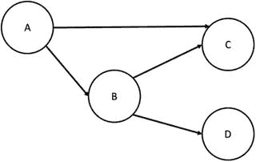
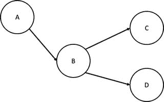

# 评估步骤

本章的目标是向你展示如何评估你的数据科学数据，以发现无效或错误的数据值。

**注意**
我发现在我 90% 的项目中，有 70% 的处理工作都花在了这个步骤上，目的是提高所用数据的质量。这个步骤无疑会提高你数据科学工作的质量。

我强烈建议你在进行数据科学工作之前，花时间对数据进行“清理”，因为错误的数据条目会对后续步骤产生重大影响。也请针对“错误”数据开展数据科学项目，以理解上游流程为何会产生错误数据。通过调查这些错误数据，我发现了客户生态系统中许多未知的问题。

现在，我将向你介绍一系列评估技术和算法，我会在项目检索阶段，科学地将它们应用于导入的数据。

**注意**
你的特定数据源会有额外要求。请根据你的特定数据，探索所需的其他质量技术和算法。

## 评估步骤

数据质量指的是一组定性或定量变量的状况。数据质量是衡量特定数据集可接受性的一个多维指标。在商业中，衡量数据质量是为了确定数据是否可以作为可靠情报提取的基础，以支持组织决策。

数据剖析涉及在你的数据源中观察信息提供的所有视角。主要目标是确定各个视角是否准确和完整。评估步骤决定了对于不符合要求的数据条目需要应用哪些额外的处理。

我应该指出，执行此任务并不像大多数客户想象的那么简单。少量错误数据可能会对后续数据处理步骤产生重大影响，并可能影响数据科学的质量。

**注意**
你总会遇到错误。正是这些质量技术和算法解决了这些错误，引导你走上成功数据科学之路。

### 错误

你发现了错误或问题吗？通常，我可以对数据采取以下四种处理方式之一。

#### 接受错误

如果错误在可接受的标准范围内（例如，“West Street”而不是“West St.”），我可以决定接受它并继续处理下一个数据条目。

请注意，如果你接受错误，将会影响执行分类的数据科学技术和算法，例如分箱、回归、聚类和决策树，因为这些过程假设此示例中的值是不同的。这是一种简单的选择，但并非总是最佳选择。

#### 拒绝错误

偶尔，主要是在首次数据导入时，信息损坏严重，以至于最好有方法地直接删除数据条目，而不是试图纠正它。请注意：删除数据是最后的手段。我通常会添加一个质量标志，并使用此标志来避免这些错误数据被用于会受其负面影响的数据科学技术和算法。我将在本书的其余部分讨论具体的数据科学技术和算法，并在每个阶段解释如何处理错误数据。

#### 纠正错误

这是评估步骤中大部分工作致力于实现的选择。客户姓名、地址和位置中的拼写错误是常见的错误来源，这些错误会被有条不紊地纠正。如果名称存在变体，我建议将一个数据源设置为“主数据源”，并以此主数据源为基础，跨所有数据库保持数据的一致和正确。我还建议将原始错误存储在一个单独的值中，因为它有助于发现持续产生错误的数据源的模式。

#### 创建默认值

这是我在企业咨询工作中常见的一种选择。大多数系统开发者假设，如果业务方没有输入值，他们就应该输入一个默认值。我见过的常见默认值有“未知”或“不适用”。不幸的是，我也见过许多不理想的选择，例如用生日作为日期，用宠物名字作为名字和姓氏，用父母的地址作为地址……当多个使用相同服务进行营销的公司向父母地址发送超过 300 封附带样品的营销信函时，这种地址选择当然会出问题。我建议你与客户详细讨论默认值，并就官方的“缺失数据”值达成一致。

### 数据分析

我总是为所有导入的数据生成一份健康报告。我建议使用以下六个数据质量维度。

## 完整性

我计算每个数据源字段中错误条目数占总数据量的百分比。若数据源因包含关键数据（客户姓名、电话号码、电子邮件地址等）而具有特殊重要性，我优先分析这些字段，确保数据源具备进入下一阶段分析的条件，以验证非关键数据的完整性。例如，要实现个人数据的唯一性，至少需要名字、姓氏和出生日期这三项。如果其中任何信息缺失，则该个人数据条目即为不完整。请注意，完整性是针对你所处理数据的业务领域而言的。

## 唯一性

我评估特定值相对于该字段中其他数据的唯一程度。同时，还需将该值与其他已知同数据集来源的值进行比对。最后一项唯一性检验是找出同一字段存在于多个数据源中的情况。通常，你会以直方图的形式报告每个数据源中所有唯一值的分布情况，以此来呈现唯一性。

## 时效性

记录日期和时间对数据源的影响。数据是否存在稳定期或不稳定期？在进行源系统提取调度时，这一检查十分有用。我曾见过无数在月底结束前就执行的月末快照提取。这些提取数据毫无价值。我建议你与客户的运营人员紧密合作，确保在业务周期的正确时间点执行数据提取。

## 有效性

有效性需根据已知且获批的标准进行检验。记录结果以不符合标准的数据所占百分比呈现。我发现大多数数据条目都有对应的标准。例如，国家代码使用 ISO 3166-1 标准；货币使用 ISO 4217 标准。

我还建议你关注客户特定的标准，例如国际疾病分类（ICD）标准 ICD-10。请注意：标准会随时间变化。例如，ICD-10 是标准的第十版。ICD-7 于 1958 年生效，ICD-8A 于 1968 年，ICD-9 于 1979 年，ICD-10 于 1999 年。因此，当你验证数据时，务必在正确的数据时段应用正确的标准。

## 准确性

准确性是针对数据源中记录的真实人物或对象来衡量数据准确程度。存在一些法规，例如欧盟的《通用数据保护条例》（GDPR），要求数据在准确性方面必须合规。我建议你调查自己需要遵守哪些关于准确性的标准和法规。

## 一致性

该度量指标记录数据模式的变化。衡量每次数据加载后数据的变化情况。我建议你测量数据源的模式和校验和。

在第九章 `9`，我将介绍一种名为“数据仓库”的数据结构，它将帮助你完成此过程。在第十章 `10`，我将演示如何使用缓慢变化维度来追踪这些一致性。

**注意**
对系统中错误的研究与对有效数据的研究同等重要。许多真实的业务问题都是由数据错误引起的。

现在，我将继续指导你将刚刚学到的知识付诸实践。

## 实践操作

在第七章 `7`，我向你介绍了 Python 包 `pandas`。该包具备多种自动错误管理功能。

### Pandas 中的缺失值

我将首先引导你了解一些基本的错误处理概念，然后将所学内容应用于样本数据。我将使用带有 `pandas` 包的 Python 进行演示，但这些基本概念同样适用于许多其他工具。

以下是四个基本的处理概念。

#### 删除所有元素均为缺失值的列

打开你的 Python 编辑器，在目录 `C:\VKHCG\01-Vermeulen\02-Assess` 下创建一个名为 `Assess-Good-Bad-01.py` 的文件。然后将以下代码复制到文件中：


```
################################################################
# -*- coding: utf-8 -*-
################################################################
Import sys
import os
import pandas as pd
################################################################
if `sys.platform` == 'linux':
`Base`=os.path.expanduser('~') + '/VKHCG'
else:
`Base`='C:/VKHCG'
print('################################')
print('Working Base:',`Base`,'using',`sys.platform`)
print('################################') `sInputFileName`='Good-or-Bad.csv'
`sOutputFileName`='Good-or-Bad-01.csv'
`Company`='01-Vermeulen'
################################################################
################################################################
`sFileDir`=`Base` + '/' + `Company` + '/02-Assess/01-EDS/02-Python'
if not os.path.exists(`sFileDir`):
os.makedirs(`sFileDir`)
################################################################
### Import Warehouse
################################################################
`sFileName`=`Base` + '/' + `Company` + '/00-RawData/' + `sInputFileName`
print('Loading:',`sFileName`)
`RawData`=pd.read_csv(`sFileName`,header=0)
print('################################')
print('## Raw Data Values')
print('################################')
print(`RawData`)
print('################################')
print('## Data Profile')
print('################################')
print('Rows:',`RawData`.shape[0])
print('Columns:',`RawData`.shape[1])
print('################################')
################################################################
`sFileName`=`sFileDir` + '/' + `sInputFileName`
`RawData`.to_csv(`sFileName`, index = False)
################################################################
## This is the important action! The rest of this code snippet
## Only supports this action.
################################################################
`TestData`=`RawData`.dropna(axis=1, how="all")
################################################################
print('################################')
print('## Test Data Values')
print('################################')
print(`TestData`)
print('################################')
print('## Data Profile')
print('################################')
print('Rows:',`TestData`.shape[0])
print('Columns:',`TestData`.shape[1])
print('################################')
################################################################
`sFileName`=`sFileDir` + '/' + `sOutputFileName`
`TestData`.to_csv(`sFileName`, index = False)
################################################################
print('################################')
print('### Done!! #####################')
print('################################')
################################################################
```

保存文件 `Assess-Good-Bad-01.py`，然后使用你的 Python 编译器编译并执行它。这将在目录 `C:/VKHCG/01-Vermeulen/02-Assess/01-EDS/02-Python` 下生成一组显示值以及两个名为 `Good-or-Bad.csv` 和 `Good-or-Bad-01.csv` 的文件。

该代码加载以下原始数据：

| ID | FieldA | FieldB | FieldC | FieldD | FieldE | FieldF | FieldG |
| --- | --- | --- | --- | --- | --- | --- | --- |
| 1 | 好 | 更好 | 最好 | 1024 |   | 10241 | 1 |
| 2 | 好 |   | 最好 | 512 |   | 5121 | 2 |
| 3 | 好 | 更好 |   | 256 |   | 256 | 3 |
| 4 | 好 | 更好 | 最好 |   |   | 211 | 4 |
| 5 | 好 | 更好 |   | 64 |   | 6411 | 5 |
| 6 | 好 |   | 最好 | 32 |   | 32 | 6 |
| 7 |   | 更好 | 最好 | 16 |   | 1611 | 7 |
| 8 |   |   | 最好 | 8 |   | 8111 | 8 |
| 9 |   |   |   | 4 |   | 41 | 9 |
| 10 | A | B | C | 2 |   | 21111 | 10 |
|   |   |   |   |   |   |   | 11 |
| 10 | 好 | 更好 | 最好 | 1024 |   | 102411 | 12 |
| 10 | 好 |   | 最好 | 512 |   | 512 | 13 |
| 10 | 好 | 更好 |   | 256 |   | 1256 | 14 |
| 10 | 好 | 更好 | 最好 |   |   |   | 15 |
| 10 | 好 | 更好 |   | 64 |   | 164 | 16 |
| 10 | 好 |   | 最好 | 32 |   | 322 | 17 |
| 10 |   | 更好 | 最好 | 16 |   | 163 | 18 |
| 10 |   |   | 最好 | 8 |   | 844 | 19 |
| 10 |   |   |   | 4 |   | 4555 | 20 |
| 10 | A | B | C | 2 |   | 111 | 21 |

`TestData=RawData.dropna(axis=1, how="all")` 这行代码会执行如下纠错：

| ID | FieldA | FieldB | FieldC | FieldD | FieldF | FieldG |
| --- | --- | --- | --- | --- | --- | --- |
| 1 | 好 | 更好 | 最好 | 1024 | 10241 | 1 |
| 2 | 好 |   | 最好 | 512 | 5121 | 2 |
| 3 | 好 | 更好 |   | 256 | 256 | 3 |
| 4 | 好 | 更好 | 最好 |   | 211 | 4 |
| 5 | 好 | 更好 |   | 64 | 6411 | 5 |
| 6 | 好 |   | 最好 | 32 | 32 | 6 |
| 7 |   | 更好 | 最好 | 16 | 1611 | 7 |
| 8 |   |   | 最好 | 8 | 8111 | 8 |
| 9 |   |   |   | 4 | 41 | 9 |
| 10 | A | B | C | 2 | 21111 | 10 |
| 10 | 好 | 更好 | 最好 | 1024 | 102411 | 12 |
| 10 | 好 |   | 最好 | 512 | 512 | 13 |
| 10 | 好 | 更好 |   | 256 | 1256 | 14 |
| 10 | 好 | 更好 | 最好 |   |   | 15 |
| 10 | 好 | 更好 |   | 64 | 164 | 16 |
| 10 | 好 |   | 最好 | 32 | 322 | 17 |
| 10 |   | 更好 | 最好 | 16 | 163 | 18 |
| 10 |   |   | 最好 | 8 | 844 | 19 |
| 10 |   |   |   | 4 | 4555 | 20 |
| 10 | A | B | C | 2 | 111 | 21 |


#### 删除任何元素存在缺失值的列

|  ---  |  ---  |  ---  |  ---  |  ---  |  ---  |  ---  |
| --- | --- | --- | --- | --- | --- | --- |

| 1 | 好 | 更好 | 最好 | 1024 | 10241 | 1 |
| 2 | 好 |   | 最好 | 512 | 5121 | 2 |
| 3 | 好 | 更好 |   | 256 | 256 | 3 |
| 4 | 好 | 更好 | 最好 |   | 211 | 4 |
| 5 | 好 | 更好 |   | 64 | 6411 | 5 |
| 6 | 好 |   | 最好 | 32 | 32 | 6 |
| 7 |   | 更好 | 最好 | 16 | 1611 | 7 |
| 8 |   |   | 最好 | 8 | 8111 | 8 |
| 9 |   |   |   | 4 | 41 | 9 |
| 10 | A | B | C | 2 | 21111 | 10 |
|   |   |   |   |   |   | 11 |
| 10 | 好 | 更好 | 最好 | 1024 | 102411 | 12 |
| 10 | 好 |   | 最好 | 512 | 512 | 13 |
| 10 | 好 | 更好 |   | 256 | 1256 | 14 |
| 10 | 好 | 更好 | 最好 |   |   | 15 |
| 10 | 好 | 更好 |   | 64 | 164 | 16 |
| 10 | 好 |   | 最好 | 32 | 322 | 17 |
| 10 |   | 更好 | 最好 | 16 | 163 | 18 |
| 10 |   |   | 最好 | 8 | 844 | 19 |
| 10 |   |   |   | 4 | 4555 | 20 |
| 10 | A | B | C | 2 | 111 | 21 |

E 列已被完全删除，因为该列的所有值均为缺失值或错误值。

打开您的 Python 编辑器，在目录`C:\VKHCG\01-Vermeulen\02-Assess`中创建一个名为`Assess-Good-Bad-02.py`的文件。然后将以下代码复制到该文件中：

```python
################################################################
# -*- coding: utf-8 -*-
################################################################
Import sys
import os
import pandas as pd
################################################################
if sys.platform == 'linux':
Base=os.path.expanduser('~') + '/VKHCG'
else:
Base='C:/VKHCG'
print('################################')
print('Working Base:',Base,'using',sys.platform)
print('################################') sInputFileName='Good-or-Bad.csv'
sOutputFileName='Good-or-Bad-02.csv'
Company='01-Vermeulen'
################################################################
Base='C:/VKHCG'
################################################################
sFileDir=Base + '/' + Company + '/02-Assess/01-EDS/02-Python'
if not os.path.exists(sFileDir):
os.makedirs(sFileDir)
################################################################
### Import Warehouse
################################################################
sFileName=Base + '/' + Company + '/00-RawData/' + sInputFileName
print('Loading:',sFileName)
RawData=pd.read_csv(sFileName,header=0)
print('################################')
print('## Raw Data Values')
print('################################')
print(RawData)
print('################################')
print('## Data Profile')
print('################################')
print('Rows:',RawData.shape[0])
print('Columns:',RawData.shape[1])
print('################################')
################################################################
sFileName=sFileDir + '/' + sInputFileName
RawData.to_csv(sFileName, index = False)
################################################################
## This is the important action! The rest of this code snippet
## Only supports this action.
################################################################
TestData=RawData.dropna(axis=1, how="any")
################################################################
print('################################')
print('## Test Data Values')
print('################################')
print(TestData)
print('################################')
print('## Data Profile')
print('################################')
print('Rows:',TestData.shape[0])
print('Columns:',TestData.shape[1])
print('################################')
################################################################
sFileName=sFileDir + '/' + sOutputFileName
TestData.to_csv(sFileName, index = False)
################################################################
print('################################')
print('### Done!! #####################')
print('################################')
################################################################
```

保存`Assess-Good-Bad-02.py`文件，然后使用 Python 编译器进行编译和执行。这将生成一组显示值，并在目录`C:/VKHCG/01-Vermeulen/02-Assess/01-EDS/02-Python`中生成两个文件，分别为`Good-or-Bad.csv`和`Good-or-Bad-02.csv`。

代码加载了以下原始数据：

| ID | FieldA | FieldB | FieldC | FieldD | FieldE | FieldF | FieldG |
| --- | --- | --- | --- | --- | --- | --- | --- |

| 1 | 好 | 更好 | 最好 | 1024 |   | 10241 | 1 |
| --- | --- | --- | --- | --- | --- | --- | --- |
| 2 | 好 |   | 最好 | 512 |   | 5121 | 2 |
| 3 | 好 | 更好 |   | 256 |   | 256 | 3 |
| 4 | 好 | 更好 | 最好 |   |   | 211 | 4 |
| 5 | 好 | 更好 |   | 64 |   | 6411 | 5 |
| 6 | 好 |   | 最好 | 32 |   | 32 | 6 |
| 7 |   | 更好 | 最好 | 16 |   | 1611 | 7 |
| 8 |   |   | 最好 | 8 |   | 8111 | 8 |
| 9 |   |   |   | 4 |   | 41 | 9 |
| 10 | A | B | C | 2 |   | 21111 | 10 |
|   |   |   |   |   |   |   | 11 |
| 10 | 好 | 更好 | 最好 | 1024 |   | 102411 | 12 |
| 10 | 好 |   | 最好 | 512 |   | 512 | 13 |
| 10 | 好 | 更好 |   | 256 |   | 1256 | 14 |
| 10 | 好 | 更好 | 最好 |   |   |   | 15 |
| 10 | 好 | 更好 |   | 64 |   | 164 | 16 |
| 10 | 好 |   | 最好 | 32 |   | 322 | 17 |
| 10 |   | 更好 | 最好 | 16 |   | 163 | 18 |
| 10 |   |   | 最好 | 8 |   | 844 | 19 |
| 10 |   |   |   | 4 |   | 4555 | 20 |
| 10 | A | B | C | 2 |   | 111 | 21 |

`TestData=RawData.dropna(axis=1, how="any")` 这行代码会执行如下纠错：

| FieldG |
| --- |
| 1 |
| 2 |
| 3 |
| 4 |
| 5 |
| 6 |
| 7 |
| 8 |
| 9 |
| 10 |
| 11 |
| 12 |
| 13 |
| 14 |
| 15 |
| 16 |
| 17 |
| 18 |
| 19 |
| 20 |
| 21 |

列 A、B、C、D、E 和 F 已被移除，因为其中一些值存在缺失值或错误。当您需要隔离完整且正确的列时，移除整个列的操作非常有用。

## 仅保留最多包含两个缺失值的行

打开你的 Python 编辑器，并在目录 `C:\VKHCG\01-Vermeulen\02-Assess` 中创建一个名为 `Assess-Good-Bad-03.py` 的文件。现在将以下代码复制到该文件中：

```python
################################################################
# -*- coding: utf-8 -*-
################################################################
Import sys
import os
import pandas as pd
################################################################
if sys.platform == 'linux':
Base=os.path.expanduser('~') + '/VKHCG'
else:
Base='C:/VKHCG'
print('################################')
print('Working Base:',Base,'using',sys.platform)
print('################################') ################################################################
sInputFileName='Good-or-Bad.csv'
sOutputFileName='Good-or-Bad-03.csv'
Company='01-Vermeulen'
################################################################
Base='C:/VKHCG'
################################################################
sFileDir=Base + '/' + Company + '/02-Assess/01-EDS/02-Python'
if not os.path.exists(sFileDir):
os.makedirs(sFileDir)
################################################################
### Import Warehouse
################################################################
sFileName=Base + '/' + Company + '/00-RawData/' + sInputFileName
print('Loading:',sFileName)
RawData=pd.read_csv(sFileName,header=0)
print('################################')
print('## Raw Data Values')
print('################################')
print(RawData)
print('################################')
print('## Data Profile')
print('################################')
print('Rows:',RawData.shape[0])
print('Columns:',RawData.shape[1])
print('################################')
################################################################
sFileName=sFileDir + '/' + sInputFileName
RawData.to_csv(sFileName, index = False)
################################################################
## This is the important action! The rest of this code snippet
## Only supports this action.
################################################################
TestData=RawData.dropna(thresh=2)
################################################################
print('################################')
print('## Test Data Values')
print('################################')
print(TestData)
print('################################')
print('## Data Profile')
print('################################')
print('Rows:',TestData.shape[0])
print('Columns:',TestData.shape[1])
print('################################')
################################################################
sFileName=sFileDir + '/' + sOutputFileName
TestData.to_csv(sFileName, index = False)
################################################################
print('################################')
print('### Done!! #####################')
print('################################')
################################################################
```

保存 `Assess-Good-Bad-03.py` 文件，然后使用你的 `Python` 编译器编译并执行它。这将产生一组显示值，以及在目录 `C:/VKHCG/01-Vermeulen/02-Assess/01-EDS/02-Python` 中生成的两个文件，分别为 `Good-or-Bad.csv` 和 `Good-or-Bad-03.csv`。

该代码加载以下原始数据：

| ID | FieldA | FieldB | FieldC | FieldD | FieldE | FieldF | FieldG |
| --- | --- | --- | --- | --- | --- | --- | --- |
| 1 | Good | Better | Best | 1024 |   | 10241 | 1 |
| 2 | Good |   | Best | 512 |   | 5121 | 2 |
| 3 | Good | Better |   | 256 |   | 256 | 3 |
| 4 | Good | Better | Best |   |   | 211 | 4 |
| 5 | Good | Better |   | 64 |   | 6411 | 5 |
| 6 | Good |   | Best | 32 |   | 32 | 6 |
| 7 |   | Better | Best | 16 |   | 1611 | 7 |
| 8 |   |   | Best | 8 |   | 8111 | 8 |
| 9 |   |   |   | 4 |   | 41 | 9 |
| 10 | A | B | C | 2 |   | 21111 | 10 |
|   |   |   |   |   |   |   | 11 |
| 10 | Good | Better | Best | 1024 |   | 102411 | 12 |
| 10 | Good |   | Best | 512 |   | 512 | 13 |
| 10 | Good | Better |   | 256 |   | 1256 | 14 |
| 10 | Good | Better | Best |   |   |   | 15 |
| 10 | Good | Better |   | 64 |   | 164 | 16 |
| 10 | Good |   | Best | 32 |   | 322 | 17 |
| 10 |   | Better | Best | 16 |   | 163 | 18 |
| 10 |   |   | Best | 8 |   | 844 | 19 |
| 10 |   |   |   | 4 |   | 4555 | 20 |

| 10 | A | B | C | 2 |   | 111 | 21 |

`TestData=RawData.dropna(thresh=2)` 的结果如下，即错误修正后的数据：

| ID | FieldA | FieldB | FieldC | FieldD | FieldE | FieldF | FieldG |
| --- | --- | --- | --- | --- | --- | --- | --- |
| 1 | Good | Better | Best | 1024 |   | 10241 | 1 |
| 2 | Good |   | Best | 512 |   | 5121 | 2 |
| 3 | Good | Better |   | 256 |   | 256 | 3 |
| 4 | Good | Better | Best |   |   | 211 | 4 |
| 5 | Good | Better |   | 64 |   | 6411 | 5 |
| 6 | Good |   | Best | 32 |   | 32 | 6 |
| 7 |   | Better | Best | 16 |   | 1611 | 7 |
| 8 |   |   | Best | 8 |   | 8111 | 8 |
| 9 |   |   |   | 4 |   | 41 | 9 |
| 10 | A | B | C | 2 |   | 21111 | 10 |
| 10 | Good | Better | Best | 1024 |   | 102411 | 12 |
| 10 | Good |   | Best | 512 |   | 512 | 13 |
| 10 | Good | Better |   | 256 |   | 1256 | 14 |
| 10 | Good | Better | Best |   |   |   | 15 |
| 10 | Good | Better |   | 64 |   | 164 | 16 |
| 10 | Good |   | Best | 32 |   | 322 | 17 |
| 10 |   | Better | Best | 16 |   | 163 | 18 |
| 10 |   |   | Best | 8 |   | 844 | 19 |
| 10 |   |   |   | 4 |   | 4555 | 20 |
| 10 | A | B | C | 2 |   | 111 | 21 |

第 11 行已被删除，原因在于它的两个以上的值为缺失值/错误值。

#### 使用特定数值列的均值、中位数、众数、最小值和最大值填充所有缺失值

打开你的 Python 编辑器，并在目录 `C:\VKHCG\01-Vermeulen\02-Assess` 中创建一个名为 `Assess-Good-Bad-04.py` 的文件。现在将以下代码复制到该文件中：

# Python 数据填充处理脚本

## 基本设置

```python
################################################################
# -*- coding: utf-8 -*-
################################################################
import sys
import os
import pandas as pd
################################################################
```

## 变量定义

`Base`=`'C:/VKHCG'`
`sInputFileName`=`'Good-or-Bad.csv'`
`sOutputFileNameA`=`'Good-or-Bad-04-A.csv'`
`sOutputFileNameB`=`'Good-or-Bad-04-B.csv'`
`sOutputFileNameC`=`'Good-or-Bad-04-C.csv'`
`sOutputFileNameD`=`'Good-or-Bad-04-D.csv'`
`sOutputFileNameE`=`'Good-or-Bad-04-E.csv'`
`Company`=`'01-Vermeulen'`

## 平台路径设置

```python
if sys.platform == 'linux':
    `Base`=os.path.expanduser('~') + '/VKHCG'
else:
    `Base`='C:/VKHCG'
print('################################')
print('Working Base:',`Base`,'using',sys.platform)
print('################################')
```

## 目录创建

`sFileDir`=`Base` + '/' + `Company` + '/02-Assess/01-EDS/02-Python'

```python
if not os.path.exists(`sFileDir`):
    os.makedirs(`sFileDir`)
```

## 导入仓库

`sFileName`=`Base` + '/' + `Company` + '/00-RawData/' + `sInputFileName`

```python
print('Loading:',`sFileName`)
`RawData`=pd.read_csv(`sFileName`,header=0)
print('################################')
print('## 原始数据值')
print('################################')
print(`RawData`)
print('################################')
print('## 数据概况')
print('################################')
print('Rows:',`RawData`.shape[0])
print('Columns:',`RawData`.shape[1])
print('################################')
```

## 保存原始数据

`sFileName`=`sFileDir` + '/' + `sInputFileName`

```python
`RawData`.to_csv(`sFileName`, index = False)
```

## 填充方法：平均值

```python
`TestData`=`RawData`.fillna(`RawData`.mean())
```

```python
print('################################')
print('## 测试数据值 - 平均值')
print('################################')
print(`TestData`)
print('################################')
print('## 数据概况')
print('################################')
print('Rows:',`TestData`.shape[0])
print('Columns:',`TestData`.shape[1])
print('################################')
```

`sFileName`=`sFileDir` + '/' + `sOutputFileNameA`

```python
`TestData`.to_csv(`sFileName`, index = False)
```

**关键操作**：本代码片段剩余部分仅用于支持此操作。

## 填充方法：中位数

```python
`TestData`=`RawData`.fillna(`RawData`.median())
```

```python
print('################################')
print('## 测试数据值 - 中位数')
print('################################')
print(`TestData`)
print('################################')
print('## 数据概况')
print('################################')
print('Rows:',`TestData`.shape[0])
print('Columns:',`TestData`.shape[1])
print('################################')
```

`sFileName`=`sFileDir` + '/' + `sOutputFileNameB`

```python
`TestData`.to_csv(`sFileName`, index = False)
```

## 填充方法：众数

```python
`TestData`=`RawData`.fillna(`RawData`.mode())
```

```python
print('################################')
print('## 测试数据值 - 众数')
print('################################')
print(`TestData`)
print('################################')
print('## 数据概况')
print('################################')
print('Rows:',`TestData`.shape[0])
print('Columns:',`TestData`.shape[1])
print('################################')
```

`sFileName`=`sFileDir` + '/' + `sOutputFileNameC`

```python
`TestData`.to_csv(`sFileName`, index = False)
```

## 填充方法：最小值

```python
`TestData`=`RawData`.fillna(`RawData`.min())
```

```python
print('################################')
print('## 测试数据值 - 最小值')
print('################################')
print(`TestData`)
print('################################')
print('## 数据概况')
print('################################')
print('Rows:',`TestData`.shape[0])
print('Columns:',`TestData`.shape[1])
print('################################')
```

`sFileName`=`sFileDir` + '/' + `sOutputFileNameD`

```python
`TestData`.to_csv(`sFileName`, index = False)
```

## 填充方法：最大值

```python
`TestData`=`RawData`.fillna(`RawData`.max())
```

```python
print('################################')
print('## 测试数据值 - 最大值')
print('################################')
print(`TestData`)
print('################################')
print('## 数据概况')
print('################################')
print('Rows:',`TestData`.shape[0])
print('Columns:',`TestData`.shape[1])
print('################################')
```

`sFileName`=`sFileDir` + '/' + `sOutputFileNameE`

```python
`TestData`.to_csv(`sFileName`, index = False)
```

## 完成

```python
print('################################')
print('### 完成！！ #####################')
print('################################')
```

将文件保存为`Assess-Good-Bad-04.py`，然后使用Python编译器编译并执行。这将生成一系列显示值，以及六个文件：`Good-or-Bad.csv`、`Good-or-Bad-04-A.csv`、`Good-or-Bad-04-B.csv`、`Good-or-Bad-04-C.csv`、`Good-or-Bad-04-D.csv`和`Good-or-Bad-04-E.csv`，它们位于目录`C:/VKHCG/01-Vermeulen/02-Assess/01-EDS/02-Python`中。我建议您分析每个结果，并理解它们是如何通过代码转换得到的。

## 构建一个实用的Assess超级步骤

我在本书中引用的任何源代码或其他辅助材料，读者都可以通过本书的产品页面在GitHub上获取，该页面位于[`www.apress.com/9781484230534`](http://www.apress.com/9781484230534)。请注意，此源代码假设您已经完成了第2章中概述的源代码配置，因为它会创建您完成示例所需的所有目录。

现在我已经解释了Assess超级步骤的各个方面，我将说明如何帮助我们的公司处理其数据。

### Vermeulen PLC

当我引导您完成公司的Assess超级步骤时，编码将变得越来越复杂。我将全程协助您完成这些探索阶段。Vermeulen PLC有两个我即将引导您完成的主要流程：网络路由和作业调度。

#### 创建网络路由图

接下来的步骤是为公司生成一个完整的网络路由解决方案，以解决数据检索中的数据问题。

**注意**

在接下来的示例中，我关闭了`SettingWithCopyWarning`检查，因为我要对同一数据的副本进行操作：`pd.options.mode.chained_assignment = None`。

打开你的Python编辑器，在目录`C:\VKHCG\01-Vermeulen\02-Assess`下创建一个名为`Assess-Network-Routing-Company.py`的文件。

现在将以下代码复制到文件中：

```python
################################################################
import sys
import os
import pandas as pd
################################################################
pd.options.mode.chained_assignment = None
################################################################
################################################################
if sys.platform == 'linux':
Base=os.path.expanduser('~') + '/VKHCG'
else:
Base='C:/VKHCG'
print('################################')
print('Working Base:',Base,'using',sys.platform)
print('################################') print('################################')
print('Working Base:',Base,'using',sys.platform)
print('################################')
################################################################
sInputFileName1='01-Retrieve/01-EDS/01-R/Retrieve_Country_Code.csv'
sInputFileName2='01-Retrieve/01-EDS/02-Python/Retrieve_Router_Location.csv'
################################################################
sOutputFileName='Assess-Network-Routing-Company.csv'
Company='01-Vermeulen'
################################################################
################################################################
#### 导入国家数据
################################################################
sFileName=Base + '/' + Company + '/' + sInputFileName1
print('################################')
print('加载:',sFileName)
print('################################')
CountryData=pd.read_csv(sFileName,header=0,low_memory=False, encoding="latin-1")
print('已加载国家数据:',CountryData.columns.values)
print('################################')
################################################################
## 评估国家数据
################################################################
print('################################')
print('更改前:',CountryData.columns.values)
```

**提示**

在我的数据科学项目中，我大量使用`pandas`的内置函数来操作数据。探究`pandas`库的功能对未来很有帮助。请参考`https://pandas.pydata.org/pandas-docs/stable/api.html`。

# 数据导入与处理脚本

## 数据预处理

```python
CountryData.rename(columns={'Country': 'Country_Name'}, inplace=True)
CountryData.rename(columns={'ISO-2-CODE': 'Country_Code'}, inplace=True)
CountryData.drop('ISO-M49', axis=1, inplace=True)
CountryData.drop('ISO-3-Code', axis=1, inplace=True)
CountryData.drop('RowID', axis=1, inplace=True)
print('更改后:', CountryData.columns.values)
```

## 导入公司数据

```python
sFileName = Base + '/' + Company + '/' + sInputFileName2
print('加载:', sFileName)
CompanyData = pd.read_csv(sFileName, header=0, low_memory=False, encoding="latin-1")
print('已加载公司数据:', CompanyData.columns.values)
```

## 评估公司数据

```python
print('更改前:', CompanyData.columns.values)
CompanyData.rename(columns={'Country': 'Country_Code'}, inplace=True)
print('更改后:', CompanyData.columns.values)
```

## 导入客户数据

```python
sFileName = Base + '/' + Company + '/' + sInputFileName3
print('加载:', sFileName)
CustomerRawData = pd.read_csv(sFileName, header=0, low_memory=False, encoding="latin-1")
print('已加载客户数据:', CustomerRawData.columns.values)
```

## 数据清洗

```python
CustomerData = CustomerRawData.dropna(axis=0, how="any")
print('删除空白的国家代码')
print('行数从', CustomerRawData.shape[0], '减少到', CustomerData.shape[0])
```

### 客户数据重命名

```python
print('更改前:', CustomerData.columns.values)
CustomerData.rename(columns={'Country': 'Country_Code'}, inplace=True)
print('更改后:', CustomerData.columns.values)
```

## 合并公司和国家数据

```python
print('合并公司和国家数据')
CompanyNetworkData = pd.merge(
    CompanyData,
    CountryData,
    how='inner',
    on='Country_Code'
)
```

## 重命名公司网络数据列

```python
for i in CompanyNetworkData.columns.values:
    j = 'Company_' + i
    CompanyNetworkData.rename(columns={i: j}, inplace=True)
print('更改为', CompanyNetworkData.columns.values)
```

## 保存结果

```python
sFileDir = Base + '/' + Company + '/02-Assess/01-EDS/02-Python'
if not os.path.exists(sFileDir):
    os.makedirs(sFileDir)
sFileName = sFileDir + '/' + sOutputFileName
print('存储:', sFileName)
CompanyNetworkData.to_csv(sFileName, index=False, encoding="latin-1")
```

## 完成

```python
print('### 完成!! #####################')
```

保存 `Assess-Network-Routing-Company.py` 文件，然后使用你的 Python 编译器编译并执行。这将在屏幕上显示一组演示值，并生成一个名为 `Assess-Network-Routing-Company.csv` 的文件。

| Company_Country_Code | Company_Place_Name | Company_Latitude | Company_Longitude | Company_Country_Name |
| --- | --- | --- | --- | --- |
| US | New York | 40.7528 | -73.9725 | United States of America |
| US | New York | 40.7214 | -74.0052 | United States of America |
| US | New York | 40.7662 | -73.9862 | United States of America |

打开你的 Python 编辑器，在目录 `C:\VKHCG\01-Vermeulen\02-Assess` 下创建一个名为 `Assess-Network-Routing-Customer.py` 的文件。接下来，创建一个新文件，然后继续下面的示例。

以下是该示例的代码：

```python
################################################################
import sys
import os
import pandas as pd
################################################################
pd.options.mode.chained_assignment = None
################################################################
if sys.platform == 'linux':
    Base = os.path.expanduser('~') + 'VKHCG'
else:
    Base = 'C:/VKHCG'
print('################################')
print('工作基础目录:', Base, '使用', sys.platform)
print('################################')
################################################################
sInputFileName1 = '01-Retrieve/01-EDS/01-R/Retrieve_Country_Code.csv'
sInputFileName2 = '01-Retrieve/01-EDS/02-Python/Retrieve_All_Router_Location.csv'
################################################################
sOutputFileName = 'Assess-Network-Routing-Customer.csv'
Company = '01-Vermeulen'
################################################################
################################################################
#### 导入国家数据
################################################################
sFileName = Base + '/' + Company + '/' + sInputFileName1
print('################################')
print('正在加载:', sFileName)
print('################################')
CountryData = pd.read_csv(sFileName, header=0, low_memory=False, encoding="latin-1")
print('已加载国家数据列:', CountryData.columns.values)
print('################################')
################################################################
## 评估国家数据
################################################################
print('################################')
print('修改前:', CountryData.columns.values)
CountryData.rename(columns={'Country': 'Country_Name'}, inplace=True)
CountryData.rename(columns={'ISO-2-CODE': 'Country_Code'}, inplace=True)
CountryData.drop('ISO-M49', axis=1, inplace=True)
CountryData.drop('ISO-3-Code', axis=1, inplace=True)
CountryData.drop('RowID', axis=1, inplace=True)
print('修改后:', CountryData.columns.values)
print('################################')
################################################################
#### 导入客户数据
################################################################
sFileName = Base + '/' + Company + '/' + sInputFileName2
print('################################')
print('正在加载:', sFileName)
print('################################')
CustomerRawData = pd.read_csv(sFileName, header=0, low_memory=False, encoding="latin-1")
print('################################')
print('已加载客户数据列:', CustomerRawData.columns.values)
print('################################')
################################################################
CustomerData = CustomerRawData.dropna(axis=0, how="any")
print('################################')
print('移除空白国家代码')
print('行数从', CustomerRawData.shape[0], '减少至', CustomerData.shape[0])
print('################################')
################################################################
print('################################')
print('修改前:', CustomerData.columns.values)
CustomerData.rename(columns={'Country': 'Country_Code'}, inplace=True)
print('修改后:', CustomerData.columns.values)
print('################################')
################################################################
print('################################')
print('合并客户与国家数据')
print('################################')
CustomerNetworkData = pd.merge(
    CustomerData,
    CountryData,
    how='inner',
    on='Country_Code'
)
################################################################
print('################################')
print('修改', CustomerNetworkData.columns.values)
for i in CustomerNetworkData.columns.values:
    j = 'Customer_' + i
    CustomerNetworkData.rename(columns={i: j}, inplace=True)
print('至', CustomerNetworkData.columns.values)
print('################################')
################################################################
sFileDir = Base + '/' + Company + '/02-Assess/01-EDS/02-Python'
if not os.path.exists(sFileDir):
    os.makedirs(sFileDir)
################################################################
sFileName = sFileDir + '/' + sOutputFileName
print('################################')
print('正在存储:', sFileName)
print('################################')
CustomerNetworkData.to_csv(sFileName, index=False, encoding="latin-1")
################################################################
print('################################')
print('### 完成!! #####################')
print('################################')
################################################################
```

保存文件`Assess-Network-Routing-Customer.py`，然后使用 Python 编译器编译并执行。这将在屏幕上生成一组展示值，并生成一个名为`Assess-Network-Routing-Customer.csv`的文件。

| `Customer_Country_Code` | `Customer_Place_Name` | `Customer_Latitude` | `Customer_Longitude` | `Customer_Country_Name` |
| --- | --- | --- | --- | --- |
| BW | Gaborone | -24.6464 | 25.9119 | Botswana |
| BW | Francistown | -21.1667 | 27.5167 | Botswana |
| BW | Maun | -19.9833 | 23.4167 | Botswana |

打开 Python 编辑器，在目录`C:\VKHCG\01-Vermeulen\02-Assess`中创建一个名为`Assess-Network-Routing-Node.py`的文件。然后将以下代码复制到文件中：

```python
################################################################
import sys
import os
import pandas as pd
################################################################
pd.options.mode.chained_assignment = None
################################################################
if sys.platform == 'linux':
Base=os.path.expanduser('~') + 'VKHCG'
else:
Base='C:/VKHCG'
print('################################')
print('Working Base:',Base,'using',sys.platform)
print('################################')
################################################################
sInputFileName='01-Retrieve/01-EDS/02-Python/Retrieve_IP_DATA.csv'
################################################################
sOutputFileName='Assess-Network-Routing-Node.csv'
Company='01-Vermeulen'
################################################################
#### Import IP Data
################################################################
sFileName=Base + '/' + Company + '/' + sInputFileName
print('################################')
print('Loading:',sFileName)
print('################################')
IPData=pd.read_csv(sFileName,header=0,low_memory=False, encoding="latin-1")
print('Loaded IP:', IPData.columns.values)
print('################################')
################################################################
print('################################')
print('Changed:',IPData.columns.values)
IPData.drop('RowID', axis=1, inplace=True)
IPData.drop('ID', axis=1, inplace=True)
IPData.rename(columns={'Country': 'Country_Code'}, inplace=True)
IPData.rename(columns={'Place.Name': 'Place_Name'}, inplace=True)
IPData.rename(columns={'Post.Code': 'Post_Code'}, inplace=True)
IPData.rename(columns={'First.IP.Number': 'First_IP_Number'}, inplace=True)
IPData.rename(columns={'Last.IP.Number': 'Last_IP_Number'}, inplace=True)
print('To:',IPData.columns.values)
print('################################')
################################################################
print('################################')
print('Change',IPData.columns.values)
for i in IPData.columns.values:
j='Node_'+i
IPData.rename(columns={i:j}, inplace=True)
print('To', IPData.columns.values)
print('################################')
################################################################
sFileDir=Base + '/' + Company + '/02-Assess/01-EDS/02-Python'
if not os.path.exists(sFileDir):
os.makedirs(sFileDir)
################################################################
sFileName=sFileDir + '/' + sOutputFileName
print('################################')
print('Storing:', sFileName)
print('################################')
IPData.to_csv(sFileName, index = False, encoding="latin-1")
################################################################
print('################################')
print('### Done!! #####################')
print('################################')
################################################################
```

保存`Assess-Network-Routing-Node.py`文件，然后使用 Python 编译器编译并执行。这将在屏幕上生成一组展示值，并生成一个名为`Assess-Network-Routing-Node.csv`的文件。

| `Node_Country_Code` | `Node_Place_Name` | `Node_Post_Code` | `Node_Latitude` | `Node_Longitude` | `Node_First_IP_Number` | `Node_Last_IP_Number` |
| --- | --- | --- | --- | --- | --- | --- |
| GB | Lerwick | ZE1 | 60.15 | -1.15 | 523478016 | 523479039 |
| GB | Lerwick | ZE1 | 60.15 | -1.15 | 1545369984 | 1545370111 |
| GB | Selby | YO8 | 53.7833 | -1.0667 | 35231232 | 35231359 |

### 图论

# 图论基础简介

在进入示例之前，我先简单介绍一下图论。图用于表示现实世界中实体之间的关系。基本构建块是两个不同的图组件，如下所示。

## 节点（Node）

节点是任意特定的单个实体。例如，在“Andre 吻 Zhaan”中，有两个节点：Andre 和 Zhaan。


**图 8-1** 节点 Andre 和 Zhaan

## 边（Edge）

边是任意两个节点之间的特定关系。例如，在“Andre 吻 Zhaan”中，有两个节点，即 Andre 和 Zhaan。边是“吻”。边可以记录为无向的。这将把“吻”记录为“互相亲吻”。


**图 8-2** 节点 Andre 和 Zhaan 互相亲吻

边可以记录为有向的。这将把“吻”记录为“吻向”。


**图 8-3** 节点 Andre 吻向 Zhaan

这强制规定了边的方向。当处理必须按特定顺序发生的动作，或者需要遵循特定路径时，方向的概念非常有用。下图展示了一个示例。


**图 8-4** 边的方向

你只能从 A 经过 B 到达 C，从 A 经过 B 到达 D，从 A 到 B，从 B 到 C，以及从 B 到 D。你不能从 C 到 B，从 D 到 B，从 B 到 A，从 C 到 A，以及从 D 到 A。有向边阻止了这些动作。

## 有向无环图（DAG）

有向无环图是一种特殊图，图中只有一条路径。下图显示了一个属于 `DAG` 的图，而另一个则不属于 `DAG`。



**图 8-6** 此图不是 `DAG`



**图 8-5** 此图是 `DAG`

图 8-6 不是 `DAG` 的原因是在 A 和 C 之间有两条路径：A 到 C，以及 A 经过 B 到 C。现在你已经了解了基础知识，接下来让我展示如何在数据科学中使用它。