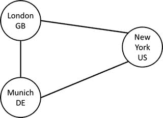
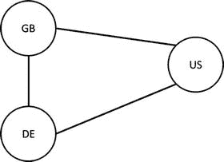
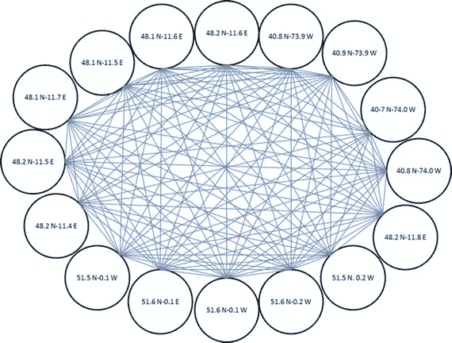
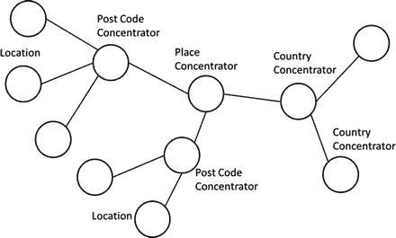
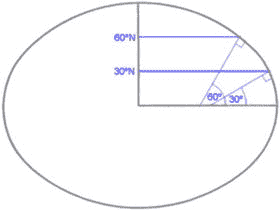

# 为作业调度构建 DAG

以下示例说明了如何安排网络设备维护作业，以便在一个月内执行所需的维修。为了创建 DAG，我首先要定义它是什么：DAG 是一种数据结构，它使您能够在只能按特定顺序执行的数据条目之间生成关系。DAG 是核心数据科学环境中的重要结构，因为它是使 Hadoop 中的 Spark、Pig 和 Tez 等工具能够工作的基本结构。它也用于记录任务调度和处理数据时的流程相互依赖关系。

我将介绍一个名为 `networkx` 的新 Python 库。

打开您的 Python 编辑器，并在目录 `..\VKHCG\01-Vermeulen\02-Assess` 中创建一个名为 `Assess-DAG-Location.py` 的文件。现在将以下代码复制到该文件中：

```
################################################################
import networkx as nx
import matplotlib.pyplot as plt
import sys
import os
import pandas as pd
################################################################
if sys.platform == 'linux':
Base=os.path.expanduser('~') + 'VKHCG'
else:
Base='C:/VKHCG'
print('################################')
print('Working Base:',Base,'using',sys.platform)
print('################################')
################################################################
sInputFileName='01-Retrieve/01-EDS/02-Python/Retrieve_Router_Location.csv'
sOutputFileName1='Assess-DAG-Company-Country.png'
sOutputFileName2='Assess-DAG-Company-Country-Place.png'
Company='01-Vermeulen'
################################################################
### Import Company Data
################################################################
sFileName=Base + '/' + Company + '/' + sInputFileName
print('################################')
print('Loading:',sFileName)
print('################################')
CompanyData=pd.read_csv(sFileName,header=0,low_memory=False, encoding="latin-1")
print('Loaded Company:',CompanyData.columns.values)
print('################################')
################################################################
print(CompanyData)
print('################################')
print('Rows:',CompanyData.shape[0])
print('################################')
```

我们现在将创建两个有向图：G1 和 G2。这需要使用 `G=DiGraph()`，如果只想要一个图，则使用 `G=Graph()`。

```
################################################################
G1=nx.DiGraph()
G2=nx.DiGraph()
################################################################
```

我们现在将为数据中的每个地点创建一个节点。为此，请使用 `G.add_node()` 函数。

> **注意**
> 
> 如果你执行 `G.add_node("A")`，然后再执行 `G.add_node("A")`，你只会得到一个节点：`"A"`。该图会自动解析任何重复的节点请求。

我们现在将遍历所有国家和地点-名称-国家的记录。

```
for i in range(CompanyData.shape[0]):
G1.add_node(CompanyData['Country'][i])
sPlaceName= CompanyData['Place_Name'][i] + '-' + CompanyData['Country'][i]
G2.add_node(sPlaceName)
```

我们现在将通过成对循环所有节点（`G.nodes()`）来互连所有节点。

```
print('################################')
for n1 in G1.nodes():
for n2 in G1.nodes():
if n1 != n2:
print('Link:',n1,' to ', n2)
G1.add_edge(n1,n2)
print('################################')
```

现在，我们可以看到您创建的节点和边了。

```
print('################################')
print("Nodes of graph:")
print(G1.nodes())
print("Edges of graph:")
print(G1.edges())
print('################################')
```

我们现在可以保存我们的图，如下所示：

```
################################################################
sFileDir=Base + '/' + Company + '/02-Assess/01-EDS/02-Python'
if not os.path.exists(sFileDir):
os.makedirs(sFileDir)
################################################################
sFileName=sFileDir + '/' + sOutputFileName1
print('################################')
print('Storing:', sFileName)
print('################################')
```

现在，您可以将图形显示为图片。

```
nx.draw(G1,pos=nx.spectral_layout(G1),
nodecolor='r',edge_color='b',
with_labels=True,node_size=8000,
font_size=12)
plt.savefig(sFileName) # save as png
plt.show() # display
################################################################
```

现在，您可以完成第二个图了。

```
print('################################')
for n1 in G2.nodes():
for n2 in G2.nodes():
if n1 != n2:
print('Link:',n1,'to',n2)
G2.add_edge(n1,n2)
print('################################')
print('################################')
print("Nodes of graph:")
print(G2.nodes())
print("Edges of graph:")
print(G2.edges())
print('################################')
################################################################
sFileDir=Base + '/' + Company + '/02-Assess/01-EDS/02-Python'
if not os.path.exists(sFileDir):
os.makedirs(sFileDir)
################################################################
sFileName=sFileDir + '/' + sOutputFileName2
print('################################')
print('Storing:', sFileName)
print('################################')
nx.draw(G2,pos=nx.spectral_layout(G2),
nodecolor='r',edge_color='b',
with_labels=True,node_size=8000,
font_size=12)
plt.savefig(sFileName) # save as png
plt.show() # display
################################################################
```

保存 `Assess-DAG-Location.py` 文件，然后用你的 Python 编译器编译并执行。这将在屏幕上生成一组演示值，以及两个图形文件，分别名为 `Assess-DAG-Company-Country.png`（图 8-7）和 `Assess-DAG-Company-Country-Place.png`（图 8-8）。



**图 8-8** `Assess-DAG-Company-Country-Place.png` 文件



**图 8-7** `Assess-DAG-Company-Country.png` 文件

干得好。您刚刚完成了一个简单但有效的图。让我们尝试一个更大的图。

> **记住**
> 
> 只有两个实体。大小对构建方式没有直接影响。

> **注意**
> 
> `networkx` 库可以很好地处理相当大的图，但它受限于您的内存。我的两个 32 核 AMD CPU 搭配 1TB DRAM5 可以轻松容纳 1 亿个节点和边。但是，当我处理超过 10 亿个节点和边时，我会切换到分布式图引擎，使用我的 12 节点 DataStax Enterprise 数据平台，并通过 `dse-graph` 库，利用 DSE Graph 来处理图。我可以确认，本书中的示例在我的四核 4MB RAM 笔记本电脑上可以轻松运行。

打开您的 Python 编辑器，并在目录 `C:\VKHCG\01-Vermeulen\02-Assess` 中创建一个名为 `Assess-DAG-GPS.py` 的文件。现在将以下代码复制到该文件中：

```
################################################################
import networkx as nx
import matplotlib.pyplot as plt
import sys
import os
import pandas as pd
################################################################
if sys.platform == 'linux':
Base=os.path.expanduser('~') + 'VKHCG'
else:
Base='C:/VKHCG'
print('################################')
print('Working Base:',Base,'using',sys.platform)
print('################################')
################################################################
sInputFileName='01-Retrieve/01-EDS/02-Python/Retrieve_Router_Location.csv'
sOutputFileName='Assess-DAG-Company-GPS.png'
Company='01-Vermeulen'
################################################################
### Import Company Data
################################################################
sFileName=Base + '/' + Company + '/' + sInputFileName
print('################################')
print('Loading:',sFileName)
print('################################')
CompanyData=pd.read_csv(sFileName,header=0,low_memory=False, encoding="latin-1")
print('Loaded Company:',CompanyData.columns.values)
print('################################')
################################################################
print(CompanyData)
print('################################')
print('Rows:',CompanyData.shape[0])
print('################################')
################################################################
G=nx.Graph()
################################################################
```

> **提示**
> 
> 我在以下代码中使用了一个简单的数据科学技术，即在纬度和经度值上添加了 `round(x,1)`。这将所需节点数从 150 个减少到 16 个，节省了 90% 的节点处理量。边数从 11,175 条减少到 120 条，节省了 99% 的边处理量。如果您使用 `round(x,2)`，您会得到 117 个节点和 6786 条边，分别节省了 22% 和 39%。当您只想在预估水平上测试发现时，这是一个有用的技术。

```
for i in range(CompanyData.shape[0]):
nLatitude=round(CompanyData['Latitude'][i],1)
nLongitude=round(CompanyData['Longitude'][i],1)
if nLatitude < 0:
sLatitude = str(nLatitude*-1) + 'S'
else:
sLatitude = str(nLatitude) + 'N'
if nLongitude < 0:
sLongitude = str(nLongitude*-1) + 'W'
else:
sLongitude = str(nLongitude) + 'E'
sGPS= sLatitude + '-' + sLongitude
G.add_node(sGPS)
print('################################')
for n1 in G.nodes():
for n2 in G.nodes():
if n1 != n2:
print('Link:',n1,'to',n2)
G.add_edge(n1,n2)
print('################################')
print('################################')
print("Nodes of graph:")
print(G.nodes())
print("Edges of graph:")
print(G.edges())
print('################################')
################################################################
sFileDir=Base + '/' + Company + '/02-Assess/01-EDS/02-Python'
if not os.path.exists(sFileDir):
os.makedirs(sFileDir)
################################################################
sFileName=sFileDir + '/' + sOutputFileName
print('################################')
print('Storing:', sFileName)
print('################################')
pos=nx.circular_layout(G,dim=1, scale=2)
nx.draw(G,pos=pos,
nodecolor='r',edge_color='b',
with_labels=True,node_size=4000,
font_size=9)
plt.savefig(sFileName) # save as png
plt.show() # display
################################################################
```

保存文件 `Assess-DAG-GPS.py`，然后用你的 Python 编译器编译并执行。这将在屏幕上生成一组演示值，以及一个名为 `Assess-DAG-Company-GPS.png` 的图形文件（图 8-9）。



**图 8-9** `Assess-DAG-Company-GPS.png` 文件

我已经引导您了解了使用图论数据结构评估数据实体之间关系是否正确的概念。现在，我将演示如何将我们检索到的 IP 数据转换为有效的路由网络（图 8-10）。



**图 8-10** 有效的路由网络

基本验证如下：

- 国家之间相互连接，形成一个网状网络。
- 国家内的地点连接到所有国内节点，即国内所有网络连接集中在一起的某个点，称为“地点集中器”。
- 邮政编码只能通过邮政编码集中器（类似于地点集中器的设备，但每个邮政编码一个）连接到地点集中器。
- 位置只能连接到其邮政编码集中器。

> **注意**
> 
> 互连节点的规则不止一套。然而，当应用所有规则时，结果仍然只有一个图。如果规则之间存在重叠连接，图将只解析一种关系。这使您免于解决重叠问题。记住这点不错！

现在，用这个例子来测试一下您的技能。我将引导您完成 `Retrieve_IP_DATA_CORE.csv` 的评估步骤。打开您的 Python 编辑器，并在目录 `C:\VKHCG\01-Vermeulen\02-Assess` 中创建一个名为 `Assess-DAG-Schedule.py` 的文件。

现在将此代码复制到以下文件中：

```
################################################################
import networkx as nx
import matplotlib.pyplot as plt
import sys
import os
import pandas as pd
################################################################
if sys.platform == 'linux':
Base=os.path.expanduser('~') + 'VKHCG'
else:
Base='C:/VKHCG'
print('################################')
print('Working Base:',Base,'using',sys.platform)
print('################################')
################################################################
sInputFileName='01-Retrieve/01-EDS/01-R/Retrieve_IP_DATA_CORE.csv'
sOutputFileName='Assess-DAG-Schedule.gml'
Company='01-Vermeulen'
################################################################
### Import Core Company Data
################################################################
sFileName=Base + '/' + Company + '/' + sInputFileName
print('################################')
print('Loading:',sFileName)
print('################################')
CompanyData=pd.read_csv(sFileName,header=0,low_memory=False, encoding="latin-1")
print('Loaded Company:',CompanyData.columns.values)
print('################################')
################################################################
print(CompanyData)
print('################################')
print('Rows:',CompanyData.shape[0])
print('################################')
################################################################
G=nx.Graph()
################################################################
for i in range(CompanyData.shape[0]):
sGroupName0= str(CompanyData['Country'][i])
sGroupName1= str(CompanyData['Place.Name'][i])
sGroupName2= str(CompanyData['Post.Code'][i])
nLatitude=round(CompanyData['Latitude'][i],6)
nLongitude=round(CompanyData['Longitude'][i],6)
```

> **注意**
> 
> 您可以在这里看到，您可以在节点和边上存储额外信息，以增强图中存储的数据，同时仍不会导致基本的节点-边关系出现问题。

您可以通过使用 `G.add_node()` 特性的扩展来添加额外信息。

```
CountryName=sGroupName0
print('Add Node:',sGroupName0)
G.add_node(CountryName,
routertype='CountryName',
group0=sGroupName0)
sPlaceName= sGroupName1 + '-' + sGroupName0
G.add_node(sPlaceName,
routertype='PlaceName',
group0=sGroupName0,
group1=sGroupName1)
sPostCodeName= sGroupName1 + '-' + sGroupName2 + '-' + sGroupName0
print('Add Node:',sPostCodeName)
G.add_node(sPostCodeName,
routertype='PostCode',
group0=sGroupName0,
group1=sGroupName1,
group2=sGroupName2)
if nLatitude < 0:
sLatitude = str(nLatitude*-1) + 'S'
else:
sLatitude = str(nLatitude) + 'N'
if nLongitude < 0:
sLongitude = str(nLongitude*-1) + 'W'
else:
sLongitude = str(nLongitude) + 'E'
sGPS= sLatitude + '-' + sLongitude
print('Add Node:',sGPS)
G.add_node(sGPS,routertype='GPS',
group0=sGroupName0,
group1=sGroupName1,
group2=sGroupName2,
sLatitude=sLatitude,
sLongitude=sLongitude,
nLatitude=nLatitude,
nLongitude=nLongitude)
################################################################
```

您通过使用 `G.node[][]` 特性的扩展来使用额外信息。同样要注意 `nodes_iter(G)`，它让您能够访问所有节点。我们现在将在节点之间添加规则。

```
print('################################')
print('Link Country to Country')
print('################################')
for n1 in nx.nodes_iter(G):
if G.node[n1]['routertype'] == 'CountryName':
for n2 in nx.nodes_iter(G):
if G.node[n2]['routertype'] == 'CountryName':
if n1 != n2:
print('Link:',n1,'to',n2)
G.add_edge(n1,n2)
print('################################')
print('################################')
print('Link Country to Place')
print('################################')
for n1 in nx.nodes_iter(G):
if G.node[n1]['routertype'] == 'CountryName':
for n2 in nx.nodes_iter(G):
if G.node[n2]['routertype'] == 'PlaceName':
if G.node[n1]['group0'] == G.node[n2]['group0']:
if n1 != n2:
print('Link:',n1,'to',n2)
G.add_edge(n1,n2)
print('################################')
print('################################')
print('Link Place to Post Code')
print('################################')
for n1 in nx.nodes_iter(G):
if G.node[n1]['routertype'] == 'PlaceName':
for n2 in nx.nodes_iter(G):
if G.node[n2]['routertype'] == 'PostCode':
if G.node[n1]['group0'] == G.node[n2]['group0']:
if G.node[n1]['group1'] == G.node[n2]['group1']:
if n1 != n2:
print('Link:',n1,'to',n2)
G.add_edge(n1,n2)
print('################################')
print('################################')
print('Link Post Code to GPS')
print('################################')
for n1 in nx.nodes_iter(G):
if G.node[n1]['routertype'] == 'PostCode':
for n2 in nx.nodes_iter(G):
if G.node[n2]['routertype'] == 'GPS':
if G.node[n1]['group0'] == G.node[n2]['group0']:
if G.node[n1]['group1'] == G.node[n2]['group1']:
if G.node[n1]['group2'] == G.node[n2]['group2']:
if n1 != n2:
print('Link:',n1,'to',n2)
G.add_edge(n1,n2)
print('################################')
print('################################')
print("Nodes of graph:",nx.number_of_nodes(G))
print("Edges of graph:",nx.number_of_edges(G))
print('################################')
################################################################
sFileDir=Base + '/' + Company + '/02-Assess/01-EDS/02-Python'
if not os.path.exists(sFileDir):
os.makedirs(sFileDir)
################################################################
sFileName=sFileDir + '/' + sOutputFileName
print('################################')
print('Storing:', sFileName)
print('################################')
nx.write_gml(G,sFileName)
sFileName=sFileName +'.gz'
nx.write_gml(G,sFileName)
################################################################
```

保存 `Assess-DAG-Schedule.py` 文件，然后用你的 Python 编译器编译并执行。这将在屏幕上生成一组演示值，以及一个名为 `Assess-DAG-Schedule.gml` 的图形数据文件。

> **提示**
> 
> 您可以使用文本编辑器查看 GML 格式。我经常用它来查找图的错误。

如果您用文本编辑器打开该文件，可以看到它生成的格式。这种格式简单但有效。

这是一个邮政编码节点：

```
node [
id 327
label "Munich-80331-DE"
routertype "PostCode"
group0 "DE"
group1 "Munich"
group2 "80331"
]
```

这是一个 GPS 节点：

```
node [
id 328
label "48.1345 N-11.571 E"
routertype "GPS"
group0 "DE"
group1 "Munich"
group2 "80331"
sLatitude "48.1345 N"
sLongitude "11.571 E"
nLatitude 48.134500000000003
nLongitude 11.571
]
```

这是一条连接两个节点的边：

```
edge [
source 327
target 328
]
```

此转换到图形数据结构现在已经验证了全面的 IP 结构，方法是消除由不同规则或基础数据中的任何重复条目创建的任何重复节点或边。当有多个系统向同一系统加载请求时，这种自然的去重功能非常有用。

例如：两个运输代理可以请求一辆卡车将两个不同的箱子从地点 A 运送到地点 B。在卡车离开之前，物流程序将创建一个运输图，然后发送一辆卡车运送这两个箱子。

我已经证明了这在较小的 IP 核心数据上是可行的。现在，我们可以将其应用于更大的 IP 数据集 `Retrieve_IP_DATA.csv`。

考虑到更大数据集的范围，我建议我们通过更改输入和导出源设计来包含 SQLite 数据库，以协助解决数据处理问题，从而处理这些数据。作为一名数据科学家，您应该不断探索可用的工具，以提高解决方案的有效性和效率。我将引导您完成以下处理模式，使您能够理解我如何利用数据库引擎的优势来解决更大数据集完成某些关系所需的复杂性。我们将把图数据结构的处理能力与 SQLite 数据库的处理能力结合起来。

> **警告**
> 
> 如果您的系统上尚未使用 SQLite，则必须安装它。请参阅 [`www.sqlite.org`](http://www.sqlite.org) 了解如何实现此安装的详细信息。您可以通过使用 sqlite3 版本来检查安装。如果得到 `3.20.x` 的结果，您就可以继续了。确保您也安装了 python SQLite 库。在您的 IPython 控制台中执行 `import SQLite`。如果这不起作用，请执行库安装。

打开您的 Python 编辑器，并在目录 `C:\VKHCG\01-Vermeulen\02-Assess` 中创建一个名为 `Retrieve-IP_2_SQLite_2_DAG.py` 的文件。现在将以下代码复制到该文件中：

```
################################################################
# -*- coding: utf-8 -*-
################################################################
import networkx as nx
import sys
import os
import sqlite3 as sq
import pandas as pd
################################################################
if sys.platform == 'linux':
Base=os.path.expanduser('~') + 'VKHCG'
else:
Base='C:/VKHCG'
print('################################')
print('Working Base:',Base,'using',sys.platform)
print('################################')
################################################################
sDatabaseName=Base + '/01-Vermeulen/00-RawData/SQLite/vermeulen.db'
conn = sq.connect(sDatabaseName)
################################################################
sFileName=Base + '/01-Vermeulen/01-Retrieve/01-EDS/02-Python/Retrieve_IP_DATA.csv'
sOutputFileName='Assess-DAG-Schedule-All.csv'
Company='01-Vermeulen'
```

现在，我们将基础数据作为 `pandas` 数据结构加载到内存中，然后使用 `df.tosql()` 命令将其存储到 SQLite 数据库中。

```
################################################################
print('Loading :',sFileName)
IP_DATA_ALL=pd.read_csv(sFileName,header=0,low_memory=False, encoding="latin-1")
IP_DATA_ALL.index.names = ['RowIDCSV']
IP_DATA_ALL.rename(columns={'Place.Name': 'PlaceName'}, inplace=True)
IP_DATA_ALL.rename(columns={'Post.Code': 'PostCode'}, inplace=True)
#print(IP_DATA_ALL)
print('################')
sTable='Assess_IP_DATA'
print('Storing:',sDatabaseName,'Table:',sTable)
IP_DATA_ALL.to_sql(sTable, conn, if_exists="replace")
print('################')
```

我们使用 `G=nx.Graph()` 创建一个无向图。

```
################################################################
G=nx.Graph()
################################################################
```

现在，我们从 SQLite 创建已加载数据的一个子集，以匹配您所需的格式。

> **提示**
> 
> 这种将处理任务卸载到第三方处理引擎的方式，使您能够连接到核心资源（例如数据库），然后执行复杂的连接和更繁重的处理。我通常也会通过 DSE Graph 以相同的方式卸载我的图处理，以增强更复杂的图。
> 
> 能够成功卸载复杂的数据处理是数据科学家应该具备的一项好技能。

> **注意**
> 
> 我可以使用像树莓派 3 这样的小型计算机来驱动我的集群，轻松执行大规模处理任务。

那么，让我们重新开始我们的例子。您必须从一个包含重复数据的数据集返回不重复的国家列表。我建议您使用 `SQL DISTINCT` 命令，通过 SQLite 数据引擎来执行此任务。

```
print('################')
sTable = 'Assess_IP_DATA'
print('Loading:',sDatabaseName,'Table:',sTable)
sSQL="select distinct"
sSQL=sSQL+ "A.Country,"
sSQL=sSQL+ "A.Country AS NodeName,"
sSQL=sSQL+ "A.Country AS GroupName0,"
sSQL=sSQL+ "'Country-Router' AS RouterType"
sSQL=sSQL+ "from"
sSQL=sSQL+ "Assess_IP_DATA as A"
sSQL=sSQL+ "ORDER BY A.Country;"
CompanyData=pd.read_sql_query(sSQL, conn)
print('################')
```

您现在在 `CompanyData` 中有了不重复的国家列表。干得好。

您现在需要将这些节点添加到您之前创建的图中。您之前已经完成过这个任务，所以只需遵循以下代码：

```
for i in range(CompanyData.shape[0]):
sNode=str(CompanyData['NodeName'][i])
sRouterType=str(CompanyData['RouterType'][i])
sGroupName0=str(CompanyData['GroupName0'][i])
G.add_node(sNode,
routertype=sRouterType,
group0=sGroupName0)
print('################################')
print("Nodes of graph:",nx.number_of_nodes(G))
print("Edges of graph:",nx.number_of_edges(G))
print('################################')
```

干得好，您在这里取得了进展。您拥有了所有的国家节点。

我建议我们将国家列表存储为表 `Assess_IP_Country` 以备后用。

```
print('################')
sTable='Assess_IP_Country'
print('Storing:',sDatabaseName,'Table:',sTable)
CompanyData.to_sql(sTable, conn, if_exists="replace")
```

既然您已经掌握了基本流程，您会发现重复这个过程很容易。接下来，提取不重复的国家和地点，添加节点，并将其存储为表 `Assess_IP_PlaceName`。

```
print('################')
################################################################
print('################')
sTable = 'Assess_IP_DATA'
print('Loading:',sDatabaseName,'Table:',sTable)
sSQL="select distinct"
sSQL=sSQL+ "A.Country,"
sSQL=sSQL+ "A.PlaceName,"
sSQL=sSQL+ "A.PlaceName || '-' || A.Country AS NodeName,"
sSQL=sSQL+ "A.Country AS GroupName0,"
sSQL=sSQL+ "A.PlaceName AS GroupName1,"
sSQL=sSQL+ "'Place-Router' AS RouterType"
sSQL=sSQL+ "from"
sSQL=sSQL+ "Assess_IP_DATA as A"
sSQL=sSQL+ "ORDER BY A.Country AND"
sSQL=sSQL+ "A.PlaceName;"
CompanyData=pd.read_sql_query(sSQL, conn)
print('################')
for i in range(CompanyData.shape[0]):
sNode=str(CompanyData['NodeName'][i])
sRouterType=str(CompanyData['RouterType'][i])
sGroupName0= str(CompanyData['Country'][i])
sGroupName1= str(CompanyData['PlaceName'][i])
G.add_node(sNode,
routertype=sRouterType,
group0=sGroupName0,
group1=sGroupName1)
print('################################')
print("Nodes of graph:",nx.number_of_nodes(G))
print("Edges of graph:",nx.number_of_edges(G))
print('################################')
print('################')
sTable='Assess_IP_PlaceName'
print('Storing:',sDatabaseName,'Table:',sTable)
CompanyData.to_sql(sTable, conn, if_exists="replace")
print('################')
################################################################
```

您现在在流程中取得了更多成功。您能看出使用数据库执行工作的优势了吗？

接下来，对选定的国家、地点名称和节点名称数据重复此操作。添加节点并将表存储为 `Assess_IP_PostCode`。

```
print('################')
sTable = 'Assess_IP_DATA'
print('Loading:',sDatabaseName,'Table:',sTable)
sSQL="select distinct"
sSQL=sSQL+ "A.Country,"
sSQL=sSQL+ "A.PlaceName,"
sSQL=sSQL+ "A.PostCode,"
sSQL=sSQL+ "A.PlaceName || '-' || A.PostCode || '-' || A.Country AS NodeName,"
sSQL=sSQL+ "A.Country AS GroupName0,"
sSQL=sSQL+ "A.PlaceName AS GroupName1,"
sSQL=sSQL+ "A.PostCode AS GroupName2,"
sSQL=sSQL+ "'Place-Router' AS RouterType"
sSQL=sSQL+ "from"
sSQL=sSQL+ "Assess_IP_DATA as A"
sSQL=sSQL+ "ORDER BY A.Country AND"
sSQL=sSQL+ "A.PlaceName AND"
sSQL=sSQL+ "A.PostCode;"
CompanyData=pd.read_sql_query(sSQL, conn)
print('################')
for i in range(CompanyData.shape[0]):
sNode=str(CompanyData['NodeName'][i])
sRouterType=str(CompanyData['RouterType'][i])
sGroupName0= str(CompanyData['GroupName0'][i])
sGroupName1= str(CompanyData['GroupName1'][i])
sGroupName2= str(CompanyData['GroupName2'][i])
G.add_node(sNode,
routertype=sRouterType,
group0=sGroupName0,
group1=sGroupName1,
group2=sGroupName2)
print('################################')
print("Nodes of graph:",nx.number_of_nodes(G))
print("Edges of graph:",nx.number_of_edges(G))
print('################################')
print('################')
sTable='Assess_IP_PostCode'
print('Storing:',sDatabaseName,'Table:',sTable)
CompanyData.to_sql(sTable, conn, if_exists="replace")
print('################')
################################################################
```

接下来，对选定的国家、地点名称、邮政编码、纬度和经度数据重复此操作。添加节点并将表存储为 `Assess_IP_GPS`。

```
print('################')
sTable = 'Assess_IP_DATA'
print('Loading:',sDatabaseName,'Table:',sTable)
sSQL="select distinct"
sSQL=sSQL+ "A.Country,"
sSQL=sSQL+ "A.PlaceName,"
sSQL=sSQL+ "A.PostCode,"
sSQL=sSQL+ "A.Latitude,"
sSQL=sSQL+ "A.Longitude,"
sSQL=sSQL+ "(CASE WHEN A.Latitude < 0 THEN"
sSQL=sSQL+ "'S' || ABS(A.Latitude)"
sSQL=sSQL+ "ELSE "
sSQL=sSQL+ "'N' || ABS(A.Latitude)"
sSQL=sSQL+ "END ) AS sLatitude,"
sSQL=sSQL+ "(CASE WHEN A.Longitude < 0 THEN"
sSQL=sSQL+ "'W' || ABS(A.Longitude)"
sSQL=sSQL+ "ELSE"
sSQL=sSQL+ "'E' || ABS(A.Longitude)"
sSQL=sSQL+ "END ) AS sLongitude"
sSQL=sSQL+ "from"
sSQL=sSQL+ "Assess_IP_DATA as A;"
CompanyData=pd.read_sql_query(sSQL, conn)
print('################')
sTable='Assess_IP_GPS'
CompanyData.to_sql(sTable, conn, if_exists="replace")
sSQL="select distinct"
sSQL=sSQL+ "A.Country,"
sSQL=sSQL+ "A.PlaceName,"
sSQL=sSQL+ "A.PostCode,"
sSQL=sSQL+ "A.Latitude,"
sSQL=sSQL+ "A.Longitude,"
sSQL=sSQL+ "A.sLatitude,"
sSQL=sSQL+ "A.sLongitude,"
sSQL=sSQL+ "A.sLatitude || '-' || A.sLongitude AS NodeName,"
sSQL=sSQL+ "A.Country AS GroupName0,"
sSQL=sSQL+ "A.PlaceName AS GroupName1,"
sSQL=sSQL+ "A.PostCode AS GroupName2,"
sSQL=sSQL+ "'GPS-Client' AS RouterType"
sSQL=sSQL+ "from"
sSQL=sSQL+ "Assess_IP_GPS as A"
sSQL=sSQL+ "ORDER BY A.Country AND"
sSQL=sSQL+ "A.PlaceName AND"
sSQL=sSQL+ "A.PostCode AND"
sSQL=sSQL+ "A.Latitude AND"
sSQL=sSQL+ "A.Longitude;"
CompanyData=pd.read_sql_query(sSQL, conn)
for i in range(CompanyData.shape[0]):
sNode=str(CompanyData['NodeName'][i])
sRouterType=str(CompanyData['RouterType'][i])
sGroupName0= str(CompanyData['GroupName0'][i])
sGroupName1= str(CompanyData['GroupName1'][i])
sGroupName2= str(CompanyData['GroupName2'][i])
nLatitude=round(CompanyData['Latitude'][i],6)
nLongitude=round(CompanyData['Longitude'][i],6)
sLatitude= str(CompanyData['sLatitude'][i])
sLongitude= str(CompanyData['sLongitude'][i])
G.add_node(sNode,
routertype=sRouterType,
group0=sGroupName0,
group1=sGroupName1,
group2=sGroupName2,
sLatitude=sLatitude,
sLongitude=sLongitude,
nLatitude=nLatitude,
nLongitude=nLongitude)
print('################################')
print("Nodes of graph:",nx.number_of_nodes(G))
print("Edges of graph:",nx.number_of_edges(G))
print('################################')
print('################')
sTable='Assess_IP_GPS'
print('Storing:',sDatabaseName,'Table:',sTable)
CompanyData.to_sql(sTable, conn, if_exists="replace")
print('################')
###############################################################
```

干得好。您已经创建了所有节点。现在您将看到使用数据库的真正威力。

我们必须将每个国家与所有其他国家链接起来，但不能将国家与自己链接。如果没有我们在加载节点时创建的表，这项任务会很复杂。现在，我们可以对 `Assess_IP_Country` 执行两次连接，并通过添加一个额外的条件（即一个国家小于另一个国家）来在选取过程中增加一个增强，只创建单向边。使用 `Graph()` 类型的图可以免费提供 `add_edge()` 在相反方向的链接。因此，我们节省了大约 +/- 50% 的处理工作量。那么，继续示例来链接不同类型的节点。

```
print('################################')
print('Link Country to Country')
print('################################')
print('################')
print('Loading:',sDatabaseName,'Table:',sTable)
sSQL="select distinct"
sSQL=sSQL+ "A.NodeName as N1,"
sSQL=sSQL+ "B.NodeName as N2"
sSQL=sSQL+ "from"
sSQL=sSQL+ "Assess_IP_Country as A,"
sSQL=sSQL+ "Assess_IP_Country as B"
sSQL=sSQL+ "WHERE "
sSQL=sSQL+ "A.Country  B.NodeName;"
CompanyData=pd.read_sql_query(sSQL, conn)
print('################')
n1= str(CompanyData['N1'][i])
n2= str(CompanyData['N2'][i])
print('Link Country:',n1,'to Country:',n2)
G.add_edge(n1,n2)
print('################################')
print('################################')
print("Nodes of graph:",nx.number_of_nodes(G))
print("Edges of graph:",nx.number_of_edges(G))
print('################################')
###############################################################
print('################################')
print('Link Country to Place')
print('################################')
print('################')
print('Loading:',sDatabaseName,'Table:',sTable)
sSQL="select distinct"
sSQL=sSQL+ "A.NodeName as N1,"
sSQL=sSQL+ "B.NodeName as N2"
sSQL=sSQL+ "from"
sSQL=sSQL+ "Assess_IP_Country as A,"
sSQL=sSQL+ "Assess_IP_PlaceName as B"
sSQL=sSQL+ "WHERE "
sSQL=sSQL+ "A.Country = B.Country AND"
sSQL=sSQL+ "A.NodeName  B.NodeName;"
CompanyData=pd.read_sql_query(sSQL, conn)
print('################')
for i in range(CompanyData.shape[0]):
n1= str(CompanyData['N2'][i])
n2= str(CompanyData['N2'][i])


### 克伦瓦尔纳股份公司

克伦瓦尔纳股份公司是负责处理我们所有媒体业务的德国公司。我们将用这家公司来演示三种基本的评估解决方案。

#### 为广告牌挑选内容

克伦瓦尔纳负责在集团拥有的一系列广告牌上发布客户的广告。我将解释评估与广告牌相关信息所需的概念，这些信息是我们必须处理的。

你将使用 `sqlite3` 和 `pandas` 包来创建一个解决方案。你之前已经执行过与弗穆伦公司类似的步骤，所以下面这个示例你应该能够处理。基本流程是将两组数据合并，然后根据访问德国广告牌的 IP 地址范围，计算每日访客数量。

打开你的 Python 编辑器，在目录 `C:\VKHCG\02-Krennwallner\02-Assess` 中创建一个名为 `Assess-DE-Billboard.py` 的文件。然后将以下代码复制到文件中：

```
################################################################
import sys
import os
import sqlite3 as sq
import pandas as pd
################################################################
if sys.platform == 'linux':
Base=os.path.expanduser('~') + 'VKHCG'
else:
Base='C:/VKHCG'
print('################################')
print('Working Base:',Base,'using',sys.platform)
print('################################')
################################################################
```

我们需要合并的两个数据源如下所示：

```
sInputFileName1='01-Retrieve/01-EDS/02-Python/Retrieve_DE_Billboard_Locations.csv'
sInputFileName2='01-Retrieve/01-EDS/02-Python/Retrieve_Online_Visitor.csv'
```

结果将存储在此输出文件中：

```
sOutputFileName='Assess-DE-Billboard-Visitor.csv'
Company='02-Krennwallner'
################################################################
sDataBaseDir=Base + '/' + Company + '/02-Assess/SQLite'
if not os.path.exists(sDataBaseDir):
os.makedirs(sDataBaseDir)
################################################################
```

以下是为该示例处理过程提供支持的数据库：

```
sDatabaseName=sDataBaseDir + '/krennwallner.db'
conn = sq.connect(sDatabaseName)
################################################################
#### 导入广告牌数据
################################################################
sFileName=Base + '/' + Company + '/' + sInputFileName1
print('################################')
print('Loading:',sFileName)
print('################################')
```

加载第一个文件并清理重复项。

```
BillboardRawData=pd.read_csv(sFileName,header=0,low_memory=False, encoding="latin-1")
BillboardRawData.drop_duplicates(subset=None, keep="first", inplace=True)
BillboardData=BillboardRawData
print('Loaded Company:',BillboardData.columns.values)
print('################################')
################################################################
```

将清洗后的数据存储到 SQLite 中。

```
print('################')
sTable='Assess_BillboardData'
print('Storing:',sDatabaseName,'Table:',sTable)
BillboardData.to_sql(sTable, conn, if_exists="replace")
print('################')
################################################################
print(BillboardData.head())
print('################################')
print('Rows:',BillboardData.shape[0])
print('################################')
```

加载第二个文件并清理重复项。

```
################################################################
#### 导入广告牌数据
################################################################
sFileName=Base + '/' + Company + '/' + sInputFileName2
print('################################')
print('Loading:',sFileName)
print('################################')
VisitorRawData=pd.read_csv(sFileName,header=0,low_memory=False, encoding="latin-1")
VisitorRawData.drop_duplicates(subset=None, keep="first", inplace=True)
```

利用 `country=DE` 的结果，你现在可以将数据限制为仅包含德国数据。尽早丢弃多余数据是高效数据科学的关键一环。

**提示**


将调查中的数据集保持在所需的最小大小，这可以为您和您的客户节省时间和金钱。

```
VisitorData=VisitorRawData[VisitorRawData.Country=='DE']
print('Loaded Company:',VisitorData.columns.values)
print('################################')
################################################################
```

将第二组干净加载的数据存储到`SQLite`中。

```
print('################')
sTable='Assess_VisitorData'
print('Storing:',sDatabaseName,'Table:',sTable)
VisitorData.to_sql(sTable, conn, if_exists="replace")
print('################')
################################################################
print(VisitorData.head())
print('################################')
print('Rows:',VisitorData.shape[0])
print('################################')
################################################################
```

从`SQLite`中检索间接清洗的数据集，因为您已经存储了干净数据。第二个数据集的缩减也提高了流程效率。

```
print('################')
sTable='Assess_BillboardVisitorData'
print('Loading:',sDatabaseName,'Table:',sTable)
sSQL="select distinct"
sSQL=sSQL+ "A.Country AS BillboardCountry,"
sSQL=sSQL+ "A.Place_Name AS BillboardPlaceName,"
sSQL=sSQL+ "A.Latitude AS BillboardLatitude,"
sSQL=sSQL+ "A.Longitude AS BillboardLongitude,"
sSQL=sSQL+ "B.Country AS VisitorCountry,"
sSQL=sSQL+ "B.Place_Name AS VisitorPlaceName,"
sSQL=sSQL+ "B.Latitude AS VisitorLatitude,"
sSQL=sSQL+ "B.Longitude AS VisitorLongitude,"
sSQL=sSQL+ "(B.Last_IP_Number - B.First_IP_Number) * 365.25 * 24 * 12 AS VisitorYearRate"
sSQL=sSQL+ "from"
sSQL=sSQL+ "Assess_BillboardData as A"
sSQL=sSQL+ "JOIN"
sSQL=sSQL+ "Assess_VisitorData as B"
sSQL=sSQL+ "ON"
sSQL=sSQL+ "A.Country = B.Country"
sSQL=sSQL+ "AND"
sSQL=sSQL+ "A.Place_Name = B.Place_Name;"
BillboardVistorsData=pd.read_sql_query(sSQL, conn)
print('################')
################################################################
```

将合并后的数据集存回`SQLite`。

```
print('################')
sTable='Assess_BillboardVistorsData'
print('Storing:',sDatabaseName,'Table:',sTable)
BillboardVistorsData.to_sql(sTable, conn, if_exists="replace")
print('################')
################################################################
print(BillboardVistorsData.head())
print('################################')
print('Rows:',BillboardVistorsData.shape[0])
print('################################')
################################################################
sFileDir=Base + '/' + Company + '/02-Assess/01-EDS/02-Python'
if not os.path.exists(sFileDir):
os.makedirs(sFileDir)
################################################################
print('################################')
print('Storing:', sFileName)
print('################################')
sFileName=sFileDir + '/' + sOutputFileName
BillboardVistorsData.to_csv(sFileName, index = False)
print('################################')
################################################################
print('### Done!! ############################################')
################################################################
```

保存`Assess-DE-Billboard.py`，然后使用您的`Python`编译器编译并执行。这将在屏幕上生成一组演示值，以及一个名为`Assess-DE-Billboard-Visitor.csv`的数据文件。

| 广告牌国家 | 广告牌地点名称 | 广告牌纬度 | 广告牌经度 | 访客国家 | 访客地点名称 | 访客纬度 | 访客经度 | 访客年增长率 |
| --- | --- | --- | --- | --- | --- | --- | --- | --- |
| DE | Lake | 51.7833 | 8.5667 | DE | Lake | 51.7833 | 8.5667 | 26823960 |
| DE | Horb | 48.4333 | 8.6833 | DE | Horb | 48.4333 | 8.6833 | 26823960 |
| DE | Horb | 48.4333 | 8.6833 | DE | Horb | 48.4333 | 8.6833 | 53753112 |

您现在应该明白，您可以将`SQL`卸载到`SQLite`数据库，以便轻松利用该`SQL`系统提供的数据处理能力。

我们现在将研究下一个示例。

#### 了解您的在线访客数据

必须将在线访客映射到离他们最近的广告牌，以确保我们了解他们可以访问的位置和内容。为了实现这一点，我将引导您完成一个图数据处理示例，将访客活动中涉及的不同实体链接到一个图中。

然而，我们拥有的数据存储存在一些问题。

*   广告牌名称缺失。通过一些特征工程，我们可以从经度和纬度值推断出这些值。
*   广告牌与访客之间的距离未知。通过特征工程，使用文森特公式（Vincenty’s formulae）可以找到这个距离。
*   需要对经度和纬度进行平滑处理，以符合广告牌命名格式协议。

什么是文森特公式？撒迪厄斯·文森特公式（Thaddeus Vincenty’s formulae）是大地测量学中用于计算椭球体表面两点之间距离的两种相关迭代方法。它们假设地球的真实形状是一个扁球体，因此，比假设地球为球体的方法更准确。该距离被称为大圆距离。（见图 8-11）



**图 8-11** 图形形式的撒迪厄斯·文森特公式

在数据科学中，使用经过其他专家验证的成熟技术总是明智的。撒迪厄斯·文森特是计算地球距离的专家。`geopy`库也有一个经过验证的文森特计算器。明智的数据科学家会使用这些经过验证的公式，因为它们能为您的工作增加额外的可信度。

您将使用`networkx`、`sqlite3`、`pandas`和`geopy`包来创建解决方案。打开您的`Python`编辑器，在目录`C:/VKHCG/02-Krennwallner/02-Assess`中创建一个名为`Assess-Billboard_2_Visitor.py`的文件。现在将以下代码复制到文件中：

```
################################################################
