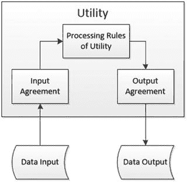
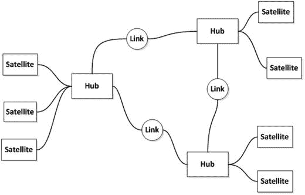
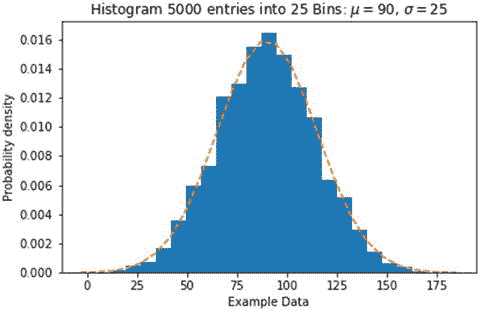

# 5. 工具层

工具层用于存储可复用的数据科学实用方法。本章的目标是定义工具层在生态系统中的使用方式。

工具是数据科学生态系统中通用且经过验证的“主力军”。工具层是一个集中存储库，用于将所有解决方案工具保存在一个地方。拥有一个集中存储所有工具的地方，可以确保你不会在你的解决方案中使用过时或重复的算法。最重要的好处是，你可以在整个解决方案中使用稳定的算法。

**提示：**
将所有工具（包括`源代码`）集中收集在一个地方。保存所有版本的记录，以备将来参考。

如果你使用算法，我建议你保留任何能够证明该流程是高质量、业界认可的算法的证据和凭证。艰苦的经验告诉我，你很可能会受到考验，因此必须证明你的科学方法是 100%有效的。

另一个附加价值在于，能够让更大的团队在类似项目上协同工作，并且知晓每位数据科学家或工程师都按照相同的标准在工作。在某些行业中，使用经批准的算法是法规要求。

2018 年 5 月 25 日，欧盟的《通用数据保护条例》（`GDPR`）正式生效。`GDPR` 包含以下规则：

- **你必须获得有效同意作为处理的法律依据。** 对于你使用的任何工具，测试其是否获得同意至关重要。在第 7 章到第 11 章中，我将讨论如何在流程的每个步骤中测试是否获得同意。

- **你必须确保透明度**，提供关于收集了哪些数据以及如何处理这些数据的清晰信息。工具必须为其所有活动生成完整的审计跟踪。我将在第 6 章关于审计跟踪要求的章节中详细讨论这一点。

- **你必须支持准确个人数据的权利。** 工具必须仅使用最新的准确数据。我将在第 8 章中讨论评估数据处理的技术，该章涵盖了评估超步骤。

- **你必须支持删除个人数据的权利。** 工具必须支持删除特定个人的所有信息。我还将讨论当请求“被遗忘权”时会发生什么。

**警告：**
“被遗忘权”是一项要求你立即将所有系统中某个（或某些）人员的数据移除的请求。不遵守此类请求将导致罚款。这起初听起来很简单，但请以我的经验为警示，确保此请求得到谨慎执行。在第 7 章到第 11 章中，我将讨论如何在流程的每一步处理这个复杂的请求。

- **你必须获得批准才能在服务提供商之间移动数据。** 我建议你确保获得 100%的批准，才能在数据提供商之间移动数据。如果你在未获得明确批准的情况下将数据从客户的系统移动到自己的系统，那么你和你的客户都可能面临法律纠纷。

- **你必须支持不受完全基于自动化处理的决定约束的权利。** 这一条款是我参加的许多会议中争论的主题。从我们数据科学家所做工作的性质来看，我们或多或少都在进行某种形式的画像分析。我们工具的行为支持着客户做出的决策。在我们的工具中使用经批准的算法使得合规更加容易。

**警告：**
违反 `GDPR` 可能会导致高达全球营业额 4%的罚款。

通过维护所有数据处理活动的记录来证明合规性。这将在第 6 章的“审计”部分详细讨论。

在法国，你只能使用来自国家健康数据研究所的经批准的健康处理规则。未经个人明确同意，禁止处理任何个人健康数据。在美国，1996 年的《健康保险流通与责任法案》（`HIPAA`）指导着所有健康数据的处理。

**警告：**
违反 `HIPAA` 每次违规可能面临高达 50,000 美元的罚款。

我建议你研究处理你所经手的任何数据的规则和条件。此外，我建议你让工具获得认证，以证明其合规性。与你的首席数据官讨论使用了哪些程序，以及哪些被禁止的程序需要检查。

# 基础工具设计

基础工具必须具备通用布局，以便未来复用和增强。该标准使得工具在大型生态系统中部署时更加灵活高效。

我采用三阶段流程来设计处理工具，其基础设计如图 5-1 所示。


图 5-1 基础工具设计

1.  按照输入协议加载数据。
2.  应用工具的处理规则。
3.  按照输出协议保存数据。

这种方法在数据科学生态系统中的主要优势在于，你可以构建一套丰富的工具集，满足所有数据科学算法的需求。这样一来，你就拥有了一套经过预验证的基础工具，用于执行通用处理，只需将时间投入到项目的定制化部分。

你还可以通过一次新的工具更新，来增强整个项目集合的处理能力。

> **注意**
> 我超过 80% 的非项目工作时间都用于设计新的工具和算法，以提升交付能力。

我建议你从一套确信运行良好的小型工具集开始构建工具层，并随着项目进展逐步扩充。

在本章中，我将介绍多年来在执行数据科学过程中发现的实用工具。我将这些工具按照生态系统中的不同层级进行分类，以帮助你将其与其它各章中的特定部分联系起来。

共有三种类型的工具：

- 数据处理工具
- 维护工具
- 处理工具

我将在接下来的几页中详细讨论这些类型。

## 数据处理工具

数据处理工具之所以归为一类，是因为它们在解决方案中执行某种形式的数据转换。

### 检索工具

此超级步骤中的工具包含从原始数据湖中检索数据并将其转换为新结构化格式的处理链。我将在第 7 章中给出这些工具的具体实现。

我建议你构建所有检索工具，将外部原始数据湖格式转换为我在项目中一直使用的同构递归统一模式本体（HORUS）数据格式。

`HORUS` 是我的核心数据格式。我的数据科学框架使用它来减少开发工作量，从而构建出一个能够处理所有数据格式的完整解决方案。

我将在后续章节中详细介绍该格式。目前，只需记住存在 `HORUS` 即可。

> **注意**
> `HORUS` 是我的基础，也是解决我核心格式需求的方法。如果你愿意，可以创建自己的格式，但也可以随意使用我的。

为了演示，我选择了基于 CSV 的 `HORUS` 格式。我通常会使用基于 JSON 的 Hadoop 生态系统，或像 `Cassandra` 这样的分布式数据库来保存核心的 `HORUS` 格式。

> **提示**
> 请查看示例目录 `C:\VKHCG\05-DS\9999-Data\` 以获取后续代码和数据。

我推荐以下检索工具作为良好起点。

#### 文本分隔符格式转 HORUS

这些工具使你的解决方案能够从原始数据源导入基于文本的数据。我将在第 7 章中使用示例数据演示此工具。

示例：此工具将 CSV 文件格式的国家列表导入为 `HORUS` 格式。

```python
# Utility Start CSV to HORUS =================================
# Standard Tools
#=============================================================
import pandas as pd
# Input Agreement ============================================
sInputFileName='C:/VKHCG/05-DS/9999-Data/Country_Code.csv'
InputData=pd.read_csv(sInputFileName,encoding="latin-1")
print('Input Data Values ===================================')
print(InputData)
print('=====================================================')
# Processing Rules ===========================================
ProcessData=InputData
# Remove columns ISO-2-Code and ISO-3-CODE
ProcessData.drop('ISO-2-CODE', axis=1,inplace=True)
ProcessData.drop('ISO-3-Code', axis=1,inplace=True)
# Rename Country and ISO-M49
ProcessData.rename(columns={'Country': 'CountryName'}, inplace=True)
ProcessData.rename(columns={'ISO-M49': 'CountryNumber'}, inplace=True)
# Set new Index
ProcessData.set_index('CountryNumber', inplace=True)
# Sort data by CurrencyNumber
ProcessData.sort_values('CountryName', axis=0, ascending=False, inplace=True)
print('Process Data Values =================================')
print(ProcessData)
print('=====================================================')
# Output Agreement ===========================================
OutputData=ProcessData
sOutputFileName='C:/VKHCG/05-DS/9999-Data/HORUS-CSV-Country.csv'
OutputData.to_csv(sOutputFileName, index = False)
print('CSV to HORUS - Done')
# Utility done ===============================================
```

#### XML 转 HORUS

这些实用程序使您的解决方案能够从原始数据源导入基于 XML 的数据。我将在第 7 章中结合示例数据演示此实用程序。

示例：此实用程序将 XML 文件格式的国家列表导入为 `HORUS` 格式。

# Utility Start XML to HORUS

## Standard Tools

```python
import pandas as pd
import xml.etree.ElementTree as ET
```

```python
def df2xml(data):
    header = data.columns
    root = ET.Element('root')
    for row in range(data.shape[0]):
        entry = ET.SubElement(root,'entry')
        for index in range(data.shape[1]):
            schild=str(header[index])
            child = ET.SubElement(entry, schild)
            if str(data[schild][row]) != 'nan':
                child.text = str(data[schild][row])
            else:
                child.text = 'n/a'
            entry.append(child)
    result = ET.tostring(root)
    return result
```

```python
def xml2df(xml:data):
    root = ET.XML(xml:data)
    all_records = []
    for i, child in enumerate(root):
        record = {}
        for subchild in child:
            record[subchild.tag] = subchild.text
        all_records.append(record)
    return pd.DataFrame(all_records)
```

## Input Agreement

```python
sInputFileName='C:/VKHCG/05-DS/9999-Data/Country_Code.xml'
InputData = open(sInputFileName).read()
print('=====================================================')
print('Input Data Values ===================================')
print('=====================================================')
print(InputData)
print('=====================================================')
```

## Processing Rules

```python
ProcessDataXML=InputData
# XML to Data Frame
ProcessData=xml2df(ProcessDataXML)
# Remove columns ISO-2-Code and ISO-3-CODE
ProcessData.drop('ISO-2-CODE', axis=1,inplace=True)
ProcessData.drop('ISO-3-Code', axis=1,inplace=True)
# Rename Country and ISO-M49
ProcessData.rename(columns={'Country': 'CountryName'}, inplace=True)
ProcessData.rename(columns={'ISO-M49': 'CountryNumber'}, inplace=True)
# Set new Index
ProcessData.set_index('CountryNumber', inplace=True)
# Sort data by CurrencyNumber
ProcessData.sort_values('CountryName', axis=0, ascending=False, inplace=True)
print('=====================================================')
print('Process Data Values =================================')
print('=====================================================')
print(ProcessData)
print('=====================================================')
```

## Output Agreement

```python
OutputData=ProcessData
sOutputFileName='C:/VKHCG/05-DS/9999-Data/HORUS-XML-Country.csv'
OutputData.to_csv(sOutputFileName, index = False)
print('=====================================================')
print('XML to HORUS - Done')
print('=====================================================')
```

## JSON 转 HORUS

这些实用程序使您的解决方案能够从原始数据源导入基于 JSON 的数据。我将在第 7 章中结合示例数据演示此实用程序。

示例：此实用程序将 JSON 文件格式的国家列表导入为 HORUS 格式。

```
# Utility Start JSON to HORUS =================================
# Standard Tools
#=============================================================
import pandas as pd
# Input Agreement ============================================
sInputFileName='C:/VKHCG/05-DS/9999-Data/Country_Code.json'
InputData=pd.read_json(sInputFileName,
                        orient='index',
                        encoding="latin-1")
print('Input Data Values ===================================')
print(InputData)
print('=====================================================')
# Processing Rules ===========================================
ProcessData=InputData
# Remove columns ISO-2-Code and ISO-3-CODE
ProcessData.drop('ISO-2-CODE', axis=1,inplace=True)
ProcessData.drop('ISO-3-Code', axis=1,inplace=True)
# Rename Country and ISO-M49
ProcessData.rename(columns={'Country': 'CountryName'}, inplace=True)
ProcessData.rename(columns={'ISO-M49': 'CountryNumber'}, inplace=True)
# Set new Index
ProcessData.set_index('CountryNumber', inplace=True)
# Sort data by CurrencyNumber
ProcessData.sort_values('CountryName', axis=0, ascending=False, inplace=True)
print('Process Data Values =================================')
print(ProcessData)
print('=====================================================')
# Output Agreement ===========================================
OutputData=ProcessData
sOutputFileName='C:/VKHCG/05-DS/9999-Data/HORUS-JSON-Country.csv'
OutputData.to_csv(sOutputFileName, index = False)
print('JSON to HORUS - Done')
# Utility done ===============================================
```

## 数据库转 HORUS

这些实用程序使您的解决方案能够从现有数据库源导入数据。我将在第 7 章中结合示例数据演示此实用程序。

示例：此实用程序将以 SQLite 数据格式存储的国家列表导入为 HORUS 格式。

```
# Utility Start Database to HORUS =================================
# Standard Tools
#=============================================================
import pandas as pd
import sqlite3 as sq
# Input Agreement ============================================
sInputFileName='C:/VKHCG/05-DS/9999-Data/utility.db'
sInputTable='Country_Code'
conn = sq.connect(sInputFileName)
sSQL='select * FROM ' + sInputTable + ';'
InputData=pd.read_sql_query(sSQL, conn)
print('Input Data Values ===================================')
print(InputData)
print('=====================================================')
# Processing Rules ===========================================
ProcessData=InputData
# Remove columns ISO-2-Code and ISO-3-CODE
ProcessData.drop('ISO-2-CODE', axis=1,inplace=True)
ProcessData.drop('ISO-3-Code', axis=1,inplace=True)
# Rename Country and ISO-M49
ProcessData.rename(columns={'Country': 'CountryName'}, inplace=True)
ProcessData.rename(columns={'ISO-M49': 'CountryNumber'}, inplace=True)
# Set new Index
ProcessData.set_index('CountryNumber', inplace=True)
# Sort data by CurrencyNumber
ProcessData.sort_values('CountryName', axis=0, ascending=False, inplace=True)
print('Process Data Values =================================')
print(ProcessData)
print('=====================================================')
# Output Agreement ===========================================
OutputData=ProcessData
sOutputFileName='C:/VKHCG/05-DS/9999-Data/HORUS-CSV-Country.csv'
OutputData.to_csv(sOutputFileName, index = False)
print('Database to HORUS - Done')
# Utility done ===============================================
```

此外，还有一些您可能会用到的专家级实用程序。

## 图片转 HORUS

这些专家级工具能让您的解决方案将图片转换为额外数据。这些工具可识别图片中的对象，例如人物、对象类型、位置以及许多其他复杂的数据特征。我将在第 7 章中更详细地讨论这一点。

示例：该工具将一张名为 Angus 的狗的 JPG 格式图片导入为 HORUS 格式。

```
# Utility Start Picture to HORUS =================================
# Standard Tools
#=============================================================
from scipy.misc import imread
import pandas as pd
import matplotlib.pyplot as plt
import numpy as np
# Input Agreement ============================================
sInputFileName='C:/VKHCG/05-DS/9999-Data/Angus.jpg'
InputData = imread(sInputFileName, flatten=False, mode="RGBA")
print('Input Data Values ===================================')
print('X: ',InputData.shape[0])
print('Y: ',InputData.shape[1])
print('RGBA: ', InputData.shape[2])
print('=====================================================')
# Processing Rules ===========================================
ProcessRawData=InputData.flatten()
y=InputData.shape[2] + 2
x=int(ProcessRawData.shape[0]/y)
ProcessData=pd.DataFrame(np.reshape(ProcessRawData, (x, y)))
sColumns= ['XAxis','YAxis','Red', 'Green', 'Blue','Alpha']
ProcessData.columns=sColumns
ProcessData.index.names =['ID']
print('Rows: ',ProcessData.shape[0])
print('Columns :',ProcessData.shape[1])
print('=====================================================')
print('Process Data Values =================================')
print('=====================================================')
plt.imshow(InputData)
plt.show()
print('=====================================================')
# Output Agreement ===========================================
OutputData=ProcessData
print('Storing File')
sOutputFileName='C:/VKHCG/05-DS/9999-Data/HORUS-Picture.csv'
OutputData.to_csv(sOutputFileName, index = False)
print('=====================================================')
print('Picture to HORUS - Done')
print('=====================================================')
# Utility done ===============================================
```

## 视频转 HORUS

这些专家级工具能让您的解决方案将视频转换为额外数据。这些工具可识别视频帧中的对象，例如人物、对象类型、位置以及许多其他复杂的数据特征。我将在第 7 章中对这些内容进行更详细的说明。

示例：该工具将一个 MP4 格式的视频导入为 HORUS 格式。该过程分两个阶段进行。

### 视频转帧

```
# Utility Start Movie to HORUS (Part 1) ======================
# Standard Tools
#=============================================================
import os
import shutil
import cv2
#=============================================================
sInputFileName='C:/VKHCG/05-DS/9999-Data/dog.mp4'
sDataBaseDir='C:/VKHCG/05-DS/9999-Data/temp'
if os.path.exists(sDataBaseDir):
shutil.rmtree(sDataBaseDir)
if not os.path.exists(sDataBaseDir):
os.makedirs(sDataBaseDir)
print('=====================================================')
print('Start Movie to Frames')
print('=====================================================')
vidcap = cv2.VideoCapture(sInputFileName)
success,image = vidcap.read()
count = 0
while success:
success,image = vidcap.read()
sFrame=sDataBaseDir + str('/dog-frame-' + str(format(count, '04d')) + '.jpg')
print('Extracted: ', sFrame)
cv2.imwrite(sFrame, image)
if os.path.getsize(sFrame) == 0:
count += -1
os.remove(sFrame)
print('Removed: ', sFrame)
if cv2.waitKey(10) == 27: # exit if Escape is hit
break
count += 1
print('=====================================================')
print('Generated : ', count, ' Frames')
print('=====================================================')
print('Movie to Frames HORUS - Done')
print('=====================================================')
# Utility done ===============================================
```

现在我们已经创建了帧，需要将它们加载到 HORUS 中。

### 帧转 HORUS

# Utility Start Movie to HORUS (Part 2)
```python
# Standard Tools
#=============================================================
from scipy.misc import imread
import pandas as pd
import matplotlib.pyplot as plt
import numpy as np
import os
# Input Agreement ============================================
sDataBaseDir='C:/VKHCG/05-DS/9999-Data/temp'
f=0
for file in os.listdir(sDataBaseDir):
    if file.endswith(".jpg"):
        f += 1
        sInputFileName=os.path.join(sDataBaseDir, file)
        print('Process : ', sInputFileName)
        InputData = imread(sInputFileName, flatten=False, mode="RGBA")
        print('Input Data Values ===================================')
        print('X: ',InputData.shape[0])
        print('Y: ',InputData.shape[1])
        print('RGBA: ', InputData.shape[2])
        print('=====================================================')
# Processing Rules ===========================================
ProcessRawData=InputData.flatten()
y=InputData.shape[2] + 2
x=int(ProcessRawData.shape[0]/y)
ProcessFrameData=pd.DataFrame(np.reshape(ProcessRawData, (x, y)))
ProcessFrameData['Frame']=file
print('=====================================================')
print('Process Data Values =================================')
print('=====================================================')
plt.imshow(InputData)
plt.show()
if f == 1:
    ProcessData=ProcessFrameData
else:
    ProcessData=ProcessData.append(ProcessFrameData)
if f > 0:
    sColumns= ['XAxis','YAxis','Red', 'Green', 'Blue','Alpha','FrameName']
    ProcessData.columns=sColumns
    print('=====================================================')
    ProcessFrameData.index.names =['ID']
    print('Rows: ',ProcessData.shape[0])
    print('Columns :',ProcessData.shape[1])
    print('=====================================================')
# Output Agreement ===========================================
OutputData=ProcessData
print('Storing File')
sOutputFileName='C:/VKHCG/05-DS/9999-Data/HORUS-Movie-Frame.csv'
OutputData.to_csv(sOutputFileName, index = False)
print('=====================================================')
print('Processed ; ', f,' frames')
print('=====================================================')
print('Movie to HORUS - Done')
print('=====================================================')
# Utility done ===============================================
```

## 音频转 HORUS

这些专家级工具能让您的解决方案将音频转换为额外数据。这些工具可识别视频帧中的对象，例如人物、对象类型、位置以及许多其他复杂的数据特征。我将在第 7 章中更详细地讨论这些内容。

示例：该工具将一组 WAV 格式的音频文件导入为 HORUS 格式。

# 实用工具：将音频转换为 HORUS 格式

```python
# =============================================================
# 标准工具库
# =============================================================
from scipy.io import wavfile
import pandas as pd
import matplotlib.pyplot as plt
import numpy as np

# =============================================================
def show_info(aname, a, r):
    print('----------------')
    print("音频文件:", aname)
    print('----------------')
    print("采样率:", r)
    print('----------------')
    print("形状:", a.shape)
    print("数据类型:", a.dtype)
    print("最小值, 最大值:", a.min(), a.max())
    print('----------------')
    plot_info(aname, a, r)

# =============================================================
def plot_info(aname, a, r):
    sTitle = '信号波形 - ' + aname + ' 于 ' + str(r) + 'Hz'
    plt.title(sTitle)
    sLegend = []
    for c in range(a.shape[1]):
        sLabel = '通道' + str(c + 1)
        sLegend = sLegend + [str(c + 1)]
        plt.plot(a[:, c], label=sLabel)
    plt.legend(sLegend)
    plt.show()

# =============================================================
sInputFileName = 'C:/VKHCG/05-DS/9999-Data/2ch-sound.wav'
print('=====================================================')
print('正在处理 : ', sInputFileName)
print('=====================================================')
InputRate, InputData = wavfile.read(sInputFileName)
show_info("2 通道", InputData, InputRate)
ProcessData = pd.DataFrame(InputData)
sColumns = ['通道 1', '通道 2']
ProcessData.columns = sColumns
OutputData = ProcessData
sOutputFileName = 'C:/VKHCG/05-DS/9999-Data/HORUS-Audio-2ch.csv'
OutputData.to_csv(sOutputFileName, index=False)

# =============================================================
sInputFileName = 'C:/VKHCG/05-DS/9999-Data/4ch-sound.wav'
print('=====================================================')
print('正在处理 : ', sInputFileName)
print('=====================================================')
InputRate, InputData = wavfile.read(sInputFileName)
show_info("4 通道", InputData, InputRate)
ProcessData = pd.DataFrame(InputData)
sColumns = ['通道 1', '通道 2', '通道 3', '通道 4']
ProcessData.columns = sColumns
OutputData = ProcessData
sOutputFileName = 'C:/VKHCG/05-DS/9999-Data/HORUS-Audio-4ch.csv'
OutputData.to_csv(sOutputFileName, index=False)

# =============================================================
sInputFileName = 'C:/VKHCG/05-DS/9999-Data/6ch-sound.wav'
print('=====================================================')
print('正在处理 : ', sInputFileName)
print('=====================================================')
InputRate, InputData = wavfile.read(sInputFileName)
show_info("6 通道", InputData, InputRate)
ProcessData = pd.DataFrame(InputData)
sColumns = ['通道 1', '通道 2', '通道 3', '通道 4', '通道 5', '通道 6']
ProcessData.columns = sColumns
OutputData = ProcessData
sOutputFileName = 'C:/VKHCG/05-DS/9999-Data/HORUS-Audio-6ch.csv'
OutputData.to_csv(sOutputFileName, index=False)

# =============================================================
sInputFileName = 'C:/VKHCG/05-DS/9999-Data/8ch-sound.wav'
print('=====================================================')
print('正在处理 : ', sInputFileName)
print('=====================================================')
InputRate, InputData = wavfile.read(sInputFileName)
show_info("8 通道", InputData, InputRate)
ProcessData = pd.DataFrame(InputData)
sColumns = ['通道 1', '通道 2', '通道 3', '通道 4', '通道 5', '通道 6', '通道 7', '通道 8']
ProcessData.columns = sColumns
OutputData = ProcessData
sOutputFileName = 'C:/VKHCG/05-DS/9999-Data/HORUS-Audio-8ch.csv'
OutputData.to_csv(sOutputFileName, index=False)
print('=====================================================')
print('音频转换为 HORUS 格式 - 完成')
print('=====================================================')
```

## 数据流转换至 HORUS

这些专业实用工具能让你的解决方案处理数据流。数据流正在成长为数据湖边缘增长最快的数据采集接口。我将在本书后续部分对数据科学生态系统中数据流的使用进行更深入的讨论和建议。

> **提示**
>
> 我使用名为 `python-confluent-kafka` 的包来满足我的 Kafka 流处理需求。我也曾成功使用过 `PyKafka`。

在功能层的“检索”（Retrieve）超级步骤（第 7 章）中，我将用更多篇幅阐明如何使用最优技术从数据湖中检索数据并生成完整的处理链。

## 评估实用工具

此超级步骤的实用工具包含了所有用于质量保证和额外数据增强的处理链。我将在第 8 章中提供这些实用工具的具体实现。

评估实用工具确保通过“检索”超级步骤导入的数据具有良好的质量，以满足解决方案的前提标准。我在这个阶段执行特征工程，以改进数据，确保其在后续数据处理阶段能取得更好的处理效果。

评估实用工具有两种类型：

### 特征工程

特征工程是一个增强或提取数据源的过程，旨在更好地提取你正在数据集中研究的特征。以下是可能用到的一小部分实用工具。我将在第 8 章中详细介绍其中许多工具。

#### 修复工具

修复工具使你的解决方案能够利用现有数据，并解决特定的质量问题。

示例包括：
- 去除数据条目中前导或尾随的空格  

  Python 示例：

  ```python
  baddata = "    含过多空格的“数据科学”信息很糟糕！！！      "
  cleandata = baddata.strip()
  print('>', baddata, '', cleandata, '<')
  ```

- 去除数据条目中的非打印字符  

  Python 示例：

  ```python
  import string
  printable = set(string.printable)
  baddata = "数据\x00 科学带着\x02 奇怪字符真的很\x10 糟糕!!!"
  cleandata = ''.join(filter(lambda x: x in string.printable, baddata))
  print(cleandata)
  ```

- 重新格式化数据条目以匹配特定的格式标准。将 `2017/01/31` 转换为 `31 January 2017`  

  Python 示例：

  ```python
  import datetime as dt
  baddate = dt.date(2017, 1, 31)
  baddata = format(baddate, '%Y-%m-%d')
  print(baddata)
  gooddate = dt.datetime.strptime(baddata, '%Y-%m-%d')
  gooddata = format(gooddate, '%d %B %Y')
  print(gooddata)
  ```

在第 8 章中，我将介绍其他互补的实用工具。

#### 添加工具

添加工具利用现有数据条目，然后添加额外的数据条目以增强你的数据。示例包括：
- 根据你的解决方案中的现有数据条目查找额外数据的工具。某个工具可以使用联合国 ISO M49 国家代码列表，通过查找`826`，将国家名称设为`United Kingdom`。另一个工具使用 ISO alpha-2 代码查找`GB`，返回国家名称`United Kingdom`。
- 根据测试结果，通过额外数据条目添加的划区数据。该工具可以指示数据条目是否有效，即你在查找表中找到了该代码。某个工具可以指示你的银行余额数据条目是处于盈余（黑）还是亏损（红）。

我将在第 8 章中详细讨论其中的许多实用工具。

# 流程工具

本超步骤中的工具包含构建数据仓库所需的所有处理链。在第 9 章中，我将提供这些工具的具体实现。

我将在功能层的流程超步骤（第 9 章）中详细讨论数据仓库（`时间`、`人员`、`对象`、`地点`、`事件`）的设计、模型和内部工作原理。

就本章而言，我将在此时将数据仓库介绍为一种数据结构，它采用结构化设计来存储具有完整历史记录的数据。数据仓库的基本要素是枢纽、卫星和链接。关于结构以及如何构建数据仓库的完整细节将在第 9 章（涵盖流程超步骤）中解释。

在本章中，我仅会介绍一些基本概念。共有三个基本流程工具。

## 数据仓库工具

数据仓库是一种高度专业化的数据存储技术，由丹·林斯泰特设计。数据仓库是一组面向细节、追踪历史且唯一关联的规范化表，支持一个或多个业务功能领域。它是一种混合方法，结合了第三范式（3NF）和星型模式的最佳实践。我将在第 9 章中详细讨论此配置的使用。图 5-2 展示了一个基本示例。



图 5-2 简单数据仓库

### 枢纽工具

枢纽工具确保数据仓库（`时间`、`人员`、`对象`、`地点`、`事件`）枢纽的完整性达到 100%正确，以验证数据仓库是否按设计运行。

### 卫星工具

卫星工具确保特定卫星及其关联枢纽的完整性。

### 链接工具

链接工具确保特定链接及其关联枢纽的完整性。由于数据仓库是一种高度结构化的数据模型，功能层流程超步骤（参见第 9 章）中的工具将帮助您构建自己的解决方案。

## 转换工具

本超步骤中的工具包含根据实际数据科学结果构建数据仓库所需的所有处理链。在第 10 章中，我将提供这些工具的具体实现。

我将在第 10 章中详细讨论数据科学和数据仓库的设计、模型和内部工作原理。因此，在本章中我仅会介绍一些基本的数据仓库概念。

在转换超步骤中，系统通过结构化数据配置构建维度和事实，以准备数据仓库，供数据科学中的算法使用，从而产生数据科学发现。共有两个基本转换工具。

### 维度工具

维度使用多种工具来确保维度结构的完整性。诸如一致维度、退化维度、角色扮演维度、微维度、支架维度、缓慢变化维度、迟到维度以及维度类型（0、1、2、3）等概念将在第 10 章中详细讨论。它们都需要特定的工具来确保维度结构的 100%完整性。

纯数据科学算法在解决方案的此阶段使用最为频繁。我将在第 10 章中广泛讨论执行实际数据科学所需的数据科学算法。我将确认其中最先进的算法是标准算法，这将产生通用的工具。

### 事实工具

这些工具包含一系列确保维度结构和事实完整性的工具。有多种统计和数据科学算法可应用于事实，从而产生额外的工具。

**注意：** 对于您的数据科学而言，最重要的工具将是转换工具，因为它们包含了您的解决方案成功所需的经认可的数据科学。

### 数据科学工具

在数据处理生态系统中，您需要使用几种数据科学特定工具才能取得成功。

### 数据分箱或分组

分箱是一种数据预处理技术，用于减少细微观察误差的影响。统计数据分箱是一种将多个或多或少连续的值分组为较少数量的“箱子”的方法。

示例：打开您的 Python 编辑器，在目录 `C:\VKHCG\05-DS\4000-UL\0200-DU` 中创建一个名为 `DU-Histogram.py` 的文件。然后将以下代码复制到该文件中：

```python
import numpy as np
import matplotlib.mlab as mlab
import matplotlib.pyplot as plt
np.random.seed(0)
# example data
mu = 90  # mean of distribution
sigma = 25  # standard deviation of distribution
x = mu + sigma * np.random.randn(5000)
num_bins = 25
fig, ax = plt.subplots()
# the histogram of the data
n, bins, patches = ax.hist(x, num_bins, normed=1)
# add a 'best fit' line
y = mlab.normpdf(bins, mu, sigma)
ax.plot(bins, y, '--')
ax.set_xlabel('Example Data')
ax.set_ylabel('Probability density')
sTitle=r'Histogram ' + str(len(x)) + ' entries into ' + str(num_bins) + ' Bins: $\mu=' + str(mu) + '$, $\sigma=' + str(sigma) + '$'
ax.set_title(sTitle)
fig.tight_layout()
plt.show()
```

如图 5-3 所示，分箱将 5000 个数据条目减少到仅 25 个，且数值接近真实值。



图 5-3 显示细微观察误差减少的直方图

### 数据平均化

使用特征值平均化能够以受控方式减少数据量，从而提高数据处理效率。

示例：打开您的 Python 编辑器，在目录 `C:\VKHCG\05-DS\4000-UL\0200-DU` 中创建一个名为 `DU-Mean.py` 的文件。以下代码将数据量从 3562 条减少到 3 条数据条目，相当于减少了 99.91%。

```python
################################################################
import pandas as pd
################################################################
InputFileName='IP_DATA_CORE.csv'
OutputFileName='Retrieve_Router_Location.csv'
################################################################
Base='C:/VKHCG'
sFileName=Base + '/01-Vermeulen/00-RawData/' + InputFileName
print('Loading :',sFileName)
IP_DATA_ALL=pd.read_csv(sFileName,header=0,low_memory=False,
usecols=['Country','Place Name','Latitude','Longitude'], encoding="latin-1")
IP_DATA_ALL.rename(columns={'Place Name': 'Place_Name'}, inplace=True)
AllData=IP_DATA_ALL[['Country', 'Place_Name','Latitude']]
print(AllData)
MeanData=AllData.groupby(['Country', 'Place_Name'])['Latitude'].mean()
print(MeanData)
################################################################
```

这种技术还能帮助数据科学避免一种常见问题——模型过拟合；我将在第 10 章中详细讨论此问题。

### 异常值检测

异常值是数据集中与其他数据差异极大的数据，可能是由数据源错误引起的。有一种称为异常值检测的技术，配合良好的数据科学实践，可以识别出这些异常值。

示例：打开你的 Python 编辑器，在目录 `C:\VKHCG\05-DS\4000-UL\0200-DU` 中创建一个文件 `DU-Outliers.py`。

```
################################################################
import pandas as pd
################################################################
InputFileName='IP_DATA_CORE.csv'
OutputFileName='Retrieve_Router_Location.csv'
################################################################
Base='C:/VKHCG'
sFileName=Base + '/01-Vermeulen/00-RawData/' + InputFileName
print('Loading :',sFileName)
IP_DATA_ALL=pd.read_csv(sFileName,header=0,low_memory=False,
usecols=['Country','Place Name','Latitude','Longitude'], encoding="latin-1")
IP_DATA_ALL.rename(columns={'Place Name': 'Place_Name'}, inplace=True)
LondonData=IP_DATA_ALL.loc[IP_DATA_ALL['Place_Name']=='London']
AllData=LondonData[['Country', 'Place_Name','Latitude']]
print('All Data')
print(AllData)
MeanData=AllData.groupby(['Country', 'Place_Name'])['Latitude'].mean()
StdData=AllData.groupby(['Country', 'Place_Name'])['Latitude'].std()
print('Outliers')
UpperBound=float(MeanData+StdData)
print('Higher than ', UpperBound)
OutliersHigher=AllData[AllData.Latitude>UpperBound]
print(OutliersHigher)
LowerBound=float(MeanData-StdData)
print('Lower than ', LowerBound)
OutliersLower=AllData[AllData.Latitude=LowerBound) & (AllData.Latitude<=UpperBound)]
print(OutliersNot)
################################################################
```

### 组织工具

此超步骤的工具包含用于构建数据集市的所有处理链。组织工具主要用于根据存储在数据仓库维度和事实中的数据科学结果来创建数据集市。相关详细信息请参见第 11 章。

### 报告工具

此超步骤的工具包含用于构建可操作知识的虚拟化和报告的所有处理链。报告工具主要用于根据存储在数据集市中的数据科学结果来创建数据虚拟化。相关详细信息请参见第 11 章。

### 维护工具

您正在构建的数据科学解决方案是一个标准的数据系统，因此，与任何其他系统一样，它也需要维护工具。数据工程师和数据科学家必须协同工作，以确保生态系统始终以最高效的水平运行。工具涵盖以下几个领域。

### 备份和恢复工具

这些工具为解决方案执行不同类型的数据库备份和恢复。它们是任何计算机系统的标配。对于特定的工具，我建议您与您自己的系统管理员或客户的系统管理员进行深入讨论。我通常会为特定工具提供一个封装器，以便在我的数据科学生态系统中调用，而无需直接暴露于每个客户的自定义需求。

### 数据完整性检查工具

这些工具检查整个生态系统中数据库对象和索引的分配和结构完整性，以确保数据被准确地处理成知识。我将在第 7 至 11 章中讨论具体的工具。

### 历史记录清理工具

这些工具归档并删除数据库中历史表中的条目。我将在第 7 至 11 章中讨论具体的清理工具。

**备注**

世界上多个国家的“被遗忘权”法规为数据科学领域提出了多方面的要求，以便能够实施选择性数据处理。

**警告**

我建议您详细了解您所在地区的信息保护法，因为当前通过数据科学处理数据的方式风险极高，许多国家/地区对错误处理这些规则的行为会处以罚款。

### 维护清理工具

这些工具会移除与维护计划和数据库备份文件相关的工件。我将在第 6 章中详细讨论这些工具。

### 通知操作员工具

向运维团队发送系统状态通知消息的工具对于任何数据科学工厂都至关重要。这些工具将在第 6 章中详细讨论。

### 重建数据结构工具

这些工具重建数据库表和视图，以确保所有开发都符合设计要求。我将在第 6 至 11 章中讨论具体的重建工具。

### 重新组织索引工具

这些工具重新组织数据库表和视图中的索引。当您的数据湖以海量且高速的方式增长时，这是一个重要的运维流程。数据类型的多样性也增加了将索引应用于复杂数据结构的难度。我将在第 6 至 11 章中讨论具体的重建工具。作为数据科学家，您必须了解数据源何时以及如何发生变化。不清晰的索引策略可能会在您不知情的情况下拖慢算法，并且由于未能处理数据流的高速特性，您可能会丢失数据。

### 收缩/移动数据结构工具

这些工具减少数据库数据及相关日志文件的占用空间，以确保解决方案以最优方式运行。我将在第 6 至 11 章中讨论具体的重建工具。

### 解决方案统计工具

这些工具更新关于数据科学工件的信息，以确保您的数据结构被记录在案。可以称之为数据科学之上的数据科学。这些工具将在第 6 章中详细讨论。上述列表是全面的，但并非穷尽。我建议您与您所在组织的开发和运维人员沟通，以确保您的数据科学解决方案能够融入组织的整体数据处理架构中。

### 处理工具

您所构建的数据科学解决方案需要处理工具来执行标准的系统处理。数据科学环境需要两种基本的处理工具类型。

### 调度工具

我使用的调度工具基于基本的敏捷调度原则。

#### 待办项池工具

待办项池工具接受系统中新的处理请求，并使其准备好待未来的处理周期进行处理。

#### 待处理工具

待处理工具从待办项池中选取一个子集，用于在下一个处理周期中进行处理。它们使用分类标签（例如优先级和父子关系）来决定下一个周期运行哪些进程。

#### 处理中工具

处理中工具执行当前周期的请求。

#### 已完成工具

已完成工具确认已完成的请求执行了预期的处理。

### 监控工具

监控工具确保整个系统按预期工作。

# 构建实用工具层

我在本书中引用的所有源代码或其他补充材料，均可通过本书的产品页面在 GitHub 上获取，该页面位于 [`www.apress.com/9781484230534`](http://www.apress.com/9781484230534)。

注意

请参见以下来自第 2 章的源代码：`./VKHCG/05-DS/4000-UL`。

实用工具层包含了你在数据科学环境中共享的所有实用工具。我建议你创建三个子层，以帮助实用工具层更好地支持未来的工具使用。

## 维护工具

将所有维护工具收集到这一个目录中，使环境能够将这些工具作为一个集合来管理。

注意

请参见以下来自第 2 章的源代码：`./VKHCG/05-DS/4000-UL /4000-UL/0100-MU`。

我建议你维护一个维护工具注册表，以便整个团队都能使用这些通用工具。为每个维护工具提供足够的文档，以解释其完整的工作机制和要求。

## 数据工具

将所有数据工具收集到这一个目录中，使环境能够将这些工具作为一个集合来管理。

注意

请参见以下来自第 2 章的源代码：`./VKHCG/05-DS/4000-UL /4000-UL/0200-DU`。

我建议你维护一个数据工具注册表，以便整个团队都能使用这些通用工具。为每个数据工具提供足够的文档，以解释其完整的工作机制和要求。

## 处理工具

将所有处理工具收集到这一个目录中，使环境能够将这些工具作为一个集合来管理。

注意

请参见以下来自第 2 章的源代码：`./VKHCG/05-DS/4000-UL /4000-UL/0300-PU`。

我建议你维护一个处理工具注册表，以便整个团队都能使用这些通用工具。为每个处理工具提供充分的文档，以解释其完整的工作机制和要求。

警告

请确保支持你公司的处理环境，并且建议的环境支持敏捷处理方法论。这可能并不总是与你自身的环境相匹配。

小心

请记住：这些工具由你所在的大团队使用，如果你中断它们，将会暂停其他正在进行的处理工作。请特别注意本层的人工制品。

## 总结

我已经完成了支持数据科学环境中通用工具的实用工具层。随着数据科学能力的提升，这一层也会不断发展。在环境搭建初期，你会添加大量额外的工具，但随着时间的推移，你将复用你已经拥有并信任的制品。你现在必须熟悉实用工具层，并理解根据需求对其进行扩展意味着你已经成功完成了本章内容。

记住

一个好的实用工具层会持续演进。这是正常的。

在下一章中，我将继续讲解三个管理层。

