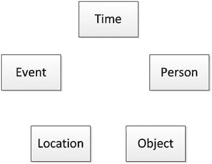
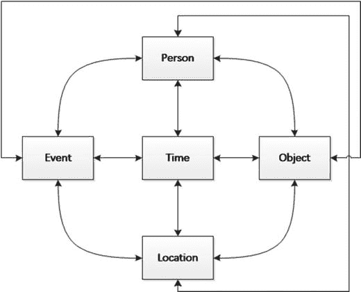
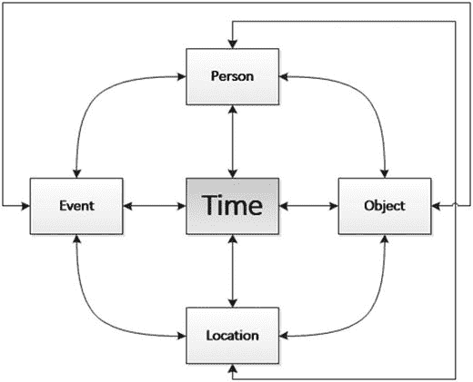
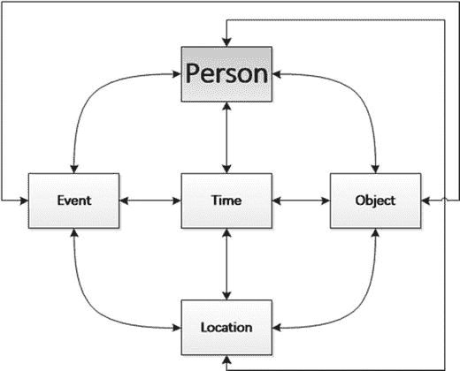
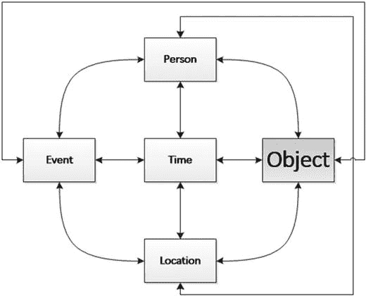
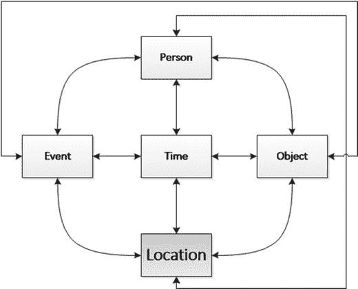
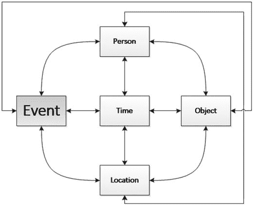

# print('################')

sTable = 'Assess_People'

print('存储中:', sDatabaseName, '表:', sTable)

PeopleData.to_sql(sTable, conn, if_exists="replace")

print('################')

################################################################

sFileDir = Base + '/' + Company + '/02-Assess/01-EDS/02-Python'

if not os.path.exists(sFileDir):

    os.makedirs(sFileDir)

################################################################

sOutputFileName = sTable + '.csv'

sFileName = sFileDir + '/' + sOutputFileName

print('################################')

print('存储中:', sFileName)

print('################################')

PeopleData.to_csv(sFileName, index=False)

print('################################')

################################################################

print('### 完成!! ############################################')

################################################################

```

保存`Assess-People.py`文件，然后使用`Python`编译器编译并执行。这将在屏幕上生成一组演示值。

## 总结

恭喜！你已经完成了评估超步骤。现在你有了一个稳定的基础，可以将多个数据源混合到数据仓库中。

我已经引导你完成了首个数据质量处理步骤。你所取得的成果将作为第 9 章的基础数据。

那么，在本书的这个阶段，你应该了解些什么呢？你应该知道如何：

*   有效解决不同的数据质量问题。
*   在执行评估处理时，转换并更新数据映射矩阵。你评估的每个数据源都是一个清晰的数据科学信息来源。
*   成功执行特征工程。
*   通过评估，引入针对其他数据源的标准，并查阅货币代码和国家代码等标准。
*   将列格式数据转换为图形关系。这是一项需要掌握的重要数据科学技能。

**注意：** 在现实世界的数据科学项目中，到目前为止，你可能已经消耗了高达 50% 的项目资源，才达到你今天所实现的稳定数据集。做得好！数据准备是消耗你人力、预算和计算资源的最大环节。

现在，你已经掌握了评估超步骤，并熟练掌握了处理数据质量的技巧。接下来的步骤在本质上更具结构性，因为你将创建一个通用的数据结构，为第 9 章开始的全方位数据科学探索奠定基础。

我建议你准备些好吃的零食，然后我们就可以进入下一章，在那里我们将为你的数据科学构建一个数据仓库。

# 9. 处理超步骤

处理超步骤将数据源的检索版本评估结果，适配成一个高度结构化的数据仓库，该仓库将为后续的数据科学步骤形成基础数据结构。这个数据仓库涉及跨项目制定一个标准的数据合并格式。

**提示：** 如果你遵循数据仓库的规则，它将为你未来的数据科学工作带来一个清晰且稳定的结构。

处理超步骤是一个合并过程，它将你的数据源导入到五个主要的数据类别中（图 9-1）。



**图 9-1** 五类数据

在你的数据仓库中仅使用这五个中心，配合良好的建模，你就可以描述客户的大部分活动。这使得你能够微调数据科学算法，只需理解这五个中心的用途和关系，就能实现良好的数据科学。

### 数据仓库

数据仓库建模是由 Dan Linstedt 设计的一种数据库建模方法。该数据结构旨在负责长期历史存储来自多个操作系统的数据。它支持按时间顺序的历史数据追踪，以实现完全审计，并支持结构的并行加载。

### 中心（Hubs）

数据仓库中心包含一组独特的业务键，这些键通常不随时间变化，因此是存储在中心中的稳定数据实体。中心为每个中心数据条目持有一个代理键，以及标记业务键来源的元数据。

### 链接（Links）

数据仓库链接是业务键之间的关联。这些链接本质上是多对多连接，并带有增强特定链接的额外元数据。

### 卫星（Satellites）

数据仓库卫星保存特定业务数据部分的时序和描述性特征。中心和链接构成了模型的结构，但它们本身没有时序特征，也不持有描述性特征。卫星由特征以及将它们链接到特定中心的元数据组成。标记关联和特征来源的元数据，以及包含特征起始和结束日期的时间线，都会被安全存储，以供数据部分将来使用。每个卫星都保存了该特定卫星内数据实体的完整时序历史。

### 参考卫星（Reference Satellites）

参考卫星从卫星引用，但在任何情况下都不会与中心键的元数据绑定。它们避免了其他卫星经常使用的参考特征的冗余存储。

典型的参考卫星包括：

*   **标准代码：** 例如用于国家代码的`ISO 3166`、用于货币的`ISO 4217`和用于时区的`ISO 8601`等代码。
*   **特定特征的固定列表：** 这些可以是缩减其他标准列表的标准列表。例如，你的业务设有办事处的国家列表，可能是从`ISO 3166`列表中缩减而来的固定列表。你也可以根据自己的报告结构，生成自己的列表，例如业务区域列表。
*   **转换查询：** 查看全球定位系统 (`GPS`) 的转换，例如 Molodensky 转换、Helmert 转换、Molodensky-Badekas 转换或 Gauss-Krüger 坐标系。

最常见的是`WGS84`，它是美国国防部定义的地理空间信息全球定位系统的标准，也是`GPS`的参考系统。

## 时间-人-对象-地点-事件数据仓库

我们使用的数据仓库基于时间-人-对象-地点-事件 (`T-P-O-L-E`) 设计原则（图 9-2）。



**图 9-2** `T-P-O-L-E`——高层设计

**注意：** 接下来几页讨论的所有数据结构都可以在 `datavault.db` 文件中找到，该文件位于目录 `\VKHCG\88-DV` 中。

### 时间部分（Time Section）

时间部分包含所有与记录事件发生时间相关的数据实体的完整数据结构。

#### 时间中心（Time Hub）

时间中心包含以下字段：

```sql
CREATE TABLE [Hub-Time] (
IDNumber      VARCHAR (100) PRIMARY KEY,
IDTimeNumber  Integer,
ZoneBaseKey   VARCHAR (100),
DateTimeKey   VARCHAR (100),
DateTimeValue DATETIME
);
```

该时间中心充当时区与其他日期时间关联值之间的核心连接器。

## 时间链接

时间链接将时间中心连接到其他中心（图 9-3）。



**图 9-3** 时间链接

支持以下链接。

### 时间-人员链接

这将人员中心内的日期时间值连接到时间中心。物理链接结构在数据仓库中存储为多对多关系。在本章后面，我将提供如何构建这些表的详细信息。

诸如生日、结婚纪念日以及阅读本书的日期等日期，可以在数据仓库中作为单独的链接进行记录。常见的格式是 `BirthdayOn`、`MarriedOn` 或 `ReadBookOn`。该格式简单来说是时间中心和人员中心之间的一对键。

### 时间-对象链接

这将对象中心内的日期时间值连接到时间中心。诸如你买车、卖车和阅读本书的日期等日期，可以在数据仓库中作为单独的链接进行记录。常见的格式是 `BoughtCarOn`、`SoldCarOn` 或 `ReadBookOn`。该格式简单来说是时间中心和对象中心之间的一对键。

### 时间-地点链接

这将地点中心内的日期时间值连接到时间中心。诸如搬到了邮政编码 SW1、从邮政编码 SW1 搬离以及在邮政编码 SW1 阅读本书等日期，可以在数据仓库中作为单独的链接进行记录。常见的格式是 `MovedToPostCode`、`MovedFromPostCode` 或 `ReadBookAtPostCode`。该格式简单来说是时间中心和地点中心之间的一对键。

### 时间-事件链接

该链接将事件中心中的日期时间值与时间中心连接起来。诸如搬家日期和更换交通工具日期等，都可以作为数据仓库中的独立链接进行记录。

标准格式为 `MoveHouse` 或 `ChangeVehicle`。该格式本质上是一组介于时间中心与事件中心之间的键值对。

## 时间卫星

时间卫星是数据仓库中用于存储以下字段的部分。

> **注意**
> 表名中的 `<Time Zone>` 部分来自一个时区列表，我将在本章后面讨论该列表。

```sql
CREATE TABLE [Satellite-Time-] (
  IDZoneNumber     VARCHAR (100) PRIMARY KEY,
  IDTimeNumber     INTEGER,
  ZoneBaseKey      VARCHAR (100),
  DateTimeKey      VARCHAR (100),
  UTCDateTimeValue DATETIME,
  Zone             VARCHAR (100),
  DateTimeValue    DATETIME
);
```

时间卫星使您能够更轻松地处理跨国业务模式。您可以跨时区查看诸如“在早上……”或“在午餐时间……”之类的模式。这些功能将在转换超级步骤中使用，以发现全球范围内的规律和行为。

## 人物部分

人物部分包含与记录相关人员相关的所有数据实体的完整数据结构。

### 人物中心

人物中心由一系列支持“真实”人物的字段组成。人物中心包含以下字段：

```sql
CREATE TABLE [Hub-Person] (
  IDPersonNumber     INTEGER,
  FirstName          VARCHAR (200),
  SecondName         VARCHAR (200),
  LastName           VARCHAR (200),
  Gender             VARCHAR (20),
  TimeZone           VARCHAR (100),
  BirthDateKey       VARCHAR (100),
  BirthDate          DATETIME
);
```

### 人物链接

此部分将人物中心与其他中心连接起来（图 9-4）。



**图 9-4** 人物链接

人物链接中支持以下链接类型。

#### 人物-时间链接

此链接将人物与时间中心连接起来，用于描述这两个中心之间的关系。该链接包含以下字段：

```sql
CREATE TABLE [Link-Person-Time] (
  IDPersonNumber   INTEGER,
  IDTimeNumber     INTEGER,
  ValidDate        DATETIME
);
```

#### 人物-对象链接

此链接将人物与对象中心连接起来，用于描述这两个中心之间的关系。该链接包含以下字段：

```sql
CREATE TABLE [Link-Person-Object] (
  IDPersonNumber   INTEGER,
  IDObjectNumber   INTEGER,
  ValidDate        DATETIME
);
```

#### 人物-地点链接

此链接将人物与地点中心连接起来，用于描述这两个中心之间的关系。该链接包含以下字段：

```sql
CREATE TABLE [Link-Person-Location] (
  IDPersonNumber       INTEGER,
  IDLocationNumber     INTEGER,
  ValidDate            DATETIME
);
```

#### 人物-事件链接

此链接将人物与事件中心连接起来，用于描述这两个中心之间的关系。该链接包含以下字段：

```sql
CREATE TABLE [Link-Person-Event] (
  IDPersonNumber   INTEGER,
  IDEventNumber    INTEGER,
  ValidDate        DATETIME
);
```

### 人物卫星

人物卫星是数据仓库中用于存储数据的时间属性和描述性属性的部分。卫星表采用以下格式：

```sql
CREATE TABLE [Satellite-Person-Gender] (
  PersonSatelliteID VARCHAR (100),
  IDPersonNumber INTEGER,
  FirstName VARCHAR (200),
  SecondName VARCHAR (200),
  LastName VARCHAR (200),
  BirthDateKey VARCHAR (20),
  Gender VARCHAR (10)
);
```

## 对象部分

对象部分包含与记录相关对象相关的所有数据实体的完整数据结构。

### 对象中心

对象中心由一系列支持“真实”对象的字段组成。对象中心包含以下字段：

```sql
CREATE TABLE [Hub-Object-Species] (
  IDObjectNumber INTEGER,
  ObjectBaseKey VARCHAR (100),
  ObjectNumber VARCHAR (100),
  ObjectValue VARCHAR (200)
);
```

这种结构使您作为数据科学家能够对业务环境中的对象进行分类。

### 对象链接

这些链接将对象中心与其他中心连接起来（图 9-5）。



**图 9-5** 对象链接

支持以下链接类型：

#### 对象-时间链接

此链接将对象与时间中心连接起来，用于描述这两个中心之间的关系。该链接包含以下字段：

```sql
CREATE TABLE [Link-Object-Time] (
  IDObjectNumber   INTEGER,
  IDTimeNumber     INTEGER,
  ValidDate        DATETIME
);
```

#### 对象-人物链接

此链接将对象与人物中心连接起来，用于描述这两个中心之间的关系。该链接包含以下字段：

```sql
CREATE TABLE [Link-Object-Person] (
  IDObjectNumber   INTEGER,
  IDPersonNumber   INTEGER,
  ValidDate        DATETIME
);
```

#### 对象-地点链接

此链接将对象与地点中心连接起来，用于描述这两个中心之间的关系。该链接包含以下字段：

```sql
CREATE TABLE [Link-Object-Location] (
  IDObjectNumber   INTEGER,
  IDLocationNumber INTEGER,
  ValidDate        DATETIME
);
```

##### 对象-事件链接

此链接将对象与事件中心连接起来，用于描述这两个中心之间的关系。

#### 对象卫星

对象卫星是数据仓库中用于存储和提供对象详细特征的部分。典型的对象卫星表包含以下数据字段：

```
CREATE TABLE [Satellite-Object-Make-Model] (
    IDObjectNumber INTEGER,
    ObjectSatelliteID VARCHAR (200),
    ObjectType VARCHAR (200),
    ObjectKey VARCHAR (200),
    ObjectUUID VARCHAR (200),
    Make VARCHAR (200),
    Model VARCHAR (200)
);
```

对象卫星将持有额外的特征，因为每个对象都需要额外的信息来进行描述。我将每组特征分开存储，以确保未来的扩展性，因为对象是变化率最高的中心之一，您的数据科学工作会不断发现新的特征。

### 地点部分

地点部分包含与记录相关地点相关的所有数据实体的完整数据结构。

#### 地点中心

地点中心由一系列支持 GPS 位置的字段组成。地点中心包含以下字段：

```
CREATE TABLE [Hub-Location] (
    IDLocationNumber INTEGER,
    ObjectBaseKey  VARCHAR (200),
    LocationNumber INTEGER,
    LocationName   VARCHAR (200),
    Longitude      DECIMAL (9, 6),
    Latitude       DECIMAL (9, 6)
);
```

地点中心使您能够将任何地点、地址或地理空间信息连接到数据仓库的其他部分。

#### 地点链接

地点链接将地点中心与其他中心连接起来（图 9-6）。



**图 9-6** 地点链接

支持以下链接类型。

##### 地点-时间链接

此链接将地点与时间中心连接起来，用于描述这两个中心之间的关系。该链接包含以下字段：

```
CREATE TABLE [Link-Location-Time] (
    IDLocationNumber   INTEGER,
    IDTimeNumber       INTEGER,
    ValidDate          DATETIME
);
```

这些链接支持诸如 `ArrivedAtShopAtDateTime` 或 `ShopOpensAtTime` 之类的业务操作。

##### 地点-人物链接

此链接将地点与人物中心连接起来，用于描述这两个中心之间的关系。该链接包含以下字段：

```
CREATE TABLE [Link-Location-Person] (
    IDLocationNumber   INTEGER,
    IDPersonNumber     INTEGER,
    ValidDate          DATETIME
);
```

这些链接支持诸如 `ManagerAtShop` 或 `SecurityAtShop` 之类的业务操作。

##### 地点-对象链接

此链接用于连接地点与对象中心，描述两个中心之间的关系。该链接包含以下字段：

```
CREATE TABLE [Link-Location-Object] (
    IDLocationNumber   INTEGER,
    IDObjectNumber     INTEGER,
    ValidDate          DATETIME
);
```

这些链接支持诸如 `ShopDeliveryVan`（店铺送货车辆）或 `RackAtShop`（店铺货架）等业务行为。

##### 地点-事件链接

此链接用于连接地点与事件中心，描述两个中心之间的关系。该链接包含以下字段：

```
CREATE TABLE [Link-Location-Event] (
    IDLocationNumber   INTEGER,
    IDEventNumber      INTEGER,
    ValidDate          DATETIME
);
```

这些链接支持诸如 `ShopOpened`（店铺开业）或 `PostCodeDeliveryStarted`（邮编区配送开始）等业务行为。

#### 地点卫星

地点卫星是数据仓库的一部分，用于存储和提供实体所在位置的详细特征。典型的地点卫星包含以下数据字段：

```
CREATE TABLE [Satellite-Location-PostCode] (
    IDLocationNumber INTEGER,
    LocationSatelliteID VARCHAR (200),
    LocationType VARCHAR (200),
    LocationKey VARCHAR (200),
    LocationUUID VARCHAR (200),
    CountryCode VARCHAR (20),
    PostCode VARCHAR (200)
);
```

地点卫星还将包含仅与您特定客户相关的其他特征。他们可能会将业务区域划分为自己的地理区域，例如，`Europe`（欧洲）、`Middle-East`（中东）和 `China`（中国）。这些可以作为单独的地点卫星添加。

### 事件部分

事件部分包含了与记录所发生事件相关的所有数据实体的完整数据结构。

#### 事件中心

事件中心由一系列支持现实世界中发生的事件的字段组成。事件中心包含以下字段：

```
CREATE TABLE [Hub-Event] (
    IDEventNumber    INTEGER,
    EventType        VARCHAR (200),
    EventDescription VARCHAR (200)
);
```

#### 事件链接

事件链接将事件中心与其他中心连接起来（参见图 9-7）。



**图 9-7** 事件链接

支持以下链接。

##### 事件-时间链接

此链接用于连接事件与时间中心，描述两个中心之间的关系。该链接包含以下字段：

```
CREATE TABLE [Link-Event-Time] (
    IDEventNumber   INTEGER,
    IDTimeNumber     INTEGER,
    ValidDate        DATETIME
);
```

这些链接支持诸如 `DeliveryDueAt`（预定送达时间）或 `DeliveredAt`（实际送达时间）等业务行为。

##### 事件-人员链接

此链接用于连接事件与人员中心，描述两个中心之间的关系。该链接包含以下字段：

```
CREATE TABLE [Link-Event-Person] (
    IDEventNumber   INTEGER,
    IDPersonNumber  INTEGER,
    ValidDate       DATETIME
);
```

这些链接支持诸如 `ManagerAppointAs`（任命为经理）或 `StaffMemberJoins`（员工入职）等业务行为。

##### 事件-对象链接

此链接用于连接事件与对象中心，描述两个中心之间的关系。该链接包含以下字段：

```
CREATE TABLE [Link-Event-Object] (
    IDEventNumber   INTEGER,
    IDObjectNumber  INTEGER,
    ValidDate       DATETIME
);
```

这些链接支持诸如 `VehicleBuy`（车辆购买）、`VehicleSell`（车辆出售）或 `ItemInStock`（库存物品）等业务行为。

##### 事件-地点链接

此链接用于连接事件与地点中心，描述两个中心之间的关系。该链接包含以下字段：

```
CREATE TABLE [Link-Event-Location] (
    IDEventNumber   INTEGER,
    IDTimeNumber    INTEGER,
    ValidDate       DATETIME
);
```

```

# 设计实用的过程超步骤

接下来，我将开始一系列信息性和实践性的章节，最终目标是让您使用前面讨论过的 T-P-O-L-E 设计模型，通过“过程”步骤生成一个数据仓库。

> **注意**
>
> 我使用 `T-P-O-L-E` 模型，但“纯粹的”数据仓库可以使用各种其他中心、链接或卫星。该模型是一个简化模型，使我能够复用多年来在数据科学工作中开发的众多实用工具和流程。

#### 事件卫星

事件卫星是数据仓库的一部分，用于存储与您将通过数据科学进行分析的系统内发生的所有事件相关的详细信息。我建议您每个卫星只包含一种事件类型。这有助于未来扩展，并便于数据仓库的长期维护。

## 时间

时间是数据的一个特征，与时间记录直接相关。ISO 8601-2004 描述了数据元素和日期时间交换格式的国际标准。以下是处理数据交换的一组基本规则。

日历基于公历。以下数据实体（年、月、日、时、分、秒以及秒的小数部分）正式成为 ISO 8601-2004 标准的一部分。数据按从大到小的顺序记录。值必须有预先商定的固定位数，不足时用前导零补齐。现在，我将向您介绍这些不同的数据实体。

### 年

标准年份必须使用 `0000` 到 `9999` 范围内的四位数。双方可选约定，任何用公元前/公元后表示的日期需要转换，其中公元 1 年 = 年份 1，公元前 1 年 = 年份 0，公元前 2 年 = 年份 -1。这意味着公元 2017 年变为 `+2017`，但公元前 2017 年则变为 `-2016`。

有效格式为：`YYYY` 和 `+/-YYYY`。一个有效年份的规则是：2017 年 10 月 20 日变为 `2017-10-20` 或 `+2017-10-20` 或基本格式 `20171020`。年份数据缺失的规则是：10 月 20 日变为 `--10-20` 或 `--1020`。

`YYYYMMDD` 格式在源系统中很常见。我建议您在“评估”步骤中将其转换为 `YYYY-MM-DD` 格式，以便在后续处理阶段实现日期格式的一致性。

> **警告**
>
> 与您的客户讨论 1582 年 10 月（公历正式起始日期）之前的日期。儒略历自公元前 45 年 1 月 1 日起使用。如果更早的日期对客户的数据处理至关重要，我建议您深入研究这些日期之间其他更复杂的差异。在处理较旧文档的文本挖掘时，这一点非常重要。

打开您的 IPython 编辑器并研究以下日期格式：

```python
from datetime import datetime
from pytz import timezone, all_timezones

now_date = datetime(2001,2,3,4,5,6,7)
now_utc=now_date.replace(tzinfo=timezone('UTC'))

print('Date:',str(now_utc.strftime("%Y-%m-%d %H:%M:%S (%Z) (%z)")))
print('Year:',str(now_utc.strftime("%Y")))
```

您应该看到：

```
Date: 2001-02-03 04:05:06 (UTC) (+0000)
Year: 2001
```

这使您能够轻松地从给定日期中提取年份值。

### 月份

标准月份必须使用介于 `01` 到 `12` 之间的两位数值。有效月份的规则是，2017 年 10 月 20 日应表示为 `2017-10-20` 或 `+2017-10-20`。不带日期的有效月份规则是，2017 年 10 月应表示为 `2017-10` 或 `+2017-10`。

> **警告：** 你不能使用 `YYYYMM` 格式，因此 `201710` 无效。本标准是为了避免与源系统中仍然常用的简化格式 `YYMMDD` 产生混淆。`201011` 可能被理解为 `2010-11` 或 `1920-10-11`。

打开你的 IPython 编辑器，研究以下日期格式：

```python
print('Date:',str(now_utc.strftime("%Y-%m-%d %H:%M:%S (%Z) (%z)")))
print('Month:',str(now_utc.strftime("%m")))
```

你应该得到以下输出：

```
Date: 2001-02-03 04:05:06 (UTC) (+0000)
Month: 02
```

现在你可以获取月份了。

这遵循了标准的英文月份名称。

| 数字 | 月份 |
| --- | --- |
| 1 | January |
| 2 | February |
| 3 | March |
| 4 | April |
| 5 | May |
| 6 | June |
| 7 | July |
| 8 | August |
| 9 | September |
| 10 | October |
| 11 | November |
| 12 | December |

打开你的 IPython 编辑器，研究以下日期格式：

```python
print('Date:',str(now_utc.strftime("%Y-%m-%d %H:%M:%S (%Z) (%z)")))
print('MonthName:', str(now_utc.strftime("%B")))
```

这将返回月份的单词形式。

```
Date: 2001-02-03 04:05:06 (UTC) (+0000)
MonthName: February
```

### 日

标准日期中的日必须使用两位数值，可能取值在 `01` 到 `31` 之间，具体取决于特定月份和年份的约定格式。有效月份的规则是，2017 年 10 月 20 日应表示为 `2017-10-20` 或 `+2017-10-20`。

打开你的 IPython 编辑器，研究以下日期格式：

```python
print('Date:',str(now_utc.strftime("%Y-%m-%d %H:%M:%S (%Z) (%z)")))
print('Day:',str(now_utc.strftime("%d")))
```

这将返回该日期的日。

```
Date: 2001-02-03 04:05:06 (UTC) (+0000)
Day: 03
```

验证日期适用两种标准：非闰年和闰年。由于太阳年长度略短于 365¼ 天——大约少 11 分钟——每 4 年，日历会显示一个闰年，除非该年份能被 400 整除。这修正了 400 年间积累的 11 分钟差值。

打开你的 IPython 编辑器，研究以下日期格式。我将向你展示查找闰年的方法。

```python
import datetime
for year in range(1960,2025):
    month=2
    day=29
    hour=0
    correctDate = None
    try:
        newDate = datetime.datetime(year=year,month=month,day=day,hour=hour)
        correctDate = True
    except ValueError:
        correctDate = False
    if correctDate == True:
        if year%400 == 0:
            print(year, 'Leap Year (400)')
        else:
            print(year, 'Leap Year')
    else:
        print(year,'Non Leap Year')
```

结果显示闰年如下：

```
1960,1964,1968,1972,1976,1980,1984,1988,1992,1996,2000(This was a 400)
2004,2008,2012,2016,2020,2024.
```

现在，我们可以查看日期时间中的时间部分。

### 小时

标准小时必须使用介于 `00` 到 `24` 之间的两位数值。有效格式为 `hhmmss` 或 `hh:mm:ss`。缩写格式 `hhmm` 或 `hh:mm` 可接受，但不建议使用。不支持 `hh` 格式。`00:00:00` 表示日历日的开始。`24:00:00` 仅用于表示日历日的结束。

打开你的 IPython 编辑器，研究以下日期格式：

```python
print('Date:',str(now_utc.strftime("%Y-%m-%d %H:%M:%S (%Z) (%z)")))
print('Hour:',str(now_utc.strftime("%H")))
```

结果是：

```
Date: 2001-02-03 04:05:06 (UTC) (+0000)
Hour: 04
```

### 分钟

标准分钟必须使用介于 `00` 到 `59` 之间的两位数值。有效格式为 `hhmmss` 或 `hh:mm:ss`。缩写格式 `hhmm` 或 `hh:mm` 可接受，但不建议使用。

打开你的 IPython 编辑器，研究以下日期格式：

```python
```

print('Date:',str(now_utc.strftime("%Y-%m-%d %H:%M:%S (%Z) (%z)")))
print('Minute:',str(now_utc.strftime("%M")))
```

结果是：

```
Date: 2001-02-03 04:05:06 (UTC) (+0000)
Minute: 05
```

### 秒

标准秒必须使用介于 00 到 59 之间的两位数值。有效格式为 `hhmmss` 或 `hh:mm:ss`。

打开你的 IPython 编辑器，研究以下日期格式：

```
print('Date:',str(now_utc.strftime("%Y-%m-%d %H:%M:%S (%Z) (%z)")))
print('Second:',str(now_utc.strftime("%S")))
```

这将返回日期时间的秒数。

```
Date: 2001-02-03 04:05:06 (UTC) (+0000)
Second: 06
```

**注意：** 这通常是大多数系统停止记录时间的地方，但我有一些客户需要更精确的时间记录级别。

### 秒的小数部分

秒的小数部分仅定义为以下格式：`hhmmss,sss` 或 `hh:mm:ss,sss` 或 `hhmmss.sss` 或 `hh:mm:ss.sss`。我更喜欢 `hh:mm:ss.sss` 格式，因为使用逗号在导出到数据科学生态系统中常见的 CSV 文件格式时会引起问题。

当前常用的格式如下：

- `hh:mm:ss.s`：十分之一秒
- `hh:mm:ss.ss`：百分之一秒
- `hh:mm:ss.sss`：千分之一秒

如果你能以尽可能低的级别记录数据，数据科学的效果最好。我建议你将时间记录在 `hh:mm:ss.sss` 级别。

打开你的 IPython 编辑器，研究以下日期格式：

```
print('Date:',str(now_utc.strftime("%Y-%m-%d %H:%M:%S (%Z) (%z)")))
print('Millionth of Second:',str(now_utc.strftime("%f")))
```

这将返回百万分之一秒（即微秒）的秒小数部分，如下所示：

- Date: `2001-02-03 04:05:06 (UTC) (+0000)`
- Millionth of Second: `000007`

还有一些更小的单位，例如：

- **纳秒：** 十亿分之一秒
  - 尺度对比：1 纳秒相对于 1 秒，相当于 1 秒相对于 31.71 年。
- **皮秒：** 一万亿分之一秒，或百万分之一百万分之一秒
  - 尺度对比：1 皮秒相对于 1 秒，相当于 1 秒相对于 31,710 年。

我有一个客户，他拥有一台名为条纹管或增强型 CCD (`ICCD`) 相机的科学设备。这些设备能够拍摄光的运动图像，其中 +/-3.3 皮秒是光传播 1 毫米所需的时间。

**注意：** 2011 年，麻省理工学院的研究人员宣布他们拥有了一台每秒万亿帧的视频相机。这款相机的能力非常出色，因为电影的标准是每秒 24 帧 (`fps`)，视频是每秒 30 帧，还有一些 48 `fps` 的型号。

在高性能计算的测量中，一台常见的 3.0 GHz 计算机 `CPU` 将两个整数相加需要 +/-330 皮秒。数据科学家的世界是一个极端测量的世界。

还记得你在第 5 章之前做的电影与帧的示例吗？这台相机在 1 秒内产生的帧数足以制作 1,056,269,593.8 年的视频（以 30 `fps` 播放）。

### 本地时间与协调世界时 (UTC)

我们使用的日期和时间与地球上的特定地点以及日历年的特定时间绑定。约定的本地时间由特定国家批准。

我讨论时区是因为，作为一名数据科学家，你将不得不合并来自全球多个数据源的数据。问题在于时区的影响以及客户对规则的不一致应用。

### 当地时间

经批准的当地时间由特定国家通过批准使用该国的特定时区来确定。夏令时也可被采用，如果该国使用夏令时，则会使其当地时间在一年中的特定时段发生偏移。当地时间的通用格式为 `hh:mm:ss`。

打开你的 IPython 编辑器并研究以下日期格式：

```
from datetime import datetime
now_date = datetime.now()
print('Date:',str(now_date.strftime("%Y-%m-%d %H:%M:%S (%Z) (%z)")))
```

结果如下：

```
2017-10-01 10:45:58 () ()
```

出现两个空括号的原因是此时日期时间处于当地时间设置中。

**警告**  
大多数数据系统会在特定服务器、个人电脑或平板电脑的当地时间设置中记录当地时间。作为数据科学家，你需要理解生态系统中的并非所有系统都能以可靠的方式记录时间。

**提示**  
有一个简单网络时间协议（`SNTP`），你可以自动使用它来将系统时间与远程服务器的时间同步。`SNTP` 可用于通过远程服务器更新机器上的时钟。通过与已知时间准确的服务器同步，这能保持机器时间的准确性。我通常会将自己记录客户数据的计算机与客户使用的同一台 `NTP` 服务器同步，以确保按照他们的系统获得正确的日期和时间。

现在你可以开始研究国际日期和时间设置的世界了。

### 协调世界时（UTC）

协调世界时是一种时间计量方式，与 0° 经度处的平太阳时误差在约 1 秒以内。有效格式为 `hh:mm:ss±hh:mm` 或 `hh:mm:ss±hh`。

例如，2017 年 9 月 11 日，英国伦敦上午九点，当地时间为 `09:00:00`，UTC 时间为 `10:00:00+01:00`。在美国纽约，当地时间为 `06:00:00`，UTC 时间为 `10:00:00-04:00`。在印度新德里，当地时间为 `15:30:00`，UTC 时间为 `10:00:00+05:30`。

更精确的记录方式应为 `2017-09-11T10:00:00Z`。在接下来的章节中，我将解释为什么作为数据科学家在处理多个时区时，日期如此重要。

打开你的 IPython 编辑器并研究以下日期格式：

```
from datetime import datetime
now_date = datetime.now()
print('Local Date Time:',str(now_date.strftime("%Y-%m-%d %H:%M:%S (%Z) (%z)")))
now_utc=now_date.replace(tzinfo=timezone('UTC'))
print('UTC Date Time:',str(now_utc.strftime("%Y-%m-%d %H:%M:%S (%Z) (%z)")))
```

**警告**  
我当前工作在伦敦/爱丁堡时区，因此我的结果将基于这一事实。我的时区是 `Europe/London`。

```
from datetime import datetime
now_date = datetime.now()
print('Local Date Time:',str(now_date.strftime("%Y-%m-%d %H:%M:%S (%Z) (%z)")))
now_utc=now_date.replace(tzinfo=timezone('UTC'))
print('UTC Date Time:',str(now_utc.strftime("%Y-%m-%d %H:%M:%S (%Z) (%z)")))
now_london=now_date.replace(tzinfo=timezone('Europe/London'))
print('London Date Time:',str(now_london.strftime("%Y-%m-%d %H:%M:%S (%Z) (%z)")))
```

因此，我的参考结果如下：

```
Local Date Time: 2017-10-03 16:14:43 () ()
UTC Date Time: 2017-10-03 16:14:43 (UTC) (+0000)
London Date Time: 2017-10-03 16:14:43 (LMT) (-0001)
```

现在，带着这些知识，让我们再看一下你的结果。

```
from datetime import datetime
now_date = datetime.now()
print('Local Date Time:',str(now_date.strftime("%Y-%m-%d %H:%M:%S (%Z) (%z)")))
now_utc=now_date.replace(tzinfo=timezone('UTC'))
print('UTC Date Time:',str(now_utc.strftime("%Y-%m-%d %H:%M:%S (%Z) (%z)")))
```

Local Date Time: 2017-10-03 16:14:43 () ()
UTC Date Time: 2017-10-03 16:14:43 (UTC) (+0000)

很多公司现在都有不同的时区吗？是的！VKHCG 也不例外。

打开你的 Python 编辑器，我们来研究 VKHCG 的时区。

```python
from datetime import datetime
from pytz import timezone, all_timezones
```

获取当前时间。

```python
now_date_local=datetime.now()
```

通过将当地时间标记为 `Europe/London` 时间，将其转换为 `Europe/London` 当地时间。

```python
now_date=now_date_local.replace(tzinfo=timezone('Europe/London'))
print('Local Date Time:',str(now_date.strftime("%Y-%m-%d %H:%M:%S (%Z) (%z)")))
```

现在你拥有一个支持时区的日期时间值，可以用来计算其他时区。你首先要执行的转换是转换到 UTC 时区，如下所示：

```python
now_utc=now_date.astimezone(timezone('UTC'))
print('UTC Date Time:',str(now_utc.strftime("%Y-%m-%d %H:%M:%S (%Z) (%z)")))
```

英国伦敦的时间是多少？

```python
now_eu_london=now_date.astimezone(timezone('Europe/London'))
print('London Date Time:',str(now_eu_london.strftime("%Y-%m-%d %H:%M:%S (%Z) (%z)")))
```

德国柏林的时间是多少？

```python
now_eu_berlin=now_date.astimezone(timezone('Europe/Berlin'))
print('Berlin Date Time:',str(now_eu_berlin.strftime("%Y-%m-%d %H:%M:%S (%Z) (%z)")))
```

英国泽西岛的时间是多少？

```python
now_eu_jersey=now_date.astimezone(timezone('Europe/Jersey'))
print('Jersey Date Time:',str(now_eu_jersey.strftime("%Y-%m-%d %H:%M:%S (%Z) (%z)")))
```

美国纽约的时间是多少？

```python
now_us_eastern=now_date.astimezone(timezone('US/Eastern'))
print('USA Easten Date Time:',str(now_us_eastern.strftime("%Y-%m-%d %H:%M:%S (%Z) (%z)")))
```

美国亚利桑那州的时间是多少？

```python
now_arizona=now_date.astimezone(timezone('US/Arizona'))
print('USA Arizona Date Time:',str(now_arizona.strftime("%Y-%m-%d %H:%M:%S (%Z) (%z)")))
```

澳大利亚奥克兰的时间是多少？

```python
now_auckland=now_date.astimezone(timezone('Pacific/Auckland'))
print('Auckland Date Time:',str(now_auckland.strftime("%Y-%m-%d %H:%M:%S (%Z) (%z)")))
```

加拿大育空地区的时间是多少？

```python
now_yukon=now_date.astimezone(timezone('Canada/Yukon'))
print('Canada Yukon Date Time:',str(now_yukon.strftime("%Y-%m-%d %H:%M:%S (%Z) (%z)")))
```

冰岛雷克雅未克的时间是多少？

```python
now_reyk=now_date.astimezone(timezone('Atlantic/Reykjavik'))
print('Reykjavik Date Time:',str(now_reyk.strftime("%Y-%m-%d %H:%M:%S (%Z) (%z)")))
```

印度孟买的时间是多少？

```python
now_india=now_date.astimezone(timezone('Etc/GMT-7'))
print('India Date Time:',str(now_india.strftime("%Y-%m-%d %H:%M:%S (%Z) (%z)")))
```

费尔默伦使用了哪些时区？

```python
print('Vermeulen Companies')
print('Local Date Time:',str(now_date_local.strftime("%Y-%m-%d %H:%M:%S (%Z) (%z)")))
print('HQ Edinburgh:',str(now_utc.strftime("%Y-%m-%d %H:%M:%S (%Z) (%z)")))
print('Iceland Thor Computers:',str(now_reyk.strftime("%Y-%m-%d %H:%M:%S (%Z) (%z)")))
print('USA Arizona Computers:',str(now_arizona.strftime("%Y-%m-%d %H:%M:%S (%Z) (%z)")))
```

以下是费尔默伦的结果：

```
Vermeulen Companies
Local Date Time: 2017-10-03 16:14:43 () ()
HQ Edinburgh: 2017-10-03 16:15:43 (UTC) (+0000)
Iceland Thor Computers: 2017-10-03 16:15:43 (GMT) (+0000)
USA Arizona Computers: 2017-10-03 09:15:43 (MST) (-0700)
```

克伦瓦尔纳的情况如何？

```python
print('Krennwallner Companies')
print('Local Date Time:',str(now_date_local.strftime("%Y-%m-%d %H:%M:%S (%Z) (%z)")))
print('HQ Berlin:',str(now_eu_berlin.strftime("%Y-%m-%d %H:%M:%S (%Z) (%z)")))
print('HQ USA:',str(now_us_eastern.strftime("%Y-%m-%d %H:%M:%S (%Z) (%z)")))
```

以下是克伦瓦尔纳的结果：

```
Krennwallner Companies
Local Date Time: 2017-10-03 16:14:43 () ()
HQ Berlin: 2017-10-03 18:15:43 (CEST) (+0200)
HQ USA: 2017-10-03 12:15:43 (EDT) (-0400)
```

希尔曼的情况如何？

```python
print('Hillman Companies')
print('HQ London:',str(now_london.strftime("%Y-%m-%d %H:%M:%S (%Z) (%z)")))
print('HQ USA:',str(now_arizona.strftime("%Y-%m-%d %H:%M:%S (%Z) (%z)")))
print('HQ Canada:',str(now_yukon.strftime("%Y-%m-%d %H:%M:%S (%Z) (%z)")))
print('HQ Australia:',str(now_auckland.strftime("%Y-%m-%d %H:%M:%S (%Z) (%z)")))
print('HQ India:',str(now_india.strftime("%Y-%m-%d %H:%M:%S (%Z) (%z)")))
```

希尔曼的结果仅针对总部。

```
Hillman Companies
HQ London: 2017-10-03 16:14:43 (LMT) (-0001)
HQ USA: 2017-10-03 09:15:43 (MST) (-0700)
```

HQ Canada: 2017-10-03 09:15:43 (PDT) (-0700)

HQ Australia: 2017-10-04 05:15:43 (NZDT) (+1300)

HQ India: 2017-10-03 23:15:43 (+07) (+0700)

```

克拉克的情况如何？

```python

print('Clark Companies')

print('HQ Jersey:',str(now_eu_jersey.strftime("%Y-%m-%d %H:%M:%S (%Z) (%z)")))

print('HQ Berlin:',str(now_eu_berlin.strftime("%Y-%m-%d %H:%M:%S (%Z) (%z)")))

print('HQ USA:',str(now_us_eastern.strftime("%Y-%m-%d %H:%M:%S (%Z) (%z)")))

```

希尔曼的情况如何？

```

HQ Jersey: 2017-10-03 17:15:43 (BST) (+0100)

HQ Berlin: 2017-10-03 18:15:43 (CEST) (+0200)

HQ USA: 2017-10-03 12:15:43 (EDT) (-0400)

```

这展示了数据科学家如何研究我们的日期和时间。作为人类，几千年来我们一直将日期和时间的概念分开。日期是通过星辰计算的。时间曾由沙漏确定。后来，日期出现在日历上，而时间则体现在怀表上。但在现代国际社会中，还有另一种日期时间数据项。对我来说，它就是一部智能手机——句号！

## 组合日期与时间

当日期和时间在同一个字段中使用时，ISO 支持本地时间的格式 `YYYY-MM-DDThh:mm:ss.sss` 和协调世界时的格式 `YYYY-MM-DDThh:mm:ss.sssZ`。

这些日期和时间的组合通常出现在跨国公司的财务报表、物流运输信息以及我的智能手机上。

## 时区

时区使得现实世界能够创建一套人们可用来安排生活的日期和小时日历。例如，日期和时间通常表示为 2017 年 10 月 20 日 9:00。但在数据科学家的世界里，这个信息是不充分的。数据科学家需要日期、时间和时区。`YYYY-MM-DDThh:mm:ss.sssZ` 是满足数据科学家数据处理需求的特殊时区格式。

`注意`

本章前面已经讨论过这种格式，作为 UTC 的替代方案。

在国际数据中，我还见过以其他格式设置的时区，必须与大家讨论如何以实际的方式处理这些格式。

打开你的 `IPython` 编辑器，研究以下日期格式：

```python

from pytz import all_timezones

for zone in all_timezones:

    print(zone)

```

共有 593 个时区。是的，你没有看错！问题在于，由于缺乏理解，公司甚至不遵循这些标准时区。例如，我的一个客户使用 `YYYY-DDThh:mm:ss.sssY` 来表示 UTC-12:00，即 Yankee 时区。

`警告`

这些时区不是 ISO 的有效格式！但它们被世界各地的源系统普遍使用。

如果你需要转换回 UTC 格式或本地时间，我将提供我曾经见过的时区列表。

`提示`

我通常会在所有数据科学工作中添加一个 UTC 时区（格式为 `YYYY-DDThh:mm:ss.sssZ`），因为它能确保在处理来自多个时区的数据时，你始终有一个通用的日期和时间处理变量。

数据源记录的时点通常就是你使用的时区。

`警告`

时区取决于你源系统的经纬度或硬件的时钟设置。以下数据是概括性的。我建议你在选择正确的时区之前，先调查一下数据的来源。

一旦找到正确的原始时区，我建议你执行以下操作：

```python

now_date_local = datetime.now()

now_date = now_date_local.replace(tzinfo=timezone('Europe/London'))

print('Local Date Time:', str(now_date_local.strftime("%Y-%m-%d %H:%M:%S (%Z) (%z)")))

print('Local Date Time:', str(now_date.strftime("%Y-%m-%d %H:%M:%S (%Z) (%z)")))

```

结果是

```

Local Date Time: 2017-10-01 12:54:03 () ()

Local Date Time: 2017-10-01 12:54:03 (LMT) (-0001)

```

`'Europe/London'` 从 593 个时区的列表中应用了正确的时区。现在转换为 UTC。

```python

now_utc = now_date.astimezone(timezone('UTC'))

print('UTC Date Time:', str(now_utc.strftime("%Y-%m-%d %H:%M:%S (%Z) (%z)")))

```

结果是

```

UTC Date Time: 2017-10-01 12:55:03 (UTC) (+0000)


我建议你谨慎使用这种方式作为首选的转换方法。你会注意到 `YYYY-DDDThh:mmM` 这种格式的含义或多或少不太准确，它可以转换为 UTC+12:00、UTC+12:45、UTC+13:00 和 UTC+14:00。

UTC+14:00 是 UTC+14，向东延伸至 180° 经线以东 30°，在国际日期变更线上形成了一个大拐弯，并为数据科学家带来了有趣的数据问题。

### 有趣的事实

基里巴斯共和国于 1995 年 1 月 1 日对其东部一半的地区实行了日期和时间的变更，从时区 -11 和 -10 调整为 +13 和 +14。在此之前，`UTC+13`和`UTC+14`这两个时区并不存在。其原因是，基里蒂马蒂岛比地球上任何其他国家都更早进入 2000 年，基里巴斯政府将此特点视为潜在的旅游资产。这一举措是成功的，但也给前来体验的游客的信用卡交易带来了重大问题。菲尼克斯群岛和莱恩群岛政府办公室的当地时间位于国际日期变更线的两侧，它们在一周中只有四天（双方同时在工作日）才能通过无线电或电话进行通信。这些变更带来的问题总是出现在数据系统中。加密引擎上的`GPS`和时区有效性检查不支持这种非标准的变更。

汤加从 1999 年到 2002 年、以及从 2016 年至今，使用`UTC+14`作为夏令时，目的是为了与基里巴斯的莱恩群岛同时庆祝 2000 年新年，并于 2016 年恢复使用变更后的时区，以重新吸引新年旅游业务。该时区于 2017 年 11 月 5 日启用，并于 2018 年 1 月 21 日停用。

2011 年 12 月 29 日（`UTC-10`），萨摩亚将其标准时间从`UTC-11`变更为`UTC+13`，并将其夏令时从`UTC-10`变更为`UTC+14`，从而将国际日期变更线移到了该国的另一侧。想知道为什么吗？为了新年旅游业务。

阿拉斯加（原俄属美洲）在 1867 年之前一直使用从`GMT+11:30`到`GMT+15:10`的当地时间（`UTC`于 1960 年引入）。

墨西哥的金塔纳罗奥州于 2015 年 2 月 1 日永久改为`UTC-5`，旨在通过创造更长、更明亮的夜晚来促进旅游业。

纳米比亚于 2017 年 9 月 3 日从`UTC+1`（夏令时为`UTC+2`）永久改为`UTC+2`。

在 1982 年之前，`UTC+14`曾被用作俄罗斯东部部分地区（楚科奇自治区）的夏令时。

`UTC-12:00`是最后一个开始新一天的当地时间区。

180 度经线被指定为国际日期变更线，因为它大致穿过人口稀少的太平洋中部地区，并于 1884 年获得批准。现在，许多研究探测船、游轮和飞机定期穿越这条线，并通过源系统记录数据。

在处理来自不同时区的数据时，数据科学家必须注意这些例外情况，因为数据从一年到下一年的微小偏移可能隐藏着季节性趋势。我曾受墨西哥金塔纳罗奥州坎昆的一家酒店集团委托，调查时区变更是否带来了其收入的增长，以及如果他们积极推广酒店酒吧延长开放时间，可能会产生多少潜在额外收入。

### 由开始和结束日期及时间标识的时间段

在一个字段中支持日期和时间间隔有一种标准格式：`YYYYMMDDThhmmss/YYYYMMDDThhmmss` 或 `YYYY-MM-DDThh:mm:ss/YYYY-MM-DDThh:mm:ss`。因此，2017 年 10 月 20 日可以记录为`2017-10-20T000000/2017-10-20T235959`，而 2017 年 12 月的假期可以记录为`2017-12-22T120001/2017-12-27T085959`，都放在同一个数据表中。

**注意**：前面的示例来源于我的一个源系统。复杂的数据问题在数据科学中很常见。要快速发现它们，并快速处理它们！

作为一般性提醒，我建议，当你发现这些复杂结构时，尽快将它们转换为更简单的结构。我建议你添加一个评估步骤，将它们拆分为四个字段：`开始日期时间`、`结束日期时间`、`原始日期时间`和`业务术语`。

使用前面提到的格式，2017 年 10 月 20 日记录为`2017-10-20T000000/2017-10-20T235959`，变为以下内容：

| 开始日期时间 | 结束日期时间 | 原始日期时间 | 业务术语 |
| --- | --- | --- | --- |
| `2017-10-20T000000` | `2017-10-20T235959` | `2017-10-20T000000/2017-10-20T235959` | 2017 年 10 月 20 日 |

2017 年 12 月的假期可以在同一个数据表中记录为`2017-12-22T120001/2017-12-27T085959`，如下所示：

| 开始日期时间 | 结束日期时间 | 原始日期时间 | 业务术语 |
| --- | --- | --- | --- |
| `2017-12-22T120001` | `2017-12-22T235959` | `2017-12-22T120001/2017-12-27T085959` | 2017 年 12 月假期 |
| `2017-12-23T000000` | `2017-12-23T235959` | `2017-12-22T120001/2017-12-27T085959` | 2017 年 12 月假期 |
| `2017-12-24T000000` | `2017-12-24T235959` | `2017-12-22T120001/2017-12-27T085959` | 2017 年 12 月假期 |
| `2017-12-25T000000` | `2017-12-25T235959` | `2017-12-22T120001/2017-12-27T085959` | 2017 年 12 月假期 |
| `2017-12-26T000000` | `2017-12-26T235959` | `2017-12-22T120001/2017-12-27T085959` | 2017 年 12 月假期 |
| `2017-12-27T000000` | `2017-12-27T085959` | `2017-12-22T120001/2017-12-27T085959` | 2017 年 12 月假期 |

现在你有了相同日期的时段，这些时段更容易转换为日期时间格式。

### 特殊日期格式

以下是特殊日期格式。

#### 星期几

ISO 8601-2004 规定了以下标准：

| 数字 | 名称 |
| --- | --- |
| 1 | 星期一 |
| 2 | 星期二 |
| 3 | 星期三 |
| 4 | 星期四 |
| 5 | 星期五 |
| 6 | 星期六 |
| 7 | 星期日 |

打开你的 `IPython` 编辑器，研究以下日期格式：

```python
now_date_local = datetime.now()
now_date = now_date_local.replace(tzinfo=timezone('Europe/London'))
print('Weekday:', str(now_date.strftime("%w")))
```

结果是：

```
(It is Sunday)
Weekday: 0
```

**注意**：我见过不同的变体！星期日=0，星期日=1，还有星期一=0。在合并数据之前，确保你使用了正确的格式。

### 周日期

在许多源系统中使用周日期会在处理日期时带来一些复杂性。周日期通过格式中使用大写字母 `W` 以及 `W` 和 `D` 来标识。

以下都是有效格式：`YYYY-Www` 或 `YYYYWww` 或 `YYYY-Www-D` 或 `YYYYWwwD`。例如，2017 年 10 月 22 日，如果使用 ISO 8601（欧洲标准），则为 `2017-W42`；但如果使用 ISO 8601（美国标准），则为 `2017-W43`。

**警告**：ISO 8601（欧洲标准）是官方格式。标准规定，一年的第一周是包含该年第一个星期四或包含 1 月 4 日的那个星期。按照这种方法，1 月 1 日、2 日和 3 日可能被包含在前一年的最后一周，而 12 月 29 日、30 日和 31 日可能被包含在次年的第一周。

ISO 8601（美国标准）被广泛使用。根据该标准，第一周从 1 月 1 日开始，下一周从下一个星期日开始。

其他选项包括：一年的第一周从 1 月 1 日开始，下一周从接下来的星期一开始；或者一年的第一周从 1 月 1 日开始，下一周从 1 月 8 日开始。

```python
now_date_local = datetime.now()
now_date = now_date_local.replace(tzinfo=timezone('Europe/London'))
print('Week of Year:', str(now_date.strftime("%YW%WD%w")))
```

结果是：

```
Week of Year: 2017W39D0
```

# 一年中的第几天

一年中的第几天是通过计算从当年 1 月 1 日起的天数来简单得出的。例如：2017 年 10 月 20 日对应的是 `2017/293`。

## 注意

请尽快将其改为 ISO 标准！

我曾在一个生日字段中发现该格式存储为 `2017293`。原因是用来隐藏某位员工的年龄。这成功破坏了养老金计算器的预测，因为计算器将该值解读为美国格式的 2017 年 3 月 29 日，即 `2017/29/3`。这位员工在 2017 年可能会收到管理层送来的两张生日贺卡和蛋糕。我在 2017 年 9 月修复了这个问题。

现在，让我们按照该格式原本的用途来审视一年中的第几天。当比较不同年份的数据时，一年中的第几天有助于判断数据中的季节性规律。检查每年同一天是否会发生相同的事。虽然并非那么简单，但大致如此！

以下是一年中第几天的格式：

```python
now_date_local = datetime.now()
now_date = now_date_local.replace(tzinfo=timezone('Europe/London'))
print('Day of year:', str(now_date.strftime("%Y/%j")))
```

结果如下：

```
Day of year: 2017/274
```

干得漂亮。你现在已经完成了"流程"步骤中关于日期和时间的基础介绍。在本章的实践部分，我将展示 `YYYY-MM-DDThh:mm:ss.sssZ` 格式的数值对于数据科学中的日期和时间处理有多么重要。

至此，关于日期和时间的初步介绍就结束了。接下来，你将开始构建时间中心枢纽、各个链接以及卫星表。

打开你的 Python 编辑器，创建一个名为 `Process_Time.py` 的文件，并将其保存到目录 `..\VKHCG\01-Vermeulen\03-Process` 中。第一部分包括标准导入和环境设置。

```python
################################################################
```