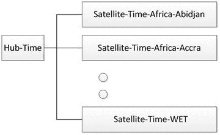

# Python 数据处理：时间中心枢纽构建

## 1. 环境导入与路径设置

```python
import sys
import os
from datetime import datetime, timedelta
from pytz import timezone, all_timezones
import pandas as pd
import sqlite3 as sq
from pandas.io import sql
import uuid

pd.options.mode.chained_assignment = None
```

```python
if sys.platform == 'linux':
    Base = os.path.expanduser('~') + '/VKHCG'
else:
    Base = 'C:/VKHCG'

print('################################')
print('Working Base :', Base, ' using ', sys.platform)
print('################################')
```

```python
Company = '03-Hillman'
InputDir = '00-RawData'
InputFileName = 'VehicleData.csv'
```

```python
sDataBaseDir = Base + '/' + Company + '/03-Process/SQLite'
if not os.path.exists(sDataBaseDir):
    os.makedirs(sDataBaseDir)
```

```python
sDatabaseName = sDataBaseDir + '/Hillman.db'
conn1 = sq.connect(sDatabaseName)
```

```python
sDataVaultDir = Base + '/88-DV'
if not os.path.exists(sDataBaseDir):
    os.makedirs(sDataBaseDir)
```

```python
sDatabaseName = sDataVaultDir + '/datavault.db'
conn2 = sq.connect(sDatabaseName)
```

## 2. 构建时间中心枢纽

你需要为 2018 年 1 月 1 日之前的十年时间段构建一个时间中心枢纽。如果想尝试不同的时间段，只需修改参数即可。

```python
base = datetime(2018, 1, 1, 0, 0, 0)
numUnits = 10 * 365 * 24
```

```python
date_list = [base - timedelta(hours=x) for x in range(0, numUnits)]
t = 0
for i in date_list:
    now_utc = i.replace(tzinfo=timezone('UTC'))
    sDateTime = now_utc.strftime("%Y-%m-%d %H:%M:%S")
    sDateTimeKey = sDateTime.replace(' ', '-').replace(':', '-')
    t += 1
    IDNumber = str(uuid.uuid4())
    TimeLine = [('ZoneBaseKey', ['UTC']),
                ('IDNumber', [IDNumber]),
                ('nDateTimeValue', [now_utc]),
                ('DateTimeValue', [sDateTime]),
                ('DateTimeKey', [sDateTimeKey])]
    if t == 1:
        TimeFrame = pd.DataFrame.from_items(TimeLine)
    else:
        TimeRow = pd.DataFrame.from_items(TimeLine)
        TimeFrame = TimeFrame.append(TimeRow)
```

```python
TimeHub = TimeFrame[['IDNumber', 'ZoneBaseKey', 'DateTimeKey', 'DateTimeValue']]
TimeHubIndex = TimeHub.set_index(['IDNumber'], inplace=False)
```

```python
TimeFrame.set_index(['IDNumber'], inplace=True)
```

```python
sTable = 'Process-Time'
print('Storing :', sDatabaseName, ' Table:', sTable)
TimeHubIndex.to_sql(sTable, conn1, if_exists="replace")
```

```python
sTable = 'Hub-Time'
print('Storing :', sDatabaseName, ' Table:', sTable)
TimeHubIndex.to_sql(sTable, conn2, if_exists="replace")
```

你已经成功在数据仓库中构建了时间中心枢纽。现在，我们将为每个时区构建卫星表。接下来，创建一个循环来执行这些任务：

```python
active_timezones = all_timezones
z = 0
for zone in active_timezones:
    t = 0
    for j in range(TimeFrame.shape[0]):
        now_date = TimeFrame['nDateTimeValue'][j]
        DateTimeKey = TimeFrame['DateTimeKey'][j]
        now_utc = now_date.replace(tzinfo=timezone('UTC'))
        sDateTime = now_utc.strftime("%Y-%m-%d %H:%M:%S")
        now_zone = now_utc.astimezone(timezone(zone))
        sZoneDateTime = now_zone.strftime("%Y-%m-%d %H:%M:%S")
        t += 1
        z += 1
        IDZoneNumber = str(uuid.uuid4())
        TimeZoneLine = [('ZoneBaseKey', ['UTC']),
                        ('IDZoneNumber', [IDZoneNumber]),
                        ('DateTimeKey', [DateTimeKey]),
                        ('UTCDateTimeValue', [sDateTime]),
```

```markdown
# 时间维度表构建与数据模型

 ('Zone', [zone]),
 ('DateTimeValue', [sZoneDateTime])]

if t==1:
     TimeZoneFrame = pd.DataFrame.from_items(TimeZoneLine)
 else:
     TimeZoneRow = pd.DataFrame.from_items(TimeZoneLine)
     TimeZoneFrame = TimeZoneFrame.append(TimeZoneRow)

TimeZoneFrameIndex = TimeZoneFrame.set_index(['IDZoneNumber'], inplace=False)
sZone = zone.replace('/', '-').replace(' ', '')

#############################################################

sTable = 'Process-Time-' + sZone
print('Storing :', sDatabaseName, ' Table:', sTable)
TimeZoneFrameIndex.to_sql(sTable, conn1, if_exists="replace")

#################################################################

#############################################################

sTable = 'Satellite-Time-' + sZone
print('Storing :', sDatabaseName, ' Table:', sTable)
TimeZoneFrameIndex.to_sql(sTable, conn2, if_exists="replace")

#################################################################

```

你会注意到数据库正在以惊人的速度增长。我建议引入一个小的数据库维护步骤，用于压缩数据库以节省磁盘空间。所需的命令是`vacuum`。它执行的操作类似于真空封装系统，将数据压缩到尽可能小的磁盘占用空间。

```python
 print('################')
 print('Vacuum Databases')
 sSQL = "VACUUM;"
 sql.execute(sSQL, conn1)
 sql.execute(sSQL, conn2)
 print('################')
 #################################################################
 print('### Done!! ############################################')
 #################################################################
```

恭喜！你已经为数据仓库中的时间维度构建了第一个中心枢纽和卫星表。数据仓库已构建在目录`..\VKHCG\88-DV\datavault.db`中。如果你想查看自己的成果，可以使用SQLite工具访问它。在图 9-8 中，你应该会看到一个包含这些数据项的结构。



**图 9-8** —— 包含三个数据项的结构。

#### 人物

此结构用于记录数据源中涉及的人物。一个人被定义为一组数据项的集合，这些数据项组合起来描述了现实世界中一个真实的个体。

请记住：住在街对面的面包师`安格斯·麦克盖弗`是个人。我的狗`安格斯`是一个物体。电视剧中由`理查德·迪安·安德森`扮演的虚构角色`安格斯·麦克盖弗`是一个物体。而演员`理查德·迪安·安德森`是个人。你会惊讶地发现，数据科学家在世界各地的数据库中找到了多少虚构角色。

警告：注意在你的数据科学中不要使用多余的无用数据条目！就在去年，一个公共安全系统曾两次派遣了大量应急车辆和人员，原因是一位数据科学家认为使用`安格斯·麦克盖弗`来命名一个随机在高层建筑安置炸弹的恐怖嫌疑人是可以容忍的。这位数据科学家为他的行为辩护，理由是他通过将名字硬编码到数据科学算法中来测试代码。这不是优秀数据科学家的标志！

提示：立即从生产系统中移除自生成的数据错误。它们代表的是糟糕的科学！而且，是的，它们可能损坏财产并伤害人员。

### 黄金标准记录

一条黄金标准记录是某个人的唯一记录，并包含供所有系统使用的独特引用。这为系统提供了关于该人的单一视图。我使用名、中间名、姓和出生日期作为我的黄金标准记录。我们在`assess`目录中拥有的数据需要出生日期才能形成黄金标准记录。我将解释如何使用我们的示例集生成一条黄金标准记录。

打开你的Python编辑器，并在`..\VKHCG\04-Clark\03-Process`目录下创建一个名为`Process-People.py`的文件。

```python
 ################################################################
 import sys
 import os
 import sqlite3 as sq
 import pandas as pd
 from datetime import datetime, timedelta
 from pytz import timezone, all_timezones
 from random import randint
 ################################################################
 if sys.platform == 'linux':
     Base = os.path.expanduser('~') + '/VKHCG'
 else:
     Base = 'C:/VKHCG'
 print('################################')
 print('Working Base :', Base, ' using ', sys.platform)
 print('################################')
 ################################################################
 Company = '04-Clark'
 sInputFileName = '02-Assess/01-EDS/02-Python/Assess_People.csv'
 ################################################################
 sDataBaseDir = Base + '/' + Company + '/03-Process/SQLite'
 if not os.path.exists(sDataBaseDir):
     os.makedirs(sDataBaseDir)
 ################################################################
 sDatabaseName = sDataBaseDir + '/clark.db'
 conn = sq.connect(sDatabaseName)
 ################################################################
 ### Import Female Data
 ################################################################
 sFileName = Base + '/' + Company + '/' + sInputFileName
 print('################################')
 print('Loading :', sFileName)
 print('################################')
 print(sFileName)
```

现在将之前的评估数据加载到内存中进行处理。

```python
 RawData = pd.read_csv(sFileName, header=0, low_memory=False, encoding="latin-1")
 RawData.drop_duplicates(subset=None, keep="first", inplace=True)
```

假设没有人出生于`1900`年`1月1日`之前。

```

start_date = datetime(1900,1,1,0,0,0)
start_date_utc=start_date.replace(tzinfo=timezone('UTC'))

## 同时假设，人们的出生年份是通过随机分配，均匀分布在 100 年的时间跨度内。

```python
HoursBirth=100*365*24

RawData['BirthDateUTC']=RawData.apply(lambda row:
    (start_date_utc + timedelta(hours=randint(0, HoursBirth)))
    ,axis=1)

zonemax=len(all_timezones)-1

RawData['TimeZone']=RawData.apply(lambda row:
    (all_timezones[randint(0, zonemax)])
    ,axis=1)

RawData['BirthDateISO']=RawData.apply(lambda row:
    row["BirthDateUTC"].astimezone(timezone(row['TimeZone']))
    ,axis=1)

RawData['BirthDateKey']=RawData.apply(lambda row:
    row["BirthDateUTC"].strftime("%Y-%m-%d %H:%M:%S")
    ,axis=1)

RawData['BirthDate']=RawData.apply(lambda row:
    row["BirthDateISO"].strftime("%Y-%m-%d %H:%M:%S")
    ,axis=1)

################################################################

Data=RawData.copy()
```

## 你必须删除两个 ISO 复杂日期时间结构，因为代码无法将其转换为 SQLite 的数据类型。

```python
Data.drop('BirthDateUTC', axis=1,inplace=True)
Data.drop('BirthDateISO', axis=1,inplace=True)
print('################################')
```

## 现在将你新的黄金标准记录保存到 SQLite。

```python
#################################################################

print('################')
sTable='Process_Person'
print('Storing :',sDatabaseName,' Table:',sTable)
Data.to_sql(sTable, conn, if_exists="replace")
print('################')
```

## 现在将你新的黄金标准记录保存到 CSV 文件。

```python
################################################################

sFileDir=Base + '/' + Company + '/03-Process/01-EDS/02-Python'
if not os.path.exists(sFileDir):
    os.makedirs(sFileDir)

################################################################

sOutputFileName = sTable + '.csv'
sFileName=sFileDir + '/' + sOutputFileName

print('################################')
print('Storing :', sFileName)
print('################################')

RawData.to_csv(sFileName, index = False)

print('################################')

#################################################################

print('### Done!! ############################################')

#################################################################
```

```
一个真实的例子是拉夫拉斯伯爵夫人阿达，她出生时的名字是奥古斯塔·阿达·金-诺尔。她是一位英国数学家和作家，主要因在查尔斯·巴贝奇提出的机械通用计算机——分析机上的工作而闻名。她出生于 1815 年 12 月 10 日。

- 名 = 奥古斯塔
- 中间名 = 阿达·金-诺尔
- 姓 = 拉夫拉斯
- 出生日期 = 1815-10-10 00:00:00

你应使用她出生证明上的官方姓名，而非她的通用名。你可以添加一个名为`CommonKnownAs`的附属表，并将`阿达·拉夫拉斯`放入该表中。

注意：下一节将介绍我在世界各地工作时发现的一些有趣概念。它将让你深入了解数据科学家在执行工作时可能遇到的多样性需求。

# 人名的含义

我们都有名字，而我们的名字为数据科学家提供了更大的分组，甚至隐藏的含义。如果人们共享相同的姓氏，那么他们之间存在亲缘关系的概率就很大。我稍后会再次讨论这一点。在世界各地，还有许多与人们的名字相关的其他关系。让我们看看我在多年处理数据过程中接触到的一些例子。

# 个人名字的构成与文化差异

## [给定名、母名和父名](https://www.w3.org/International/questions/qa-personal-names%23patronymic) 的含义

人们的名字中可能蕴含着特定的关系或含义。冰岛名字`Björk Guðmundsdóttir`就表达了个体与其家庭成员之间复杂的关系。

`Björk`是此人的名字。`Guðmundsdóttir`表示一种关系：`Guðmundur`的女儿（`-dóttir`）。这表明此人是女性。

`Björk`的父亲是`Guðmundur Gunnarsson`。这是最常见的命名方式。

`Björk`也可能拥有以下母名：`Hildardottir`，甚至同时拥有母名和父名：`Hildar- og Guðmundsdóttir`，因为`Björk`的母亲是`Hildur R’una Hauksdottir`。

`Gunnarsson`表示“`Gunnar`之子”的关系。因此，`Ólafur Guðmundsson`是`Björk`的兄弟。`Ólafur`的儿子是`Jón Ólafurson`。

我刚刚推翻了自己先前的假设。不同的姓氏同样可以表示同一家族的成员！

> **注意**
>
> 不要认为在你所在国家行之有效的算法和假设，在所有其他国家也能同样成功。

马来名字`Isa bin Osman`也暗示了一种隐藏的关系。`Isa`是给定名。`bin Osman`表示“`Osman`之子”。`Isa`的姐妹会是`Mira binti Osman`，因为`binti`意为“之女”。

`Encik Isa`意为“`Isa bin Osman`先生”，但写这个名字的人与`Isa`本人相熟。因此，如果你与`Isa`不熟，就不要称呼他为`Encik Isa`。

以下是一些需要注意的其他命名惯例。

| 语言 | “之子”后缀 | “之女”后缀 |
| --- | --- | --- |
| 古诺尔斯语 | `-son` | `-dóttir` |
| 丹麦语 | `-sen` | `-datter` |
| 法罗语 | `-son` | `-dóttir` |
| 芬兰语 | `-poika` | `-tytär` |
| 冰岛语 | `-son -sson` | `-dóttir` |
| 挪威语 | `-sen/-son/-søn` | `-datter/-dotter` |
| 瑞典语 | `-son` | `-dotter` |

## [名字各部分的不同顺序](https://www.w3.org/International/questions/qa-personal-names%23partorder)

全名并不总是按名字、中间名和姓氏的顺序排列。例如，在中国名字`毛泽东`（`Mao Zedong`）中，姓氏（家族名）是`毛`（`Mao`）。中间的字`泽`（`Ze`）是辈分字，同一家族的所有兄弟姐妹都共享此字。根据规范中文音译为英文的拼音系统，中文名字的后两个字或元素通常合并为一个词，例如`Zedong`，而不是`Ze Dong`。毛泽东的兄弟姐妹是`毛泽民`（`Mao Zemin`）、`毛泽覃`（`Mao Zetan`）和`毛泽紅`（`Mao Zehong`）。

> **注意**
>
> 在音译中，“`Ze Dong`”这种写法很少（如果有的话）被使用。

对于那些与他关系不熟的人，毛泽东可能被称为`毛泽东先生`（`Mao Zedong xiānshēng`）或`毛先生`（`Mao xiānshēng`）（`xiānshēng`相当于“先生”）。如果你与一位叫`毛泽东`的人关系熟络，你通常会称他为`泽东`（`Zedong`），而不仅仅是`东`（`Dong`）。

在日本、韩国和匈牙利，名字的顺序是姓氏在前，跟随后面的给定名。

> **注意**
>
> 与西方人打交道的中国人通常会另外取一个西方人更容易使用的名字。`姚明`（姓氏`姚`，名字`明`）也为西方人将自己的名字呈现为`Fred Yao Ming`或`Fred Ming Yao`。

对于讲西班牙语的人来说，拥有两个姓氏是很常见的。例如，`María-Jose Carreño Quiñones`指的是`Antonio Carreño Rodríguez`和`María Quiñones Marqués`的女儿。你应该称呼她为`Señorita Carreño`，而不是`Señorita Quiñones`。

巴西人有类似的习俗，他们可能会有三到四个姓氏，将祖先的名字串联起来，例如`José Eduardo Santos Tavares Melo Silva`。通常，两个西班牙语姓氏的顺序是父姓+母姓，而在巴西，葡萄牙语名字的顺序是母姓+父姓。然而，这个顺序可能会改变，这常常让数据科学家感到困惑。

> **注意**
>
> 有些名字在姓氏之间包含小品词，如`de`或`e`，例如`Carreño de Quiñones`或`Tavares e Silva`。

俄罗斯人使用父名作为他们的中间名，但也使用姓氏，顺序为给定名+父名+姓氏。父名和姓氏的词尾表明了此人是男性还是女性。例如，`Бopиc Hикoлaeвич Eльцин`（`Boris Nikolayevich Yeltsin`）的妻子是`Haинa Иocифoвнa Eльцинa`（`Naina Iosifovna Yeltsina`）。

> **注意**
>
> 根据俄罗斯命名惯例，男性的名字以辅音结尾，而女性的名字（甚至父名）以`a`结尾。这一俄罗斯命名惯例适用于所有男性和女性，而不仅仅是已婚者。

## [名字的继承](https://www.w3.org/International/questions/qa-personal-names%23inheritance)

认为同一核心家庭成员共享相同姓氏是错误的。在西方，已婚女性婚后保留自己娘家姓的趋势日益增长。然而，在另一些文化中，例如中国文化，这本身就是标准做法。在一些国家，已婚女性可能会或可能不会随夫姓。例如，如果之前提到的马来女孩`Zaiton`嫁给了`Isa`，她可能仍然是`Zaiton`女士，或者她可能会选择成为`Zaiton Isa`，在这种情况下，你可以称呼她为`Isa`女士。

对于数据科学家来说，这些数据特征可能使得数据分组变得复杂。

## 其他亲属关系

荷兰文化有其自身的命名惯例。其遵循的规则如下：

-   长子以祖父的名字命名。
-   长女以祖母的名字命名。
-   次子以外祖父的名字命名。
-   次女以外祖母的名字命名。
-   后续出生的孩子常以叔伯或姑姨的名字命名。

然而，如果某个儿子在其弟弟出生前已去世，弟弟通常会沿用已故兄长的名字。女儿的情况也是如此。如果父亲在儿子出生前去世，儿子会随父亲的名字命名。如果母亲在生下女儿时去世，女儿会随母亲的名字命名。

我曾通过一个数据集艰难地发现，荷兰人的名字存在这种结构——当时我们在找到一份死亡证明后，标记了一个人已故。在非荷兰裔家庭中，不常见在同辈人中重复使用已故者的名字，我们的数据科学程序总是将其标记为错误。因此，当我们将系统从美国迁移到欧洲时，不得不移除这个错误规则，以解决这种文化上的不一致。

荷兰人的名字还与出生地或家族职业有历史和文化上的关联。

例如，`Vermeulen` 是荷兰姓氏 `ver Meulen` 的一种比利时变体，它表示我的家族“来自遥远的磨坊”，或者从事“流动磨坊主”这一职业。因此，我的家族纹章上绘有风车。

按照荷兰传统，过去结婚时，女性需要将丈夫的姓氏放在自己的[娘家姓](https://en.wikipedia.org/wiki/Maiden_name%23Maiden%20name)之前，并用连字符连接。例如，一位 `Anna Pietersen` 嫁给 `Jan Jansen` 后会变成 `Anna Jansen-Pietersen`。荷兰现行的法律给予了人们更多自由。在荷兰境内结婚时，双方默认保留自己的姓氏，但双方都可以选择合法地使用对方的姓氏，或者将两者结合。简单来说，`Anna Pietersen`、`Jan Pietersen`、`Anna Jansen`、`Jan Jansen`、`Anna Jansen-Pietersen` 和 `Jan Jansen-Pietersen` 都可能是同一对夫妻在不同时期使用的名字。

这些姓氏的变体及其附加含义，能够使数据科学家仅仅通过使用人们姓名，就能训练他们的算法来发现人与人之间的关系。我已经和您分享了一些我在多个国家工作多年期间的有趣发现。为了本书的目的，我会保持人物名字的简洁，并遵循西方名字（名+姓）的惯例。

现在，我们将这个人加载到数据仓库中。打开您的 Python 编辑器，在目录 `..\VKHCG\04-Clark\03-Process` 中创建一个名为 `Process-People.py` 的新文件。然后将以下 Python 代码复制到该文件中：

```python
```

```python
import sys
import os
import sqlite3 as sq
import pandas as pd
from pandas.io import sql
from datetime import datetime, timedelta
from pytz import timezone, all_timezones
from random import randint

################################################################

if sys.platform == 'linux':
    Base = os.path.expanduser('~') + '/VKHCG'
else:
    Base = 'C:/VKHCG'

print('################################')
print('Working Base :', Base, ' using ', sys.platform)
print('################################')

################################################################

Company = '04-Clark'
sInputFileName = '02-Assess/01-EDS/02-Python/Assess_People.csv'

################################################################

sDataBaseDir = Base + '/' + Company + '/03-Process/SQLite'
if not os.path.exists(sDataBaseDir):
    os.makedirs(sDataBaseDir)

################################################################

sDatabaseName = sDataBaseDir + '/clark.db'
conn1 = sq.connect(sDatabaseName)

################################################################

sDataVaultDir = Base + '/88-DV'
if not os.path.exists(sDataBaseDir):
    os.makedirs(sDataBaseDir)

################################################################

sDatabaseName = sDataVaultDir + '/datavault.db'
conn2 = sq.connect(sDatabaseName)

################################################################

### 导入女性数据
################################################################

sFileName = Base + '/' + Company + '/' + sInputFileName
print('################################')
print('正在加载 :', sFileName)
print('################################')
print(sFileName)
RawData = pd.read_csv(sFileName, header=0, low_memory=False, encoding="latin-1")
RawData.drop_duplicates(subset=None, keep="first", inplace=True)
start_date = datetime(1900, 1, 1, 0, 0, 0)
start_date_utc = start_date.replace(tzinfo=timezone('UTC'))
HoursBirth = 100 * 365 * 24
RawData['BirthDateUTC'] = RawData.apply(lambda row:
                                        (start_date_utc + timedelta(hours=randint(0, HoursBirth)))
                                        , axis=1)
zonemax = len(all_timezones) - 1
RawData['TimeZone'] = RawData.apply(lambda row:
                                    (all_timezones[randint(0, zonemax)])
                                    , axis=1)
RawData['BirthDateISO'] = RawData.apply(lambda row:
                                        row["BirthDateUTC"].astimezone(timezone(row['TimeZone']))
                                        , axis=1)
RawData['BirthDateKey'] = RawData.apply(lambda row:
                                        row["BirthDateUTC"].strftime("%Y-%m-%d %H:%M:%S")
                                        , axis=1)
RawData['BirthDate'] = RawData.apply(lambda row:
                                     row["BirthDateISO"].strftime("%Y-%m-%d %H:%M:%S")
                                     , axis=1)

################################################################

Data = RawData.copy()
Data.drop('BirthDateUTC', axis=1, inplace=True)
Data.drop('BirthDateISO', axis=1, inplace=True)
indexed_data = Data.set_index(['PersonID'])
print('################################')

################################################################

print('################')
sTable = 'Process_Person'
print('正在存储 :', sDatabaseName, ' 表:', sTable)
indexed_data.to_sql(sTable, conn1, if_exists="replace")
print('################')

################################################################

PersonHubRaw = Data[['PersonID', 'FirstName', 'SecondName', 'LastName', 'BirthDateKey']]
PersonHubRaw['PersonHubID'] = RawData.apply(lambda row:
                                            str(uuid.uuid4())
                                            , axis=1)
PersonHub = PersonHubRaw.drop_duplicates(subset=None,
                                         keep='first',
```

```python
inplace=False)

indexed_PersonHub = PersonHub.set_index(['PersonHubID'])

sTable = 'Hub-Person'

print('正在存储 :', sDatabaseName, ' 表:', sTable)

indexed_PersonHub.to_sql(sTable, conn2, if_exists="replace")

################################################################

PersonSatelliteGenderRaw = Data[['PersonID', 'FirstName', 'SecondName', 'LastName',

                                  'BirthDateKey', 'Gender']]

PersonSatelliteGenderRaw['PersonSatelliteID'] = RawData.apply(lambda row:

                                                              str(uuid.uuid4())

                                                              , axis=1)

PersonSatelliteGender = PersonSatelliteGenderRaw.drop_duplicates(subset=None,

                                                                 keep='first',

                                                                 inplace=False)

indexed_PersonSatelliteGender = PersonSatelliteGender.set_index(['PersonSatelliteID'])

sTable = 'Satellite-Person-Gender'

print('正在存储 :', sDatabaseName, ' 表:', sTable)

indexed_PersonSatelliteGender.to_sql(sTable, conn2, if_exists="replace")

################################################################

PersonSatelliteBirthdayRaw = Data[['PersonID', 'FirstName', 'SecondName', 'LastName',

                                    'BirthDateKey', 'TimeZone', 'BirthDate']]

PersonSatelliteBirthdayRaw['PersonSatelliteID'] = RawData.apply(lambda row:

                                                                str(uuid.uuid4())

                                                                , axis=1)

PersonSatelliteBirthday = PersonSatelliteBirthdayRaw.drop_duplicates(subset=None,

                                                                     keep='first',

                                                                     inplace=False)

indexed_PersonSatelliteBirthday = PersonSatelliteBirthday.set_index(['PersonSatelliteID'])

sTable = 'Satellite-Person-Names'

print('正在存储 :', sDatabaseName, ' 表:', sTable)

indexed_PersonSatelliteBirthday.to_sql(sTable, conn2, if_exists="replace")

################################################################

sFileDir = Base + '/' + Company + '/03-Process/01-EDS/02-Python'

if not os.path.exists(sFileDir):

    os.makedirs(sFileDir)

################################################################

sOutputFileName = sTable + '.csv'

sFileName = sFileDir + '/' + sOutputFileName

print('################################')

print('正在存储 :', sFileName)

print('################################')

RawData.to_csv(sFileName, index=False)

print('################################')

################################################################

print('################')

print('清空数据库')

sSQL = "VACUUM;"

sql.execute(sSQL, conn1)

sql.execute(sSQL, conn2)

print('################')

################################################################

print('### 完成!! ############################################')

################################################################
```

### 对象

此结构用于记录数据源中涉及的其他对象和非人类实体。一个有效的对象必须包含三个基本字段：`Object Type`（对象类型）、`Object Group`（对象组）和`Object Code`（对象编码）。我还添加了简短和详细的描述，以供信息参考。

数据科学允许数据仓库的对象枢纽成为`Object Type`（对象类型）、`Object Group`（对象组）和`Object Code`（对象编码）的简单组合，以形成对现实世界中任何非人类实体的完整描述。

我必须指出，当你开始处理对象时，你会发现大多数对象类型都有支持特定对象处理的标准。让我们看看我在数据科学中必须处理的一些常见对象。

### 动物

动物属于许多不同的分组，从动物界开始。

#### 界

所有生物首先被归入不同的界。有五个不同的界对地球上的生命进行分类：动物界、植物界、真菌界、细菌界和原生生物界（单细胞生物）。

#### 门

动物界被划分为 40 个更小的分组，称为门。因此，动物根据其主要特征进行分组。动物通常属于五个不同的门：刺胞动物门（无脊椎动物）、脊索动物门（脊椎动物）、节肢动物门、软体动物门和棘皮动物门。

#### 纲

一个门被进一步划分为更小的分组，称为纲。脊索动物门（脊椎动物）分为哺乳纲（哺乳动物）、辐鳍鱼纲（硬骨鱼）、软骨鱼纲（软骨鱼）、鸟纲（鸟类）、两栖纲（两栖动物）和爬行纲（爬行动物）。

#### 目

每个纲被划分为更小的分组，称为目。哺乳纲（哺乳动物）分为不同的目，包括食肉目、灵长目、偶蹄目和啮齿目。

#### 科

在每个目中，都有不同的动物科，它们都具有非常相似的特征。食肉目下分为猫科（猫）、犬科（狗）、熊科（熊）和鼬科（鼬鼠）等科。

#### 属

每个动物科会被进一步划分为称为“属”的群体。每个属中包含特征非常相似且亲缘关系密切的动物。例如，`Felidae`（猫科）包含了以下属：`Felis`（小型猫和家猫）、`Panthera`（虎、豹、美洲豹和狮）以及`Puma`（美洲狮和美洲豹）。

#### 种

每个属中的单个物种都以各自独特的特征和特性命名。与属名一样，动物的名称使用拉丁文，以便全球通用，并且由两个单词组成。动物名称的第一部分表示其属名，第二部分表示具体的种名。

让我们来对我那只名为`Tigger`的玩具虎进行分类。

| 界 | 动物界 |
| --- | --- |
| 门 | 脊索动物门（脊椎动物） |
| 纲 | 哺乳纲（哺乳动物） |
| 目 | 食肉目（食肉动物） |
| 科 | 猫科（猫） |
| 属 | 豹属 |
| 种 | 虎 |

现在，我们来对我的狗`Angus`进行分类。

| 界 | 动物界 |
| --- | --- |
| 纲 | 哺乳纲 |
| 目 | 食肉目 |
| 科 | 犬科 |
| 属 | 犬属 |
| 种 | 狼（家犬） |


它被归类为`Canis Lupus familiaris`。

你必须以新近发现的知识所揭示的方式来审视一个对象。现在，我将指导你完成一个 Python 代码会话，将扁平文件转换为包含知识的图谱。你唯一拥有的信息位于目录`.. VKHCG\03-Hillman\00-RawData`下的`Animals.csv`文件中。

其格式为

| ItemLevel | ParentID | ItemID | ItemName |
| --- | --- | --- | --- |
| 0 | 0 | 50 | Bacteria |
| 0 | 0 | 202422 | Plantae |
| 1 | 50 | 956096 | Negibacteria |
| 1 | 50 | 956097 | Posibacteria |

这些字段的含义如下：

- `ItemLevel` 表示特定项目距离分类中顶层节点的层级数。
- `ParentID` 是所列出项目的父级项目的`ItemID`。
- `ItemID` 是该项目的唯一标识符。
- `ItemName` 是该项目的完整名称。

这些数据组合起来形成了一个庞大的分类树。你必须创建一个能够为你提供以下信息的图谱：

```
Bacteria-> Negibacteria and Bacteria-> Posibacteria
```

以下是用于转换数据的代码。你将执行数据准备的几个部分、为检索存储数据、评估超步，然后我们将完成数据存入数据仓库的流程步骤。你从标准框架开始，请将代码复制到你的 Python 编辑器中。首先，我们来设置数据：

```
################################################################
```