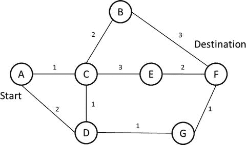

# -*- coding: utf-8 -*-
################################################################
import sys
import os
import pandas as pd
import networkx as nx
import sqlite3 as sq
from pandas.io import sql
import uuid
################################################################
if sys.platform == 'linux':
Base=os.path.expanduser('~') + '/VKHCG'
else:
Base='C:/VKHCG'
print('################################')
print('Working Base :',Base, ' using ', sys.platform)
print('################################')
################################################################
Company='03-Hillman'
```

以下是你在本章前面创建的图的路径：

```python
InputAssessGraphName='Assess_All_Animals.gml'
EDSAssessDir='02-Assess/01-EDS'
InputAssessDir=EDSAssessDir + '/02-Python'
################################################################
sFileAssessDir=Base + '/' + Company + '/' + InputAssessDir
if not os.path.exists(sFileAssessDir):
os.makedirs(sFileAssessDir)
################################################################
sDataBaseDir=Base + '/' + Company + '/03-Process/SQLite'
if not os.path.exists(sDataBaseDir):
os.makedirs(sDataBaseDir)
################################################################
sDatabaseName=sDataBaseDir + '/Hillman.db'
conn1 = sq.connect(sDatabaseName)
################################################################
sDataVaultDir=Base + '/88-DV'
if not os.path.exists(sDataBaseDir):
os.makedirs(sDataBaseDir)
################################################################
sDatabaseName=sDataVaultDir + '/datavault.db'
conn2 = sq.connect(sDatabaseName)
################################################################
```

现在，加载你在本章前面创建的图。

```python
sFileName= sFileAssessDir + '/' + InputAssessGraphName
print('################################')
print('Loading Graph :', sFileName)
print('################################')
G=nx.read_gml(sFileName)
print('Nodes: ', G.number_of_nodes())
print('Edges: ', G.number_of_edges())
```

现在，你将读取图的节点，并将它们作为对象添加到数据保险库中。


```
################################################################
t=0
tMax=G.number_of_nodes()
for node in nx.nodes_iter(G):
t+=1
IDNumber=str(uuid.uuid4())
NodeName=G.node[node]['NodeName']
print('提取:',t,'/共 ',tMax,' 个:',NodeName)
ObjectLine=[('ObjectBaseKey', ['Species']),
('IDNumber', [IDNumber]),
('ObjectNumber', [str(t)]),
('ObjectValue', [NodeName])]
if t==1:
ObjectFrame = pd.DataFrame.from_items(ObjectLine)
else:
ObjectRow = pd.DataFrame.from_items(ObjectLine)
ObjectFrame = ObjectFrame.append(ObjectRow)
################################################################
ObjectHubIndex=ObjectFrame.set_index(['IDNumber'],inplace=False)
################################################################
sTable = 'Process-Object-Species'
print('存储至:',sDatabaseName,' 表:',sTable)
ObjectHubIndex.to_sql(sTable, conn1, if_exists="replace")
#################################################################
sTable = 'Hub-Object-Species'
print('存储至:',sDatabaseName,' 表:',sTable)
ObjectHubIndex.to_sql(sTable, conn2, if_exists="replace")
#################################################################
print('################')
print('清空数据库')
sSQL="VACUUM;"
sql.execute(sSQL,conn1)
sql.execute(sSQL,conn2)
print('################')
################################################################
print('### 完成!! ############################################")
################################################################
```

干得不错。现在你在数据仓库中为物种新增了一个对象枢纽。看看这两段代码。遍历所有节点，并返回从`'World'`节点出发的最短路径。

```
for node1 in nx.nodes_iter(G):
p=nx.shortest_path(G, source="world", target=node1, weight=None)
print('从 World 到 ',node1,' 的路径:',p)
```

遍历所有节点，并返回整个节点集之间的最短路径。

```
for node1 in nx.nodes_iter(G):
for node2 in nx.nodes_iter(G):
p=nx.shortest_path(G, source=node1, target=node1, weight=None)
print('路径:',p)
```

我们来快速讨论一种新算法。Dijkstra 算法是一种用于发现图中节点间最短路径的算法，由计算机科学家**艾兹格·W·迪杰斯特拉**于 1956 年提出。图 9-9 展示了一个示例。



**图 9-9**

Dijkstra 算法示例

```
import networkx as nx
G = nx.Graph()
G.add_edge('a', 'c', weight=1)
G.add_edge('a', 'd', weight=2)
G.add_edge('b', 'c', weight=2)
G.add_edge('c', 'd', weight=1)
G.add_edge('b', 'f', weight=3)
G.add_edge('c', 'e', weight=3)
G.add_edge('e', 'f', weight=2)
G.add_edge('d', 'g', weight=1)
G.add_edge('g', 'f', weight=1)
d=nx.dijkstra_path(G, source="a", target="f", weight=None)
print(d)
```

我计算出`['a', 'c', 'b', 'f']`是最短路径。

是的，这个算法构思于 1956 年，三年后发表。数据科学并没有很多人想象的那么年轻。我们在工作中部署了大量成熟的算法。

使用 Dijkstra 算法，遍历所有节点，并返回整个节点集之间的最短路径：

```
for node1 in nx.nodes_iter(G):
for node2 in nx.nodes_iter(G):
d=nx.dijkstra_path(G, source=node1, target=node1, weight=None)
print('路径:',d)
```

问题：你能创建一个使用该路径作为链接的链接表吗？

以下是你要填充的表格：

```
CREATE TABLE [Link-Object-Species] (
LinkID     VARCHAR (100),
NodeFrom   VARCHAR (200),
NodeTo     VARCHAR (200),
ParentNode VARCHAR (200),
Node       VARCHAR (200),
Step       INTEGER
);
```

在图论中尝试你的新技能。你能让它成功运行吗？

让我们来看下一种对象类型。

#### 车辆

国际车辆分类是一个复杂的过程。虽然有标准，但这些标准并未在全球范围内统一应用，不同群体或国家之间也存在差异。例如，我的凯迪拉克凯雷德 ESV 四驱白金版按市场细分（美式英语）属于：

*   “全尺寸 SUV 皮卡”
*   “大型 4×4”（英式英语）
*   “超大型 SUV”（澳式英语）
*   “标准运动型多用途车”（美国环保署尺寸等级）
*   “越野车”（欧洲 NCAP 结构类别）
*   “大型越野 4×4”（1997–2009 年欧洲 NCAP 等级）
*   “J 级运动型多用途轿车”（欧洲市场细分）
*   “豪华旅行车”（美国公路安全保险协会分类）

要精确分类我的车辆，我需要车辆识别码（VIN）。一个唯一的 VIN 能为数据科学家提供大量的分类细节。车辆有两个标准：ISO 3779:2009（道路车辆—VIN—内容与结构）和 ISO 3780:2009（道路车辆—世界制造商识别码[WMI]代码）。我发现两者结合可以很好地分类车辆，也就是说，我可以解码 VIN。

VIN: 1HGBH41JXMN109186

*   型号：Prelude
*   类型：乘用车
*   品牌：本田
*   车型年份：1991 年
*   制造商：本田美国制造有限公司
*   制造地：美国（北美）
*   序列号：109186
*   车身类型：双门轿跑车
*   车辆类型：乘用车

**警告**

车辆的车牌或标签并非该车辆的唯一标识。存在属于个人而非车辆的车牌号。这会导致不同车辆在不同时期使用相同车牌号的情况。当车辆转售时，新车主也可能获得新的车牌号。因此，**不要**使用车牌号作为唯一键。

作为一名数据科学家，你必须理解可以从被记录对象的简单代码和分类中推断出的数据。

**提示**

车辆是系统编码的，如果你能花时间先理解编码标准，你会体会到其长期价值。

我们先将 Hillman 有限公司的车辆数据加载到数据仓库中，之后会用到。在 Python 编辑器中，于目录`..\VKHCG\03-Hillman\03-Process`下创建一个名为`Process-Vehicle-Logistics.py`的新文件。在我逐步讲解指导时，将代码复制到你的新文件中。从创建生态系统的标准结构开始。

```
################################################################
