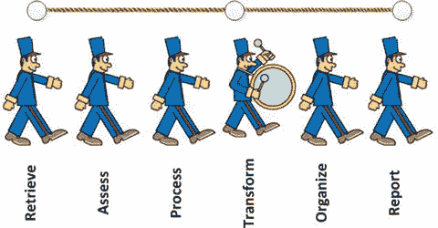

# 6. 三个管理层

本章将介绍三个管理层，它们是任何大规模数据科学系统所必需的。我将从基础层面讨论它们。我建议你随着环境的成长，逐步扩展这些管理能力。

### 运营管理层

运营管理层是数据科学生态系统完整处理能力的核心存储库。该层存储了全包容生态系统的每个处理调度和工作流程。

这个区域能让你对整个生态系统有一个统一的视图。它报告处理状态。

运营管理层是我记录以下内容的地方。

### 处理流定义与管理

处理流定义是数据科学生态系统的构建模块。我将所有当前活动的处理脚本存储在此部分。

定义管理描述了脚本在系统中的工作流程，确保按照数据科学家的工作流设计来管理正确的执行顺序。

**提示**
将所有通用技术和算法存放在基于源代码控制的系统中，例如 GitHub 或 SVN，并以可导入库的格式保存。这样，你就不必在每次使用时都验证它们是否能正常工作。

**建议**
我每周会花 10% 的时间生成新的处理构建模块，另外 10% 的时间用于改进现有的构建模块。我可以确认，这种做法为我在启动新的数据科学项目时轻松节省了超过 20% 的时间，因为我已经拥有一套经过测试的代码基础来支持所需的活动。因此，请为你自己和团队的未来投资，将此作为团队的标准实践。你不会后悔这项投资。

**警告**
当替换现有的构建模块时，请检查对下游流程的影响。我建议你使用简单的版本控制方案，例如 `mylib_001_01`。这样，你可以拥有 999 个主版本，每个主版本下有 99 个子版本。这也能确保你的新版本可以有序地推送给你的客户群体。最成功的版本管理方式是使用一个能够支持多分支或分叉代码集的良好版本控制流程。

### 参数

处理的参数存储在此部分，以确保所有系统参数只有一个存放位置。你将在以下所有示例中看到一个生态系统设置阶段。

```python
if sys.platform == 'linux':
    Base=os.path.expanduser('~') + '/VKHCG'
else:
    Base='C:/VKHCG'
################################################################
print('################################')
print('Working Base :',Base, ' using ', sys.platform)
print('################################')
################################################################
sFileDir=Base + '/01-Vermeulen/01-Retrieve/01-EDS/02-Python'
if not os.path.exists(sFileDir):
    os.makedirs(sFileDir)
################################################################
sFileName=Base + '/01-Vermeulen/00-RawData/Country_Currency.xlsx'
```

在我的生产系统中，针对每个客户，我们将所有这些参数放在一个位置，然后只需调用这个单一位置。主要使用两种设计：

1.  一个简单的文本文件，然后我们将其导入每个 Python 脚本。
2.  一个参数数据库，由标准的参数设置脚本支持，然后我们将该脚本包含到每个脚本中。

我也承认有几个参数遵循与前面示例相同的格式，我只是将它们收集在代码顶部的一个区域中。

**建议**
找到最适合团队的方法，并在团队中统一采用该方法。

### 调度

调度方案存储在本节中，以实现对系统完整调度计划的集中控制和可视性。在我的解决方案中，我采用了“鼓-缓冲-绳”方法（图 6-1），其原理很简单。



**图 6-1**
原始的“鼓-缓冲-绳”应用

类似于一支行进中的队伍，“鼓-缓冲-绳”方法是一种标准实践：识别出最慢的流程，然后用这个流程来把控整个管线的节奏。接着将管线的其他部分与这个流程绑定，从而控制整个生态系统的速度。

因此，你将“鼓”放置在管线的慢速部分，用以给出处理节奏；并在管线起点和终点系上“绳子”，确保没有脱离这个鼓的节拍的处理工作发生。这能确保你的流程更高效地完成，因为在没有鼓点记录的情况下，没有任何东西会进入或离开处理管道。

我通常使用一个独立的 Python 程序，该程序利用网络库提供的 `DiGraph` 结构（即**有向无环图** (`DAG`) ）。这能自动解析重复依赖关系，并支持使用**拓扑排序** (`topological_sort`) ，从而确保任务按照需求的顺序完成。示例如下：在你的 Python 编辑器中打开并查看过程。

```python
import networkx as nx
```

在这里，你可以按任意顺序构建你的网络。

```python
DG = nx.DiGraph([
    ('Start','Retrieve1'),
    ('Start','Retrieve2'),
    ('Retrieve1','Assess1'),
    ('Retrieve2','Assess2'),
    ('Assess1','Process'),
    ('Assess2','Process'),
    ('Process','Transform'),
    ('Transform','Report1'),
    ('Transform','Report2')
])
```

这是未排序的网络：

```python
print("Unsorted Nodes")
print(DG.nodes())
```

你可以测试你的网络是否为有效的有向无环图。

```python
print("Is a DAG?",nx.is_directed_acyclic_graph(DG))
```

现在，你将这个有向无环图排序成正确的顺序。

```python
sOrder=nx.topological_sort(DG)
print("Sorted Nodes")
print(sOrder)
```

你还可以将你的网络可视化。

```python
pos=nx.spring_layout(DG)
nx.draw_networkx_nodes(DG,pos=pos,node_size = 1000)
nx.draw_networkx_edges(DG,pos=pos)
nx.draw_networkx_labels(DG,pos=pos)
```

你可以添加一些额外的节点，看看这是如何解析排序的。我建议你尝试不同配置的网络，这将有助于你理解这个过程如何真正辅助处理工作负载。

**提示**
我通常将节点的需求存储在一个公共数据库中。这样，我可以上传多个数据科学项目的需求，并轻松解析出最优方案。

### 监控

中央监控流程位于本节，旨在确保对整个系统有一个统一的视图。务必从单一监控点监控你的数据科学。不建议在同一个生态系统中运行多个数据科学流程而没有中央监控。

**提示**
我总是在数据科学流程启动时，自动在一个中央表中设置一个活动状态，并在完成时设置为非活动状态。这样，整个团队都能知道谁在运行什么任务，并能更好地规划自己的处理工作。

如果你在 Windows 上运行，请尝试以下操作：

```python
conda install -c primer wmi
import wmi
c = wmi.WMI ()
for process in c.Win32_Process ():
    print (process.ProcessId, process.Name)
```

对于 Linux，请尝试以下操作：

```python
import os
pids = [pid for pid in os.listdir('/proc') if pid.isdigit()]
for pid in pids:
    try:
        print open(os.path.join('/proc', pid, 'cmdline'), 'rb').read()
    except IOError: # proc has already terminated
        continue
```

这将为你提供所有正在运行的进程的完整列表。我通常每隔大约一分钟将其加载到一个表中，以便为生态系统创建一个监控模式。

### 通信

系统中所有的通信都在这一部分处理，以确保系统能够通报任何正在发生的活动。我们通过 Jira 使用一个复杂的通信流程，以确保我们所有的数据科学活动都被追踪。我建议你看看 `conda install -c conda-forge jira` 这个命令。

关于这个主题，我不会提供更多细节，因为我发现任何公司的内部沟通渠道都是由其使用的沟通工具驱动的。我唯一能提供的建议是：务必进行沟通！如果你因为有人没有通报他们在运行什么而导致每周至少有一个项目失败，你会感到非常震惊。

### 告警

告警部分利用通信机制，在正确的时间，将整个系统的正确状态通知给正确的人。我使用 Jira 进行告警，效果很好。如果出现问题，告警系统会提供状态以及所产生的错误的完整详细信息。

现在我将在下一节更详细地讨论上述每一部分，并提供关于每个部分应预期或创建什么内容的实用示例。

## 审计、平衡与控制层

审计、平衡与控制层控制任何正在进行的处理。这一层是确保生态系统按计划完成每个处理请求的引擎。审计、平衡与控制层是你能观察到数据科学环境中当前正在运行什么内容的单一区域。

它记录：
*   进程执行统计信息
*   平衡与管控
*   拒绝与错误处理
*   故障代码管理

三个子区域的运用方式如下：

### 审计

首先，我们来定义一下我所指的审计。

审计是对生态系统进行系统性和独立性的检查。

审计子层记录环境中任何特定时刻正在运行的进程。数据科学家和工程师利用这些信息来了解并规划未来对处理流程的改进。

`提示`

确保你的算法和处理流程生成良好且完整的审计轨迹。

我的经验表明，良好的审计轨迹极其关键。利用数据科学技术栈组件的内置审计能力，可以为你的审计工作提供一个快速有效的基础。接下来我将讨论哪些审计统计数据对于你的数据科学成功至关重要。

在数据科学生态系统中，审计由一系列观察者组成，他们记录关于生态系统的预先批准的处理指标。我发现以下指标对于审计目的非常有用。

#### 内置日志记录

我建议你设计日志记录，将其存入一个组织有序且预先批准的位置，以确保捕获所有相关的日志条目。我还建议你不要更改任何数据科学工具的内部或内置日志记录流程，因为这会使未来的升级变得复杂且成本高昂。我建议你像处理任何其他数据源一样处理日志。

通常，我会对所有内置日志库构建一个受控的、系统化的、独立的检查。这样，我确信能够独立地收集并处理整个生态系统中的这些日志。我为每个日志位置部署了五个独立的监视器，因为日志记录通常有以下五个层级。

##### 调试监视器

这是最详细的日志记录级别。如果我在生态系统中发现任何调试日志，我通常会触发警报，因为这意味着工具正在使用精确的处理周期来执行低层级的调试。

`警告`

运行调试模式的工具不应成为生产系统的一部分。

##### 信息监视器

信息级别通常用于输出对系统运行和管理有益的信息。我将这些日志通过管道传输到中央审计、平衡与控制数据存储区，像使用任何其他数据源一样使用生态系统。

### 核心日志记录（Warning/Error/Fatal）与基础日志系统

#### Warning Watcher

`Warning` 通常用于记录那些已被处理的“异常”或其他重要的日志事件。这通常意味着工具已处理该问题并采取了恢复性的纠正措施。将这些日志通过生态系统（如同其他数据源一样）传输到中央审计、平衡与控制数据存储区。同时，还会将一个 `warning` 条目添加到“执行因果分析系统”数据存储区。本章稍后将讨论这一关键工具。

#### Error Watcher

`Error` 用于记录工具中所有未处理的异常。对于整个处理流程而言，这并非一个良好的状态，因为它意味着计划处理中的特定步骤未能按预期完成。此时，生态系统必须介入处理该问题并采取恢复性的纠正措施。将这些日志通过生态系统（如同其他数据源一样）传输到中央审计、平衡与控制数据存储区。同时，还会将一个 `error` 条目添加到“执行因果分析系统”数据存储区。本章稍后将讨论这一关键工具。

#### Fatal Watcher

`Fatal` 保留给特殊的异常或条件，当这些事件发生时必须快速识别。对于整个处理流程而言，这并非一个良好的状态，因为它意味着计划处理中的特定步骤未能按预期完成。这意味着生态系统现在必须处理该问题并采取恢复性的纠正措施。再次强调，将这些日志通过生态系统（如同其他数据源一样）传输到中央审计、平衡与控制数据存储区。同时，还会将一个 `error` 条目添加到“执行因果分析系统”数据存储区，本章稍后将会讨论。

通过简单地使用内置日志记录和一个良好的因果分析系统，可以处理生态系统中出现的超过 95%的问题。

### 基础日志（Basic Logging）

以下是数据科学中通常部署的基本日志记录流程。打开 Python 编辑器，输入以下日志记录示例。您需要以下库：

```python
import sys
import os
import logging
import uuid
import shutil
import time
```

接下来，按如下方式设置基本生态系统：

```python
if sys.platform == 'linux':
    Base=os.path.expanduser('~') + '/VKHCG'
else:
    Base='C:/VKHCG'
```

需要以下常量来涵盖整个生态系统：

```python
sCompanies=['01-Vermeulen','02-Krennwallner','03-Hillman','04-Clark']
sLayers=['01-Retrieve','02-Assess','03-Process','04-Transform','05-Organise','06-Report']
sLevels=['debug','info','warning','error']
```

现在可以构建循环来执行基本的日志记录运行。

```python
for sCompany in sCompanies:
    sFileDir=Base + '/' + sCompany
    if not os.path.exists(sFileDir):
        os.makedirs(sFileDir)
    for sLayer in sLayers:
        log = logging.getLogger()  # root logger
        for hdlr in log.handlers[:]:  # remove all old handlers
            log.removeHandler(hdlr)
        sFileDir=Base + '/' + sCompany + '/' + sLayer + '/Logging'
        if os.path.exists(sFileDir):
            shutil.rmtree(sFileDir)
        time.sleep(2)
        if not os.path.exists(sFileDir):
            os.makedirs(sFileDir)
        skey=str(uuid.uuid4())
        sLogFile=Base + '/' + sCompany + '/' + sLayer + '/Logging/Logging_'+skey+'.log'
        print('Set up:',sLogFile)
```

按如下方式设置文件日志记录：

```python
logging.basicConfig(level=logging.DEBUG,
                    format='%(asctime)s %(name)-12s %(levelname)-8s %(message)s',
                    datefmt='%m-%d %H:%M',
                    filename=sLogFile,
                    filemode='w')
```

定义一个处理器，将所有消息写入 `sys.stderr`。

```python
console = logging.StreamHandler()
console.setLevel(logging.INFO)
```

设置控制台使用的格式。

```python
formatter = logging.Formatter('%(name)-12s: %(levelname)-8s %(message)s')
```

激活处理器以使用此格式。

```python
console.setFormatter(formatter)
```

现在，将处理器添加到根日志记录器。

```python
logging.getLogger('').addHandler(console)
```

测试您的根日志记录。

```python
logging.info('Practical Data Science is fun!.')
```

测试所有其他级别。

```python
for sLevel in sLevels:
    sApp='Application-'+ sCompany + '-' + sLayer + '-' + sLevel
    logger = logging.getLogger(sApp)
    if sLevel == 'debug':
        logger.debug('Practical Data Science logged a debugging message.')
    if sLevel == 'info':
        logger.info('Practical Data Science logged information message.')
    if sLevel == 'warning':
        logger.warning('Practical Data Science logged a warning message.')
    if sLevel == 'error':
        logger.error('Practical Data Science logged an error message.')
```

此日志记录使您能够将数据科学处理过程中发生的一切记录到每次流程运行的中央文件中。

### 流程跟踪（Process Tracking）

通常需要构建一个受控的、系统性的、独立的过程审查，用于硬件日志记录。有许多基于服务器的软件可以监控计算机系统的温度传感器、电压、风扇转速、负载和时钟速度。建议您选择您和客户最熟悉的工具。但确实建议您将这些日志用于因果分析系统。

### 数据来源（Data Provenance）

通过跟踪数据湖中每个数据实体在系统中的所有转换，为其保留记录。这确保了如果需要，将来可以重现数据，并提供了数据在系统中来源的详细历史记录。

### 数据沿袭（Data Lineage）

保留数据湖中每个数据值发生的所有更改的记录。这使您能够了解过去任何数据记录的确切值。通常通过为数据科学环境中的每个数据集添加一个“有效开始”（`valid-from`）和“有效结束”（`valid-to`）的审计条目来实现。

### 平衡（Balance）

平衡子层确保生态系统的处理能力平衡，或在极端处理期间具有补充能力的上限。云生态系统的按需处理能力非常适合此目的。

> 提示：将能力规划为始终在线和补充处理的组合。

通过使用审计跟踪，可以适应不断变化的需求，并预测完成您提交给生态系统的工作计划所需的条件。我发现，针对因果分析系统部署深度强化学习算法可以动态处理任何平衡需求。

> 注意：根据我的经验，即使是预处理的计划方案，也会在处理平衡的、具备强化学习能力的良好深度学习算法面前瓦解。

### 控制（Control）

控制子层控制当前活动的数据科学的执行。控制元素是数据科学技术栈中各个工具内的控制元素以及用于控制全局工作的自定义接口的组合。

控制子层还确保当处理遇到错误时，可以根据您的要求尝试恢复，或安排清理工具来撤销错误。因果分析系统是生态系统中分布式控制系统的核心数据源。

通常使用分布式“分布式轭”（yoke）方案来控制处理。创建一个独立的进程，专门用于监控数据处理生态系统控制的特定部分。因此，控制系统由一系列控制点处的轭（yoke）组成，这些轭使用 `Kafka` 消息传递来通信控制请求。然后，轭（yoke）将请求转换为在生态系统中执行和管理的进程。轭（yoke）系统确保即使与中央服务失去联系，也能完成分布式任务。该轭（yoke）方案在物联网环境中极为有用，因为您并非总能直接与数据源通信。

# Yoke 解决方案

Yoke 解决方案是我在多年部署中不断打磨的一套自定义设计。

Apache Kafka 是一个开源流处理平台，旨在提供一个统一、高吞吐量、低延迟的平台，用于处理实时数据流。Kafka 提供了一种发布-订阅解决方案，能够处理所有活动流数据及其处理工作。

Kafka 环境使您能够在生产者和消费者之间发送消息，从而在生态系统的不同部分之间转移控制权，同时确保流程的稳定。

我将为您提供一个关于可发送和接收信息类型的简单示例。

## 生产者

生产者是系统中生成数据科学处理请求的部分，它会为所需的每种数据科学流程创建结构化的消息。生产者是将消息加载到 Kafka 的管道的终点。

> 注意：此信息仅供参考。您无需编写代码并使其运行。

```python
from kafka import KafkaProducer
producer = KafkaProducer(bootstrap_servers='localhost:1234')
for _ in range(100):
    producer.send('Retrieve', b'Person.csv')
# Block until a single message is sent (or timeout)
future = producer.send('Retrieve', b'Last_Name.json')
result = future.get(timeout=60)
# Block until all pending messages are at least put on the network
# NOTE: This does not guarantee delivery or success! It is really
# only useful if you configure internal batching using linger_ms
producer.flush()
# Use a key for hashed-partitioning
producer.send('York', key=b'Retrieve', value=b'Run')
# Serialize json messages
import json
producer = KafkaProducer(value_serializer=lambda v: json.dumps(v).encode('utf-8'))
producer.send('Retrieve', {'Retrieve': 'Run'})
# Serialize string keys
producer = KafkaProducer(key_serializer=str.encode)
producer.send('Retrieve', key="ping", value=b'1234')
# Compress messages
producer = KafkaProducer(compression_type='gzip')
for i in range(1000):
    producer.send('Retrieve', b'msg %d' % i)
```

## 消费者

消费者是流程中接收消息并将其组织起来，供数据科学工具处理的部分。消费者是从 Kafka 卸载消息的管道的终点。

> 注意：此信息仅供参考。您无需编写代码并使其运行。

```python
from kafka import KafkaConsumer
import msgpack
consumer = KafkaConsumer('Yoke')
for msg in consumer:
    print(msg)
# join a consumer group for dynamic partition assignment and offset commits
from kafka import KafkaConsumer
consumer = KafkaConsumer('Yoke', group_id="Retrieve")
for msg in consumer:
    print(msg)
# manually assign the partition list for the consumer
from kafka import TopicPartition
consumer = KafkaConsumer(bootstrap_servers='localhost:1234')
consumer.assign([TopicPartition('Retrieve', 2)])
msg = next(consumer)
# Deserialize msgpack-encoded values
consumer = KafkaConsumer(value_deserializer=msgpack.loads)
consumer.subscribe(['Yoke'])
for msg in consumer:
    assert isinstance(msg.value, dict)
```

## 有向无环图调度

该解决方案结合了图论和发布-订阅流数据处理，以实现调度功能。您可以使用 Python 的 `NetworkX` 库来解决任何冲突，只需在通过 Kafka 发送或接收消息之前或之后，将图形构建到特定点即可。这样，您就能确保建立一个高效且有效的处理管道。

> 提示：我通常会将请求发布到三个不同的消息队列中，以确保管道的完整性。额外的冗余所带来的好处超过了额外的处理开销，因为消息通常非常小。

## Yoke 示例

以下是对您应该如何处理数据的简单模拟。打开您的 Python 编辑器，创建 Yoke 处理管道的以下三个部分：

在目录 `..\VKHCG\77-Yoke` 下创建一个名为 `Run-Yoke.py` 的文件。

将以下代码输入文件并保存。

```python
################################################################
# -*- coding: utf-8 -*-
################################################################
import sys
import os
import shutil
################################################################
def prepecosystem():
    if sys.platform == 'linux':
        Base=os.path.expanduser('~') + '/VKHCG'
    else:
        Base='C:/VKHCG'
    ############################################################
    sFileDir=Base + '/77-Yoke'
    if not os.path.exists(sFileDir):
        os.makedirs(sFileDir)
    ############################################################
    sFileDir=Base + '/77-Yoke/10-Master'
    if not os.path.exists(sFileDir):
        os.makedirs(sFileDir)
    ############################################################
    sFileDir=Base + '/77-Yoke/20-Slave'
    if not os.path.exists(sFileDir):
        os.makedirs(sFileDir)
    ############################################################
    return Base
################################################################
def makeslavefile(Base,InputFile):
    sFileNameIn=Base + '/77-Yoke/10-Master/'+InputFile
    sFileNameOut=Base + '/77-Yoke/20-Slave/'+InputFile
    if os.path.isfile(sFileNameIn):
        shutil.move(sFileNameIn,sFileNameOut)
################################################################
if __name__ == '__main__':
    ################################################################
    print('### Start ############################################')
    ################################################################
    Base = prepecosystem()
    sFiles=list(sys.argv)
    for sFile in sFiles:
        if sFile != 'Run-Yoke.py':
            print(sFile)
            makeslavefile(Base,sFile)
    ################################################################
    print('### Done!! ############################################')
    ################################################################
```

接下来，创建主生产者脚本。该脚本会将九个文件放入由名为`10-Master`的目录模拟的主消息队列中。

在目录`..\VKHCG\77-Yoke`下创建一个名为`Master-Yoke.py`的文件。

```
################################################################
# -*- coding: utf-8 -*-
################################################################
import sys
import os
import sqlite3 as sq
from pandas.io import sql
import uuid
import re
from multiprocessing import Process
################################################################
def prepecosystem():
    if sys.platform == 'linux':
        Base=os.path.expanduser('~') + '/VKHCG'
    else:
        Base='C:/VKHCG'
    ############################################################
    sFileDir=Base + '/77-Yoke'
    if not os.path.exists(sFileDir):
        os.makedirs(sFileDir)
    ############################################################
    sFileDir=Base + '/77-Yoke/10-Master'
    if not os.path.exists(sFileDir):
        os.makedirs(sFileDir)
    ############################################################
    sFileDir=Base + '/77-Yoke/20-Slave'
    if not os.path.exists(sFileDir):
        os.makedirs(sFileDir)
    ############################################################
    sFileDir=Base + '/77-Yoke/99-SQLite'
    if not os.path.exists(sFileDir):
        os.makedirs(sFileDir)
    ############################################################
    sDatabaseName=Base + '/77-Yoke/99-SQLite/Yoke.db'
    conn = sq.connect(sDatabaseName)
    print('Connecting :',sDatabaseName)
    sSQL='CREATE TABLE IF NOT EXISTS YokeData (\
PathFileName VARCHAR (1000) NOT NULL\
);'
    sql.execute(sSQL,conn)
    conn.commit()
    conn.close()
    return Base,sDatabaseName
################################################################
def makemasterfile(sseq,Base,sDatabaseName):
    sFileName=Base + '/77-Yoke/10-Master/File_' + sseq +\
'_' + str(uuid.uuid4()) + '.txt'
    sFileNamePart=os.path.basename(sFileName)
    smessage="Practical Data Science Yoke \n File: " + sFileName
    with open(sFileName, "w") as txt_file:
        txt_file.write(smessage)
    connmerge = sq.connect(sDatabaseName)
    sSQLRaw="INSERT OR REPLACE INTO YokeData(PathFileName)\
VALUES\
('" + sFileNamePart + "');"
    sSQL=re.sub('\s{2,}', ' ', sSQLRaw)
    sql.execute(sSQL,connmerge)
    connmerge.commit()
    connmerge.close()
################################################################
if __name__ == '__main__':
    ################################################################
    print('### Start ############################################')
    ################################################################
    Base,sDatabaseName = prepecosystem()
    for t in range(1,10):
        sFile='{num:06d}'.format(num=t)
        print('Spawn:',sFile)
        p = Process(target=makemasterfile, args=(sFile,Base,sDatabaseName))
        p.start()
        p.join()
    ################################################################
    print('### Done!! ############################################')
    ################################################################
```

执行主脚本来将消息加载到`yoke`系统中。

接下来，创建从属消费者脚本。此脚本将在由`20-Slave`目录模拟的主消息队列中放置九个文件。

在目录`..\VKHCG\77-Yoke`中创建一个名为`Slave-Yoke.py`的文件。

```
################################################################
# -*- coding: utf-8 -*-
################################################################
import sys
import os
import sqlite3 as sq
from pandas.io import sql
import pandas as pd
from multiprocessing import Process
################################################################
def prepecosystem():
    if sys.platform == 'linux':
        Base=os.path.expanduser('~') + '/VKHCG'
    else:
        Base='C:/VKHCG'
    ############################################################
    sFileDir=Base + '/77-Yoke'
    if not os.path.exists(sFileDir):
        os.makedirs(sFileDir)
    ############################################################
    sFileDir=Base + '/77-Yoke/10-Master'
    if not os.path.exists(sFileDir):
        os.makedirs(sFileDir)
    ############################################################
    sFileDir=Base + '/77-Yoke/20-Slave'
    if not os.path.exists(sFileDir):
        os.makedirs(sFileDir)
    ############################################################
    sFileDir=Base + '/77-Yoke/99-SQLite'
    if not os.path.exists(sFileDir):
        os.makedirs(sFileDir)
    ############################################################
    sDatabaseName=Base + '/77-Yoke/99-SQLite/Yoke.db'
    conn = sq.connect(sDatabaseName)
    print('Connecting :',sDatabaseName)
    sSQL='CREATE TABLE IF NOT EXISTS YokeData (\
PathFileName VARCHAR (1000) NOT NULL\
);'
    sql.execute(sSQL,conn)
    conn.commit()
    conn.close()
    return Base,sDatabaseName
################################################################
def makeslavefile(Base,InputFile):
    sExecName=Base + '/77-Yoke/Run-Yoke.py'
    sExecLine='python ' + sExecName + ' ' + InputFile
    os.system(sExecLine)
################################################################
if __name__ == '__main__':
    ################################################################
    print('### Start ############################################')
    ################################################################
    Base,sDatabaseName = prepecosystem()
    connslave = sq.connect(sDatabaseName)
    sSQL="SELECT PathFileName FROM YokeData;"
    SlaveData=pd.read_sql_query(sSQL, connslave)
    for t in range(SlaveData.shape[0]):
        sFile=str(SlaveData['PathFileName'][t])
        print('Spawn:',sFile)
        p = Process(target=makeslavefile, args=(Base,sFile))
        p.start()
        p.join()
    ################################################################
    print('### Done!! ############################################')
    ################################################################
```

执行脚本并观察从属脚本检索消息，然后使用`Run-Yoke`将文件在`10-Master`和`20-Slave`目录之间移动。这模拟了如何使用诸如 Kafka 之类的系统通过生产者发送消息，以及稍后通过消费者检索消息并执行另一个进程来处理数据科学处理。

恭喜，您刚刚成功模拟了一个简单的消息系统。

## 提示

通过这种方式，我已成功在跨越四个时区的五个数据中心之间传递消息。值得投入时间和精力去实践，以达到使用消息传递解决方案的高水平专业知识。

## 因果分析系统

因果分析系统是生态系统的一部分，它收集所有日志、调度和其他生态系统相关信息，使数据科学家能够评估其系统的质量。

## 建议

将相同的数据科学技术应用于此数据集，以发现您需要改善数据科学生态系统的见解。

您现在已成功完成生态系统的管理部分。接下来，我将介绍本书的核心数据科学流程。

## 功能层

数据科学生态系统中的功能层是最大且最重要的编程和建模层。在第 7 章至第 11 章中，我将详细介绍完整的功能层。

任何数据科学项目都必须在此层中包含处理元素。该层执行实用数据科学的所有数据处理链。

在我正式开始讨论功能层之前，我想分享我成功的基础数据科学流程。

## 数据科学流程

以下是我进行实用数据科学的核心的五个基础数据科学流程步骤。

### 从假设性问题开始

决定您想知道什么，即使只是您要用于数据科学的数据湖的子集，这也是一个好的开始。

例如，让我们考虑一个小型汽车经销商的例子。假设我被告知 Bob 上周末在看车。因此，我问：“如果我知道我的客户 Bob 接下来会买哪辆车，那会怎样？”

# 推测潜在模式

运用你的经验或洞察力，猜测一个你想要发现的模式，从而从已掌握的数据中挖掘更多见解。例如，我猜测鲍勃每三年会买一辆车，而他目前拥有一辆已使用三年的奥迪，因此他很可能再买一辆奥迪。我没有任何证据；这仅仅是一个猜测，或者说是一种直觉。是一种我能通过数据科学技术来验证的猜想。

# 收集观察结果并提出假设

于是，我开始收集鲍勃的购车模式，并就他未来的行为提出一个假设。对于那些不了解假设概念的人，它是指基于有限证据提出的解释，作为进一步研究的起点。

“我上周末看到鲍勃开着他的奥迪在看车” 随后变为 “鲍勃接下来会买一辆奥迪，因为他通常的三年购车周期即将到来。”

# 利用真实世界证据验证假设

现在，我们用真实世界的证据来验证我们的假设。在我们的监控录像中，我看到鲍勃只关注奥迪，并且在过去两周内，他曾五次返回观看一辆黄色的奥迪 R8。

在销售账本上，我看到鲍勃在三年前和六年前各购买过一辆奥迪。由此可见，鲍勃的购车模式是每三年一次。

因此，我们的假设得到了验证。鲍勃想买我的黄色奥迪 R8。

# 在获取见解时，及时并定期与客户及领域专家协作

在我发现鲍勃的意图的那一刻，我联系了销售人员，我们成功地将黄色奥迪 R8 卖给了鲍勃。

这五个步骤行之有效，但我得承认，它们仅在我进行原型设计时作为指导。当你开始处理海量、高速且多变的数据时，你将需要一个更结构化的框架来驾驭数据科学。

在第 7 至 11 章中，我将回到数据科学流程，并解释前述五个步骤如何融入更广泛的框架中。

那么，让我们更详细地讨论框架的功能层。

如前所述，数据科学生态系统中的功能层是用于编程和建模的最大、最重要的层。功能层是生态系统中运行整个数据科学生态系统的那部分。

> **警告**
>
> 当数据库管理员提到数据模型时，在数据科学领域，他们指的是数据模式和数据格式。数据科学则将数据模型视为应用于数据处理管道中的一组算法和处理规则。因此，请确保在与他人沟通时，在所有交流渠道中，他们都清楚你正在谈论的内容。

它由以下几个结构组成：

- **数据模式和数据格式**：功能性的数据模式和数据格式被部署到数据湖的原始数据上，通过功能层执行所需的按需定义模式查询。

- **数据模型**：这些构成了未来处理的基础，通过存储已处理过的数据源供未来其他针对数据湖的流程使用，来增强数据湖的处理能力。

- **处理算法**：功能处理是通过处理链中一系列精心设计的算法来执行的。

- **基础设施的供给**：功能性的基础设施供给使该框架能够利用诸如`Apache Mesos`等技术为生态系统增加处理能力，从而实现对处理工作单元的动态预配置。

处理算法和数据模型分布在处理数据湖的六个超级步骤中。

1. **检索**

   此超级步骤包含将所有处理链用于从原始数据湖检索数据并将其转换为更结构化格式。此超级步骤的详细内容在第 7 章中讨论。

2. **评估**

   此超级步骤包含用于质量保证和额外数据增强的所有处理链。此超级步骤的详细内容在第 8 章中讨论。

3. **处理**

   此超级步骤包含用于构建数据保险库的所有处理链。此超级步骤的详细内容在第 9 章中讨论。

4. **转换**

   此超级步骤包含用于从核心数据保险库构建数据仓库的所有处理链。此超级步骤的详细内容在第 10 章中讨论。

5. **组织**

   此超级步骤包含用于从核心数据仓库构建数据集市的所有处理链。此超级步骤的详细内容在第 11 章中讨论。

6. **报告**

   此超级步骤包含用于构建可操作知识的虚拟化和报告的所有处理链。此超级步骤的详细内容在第 11 章中讨论。

这六个超级步骤将在各自的专用章节中进行详细讨论，使读者能够掌握它们以及数据科学技术栈中的相关工具。

## 总结

本章涵盖了任何数据科学生态系统的三个管理层。运营管理确保你的系统已准备好一切，以便使用你进行数据科学所需的数据技术来处理数据。它存储并拥有你解决方案的所有处理能力，随时准备处理数据。审计、平衡和控制层控制着当前正在执行的任何处理，并记录系统中已经发生和正在发生的事情。请注意，这个领域是优化你自己的解决方案以提升生态系统性能的最大信息来源。数据科学生态系统中的功能层是用于编程和建模的最大、最重要的层。这些是针对每个客户数据集部署的技术、算法和方法的具体组合。这一层是生态系统中最大的部分。

我还讨论了其他重要概念。我讨论了我在数据科学中个人使用的“轭式解决方案”，因为它支持使用消息传递生态系统进行分布式处理。这在利用来自各种分布式数据湖的数据来构建整体数据科学解决方案时非常有用。我讲述了我在完成数据科学项目时所遵循的基本数据科学流程，无论数据的规模或复杂性如何。它是我进行良好实践数据科学的指南。

在下一章中，我将详细阐述功能层中使用的技术、算法和方法，使你能够处理数据湖以获得商业见解。

