# Python 数据处理脚本

本脚本用于从 CSV 文件加载数据，并将其处理后存储到 SQLite 数据库中。

## 代码

```python
# -*- coding: utf-8 -*-

################################################################

import sys

import os

import pandas as pd

import sqlite3 as sq

from pandas.io import sql

import uuid

################################################################

if sys.platform == 'linux':

Base=os.path.expanduser('~') + '/VKHCG'

else:

Base='C:/VKHCG'

print('################################')

print('Working Base :',Base, ' using ', sys.platform)

print('################################')

################################################################

Company='01-Vermeulen'

InputFileName='Action_Plan.csv'

################################################################

sDataBaseDir=Base + '/' + Company + '/03-Process/SQLite'

if not os.path.exists(sDataBaseDir):

os.makedirs(sDataBaseDir)

################################################################

sDatabaseName=sDataBaseDir + '/Vermeulen.db'

conn1 = sq.connect(sDatabaseName)

################################################################

sDataVaultDir=Base + '/88-DV'

if not os.path.exists(sDataBaseDir):

os.makedirs(sDataBaseDir)

################################################################

sDatabaseName=sDataVaultDir + '/datavault.db'

conn2 = sq.connect(sDatabaseName)

################################################################

sFileName=Base + '/' + Company + '/00-RawData/' + InputFileName

print('Loading :',sFileName)

EventRawData=pd.read_csv(sFileName,header=0,low_memory=False, encoding="latin-1")

EventRawData.index.names=['EventID']

EventHubIndex=EventRawData

################################################################

sTable = 'Process-Event'

print('Storing :',sDatabaseName,' Table:',sTable)

EventHubIndex.to_sql(sTable, conn1, if_exists="replace")

#################################################################

sTable = 'Hub-Event'

print('Storing :',sDatabaseName,' Table:',sTable)

EventHubIndex.to_sql(sTable, conn2, if_exists="replace")

#################################################################

print('################')

print('Vacuum Databases')

sSQL="VACUUM;"

sql.execute(sSQL,conn1)

sql.execute(sSQL,conn2)

print('################')

################################################################

print('## Done!! ##############################################")

################################################################
```

做得好！你刚刚完成了下一个中心。

## 数据科学流程

在继续讲解“处理”步骤的其余部分之前，我想在此讨论一个基本的数据科学流程。这个基本流程将指引后续的进程，并构建我将随着我们深入数据发现之旅而教授给你的基本调查技术。

### 数据科学的根源

数据科学的核心在于好奇心和探索精神。这个核心植根于“5 个为什么”方法。“5 个为什么”是数据科学分析阶段使用的一种技术。

#### “5 个为什么”的好处

“5 个为什么”有助于数据科学家识别问题的根本原因，并确定同一问题不同根本原因之间的关系。它是最简单的调查工具之一——无需进行复杂的统计分析即可轻松完成。

#### “5 个为什么”在什么情况下最有用？

“5 个为什么”在寻找涉及人为因素或交互作用从而产生多层数据问题的解决方案时最为有用。在日常业务生活中，它可以用于现实企业中找到问题的根本原因。

#### 如何执行“5 个为什么”

写下具体的问题。这将有助于你将问题正式化并完整地描述它。它也有助于数据科学团队聚焦于同一个问题。

询问问题为什么会发生，并在问题下方写下答案。如果你提供的答案没有识别出你最初写下的问题的根本原因，那么再次询问为什么，并写下答案。

循环回到上一步，直到你和你的客户都认同问题的根本原因已被识别出来。同样，这可能需要的“为什么”少于或超过 5 个。

> **提示**  
> 我发现大多数问题只需要 4 个“为什么”，但如果你需要 7 个，我建议你重新审视整个过程，因为它并没有解决根本原因。

作为数据科学家，我发现处理数据并将数据存入核心数据仓库时，执行“5 个为什么”会很有帮助。要寻找将特定数据条目加载到数据仓库特定部分的明确理由。

> **注意**  
> 你所做的数据映射决策将影响数据科学的质量，以及你从数据仓库中获得的洞察的价值。

### 鱼骨图

我发现这个简单的图表是一个有用的工具，可以指导我需要解决的、关于每个数据源的数据如何适配数据仓库的问题。当你完成“5 个为什么”流程时，就可以绘制出该图表（图 9-10），因为你会发现记录特定事实通常有很多原因。

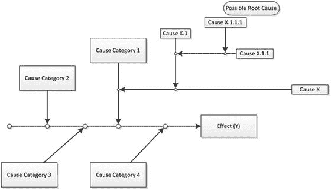

图 9-10 鱼骨图

让我们回到我之前的事件，即我买了十罐咖喱牛肉罐头的那次。这十罐是结果（`Y`），但购买的四个根本原因是：

- 我饿了，所以我买了十罐。我不喜欢上周买的那种十罐装咖喱的品牌。
- 我的邻居需要五罐，因为她无法走路了，她要求我买这个牌子，因为它最便宜，每罐 1.10 英镑。
- 我喂了两罐给狗，因为我觉得狗粮没有营养，但我不准备为狗买更贵的罐装咖喱牛肉品牌。
- 我把三罐放进了当地学校外的慈善箱里，因为慈善机构想要那个牌子的咖喱来做汤食，并且还需要其“资助学校新笔记本电脑”代金券（每罐 2.50 英镑）。

我有一位客户的数据科学家（现在已离职）将我买的十罐以及当周售出的其他 9,000 罐归类为他们的新咖喱品牌的重大成功。由于这次成功，客户的采购员签订了一份预付六个月的采购订单。大约有 10 万罐出现在零售商处，并在八天内售罄。可悲的是，产品卖得这么好的原因是每罐 2.50 英镑的代金券掩盖了一个 25 美分的现金返还优惠，这个优惠被当地批发商错误地用一张 2.50 英镑的“资助学校新笔记本电脑”贴纸覆盖了，而这张贴纸本是为他同时供应的、更昂贵的 25.00 英镑书包准备的。批发商的采购员非法将黑市过期产品运入国内。2.50 英镑的贴纸还盖住了过期日期。由批发商的数据科学家建议的数据系统使用了一个隐式事件，系统将未知的过期日期标记为扫描进入批发商仓库的日期。

> **警告**  
> 如果某事听起来好得不像是真的，那它很可能是错的！

这场微不足道的销售灾难导致两名数据科学家和一名采购员失业；一家批发商宣布破产；六人在汤食厨房食物中毒；我的狗不得不被送去兽医那里。公式很简单：狗 + 咖喱 = 生病的狗狗！我仍然认为责任在商店；我妻子不同意。

“资助学校新笔记本电脑”的活动取得了巨大成功，近 90% 的代金券已被兑换，可惜的是，这并没有带来 25.00 英镑书包销量的增长。

我的邻居收到了五罐我们更好品牌的咖喱，因为狗生病了。我得到了更多工作。一切都好。

我仍然不确定为什么只有 2,000 罐未开封的罐头被顾客退回给零售商，而且每 200 罐中只有 1 罐还贴着代金券。

> **提示**  
> 永远要问为什么，并且在证明答案正确之前，绝不要假设它是正确的。

那么，让我们来看另一个“5 个为什么”的例子。

### 5 个为什么示例

那么，让我们看看在咖喱罐头出问题后，我与零售商一起进行的数据科学分析。

**问题陈述：** 客户不满意，因为他们收到的产品不符合其规格要求。

1. 为什么客户收到的产品不合格？
    - 因为制造部门按照与客户和销售人员商定的规格不同的规格生产了产品。
2. 为什么制造部门按照与销售部门不同的规格生产产品？
    - 因为销售人员直接打电话给制造主管开始工作，以加快车间工作进度。在沟通或记录规格时发生了错误。
3. 为什么销售人员直接打电话给制造主管开始工作，而不遵循公司既定的流程？
    - 因为“开始工作”表格需要销售总监的批准才能开始工作，这拖慢了制造流程（或者当总监不在办公室时导致流程停止）。
4. 为什么表格中需要销售总监的批准？
    - 因为销售总监需要不断了解销售情况，以便与首席执行官讨论，因为我的零售商客户是十大重要客户之一。

在这个案例中，只需要四个“为什么”就确定了：一个无增值的签字授权环节，助长了重要客户质量保证流程的崩溃！剩下的就是犯罪行为。

批发商的外部采购员知道这个流程经常被绕过，于是开始购买这些不合格的罐头，作为非官方的补充手段，来弥补制造部门质量保证流程的失败，以满足销售需求的缺口。批发商只是重新贴了标签，并没有改变产品的制造方式。原因何在？巨额节省带来巨额奖金。一个重要客户的订单必须完成……销售很重要！

> **提示**  
> 只需快速的五个“为什么”——就能验证！

我接下来使用的技术在我的 90% 的数据科学工作中都很有用。它通常提供多方面的解决方案，但需要更深层次的分析。

### 蒙特卡洛模拟

我想向你介绍一个强大的数据科学工具，叫做蒙特卡洛模拟。这项技术通过为具有固有不确定性的参数替换一系列值（即概率分布）来构建可能结果的模型，从而进行分析。然后，它反复计算结果，每次使用来自概率函数的一组不同的随机值。根据不确定性的数量及其指定的范围，蒙特卡洛模拟在完成之前可能涉及数千或数万次重新计算。蒙特卡洛模拟会产生可能结果值的分布。作为数据科学家，这可以让你了解模型在现实情况下的反应。它也为数据科学家提供了一个检查复杂系统的工具，尤其当输入参数数量庞大或复杂时。我将在下一节向你展示这个工具的实际用途。

### 因果循环图

因果循环图（CLD）是一种因果图，用于直观展示系统中多个变量如何相互关联并驱动因果过程。该图由一组节点和边构成。节点代表变量，边则代表连接两个变量或表示它们之间关系的链接。我通常使用第 8 章中介绍的图论来对系统中的路径进行建模。我只需创建一个有向图，然后一步一步地遍历它。

示例：我们的目标是尽可能保持“可用员工数量与生产力”处于高位。

在调查这个棘手的流程时，我绘制了如下基本示意图（图 9-11）。

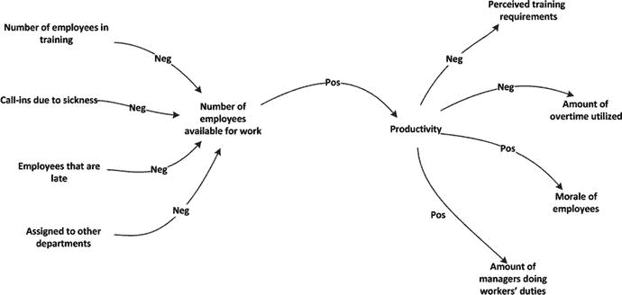

图 9-11 因果循环图

我们的第一个结论是“我们需要更多员工。”然后，我使用一种混合数据科学技术——该技术由蒙特卡洛模拟和深度强化学习两种其他技术综合而成——在图形数据模型上模拟了这个流程。结果发现了流程中另外几个影响我所研究结果的因素。最终结果如图（图 9-12）所示。

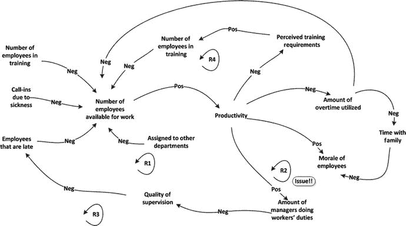

图 9-12 蒙特卡洛模拟结果

蒙特卡洛模拟通过在三小时内改变点 `R1` 到 `R4` 的值来循环遍历因果模型，以此作为训练集。随后，该模拟又运行了三天，使用了一个能够适应系统中关键驱动因素的强化深度学习模型。

结果是“管理者需要去管理，而不是去做具体工作”。`R2`——管理者处理员工职责的比例——是系统中影响最大的原因和驱动力。

> **提示**  
> 如果你不确定真正的数据科学结果，就不要提前交付成果。要有效且高效地工作，而非追求速度！

我通常会并行处理多个项目的分析工作。通过这种方式，我可以在处理并行数据科学任务的同时，依然支持卓越、有效且高效的数据科学工作。

### 帕累托图

帕累托图是我用来为数据科学制定快速处理计划的一种技术。帕累托图可以通过将数据范围划分为若干组（也称为区间、分箱或类别）来构建。（见图 9-13）。

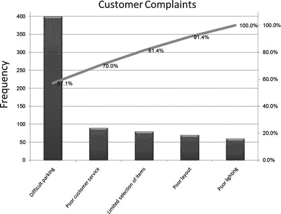

图 9-13 帕累托图

帕累托图回答的问题：

* 我们的团队或客户的业务面临的最大问题是什么？
* 哪些 20% 的原因导致了 80% 的问题（80/20 法则）？
* 我们应该将精力集中在哪里才能取得最大的改进？

我对数据科学流程进行快速评估，并确定在最短的时间内，高效且有效地完成 80% 数据科学工作所需的条件。这是一种追求最大收益的技术。

> **提示**  
> 如果你能为客户节省 80% 已被证实的损失，那么要找到资源来完成剩余 20% 的节省工作就会毫无压力。

### 相关性分析

在此步骤中，我执行的最常见的分析是对数据仓库中的所有数据进行相关性分析。在数据项之间进行特征开发，以发现数据值之间的关系。

```python
```

# 预测

## Pandas Correlation 示例

```python
import pandas as pd

a = [ [1, 2, 3], [5, 6, 9], [7, 3, 13], [5, 3, 19], [5, 3, 12], [5, 6, 11], [5, 6, 13], [5, 3, 4]]
df = pd.DataFrame(data=a)
cr = df.corr()
print(cr)
```

## 预测概念

预测是通过查看历史数据来预测未来可能情况的能力。数据仓库使得这类调查成为可能，因为它会在处理源数据系统时收集完整的历史记录。在你作为数据科学家的职业生涯中，你将执行许多预测项目，并为以下这类问题提供答案：
*   我们应该买什么？
*   我们应该卖什么？
*   我们的下一笔业务将来自哪里？

人们想知道你的计算结果，以判断将要发生什么。现在，我将介绍一个关于预测的例子。

`VKHCG` 资助了多家其他公司以产生额外资本。请在 `\VKHCG\04-Clark\00-RawDat` 目录中查找名为 `VKHCG_Shares.csv` 的文件。以下是我们投资组合：

| 股票 | sTable | 单位 |
| --- | --- | --- |
| WIKI/GOOGL | WIKI_Google | 1000000 |
| WIKI/MSFT | WIKI_Microsoft | 1000000 |
| WIKI/UPS | WIKI_UPS | 1000000 |
| WIKI/AMZN | WIKI_Amazon | 1000000 |
| LOCALBTC/USD | LOCALBTC_USD | 1000000 |
| PERTH/AUD_USD_M | PERTH_AUD_USD_M | 1000 |
| PERTH/AUD_USD_D | PERTH_AUD_USD_D | 1000 |
| PERTH/AUD_SLVR_M | PERTH_SLVR_USD_M | 1000 |
| PERTH/AUD_SLVR_D | PERTH_SLVR_USD_D | 1000 |
| BTER/AURBTC | BTER_AURBTC | 1000000 |
| FED/RXI_US_N_A_UK | FED_RXI_US_N_A_UK | 1000 |
| FED/RXI_N_A_CA | FED_RXI_N_A_CA | 1000 |

我将指导你使用一种技术来确定我们是否可以预测股票在近期的走势。在你的 Python 编辑器中打开一个新文件，并将其保存为 `\VKHCG\04-Clark\03-Process` 目录下的 `Process-Shares-Data.py`。我将引导你完成这个过程。你需要一个名为 `quandl` 的库（`conda install -c anaconda quandl`），它使你能够使用示例中的在线股票数据。像之前一样，通过设置库和环境的基本目录来启动生态系统。

```python
################################################################
import sys
import os
import sqlite3 as sq
import quandl
import pandas as pd
################################################################
if sys.platform == 'linux':
    Base=os.path.expanduser('~') + '/VKHCG'
else:
    Base='C:/VKHCG'

print('################################')
print('Working Base :',Base, ' using ', sys.platform)
print('################################')
################################################################
Company='04-Clark'
sInputFileName='00-RawData/VKHCG_Shares.csv'
sOutputFileName='Shares.csv'
################################################################
sDataBaseDir=Base + '/' + Company + '/03-Process/SQLite'
if not os.path.exists(sDataBaseDir):
    os.makedirs(sDataBaseDir)
################################################################
sFileDir1=Base + '/' + Company + '/01-Retrieve/01-EDS/02-Python'
if not os.path.exists(sFileDir1):
    os.makedirs(sFileDir1)
################################################################
sFileDir2=Base + '/' + Company + '/02-Assess/01-EDS/02-Python'
if not os.path.exists(sFileDir2):
    os.makedirs(sFileDir2)
################################################################
sFileDir3=Base + '/' + Company + '/03-Process/01-EDS/02-Python'
if not os.path.exists(sFileDir3):
    os.makedirs(sFileDir3)
################################################################
sDatabaseName=sDataBaseDir + '/clark.db'
conn = sq.connect(sDatabaseName)
################################################################
```

现在，你将导入我们持有的股票列表以创建预测。

### 导入股票名称数据

```python
################################################################
### 导入股票名称数据
################################################################
sFileName=Base + '/' + Company + '/' + sInputFileName
print('################################')
print('正在加载:',sFileName)
print('################################')
RawData=pd.read_csv(sFileName,header=0,low_memory=False, encoding="latin-1")
RawData.drop_duplicates(subset=None, keep="first", inplace=True)
print('行数   :',RawData.shape[0])
print('列数:',RawData.shape[1])
print('################')
################################################################
sFileName=sFileDir1 + '/Retrieve_' + sOutputFileName
print('################################')
print('正在存储:', sFileName)
print('################################')
RawData.to_csv(sFileName, index = False)
print('################################')
################################################################
sFileName=sFileDir2 + '/Assess_' + sOutputFileName
print('################################')
print('正在存储:', sFileName)
```

print('################################')

`RawData.to_csv(sFileName, index = False)`

print('################################')

################################################################

`sFileName=sFileDir3 + '/Process_' + sOutputFileName`

print('################################')

print('正在存储:', `sFileName`)

print('################################')

`RawData.to_csv(sFileName, index = False)`

print('################################')

现在，你将逐一遍历每只股票，并对每只股票进行预测。

```python
################################################################

### 导入股票详情数据

################################################################

for `sShare` in range(`RawData.shape[0]`):

    `sShareName` = str(`RawData['Shares'][sShare]`)

    `ShareData` = `quandl.get(sShareName)`

    `UnitsOwn` = `RawData['Shares'][sShare]`

    `ShareData['UnitsOwn']` = `ShareData.apply(lambda row:(UnitsOwn),axis=1)`

    print('################')

    print('股票  :', `sShareName`)

    print('行数   :', `ShareData.shape[0]`)

    print('列数:', `ShareData.shape[1]`)

    print('################')

#################################################################

    print('################')

    `sTable` = str(`RawData['sTable'][sShare]`)

    print('正在存储:', `sDatabaseName`, ' 表:', `sTable`)

    `ShareData.to_sql(sTable, conn, if_exists="replace")`

    print('################')

################################################################

    `sOutputFileName` = `sTable + '.csv'`

    `sFileName` = `sFileDir1 + '/Retrieve_' + sOutputFileName`

    print('################################')

    print('正在存储:', `sFileName`)

    print('################################')

    `RawData.to_csv(sFileName, index = False)`

    print('################################')

################################################################

    `sOutputFileName` = `sTable + '.csv'`

    `sFileName` = `sFileDir2 + '/Assess_' + sOutputFileName`

    print('################################')

    print('正在存储:', `sFileName`)

    print('################################')

    `RawData.to_csv(sFileName, index = False)`

    print('################################')

################################################################

    `sOutputFileName` = `sTable + '.csv'`

    `sFileName` = `sFileDir3 + '/Process_' + sOutputFileName`

    print('################################')

    print('正在存储:', `sFileName`)

    print('################################')

    `RawData.to_csv(sFileName, index = False)`

    print('################################')

################################################################

################################################################

print('### 完成!! ############################################')

################################################################
```

你怎么看？我们表现良好，还是正走向破产？你会建议我们买入更多股票吗？

股票将作为对象存储在数据仓库中，而具体的股票（即股票代码）将存储在对象中心（`object hub`）中。将真实的每日股价存储在对象-股价卫星（`object-share-price satellite`）中，以追踪每日变化。将你每天的预测或预报存储在对象-股价预测中心（`object-share-price-projected hub`）中。这样，你既能将预测与真实定价进行比较，也能洞察股价随时间变化的趋势。

为了追踪股价随时间的变化，你还需要一个指向时间中心的链接，以便能够对照数据仓库中的任何其他活动来研究股价。所以，正如我之前所说，你可以对你从数据湖中获取的任何数据，或通过洞察处理到数据仓库中的数据，进行建模。

## 数据科学

你必须明白，当你遵循公认的算法和技术时，数据科学才能发挥最佳效果。你可以进行实验和数据整理，但最终必须验证并支持你的结果。应用良好的数据科学可以确保你能用可接受的证明和统计检验来支持你的工作。我认为，行之有效的数据科学遵循以下基本步骤：

1.  **从一个问题开始。** 确保你已经充分探究了“五个为什么”。
2.  **遵循一个好的模式来构建模型。** 构建一个模型，为数据猜测一个原型，并开始对真实世界参数进行虚拟模拟。如果你具备运筹学或计量经济学技能，这正是你发挥所长之处。将一些数学和统计学知识融入解决方案中，你就有了数据科学模型的雏形。请记住：所有问题都必须与客户的业务相关，并且必须能对问题提供洞察，从而得出可执行的成果，通常还需对你计划部署的数据科学流程的应用产生可量化的投资回报。
3.  **收集观察数据并用于生成假设。** 按照你的模型开始调查，收集所需的观察数据。根据观察数据运行你的模型，并证明你的假设为真或假。
4.  **使用真实世界证据来评判假设。** 将发现与真实世界联系起来，并通过讲故事的方式，将结果转化为现实中的商业建议和洞察。**注意：** 你可能会得到极好的结果，但如果你无法解释它们为何重要，你就没有实现目标。
5.  **在整个过程中尽早并经常与客户和领域专家合作。** 你还必须尽早并经常与你的相关专家沟通，确保他们与你一同踏上探索之旅。商业人士希望成为解决他们问题的方案的一部分。你的责任是提供良好的科学结果来支持业务。

## 总结

你已经成功完成了本章的“处理”步骤。现在，你应该拥有一个坚实的数据仓库，其中包含已处理数据，可供“转换”步骤提取，从而将你的新知识转化为智慧与洞察。

至此，“检索”、“评估”和“处理”这三个步骤，已使你能够将数据湖中的未知数据转化为一系列分类后的中心（即 `T-P-O-L-E` 结构）。你的数据仓库中应包含以下内容：

-   带有卫星表和链接表的时间中心
-   带有卫星表和链接表的人员中心
-   带有卫星表和链接表的对象中心
-   带有卫星表和链接表的地点中心
-   带有卫星表和链接表的事件中心

后续的数据科学工作都将针对这一标准化结构进行。这将帮助你针对 `T-P-O-L-E` 结构，开发出扎实且富有洞察力的数据科学技术和方法。

**注意**
如果你已经将数据湖中的特征处理到了数据仓库中，那么你现在应该已经完成了大部分的数据工程或数据转换任务。

通过构建数据仓库，你已实现了一个重要的里程碑。

**注意**
数据仓库创建了一个自然的历史记录，因为它将所有先前的处理运行结果作为快照存储在数据仓库中。你可以重新运行整个“转换”超级步骤，从而恢复处理过程中每一步的完整历史记录。

下一步，你将开始执行更纯粹的数据科学任务，以探究你发现了哪些数据，以及如何将数据仓库中的数据组织成可供业务查询的解决方案。

# 10. 转换超级步骤

“转换”超级步骤允许你作为数据科学家，从数据仓库中提取数据，并根据你的研究结果形成问题的答案。转换步骤是一个数据科学流程，它将结果转化为洞察。

它采用标准的数据科学技术和方法来获取对数据的洞察和知识，然后这些知识可以转化为可操作的决策。通过故事化的讲述，你可以向非数据科学人员解释你在数据湖中发现了什么。

本书中我所引用的任何源代码或其他补充材料，读者都可以通过本书的产品页面（[`www.apress.com/9781484230534`](http://www.apress.com/9781484230534)）在 GitHub 上获取。请注意，此源代码假定你已经完成了第 2 章中概述的源代码设置。

## 转换超级步骤

“转换”超级步骤使用“处理”步骤得到的数据仓库作为其源数据。这些转换经过调整，以适配数据仓库的五个维度。作为对该结构样子的提醒，请参见图 10-1。

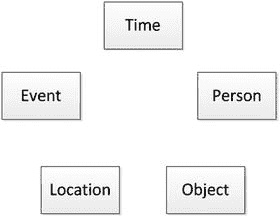
*图 10-1 — 五类数据*

### 维度整合

数据仓库由五类数据组成，这些数据在卫星中心中具有关联关系和附加特征。

要执行维度整合，你从数据仓库中的给定关系出发，为该关系构建一个“太阳模型”，如图 10-2 所示。

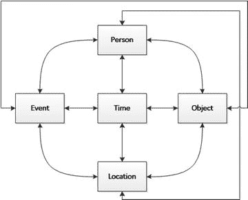
*图 10-2 — T-P-O-L-E 高级别设计*

我将以一个人出生的例子来说明整合过程。

**注意**
你需要一个 `Python` 编辑器来完成本章，请先打开它，然后我们就可以进行所需的数据科学工作了。

在 `Python` 编辑器中打开一个新文件，并将其保存在目录 `..\VKHCG\01-Vermeulen\04-Transform` 中，命名为 `Transform-Gunnarsson_is_Born.py`。你将需要 `Python` 生态系统，因此请通过向编辑器添加以下内容来进行设置（你必须通过添加库来设置生态系统）：

```python
import sys
import os
from datetime import datetime
from datetime import timedelta
from pytz import timezone, all_timezones
import pandas as pd
import sqlite3 as sq
from pandas.io import sql
import uuid
pd.options.mode.chained_assignment = None
```

找到示例的工作目录。

```python
################################################################
if sys.platform == 'linux':
    Base = os.path.expanduser('~') + '/VKHCG'
else:
    Base = 'C:/VKHCG'
print('################################')
print('Working Base :', Base, ' using ', sys.platform)
print('################################')
```

设置你正在处理的公司。

```python
Company = '01-Vermeulen'
```

添加公司工作空间：

```python
sDataBaseDir = Base + '/' + Company + '/04-Transform/SQLite'
if not os.path.exists(sDataBaseDir):
    os.makedirs(sDataBaseDir)
sDatabaseName = sDataBaseDir + '/Vermeulen.db'
conn1 = sq.connect(sDatabaseName)
```

添加数据仓库。

```python
sDataVaultDir = Base + '/88-DV'
if not os.path.exists(sDataVaultDir):
    os.makedirs(sDataVaultDir)
sDatabaseName = sDataVaultDir + '/datavault.db'
conn2 = sq.connect(sDatabaseName)
```

添加数据仓库。

```python
sDataWarehousetDir = Base + '/99-DW'
if not os.path.exists(sDataWarehousetDir):
    os.makedirs(sDataWarehousetDir)
sDatabaseName = sDataVaultDir + '/datawarehouse.db'
conn3 = sq.connect(sDatabaseName)
```

# 执行 Python 代码设置基本生态系统

**注意**  
新的数据结构（称为数据仓库）位于目录 `../99-DW` 中。

数据仓库是“转换”步骤产生的唯一数据结构。让我们来看一个真实场景。

Guðmundur Gunnarsson 于 1960 年 12 月 20 日 9 点 15 分出生在冰岛雷克雅未克 101 区 Hringbraut 101 号的 Landspítali 医院。以下是我期望在数据仓库中找到的内容。

## 时间

你需要一个日期时间：`1960-12-20 09:15`，地点是冰岛雷克雅未克。在编辑器中输入以下代码（你从 UTC 时间开始）：

```python
print('Time Category')

print('UTC Time')

BirthDateUTC = datetime(1960,12,20,10,15,0)

BirthDateZoneUTC=BirthDateUTC.replace(tzinfo=timezone('UTC'))

BirthDateZoneUTCStr=BirthDateZoneUTC.strftime("%Y-%m-%d %H:%M:%S (%Z) (%z)")

BirthDateLocal=BirthDate.strftime("%Y-%m-%d %H:%M:%S")

print(BirthDateZoneUTCStr)
```

转换为雷克雅未克当地时间。

```python
print('Birth Date in Reykjavik :')

BirthZone = 'Atlantic/Reykjavik'

BirthDate = BirthDateZoneUTC.astimezone(timezone(BirthZone))

BirthDateStr=BirthDate.strftime("%Y-%m-%d %H:%M:%S (%Z) (%z)")

print(BirthDateStr)
```

你已成功发现时间枢纽和时间区卫星的密钥，该卫星对应 `Atlantic/Reykjavik`。

- 时间枢纽：你拥有一个 UTC 日期时间，即 1960 年 12 月 20 日 9:15，地点为冰岛雷克雅未克，具体如下：`1960-12-20 10:15:00 (UTC) (+0000)`
- 时间卫星：雷克雅未克的出生日期：`1960-12-20 09:15:00 (-01) (-0100)`

现在，通过将以下内容添加到你的代码中来保存工作。

构建一个数据帧，如下所示：

```python
IDZoneNumber=str(uuid.uuid4())

sDateTimeKey=BirthDateZoneStr.replace(' ','-').replace(':','-')

TimeLine=[('ZoneBaseKey', ['UTC']),

('IDNumber', [IDZoneNumber]),

('DateTimeKey', [sDateTimeKey]),

('UTCDateTimeValue', [BirthDateZoneUTC]),

('Zone', [BirthZone]),

('DateTimeValue', [BirthDateStr])]

TimeFrame = pd.DataFrame.from_items(TimeLine)
```

创建时间枢纽。

```python
TimeHub=TimeFrame[['IDNumber','ZoneBaseKey','DateTimeKey','DateTimeValue']]

TimeHubIndex=TimeHub.set_index(['IDNumber'],inplace=False)

sTable = 'Hub-Time-Gunnarsson'

print('\n#################################')

print('Storing :',sDatabaseName,'\n Table:',sTable)

print('\n#################################')

TimeHubIndex.to_sql(sTable, conn2, if_exists="replace")

sTable = 'Dim-Time-Gunnarsson'

TimeHubIndex.to_sql(sTable, conn3, if_exists="replace")
```

创建时间卫星。

```python
TimeSatellite=TimeFrame[['IDNumber','DateTimeKey','Zone','DateTimeValue']]

TimeSatelliteIndex=TimeSatellite.set_index(['IDNumber'],inplace=False)

BirthZoneFix=BirthZone.replace(' ','-').replace('/','-')

sTable = 'Satellite-Time-' + BirthZoneFix + '-Gunnarsson'

print('\n#################################')

print('Storing :',sDatabaseName,'\n Table:',sTable)

print('\n#################################')

TimeSatelliteIndex.to_sql(sTable, conn2, if_exists="replace")

sTable = 'Dim-Time-' + BirthZoneFix + '-Gunnarsson'

TimeSatelliteIndex.to_sql(sTable, conn3, if_exists="replace")
```

干得好。你现在有了一个时间类别。下一个类别是人物。

## 人物

你必须记录下**古德蒙杜尔·贡纳松**于**1960 年 12 月 20 日 9:15**在**冰岛**出生。

将以下内容添加到现有代码中：

```python
print('Person Category')

FirstName = 'Guðmundur'

LastName = 'Gunnarsson'

print('Name:',FirstName,LastName)

print('Birth Date:',BirthDateLocal)

print('Birth Zone:',BirthZone)

print('UTC Birth Date:',BirthDateZoneStr)
```

你刚刚在人物枢纽中创建了该人物。

```python
IDPersonNumber=str(uuid.uuid4())

PersonLine=[('IDNumber', [IDPersonNumber]),

('FirstName', [FirstName]),

('LastName', [LastName]),

('Zone', ['UTC']),

('DateTimeValue', [BirthDateZoneStr])]

PersonFrame = pd.DataFrame.from_items(PersonLine)

################################################################

TimeHub=PersonFrame

TimeHubIndex=TimeHub.set_index(['IDNumber'],inplace=False)

################################################################

sTable = 'Hub-Person-Gunnarsson'

print('\n#################################')

print('Storing :',sDatabaseName,'\n Table:',sTable)

print('\n#################################')

TimeHubIndex.to_sql(sTable, conn2, if_exists="replace")

sTable = 'Dim-Person-Gunnarsson'

TimeHubIndex.to_sql(sTable, conn3, if_exists="replace")
```

# 创建数据模型

## 引导性建模任务

干得好。你现在有了一个人物枢纽。

你能为冰岛国立大学医院创建一个位置枢纽和卫星吗？

- 纬度：北纬 64° 08' 10.80" 或 `64.136332788`，经度：西经 21° 55' 22.79" 或 `-21.922996308`

你还能从地址数据中处理哪些信息？

- `Landspítali`：本地名称
- `Hringbraut 101`：街道地址
- `101`：邮政编码
- `Reykjavík`：城市名称
- `Iceland`：国家

如果雷克雅未克的具体经纬度尚不存在，你可以向位置枢纽添加一条记录。然后，你可以向一个名为 `Hospitals` 的卫星添加来自位置枢纽的键以及所有额外信息。或者，你也可以简单地将其添加为一个名为 `BuildingAt` 的卫星，包含相同的额外信息和一个 `type_of_building` 指示符。

无论采用哪种方式，我都建议你与客户讨论。

> **注意**：你可以从简单的位置或建筑连接中挖掘出许多特征。

你现在可以为一个名为 "Birth" 的事件创建事件枢纽吗？是的，你可以——这很容易——但是你已经有了一个名为 "Born" 的事件。请使用这个。

> **注意**：我发现不同的人对类似事件有不同的名称，例如 "born" 和 "birth"，"death" 和 "deceased"。
>
> 我有一个事件库，用于对同一事件进行建模。我将这些事件保存在一个额外的表中，当我们为一个列表中的某个词创建事件时，也会为其他列表中的对应词创建事件。
>
> 例如，如果我们为 "born" 和 "birth" 创建事件，这将有助于转换步骤中的查询。如果你问“谁出生了？”或“这是谁的出生？”，你会从数据仓库中检索到结果。

那么，关于**对象**呢？是的，你可以使用属/种数据。古德蒙杜尔是智人（人类）。尝试找到正确的记录进行链接。

> **提示**：你现在应该明白，即使是像“古德蒙杜尔·贡纳松的出生”这样一个简单的业务动作，也能产生大量额外的数据点。
>
> 我建议你尝试看看自己生活中的重大事件：你的出生、第一天上学。如果你查看事件枢纽中适用于你的动作，会怎样？
>
> 如果你理解了通过增强数据仓库可以实现转换步骤中维度整合的重大提升，那么你就在数据科学家能力方面达到了一个重要的里程碑。

# 太阳模型

使用太阳模型是一种技术，它使数据科学家能够通过向业务人员解释预期的数据关系，实现一致的维度整合，而无需暴露完成转换处理所需的技术细节。那么，让我们回顾一下我们的业务陈述：古德蒙杜尔·贡纳松于 1960 年 12 月 20 日 9:15 出生在冰岛雷克雅未克 Hringbraut 101 号的 Landspítali 医院。

## 人物到时间太阳模型

下图 10-3 中的太阳模型解释了数据仓库中时间类别和人物类别之间的关系。

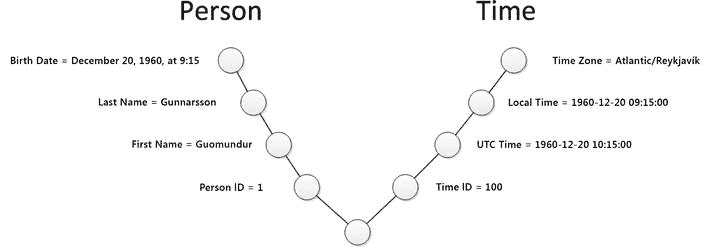
**图 10-3** 人物到时间太阳模型

构建的太阳模型显示了计划提取的两个数据仓库枢纽类别的所有特征。它解释了如何通过图 10-3 中的转换步骤创建两个维度和一个事实。你将创建一个事实（`PersonBornAtTime`）和两个维度（`Person` 和 `Time`），如图 10-4 所示。

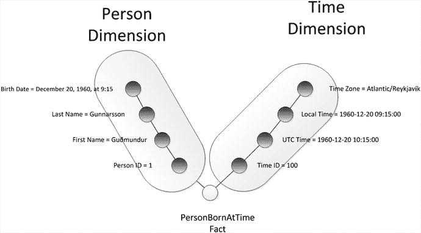
**图 10-4** 人物到时间太阳模型（已解释）

太阳模型解释了古德蒙杜尔·贡纳松于 1960 年 12 月 20 日 9:15 在冰岛出生。

> **提示**：我通过记录日常交互并为这些活动绘制太阳模型来练习太阳模型建模。这样，我就能轻松绘制出大多数关系。熟能生巧对于这项技术来说是真的。

## 模板模型

我还打印了几份带有空白条目的太阳模型副本（图 10-5），以便在与客户会面时快速记录关系。

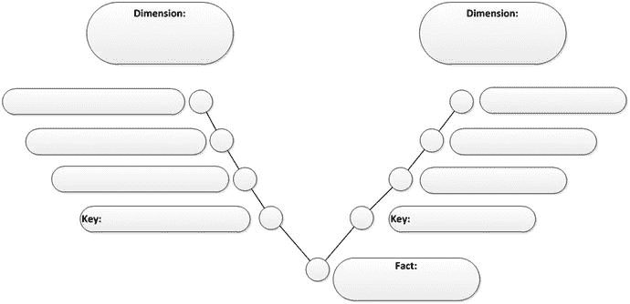
**图 10-5** 简易太阳模型模板

**提示**：我通常会在 `Microsoft Visio` 或 `LibreOffice Draw` 中保留一份空白副本，以便快速上手。我已经指导了几位客户创建太阳模型，他们现在会通过添加这些额外信息来编写需求。这给了他们一种主人翁感。

## 人到对象太阳模型

你能在这些已完成的太阳模型上找出维度和事实吗？（见图 10-6。）

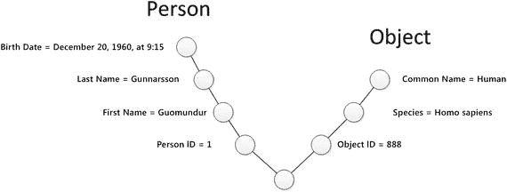
**图 10-6** 针对 `PersonIsSpecies` 事实的太阳模型

你进展如何？在图 10-6 中，维度是 `Person` 和 `Object`。事实是 `PersonIsSpecies`。这描述了 Guðmundur Gunnarsson 是一个 `Homo sapiens`。

## 人到地点太阳模型

如果你有维度 `Person` 和 `Location` 以及事实 `PersonAtLocation`，那么你就成功解读了这个太阳模型（图 10-7）。

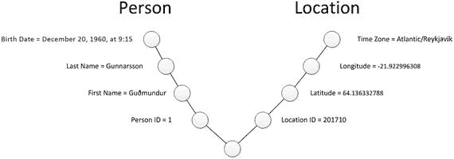
**图 10-7** 针对 `PersonAtLocation` 事实的太阳模型

这描述了 Guðmundur Gunnarsson 出生于：

*   纬度：北纬 64° 08' 10.80" 或 `64.136332788`
*   经度：西经 21° 55' 22.79" 或 `-21.922996308`

## 人到事件太阳模型

那么这个事件太阳模型呢？你能从图 10-8 中提取信息吗？

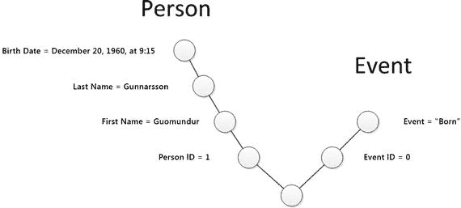
**图 10-8** 针对 `PersonBorn` 事实的太阳模型

如果你有维度 `Person` 和 `Event` 以及事实 `PersonBorn`，那么你就成功解读了这个太阳模型（图 10-8）。

## 从太阳模型到转换步骤

我将引导你创建 `Transform` 步骤，如图 10-9 中的太阳模型所示。

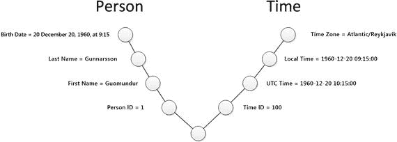
**图 10-9** 针对 `PersonBornAtTime` 事实的太阳模型

你需要构建三个项目：维度 `Person`、维度 `Time` 和事实 `PersonBornAtTime`。打开你的 Python 编辑器，在目录 `..\VKHCG\01-Vermeulen\04-Transform` 下创建一个名为 `Transform-Gunnarsson-Sun-Model.py` 的文件。以下是你的基本生态系统：

```
################################################################
```