# 9. 处理超步骤

处理超步骤将数据源的检索版本评估结果，适配成一个高度结构化的数据仓库，该仓库将为后续的数据科学步骤形成基础数据结构。这个数据仓库涉及跨项目制定一个标准的数据合并格式。

**提示：** 如果你遵循数据仓库的规则，它将为你未来的数据科学工作带来一个清晰且稳定的结构。

处理超步骤是一个合并过程，它将你的数据源导入到五个主要的数据类别中（图 9-1）。

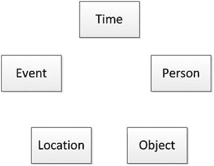

**图 9-1** 五类数据

在你的数据仓库中仅使用这五个中心，配合良好的建模，你就可以描述客户的大部分活动。这使得你能够微调数据科学算法，只需理解这五个中心的用途和关系，就能实现良好的数据科学。

### 数据仓库

数据仓库建模是由 Dan Linstedt 设计的一种数据库建模方法。该数据结构旨在负责长期历史存储来自多个操作系统的数据。它支持按时间顺序的历史数据追踪，以实现完全审计，并支持结构的并行加载。

### 中心（Hubs）

数据仓库中心包含一组独特的业务键，这些键通常不随时间变化，因此是存储在中心中的稳定数据实体。中心为每个中心数据条目持有一个代理键，以及标记业务键来源的元数据。

### 链接（Links）

数据仓库链接是业务键之间的关联。这些链接本质上是多对多连接，并带有增强特定链接的额外元数据。

### 卫星（Satellites）

数据仓库卫星保存特定业务数据部分的时序和描述性特征。中心和链接构成了模型的结构，但它们本身没有时序特征，也不持有描述性特征。卫星由特征以及将它们链接到特定中心的元数据组成。标记关联和特征来源的元数据，以及包含特征起始和结束日期的时间线，都会被安全存储，以供数据部分将来使用。每个卫星都保存了该特定卫星内数据实体的完整时序历史。

### 参考卫星（Reference Satellites）

参考卫星从卫星引用，但在任何情况下都不会与中心键的元数据绑定。它们避免了其他卫星经常使用的参考特征的冗余存储。

典型的参考卫星包括：

*   **标准代码：** 例如用于国家代码的`ISO 3166`、用于货币的`ISO 4217`和用于时区的`ISO 8601`等代码。
*   **特定特征的固定列表：** 这些可以是缩减其他标准列表的标准列表。例如，你的业务设有办事处的国家列表，可能是从`ISO 3166`列表中缩减而来的固定列表。你也可以根据自己的报告结构，生成自己的列表，例如业务区域列表。
*   **转换查询：** 查看全球定位系统 (`GPS`) 的转换，例如 Molodensky 转换、Helmert 转换、Molodensky-Badekas 转换或 Gauss-Krüger 坐标系。

最常见的是`WGS84`，它是美国国防部定义的地理空间信息全球定位系统的标准，也是`GPS`的参考系统。

## 时间-人-对象-地点-事件数据仓库

我们使用的数据仓库基于时间-人-对象-地点-事件 (`T-P-O-L-E`) 设计原则（图 9-2）。

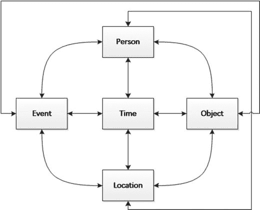

**图 9-2** `T-P-O-L-E`——高层设计

**注意：** 接下来几页讨论的所有数据结构都可以在 `datavault.db` 文件中找到，该文件位于目录 `\VKHCG\88-DV` 中。

### 时间部分（Time Section）

时间部分包含所有与记录事件发生时间相关的数据实体的完整数据结构。

#### 时间中心（Time Hub）

时间中心包含以下字段：

```sql
CREATE TABLE [Hub-Time] (
IDNumber      VARCHAR (100) PRIMARY KEY,
IDTimeNumber  Integer,
ZoneBaseKey   VARCHAR (100),
DateTimeKey   VARCHAR (100),
DateTimeValue DATETIME
);
```

该时间中心充当时区与其他日期时间关联值之间的核心连接器。

## 时间链接

时间链接将时间中心连接到其他中心（图 9-3）。

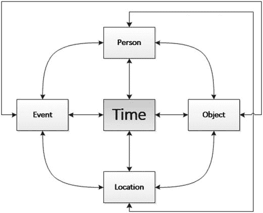

**图 9-3** 时间链接

支持以下链接。

### 时间-人员链接

这将人员中心内的日期时间值连接到时间中心。物理链接结构在数据仓库中存储为多对多关系。在本章后面，我将提供如何构建这些表的详细信息。

诸如生日、结婚纪念日以及阅读本书的日期等日期，可以在数据仓库中作为单独的链接进行记录。常见的格式是 `BirthdayOn`、`MarriedOn` 或 `ReadBookOn`。该格式简单来说是时间中心和人员中心之间的一对键。

### 时间-对象链接

这将对象中心内的日期时间值连接到时间中心。诸如你买车、卖车和阅读本书的日期等日期，可以在数据仓库中作为单独的链接进行记录。常见的格式是 `BoughtCarOn`、`SoldCarOn` 或 `ReadBookOn`。该格式简单来说是时间中心和对象中心之间的一对键。

### 时间-地点链接

这将地点中心内的日期时间值连接到时间中心。诸如搬到了邮政编码 SW1、从邮政编码 SW1 搬离以及在邮政编码 SW1 阅读本书等日期，可以在数据仓库中作为单独的链接进行记录。常见的格式是 `MovedToPostCode`、`MovedFromPostCode` 或 `ReadBookAtPostCode`。该格式简单来说是时间中心和地点中心之间的一对键。

### 时间-事件链接

该链接将事件中心中的日期时间值与时间中心连接起来。诸如搬家日期和更换交通工具日期等，都可以作为数据仓库中的独立链接进行记录。

标准格式为 `MoveHouse` 或 `ChangeVehicle`。该格式本质上是一组介于时间中心与事件中心之间的键值对。

## 时间卫星

时间卫星是数据仓库中用于存储以下字段的部分。

> **注意**
> 表名中的 `<Time Zone>` 部分来自一个时区列表，我将在本章后面讨论该列表。

```sql
CREATE TABLE [Satellite-Time-] (
  IDZoneNumber     VARCHAR (100) PRIMARY KEY,
  IDTimeNumber     INTEGER,
  ZoneBaseKey      VARCHAR (100),
  DateTimeKey      VARCHAR (100),
  UTCDateTimeValue DATETIME,
  Zone             VARCHAR (100),
  DateTimeValue    DATETIME
);
```

时间卫星使您能够更轻松地处理跨国业务模式。您可以跨时区查看诸如“在早上……”或“在午餐时间……”之类的模式。这些功能将在转换超级步骤中使用，以发现全球范围内的规律和行为。

## 人物部分

人物部分包含与记录相关人员相关的所有数据实体的完整数据结构。

### 人物中心

人物中心由一系列支持“真实”人物的字段组成。人物中心包含以下字段：

```sql
CREATE TABLE [Hub-Person] (
  IDPersonNumber     INTEGER,
  FirstName          VARCHAR (200),
  SecondName         VARCHAR (200),
  LastName           VARCHAR (200),
  Gender             VARCHAR (20),
  TimeZone           VARCHAR (100),
  BirthDateKey       VARCHAR (100),
  BirthDate          DATETIME
);
```

### 人物链接

此部分将人物中心与其他中心连接起来（图 9-4）。

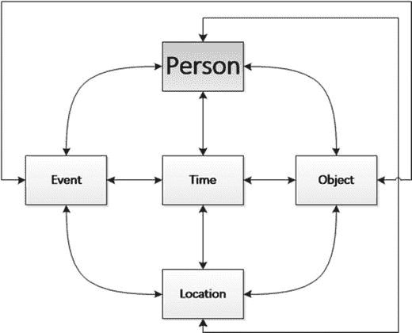

**图 9-4** 人物链接

人物链接中支持以下链接类型。

#### 人物-时间链接

此链接将人物与时间中心连接起来，用于描述这两个中心之间的关系。该链接包含以下字段：

```sql
CREATE TABLE [Link-Person-Time] (
  IDPersonNumber   INTEGER,
  IDTimeNumber     INTEGER,
  ValidDate        DATETIME
);
```

#### 人物-对象链接

此链接将人物与对象中心连接起来，用于描述这两个中心之间的关系。该链接包含以下字段：

```sql
CREATE TABLE [Link-Person-Object] (
  IDPersonNumber   INTEGER,
  IDObjectNumber   INTEGER,
  ValidDate        DATETIME
);
```

#### 人物-地点链接

此链接将人物与地点中心连接起来，用于描述这两个中心之间的关系。该链接包含以下字段：

```sql
CREATE TABLE [Link-Person-Location] (
  IDPersonNumber       INTEGER,
  IDLocationNumber     INTEGER,
  ValidDate            DATETIME
);
```

#### 人物-事件链接

此链接将人物与事件中心连接起来，用于描述这两个中心之间的关系。该链接包含以下字段：

```sql
CREATE TABLE [Link-Person-Event] (
  IDPersonNumber   INTEGER,
  IDEventNumber    INTEGER,
  ValidDate        DATETIME
);
```

### 人物卫星

人物卫星是数据仓库中用于存储数据的时间属性和描述性属性的部分。卫星表采用以下格式：

```sql
CREATE TABLE [Satellite-Person-Gender] (
  PersonSatelliteID VARCHAR (100),
  IDPersonNumber INTEGER,
  FirstName VARCHAR (200),
  SecondName VARCHAR (200),
  LastName VARCHAR (200),
  BirthDateKey VARCHAR (20),
  Gender VARCHAR (10)
);
```

## 对象部分

对象部分包含与记录相关对象相关的所有数据实体的完整数据结构。

### 对象中心

对象中心由一系列支持“真实”对象的字段组成。对象中心包含以下字段：

```sql
CREATE TABLE [Hub-Object-Species] (
  IDObjectNumber INTEGER,
  ObjectBaseKey VARCHAR (100),
  ObjectNumber VARCHAR (100),
  ObjectValue VARCHAR (200)
);
```

这种结构使您作为数据科学家能够对业务环境中的对象进行分类。

### 对象链接

这些链接将对象中心与其他中心连接起来（图 9-5）。

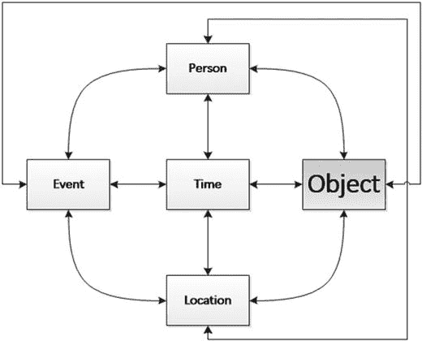

**图 9-5** 对象链接

支持以下链接类型：

#### 对象-时间链接

此链接将对象与时间中心连接起来，用于描述这两个中心之间的关系。该链接包含以下字段：

```sql
CREATE TABLE [Link-Object-Time] (
  IDObjectNumber   INTEGER,
  IDTimeNumber     INTEGER,
  ValidDate        DATETIME
);
```

#### 对象-人物链接

此链接将对象与人物中心连接起来，用于描述这两个中心之间的关系。该链接包含以下字段：

```sql
CREATE TABLE [Link-Object-Person] (
  IDObjectNumber   INTEGER,
  IDPersonNumber   INTEGER,
  ValidDate        DATETIME
);
```

#### 对象-地点链接

此链接将对象与地点中心连接起来，用于描述这两个中心之间的关系。该链接包含以下字段：

```sql
CREATE TABLE [Link-Object-Location] (
  IDObjectNumber   INTEGER,
  IDLocationNumber INTEGER,
  ValidDate        DATETIME
);
```

##### 对象-事件链接

此链接将对象与事件中心连接起来，用于描述这两个中心之间的关系。

#### 对象卫星

对象卫星是数据仓库中用于存储和提供对象详细特征的部分。典型的对象卫星表包含以下数据字段：

```
CREATE TABLE [Satellite-Object-Make-Model] (
    IDObjectNumber INTEGER,
    ObjectSatelliteID VARCHAR (200),
    ObjectType VARCHAR (200),
    ObjectKey VARCHAR (200),
    ObjectUUID VARCHAR (200),
    Make VARCHAR (200),
    Model VARCHAR (200)
);
```

对象卫星将持有额外的特征，因为每个对象都需要额外的信息来进行描述。我将每组特征分开存储，以确保未来的扩展性，因为对象是变化率最高的中心之一，您的数据科学工作会不断发现新的特征。

### 地点部分

地点部分包含与记录相关地点相关的所有数据实体的完整数据结构。

#### 地点中心

地点中心由一系列支持 GPS 位置的字段组成。地点中心包含以下字段：

```
CREATE TABLE [Hub-Location] (
    IDLocationNumber INTEGER,
    ObjectBaseKey  VARCHAR (200),
    LocationNumber INTEGER,
    LocationName   VARCHAR (200),
    Longitude      DECIMAL (9, 6),
    Latitude       DECIMAL (9, 6)
);
```

地点中心使您能够将任何地点、地址或地理空间信息连接到数据仓库的其他部分。

#### 地点链接

地点链接将地点中心与其他中心连接起来（图 9-6）。

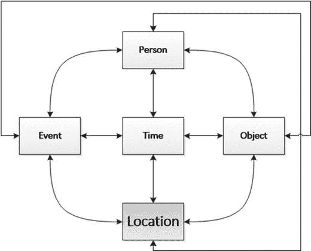

**图 9-6** 地点链接

支持以下链接类型。

##### 地点-时间链接

此链接将地点与时间中心连接起来，用于描述这两个中心之间的关系。该链接包含以下字段：

```
CREATE TABLE [Link-Location-Time] (
    IDLocationNumber   INTEGER,
    IDTimeNumber       INTEGER,
    ValidDate          DATETIME
);
```

这些链接支持诸如 `ArrivedAtShopAtDateTime` 或 `ShopOpensAtTime` 之类的业务操作。

##### 地点-人物链接

此链接将地点与人物中心连接起来，用于描述这两个中心之间的关系。该链接包含以下字段：

```
CREATE TABLE [Link-Location-Person] (
    IDLocationNumber   INTEGER,
    IDPersonNumber     INTEGER,
    ValidDate          DATETIME
);
```

这些链接支持诸如 `ManagerAtShop` 或 `SecurityAtShop` 之类的业务操作。

##### 地点-对象链接

此链接用于连接地点与对象中心，描述两个中心之间的关系。该链接包含以下字段：

```
CREATE TABLE [Link-Location-Object] (
    IDLocationNumber   INTEGER,
    IDObjectNumber     INTEGER,
    ValidDate          DATETIME
);
```

这些链接支持诸如 `ShopDeliveryVan`（店铺送货车辆）或 `RackAtShop`（店铺货架）等业务行为。

##### 地点-事件链接

此链接用于连接地点与事件中心，描述两个中心之间的关系。该链接包含以下字段：

```
CREATE TABLE [Link-Location-Event] (
    IDLocationNumber   INTEGER,
    IDEventNumber      INTEGER,
    ValidDate          DATETIME
);
```

这些链接支持诸如 `ShopOpened`（店铺开业）或 `PostCodeDeliveryStarted`（邮编区配送开始）等业务行为。

#### 地点卫星

地点卫星是数据仓库的一部分，用于存储和提供实体所在位置的详细特征。典型的地点卫星包含以下数据字段：

```
CREATE TABLE [Satellite-Location-PostCode] (
    IDLocationNumber INTEGER,
    LocationSatelliteID VARCHAR (200),
    LocationType VARCHAR (200),
    LocationKey VARCHAR (200),
    LocationUUID VARCHAR (200),
    CountryCode VARCHAR (20),
    PostCode VARCHAR (200)
);
```

地点卫星还将包含仅与您特定客户相关的其他特征。他们可能会将业务区域划分为自己的地理区域，例如，`Europe`（欧洲）、`Middle-East`（中东）和 `China`（中国）。这些可以作为单独的地点卫星添加。

### 事件部分

事件部分包含了与记录所发生事件相关的所有数据实体的完整数据结构。

#### 事件中心

事件中心由一系列支持现实世界中发生的事件的字段组成。事件中心包含以下字段：

```
CREATE TABLE [Hub-Event] (
    IDEventNumber    INTEGER,
    EventType        VARCHAR (200),
    EventDescription VARCHAR (200)
);
```

#### 事件链接

事件链接将事件中心与其他中心连接起来（参见图 9-7）。

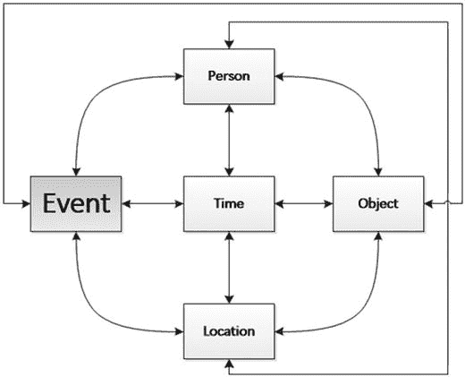

**图 9-7** 事件链接

支持以下链接。

##### 事件-时间链接

此链接用于连接事件与时间中心，描述两个中心之间的关系。该链接包含以下字段：

```
CREATE TABLE [Link-Event-Time] (
    IDEventNumber   INTEGER,
    IDTimeNumber     INTEGER,
    ValidDate        DATETIME
);
```

这些链接支持诸如 `DeliveryDueAt`（预定送达时间）或 `DeliveredAt`（实际送达时间）等业务行为。

##### 事件-人员链接

此链接用于连接事件与人员中心，描述两个中心之间的关系。该链接包含以下字段：

```
CREATE TABLE [Link-Event-Person] (
    IDEventNumber   INTEGER,
    IDPersonNumber  INTEGER,
    ValidDate       DATETIME
);
```

这些链接支持诸如 `ManagerAppointAs`（任命为经理）或 `StaffMemberJoins`（员工入职）等业务行为。

##### 事件-对象链接

此链接用于连接事件与对象中心，描述两个中心之间的关系。该链接包含以下字段：

```
CREATE TABLE [Link-Event-Object] (
    IDEventNumber   INTEGER,
    IDObjectNumber  INTEGER,
    ValidDate       DATETIME
);
```

这些链接支持诸如 `VehicleBuy`（车辆购买）、`VehicleSell`（车辆出售）或 `ItemInStock`（库存物品）等业务行为。

##### 事件-地点链接

此链接用于连接事件与地点中心，描述两个中心之间的关系。该链接包含以下字段：

```
CREATE TABLE [Link-Event-Location] (
    IDEventNumber   INTEGER,
    IDTimeNumber    INTEGER,
    ValidDate       DATETIME
);
```

```

# 设计实用的过程超步骤

接下来，我将开始一系列信息性和实践性的章节，最终目标是让您使用前面讨论过的 T-P-O-L-E 设计模型，通过“过程”步骤生成一个数据仓库。

> **注意**
>
> 我使用 `T-P-O-L-E` 模型，但“纯粹的”数据仓库可以使用各种其他中心、链接或卫星。该模型是一个简化模型，使我能够复用多年来在数据科学工作中开发的众多实用工具和流程。

#### 事件卫星

事件卫星是数据仓库的一部分，用于存储与您将通过数据科学进行分析的系统内发生的所有事件相关的详细信息。我建议您每个卫星只包含一种事件类型。这有助于未来扩展，并便于数据仓库的长期维护。

## 时间

时间是数据的一个特征，与时间记录直接相关。ISO 8601-2004 描述了数据元素和日期时间交换格式的国际标准。以下是处理数据交换的一组基本规则。

日历基于公历。以下数据实体（年、月、日、时、分、秒以及秒的小数部分）正式成为 ISO 8601-2004 标准的一部分。数据按从大到小的顺序记录。值必须有预先商定的固定位数，不足时用前导零补齐。现在，我将向您介绍这些不同的数据实体。

### 年

标准年份必须使用 `0000` 到 `9999` 范围内的四位数。双方可选约定，任何用公元前/公元后表示的日期需要转换，其中公元 1 年 = 年份 1，公元前 1 年 = 年份 0，公元前 2 年 = 年份 -1。这意味着公元 2017 年变为 `+2017`，但公元前 2017 年则变为 `-2016`。

有效格式为：`YYYY` 和 `+/-YYYY`。一个有效年份的规则是：2017 年 10 月 20 日变为 `2017-10-20` 或 `+2017-10-20` 或基本格式 `20171020`。年份数据缺失的规则是：10 月 20 日变为 `--10-20` 或 `--1020`。

`YYYYMMDD` 格式在源系统中很常见。我建议您在“评估”步骤中将其转换为 `YYYY-MM-DD` 格式，以便在后续处理阶段实现日期格式的一致性。

> **警告**
>
> 与您的客户讨论 1582 年 10 月（公历正式起始日期）之前的日期。儒略历自公元前 45 年 1 月 1 日起使用。如果更早的日期对客户的数据处理至关重要，我建议您深入研究这些日期之间其他更复杂的差异。在处理较旧文档的文本挖掘时，这一点非常重要。

打开您的 IPython 编辑器并研究以下日期格式：

```python
from datetime import datetime
from pytz import timezone, all_timezones

now_date = datetime(2001,2,3,4,5,6,7)
now_utc=now_date.replace(tzinfo=timezone('UTC'))

print('Date:',str(now_utc.strftime("%Y-%m-%d %H:%M:%S (%Z) (%z)")))
print('Year:',str(now_utc.strftime("%Y")))
```

您应该看到：

```
Date: 2001-02-03 04:05:06 (UTC) (+0000)
Year: 2001
```

这使您能够轻松地从给定日期中提取年份值。

### 月份

标准月份必须使用介于 `01` 到 `12` 之间的两位数值。有效月份的规则是，2017 年 10 月 20 日应表示为 `2017-10-20` 或 `+2017-10-20`。不带日期的有效月份规则是，2017 年 10 月应表示为 `2017-10` 或 `+2017-10`。

> **警告：** 你不能使用 `YYYYMM` 格式，因此 `201710` 无效。本标准是为了避免与源系统中仍然常用的简化格式 `YYMMDD` 产生混淆。`201011` 可能被理解为 `2010-11` 或 `1920-10-11`。

打开你的 IPython 编辑器，研究以下日期格式：

```python
print('Date:',str(now_utc.strftime("%Y-%m-%d %H:%M:%S (%Z) (%z)")))
print('Month:',str(now_utc.strftime("%m")))
```

你应该得到以下输出：

```
Date: 2001-02-03 04:05:06 (UTC) (+0000)
Month: 02
```

现在你可以获取月份了。

这遵循了标准的英文月份名称。

| 数字 | 月份 |
| --- | --- |
| 1 | January |
| 2 | February |
| 3 | March |
| 4 | April |
| 5 | May |
| 6 | June |
| 7 | July |
| 8 | August |
| 9 | September |
| 10 | October |
| 11 | November |
| 12 | December |

打开你的 IPython 编辑器，研究以下日期格式：

```python
print('Date:',str(now_utc.strftime("%Y-%m-%d %H:%M:%S (%Z) (%z)")))
print('MonthName:', str(now_utc.strftime("%B")))
```

这将返回月份的单词形式。

```
Date: 2001-02-03 04:05:06 (UTC) (+0000)
MonthName: February
```

### 日

标准日期中的日必须使用两位数值，可能取值在 `01` 到 `31` 之间，具体取决于特定月份和年份的约定格式。有效月份的规则是，2017 年 10 月 20 日应表示为 `2017-10-20` 或 `+2017-10-20`。

打开你的 IPython 编辑器，研究以下日期格式：

```python
print('Date:',str(now_utc.strftime("%Y-%m-%d %H:%M:%S (%Z) (%z)")))
print('Day:',str(now_utc.strftime("%d")))
```

这将返回该日期的日。

```
Date: 2001-02-03 04:05:06 (UTC) (+0000)
Day: 03
```

验证日期适用两种标准：非闰年和闰年。由于太阳年长度略短于 365¼ 天——大约少 11 分钟——每 4 年，日历会显示一个闰年，除非该年份能被 400 整除。这修正了 400 年间积累的 11 分钟差值。

打开你的 IPython 编辑器，研究以下日期格式。我将向你展示查找闰年的方法。

```python
import datetime
for year in range(1960,2025):
    month=2
    day=29
    hour=0
    correctDate = None
    try:
        newDate = datetime.datetime(year=year,month=month,day=day,hour=hour)
        correctDate = True
    except ValueError:
        correctDate = False
    if correctDate == True:
        if year%400 == 0:
            print(year, 'Leap Year (400)')
        else:
            print(year, 'Leap Year')
    else:
        print(year,'Non Leap Year')
```

结果显示闰年如下：

```
1960,1964,1968,1972,1976,1980,1984,1988,1992,1996,2000(This was a 400)
2004,2008,2012,2016,2020,2024.
```

现在，我们可以查看日期时间中的时间部分。

### 小时

标准小时必须使用介于 `00` 到 `24` 之间的两位数值。有效格式为 `hhmmss` 或 `hh:mm:ss`。缩写格式 `hhmm` 或 `hh:mm` 可接受，但不建议使用。不支持 `hh` 格式。`00:00:00` 表示日历日的开始。`24:00:00` 仅用于表示日历日的结束。

打开你的 IPython 编辑器，研究以下日期格式：

```python
print('Date:',str(now_utc.strftime("%Y-%m-%d %H:%M:%S (%Z) (%z)")))
print('Hour:',str(now_utc.strftime("%H")))
```

结果是：

```
Date: 2001-02-03 04:05:06 (UTC) (+0000)
Hour: 04
```

### 分钟

标准分钟必须使用介于 `00` 到 `59` 之间的两位数值。有效格式为 `hhmmss` 或 `hh:mm:ss`。缩写格式 `hhmm` 或 `hh:mm` 可接受，但不建议使用。

打开你的 IPython 编辑器，研究以下日期格式：

```python
```

print('Date:',str(now_utc.strftime("%Y-%m-%d %H:%M:%S (%Z) (%z)")))
print('Minute:',str(now_utc.strftime("%M")))
```

结果是：

```
Date: 2001-02-03 04:05:06 (UTC) (+0000)
Minute: 05
```

### 秒

标准秒必须使用介于 00 到 59 之间的两位数值。有效格式为 `hhmmss` 或 `hh:mm:ss`。

打开你的 IPython 编辑器，研究以下日期格式：

```
print('Date:',str(now_utc.strftime("%Y-%m-%d %H:%M:%S (%Z) (%z)")))
print('Second:',str(now_utc.strftime("%S")))
```

这将返回日期时间的秒数。

```
Date: 2001-02-03 04:05:06 (UTC) (+0000)
Second: 06
```

**注意：** 这通常是大多数系统停止记录时间的地方，但我有一些客户需要更精确的时间记录级别。

### 秒的小数部分

秒的小数部分仅定义为以下格式：`hhmmss,sss` 或 `hh:mm:ss,sss` 或 `hhmmss.sss` 或 `hh:mm:ss.sss`。我更喜欢 `hh:mm:ss.sss` 格式，因为使用逗号在导出到数据科学生态系统中常见的 CSV 文件格式时会引起问题。

当前常用的格式如下：

- `hh:mm:ss.s`：十分之一秒
- `hh:mm:ss.ss`：百分之一秒
- `hh:mm:ss.sss`：千分之一秒

如果你能以尽可能低的级别记录数据，数据科学的效果最好。我建议你将时间记录在 `hh:mm:ss.sss` 级别。

打开你的 IPython 编辑器，研究以下日期格式：

```
print('Date:',str(now_utc.strftime("%Y-%m-%d %H:%M:%S (%Z) (%z)")))
print('Millionth of Second:',str(now_utc.strftime("%f")))
```

这将返回百万分之一秒（即微秒）的秒小数部分，如下所示：

- Date: `2001-02-03 04:05:06 (UTC) (+0000)`
- Millionth of Second: `000007`

还有一些更小的单位，例如：

- **纳秒：** 十亿分之一秒
  - 尺度对比：1 纳秒相对于 1 秒，相当于 1 秒相对于 31.71 年。
- **皮秒：** 一万亿分之一秒，或百万分之一百万分之一秒
  - 尺度对比：1 皮秒相对于 1 秒，相当于 1 秒相对于 31,710 年。

我有一个客户，他拥有一台名为条纹管或增强型 CCD (`ICCD`) 相机的科学设备。这些设备能够拍摄光的运动图像，其中 +/-3.3 皮秒是光传播 1 毫米所需的时间。

**注意：** 2011 年，麻省理工学院的研究人员宣布他们拥有了一台每秒万亿帧的视频相机。这款相机的能力非常出色，因为电影的标准是每秒 24 帧 (`fps`)，视频是每秒 30 帧，还有一些 48 `fps` 的型号。

在高性能计算的测量中，一台常见的 3.0 GHz 计算机 `CPU` 将两个整数相加需要 +/-330 皮秒。数据科学家的世界是一个极端测量的世界。

还记得你在第 5 章之前做的电影与帧的示例吗？这台相机在 1 秒内产生的帧数足以制作 1,056,269,593.8 年的视频（以 30 `fps` 播放）。

### 本地时间与协调世界时 (UTC)

我们使用的日期和时间与地球上的特定地点以及日历年的特定时间绑定。约定的本地时间由特定国家批准。

我讨论时区是因为，作为一名数据科学家，你将不得不合并来自全球多个数据源的数据。问题在于时区的影响以及客户对规则的不一致应用。

### 当地时间

经批准的当地时间由特定国家通过批准使用该国的特定时区来确定。夏令时也可被采用，如果该国使用夏令时，则会使其当地时间在一年中的特定时段发生偏移。当地时间的通用格式为 `hh:mm:ss`。

打开你的 IPython 编辑器并研究以下日期格式：

```
from datetime import datetime
now_date = datetime.now()
print('Date:',str(now_date.strftime("%Y-%m-%d %H:%M:%S (%Z) (%z)")))
```

结果如下：

```
2017-10-01 10:45:58 () ()
```

出现两个空括号的原因是此时日期时间处于当地时间设置中。

**警告**  
大多数数据系统会在特定服务器、个人电脑或平板电脑的当地时间设置中记录当地时间。作为数据科学家，你需要理解生态系统中的并非所有系统都能以可靠的方式记录时间。

**提示**  
有一个简单网络时间协议（`SNTP`），你可以自动使用它来将系统时间与远程服务器的时间同步。`SNTP` 可用于通过远程服务器更新机器上的时钟。通过与已知时间准确的服务器同步，这能保持机器时间的准确性。我通常会将自己记录客户数据的计算机与客户使用的同一台 `NTP` 服务器同步，以确保按照他们的系统获得正确的日期和时间。

现在你可以开始研究国际日期和时间设置的世界了。

### 协调世界时（UTC）

协调世界时是一种时间计量方式，与 0° 经度处的平太阳时误差在约 1 秒以内。有效格式为 `hh:mm:ss±hh:mm` 或 `hh:mm:ss±hh`。

例如，2017 年 9 月 11 日，英国伦敦上午九点，当地时间为 `09:00:00`，UTC 时间为 `10:00:00+01:00`。在美国纽约，当地时间为 `06:00:00`，UTC 时间为 `10:00:00-04:00`。在印度新德里，当地时间为 `15:30:00`，UTC 时间为 `10:00:00+05:30`。

更精确的记录方式应为 `2017-09-11T10:00:00Z`。在接下来的章节中，我将解释为什么作为数据科学家在处理多个时区时，日期如此重要。

打开你的 IPython 编辑器并研究以下日期格式：

```
from datetime import datetime
now_date = datetime.now()
print('Local Date Time:',str(now_date.strftime("%Y-%m-%d %H:%M:%S (%Z) (%z)")))
now_utc=now_date.replace(tzinfo=timezone('UTC'))
print('UTC Date Time:',str(now_utc.strftime("%Y-%m-%d %H:%M:%S (%Z) (%z)")))
```

**警告**  
我当前工作在伦敦/爱丁堡时区，因此我的结果将基于这一事实。我的时区是 `Europe/London`。

```
from datetime import datetime
now_date = datetime.now()
print('Local Date Time:',str(now_date.strftime("%Y-%m-%d %H:%M:%S (%Z) (%z)")))
now_utc=now_date.replace(tzinfo=timezone('UTC'))
print('UTC Date Time:',str(now_utc.strftime("%Y-%m-%d %H:%M:%S (%Z) (%z)")))
now_london=now_date.replace(tzinfo=timezone('Europe/London'))
print('London Date Time:',str(now_london.strftime("%Y-%m-%d %H:%M:%S (%Z) (%z)")))
```

因此，我的参考结果如下：

```
Local Date Time: 2017-10-03 16:14:43 () ()
UTC Date Time: 2017-10-03 16:14:43 (UTC) (+0000)
London Date Time: 2017-10-03 16:14:43 (LMT) (-0001)
```

现在，带着这些知识，让我们再看一下你的结果。

```
from datetime import datetime
now_date = datetime.now()
print('Local Date Time:',str(now_date.strftime("%Y-%m-%d %H:%M:%S (%Z) (%z)")))
now_utc=now_date.replace(tzinfo=timezone('UTC'))
print('UTC Date Time:',str(now_utc.strftime("%Y-%m-%d %H:%M:%S (%Z) (%z)")))
```

Local Date Time: 2017-10-03 16:14:43 () ()
UTC Date Time: 2017-10-03 16:14:43 (UTC) (+0000)

很多公司现在都有不同的时区吗？是的！VKHCG 也不例外。

打开你的 Python 编辑器，我们来研究 VKHCG 的时区。

```python
from datetime import datetime
from pytz import timezone, all_timezones
```

获取当前时间。

```python
now_date_local=datetime.now()
```

通过将当地时间标记为 `Europe/London` 时间，将其转换为 `Europe/London` 当地时间。

```python
now_date=now_date_local.replace(tzinfo=timezone('Europe/London'))
print('Local Date Time:',str(now_date.strftime("%Y-%m-%d %H:%M:%S (%Z) (%z)")))
```

现在你拥有一个支持时区的日期时间值，可以用来计算其他时区。你首先要执行的转换是转换到 UTC 时区，如下所示：

```python
now_utc=now_date.astimezone(timezone('UTC'))
print('UTC Date Time:',str(now_utc.strftime("%Y-%m-%d %H:%M:%S (%Z) (%z)")))
```

英国伦敦的时间是多少？

```python
now_eu_london=now_date.astimezone(timezone('Europe/London'))
print('London Date Time:',str(now_eu_london.strftime("%Y-%m-%d %H:%M:%S (%Z) (%z)")))
```

德国柏林的时间是多少？

```python
now_eu_berlin=now_date.astimezone(timezone('Europe/Berlin'))
print('Berlin Date Time:',str(now_eu_berlin.strftime("%Y-%m-%d %H:%M:%S (%Z) (%z)")))
```

英国泽西岛的时间是多少？

```python
now_eu_jersey=now_date.astimezone(timezone('Europe/Jersey'))
print('Jersey Date Time:',str(now_eu_jersey.strftime("%Y-%m-%d %H:%M:%S (%Z) (%z)")))
```

美国纽约的时间是多少？

```python
now_us_eastern=now_date.astimezone(timezone('US/Eastern'))
print('USA Easten Date Time:',str(now_us_eastern.strftime("%Y-%m-%d %H:%M:%S (%Z) (%z)")))
```

美国亚利桑那州的时间是多少？

```python
now_arizona=now_date.astimezone(timezone('US/Arizona'))
print('USA Arizona Date Time:',str(now_arizona.strftime("%Y-%m-%d %H:%M:%S (%Z) (%z)")))
```

澳大利亚奥克兰的时间是多少？

```python
now_auckland=now_date.astimezone(timezone('Pacific/Auckland'))
print('Auckland Date Time:',str(now_auckland.strftime("%Y-%m-%d %H:%M:%S (%Z) (%z)")))
```

加拿大育空地区的时间是多少？

```python
now_yukon=now_date.astimezone(timezone('Canada/Yukon'))
print('Canada Yukon Date Time:',str(now_yukon.strftime("%Y-%m-%d %H:%M:%S (%Z) (%z)")))
```

冰岛雷克雅未克的时间是多少？

```python
now_reyk=now_date.astimezone(timezone('Atlantic/Reykjavik'))
print('Reykjavik Date Time:',str(now_reyk.strftime("%Y-%m-%d %H:%M:%S (%Z) (%z)")))
```

印度孟买的时间是多少？

```python
now_india=now_date.astimezone(timezone('Etc/GMT-7'))
print('India Date Time:',str(now_india.strftime("%Y-%m-%d %H:%M:%S (%Z) (%z)")))
```

费尔默伦使用了哪些时区？

```python
print('Vermeulen Companies')
print('Local Date Time:',str(now_date_local.strftime("%Y-%m-%d %H:%M:%S (%Z) (%z)")))
print('HQ Edinburgh:',str(now_utc.strftime("%Y-%m-%d %H:%M:%S (%Z) (%z)")))
print('Iceland Thor Computers:',str(now_reyk.strftime("%Y-%m-%d %H:%M:%S (%Z) (%z)")))
print('USA Arizona Computers:',str(now_arizona.strftime("%Y-%m-%d %H:%M:%S (%Z) (%z)")))
```

以下是费尔默伦的结果：

```
Vermeulen Companies
Local Date Time: 2017-10-03 16:14:43 () ()
HQ Edinburgh: 2017-10-03 16:15:43 (UTC) (+0000)
Iceland Thor Computers: 2017-10-03 16:15:43 (GMT) (+0000)
USA Arizona Computers: 2017-10-03 09:15:43 (MST) (-0700)
```

克伦瓦尔纳的情况如何？

```python
print('Krennwallner Companies')
print('Local Date Time:',str(now_date_local.strftime("%Y-%m-%d %H:%M:%S (%Z) (%z)")))
print('HQ Berlin:',str(now_eu_berlin.strftime("%Y-%m-%d %H:%M:%S (%Z) (%z)")))
print('HQ USA:',str(now_us_eastern.strftime("%Y-%m-%d %H:%M:%S (%Z) (%z)")))
```

以下是克伦瓦尔纳的结果：

```
Krennwallner Companies
Local Date Time: 2017-10-03 16:14:43 () ()
HQ Berlin: 2017-10-03 18:15:43 (CEST) (+0200)
HQ USA: 2017-10-03 12:15:43 (EDT) (-0400)
```

希尔曼的情况如何？

```python
print('Hillman Companies')
print('HQ London:',str(now_london.strftime("%Y-%m-%d %H:%M:%S (%Z) (%z)")))
print('HQ USA:',str(now_arizona.strftime("%Y-%m-%d %H:%M:%S (%Z) (%z)")))
print('HQ Canada:',str(now_yukon.strftime("%Y-%m-%d %H:%M:%S (%Z) (%z)")))
print('HQ Australia:',str(now_auckland.strftime("%Y-%m-%d %H:%M:%S (%Z) (%z)")))
print('HQ India:',str(now_india.strftime("%Y-%m-%d %H:%M:%S (%Z) (%z)")))
```

希尔曼的结果仅针对总部。

```
Hillman Companies
HQ London: 2017-10-03 16:14:43 (LMT) (-0001)
HQ USA: 2017-10-03 09:15:43 (MST) (-0700)
```

HQ Canada: 2017-10-03 09:15:43 (PDT) (-0700)

HQ Australia: 2017-10-04 05:15:43 (NZDT) (+1300)

HQ India: 2017-10-03 23:15:43 (+07) (+0700)

```

克拉克的情况如何？

```python

print('Clark Companies')

print('HQ Jersey:',str(now_eu_jersey.strftime("%Y-%m-%d %H:%M:%S (%Z) (%z)")))

print('HQ Berlin:',str(now_eu_berlin.strftime("%Y-%m-%d %H:%M:%S (%Z) (%z)")))

print('HQ USA:',str(now_us_eastern.strftime("%Y-%m-%d %H:%M:%S (%Z) (%z)")))

```

希尔曼的情况如何？

```

HQ Jersey: 2017-10-03 17:15:43 (BST) (+0100)

HQ Berlin: 2017-10-03 18:15:43 (CEST) (+0200)

HQ USA: 2017-10-03 12:15:43 (EDT) (-0400)

```

这展示了数据科学家如何研究我们的日期和时间。作为人类，几千年来我们一直将日期和时间的概念分开。日期是通过星辰计算的。时间曾由沙漏确定。后来，日期出现在日历上，而时间则体现在怀表上。但在现代国际社会中，还有另一种日期时间数据项。对我来说，它就是一部智能手机——句号！

## 组合日期与时间

当日期和时间在同一个字段中使用时，ISO 支持本地时间的格式 `YYYY-MM-DDThh:mm:ss.sss` 和协调世界时的格式 `YYYY-MM-DDThh:mm:ss.sssZ`。

这些日期和时间的组合通常出现在跨国公司的财务报表、物流运输信息以及我的智能手机上。

## 时区

时区使得现实世界能够创建一套人们可用来安排生活的日期和小时日历。例如，日期和时间通常表示为 2017 年 10 月 20 日 9:00。但在数据科学家的世界里，这个信息是不充分的。数据科学家需要日期、时间和时区。`YYYY-MM-DDThh:mm:ss.sssZ` 是满足数据科学家数据处理需求的特殊时区格式。

`注意`

本章前面已经讨论过这种格式，作为 UTC 的替代方案。

在国际数据中，我还见过以其他格式设置的时区，必须与大家讨论如何以实际的方式处理这些格式。

打开你的 `IPython` 编辑器，研究以下日期格式：

```python

from pytz import all_timezones

for zone in all_timezones:

    print(zone)

```

共有 593 个时区。是的，你没有看错！问题在于，由于缺乏理解，公司甚至不遵循这些标准时区。例如，我的一个客户使用 `YYYY-DDThh:mm:ss.sssY` 来表示 UTC-12:00，即 Yankee 时区。

`警告`

这些时区不是 ISO 的有效格式！但它们被世界各地的源系统普遍使用。

如果你需要转换回 UTC 格式或本地时间，我将提供我曾经见过的时区列表。

`提示`

我通常会在所有数据科学工作中添加一个 UTC 时区（格式为 `YYYY-DDThh:mm:ss.sssZ`），因为它能确保在处理来自多个时区的数据时，你始终有一个通用的日期和时间处理变量。

数据源记录的时点通常就是你使用的时区。

`警告`

时区取决于你源系统的经纬度或硬件的时钟设置。以下数据是概括性的。我建议你在选择正确的时区之前，先调查一下数据的来源。

一旦找到正确的原始时区，我建议你执行以下操作：

```python

now_date_local = datetime.now()

now_date = now_date_local.replace(tzinfo=timezone('Europe/London'))

print('Local Date Time:', str(now_date_local.strftime("%Y-%m-%d %H:%M:%S (%Z) (%z)")))

print('Local Date Time:', str(now_date.strftime("%Y-%m-%d %H:%M:%S (%Z) (%z)")))

```

结果是

```

Local Date Time: 2017-10-01 12:54:03 () ()

Local Date Time: 2017-10-01 12:54:03 (LMT) (-0001)

```

`'Europe/London'` 从 593 个时区的列表中应用了正确的时区。现在转换为 UTC。

```python

now_utc = now_date.astimezone(timezone('UTC'))

print('UTC Date Time:', str(now_utc.strftime("%Y-%m-%d %H:%M:%S (%Z) (%z)")))

```

结果是

```

UTC Date Time: 2017-10-01 12:55:03 (UTC) (+0000)


我建议你谨慎使用这种方式作为首选的转换方法。你会注意到 `YYYY-DDDThh:mmM` 这种格式的含义或多或少不太准确，它可以转换为 UTC+12:00、UTC+12:45、UTC+13:00 和 UTC+14:00。

UTC+14:00 是 UTC+14，向东延伸至 180° 经线以东 30°，在国际日期变更线上形成了一个大拐弯，并为数据科学家带来了有趣的数据问题。

### 有趣的事实

基里巴斯共和国于 1995 年 1 月 1 日对其东部一半的地区实行了日期和时间的变更，从时区 -11 和 -10 调整为 +13 和 +14。在此之前，`UTC+13`和`UTC+14`这两个时区并不存在。其原因是，基里蒂马蒂岛比地球上任何其他国家都更早进入 2000 年，基里巴斯政府将此特点视为潜在的旅游资产。这一举措是成功的，但也给前来体验的游客的信用卡交易带来了重大问题。菲尼克斯群岛和莱恩群岛政府办公室的当地时间位于国际日期变更线的两侧，它们在一周中只有四天（双方同时在工作日）才能通过无线电或电话进行通信。这些变更带来的问题总是出现在数据系统中。加密引擎上的`GPS`和时区有效性检查不支持这种非标准的变更。

汤加从 1999 年到 2002 年、以及从 2016 年至今，使用`UTC+14`作为夏令时，目的是为了与基里巴斯的莱恩群岛同时庆祝 2000 年新年，并于 2016 年恢复使用变更后的时区，以重新吸引新年旅游业务。该时区于 2017 年 11 月 5 日启用，并于 2018 年 1 月 21 日停用。

2011 年 12 月 29 日（`UTC-10`），萨摩亚将其标准时间从`UTC-11`变更为`UTC+13`，并将其夏令时从`UTC-10`变更为`UTC+14`，从而将国际日期变更线移到了该国的另一侧。想知道为什么吗？为了新年旅游业务。

阿拉斯加（原俄属美洲）在 1867 年之前一直使用从`GMT+11:30`到`GMT+15:10`的当地时间（`UTC`于 1960 年引入）。

墨西哥的金塔纳罗奥州于 2015 年 2 月 1 日永久改为`UTC-5`，旨在通过创造更长、更明亮的夜晚来促进旅游业。

纳米比亚于 2017 年 9 月 3 日从`UTC+1`（夏令时为`UTC+2`）永久改为`UTC+2`。

在 1982 年之前，`UTC+14`曾被用作俄罗斯东部部分地区（楚科奇自治区）的夏令时。

`UTC-12:00`是最后一个开始新一天的当地时间区。

180 度经线被指定为国际日期变更线，因为它大致穿过人口稀少的太平洋中部地区，并于 1884 年获得批准。现在，许多研究探测船、游轮和飞机定期穿越这条线，并通过源系统记录数据。

在处理来自不同时区的数据时，数据科学家必须注意这些例外情况，因为数据从一年到下一年的微小偏移可能隐藏着季节性趋势。我曾受墨西哥金塔纳罗奥州坎昆的一家酒店集团委托，调查时区变更是否带来了其收入的增长，以及如果他们积极推广酒店酒吧延长开放时间，可能会产生多少潜在额外收入。

### 由开始和结束日期及时间标识的时间段

在一个字段中支持日期和时间间隔有一种标准格式：`YYYYMMDDThhmmss/YYYYMMDDThhmmss` 或 `YYYY-MM-DDThh:mm:ss/YYYY-MM-DDThh:mm:ss`。因此，2017 年 10 月 20 日可以记录为`2017-10-20T000000/2017-10-20T235959`，而 2017 年 12 月的假期可以记录为`2017-12-22T120001/2017-12-27T085959`，都放在同一个数据表中。

**注意**：前面的示例来源于我的一个源系统。复杂的数据问题在数据科学中很常见。要快速发现它们，并快速处理它们！

作为一般性提醒，我建议，当你发现这些复杂结构时，尽快将它们转换为更简单的结构。我建议你添加一个评估步骤，将它们拆分为四个字段：`开始日期时间`、`结束日期时间`、`原始日期时间`和`业务术语`。

使用前面提到的格式，2017 年 10 月 20 日记录为`2017-10-20T000000/2017-10-20T235959`，变为以下内容：

| 开始日期时间 | 结束日期时间 | 原始日期时间 | 业务术语 |
| --- | --- | --- | --- |
| `2017-10-20T000000` | `2017-10-20T235959` | `2017-10-20T000000/2017-10-20T235959` | 2017 年 10 月 20 日 |

2017 年 12 月的假期可以在同一个数据表中记录为`2017-12-22T120001/2017-12-27T085959`，如下所示：

| 开始日期时间 | 结束日期时间 | 原始日期时间 | 业务术语 |
| --- | --- | --- | --- |
| `2017-12-22T120001` | `2017-12-22T235959` | `2017-12-22T120001/2017-12-27T085959` | 2017 年 12 月假期 |
| `2017-12-23T000000` | `2017-12-23T235959` | `2017-12-22T120001/2017-12-27T085959` | 2017 年 12 月假期 |
| `2017-12-24T000000` | `2017-12-24T235959` | `2017-12-22T120001/2017-12-27T085959` | 2017 年 12 月假期 |
| `2017-12-25T000000` | `2017-12-25T235959` | `2017-12-22T120001/2017-12-27T085959` | 2017 年 12 月假期 |
| `2017-12-26T000000` | `2017-12-26T235959` | `2017-12-22T120001/2017-12-27T085959` | 2017 年 12 月假期 |
| `2017-12-27T000000` | `2017-12-27T085959` | `2017-12-22T120001/2017-12-27T085959` | 2017 年 12 月假期 |

现在你有了相同日期的时段，这些时段更容易转换为日期时间格式。

### 特殊日期格式

以下是特殊日期格式。

#### 星期几

ISO 8601-2004 规定了以下标准：

| 数字 | 名称 |
| --- | --- |
| 1 | 星期一 |
| 2 | 星期二 |
| 3 | 星期三 |
| 4 | 星期四 |
| 5 | 星期五 |
| 6 | 星期六 |
| 7 | 星期日 |

打开你的 `IPython` 编辑器，研究以下日期格式：

```python
now_date_local = datetime.now()
now_date = now_date_local.replace(tzinfo=timezone('Europe/London'))
print('Weekday:', str(now_date.strftime("%w")))
```

结果是：

```
(It is Sunday)
Weekday: 0
```

**注意**：我见过不同的变体！星期日=0，星期日=1，还有星期一=0。在合并数据之前，确保你使用了正确的格式。

### 周日期

在许多源系统中使用周日期会在处理日期时带来一些复杂性。周日期通过格式中使用大写字母 `W` 以及 `W` 和 `D` 来标识。

以下都是有效格式：`YYYY-Www` 或 `YYYYWww` 或 `YYYY-Www-D` 或 `YYYYWwwD`。例如，2017 年 10 月 22 日，如果使用 ISO 8601（欧洲标准），则为 `2017-W42`；但如果使用 ISO 8601（美国标准），则为 `2017-W43`。

**警告**：ISO 8601（欧洲标准）是官方格式。标准规定，一年的第一周是包含该年第一个星期四或包含 1 月 4 日的那个星期。按照这种方法，1 月 1 日、2 日和 3 日可能被包含在前一年的最后一周，而 12 月 29 日、30 日和 31 日可能被包含在次年的第一周。

ISO 8601（美国标准）被广泛使用。根据该标准，第一周从 1 月 1 日开始，下一周从下一个星期日开始。

其他选项包括：一年的第一周从 1 月 1 日开始，下一周从接下来的星期一开始；或者一年的第一周从 1 月 1 日开始，下一周从 1 月 8 日开始。

```python
now_date_local = datetime.now()
now_date = now_date_local.replace(tzinfo=timezone('Europe/London'))
print('Week of Year:', str(now_date.strftime("%YW%WD%w")))
```

结果是：

```
Week of Year: 2017W39D0
```

# 一年中的第几天

一年中的第几天是通过计算从当年 1 月 1 日起的天数来简单得出的。例如：2017 年 10 月 20 日对应的是 `2017/293`。

## 注意

请尽快将其改为 ISO 标准！

我曾在一个生日字段中发现该格式存储为 `2017293`。原因是用来隐藏某位员工的年龄。这成功破坏了养老金计算器的预测，因为计算器将该值解读为美国格式的 2017 年 3 月 29 日，即 `2017/29/3`。这位员工在 2017 年可能会收到管理层送来的两张生日贺卡和蛋糕。我在 2017 年 9 月修复了这个问题。

现在，让我们按照该格式原本的用途来审视一年中的第几天。当比较不同年份的数据时，一年中的第几天有助于判断数据中的季节性规律。检查每年同一天是否会发生相同的事。虽然并非那么简单，但大致如此！

以下是一年中第几天的格式：

```python
now_date_local = datetime.now()
now_date = now_date_local.replace(tzinfo=timezone('Europe/London'))
print('Day of year:', str(now_date.strftime("%Y/%j")))
```

结果如下：

```
Day of year: 2017/274
```

干得漂亮。你现在已经完成了"流程"步骤中关于日期和时间的基础介绍。在本章的实践部分，我将展示 `YYYY-MM-DDThh:mm:ss.sssZ` 格式的数值对于数据科学中的日期和时间处理有多么重要。

至此，关于日期和时间的初步介绍就结束了。接下来，你将开始构建时间中心枢纽、各个链接以及卫星表。

打开你的 Python 编辑器，创建一个名为 `Process_Time.py` 的文件，并将其保存到目录 `..\VKHCG\01-Vermeulen\03-Process` 中。第一部分包括标准导入和环境设置。

```python
################################################################
```

# Python 数据处理：时间中心枢纽构建

## 1. 环境导入与路径设置

```python
import sys
import os
from datetime import datetime, timedelta
from pytz import timezone, all_timezones
import pandas as pd
import sqlite3 as sq
from pandas.io import sql
import uuid

pd.options.mode.chained_assignment = None
```

```python
if sys.platform == 'linux':
    Base = os.path.expanduser('~') + '/VKHCG'
else:
    Base = 'C:/VKHCG'

print('################################')
print('Working Base :', Base, ' using ', sys.platform)
print('################################')
```

```python
Company = '03-Hillman'
InputDir = '00-RawData'
InputFileName = 'VehicleData.csv'
```

```python
sDataBaseDir = Base + '/' + Company + '/03-Process/SQLite'
if not os.path.exists(sDataBaseDir):
    os.makedirs(sDataBaseDir)
```

```python
sDatabaseName = sDataBaseDir + '/Hillman.db'
conn1 = sq.connect(sDatabaseName)
```

```python
sDataVaultDir = Base + '/88-DV'
if not os.path.exists(sDataBaseDir):
    os.makedirs(sDataBaseDir)
```

```python
sDatabaseName = sDataVaultDir + '/datavault.db'
conn2 = sq.connect(sDatabaseName)
```

## 2. 构建时间中心枢纽

你需要为 2018 年 1 月 1 日之前的十年时间段构建一个时间中心枢纽。如果想尝试不同的时间段，只需修改参数即可。

```python
base = datetime(2018, 1, 1, 0, 0, 0)
numUnits = 10 * 365 * 24
```

```python
date_list = [base - timedelta(hours=x) for x in range(0, numUnits)]
t = 0
for i in date_list:
    now_utc = i.replace(tzinfo=timezone('UTC'))
    sDateTime = now_utc.strftime("%Y-%m-%d %H:%M:%S")
    sDateTimeKey = sDateTime.replace(' ', '-').replace(':', '-')
    t += 1
    IDNumber = str(uuid.uuid4())
    TimeLine = [('ZoneBaseKey', ['UTC']),
                ('IDNumber', [IDNumber]),
                ('nDateTimeValue', [now_utc]),
                ('DateTimeValue', [sDateTime]),
                ('DateTimeKey', [sDateTimeKey])]
    if t == 1:
        TimeFrame = pd.DataFrame.from_items(TimeLine)
    else:
        TimeRow = pd.DataFrame.from_items(TimeLine)
        TimeFrame = TimeFrame.append(TimeRow)
```

```python
TimeHub = TimeFrame[['IDNumber', 'ZoneBaseKey', 'DateTimeKey', 'DateTimeValue']]
TimeHubIndex = TimeHub.set_index(['IDNumber'], inplace=False)
```

```python
TimeFrame.set_index(['IDNumber'], inplace=True)
```

```python
sTable = 'Process-Time'
print('Storing :', sDatabaseName, ' Table:', sTable)
TimeHubIndex.to_sql(sTable, conn1, if_exists="replace")
```

```python
sTable = 'Hub-Time'
print('Storing :', sDatabaseName, ' Table:', sTable)
TimeHubIndex.to_sql(sTable, conn2, if_exists="replace")
```

你已经成功在数据仓库中构建了时间中心枢纽。现在，我们将为每个时区构建卫星表。接下来，创建一个循环来执行这些任务：

```python
active_timezones = all_timezones
z = 0
for zone in active_timezones:
    t = 0
    for j in range(TimeFrame.shape[0]):
        now_date = TimeFrame['nDateTimeValue'][j]
        DateTimeKey = TimeFrame['DateTimeKey'][j]
        now_utc = now_date.replace(tzinfo=timezone('UTC'))
        sDateTime = now_utc.strftime("%Y-%m-%d %H:%M:%S")
        now_zone = now_utc.astimezone(timezone(zone))
        sZoneDateTime = now_zone.strftime("%Y-%m-%d %H:%M:%S")
        t += 1
        z += 1
        IDZoneNumber = str(uuid.uuid4())
        TimeZoneLine = [('ZoneBaseKey', ['UTC']),
                        ('IDZoneNumber', [IDZoneNumber]),
                        ('DateTimeKey', [DateTimeKey]),
                        ('UTCDateTimeValue', [sDateTime]),
```

```markdown
# 时间维度表构建与数据模型

 ('Zone', [zone]),
 ('DateTimeValue', [sZoneDateTime])]

if t==1:
     TimeZoneFrame = pd.DataFrame.from_items(TimeZoneLine)
 else:
     TimeZoneRow = pd.DataFrame.from_items(TimeZoneLine)
     TimeZoneFrame = TimeZoneFrame.append(TimeZoneRow)

TimeZoneFrameIndex = TimeZoneFrame.set_index(['IDZoneNumber'], inplace=False)
sZone = zone.replace('/', '-').replace(' ', '')

#############################################################

sTable = 'Process-Time-' + sZone
print('Storing :', sDatabaseName, ' Table:', sTable)
TimeZoneFrameIndex.to_sql(sTable, conn1, if_exists="replace")

#################################################################

#############################################################

sTable = 'Satellite-Time-' + sZone
print('Storing :', sDatabaseName, ' Table:', sTable)
TimeZoneFrameIndex.to_sql(sTable, conn2, if_exists="replace")

#################################################################

```

你会注意到数据库正在以惊人的速度增长。我建议引入一个小的数据库维护步骤，用于压缩数据库以节省磁盘空间。所需的命令是`vacuum`。它执行的操作类似于真空封装系统，将数据压缩到尽可能小的磁盘占用空间。

```python
 print('################')
 print('Vacuum Databases')
 sSQL = "VACUUM;"
 sql.execute(sSQL, conn1)
 sql.execute(sSQL, conn2)
 print('################')
 #################################################################
 print('### Done!! ############################################')
 #################################################################
```

恭喜！你已经为数据仓库中的时间维度构建了第一个中心枢纽和卫星表。数据仓库已构建在目录`..\VKHCG\88-DV\datavault.db`中。如果你想查看自己的成果，可以使用SQLite工具访问它。在图 9-8 中，你应该会看到一个包含这些数据项的结构。

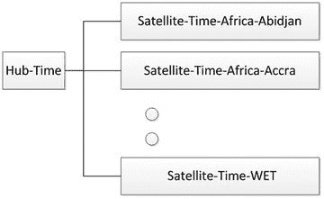

**图 9-8** —— 包含三个数据项的结构。

#### 人物

此结构用于记录数据源中涉及的人物。一个人被定义为一组数据项的集合，这些数据项组合起来描述了现实世界中一个真实的个体。

请记住：住在街对面的面包师`安格斯·麦克盖弗`是个人。我的狗`安格斯`是一个物体。电视剧中由`理查德·迪安·安德森`扮演的虚构角色`安格斯·麦克盖弗`是一个物体。而演员`理查德·迪安·安德森`是个人。你会惊讶地发现，数据科学家在世界各地的数据库中找到了多少虚构角色。

警告：注意在你的数据科学中不要使用多余的无用数据条目！就在去年，一个公共安全系统曾两次派遣了大量应急车辆和人员，原因是一位数据科学家认为使用`安格斯·麦克盖弗`来命名一个随机在高层建筑安置炸弹的恐怖嫌疑人是可以容忍的。这位数据科学家为他的行为辩护，理由是他通过将名字硬编码到数据科学算法中来测试代码。这不是优秀数据科学家的标志！

提示：立即从生产系统中移除自生成的数据错误。它们代表的是糟糕的科学！而且，是的，它们可能损坏财产并伤害人员。

### 黄金标准记录

一条黄金标准记录是某个人的唯一记录，并包含供所有系统使用的独特引用。这为系统提供了关于该人的单一视图。我使用名、中间名、姓和出生日期作为我的黄金标准记录。我们在`assess`目录中拥有的数据需要出生日期才能形成黄金标准记录。我将解释如何使用我们的示例集生成一条黄金标准记录。

打开你的Python编辑器，并在`..\VKHCG\04-Clark\03-Process`目录下创建一个名为`Process-People.py`的文件。

```python
 ################################################################
 import sys
 import os
 import sqlite3 as sq
 import pandas as pd
 from datetime import datetime, timedelta
 from pytz import timezone, all_timezones
 from random import randint
 ################################################################
 if sys.platform == 'linux':
     Base = os.path.expanduser('~') + '/VKHCG'
 else:
     Base = 'C:/VKHCG'
 print('################################')
 print('Working Base :', Base, ' using ', sys.platform)
 print('################################')
 ################################################################
 Company = '04-Clark'
 sInputFileName = '02-Assess/01-EDS/02-Python/Assess_People.csv'
 ################################################################
 sDataBaseDir = Base + '/' + Company + '/03-Process/SQLite'
 if not os.path.exists(sDataBaseDir):
     os.makedirs(sDataBaseDir)
 ################################################################
 sDatabaseName = sDataBaseDir + '/clark.db'
 conn = sq.connect(sDatabaseName)
 ################################################################
 ### Import Female Data
 ################################################################
 sFileName = Base + '/' + Company + '/' + sInputFileName
 print('################################')
 print('Loading :', sFileName)
 print('################################')
 print(sFileName)
```

现在将之前的评估数据加载到内存中进行处理。

```python
 RawData = pd.read_csv(sFileName, header=0, low_memory=False, encoding="latin-1")
 RawData.drop_duplicates(subset=None, keep="first", inplace=True)
```

假设没有人出生于`1900`年`1月1日`之前。

```

start_date = datetime(1900,1,1,0,0,0)
start_date_utc=start_date.replace(tzinfo=timezone('UTC'))

## 同时假设，人们的出生年份是通过随机分配，均匀分布在 100 年的时间跨度内。

```python
HoursBirth=100*365*24

RawData['BirthDateUTC']=RawData.apply(lambda row:
    (start_date_utc + timedelta(hours=randint(0, HoursBirth)))
    ,axis=1)

zonemax=len(all_timezones)-1

RawData['TimeZone']=RawData.apply(lambda row:
    (all_timezones[randint(0, zonemax)])
    ,axis=1)

RawData['BirthDateISO']=RawData.apply(lambda row:
    row["BirthDateUTC"].astimezone(timezone(row['TimeZone']))
    ,axis=1)

RawData['BirthDateKey']=RawData.apply(lambda row:
    row["BirthDateUTC"].strftime("%Y-%m-%d %H:%M:%S")
    ,axis=1)

RawData['BirthDate']=RawData.apply(lambda row:
    row["BirthDateISO"].strftime("%Y-%m-%d %H:%M:%S")
    ,axis=1)

################################################################

Data=RawData.copy()
```

## 你必须删除两个 ISO 复杂日期时间结构，因为代码无法将其转换为 SQLite 的数据类型。

```python
Data.drop('BirthDateUTC', axis=1,inplace=True)
Data.drop('BirthDateISO', axis=1,inplace=True)
print('################################')
```

## 现在将你新的黄金标准记录保存到 SQLite。

```python
#################################################################

print('################')
sTable='Process_Person'
print('Storing :',sDatabaseName,' Table:',sTable)
Data.to_sql(sTable, conn, if_exists="replace")
print('################')
```

## 现在将你新的黄金标准记录保存到 CSV 文件。

```python
################################################################

sFileDir=Base + '/' + Company + '/03-Process/01-EDS/02-Python'
if not os.path.exists(sFileDir):
    os.makedirs(sFileDir)

################################################################

sOutputFileName = sTable + '.csv'
sFileName=sFileDir + '/' + sOutputFileName

print('################################')
print('Storing :', sFileName)
print('################################')

RawData.to_csv(sFileName, index = False)

print('################################')

#################################################################

print('### Done!! ############################################')

#################################################################
```

```
一个真实的例子是拉夫拉斯伯爵夫人阿达，她出生时的名字是奥古斯塔·阿达·金-诺尔。她是一位英国数学家和作家，主要因在查尔斯·巴贝奇提出的机械通用计算机——分析机上的工作而闻名。她出生于 1815 年 12 月 10 日。

- 名 = 奥古斯塔
- 中间名 = 阿达·金-诺尔
- 姓 = 拉夫拉斯
- 出生日期 = 1815-10-10 00:00:00

你应使用她出生证明上的官方姓名，而非她的通用名。你可以添加一个名为`CommonKnownAs`的附属表，并将`阿达·拉夫拉斯`放入该表中。

注意：下一节将介绍我在世界各地工作时发现的一些有趣概念。它将让你深入了解数据科学家在执行工作时可能遇到的多样性需求。

# 人名的含义

我们都有名字，而我们的名字为数据科学家提供了更大的分组，甚至隐藏的含义。如果人们共享相同的姓氏，那么他们之间存在亲缘关系的概率就很大。我稍后会再次讨论这一点。在世界各地，还有许多与人们的名字相关的其他关系。让我们看看我在多年处理数据过程中接触到的一些例子。

# 个人名字的构成与文化差异

## [给定名、母名和父名](https://www.w3.org/International/questions/qa-personal-names%23patronymic) 的含义

人们的名字中可能蕴含着特定的关系或含义。冰岛名字`Björk Guðmundsdóttir`就表达了个体与其家庭成员之间复杂的关系。

`Björk`是此人的名字。`Guðmundsdóttir`表示一种关系：`Guðmundur`的女儿（`-dóttir`）。这表明此人是女性。

`Björk`的父亲是`Guðmundur Gunnarsson`。这是最常见的命名方式。

`Björk`也可能拥有以下母名：`Hildardottir`，甚至同时拥有母名和父名：`Hildar- og Guðmundsdóttir`，因为`Björk`的母亲是`Hildur R’una Hauksdottir`。

`Gunnarsson`表示“`Gunnar`之子”的关系。因此，`Ólafur Guðmundsson`是`Björk`的兄弟。`Ólafur`的儿子是`Jón Ólafurson`。

我刚刚推翻了自己先前的假设。不同的姓氏同样可以表示同一家族的成员！

> **注意**
>
> 不要认为在你所在国家行之有效的算法和假设，在所有其他国家也能同样成功。

马来名字`Isa bin Osman`也暗示了一种隐藏的关系。`Isa`是给定名。`bin Osman`表示“`Osman`之子”。`Isa`的姐妹会是`Mira binti Osman`，因为`binti`意为“之女”。

`Encik Isa`意为“`Isa bin Osman`先生”，但写这个名字的人与`Isa`本人相熟。因此，如果你与`Isa`不熟，就不要称呼他为`Encik Isa`。

以下是一些需要注意的其他命名惯例。

| 语言 | “之子”后缀 | “之女”后缀 |
| --- | --- | --- |
| 古诺尔斯语 | `-son` | `-dóttir` |
| 丹麦语 | `-sen` | `-datter` |
| 法罗语 | `-son` | `-dóttir` |
| 芬兰语 | `-poika` | `-tytär` |
| 冰岛语 | `-son -sson` | `-dóttir` |
| 挪威语 | `-sen/-son/-søn` | `-datter/-dotter` |
| 瑞典语 | `-son` | `-dotter` |

## [名字各部分的不同顺序](https://www.w3.org/International/questions/qa-personal-names%23partorder)

全名并不总是按名字、中间名和姓氏的顺序排列。例如，在中国名字`毛泽东`（`Mao Zedong`）中，姓氏（家族名）是`毛`（`Mao`）。中间的字`泽`（`Ze`）是辈分字，同一家族的所有兄弟姐妹都共享此字。根据规范中文音译为英文的拼音系统，中文名字的后两个字或元素通常合并为一个词，例如`Zedong`，而不是`Ze Dong`。毛泽东的兄弟姐妹是`毛泽民`（`Mao Zemin`）、`毛泽覃`（`Mao Zetan`）和`毛泽紅`（`Mao Zehong`）。

> **注意**
>
> 在音译中，“`Ze Dong`”这种写法很少（如果有的话）被使用。

对于那些与他关系不熟的人，毛泽东可能被称为`毛泽东先生`（`Mao Zedong xiānshēng`）或`毛先生`（`Mao xiānshēng`）（`xiānshēng`相当于“先生”）。如果你与一位叫`毛泽东`的人关系熟络，你通常会称他为`泽东`（`Zedong`），而不仅仅是`东`（`Dong`）。

在日本、韩国和匈牙利，名字的顺序是姓氏在前，跟随后面的给定名。

> **注意**
>
> 与西方人打交道的中国人通常会另外取一个西方人更容易使用的名字。`姚明`（姓氏`姚`，名字`明`）也为西方人将自己的名字呈现为`Fred Yao Ming`或`Fred Ming Yao`。

对于讲西班牙语的人来说，拥有两个姓氏是很常见的。例如，`María-Jose Carreño Quiñones`指的是`Antonio Carreño Rodríguez`和`María Quiñones Marqués`的女儿。你应该称呼她为`Señorita Carreño`，而不是`Señorita Quiñones`。

巴西人有类似的习俗，他们可能会有三到四个姓氏，将祖先的名字串联起来，例如`José Eduardo Santos Tavares Melo Silva`。通常，两个西班牙语姓氏的顺序是父姓+母姓，而在巴西，葡萄牙语名字的顺序是母姓+父姓。然而，这个顺序可能会改变，这常常让数据科学家感到困惑。

> **注意**
>
> 有些名字在姓氏之间包含小品词，如`de`或`e`，例如`Carreño de Quiñones`或`Tavares e Silva`。

俄罗斯人使用父名作为他们的中间名，但也使用姓氏，顺序为给定名+父名+姓氏。父名和姓氏的词尾表明了此人是男性还是女性。例如，`Бopиc Hикoлaeвич Eльцин`（`Boris Nikolayevich Yeltsin`）的妻子是`Haинa Иocифoвнa Eльцинa`（`Naina Iosifovna Yeltsina`）。

> **注意**
>
> 根据俄罗斯命名惯例，男性的名字以辅音结尾，而女性的名字（甚至父名）以`a`结尾。这一俄罗斯命名惯例适用于所有男性和女性，而不仅仅是已婚者。

## [名字的继承](https://www.w3.org/International/questions/qa-personal-names%23inheritance)

认为同一核心家庭成员共享相同姓氏是错误的。在西方，已婚女性婚后保留自己娘家姓的趋势日益增长。然而，在另一些文化中，例如中国文化，这本身就是标准做法。在一些国家，已婚女性可能会或可能不会随夫姓。例如，如果之前提到的马来女孩`Zaiton`嫁给了`Isa`，她可能仍然是`Zaiton`女士，或者她可能会选择成为`Zaiton Isa`，在这种情况下，你可以称呼她为`Isa`女士。

对于数据科学家来说，这些数据特征可能使得数据分组变得复杂。

## 其他亲属关系

荷兰文化有其自身的命名惯例。其遵循的规则如下：

-   长子以祖父的名字命名。
-   长女以祖母的名字命名。
-   次子以外祖父的名字命名。
-   次女以外祖母的名字命名。
-   后续出生的孩子常以叔伯或姑姨的名字命名。

然而，如果某个儿子在其弟弟出生前已去世，弟弟通常会沿用已故兄长的名字。女儿的情况也是如此。如果父亲在儿子出生前去世，儿子会随父亲的名字命名。如果母亲在生下女儿时去世，女儿会随母亲的名字命名。

我曾通过一个数据集艰难地发现，荷兰人的名字存在这种结构——当时我们在找到一份死亡证明后，标记了一个人已故。在非荷兰裔家庭中，不常见在同辈人中重复使用已故者的名字，我们的数据科学程序总是将其标记为错误。因此，当我们将系统从美国迁移到欧洲时，不得不移除这个错误规则，以解决这种文化上的不一致。

荷兰人的名字还与出生地或家族职业有历史和文化上的关联。

例如，`Vermeulen` 是荷兰姓氏 `ver Meulen` 的一种比利时变体，它表示我的家族“来自遥远的磨坊”，或者从事“流动磨坊主”这一职业。因此，我的家族纹章上绘有风车。

按照荷兰传统，过去结婚时，女性需要将丈夫的姓氏放在自己的[娘家姓](https://en.wikipedia.org/wiki/Maiden_name%23Maiden%20name)之前，并用连字符连接。例如，一位 `Anna Pietersen` 嫁给 `Jan Jansen` 后会变成 `Anna Jansen-Pietersen`。荷兰现行的法律给予了人们更多自由。在荷兰境内结婚时，双方默认保留自己的姓氏，但双方都可以选择合法地使用对方的姓氏，或者将两者结合。简单来说，`Anna Pietersen`、`Jan Pietersen`、`Anna Jansen`、`Jan Jansen`、`Anna Jansen-Pietersen` 和 `Jan Jansen-Pietersen` 都可能是同一对夫妻在不同时期使用的名字。

这些姓氏的变体及其附加含义，能够使数据科学家仅仅通过使用人们姓名，就能训练他们的算法来发现人与人之间的关系。我已经和您分享了一些我在多个国家工作多年期间的有趣发现。为了本书的目的，我会保持人物名字的简洁，并遵循西方名字（名+姓）的惯例。

现在，我们将这个人加载到数据仓库中。打开您的 Python 编辑器，在目录 `..\VKHCG\04-Clark\03-Process` 中创建一个名为 `Process-People.py` 的新文件。然后将以下 Python 代码复制到该文件中：

```python
```

```python
import sys
import os
import sqlite3 as sq
import pandas as pd
from pandas.io import sql
from datetime import datetime, timedelta
from pytz import timezone, all_timezones
from random import randint

################################################################

if sys.platform == 'linux':
    Base = os.path.expanduser('~') + '/VKHCG'
else:
    Base = 'C:/VKHCG'

print('################################')
print('Working Base :', Base, ' using ', sys.platform)
print('################################')

################################################################

Company = '04-Clark'
sInputFileName = '02-Assess/01-EDS/02-Python/Assess_People.csv'

################################################################

sDataBaseDir = Base + '/' + Company + '/03-Process/SQLite'
if not os.path.exists(sDataBaseDir):
    os.makedirs(sDataBaseDir)

################################################################

sDatabaseName = sDataBaseDir + '/clark.db'
conn1 = sq.connect(sDatabaseName)

################################################################

sDataVaultDir = Base + '/88-DV'
if not os.path.exists(sDataBaseDir):
    os.makedirs(sDataBaseDir)

################################################################

sDatabaseName = sDataVaultDir + '/datavault.db'
conn2 = sq.connect(sDatabaseName)

################################################################

### 导入女性数据
################################################################

sFileName = Base + '/' + Company + '/' + sInputFileName
print('################################')
print('正在加载 :', sFileName)
print('################################')
print(sFileName)
RawData = pd.read_csv(sFileName, header=0, low_memory=False, encoding="latin-1")
RawData.drop_duplicates(subset=None, keep="first", inplace=True)
start_date = datetime(1900, 1, 1, 0, 0, 0)
start_date_utc = start_date.replace(tzinfo=timezone('UTC'))
HoursBirth = 100 * 365 * 24
RawData['BirthDateUTC'] = RawData.apply(lambda row:
                                        (start_date_utc + timedelta(hours=randint(0, HoursBirth)))
                                        , axis=1)
zonemax = len(all_timezones) - 1
RawData['TimeZone'] = RawData.apply(lambda row:
                                    (all_timezones[randint(0, zonemax)])
                                    , axis=1)
RawData['BirthDateISO'] = RawData.apply(lambda row:
                                        row["BirthDateUTC"].astimezone(timezone(row['TimeZone']))
                                        , axis=1)
RawData['BirthDateKey'] = RawData.apply(lambda row:
                                        row["BirthDateUTC"].strftime("%Y-%m-%d %H:%M:%S")
                                        , axis=1)
RawData['BirthDate'] = RawData.apply(lambda row:
                                     row["BirthDateISO"].strftime("%Y-%m-%d %H:%M:%S")
                                     , axis=1)

################################################################

Data = RawData.copy()
Data.drop('BirthDateUTC', axis=1, inplace=True)
Data.drop('BirthDateISO', axis=1, inplace=True)
indexed_data = Data.set_index(['PersonID'])
print('################################')

################################################################

print('################')
sTable = 'Process_Person'
print('正在存储 :', sDatabaseName, ' 表:', sTable)
indexed_data.to_sql(sTable, conn1, if_exists="replace")
print('################')

################################################################

PersonHubRaw = Data[['PersonID', 'FirstName', 'SecondName', 'LastName', 'BirthDateKey']]
PersonHubRaw['PersonHubID'] = RawData.apply(lambda row:
                                            str(uuid.uuid4())
                                            , axis=1)
PersonHub = PersonHubRaw.drop_duplicates(subset=None,
                                         keep='first',
```

```python
inplace=False)

indexed_PersonHub = PersonHub.set_index(['PersonHubID'])

sTable = 'Hub-Person'

print('正在存储 :', sDatabaseName, ' 表:', sTable)

indexed_PersonHub.to_sql(sTable, conn2, if_exists="replace")

################################################################

PersonSatelliteGenderRaw = Data[['PersonID', 'FirstName', 'SecondName', 'LastName',

                                  'BirthDateKey', 'Gender']]

PersonSatelliteGenderRaw['PersonSatelliteID'] = RawData.apply(lambda row:

                                                              str(uuid.uuid4())

                                                              , axis=1)

PersonSatelliteGender = PersonSatelliteGenderRaw.drop_duplicates(subset=None,

                                                                 keep='first',

                                                                 inplace=False)

indexed_PersonSatelliteGender = PersonSatelliteGender.set_index(['PersonSatelliteID'])

sTable = 'Satellite-Person-Gender'

print('正在存储 :', sDatabaseName, ' 表:', sTable)

indexed_PersonSatelliteGender.to_sql(sTable, conn2, if_exists="replace")

################################################################

PersonSatelliteBirthdayRaw = Data[['PersonID', 'FirstName', 'SecondName', 'LastName',

                                    'BirthDateKey', 'TimeZone', 'BirthDate']]

PersonSatelliteBirthdayRaw['PersonSatelliteID'] = RawData.apply(lambda row:

                                                                str(uuid.uuid4())

                                                                , axis=1)

PersonSatelliteBirthday = PersonSatelliteBirthdayRaw.drop_duplicates(subset=None,

                                                                     keep='first',

                                                                     inplace=False)

indexed_PersonSatelliteBirthday = PersonSatelliteBirthday.set_index(['PersonSatelliteID'])

sTable = 'Satellite-Person-Names'

print('正在存储 :', sDatabaseName, ' 表:', sTable)

indexed_PersonSatelliteBirthday.to_sql(sTable, conn2, if_exists="replace")

################################################################

sFileDir = Base + '/' + Company + '/03-Process/01-EDS/02-Python'

if not os.path.exists(sFileDir):

    os.makedirs(sFileDir)

################################################################

sOutputFileName = sTable + '.csv'

sFileName = sFileDir + '/' + sOutputFileName

print('################################')

print('正在存储 :', sFileName)

print('################################')

RawData.to_csv(sFileName, index=False)

print('################################')

################################################################

print('################')

print('清空数据库')

sSQL = "VACUUM;"

sql.execute(sSQL, conn1)

sql.execute(sSQL, conn2)

print('################')

################################################################

print('### 完成!! ############################################')

################################################################
```

### 对象

此结构用于记录数据源中涉及的其他对象和非人类实体。一个有效的对象必须包含三个基本字段：`Object Type`（对象类型）、`Object Group`（对象组）和`Object Code`（对象编码）。我还添加了简短和详细的描述，以供信息参考。

数据科学允许数据仓库的对象枢纽成为`Object Type`（对象类型）、`Object Group`（对象组）和`Object Code`（对象编码）的简单组合，以形成对现实世界中任何非人类实体的完整描述。

我必须指出，当你开始处理对象时，你会发现大多数对象类型都有支持特定对象处理的标准。让我们看看我在数据科学中必须处理的一些常见对象。

### 动物

动物属于许多不同的分组，从动物界开始。

#### 界

所有生物首先被归入不同的界。有五个不同的界对地球上的生命进行分类：动物界、植物界、真菌界、细菌界和原生生物界（单细胞生物）。

#### 门

动物界被划分为 40 个更小的分组，称为门。因此，动物根据其主要特征进行分组。动物通常属于五个不同的门：刺胞动物门（无脊椎动物）、脊索动物门（脊椎动物）、节肢动物门、软体动物门和棘皮动物门。

#### 纲

一个门被进一步划分为更小的分组，称为纲。脊索动物门（脊椎动物）分为哺乳纲（哺乳动物）、辐鳍鱼纲（硬骨鱼）、软骨鱼纲（软骨鱼）、鸟纲（鸟类）、两栖纲（两栖动物）和爬行纲（爬行动物）。

#### 目

每个纲被划分为更小的分组，称为目。哺乳纲（哺乳动物）分为不同的目，包括食肉目、灵长目、偶蹄目和啮齿目。

#### 科

在每个目中，都有不同的动物科，它们都具有非常相似的特征。食肉目下分为猫科（猫）、犬科（狗）、熊科（熊）和鼬科（鼬鼠）等科。

#### 属

每个动物科会被进一步划分为称为“属”的群体。每个属中包含特征非常相似且亲缘关系密切的动物。例如，`Felidae`（猫科）包含了以下属：`Felis`（小型猫和家猫）、`Panthera`（虎、豹、美洲豹和狮）以及`Puma`（美洲狮和美洲豹）。

#### 种

每个属中的单个物种都以各自独特的特征和特性命名。与属名一样，动物的名称使用拉丁文，以便全球通用，并且由两个单词组成。动物名称的第一部分表示其属名，第二部分表示具体的种名。

让我们来对我那只名为`Tigger`的玩具虎进行分类。

| 界 | 动物界 |
| --- | --- |
| 门 | 脊索动物门（脊椎动物） |
| 纲 | 哺乳纲（哺乳动物） |
| 目 | 食肉目（食肉动物） |
| 科 | 猫科（猫） |
| 属 | 豹属 |
| 种 | 虎 |

现在，我们来对我的狗`Angus`进行分类。

| 界 | 动物界 |
| --- | --- |
| 纲 | 哺乳纲 |
| 目 | 食肉目 |
| 科 | 犬科 |
| 属 | 犬属 |
| 种 | 狼（家犬） |


它被归类为`Canis Lupus familiaris`。

你必须以新近发现的知识所揭示的方式来审视一个对象。现在，我将指导你完成一个 Python 代码会话，将扁平文件转换为包含知识的图谱。你唯一拥有的信息位于目录`.. VKHCG\03-Hillman\00-RawData`下的`Animals.csv`文件中。

其格式为

| ItemLevel | ParentID | ItemID | ItemName |
| --- | --- | --- | --- |
| 0 | 0 | 50 | Bacteria |
| 0 | 0 | 202422 | Plantae |
| 1 | 50 | 956096 | Negibacteria |
| 1 | 50 | 956097 | Posibacteria |

这些字段的含义如下：

- `ItemLevel` 表示特定项目距离分类中顶层节点的层级数。
- `ParentID` 是所列出项目的父级项目的`ItemID`。
- `ItemID` 是该项目的唯一标识符。
- `ItemName` 是该项目的完整名称。

这些数据组合起来形成了一个庞大的分类树。你必须创建一个能够为你提供以下信息的图谱：

```
Bacteria-> Negibacteria and Bacteria-> Posibacteria
```

以下是用于转换数据的代码。你将执行数据准备的几个部分、为检索存储数据、评估超步，然后我们将完成数据存入数据仓库的流程步骤。你从标准框架开始，请将代码复制到你的 Python 编辑器中。首先，我们来设置数据：

```
################################################################
```

```python
# -*- coding: utf-8 -*-

import sys

import os

import pandas as pd

import networkx as nx

import sqlite3 as sq

import numpy as np
```

```python
if sys.platform == 'linux':

    Base=os.path.expanduser('~') + '/VKHCG'

else:

    Base='C:/VKHCG'

print('################################')

print('Working Base :',Base, ' using ', sys.platform)

print('################################')
```

```python
ReaderCode='SuperDataScientist'
```

```
请将下一行中的`'Practical Data Scientist'`替换为你的名字。
```

```python
ReaderName='Practical Data Scientist'
```

```
现在，你设置所有代码输出文件的位置。
```

```python
Company='03-Hillman'

InputRawFileName='Animals.csv'

EDSRetrieveDir='01-Retrieve/01-EDS'

InputRetrieveDir=EDSRetrieveDir + '/02-Python'

InputRetrieveFileName='Retrieve_All_Animals.csv'

EDSAssessDir='02-Assess/01-EDS'

InputAssessDir=EDSAssessDir + '/02-Python'

InputAssessFileName='Assess_All_Animals.csv'

InputAssessGraphName='Assess_All_Animals.gml'
```

```python
sFileRetrieveDir=Base + '/' + Company + '/' + InputRetrieveDir

if not os.path.exists(sFileRetrieveDir):

    os.makedirs(sFileRetrieveDir)
```

```python
sFileAssessDir=Base + '/' + Company + '/' + InputAssessDir

if not os.path.exists(sFileAssessDir):

    os.makedirs(sFileAssessDir)
```

```python
sDataBaseDir=Base + '/' + Company + '/03-Process/SQLite'

if not os.path.exists(sDataBaseDir):

    os.makedirs(sDataBaseDir)
```

```python
sDatabaseName=sDataBaseDir + '/Hillman.db'

conn = sq.connect(sDatabaseName)
```

# Raw to Retrieve

################################################################

你上传包含扁平结构的 CSV 文件。

```

sFileName=Base + '/' + Company + '/00-RawData/' + InputRawFileName

print('###########')

print('Loading :',sFileName)

AnimalRaw=pd.read_csv(sFileName,header=0,low_memory=False, encoding = "ISO-8859-1")

AnimalRetrieve=AnimalRaw.copy()

print(AnimalRetrieve.shape)

```

################################################################

你现在存储检索步骤的数据。

```

sFileName=sFileRetrieveDir + '/' + InputRetrieveFileName

print('###########')

print('Storing Retrieve :',sFileName)

AnimalRetrieve.to_csv(sFileName, index = False)

```

你现在存储评估步骤的数据。

################################################################

# Retrieve to Assess

你开始执行流程步骤，将扁平数据处理成图谱。现在，你可以提取节点，如下所示：

```python
AnimalGood1 = AnimalRetrieve.fillna('0', inplace=False)

AnimalGood2=AnimalGood1[AnimalGood1.ItemName!=0]

AnimalGood2[['ItemID','ParentID']]=AnimalGood2[['ItemID','ParentID']].astype(np.int32)

AnimalAssess=AnimalGood2

print(AnimalAssess.shape)
```

你已成功提取了节点。做得好。现在你可以提取边。你将开始执行流程步骤，将数据转换为合适的图谱结构。

```python
sFileName=sFileAssessDir + '/' + InputAssessFileName

print('###########')

print('Storing Assess :',sFileName)

AnimalAssess.to_csv(sFileName, index = False)
```

你已提取了边。那么，让我们来构建一个图谱。

```python
print('################')

sTable='All_Animals'

print('Storing :',sDatabaseName,' Table:',sTable)

AnimalAssess.to_sql(sTable, conn, if_exists="replace")

print('################')
```

你开始执行流程步骤，将扁平数据处理成图谱。现在，你可以提取节点，如下所示：

```python
print('################')

sTable='All_Animals'

print('Loading Nodes :',sDatabaseName,' Table:',sTable)

sSQL=" SELECT DISTINCT"

sSQL=sSQL+ " CAST(ItemName AS VARCHAR(200)) AS NodeName,"

sSQL=sSQL+ " CAST(ItemLevel AS INT) AS NodeLevel"

sSQL=sSQL+ " FROM"

sSQL=sSQL+ " " + sTable + ";"

AnimalNodeData=pd.read_sql_query(sSQL, conn)

print(AnimalNodeData.shape)
```

你已成功提取了节点。做得好。现在你可以提取边。你将开始执行流程步骤，将数据转换为合适的图谱结构。

```python
print('################')

sTable='All_Animals'

print('Loading Edges :',sDatabaseName,' Table:',sTable)

sSQL=" SELECT DISTINCT"

sSQL=sSQL+ " CAST(A1.ItemName AS VARCHAR(200)) AS Node1,"

sSQL=sSQL+ " CAST(A2.ItemName AS VARCHAR(200)) AS Node2"

sSQL=sSQL+ " FROM"

sSQL=sSQL+ " " + sTable + " AS A1"

sSQL=sSQL+ " JOIN"

sSQL=sSQL+ " " + sTable + " AS A2"

sSQL=sSQL+ " ON"

sSQL=sSQL+ " A1.ItemID=A2.ParentID;"

AnimalEdgeData=pd.read_sql_query(sSQL, conn)

print(AnimalEdgeData.shape)
```

你已提取了边。那么，让我们来构建一个图谱。

```python
G=nx.Graph()

t=0

G.add_node('world', NodeName="World")
```

首先，你添加节点。

```python
GraphData=AnimalNodeData

print(GraphData)

################################################################

m=GraphData.shape[0]

for i in range(m):

t+=1

sNode0Name=str(GraphData['NodeName'][i]).strip()

print('Node :',t,' of ',m,sNode0Name)

sNode0=sNode0Name.replace(' ', '-').lower()

G.add_node(sNode0, NodeName=sNode0Name)

if GraphData['NodeLevel'][i] == 0:

G.add_edge(sNode0,'world')
```

第二步，添加边。

```python
GraphData=AnimalEdgeData

t=0

################################################################

m=GraphData.shape[0]

for i in range(m):

t+=1

sNode0Name=str(GraphData['Node1'][i]).strip()

sNode1Name=str(GraphData['Node2'][i]).strip()

print('Link :',t,' of ',m,sNode0Name,' to ',sNode1Name)

sNode0=sNode0Name.replace(' ', '-').lower()

sNode1=sNode1Name.replace(' ', '-').lower()

G.add_edge(sNode0,sNode1)
```

现在你已经有了节点和边。接下来，将你自己添加为一个节点。

```python
RCode=ReaderCode.replace(' ', '-').lower()

G.add_node(RCode,NodeName=ReaderName)

G.add_edge('homo-sapiens',RCode)
```

现在，存储这个图。

```python
sFileName= sFileAssessDir + '/' + InputAssessGraphName

print('################################')

print('Storing :', sFileName)

print('################################')

nx.write_gml(G,sFileName)

sFileName=sFileName +'.gz'

nx.write_gml(G,sFileName)
```

我们来思考一下我们已经能够提取的一些知识。观察以下对象之间如何相互关联：

- 你自己？
- 作者？
- Angus，我的狗？
- Tigger，我的玩具老虎？
- Chris Hillman，我的技术顾问和朋友？

将以下 `Python` 文件输入到编辑器中，你将发现新的知识。

```python
################################################################
```

# Find Lists of Objects

TargetNodes=[ReaderCode,'Andre Vermeulen','Angus', 'Tigger', 'Chris Hillman']
for j in range(len(TargetNodes)):
    TargetNodes[j]=TargetNodes[j].replace(' ', '-').lower()

for TargetNode in TargetNodes:
    if TargetNode in nx.nodes(G):
        print('=============================')
        print('Path:','World',' to ',G.node[TargetNode]['NodeName'])
        print('=============================')
        for nodecode in nx.shortest_path(G,source='world',target=TargetNode):
            print(G.node[nodecode]['NodeName'])
        print('=============================')
    else:
        print('=============================')
        print('No data - ', TargetNode, ' is missing!')
        print('=============================')

```
如果你被归类为智人，干得好！
```

现在，我们来看看 Angus 要变成 Tigger（除了减重 87 公斤并允许他上床之外），需要经过怎样的 DNA 路径？

```python
################################################################
print('=============================')
print(' How do we turn Angus into Tigger?')
print('=============================')
for nodecode in nx.shortest_path(G,source='angus',target='tigger'):
    print(G.node[nodecode]['NodeName'])
################################################################
```

我们来看看 Chris 要成为 Dr. Chris 需要经过什么路径。

```python
print('=============================')
print('How do you make Chris a Doctor?')
print('=============================')
for nodecode in nx.shortest_path(G,source='chris-hillman',target='dr-chris'):
    print(G.node[nodecode]['NodeName'])
print('=============================')
################################################################
print('### Done!! ############################################')
################################################################
```

现在你已经成功创建了一个新图，你将用它来填充数据保险库中动物对象的部分。在你的 `Python` 编辑器中，在目录 `..\VKHCG\03-Hillman\03-Process` 下创建一个名为 `Process-Animal-Graph.py` 的新文件。将以下 `Python` 代码复制到该文件中。首先，我们将加载一些你需要的库，并创建一组基本的文件名和目录，以启用生态系统。

```python
################################################################
```

# -*- coding: utf-8 -*-

import sys
import os
import pandas as pd
import networkx as nx
import sqlite3 as sq
from pandas.io import sql
import uuid

if `sys.platform` == 'linux':
    Base=os.path.expanduser('~') + '/VKHCG'
else:
    Base='C:/VKHCG'

print('################################')
print('Working Base :',Base, ' using ', `sys.platform`)
print('################################')

Company='03-Hillman'

以下是你在本章前面创建的图的路径：

```python
InputAssessGraphName='Assess_All_Animals.gml'
EDSAssessDir='02-Assess/01-EDS'
InputAssessDir=EDSAssessDir + '/02-Python'

sFileAssessDir=Base + '/' + Company + '/' + InputAssessDir
if not `os.path.exists`(sFileAssessDir):
    os.makedirs(sFileAssessDir)

sDataBaseDir=Base + '/' + Company + '/03-Process/SQLite'
if not `os.path.exists`(sDataBaseDir):
    os.makedirs(sDataBaseDir)

sDatabaseName=sDataBaseDir + '/Hillman.db'
conn1 = `sq.connect`(sDatabaseName)

sDataVaultDir=Base + '/88-DV'
if not `os.path.exists`(sDataBaseDir):
    os.makedirs(sDataBaseDir)

sDatabaseName=sDataVaultDir + '/datavault.db'
conn2 = `sq.connect`(sDatabaseName)
```

现在，加载你在本章前面创建的图。

```python
sFileName= sFileAssessDir + '/' + InputAssessGraphName
print('################################')
print('Loading Graph :', sFileName)
print('################################')
G=`nx.read_gml`(sFileName)
print('Nodes: ', G.number_of_nodes())
print('Edges: ', G.number_of_edges())
```

现在，你将读取图的节点，并将它们作为对象添加到数据保险库中。

```python
t=0
tMax=G.number_of_nodes()
for node in `nx.nodes_iter`(G):
    t+=1
    IDNumber=str(`uuid.uuid4`())
    NodeName=G.node[node]['NodeName']
    print('提取:',t,'/共 ',tMax,' 个:',NodeName)
    ObjectLine=[('ObjectBaseKey', ['Species']),
                ('IDNumber', [IDNumber]),
                ('ObjectNumber', [str(t)]),
                ('ObjectValue', [NodeName])]
    if t==1:
        ObjectFrame = `pd.DataFrame.from_items`(ObjectLine)
    else:
        ObjectRow = `pd.DataFrame.from_items`(ObjectLine)
        ObjectFrame = ObjectFrame.append(ObjectRow)

ObjectHubIndex=ObjectFrame.set_index(['IDNumber'],inplace=False)

sTable = 'Process-Object-Species'
print('存储至:',sDatabaseName,' 表:',sTable)
ObjectHubIndex.to_sql(sTable, conn1, if_exists="replace")

sTable = 'Hub-Object-Species'
print('存储至:',sDatabaseName,' 表:',sTable)
ObjectHubIndex.to_sql(sTable, conn2, if_exists="replace")

print('################')
print('清空数据库')
sSQL="VACUUM;"
sql.execute(sSQL,conn1)
sql.execute(sSQL,conn2)
print('################')

print('### 完成!! ############################################')
```

干得不错。现在你在数据仓库中为物种新增了一个对象枢纽。看看这两段代码。遍历所有节点，并返回从`'World'`节点出发的最短路径。

```python
for node1 in `nx.nodes_iter`(G):
    p=`nx.shortest_path`(G, source="world", target=node1, weight=None)
    print('从 World 到 ',node1,' 的路径:',p)
```

遍历所有节点，并返回整个节点集之间的最短路径。

```python
for node1 in `nx.nodes_iter`(G):
    for node2 in `nx.nodes_iter`(G):
        p=`nx.shortest_path`(G, source=node1, target=node1, weight=None)
        print('路径:',p)
```

我们来快速讨论一种新算法。Dijkstra 算法是一种用于发现图中节点间最短路径的算法，由计算机科学家**艾兹格·W·迪杰斯特拉**于 1956 年提出。图 9-9 展示了一个示例。

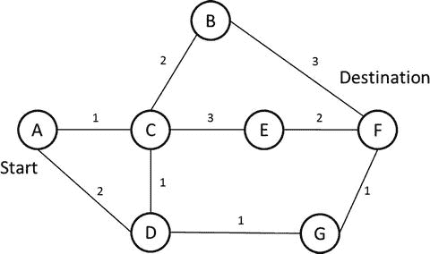

**图 9-9**

Dijkstra 算法示例

```
import networkx as nx

G = nx.Graph()

G.add_edge('a', 'c', weight=1)

G.add_edge('a', 'd', weight=2)

G.add_edge('b', 'c', weight=2)

G.add_edge('c', 'd', weight=1)

G.add_edge('b', 'f', weight=3)

G.add_edge('c', 'e', weight=3)

G.add_edge('e', 'f', weight=2)

G.add_edge('d', 'g', weight=1)

G.add_edge('g', 'f', weight=1)

d=nx.dijkstra_path(G, source="a", target="f", weight=None)

print(d)
```

我计算出`['a', 'c', 'b', 'f']`是最短路径。

是的，这个算法构思于 1956 年，三年后发表。数据科学并没有很多人想象的那么年轻。我们在工作中部署了大量成熟的算法。

使用 Dijkstra 算法，遍历所有节点，并返回整个节点集之间的最短路径：

```
for node1 in nx.nodes_iter(G):

for node2 in nx.nodes_iter(G):

d=nx.dijkstra_path(G, source=node1, target=node1, weight=None)

print('路径:',d)
```

问题：你能创建一个使用该路径作为链接的链接表吗？

以下是你要填充的表格：

```
CREATE TABLE [Link-Object-Species] (

LinkID     VARCHAR (100),

NodeFrom   VARCHAR (200),

NodeTo     VARCHAR (200),

ParentNode VARCHAR (200),

Node       VARCHAR (200),

Step       INTEGER

);
```

在图论中尝试你的新技能。你能让它成功运行吗？

让我们来看下一种对象类型。

#### 车辆

国际车辆分类是一个复杂的过程。虽然有标准，但这些标准并未在全球范围内统一应用，不同群体或国家之间也存在差异。例如，我的凯迪拉克凯雷德 ESV 四驱白金版按市场细分（美式英语）属于：

*   “全尺寸 SUV 皮卡”
*   “大型 4×4”（英式英语）
*   “超大型 SUV”（澳式英语）
*   “标准运动型多用途车”（美国环保署尺寸等级）
*   “越野车”（欧洲 NCAP 结构类别）
*   “大型越野 4×4”（1997–2009 年欧洲 NCAP 等级）
*   “J 级运动型多用途轿车”（欧洲市场细分）
*   “豪华旅行车”（美国公路安全保险协会分类）

要精确分类我的车辆，我需要车辆识别码（VIN）。一个唯一的 VIN 能为数据科学家提供大量的分类细节。车辆有两个标准：ISO 3779:2009（道路车辆—VIN—内容与结构）和 ISO 3780:2009（道路车辆—世界制造商识别码[WMI]代码）。我发现两者结合可以很好地分类车辆，也就是说，我可以解码 VIN。

`VIN`: 1HGBH41JXMN109186

*   型号：Prelude
*   类型：乘用车
*   品牌：本田
*   车型年份：1991 年
*   制造商：本田美国制造有限公司
*   制造地：美国（北美）
*   序列号：109186
*   车身类型：双门轿跑车
*   车辆类型：乘用车

**警告**

车辆的车牌或标签并非该车辆的唯一标识。存在属于个人而非车辆的车牌号。这会导致不同车辆在不同时期使用相同车牌号的情况。当车辆转售时，新车主也可能获得新的车牌号。因此，**不要**使用车牌号作为唯一键。

作为一名数据科学家，你必须理解可以从被记录对象的简单代码和分类中推断出的数据。

**提示**

车辆是系统编码的，如果你能花时间先理解编码标准，你会体会到其长期价值。

我们先将 Hillman 有限公司的车辆数据加载到数据仓库中，之后会用到。在 Python 编辑器中，于目录`..\VKHCG\03-Hillman\03-Process`下创建一个名为`Process-Vehicle-Logistics.py`的新文件。在我逐步讲解指导时，将代码复制到你的新文件中。从创建生态系统的标准结构开始。

```
################################################################
```

# -*- coding: utf-8 -*-

import sys

import os

import pandas as pd

import sqlite3 as sq

from pandas.io import sql

import uuid

`pd.options.mode.chained_assignment` = None

################################################################

if `sys.platform` == 'linux':

`Base=os.path.expanduser('~') + '/VKHCG'`

else:

`Base='C:/VKHCG'`

print('################################')

print('工作基础路径 :',`Base`, ' 使用 ', `sys.platform`)

print('################################')

################################################################

`Company='03-Hillman'`

`InputDir='00-RawData'`

`InputFileName='VehicleData.csv'`

################################################################

`sDataBaseDir=Base + '/' + Company + '/03-Process/SQLite'`

if not `os.path.exists(sDataBaseDir)`:

`os.makedirs(sDataBaseDir)`

################################################################

`sDatabaseName=sDataBaseDir + '/Hillman.db'`

`conn1 = sq.connect(sDatabaseName)`

################################################################

`sDataVaultDir=Base + '/88-DV'`

if not `os.path.exists(sDataBaseDir)`:

`os.makedirs(sDataBaseDir)`

################################################################

`sDatabaseName=sDataVaultDir + '/datavault.db'`

`conn2 = sq.connect(sDatabaseName)`

################################################################

现在加载要添加到数据仓库的车辆数据。

`VehicleRaw`是一个`pandas`数据框（`pandas.DataFrame`），其数据来自于一个 CSV 文件。我们将只使用`VehicleRaw`中的`Make`和`Model`列，以及`ObjectKey`和`ObjectUUID`。

```python
sFileName=Base + '/' + Company + '/' + InputDir + '/' + InputFileName
print('###########')
print('Loading :',sFileName)
VehicleRaw=pd.read_csv(sFileName,header=0,low_memory=False, encoding="latin-1")
```

################################################################

```python
sTable='Process_Vehicles'
print('Storing :',sDatabaseName,' Table:',sTable)
VehicleRaw.to_sql(sTable, conn1, if_exists="replace")
```

现在，将车辆特征子集化，仅保留数据仓库所需的`Make`和`Model`。

```python
VehicleRawKey=VehicleRaw[['Make','Model']].copy()
```

移除所有重复项。

```python
VehicleKey=VehicleRawKey.drop_duplicates()
```

为枢纽表（Hub）创建一个车辆键（`VehicleKey`）。可以通过移除不需要的字符来清理`VehicleKey`。

```python
VehicleKey['ObjectKey']=VehicleKey.apply(lambda row:
    str('('+ str(row['Make']).strip().replace(' ', '-').replace('/', '-').lower() +
        ')-(' + (str(row['Model']).strip().replace(' ', '-').replace(' ', '-').lower())
        +')')
    ,axis=1)
```

将`ObjectType`的所有记录设置为`'vehicle'`。

```python
VehicleKey['ObjectType']=VehicleKey.apply(lambda row:
    'vehicle'
    ,axis=1)
```

为每条记录设置唯一的`ObjectUUID`。

```python
VehicleKey['ObjectUUID']=VehicleKey.apply(lambda row:
    str(uuid.uuid4())
    ,axis=1)

VehicleHub=VehicleKey[['ObjectType','ObjectKey','ObjectUUID']].copy()
VehicleHub.index.name='ObjectHubID'
sTable = 'Hub-Object-Vehicle'
print('Storing :',sDatabaseName,' Table:',sTable)
VehicleHub.to_sql(sTable, conn2, if_exists="replace")
```

为枢纽表创建车辆卫星表（Vehicle Satellite），用于存储额外的车辆特性。

```python
##### Vehicle Satellite
#
VehicleSatellite=VehicleKey[['ObjectType','ObjectKey','ObjectUUID','Make','Model']].copy()
VehicleSatellite.index.name='ObjectSatelliteID'
sTable = 'Satellite-Object-Make-Model'
print('Storing :',sDatabaseName,' Table:',sTable)
VehicleSatellite.to_sql(sTable, conn2, if_exists="replace")
```

创建一个连接枢纽表和卫星表的车辆维度表（Vehicle Dimension）。

```python
##### Vehicle Dimension
sView='Dim-Object'
print('Storing :',sDatabaseName,' View:',sView)
sSQL="CREATE VIEW IF NOT EXISTS [" + sView + "] AS"
sSQL=sSQL+ " SELECT DISTINCT"
sSQL=sSQL+ "   H.ObjectType,"
sSQL=sSQL+ "   H.ObjectKey AS VehicleKey,"
sSQL=sSQL+ "   TRIM(S.Make) AS VehicleMake,"
```

### 连接枢纽表和卫星表的车辆维度表

```python
sSQL = sSQL + "   TRIM(S.Model) AS VehicleModel"
sSQL = sSQL + " FROM"
sSQL = sSQL + "   [Hub-Object-Vehicle] AS H"
sSQL = sSQL + " JOIN"
sSQL = sSQL + "   [Satellite-Object-Make-Model] AS S"
sSQL = sSQL + " ON"
sSQL = sSQL + "     H.ObjectType=S.ObjectType"
sSQL = sSQL + " AND"
sSQL = sSQL + " H.ObjectUUID=S.ObjectUUID;"
sql.execute(sSQL, conn2)
```

让我们测试这个连接枢纽表和卫星表的车辆维度表。

```python
print('################')
print('Loading :', sDatabaseName, ' Table:', sView)

sSQL = " SELECT DISTINCT"
sSQL = sSQL + " VehicleMake,"
sSQL = sSQL + " VehicleModel"
sSQL = sSQL + " FROM"
sSQL = sSQL + " [" + sView + "]"
sSQL = sSQL + " ORDER BY"
sSQL = sSQL + " VehicleMake"
sSQL = sSQL + " AND"
sSQL = sSQL + " VehicleMake;"

DimObjectData = pd.read_sql_query(sSQL, conn2)
DimObjectData.index.name = 'ObjectDimID'
DimObjectData.sort_values(['VehicleMake', 'VehicleModel'], inplace=True, ascending=True)
print('################')
print(DimObjectData)
```

```python
#################################################################
print('################')
print('Vacuum Databases')
sSQL = "VACUUM;"
sql.execute(sSQL, conn1)
sql.execute(sSQL, conn2)
print('################')
#################################################################

conn1.close()
conn2.close()
#################################################################
# print('### Done!! ############################################')
#################################################################
```

恭喜！你现在已经创建了两个对象枢纽表（Object Hubs）。接下来我将介绍其他几个可以研究的目标对象。

### 化合物

对象由无数化学物质构成，这些化学物质可以告诉你关于任何对象分类的信息。有一个相关的库叫做 `pyEQL`（`pip3 install pyEQL`）。

打开你的 Python 编辑器并尝试以下操作：

```python
from pyEQL import chemical_formula as cf
print(cf.hill_order('CH2(CH3)4COOH'))
```

这将帮助你解析化学式。让我们看几个例子。

*   食盐（氯化钠）是 `NaCl`。它包含一份钠和一份氯。

    ```python
    print(cf.get_element_mole_ratio('NaCl', 'Na'))
    print(cf.get_element_mole_ratio('NaCl', 'Cl'))
    ```

*   排水管清洁剂（硫酸）是 `H2SO4`。它包含两份氢、一份硫和四份氧。
*   小苏打（碳酸氢钠）是 `NaHCO3`。其比例是多少？
*   甘油是 `C3H8O3`。其比例是多少？组成该物质的成分是什么？

    ```python
    print(cf.get_element_names('C3H8O3'))
    ```

检查一个化学式是否有效。

```python
print(cf.is_valid_formula('Fe2(SO4)3'))
print(cf.is_valid_formula('Fe2(SO4)3+Bad'))
```

你还可以研究其他选项。请参见库 `periodictable`，网址为 `https://pypi.python.org/pypi/periodictable`。

```python
from periodictable import *

for el in elements:
    print("%s %s" % (el.symbol, el.name))
```


# 对象数据结构

你现在应该拥有一个元素列表。

你也可以研究`biopython`（参见`http://biopython.org`）。你可以通过运行`conda install -c anaconda biopython`来访问它。这为计算分子生物学世界提供了见解。你能将其与你的知识相结合，创建额外的对象枢纽吗？

> 提示
>
> 你可以从周围世界中提取各种对象，然后开始分析它们如何改变数据科学的艺术。

对象数据结构将随着客户数据因业务不同而变化。我建议你尽早开始分析项目中任何非人员实体的分类。与客户的领域专家交谈，获取他们的分类模型，并100%理解它们。

同时，也要纳入对象描述的所有角度。一家零售店可能销售食盐，但制造商生产的是氯化钠。通过在数据仓库中连接这些信息，你的算法将理解这些关系。诸如深度学习、逻辑回归和随机森林（我将在第10章中介绍）等算法，如果你已经通过连接不同洞见领域创建了基本关系，它们将会以改进的净结果运行。

> 提示
>
> 在确定业务需求时，应首先从对象类型（Object Type）和对象组（Object Group）开始。如果你已经理清了这两个字段，那么你已经完成了对象结构80%以上的工作。

这只是数据科学中对象处理的基本起点。在流程（Process）超步骤中，数据仓库的这一部分始终是数据科学工作中最大的一部分。

我还通过请外部专家对某些客户从未识别出共同特征的对象进行分类，来丰富我客户的数据。

> 警告
>
> 加载大量重叠的细节，总比加载不充分和不完整的细节要好。不要过度概括你的对象类型和对象组分组。

为了实践示例的目的，我将介绍一些算法和技术，这些将帮助你执行数据源中对象的分类。

# 位置

该结构记录了数据源中数据实体之间发生交互的任何位置。数据操作的位置对任何企业而言都是极具价值的数据，它能提供完整数据集的地理空间洞察。地理空间是指对地表上已定义结构所处位置进行分类的信息。

我们来探讨一些关于位置的基础知识。

## 纬度、经度和海拔

纬度、经度和海拔是描述地球位置最古老的一些官方方法，由希腊天文学家喜帕恰斯（公元前190–120年）详细阐述。经线垂直于赤道，纬线平行于赤道。经度值范围介于`-180°`到`180°`之间，格林威治本初子午线设为`0°`。纬度值范围介于`-90°`到`90°`之间，赤道设为`0°`。海拔是指在任意给定纬度和经度处高于海平面的距离。其范围从`-11,033米`（马里亚纳海沟）到`+8,850米`（尼泊尔的珠穆朗玛峰）。三个最深的海沟分别是：马里亚纳海沟（`11,033米`）、汤加海沟（`10,882米`）和千岛-堪察加海沟（`10,500米`）。三座最高的山峰分别是：珠穆朗玛峰（`+8,850米`）、乔戈里峰/K2（`+8,611米`）和干城章嘉峰（`+8,586米`）。地球上的位置可能位于`510.1万亿平方米`的网格中的任何一点。

> 提示
>
> 我总是将所有位置简化为纬度、经度和海拔，并附带简短的位置描述。

在分配设备位置时，我会使用纬度、经度和海拔，外加机柜和机架位置。如果我在雷神数据中心有服务器，我会记录它们的位置为`纬度=64.0496287`和`经度=-21.9958472`，描述字段为“雷神数据中心”，外加机柜号和机架号。

## 全球定位系统（GPS）与全球导航卫星系统（GLONASS）

全球定位系统和全球导航卫星系统是基于空间的无线电导航系统，它们向任何GPS/GLONASS接收器提供数据，使接收器能够计算自身在地球表面的位置。该系统仍然使用纬度、经度和海拔，但采用了一项先进技术，利用至少四颗卫星的一系列重叠远程映射来确定接收器的位置。因此，该系统精度极高。

## 位置特征

任何位置都具有不止一种地理特征。我将讨论一些更常用的位置分类和数据条目。

## 绝对位置

绝对位置为定位特定地点提供了明确的参照。在我处理的数据中，绝对的参照纬度、经度和海拔是我记录的核心数据。始终建议使用GPS数据源。

示例：英国伦敦威斯敏斯特大本钟，邮编SW1A 0AA，位于`纬度: 51.510357`和`经度: -0.116773`。伦敦的伦敦眼位于`纬度: 51.503399`和`经度: -0.119519`。美国纽约自由女神像国家纪念碑，邮编NY 10004，位于`纬度: 40.689247`和`经度: -74.044502`。

## 相对位置

相对位置根据一个地点相对于其环境以及与其他地点的联系来描述该地点。此数据依赖于其他数据的正确性。我见过一些相对位置的数据源。

我将使用位于`纬度: 51.510357`、`经度: -0.116773`的英国伦敦威斯敏斯特大本钟，和位于`纬度: 40.689247`、`经度: -74.044502`的美国纽约自由女神像国家纪念碑，来展示您可以预期的处理流程。

### 描述性路线

这些数据源有助于获取绝对位置之间近似的相对位置。

示例：从大本钟到伦敦眼步行需九分钟（`0.5英里`），途经A302路和女王步道；或骑自行车六分钟途经A302路；或乘出租车五分钟。从大本钟到自由女神像国家纪念碑乘飞机需`7.5小时`。

### 经纬度点之间的方位角与距离

经纬度点之间的方位角与距离是在评估步骤中结合物流计算使用的一种计算方式。它为您提供绝对位置之间更精确的相对关系。

大本钟到伦敦眼的计算结果：

- 距离：`0.7737 km`
- 起始方位角：`179° 45′ 55″`
- 终止方位角：`179° 45′ 56″`
- 中点：`北纬 51° 30′ 25″`，`东经 000° 00′ 07″`

大本钟到自由女神像的计算结果：

- 距离：`5583 km`
- 起始方位角：`071° 35′ 41″`
- 终止方位角：`128° 50′ 54″`
- 中点：`北纬 52° 23′ 15″`，`东经 041° 16′ 05″`

此方法为数据科学家提供了两个绝对位置之间更精确的信息。

> 警告
>
> 只有当绝对位置100%正确时，此方法才有效！

### 文森特直接方位角与距离公式

如果您从大本钟出发，使用WGS84椭球体，以方位角`289`行进`5583公里`的距离，您将到达

- 纬度：`北纬 41°06′19″ 41.10539784`
- 经度：`西经 74°22′37″ -74.37694307`
- 终止方位角：`231°23′36″ 231.39333234`
- 后方位角：`51°23′36″ 51.39333234`

我们位于纽约，但不在自由女神像处。

> 提示
>
> 通过更精确的方位角和距离值，有可能到达自由女神像。

当您想寻找最近的商店或计算地点之间的最佳交通方式时，地点的相对位置非常有用。

## 自然特征

[地形图](https://www.thoughtco.com/topographic-maps-overview-1435657)是展示地点物理特征的良好格式。我建议您收集特定地点的数据，以丰富您客户的数据。我还建议您查看特定地点的天气测量数据、温度、土地类型、土壤类型、地下矿产、水位、植物和动物生命等数据源。

> 注意
>
> 任何能够增强位置数据的自然信息都值得收集。

> 提示
>
> 持续一段时间收集信息。这样，您就能获得时间序列数据，可用于检查地点自然特征的变化。

这些自然特征是测试商业行为与自然位置之间相关性的良好数据来源。例如，森林、沙漠或湖泊区域等自然特征可以向连锁店等企业表明，何时会畅销或滞销摩托艇或登山靴等商品。一年中`90%`的时间被红泥覆盖的地区可能不会销售白色裤子。某地区风能的匮乏或过剩可能决定节能解决方案（如风力发电）的成功与否。或者，天坑会增加房主保险的成本。

## 人文特征

我建议您收集关于某个地点任何人为设计或文化特征的数据。这些特征包括：政府类型、土地利用、建筑风格、生计形式、宗教习俗、政治制度、常见食物、当地民间传说、交通方式、所用语言、货币可用性以及通信方式。

这些自然特征是测试商业行为与自然位置之间相关性的良好数据来源。人文特征也有助于对地点进行分类。

## 人类与环境互动

人类与环境的互动是指导人类行为及场所特征的主要关系。采矿、工业、道路建设以及景观美化等活动，不仅对环境产生积极和消极影响，同样也作用于人类自身。被规划为绿化带以协助减少碳足迹的区域，或新建的州际公路，都会改变其当前及未来的特征。场所是数据科学的主要数据源，通常我们能从中发现未知或意料之外的数据洞察。

在Python编辑器中，于目录`..\VKHCG\01-Vermeulen\03-Process`内新建一个名为`Process_Location.py`的文件。首先进行标准导入和环境配置。

```
################################################################
```


# 位置中心创建与扩展

## 1. 环境准备与路径设置

```python
# -*- coding: utf-8 -*-

################################################################

import sys
import os
import pandas as pd
import sqlite3 as sq
from pandas.io import sql
import uuid

################################################################

if sys.platform == 'linux':
    Base=os.path.expanduser('~') + '/VKHCG'
else:
    Base='C:/VKHCG'

print('################################')
print('Working Base :',Base,' using ', sys.platform)
print('################################')

################################################################

Company='01-Vermeulen'
InputAssessGraphName='Assess_All_Animals.gml'
EDSAssessDir='02-Assess/01-EDS'
InputAssessDir=EDSAssessDir + '/02-Python'

################################################################

sFileAssessDir=Base + '/' + Company + '/' + InputAssessDir
if not os.path.exists(sFileAssessDir):
    os.makedirs(sFileAssessDir)

################################################################

sDataBaseDir=Base + '/' + Company + '/03-Process/SQLite'
if not os.path.exists(sDataBaseDir):
    os.makedirs(sDataBaseDir)

################################################################

sDatabaseName=sDataBaseDir + '/Vermeulen.db'
conn1 = sq.connect(sDatabaseName)

################################################################

sDataVaultDir=Base + '/88-DV'
if not os.path.exists(sDataBaseDir):
    os.makedirs(sDataBaseDir)

################################################################

sDatabaseName=sDataVaultDir + '/datavault.db'
conn2 = sq.connect(sDatabaseName)

################################################################

tMax=360*180
```

## 2. 生成位置网格数据

现在你需要循环遍历经纬度。

**警告**：在以下示例代码中，我使用的步长为 1。在实际系统中，我会使用小至 0.000001 的步长。这会导致循环运行时间较长。为此，请生成 `pandas` 数据帧。

```python
for Longitude in range(-180,180,1):
    for Latitude in range(-90,90,1):
        t+=1
        IDNumber=str(uuid.uuid4())
        LocationName='L'+format(round(Longitude,3)*1000, '+07d') +\
            '-'+format(round(Latitude,3)*1000, '+07d')
        print('Create:',t,' of ',tMax,':',LocationName)
        LocationLine=[('ObjectBaseKey', ['GPS']),
                      ('IDNumber', [IDNumber]),
                      ('LocationNumber', [str(t)]),
                      ('LocationName', [LocationName]),
                      ('Longitude', [Longitude]),
                      ('Latitude', [Latitude])]
        if t==1:
            LocationFrame = pd.DataFrame.from_items(LocationLine)
        else:
            LocationRow = pd.DataFrame.from_items(LocationLine)
            LocationFrame = LocationFrame.append(LocationRow)
```

## 3. 存储到数据库

```python
################################################################

LocationHubIndex=LocationFrame.set_index(['IDNumber'],inplace=False)

################################################################

sTable = 'Process-Location'
print('Storing :',sDatabaseName,' Table:',sTable)
LocationHubIndex.to_sql(sTable, conn1, if_exists="replace")

#################################################################

sTable = 'Hub-Location'
print('Storing :',sDatabaseName,' Table:',sTable)
LocationHubIndex.to_sql(sTable, conn2, if_exists="replace")

#################################################################

print('################')
print('Vacuum Databases')
sSQL="VACUUM;"
sql.execute(sSQL,conn1)
sql.execute(sSQL,conn2)
print('################')

################################################################

print('### Done!! ############################################')
```

## 4. 知识扩展

恭喜！你已成功创建位置中心。你可以通过添加其他附属信息来扩展知识，例如邮政编码、通用名称、区域信息以及其他业务特定描述。你应该研究诸如 `geopandas` 的库（参见 [`http://geopandas.org`](http://geopandas.org)），以利用额外知识增强你的位置数据。你可以通过使用 `install -c conda-forge geopandas` 来安装它。

例如：

```python
import geopandas as gpd
from matplotlib import pyplot as pp

world = gpd.read_file(gpd.datasets.get_path('naturalearth_lowres'))
southern_world = world.cx[:, :0]
southern_world.plot(figsize=(10, 3));
world.plot(figsize=(10, 6));
pp.show()

import geopandas as gpd
from matplotlib import pyplot as pp

world = gpd.read_file(gpd.datasets.get_path('naturalearth_lowres'))
```

southern_world = `world.cx[:, :0]`

`southern_world.plot(figsize=(10, 3))`;

`world.plot(figsize=(10, 6))`;

`pp.show()`

该库提供了一种处理位置的简便技术。现在我们已经成功完成位置结构，只需处理事件即可完善数据仓库。

## 事件

此结构记录在数据源中发现的任何特定事件或操作。事件是数据源内发生的任何动作。事件通过三个主要数据实体来记录：事件类型、事件组和事件代码。每个事件的详细信息都作为一组明细记录在事件代码下。事件主要分为两类。

### 显式事件

此类事件在数据源中清晰且完整地陈述，有明确数据表明已执行特定操作。

以下是显式事件的示例：

* 编号为`1234`的安全卡被用于打开 A 门。
* 你正在阅读《实用数据科学》第 9 章。
* 我买了十罐咖喱牛肉。

显式事件是由源系统提供的事件，因为它们拥有直接数据证明特定操作已被执行。

### 隐式事件

此类事件由源系统中数据的特征以及对数据关系的一系列洞察推导得出。

以下是隐式事件的示例：

- 编号为`8887`的门禁卡用于打开门`X`。
- 编号为`8887`的门禁卡发给了 Vermeulen 先生。
- 房间`302`安装了一个标记为门`X`的门禁读卡器。

这三个事件可能会暗示“Vermeulen 先生进入了房间`302`”这样的事件。事实并非如此！

请注意人类的一种天性：倾向于假设一系列行为总会导致某个特定的已知动作。只记录经过证实的事实作为事件！

如果我发现所有访客通行证都是随机发放的，并且访客离开时并未在前台回收，那么很可能存在多张编号为`1234`的门禁卡。作为数据科学家，你必须确保不会基于那些可能影响业务决策的假设来创建隐式事件。你只能将事实记录为显式事件。

事件是“处理”步骤核心结构中的最后一个。接下来，我将帮助你将对时间、人员、对象、地点和事件结构的基本认识，转化为一个数据源，该数据源将有助于数据科学家执行所有必要的算法和技术，从而将数据转化为业务洞察。

数据科学家将利用从数据源中提取的数据所支持的这五大支柱（时间、人员、对象、地点和事件）来构建数据仓库。我将在本章后面部分再回到数据仓库这个话题。我想先介绍一些数据科学概念，这些概念将帮助你评估数据并将其转换为数据仓库。我建议你打开 Python 编辑器，看看能否自己创建事件中心。

################################################################

# Python 数据处理脚本

本脚本用于从 CSV 文件加载数据，并将其处理后存储到 SQLite 数据库中。

## 代码

```python
# -*- coding: utf-8 -*-

################################################################

import sys

import os

import pandas as pd

import sqlite3 as sq

from pandas.io import sql

import uuid

################################################################

if sys.platform == 'linux':

Base=os.path.expanduser('~') + '/VKHCG'

else:

Base='C:/VKHCG'

print('################################')

print('Working Base :',Base, ' using ', sys.platform)

print('################################')

################################################################

Company='01-Vermeulen'

InputFileName='Action_Plan.csv'

################################################################

sDataBaseDir=Base + '/' + Company + '/03-Process/SQLite'

if not os.path.exists(sDataBaseDir):

os.makedirs(sDataBaseDir)

################################################################

sDatabaseName=sDataBaseDir + '/Vermeulen.db'

conn1 = sq.connect(sDatabaseName)

################################################################

sDataVaultDir=Base + '/88-DV'

if not os.path.exists(sDataBaseDir):

os.makedirs(sDataBaseDir)

################################################################

sDatabaseName=sDataVaultDir + '/datavault.db'

conn2 = sq.connect(sDatabaseName)

################################################################

sFileName=Base + '/' + Company + '/00-RawData/' + InputFileName

print('Loading :',sFileName)

EventRawData=pd.read_csv(sFileName,header=0,low_memory=False, encoding="latin-1")

EventRawData.index.names=['EventID']

EventHubIndex=EventRawData

################################################################

sTable = 'Process-Event'

print('Storing :',sDatabaseName,' Table:',sTable)

EventHubIndex.to_sql(sTable, conn1, if_exists="replace")

#################################################################

sTable = 'Hub-Event'

print('Storing :',sDatabaseName,' Table:',sTable)

EventHubIndex.to_sql(sTable, conn2, if_exists="replace")

#################################################################

print('################')

print('Vacuum Databases')

sSQL="VACUUM;"

sql.execute(sSQL,conn1)

sql.execute(sSQL,conn2)

print('################')

################################################################

print('## Done!! ##############################################")

################################################################
```

做得好！你刚刚完成了下一个中心。

## 数据科学流程

在继续讲解“处理”步骤的其余部分之前，我想在此讨论一个基本的数据科学流程。这个基本流程将指引后续的进程，并构建我将随着我们深入数据发现之旅而教授给你的基本调查技术。

### 数据科学的根源

数据科学的核心在于好奇心和探索精神。这个核心植根于“5 个为什么”方法。“5 个为什么”是数据科学分析阶段使用的一种技术。

#### “5 个为什么”的好处

“5 个为什么”有助于数据科学家识别问题的根本原因，并确定同一问题不同根本原因之间的关系。它是最简单的调查工具之一——无需进行复杂的统计分析即可轻松完成。

#### “5 个为什么”在什么情况下最有用？

“5 个为什么”在寻找涉及人为因素或交互作用从而产生多层数据问题的解决方案时最为有用。在日常业务生活中，它可以用于现实企业中找到问题的根本原因。

#### 如何执行“5 个为什么”

写下具体的问题。这将有助于你将问题正式化并完整地描述它。它也有助于数据科学团队聚焦于同一个问题。

询问问题为什么会发生，并在问题下方写下答案。如果你提供的答案没有识别出你最初写下的问题的根本原因，那么再次询问为什么，并写下答案。

循环回到上一步，直到你和你的客户都认同问题的根本原因已被识别出来。同样，这可能需要的“为什么”少于或超过 5 个。

> **提示**  
> 我发现大多数问题只需要 4 个“为什么”，但如果你需要 7 个，我建议你重新审视整个过程，因为它并没有解决根本原因。

作为数据科学家，我发现处理数据并将数据存入核心数据仓库时，执行“5 个为什么”会很有帮助。要寻找将特定数据条目加载到数据仓库特定部分的明确理由。

> **注意**  
> 你所做的数据映射决策将影响数据科学的质量，以及你从数据仓库中获得的洞察的价值。

### 鱼骨图

我发现这个简单的图表是一个有用的工具，可以指导我需要解决的、关于每个数据源的数据如何适配数据仓库的问题。当你完成“5 个为什么”流程时，就可以绘制出该图表（图 9-10），因为你会发现记录特定事实通常有很多原因。

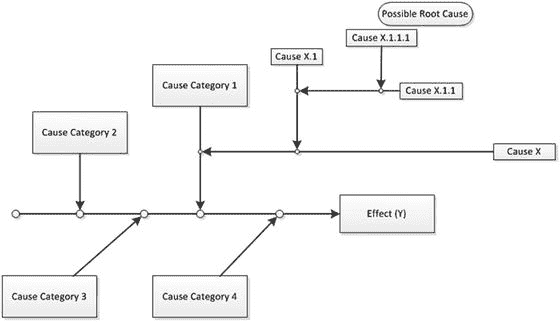

图 9-10 鱼骨图

让我们回到我之前的事件，即我买了十罐咖喱牛肉罐头的那次。这十罐是结果（`Y`），但购买的四个根本原因是：

- 我饿了，所以我买了十罐。我不喜欢上周买的那种十罐装咖喱的品牌。
- 我的邻居需要五罐，因为她无法走路了，她要求我买这个牌子，因为它最便宜，每罐 1.10 英镑。
- 我喂了两罐给狗，因为我觉得狗粮没有营养，但我不准备为狗买更贵的罐装咖喱牛肉品牌。
- 我把三罐放进了当地学校外的慈善箱里，因为慈善机构想要那个牌子的咖喱来做汤食，并且还需要其“资助学校新笔记本电脑”代金券（每罐 2.50 英镑）。

我有一位客户的数据科学家（现在已离职）将我买的十罐以及当周售出的其他 9,000 罐归类为他们的新咖喱品牌的重大成功。由于这次成功，客户的采购员签订了一份预付六个月的采购订单。大约有 10 万罐出现在零售商处，并在八天内售罄。可悲的是，产品卖得这么好的原因是每罐 2.50 英镑的代金券掩盖了一个 25 美分的现金返还优惠，这个优惠被当地批发商错误地用一张 2.50 英镑的“资助学校新笔记本电脑”贴纸覆盖了，而这张贴纸本是为他同时供应的、更昂贵的 25.00 英镑书包准备的。批发商的采购员非法将黑市过期产品运入国内。2.50 英镑的贴纸还盖住了过期日期。由批发商的数据科学家建议的数据系统使用了一个隐式事件，系统将未知的过期日期标记为扫描进入批发商仓库的日期。

> **警告**  
> 如果某事听起来好得不像是真的，那它很可能是错的！

这场微不足道的销售灾难导致两名数据科学家和一名采购员失业；一家批发商宣布破产；六人在汤食厨房食物中毒；我的狗不得不被送去兽医那里。公式很简单：狗 + 咖喱 = 生病的狗狗！我仍然认为责任在商店；我妻子不同意。

“资助学校新笔记本电脑”的活动取得了巨大成功，近 90% 的代金券已被兑换，可惜的是，这并没有带来 25.00 英镑书包销量的增长。

我的邻居收到了五罐我们更好品牌的咖喱，因为狗生病了。我得到了更多工作。一切都好。

我仍然不确定为什么只有 2,000 罐未开封的罐头被顾客退回给零售商，而且每 200 罐中只有 1 罐还贴着代金券。

> **提示**  
> 永远要问为什么，并且在证明答案正确之前，绝不要假设它是正确的。

那么，让我们来看另一个“5 个为什么”的例子。

### 5 个为什么示例

那么，让我们看看在咖喱罐头出问题后，我与零售商一起进行的数据科学分析。

**问题陈述：** 客户不满意，因为他们收到的产品不符合其规格要求。

1. 为什么客户收到的产品不合格？
    - 因为制造部门按照与客户和销售人员商定的规格不同的规格生产了产品。
2. 为什么制造部门按照与销售部门不同的规格生产产品？
    - 因为销售人员直接打电话给制造主管开始工作，以加快车间工作进度。在沟通或记录规格时发生了错误。
3. 为什么销售人员直接打电话给制造主管开始工作，而不遵循公司既定的流程？
    - 因为“开始工作”表格需要销售总监的批准才能开始工作，这拖慢了制造流程（或者当总监不在办公室时导致流程停止）。
4. 为什么表格中需要销售总监的批准？
    - 因为销售总监需要不断了解销售情况，以便与首席执行官讨论，因为我的零售商客户是十大重要客户之一。

在这个案例中，只需要四个“为什么”就确定了：一个无增值的签字授权环节，助长了重要客户质量保证流程的崩溃！剩下的就是犯罪行为。

批发商的外部采购员知道这个流程经常被绕过，于是开始购买这些不合格的罐头，作为非官方的补充手段，来弥补制造部门质量保证流程的失败，以满足销售需求的缺口。批发商只是重新贴了标签，并没有改变产品的制造方式。原因何在？巨额节省带来巨额奖金。一个重要客户的订单必须完成……销售很重要！

> **提示**  
> 只需快速的五个“为什么”——就能验证！

我接下来使用的技术在我的 90% 的数据科学工作中都很有用。它通常提供多方面的解决方案，但需要更深层次的分析。

### 蒙特卡洛模拟

我想向你介绍一个强大的数据科学工具，叫做蒙特卡洛模拟。这项技术通过为具有固有不确定性的参数替换一系列值（即概率分布）来构建可能结果的模型，从而进行分析。然后，它反复计算结果，每次使用来自概率函数的一组不同的随机值。根据不确定性的数量及其指定的范围，蒙特卡洛模拟在完成之前可能涉及数千或数万次重新计算。蒙特卡洛模拟会产生可能结果值的分布。作为数据科学家，这可以让你了解模型在现实情况下的反应。它也为数据科学家提供了一个检查复杂系统的工具，尤其当输入参数数量庞大或复杂时。我将在下一节向你展示这个工具的实际用途。

### 因果循环图

因果循环图（CLD）是一种因果图，用于直观展示系统中多个变量如何相互关联并驱动因果过程。该图由一组节点和边构成。节点代表变量，边则代表连接两个变量或表示它们之间关系的链接。我通常使用第 8 章中介绍的图论来对系统中的路径进行建模。我只需创建一个有向图，然后一步一步地遍历它。

示例：我们的目标是尽可能保持“可用员工数量与生产力”处于高位。

在调查这个棘手的流程时，我绘制了如下基本示意图（图 9-11）。

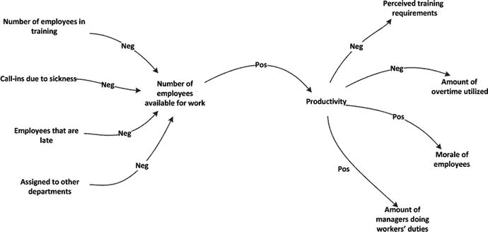

图 9-11 因果循环图

我们的第一个结论是“我们需要更多员工。”然后，我使用一种混合数据科学技术——该技术由蒙特卡洛模拟和深度强化学习两种其他技术综合而成——在图形数据模型上模拟了这个流程。结果发现了流程中另外几个影响我所研究结果的因素。最终结果如图（图 9-12）所示。

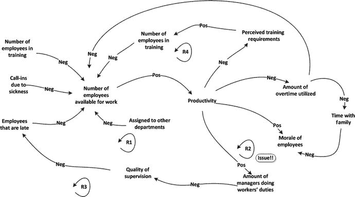

图 9-12 蒙特卡洛模拟结果

蒙特卡洛模拟通过在三小时内改变点 `R1` 到 `R4` 的值来循环遍历因果模型，以此作为训练集。随后，该模拟又运行了三天，使用了一个能够适应系统中关键驱动因素的强化深度学习模型。

结果是“管理者需要去管理，而不是去做具体工作”。`R2`——管理者处理员工职责的比例——是系统中影响最大的原因和驱动力。

> **提示**  
> 如果你不确定真正的数据科学结果，就不要提前交付成果。要有效且高效地工作，而非追求速度！

我通常会并行处理多个项目的分析工作。通过这种方式，我可以在处理并行数据科学任务的同时，依然支持卓越、有效且高效的数据科学工作。

### 帕累托图

帕累托图是我用来为数据科学制定快速处理计划的一种技术。帕累托图可以通过将数据范围划分为若干组（也称为区间、分箱或类别）来构建。（见图 9-13）。

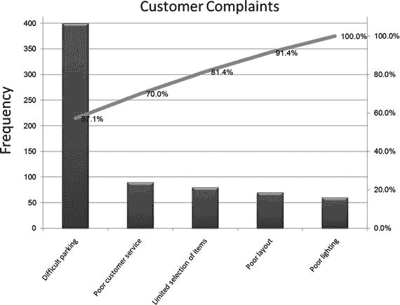

图 9-13 帕累托图

帕累托图回答的问题：

* 我们的团队或客户的业务面临的最大问题是什么？
* 哪些 20% 的原因导致了 80% 的问题（80/20 法则）？
* 我们应该将精力集中在哪里才能取得最大的改进？

我对数据科学流程进行快速评估，并确定在最短的时间内，高效且有效地完成 80% 数据科学工作所需的条件。这是一种追求最大收益的技术。

> **提示**  
> 如果你能为客户节省 80% 已被证实的损失，那么要找到资源来完成剩余 20% 的节省工作就会毫无压力。

### 相关性分析

在此步骤中，我执行的最常见的分析是对数据仓库中的所有数据进行相关性分析。在数据项之间进行特征开发，以发现数据值之间的关系。

```python
```

# 预测

## Pandas Correlation 示例

```python
import pandas as pd

a = [ [1, 2, 3], [5, 6, 9], [7, 3, 13], [5, 3, 19], [5, 3, 12], [5, 6, 11], [5, 6, 13], [5, 3, 4]]
df = pd.DataFrame(data=a)
cr = df.corr()
print(cr)
```

## 预测概念

预测是通过查看历史数据来预测未来可能情况的能力。数据仓库使得这类调查成为可能，因为它会在处理源数据系统时收集完整的历史记录。在你作为数据科学家的职业生涯中，你将执行许多预测项目，并为以下这类问题提供答案：
*   我们应该买什么？
*   我们应该卖什么？
*   我们的下一笔业务将来自哪里？

人们想知道你的计算结果，以判断将要发生什么。现在，我将介绍一个关于预测的例子。

`VKHCG` 资助了多家其他公司以产生额外资本。请在 `\VKHCG\04-Clark\00-RawDat` 目录中查找名为 `VKHCG_Shares.csv` 的文件。以下是我们投资组合：

| 股票 | sTable | 单位 |
| --- | --- | --- |
| WIKI/GOOGL | WIKI_Google | 1000000 |
| WIKI/MSFT | WIKI_Microsoft | 1000000 |
| WIKI/UPS | WIKI_UPS | 1000000 |
| WIKI/AMZN | WIKI_Amazon | 1000000 |
| LOCALBTC/USD | LOCALBTC_USD | 1000000 |
| PERTH/AUD_USD_M | PERTH_AUD_USD_M | 1000 |
| PERTH/AUD_USD_D | PERTH_AUD_USD_D | 1000 |
| PERTH/AUD_SLVR_M | PERTH_SLVR_USD_M | 1000 |
| PERTH/AUD_SLVR_D | PERTH_SLVR_USD_D | 1000 |
| BTER/AURBTC | BTER_AURBTC | 1000000 |
| FED/RXI_US_N_A_UK | FED_RXI_US_N_A_UK | 1000 |
| FED/RXI_N_A_CA | FED_RXI_N_A_CA | 1000 |

我将指导你使用一种技术来确定我们是否可以预测股票在近期的走势。在你的 Python 编辑器中打开一个新文件，并将其保存为 `\VKHCG\04-Clark\03-Process` 目录下的 `Process-Shares-Data.py`。我将引导你完成这个过程。你需要一个名为 `quandl` 的库（`conda install -c anaconda quandl`），它使你能够使用示例中的在线股票数据。像之前一样，通过设置库和环境的基本目录来启动生态系统。

```python
################################################################
import sys
import os
import sqlite3 as sq
import quandl
import pandas as pd
################################################################
if sys.platform == 'linux':
    Base=os.path.expanduser('~') + '/VKHCG'
else:
    Base='C:/VKHCG'

print('################################')
print('Working Base :',Base, ' using ', sys.platform)
print('################################')
################################################################
Company='04-Clark'
sInputFileName='00-RawData/VKHCG_Shares.csv'
sOutputFileName='Shares.csv'
################################################################
sDataBaseDir=Base + '/' + Company + '/03-Process/SQLite'
if not os.path.exists(sDataBaseDir):
    os.makedirs(sDataBaseDir)
################################################################
sFileDir1=Base + '/' + Company + '/01-Retrieve/01-EDS/02-Python'
if not os.path.exists(sFileDir1):
    os.makedirs(sFileDir1)
################################################################
sFileDir2=Base + '/' + Company + '/02-Assess/01-EDS/02-Python'
if not os.path.exists(sFileDir2):
    os.makedirs(sFileDir2)
################################################################
sFileDir3=Base + '/' + Company + '/03-Process/01-EDS/02-Python'
if not os.path.exists(sFileDir3):
    os.makedirs(sFileDir3)
################################################################
sDatabaseName=sDataBaseDir + '/clark.db'
conn = sq.connect(sDatabaseName)
################################################################
```

现在，你将导入我们持有的股票列表以创建预测。

### 导入股票名称数据

```python
################################################################
### 导入股票名称数据
################################################################
sFileName=Base + '/' + Company + '/' + sInputFileName
print('################################')
print('正在加载:',sFileName)
print('################################')
RawData=pd.read_csv(sFileName,header=0,low_memory=False, encoding="latin-1")
RawData.drop_duplicates(subset=None, keep="first", inplace=True)
print('行数   :',RawData.shape[0])
print('列数:',RawData.shape[1])
print('################')
################################################################
sFileName=sFileDir1 + '/Retrieve_' + sOutputFileName
print('################################')
print('正在存储:', sFileName)
print('################################')
RawData.to_csv(sFileName, index = False)
print('################################')
################################################################
sFileName=sFileDir2 + '/Assess_' + sOutputFileName
print('################################')
print('正在存储:', sFileName)
```

print('################################')

`RawData.to_csv(sFileName, index = False)`

print('################################')

################################################################

`sFileName=sFileDir3 + '/Process_' + sOutputFileName`

print('################################')

print('正在存储:', `sFileName`)

print('################################')

`RawData.to_csv(sFileName, index = False)`

print('################################')

现在，你将逐一遍历每只股票，并对每只股票进行预测。

```python
################################################################

### 导入股票详情数据

################################################################

for `sShare` in range(`RawData.shape[0]`):

    `sShareName` = str(`RawData['Shares'][sShare]`)

    `ShareData` = `quandl.get(sShareName)`

    `UnitsOwn` = `RawData['Shares'][sShare]`

    `ShareData['UnitsOwn']` = `ShareData.apply(lambda row:(UnitsOwn),axis=1)`

    print('################')

    print('股票  :', `sShareName`)

    print('行数   :', `ShareData.shape[0]`)

    print('列数:', `ShareData.shape[1]`)

    print('################')

#################################################################

    print('################')

    `sTable` = str(`RawData['sTable'][sShare]`)

    print('正在存储:', `sDatabaseName`, ' 表:', `sTable`)

    `ShareData.to_sql(sTable, conn, if_exists="replace")`

    print('################')

################################################################

    `sOutputFileName` = `sTable + '.csv'`

    `sFileName` = `sFileDir1 + '/Retrieve_' + sOutputFileName`

    print('################################')

    print('正在存储:', `sFileName`)

    print('################################')

    `RawData.to_csv(sFileName, index = False)`

    print('################################')

################################################################

    `sOutputFileName` = `sTable + '.csv'`

    `sFileName` = `sFileDir2 + '/Assess_' + sOutputFileName`

    print('################################')

    print('正在存储:', `sFileName`)

    print('################################')

    `RawData.to_csv(sFileName, index = False)`

    print('################################')

################################################################

    `sOutputFileName` = `sTable + '.csv'`

    `sFileName` = `sFileDir3 + '/Process_' + sOutputFileName`

    print('################################')

    print('正在存储:', `sFileName`)

    print('################################')

    `RawData.to_csv(sFileName, index = False)`

    print('################################')

################################################################

################################################################

print('### 完成!! ############################################')

################################################################
```

你怎么看？我们表现良好，还是正走向破产？你会建议我们买入更多股票吗？

股票将作为对象存储在数据仓库中，而具体的股票（即股票代码）将存储在对象中心（`object hub`）中。将真实的每日股价存储在对象-股价卫星（`object-share-price satellite`）中，以追踪每日变化。将你每天的预测或预报存储在对象-股价预测中心（`object-share-price-projected hub`）中。这样，你既能将预测与真实定价进行比较，也能洞察股价随时间变化的趋势。

为了追踪股价随时间的变化，你还需要一个指向时间中心的链接，以便能够对照数据仓库中的任何其他活动来研究股价。所以，正如我之前所说，你可以对你从数据湖中获取的任何数据，或通过洞察处理到数据仓库中的数据，进行建模。

## 数据科学

你必须明白，当你遵循公认的算法和技术时，数据科学才能发挥最佳效果。你可以进行实验和数据整理，但最终必须验证并支持你的结果。应用良好的数据科学可以确保你能用可接受的证明和统计检验来支持你的工作。我认为，行之有效的数据科学遵循以下基本步骤：

1.  **从一个问题开始。** 确保你已经充分探究了“五个为什么”。
2.  **遵循一个好的模式来构建模型。** 构建一个模型，为数据猜测一个原型，并开始对真实世界参数进行虚拟模拟。如果你具备运筹学或计量经济学技能，这正是你发挥所长之处。将一些数学和统计学知识融入解决方案中，你就有了数据科学模型的雏形。请记住：所有问题都必须与客户的业务相关，并且必须能对问题提供洞察，从而得出可执行的成果，通常还需对你计划部署的数据科学流程的应用产生可量化的投资回报。
3.  **收集观察数据并用于生成假设。** 按照你的模型开始调查，收集所需的观察数据。根据观察数据运行你的模型，并证明你的假设为真或假。
4.  **使用真实世界证据来评判假设。** 将发现与真实世界联系起来，并通过讲故事的方式，将结果转化为现实中的商业建议和洞察。**注意：** 你可能会得到极好的结果，但如果你无法解释它们为何重要，你就没有实现目标。
5.  **在整个过程中尽早并经常与客户和领域专家合作。** 你还必须尽早并经常与你的相关专家沟通，确保他们与你一同踏上探索之旅。商业人士希望成为解决他们问题的方案的一部分。你的责任是提供良好的科学结果来支持业务。

## 总结

你已经成功完成了本章的“处理”步骤。现在，你应该拥有一个坚实的数据仓库，其中包含已处理数据，可供“转换”步骤提取，从而将你的新知识转化为智慧与洞察。

至此，“检索”、“评估”和“处理”这三个步骤，已使你能够将数据湖中的未知数据转化为一系列分类后的中心（即 `T-P-O-L-E` 结构）。你的数据仓库中应包含以下内容：

-   带有卫星表和链接表的时间中心
-   带有卫星表和链接表的人员中心
-   带有卫星表和链接表的对象中心
-   带有卫星表和链接表的地点中心
-   带有卫星表和链接表的事件中心

后续的数据科学工作都将针对这一标准化结构进行。这将帮助你针对 `T-P-O-L-E` 结构，开发出扎实且富有洞察力的数据科学技术和方法。

**注意**
如果你已经将数据湖中的特征处理到了数据仓库中，那么你现在应该已经完成了大部分的数据工程或数据转换任务。

通过构建数据仓库，你已实现了一个重要的里程碑。

**注意**
数据仓库创建了一个自然的历史记录，因为它将所有先前的处理运行结果作为快照存储在数据仓库中。你可以重新运行整个“转换”超级步骤，从而恢复处理过程中每一步的完整历史记录。

下一步，你将开始执行更纯粹的数据科学任务，以探究你发现了哪些数据，以及如何将数据仓库中的数据组织成可供业务查询的解决方案。

