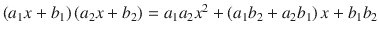

# 创建样本数据集

`nSet=1`

if `nSet==1`:

    `a` = `abs(np.random.randn(50))`

    `b` = `abs(50*np.random.randn(50))`

if `nSet==2`:

    `a=np.array([27.1,22.0,20.8,23.4,23.4,23.5,25.8,22.0,24.8,20.2,21.9,22.1,22.9,20.5,24.4])`

    `b=np.array([27.1,22.0,20.8,23.4,23.4,23.5,25.8,22.0,24.8,20.2,21.9,22.1,22.9,20.5,24.41])`

if `nSet==3`:

    `a=np.array([17.2,20.9,22.6,18.1,21.7,21.4,23.5,24.2,14.7,21.8])`

    `b=np.array([21.5,22.8,21.0,23.0,21.6,23.6,22.5,20.7,23.4,21.8])`

if `nSet==4`:

    `a=np.array([19.8,20.4,19.6,17.8,18.5,18.9,18.3,18.9,19.5,22.0])`

    `b=np.array([28.2,26.6,20.1,23.3,25.2,22.1,17.7,27.6,20.6,13.7])`

if `nSet==5`:

    `a` = `np.array([55.0, 55.0, 47.0, 47.0, 55.0, 55.0, 55.0, 63.0])`

    `b` = `np.array([55.0, 56.0, 47.0, 47.0, 55.0, 55.0, 55.0, 63.0])`

`obs` = `np.array([a,b])`

执行检验。

```python
chi2, p, dof, expected = st.chi2_contingency(obs)
```

显示结果。

```python
msg = "Test Statistic : {}\np-value: {}\ndof: {}\n"

print( msg.format( chi2, p, dof, expected) )

P=1-p

if P < 0.001:

    print('Statistically highly significant:',P)

else:

    if P < 0.05:

        print('Statistically significant:',P)

    else:

        print('No conclusion')
```

当你在样本 1 至 5 之间循环设置`nSet`时，你能理解该检验所指示的意义吗？

## 过拟合与欠拟合

过拟合和欠拟合是数据科学家从所研究的数据集中提取数据洞察时面临的主要问题。过拟合是指数据科学家构建的模型能够完美拟合训练集，但无法很好地泛化到未知的、未来的真实数据集上。这是因为模型与已知数据集拟合得过于紧密，即使是最微小的异常值也无法被正确分类。该解决方案仅适用于特定数据集，而无法适用于其他数据集。例如，如果一个人的收入超过 15 万美元，那么他就是富人；否则就是穷人。这种“富”或“穷”的二元分类是行不通的，因为一个收入约为 14.5 万美元的人难道就是穷人吗？

欠拟合则是指数据科学家将结果转化为数据洞察时过于笼统，导致预测模型在一定程度上应用不当，或其洞察力值得怀疑。例如，你的性别分类器判断一个人性别的成功率为 48%。这永远行不通，因为对于二元猜测问题，仅凭随机猜测就能达到 50%的准确率。

你的数据科学工作必须提供显著的洞察力水平，才能赢得客户的信任，从而使他们能够基于你提供的洞察，自信地做出商业决策。

### 多项式特征

多项式公式如下所示：。多项式特征提取可以利用一系列多项式公式创建一个超平面，将任意数据集细分为正确的聚类组。多项式复杂度越高，所能达到的结果就越精确。

示例：

```python
import numpy as np

import matplotlib.pyplot as plt

from sklearn.linear_model import Ridge

from sklearn.preprocessing import PolynomialFeatures

from sklearn.pipeline import make_pipeline

def f(x):

    """ function to approximate by polynomial interpolation"""

    return x * np.sin(x)
```