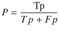
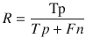
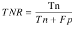
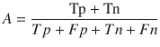
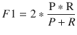

# Evaluate the models using crossvalidation

```python
scores = cross_val_score(pipeline, X[:, np.newaxis], y,
                         scoring="neg_mean_squared_error", cv=10)
X_test = np.linspace(0, 1, 100)
plt.plot(X_test, pipeline.predict(X_test[:, np.newaxis]), label="Model")
plt.plot(X_test, true_fun(X_test), label="True function")
plt.scatter(X, y, edgecolor="b", s=20, label="Samples")
plt.xlabel("x")
plt.ylabel("y")
plt.xlim((0, 1))
plt.ylim((-2, 2))
plt.legend(loc="best")
plt.title("Degree {}\nMSE = {:.2e}(+/- {:.2e})".format(
    degrees[i], -scores.mean(), scores.std()))
plt.show()
```

## 精确率-召回率

精确率-召回率是衡量在类别极度不平衡时能否成功预测的有效指标。在信息检索中，
- **精确率**是衡量结果相关性的指标。
- **召回率**是衡量返回的真正相关结果数量的指标。

### 精确率-召回率曲线

精确率-召回率曲线展示了不同阈值下精确率与召回率之间的权衡关系。曲线下面积越大，表示召回率和精确率都越高——高精确率对应低假正例率，高召回率对应低假负例率。两者得分均高表明分类器不仅返回了准确的结果（高精确率），还返回了大部分正类结果（高召回率）。

高召回率但低精确率的系统会返回大量结果，但与训练标签相比，其预测的标签大多不正确。高精确率但低召回率的系统则恰恰相反，只返回很少的结果，但与训练标签相比，其预测的标签大多正确。理想系统兼具高精确率和高召回率，能返回大量结果且所有结果标签均正确。

精确率（`P`）定义为真正例（`Tp`）数量除以真正例（`Tp`）数量与假正例（`Fp`）数量之和。



召回率（`R`）定义为真正例（`Tp`）数量除以真正例（`Tp`）数量与假负例（`Fn`）数量之和。



真负例率（`TNR`）表示负类样本的召回率指标。



准确率（`A`）定义为：



### 灵敏度与特异度

灵敏度与特异度是衡量二分类测试（在统计学中也被称为分类函数）性能的统计指标。灵敏度（也称为真正例率、召回率或检测概率）衡量正确识别为正类的比例（例如，被正确识别为患病的病人百分比）。特异度（也称为真负例率）衡量正确识别为负类的比例（例如，被正确识别为未患病的健康人百分比）。

### F1-Measure

`F1-score` 是一种结合了精确率和召回率的度量，它是精确率和召回率的调和平均数。



注意：精确率可能不会随召回率下降。

我发现以下 `sklearn` 函数在计算这些度量时非常有用：
- `sklearn.metrics.average_precision_score`
- `sklearn.metrics.recall_score`
- `sklearn.metrics.precision_score`
- `sklearn.metrics.f1_score`

我建议你用数据集进行练习，理解这些参数以及它们正面或负面的影响因素。它们是你数据科学成功与否的指标。

示例：
```