# 10. 转换超级步骤

“转换”超级步骤允许你作为数据科学家，从数据仓库中提取数据，并根据你的研究结果形成问题的答案。转换步骤是一个数据科学流程，它将结果转化为洞察。

它采用标准的数据科学技术和方法来获取对数据的洞察和知识，然后这些知识可以转化为可操作的决策。通过故事化的讲述，你可以向非数据科学人员解释你在数据湖中发现了什么。

本书中我所引用的任何源代码或其他补充材料，读者都可以通过本书的产品页面（[`www.apress.com/9781484230534`](http://www.apress.com/9781484230534)）在 GitHub 上获取。请注意，此源代码假定你已经完成了第 2 章中概述的源代码设置。

## 转换超级步骤

“转换”超级步骤使用“处理”步骤得到的数据仓库作为其源数据。这些转换经过调整，以适配数据仓库的五个维度。作为对该结构样子的提醒，请参见图 10-1。

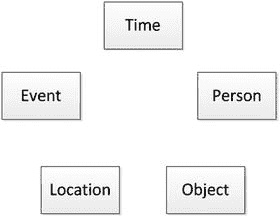
*图 10-1 — 五类数据*

### 维度整合

数据仓库由五类数据组成，这些数据在卫星中心中具有关联关系和附加特征。

要执行维度整合，你从数据仓库中的给定关系出发，为该关系构建一个“太阳模型”，如图 10-2 所示。

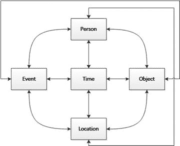
*图 10-2 — T-P-O-L-E 高级别设计*

我将以一个人出生的例子来说明整合过程。

**注意**
你需要一个 `Python` 编辑器来完成本章，请先打开它，然后我们就可以进行所需的数据科学工作了。

在 `Python` 编辑器中打开一个新文件，并将其保存在目录 `..\VKHCG\01-Vermeulen\04-Transform` 中，命名为 `Transform-Gunnarsson_is_Born.py`。你将需要 `Python` 生态系统，因此请通过向编辑器添加以下内容来进行设置（你必须通过添加库来设置生态系统）：

```python
import sys
import os
from datetime import datetime
from datetime import timedelta
from pytz import timezone, all_timezones
import pandas as pd
import sqlite3 as sq
from pandas.io import sql
import uuid
pd.options.mode.chained_assignment = None
```

找到示例的工作目录。

```python
################################################################
if sys.platform == 'linux':
    Base = os.path.expanduser('~') + '/VKHCG'
else:
    Base = 'C:/VKHCG'
print('################################')
print('Working Base :', Base, ' using ', sys.platform)
print('################################')
```

设置你正在处理的公司。

```python
Company = '01-Vermeulen'
```

添加公司工作空间：

```python
sDataBaseDir = Base + '/' + Company + '/04-Transform/SQLite'
if not os.path.exists(sDataBaseDir):
    os.makedirs(sDataBaseDir)
sDatabaseName = sDataBaseDir + '/Vermeulen.db'
conn1 = sq.connect(sDatabaseName)
```

添加数据仓库。

```python
sDataVaultDir = Base + '/88-DV'
if not os.path.exists(sDataVaultDir):
    os.makedirs(sDataVaultDir)
sDatabaseName = sDataVaultDir + '/datavault.db'
conn2 = sq.connect(sDatabaseName)
```

添加数据仓库。

```python
sDataWarehousetDir = Base + '/99-DW'
if not os.path.exists(sDataWarehousetDir):
    os.makedirs(sDataWarehousetDir)
sDatabaseName = sDataVaultDir + '/datawarehouse.db'
conn3 = sq.connect(sDatabaseName)
```

# 执行 Python 代码设置基本生态系统

**注意**  
新的数据结构（称为数据仓库）位于目录 `../99-DW` 中。

数据仓库是“转换”步骤产生的唯一数据结构。让我们来看一个真实场景。

Guðmundur Gunnarsson 于 1960 年 12 月 20 日 9 点 15 分出生在冰岛雷克雅未克 101 区 Hringbraut 101 号的 Landspítali 医院。以下是我期望在数据仓库中找到的内容。

## 时间

你需要一个日期时间：`1960-12-20 09:15`，地点是冰岛雷克雅未克。在编辑器中输入以下代码（你从 UTC 时间开始）：

```python
print('Time Category')

print('UTC Time')

BirthDateUTC = datetime(1960,12,20,10,15,0)

BirthDateZoneUTC=BirthDateUTC.replace(tzinfo=timezone('UTC'))

BirthDateZoneUTCStr=BirthDateZoneUTC.strftime("%Y-%m-%d %H:%M:%S (%Z) (%z)")

BirthDateLocal=BirthDate.strftime("%Y-%m-%d %H:%M:%S")

print(BirthDateZoneUTCStr)
```

转换为雷克雅未克当地时间。

```python
print('Birth Date in Reykjavik :')

BirthZone = 'Atlantic/Reykjavik'

BirthDate = BirthDateZoneUTC.astimezone(timezone(BirthZone))

BirthDateStr=BirthDate.strftime("%Y-%m-%d %H:%M:%S (%Z) (%z)")

print(BirthDateStr)
```

你已成功发现时间枢纽和时间区卫星的密钥，该卫星对应 `Atlantic/Reykjavik`。

- 时间枢纽：你拥有一个 UTC 日期时间，即 1960 年 12 月 20 日 9:15，地点为冰岛雷克雅未克，具体如下：`1960-12-20 10:15:00 (UTC) (+0000)`
- 时间卫星：雷克雅未克的出生日期：`1960-12-20 09:15:00 (-01) (-0100)`

现在，通过将以下内容添加到你的代码中来保存工作。

构建一个数据帧，如下所示：

```python
IDZoneNumber=str(uuid.uuid4())

sDateTimeKey=BirthDateZoneStr.replace(' ','-').replace(':','-')

TimeLine=[('ZoneBaseKey', ['UTC']),

('IDNumber', [IDZoneNumber]),

('DateTimeKey', [sDateTimeKey]),

('UTCDateTimeValue', [BirthDateZoneUTC]),

('Zone', [BirthZone]),

('DateTimeValue', [BirthDateStr])]

TimeFrame = pd.DataFrame.from_items(TimeLine)
```

创建时间枢纽。

```python
TimeHub=TimeFrame[['IDNumber','ZoneBaseKey','DateTimeKey','DateTimeValue']]

TimeHubIndex=TimeHub.set_index(['IDNumber'],inplace=False)

sTable = 'Hub-Time-Gunnarsson'

print('\n#################################')

print('Storing :',sDatabaseName,'\n Table:',sTable)

print('\n#################################')

TimeHubIndex.to_sql(sTable, conn2, if_exists="replace")

sTable = 'Dim-Time-Gunnarsson'

TimeHubIndex.to_sql(sTable, conn3, if_exists="replace")
```

创建时间卫星。

```python
TimeSatellite=TimeFrame[['IDNumber','DateTimeKey','Zone','DateTimeValue']]

TimeSatelliteIndex=TimeSatellite.set_index(['IDNumber'],inplace=False)

BirthZoneFix=BirthZone.replace(' ','-').replace('/','-')

sTable = 'Satellite-Time-' + BirthZoneFix + '-Gunnarsson'

print('\n#################################')

print('Storing :',sDatabaseName,'\n Table:',sTable)

print('\n#################################')

TimeSatelliteIndex.to_sql(sTable, conn2, if_exists="replace")

sTable = 'Dim-Time-' + BirthZoneFix + '-Gunnarsson'

TimeSatelliteIndex.to_sql(sTable, conn3, if_exists="replace")
```

干得好。你现在有了一个时间类别。下一个类别是人物。

## 人物

你必须记录下**古德蒙杜尔·贡纳松**于**1960 年 12 月 20 日 9:15**在**冰岛**出生。

将以下内容添加到现有代码中：

```python
print('Person Category')

FirstName = 'Guðmundur'

LastName = 'Gunnarsson'

print('Name:',FirstName,LastName)

print('Birth Date:',BirthDateLocal)

print('Birth Zone:',BirthZone)

print('UTC Birth Date:',BirthDateZoneStr)
```

你刚刚在人物枢纽中创建了该人物。

```python
IDPersonNumber=str(uuid.uuid4())

PersonLine=[('IDNumber', [IDPersonNumber]),

('FirstName', [FirstName]),

('LastName', [LastName]),

('Zone', ['UTC']),

('DateTimeValue', [BirthDateZoneStr])]

PersonFrame = pd.DataFrame.from_items(PersonLine)

################################################################

TimeHub=PersonFrame

TimeHubIndex=TimeHub.set_index(['IDNumber'],inplace=False)

################################################################

sTable = 'Hub-Person-Gunnarsson'

print('\n#################################')

print('Storing :',sDatabaseName,'\n Table:',sTable)

print('\n#################################')

TimeHubIndex.to_sql(sTable, conn2, if_exists="replace")

sTable = 'Dim-Person-Gunnarsson'

TimeHubIndex.to_sql(sTable, conn3, if_exists="replace")
```

# 创建数据模型

## 引导性建模任务

干得好。你现在有了一个人物枢纽。

你能为冰岛国立大学医院创建一个位置枢纽和卫星吗？

- 纬度：北纬 64° 08' 10.80" 或 `64.136332788`，经度：西经 21° 55' 22.79" 或 `-21.922996308`

你还能从地址数据中处理哪些信息？

- `Landspítali`：本地名称
- `Hringbraut 101`：街道地址
- `101`：邮政编码
- `Reykjavík`：城市名称
- `Iceland`：国家

如果雷克雅未克的具体经纬度尚不存在，你可以向位置枢纽添加一条记录。然后，你可以向一个名为 `Hospitals` 的卫星添加来自位置枢纽的键以及所有额外信息。或者，你也可以简单地将其添加为一个名为 `BuildingAt` 的卫星，包含相同的额外信息和一个 `type_of_building` 指示符。

无论采用哪种方式，我都建议你与客户讨论。

> **注意**：你可以从简单的位置或建筑连接中挖掘出许多特征。

你现在可以为一个名为 "Birth" 的事件创建事件枢纽吗？是的，你可以——这很容易——但是你已经有了一个名为 "Born" 的事件。请使用这个。

> **注意**：我发现不同的人对类似事件有不同的名称，例如 "born" 和 "birth"，"death" 和 "deceased"。
>
> 我有一个事件库，用于对同一事件进行建模。我将这些事件保存在一个额外的表中，当我们为一个列表中的某个词创建事件时，也会为其他列表中的对应词创建事件。
>
> 例如，如果我们为 "born" 和 "birth" 创建事件，这将有助于转换步骤中的查询。如果你问“谁出生了？”或“这是谁的出生？”，你会从数据仓库中检索到结果。

那么，关于**对象**呢？是的，你可以使用属/种数据。古德蒙杜尔是智人（人类）。尝试找到正确的记录进行链接。

> **提示**：你现在应该明白，即使是像“古德蒙杜尔·贡纳松的出生”这样一个简单的业务动作，也能产生大量额外的数据点。
>
> 我建议你尝试看看自己生活中的重大事件：你的出生、第一天上学。如果你查看事件枢纽中适用于你的动作，会怎样？
>
> 如果你理解了通过增强数据仓库可以实现转换步骤中维度整合的重大提升，那么你就在数据科学家能力方面达到了一个重要的里程碑。

# 太阳模型

使用太阳模型是一种技术，它使数据科学家能够通过向业务人员解释预期的数据关系，实现一致的维度整合，而无需暴露完成转换处理所需的技术细节。那么，让我们回顾一下我们的业务陈述：古德蒙杜尔·贡纳松于 1960 年 12 月 20 日 9:15 出生在冰岛雷克雅未克 Hringbraut 101 号的 Landspítali 医院。

## 人物到时间太阳模型

下图 10-3 中的太阳模型解释了数据仓库中时间类别和人物类别之间的关系。

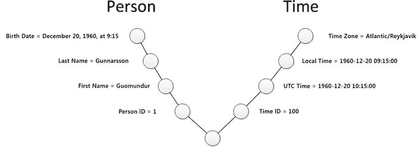
**图 10-3** 人物到时间太阳模型

构建的太阳模型显示了计划提取的两个数据仓库枢纽类别的所有特征。它解释了如何通过图 10-3 中的转换步骤创建两个维度和一个事实。你将创建一个事实（`PersonBornAtTime`）和两个维度（`Person` 和 `Time`），如图 10-4 所示。

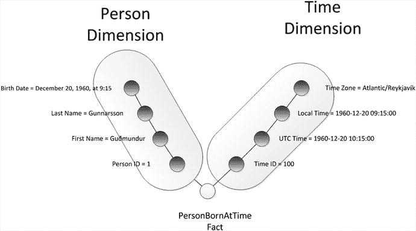
**图 10-4** 人物到时间太阳模型（已解释）

太阳模型解释了古德蒙杜尔·贡纳松于 1960 年 12 月 20 日 9:15 在冰岛出生。

> **提示**：我通过记录日常交互并为这些活动绘制太阳模型来练习太阳模型建模。这样，我就能轻松绘制出大多数关系。熟能生巧对于这项技术来说是真的。

## 模板模型

我还打印了几份带有空白条目的太阳模型副本（图 10-5），以便在与客户会面时快速记录关系。

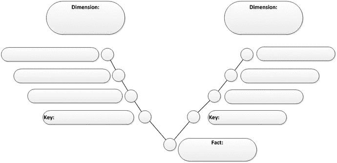
**图 10-5** 简易太阳模型模板

**提示**：我通常会在 `Microsoft Visio` 或 `LibreOffice Draw` 中保留一份空白副本，以便快速上手。我已经指导了几位客户创建太阳模型，他们现在会通过添加这些额外信息来编写需求。这给了他们一种主人翁感。

## 人到对象太阳模型

你能在这些已完成的太阳模型上找出维度和事实吗？（见图 10-6。）

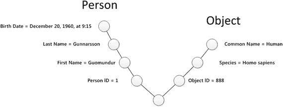
**图 10-6** 针对 `PersonIsSpecies` 事实的太阳模型

你进展如何？在图 10-6 中，维度是 `Person` 和 `Object`。事实是 `PersonIsSpecies`。这描述了 Guðmundur Gunnarsson 是一个 `Homo sapiens`。

## 人到地点太阳模型

如果你有维度 `Person` 和 `Location` 以及事实 `PersonAtLocation`，那么你就成功解读了这个太阳模型（图 10-7）。

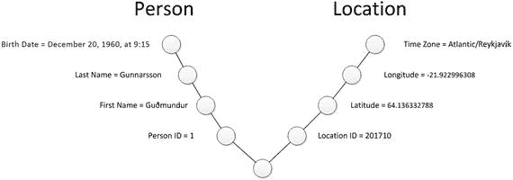
**图 10-7** 针对 `PersonAtLocation` 事实的太阳模型

这描述了 Guðmundur Gunnarsson 出生于：

*   纬度：北纬 64° 08' 10.80" 或 `64.136332788`
*   经度：西经 21° 55' 22.79" 或 `-21.922996308`

## 人到事件太阳模型

那么这个事件太阳模型呢？你能从图 10-8 中提取信息吗？

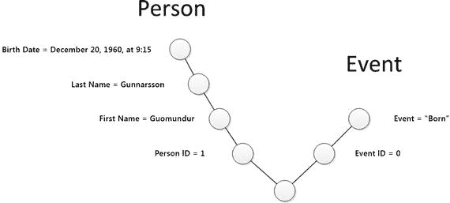
**图 10-8** 针对 `PersonBorn` 事实的太阳模型

如果你有维度 `Person` 和 `Event` 以及事实 `PersonBorn`，那么你就成功解读了这个太阳模型（图 10-8）。

## 从太阳模型到转换步骤

我将引导你创建 `Transform` 步骤，如图 10-9 中的太阳模型所示。

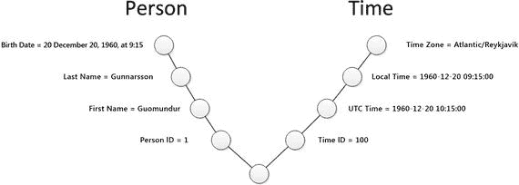
**图 10-9** 针对 `PersonBornAtTime` 事实的太阳模型

你需要构建三个项目：维度 `Person`、维度 `Time` 和事实 `PersonBornAtTime`。打开你的 Python 编辑器，在目录 `..\VKHCG\01-Vermeulen\04-Transform` 下创建一个名为 `Transform-Gunnarsson-Sun-Model.py` 的文件。以下是你的基本生态系统：

```
################################################################
```

```python
# -*- coding: utf-8 -*-

import sys
import os
from datetime import datetime
from pytz import timezone
import pandas as pd
import sqlite3 as sq
import uuid

pd.options.mode.chained_assignment = None

if sys.platform == 'linux' or sys.platform == 'Darwin':
    Base=os.path.expanduser('~') + '/VKHCG'
else:
    Base='C:/VKHCG'

print('################################')
print('Working Base :',Base, ' using ', sys.platform)
print('################################')

Company='01-Vermeulen'

sDataBaseDir=Base + '/' + Company + '/04-Transform/SQLite'
if not os.path.exists(sDataBaseDir):
    os.makedirs(sDataBaseDir)

sDatabaseName=sDataBaseDir + '/Vermeulen.db'
conn1 = sq.connect(sDatabaseName)

sDataWarehousetDir=Base + '/99-DW'
if not os.path.exists(sDataWarehousetDir):
    os.makedirs(sDataWarehousetDir)

sDatabaseName=sDataWarehousetDir + '/datawarehouse.db'
conn2 = sq.connect(sDatabaseName)
```

## Time 维度

这是你的 `Time` 维度：

```python
print('\n#################################')
print('Time Dimension')

BirthZone = 'Atlantic/Reykjavik'
BirthDateUTC = datetime(1960,12,20,10,15,0)
BirthDateZoneUTC=BirthDateUTC.replace(tzinfo=timezone('UTC'))
BirthDateZoneStr=BirthDateZoneUTC.strftime("%Y-%m-%d %H:%M:%S")
BirthDateZoneUTCStr=BirthDateZoneUTC.strftime("%Y-%m-%d %H:%M:%S (%Z) (%z)")
BirthDate = BirthDateZoneUTC.astimezone(timezone(BirthZone))
BirthDateStr=BirthDate.strftime("%Y-%m-%d %H:%M:%S (%Z) (%z)")
BirthDateLocal=BirthDate.strftime("%Y-%m-%d %H:%M:%S")

IDTimeNumber=str(uuid.uuid4())
TimeLine=[('TimeID', [IDTimeNumber]),
          ('UTCDate', [BirthDateZoneStr]),
          ('LocalTime', [BirthDateLocal]),
          ('TimeZone', [BirthZone])]
TimeFrame = pd.DataFrame.from_items(TimeLine)

DimTime=TimeFrame
DimTimeIndex=DimTime.set_index(['TimeID'],inplace=False)

sTable = 'Dim-Time'
print('\n#################################')
print('Storing :',sDatabaseName,'\n Table:',sTable)
print('\n#################################')
DimTimeIndex.to_sql(sTable, conn1, if_exists="replace")
DimTimeIndex.to_sql(sTable, conn2, if_exists="replace")
```

干得好。你已经有了一个 `Time` 维度。现在我们来构建 `Person` 维度。

## Person 维度

```python
print('\n#################################')
print('Dimension Person')
print('\n#################################')

FirstName = 'Guðmundur'
LastName = 'Gunnarsson'

IDPersonNumber=str(uuid.uuid4())
PersonLine=[('PersonID', [IDPersonNumber]),
            ('FirstName', [FirstName]),
            ('LastName', [LastName]),
            ('Zone', ['UTC']),
            ('DateTimeValue', [BirthDateZoneStr])]
PersonFrame = pd.DataFrame.from_items(PersonLine)

DimPerson=PersonFrame
DimPersonIndex=DimPerson.set_index(['PersonID'],inplace=False)

sTable = 'Dim-Person'
print('\n#################################')
print('Storing :',sDatabaseName,'\n Table:',sTable)
print('\n#################################')
DimPersonIndex.to_sql(sTable, conn1, if_exists="replace")
DimPersonIndex.to_sql(sTable, conn2, if_exists="replace")
```

## 事实

最后，我们按如下方式添加事实：

```python
print('\n#################################')
print('Fact - Person - time')
print('\n#################################')

IDFactNumber=str(uuid.uuid4())
```

PersonTimeLine=[('IDNumber', [IDFactNumber]),

('IDPersonNumber', [IDPersonNumber]),

('IDTimeNumber', [IDTimeNumber])]

PersonTimeFrame = `pd.DataFrame.from_items`(`PersonTimeLine`)

################################################################

FctPersonTime=`PersonTimeFrame`

FctPersonTimeIndex=`FctPersonTime`.set_index(['IDNumber'],inplace=False)

################################################################

sTable = 'Fact-Person-Time'

print('\n#################################')

print('Storing:',sDatabaseName,'\n Table:',sTable)

print('\n#################################')

`FctPersonTimeIndex`.to_sql(sTable, conn1, if_exists="replace")

`FctPersonTimeIndex`.to_sql(sTable, conn2, if_exists="replace")

现在你理解如何构建一个太阳模型并创建所需的维度和事实了吗？

## 构建数据仓库

由于你到目前为止表现良好，我将要求你打开目录 `..\VKHCG\01-Vermeulen\04-Transform` 中的 `Transform-Sun-Models.py` 文件。

注意

这个 Python 程序将为你构建一个良好且稳固的数据仓库，用于尝试新的数据科学技术。请耐心等待；它将为你提供巨大的推动力。

运行该程序，并在其运行期间喝点咖啡。你可以自己编写代码，或者直接从样例目录中上传代码。如果你想了解整个过程，代码如下。你能理解从数据仓库到数据仓库的转换吗？

```python

```

```python
# -*- coding: utf-8 -*-
import sys
import os
from datetime import datetime
from pytz import timezone
import pandas as pd
import sqlite3 as sq
import uuid

pd.options.mode.chained_assignment = None

if sys.platform == 'linux':
    Base = os.path.expanduser('~') + '/VKHCG'
else:
    Base = 'C:/VKHCG'

print('################################')
print('Working Base :', Base, ' using ', sys.platform)
print('################################')

Company='01-Vermeulen'
sDataBaseDir = Base + '/' + Company + '/04-Transform/SQLite'
if not os.path.exists(sDataBaseDir):
    os.makedirs(sDataBaseDir)
sDatabaseName = sDataBaseDir + '/Vermeulen.db'
conn1 = sq.connect(sDatabaseName)

sDataVaultDir = Base + '/88-DV'
if not os.path.exists(sDataVaultDir):
    os.makedirs(sDataVaultDir)
sDatabaseName = sDataVaultDir + '/datavault.db'
conn2 = sq.connect(sDatabaseName)

sDataWarehouseDir = Base + '/99-DW'
if not os.path.exists(sDataWarehouseDir):
    os.makedirs(sDataWarehouseDir)
sDatabaseName = sDataWarehouseDir + '/datawarehouse.db'
conn3 = sq.connect(sDatabaseName)

sSQL = " SELECT DateTimeValue FROM [Hub-Time];"
DateDataRaw = pd.read_sql_query(sSQL, conn2)
DateData = DateDataRaw.head(1000)
print(DateData)

print('\n#################################')
print('时间维度')
print('\n#################################')

t = 0
mt = DateData.shape[0]
for i in range(mt):
    BirthZone = ('Atlantic/Reykjavik', 'Europe/London', 'UCT')
    for j in range(len(BirthZone)):
        t += 1
        print(t, mt*3)
        BirthDateUTC = datetime.strptime(DateData['DateTimeValue'][i], "%Y-%m-%d %H:%M:%S")
        BirthDateZoneUTC = BirthDateUTC.replace(tzinfo=timezone('UTC'))
        BirthDateZoneStr = BirthDateZoneUTC.strftime("%Y-%m-%d %H:%M:%S")
        BirthDateZoneUTCStr = BirthDateZoneUTC.strftime("%Y-%m-%d %H:%M:%S (%Z) (%z)")
        BirthDate = BirthDateZoneUTC.astimezone(timezone(BirthZone[j]))
        BirthDateStr = BirthDate.strftime("%Y-%m-%d %H:%M:%S (%Z) (%z)")
        BirthDateLocal = BirthDate.strftime("%Y-%m-%d %H:%M:%S")
        IDTimeNumber = str(uuid.uuid4())
        TimeLine = [('TimeID', [str(IDTimeNumber)]),
                    ('UTCDate', [str(BirthDateZoneStr)]),
                    ('LocalTime', [str(BirthDateLocal)]),
                    ('TimeZone', [str(BirthZone)])]
        if t == 1:
            TimeFrame = pd.DataFrame.from_items(TimeLine)
        else:
            TimeRow = pd.DataFrame.from_items(TimeLine)
            TimeFrame = TimeFrame.append(TimeRow)

DimTime = TimeFrame
DimTimeIndex = DimTime.set_index(['TimeID'], inplace=False)
sTable = 'Dim-Time'

print('\n#################################')
print('正在存储 :', sDatabaseName, '\n 表:', sTable)
print('\n#################################')

DimTimeIndex.to_sql(sTable, conn1, if_exists="replace")
DimTimeIndex.to_sql(sTable, conn3, if_exists="replace")

sSQL = " SELECT " + \
        " FirstName," + \
        " SecondName," + \
        " LastName," + \
        " BirthDateKey " + \
        " FROM [Hub-Person];"
PersonDataRaw = pd.read_sql_query(sSQL, conn2)
PersonData = PersonDataRaw.head(1000)

print('\n#################################')
print('人物维度')
print('\n#################################')

t = 0
mt = DateData.shape[0]
for i in range(mt):
    t += 1
    print(t, mt)
    FirstName = str(PersonData["FirstName"])
    SecondName = str(PersonData["SecondName"])
    if len(SecondName) > 0:
        SecondName = ""
    LastName = str(PersonData["LastName"])
    BirthDateKey = str(PersonData["BirthDateKey"])
    IDPersonNumber = str(uuid.uuid4())
    PersonLine = [('PersonID', [str(IDPersonNumber)]),
                  ('FirstName', [FirstName]),
                  ('SecondName', [SecondName]),
                  ('LastName', [LastName]),
                  ('Zone', [str('UTC')]),
                  ('BirthDate', [BirthDateKey])]
    if t == 1:
        PersonFrame = pd.DataFrame.from_items(PersonLine)
```

else:

        PersonRow = pd.DataFrame.from_items(PersonLine)

        PersonFrame = PersonFrame.append(PersonRow)

DimPerson = PersonFrame

print(DimPerson)

DimPersonIndex = DimPerson.set_index(['PersonID'], inplace=False)

sTable = 'Dim-Person'

print('\n#################################')

print('正在存储 :', sDatabaseName, '\n 表:', sTable)

print('\n#################################')

DimPersonIndex.to_sql(sTable, conn1, if_exists="replace")

DimPersonIndex.to_sql(sTable, conn3, if_exists="replace")

```

现在你应该已经掌握了一个从数据保险库到数据仓库转换的良好实例。恭喜你取得了进展！

## 利用数据科学进行转换

现在你已经具备了从数据湖到数据保险库，以及从数据保险库到数据仓库进行数据探索和准备的良好基础。接下来，我将向你介绍基础的数据科学，以便将你的数据转化为洞见。你必须掌握一组精选的基础调研实践方法，才能从数据中获取洞见。

### 数据探索与准备的步骤

你必须详细记录你为准备数据所采用的技术。确保在每个数据工程步骤完成后，及时更新你的数据可追溯性矩阵。同时更新你的数据谱系与数据血统，以确保你掌握了整个流程的技术和业务细节。现在，我将带你了解少量的标准转换检查点，以确保你的数据科学工作完整无误。

### 缺失值处理

你必须详细描述数据湖转换过程中缺失值的处理方法。确保你的业务团队全程参与其中。在流程结束时，他们必须信任你的技术和结果。如果他们信任这个流程，他们就会采纳你作为数据科学家所期望实现的业务决策。

#### 为什么需要处理缺失值

在数据可追溯性矩阵上附注说明，解释数据湖中为何会存在缺失数据。请记住：数据湖中的每一个不一致之处，都可能是你的客户希望从你这位数据科学家那里获得的缺失洞见。因此，找出它们并加以解释。你的客户将利用这些洞见来创造商业价值。

#### 数据为何会出现缺失值

“五个为什么”是一种帮助你深入分析根本原因的技巧。使用因果鱼骨图将有助于你解答这些问题。

我总结了以下几个数据缺失的常见原因：

*   升级过程中数据字段被重命名
*   从旧系统迁移到新系统时，映射关系不完整
*   领域专家提供的加载规范中使用了错误的表格
*   数据未记录，因为当时无法获取
*   因数据保护法规（例如《通用数据保护条例》GDPR）的法定原因，导致数据条目被标记为“不可处理”
*   他人“不良”的数据科学实践。人和项目都会犯错，你不得不在自己的数据科学工作中修正这些错误。

> **警告**
> 请确保你的数据处理流程本身不是导致数据缺失的原因。这是最快失去客户信任的方式。

#### 有哪些方法可以处理缺失值？

在你执行超级步骤的过程中，你已经使用了多种技巧来解决缺失数据的问题。请将这些技巧记录在你的数据谱系中，但也要确保精确地收集每种技巧如何应用于处理流程。

#### 异常值检测与处理方法

在处理过程中，你会检测到一些不符合预期范围的异常值，例如，你期望得到“是”或“否”，但发现了一些“不适用”（N/A），或者你期望数字范围在 1 到 10 之间，但出现了 11、12 和 13。这些越界的数据项就是异常值。

我建议你像处理缺失数据一样处理它们。务必确保你的客户同意这个处理流程，因为它会影响你将得出的洞察以及他们的决策。

##### 椭圆包络

我将介绍一个名为 `EllipticEnvelope` 的函数。其基本思想是假设数据集来自一个已知分布，然后评估那些不符合该假设的任何条目。拟合椭圆包络是在高斯分布数据集中检测异常值的常用技术之一。

`scikit-learn` 包提供了一个对象 `covariance.EllipticEnvelope`，它可以为数据拟合出稳健的协方差估计，从而为中心数据点拟合出一个椭圆，忽略中心模式之外的点。例如，如果正常数据服从高斯分布，它将以稳健的方式（即不受异常值影响）估计正常数据的位置和协方差。基于此估计得出的马氏距离被用来衡量数据的异常程度。如果你想了解该函数更深入的细节，请访问 [`http://scikit-learn.org/stable/modules/generated/sklearn.covariance.EllipticEnvelope.html`](http://scikit-learn.org/stable/modules/generated/sklearn.covariance.EllipticEnvelope.html)。

示例：

```python
```

```python
# -*- coding: utf-8 -*-

import numpy as np

from sklearn.covariance import EllipticEnvelope

from sklearn.svm import OneClassSVM

import matplotlib.pyplot as plt

import matplotlib.font_manager

from sklearn.datasets import load_boston
```

# 获取数据

```
X1 = load_boston()['data'][:, [8, 10]]  # 两个簇

X2 = load_boston()['data'][:, [5, 12]]  # "香蕉"形状
```

# 定义要使用的"分类器"

```python
classifiers = {
    "经验协方差": `EllipticEnvelope(support_fraction=1., contamination=0.261)`,
    "稳健协方差（最小协方差行列式）": `EllipticEnvelope(contamination=0.261)`,
    "OCSVM": `OneClassSVM(nu=0.261, gamma=0.05)`
}
```

这些分类器都假设你在测试正常数据条目。我们来看一下 `EllipticEnvelope(support_fraction=1., contamination=0.261)`。其中的 `support_fraction` 是你希望用来确定正常值与异常值边界的数据占总体的比例。在这个例子中，我们用了 1，也就是 100%。`contamination` 则指示了数据集中可能存在的异常值比例，即数据集的污染程度，也就是异常值在数据集中的占比。在这里，它被设置为 0.261（最大可能为 0.5），通常可以描述为 26.1% 的污染度。

而 `EllipticEnvelope(contamination=0.261)` 仅仅是改变了包含的数据集比例，它使用了所有设置的默认值，唯一例外是将污染度（`contamination`）设置为 26.1%。

第三种是另一种类型的检测方法，称为 `sklearn.svm.OneClassSVM`，本章稍后会进行讨论。

```python
colors = ['m', 'g', 'b']
legend1 = {}
legend2 = {}
```

# 使用多个分类器学习用于异常值检测的决策边界

```python
xx1, yy1 = np.meshgrid(np.linspace(-8, 28, 500), np.linspace(3, 40, 500))

xx2, yy2 = np.meshgrid(np.linspace(3, 10, 500), np.linspace(-5, 45, 500))

for i, (clf_name, clf) in enumerate(classifiers.items()):

    fig1a=plt.figure(1)
    fig1a.set_size_inches(10, 10)
    clf.fit(X1)
    Z1 = clf.decision_function(np.c_[xx1.ravel(), yy1.ravel()])
    Z1 = Z1.reshape(xx1.shape)
    legend1[clf_name] = plt.contour(
        xx1, yy1, Z1, levels=[0], linewidths=2, colors=colors[i])

    plt.figure(2)
    clf.fit(X2)
    Z2 = clf.decision_function(np.c_[xx2.ravel(), yy2.ravel()])
    Z2 = Z2.reshape(xx2.shape)
    legend2[clf_name] = plt.contour(
        xx2, yy2, Z2, levels=[0], linewidths=2, colors=colors[i])

legend1_values_list = list(legend1.values())
legend1_keys_list = list(legend1.keys())
```

# 绘制结果 (= 数据点云的形状)

`fig1b`=`plt.figure(1)` # 两个簇
`fig1b.set_size_inches(10, 10)`
`plt.title("真实数据集上的异常值检测 (波士顿房价)")`
`plt.scatter(X1[:, 0], X1[:, 1], color="black")`
`bbox_args = dict(boxstyle="round", fc="0.8")`
`arrow_args = dict(arrowstyle="->")`
`plt.annotate("数个混淆的点", xy=(24, 19), xycoords="data", textcoords="data", xytext=(13, 10), bbox=`bbox_args`, arrowprops=`arrow_args`)`
`plt.xlim((xx1.min(), xx1.max()))`
`plt.ylim((yy1.min(), yy1.max()))`
`plt.legend((legend1_values_list[0].collections[0], legend1_values_list[1].collections[0], legend1_values_list[2].collections[0]), (legend1_keys_list[0], legend1_keys_list[1], legend1_keys_list[2]), loc="upper center", prop=`matplotlib.font_manager.FontProperties(size=12)`)`
`plt.ylabel("径向公路可达性")`
`plt.xlabel("城镇师生比")`
`legend2_values_list` = list(`legend2.values()`)
`legend2_keys_list` = list(`legend2.keys()`)
`fig2a`=`plt.figure(2)` # "香蕉"形状
`fig2a.set_size_inches(10, 10)`
`plt.title("真实数据集上的异常值检测 (波士顿房价)")`
`plt.scatter(X2[:, 0], X2[:, 1], color="black")`
`plt.xlim((xx2.min(), xx2.max()))`
`plt.ylim((yy2.min(), yy2.max()))`
`plt.legend((legend2_values_list[0].collections[0], legend2_values_list[1].collections[0], legend2_values_list[2].collections[0]), (legend2_keys_list[0], legend2_keys_list[1], legend2_keys_list[2]), loc="upper center", prop=`matplotlib.font_manager.FontProperties(size=12)`)`
`plt.ylabel("人口中低社会地位百分比")`
`plt.xlabel("每栋房屋平均房间数")`
`plt.show()`

你还可以研究其他几种异常值检测技术。

## 孤立森林
在高维数据集中执行异常检测的一种高效方法是使用随机森林。工具`ensemble.IsolationForest`通过随机选择一个特征，然后在该特征的最大值和最小值之间随机选择一个分割值来“隔离”观测值。由于递归分割可以用树结构表示，隔离一个样本所需的分割次数等同于从根节点到终止节点的路径长度。该路径长度在一组这样的随机树构成的森林中取平均，是衡量正常性的一个指标，也是我们的决策函数。随机分割会为异常点产生明显更短的路径。因此，当一组随机树为特定样本共同产生更短的路径长度时，这些样本极有可能是异常点。参见`http://scikit-learn.org/stable/modules/generated/sklearn.ensemble.IsolationForest.html#sklearn.ensemble.IsolationForest`。

## 新颖性检测
新颖性检测简单地执行一项评估，即我们向数据集添加一个观测值。这个新观测值是否与其他观测值差异足够大，以至于我们可以怀疑它不是常规数据？（即，它是否来自同一分布？）或者，相反地，它是否与其他观测值如此相似，以至于我们无法将其与原始观测值区分开来？这是新颖性检测工具和方法所要解决的问题。工具`sklearn.svm.OneClassSVM`是这种无监督异常检测技术的一个良好示例。更多信息，请参见`http://scikit-learn.org/stable/modules/generated/sklearn.svm.OneClassSVM.html#sklearn.svm.OneClassSVM`。

## 局部异常因子
对中等维度的数据集执行异常检测的一种高效方法是使用局部异常因子（LOF）算法。算法`neighbors.LocalOutlierFactor`计算一个分数（称为局部异常因子），该分数反映了观测值的异常程度。它衡量给定数据点相对于其邻居的局部密度偏差。其思想是检测那些密度明显低于其邻居的样本。在实践中，局部密度是通过 k 近邻获得的。一个观测值的 LOF 分数等于其 k 个近邻的平均局部密度与其自身局部密度之比。正常实例的局部密度预计与其邻居相似，而异常数据的局部密度则预计要小得多。更多信息，请参见`http://scikit-learn.org/stable/modules/generated/sklearn.neighbors.LocalOutlierFactor.html#sklearn.neighbors.LocalOutlierFactor`。

当污染量已知时，该算法展示了三种不同的执行方法——基于一个稳健的协方差估计器（假设数据服从高斯分布）——并且在这种情况下比单类 SVM 表现更好。第一种是单类 SVM，它能够捕捉数据集的形状，因此在数据呈强非高斯分布（例如，具有两个分离良好的簇）时表现更好。第二种是孤立森林算法，它基于随机森林，因此更适用于大规模数据集，即使在您接下来要执行的示例中它也表现良好。第三种是局部异常因子，通过比较局部密度来测量给定数据点相对于其邻居的局部偏差。

## 示例
在此，关于内点和异常点的真实情况由点的颜色给出。橙色填充区域表示每种方法报告为内点的点。我们假设已知数据集中异常点的比例，以下示例展示了您可能实现的效果。打开您的 Python 编辑器，搭建此环境，并研究上述技术。
```python
import numpy as np
from scipy import stats
import matplotlib.pyplot as plt
import matplotlib.font_manager
from sklearn import svm
from sklearn.covariance import EllipticEnvelope
from sklearn.ensemble import IsolationForest
from sklearn.neighbors import LocalOutlierFactor

rng = np.random.RandomState(42)
```

# Your example settings

`n_samples = 200`
`outliers_fraction = 0.25`
`clusters_separation = [0, 1, 2]`

# define two outlier detection tools to be compared

```python
classifiers = {

"One-Class SVM": svm.OneClassSVM(nu=0.95 * outliers_fraction + 0.05,

kernel="rbf", gamma=0.1),

"Robust covariance": EllipticEnvelope(contamination=outliers_fraction),

"Isolation Forest": IsolationForest(max_samples=n_samples,

contamination=outliers_fraction,

random_state=rng),

"Local Outlier Factor": LocalOutlierFactor(

n_neighbors=35,

contamination=outliers_fraction)}
```

# Compare given classifiers under given settings

```
xx, yy = np.meshgrid(np.linspace(-7, 7, 100), np.linspace(-7, 7, 100))

n_inliers = int((1 - outliers_fraction) * n_samples)

n_outliers = int(outliers_fraction * n_samples)

ground_truth = np.ones(n_samples, dtype=int)

ground_truth[-n_outliers:] = -1
```

# Fit the problem with varying cluster separation

```
for i, offset in enumerate(clusters_separation):

np.random.seed(42)
```

# Data generation

```
X1 = 0.3 * `np.random.randn`(n_inliers // 2, 2) - offset

X2 = 0.3 * `np.random.randn`(n_inliers // 2, 2) + offset

X = `np.r_`[X1, X2]
```

# Add outliers

```
X = np.r_[X, np.random.uniform(low=-6, high=6, size=(n_outliers, 2))]
```

# Fit the model

```python
plt.figure(figsize=(9, 7))

for i, (clf_name, clf) in enumerate(classifiers.items()):
```

# fit the data and tag outliers

```
if clf_name == "Local Outlier Factor":
    y_pred = clf.fit_predict(X)
    scores_pred = clf.negative_outlier_factor_
else:
    clf.fit(X)
    scores_pred = clf.decision_function(X)
    y_pred = clf.predict(X)

threshold = stats.scoreatpercentile(scores_pred,
    100 * outliers_fraction)
n_errors = (y_pred != ground_truth).sum()
```

# plot the levels lines and the points

```
if clf_name == "Local Outlier Factor":
```

# decision_function is private for LOF

Z = clf._decision_function(np.c_[xx.ravel(), yy.ravel()])

else:

Z = clf.decision_function(np.c_[xx.ravel(), yy.ravel()])

Z = Z.reshape(xx.shape)

subplot = plt.subplot(2, 2, i + 1)

subplot.contourf(xx, yy, Z, levels=np.linspace(Z.min(), threshold, 7),

cmap=plt.cm.Blues_r)

a = subplot.contour(xx, yy, Z, levels=[threshold],

linewidths=2, colors="red")

subplot.contourf(xx, yy, Z, levels=[threshold, Z.max()],

colors='orange')

b = subplot.scatter(X[:-n_outliers, 0], X[:-n_outliers, 1], c="white",

s=20, edgecolor="k")

c = subplot.scatter(X[-n_outliers:, 0], X[-n_outliers:, 1], c="black",

s=20, edgecolor="k")

subplot.axis('tight')

subplot.legend(

[a.collections[0], b, c],

['学习得到的决策函数', '真实内点', '真实异常点'],

prop=matplotlib.font_manager.FontProperties(size=10),

loc='lower right')

subplot.set_xlabel("%d. %s (错误数: %d)" % (i + 1, clf_name, n_errors))

subplot.set_xlim((-7, 7))

subplot.set_ylim((-7, 7))

plt.subplots_adjust(0.04, 0.1, 0.96, 0.94, 0.1, 0.26)

plt.suptitle("异常点检测")

plt.show()

## 异常点检测与特征工程

您现在可以在数据集中检测异常点了。这是一项重大成就，因为数据科学工作中最有趣的特征往往出现在这些异常点及其存在的原因中。这有助于您对数据集执行特征工程。

### 什么是特征工程？

特征工程是你的核心技术，用于确定数据湖中的重要数据特征，并确保它们通过处理步骤得到正确的处理。请确保任何特征提取过程技术都记录在数据转换矩阵和数据血统中。

### 常见的特征提取技术

我将向你介绍几种常见的特征提取技术，这些技术将帮助你通过将数据科学应用于仓库中的数据来增强任何现有的数据仓库。

### 分箱

分箱是一种用于降低数据集复杂度的技术，使数据科学家能够通过有组织的分组技术来评估数据。分箱是将连续数据转换为具有特定特征的数据集的好方法，你可以针对这些特征评估其模式。一个简单的例子是你本地商店里糖果的成本，其价格范围可能从一分钱到十美元，但如果你将价格分组，比如说，取整为一个值，那么你就将原来五百个值缩减到了五个值，从而将处理复杂度降低到原来的五百分之一。有几种不错的技术，我将在下面讨论。

我有两种分箱技术可以应用于数据集。打开你的 Python 编辑器并尝试这些示例。第一种技术是使用 `digitize` 函数。

```python
import numpy
data = numpy.random.random(100)
bins = numpy.linspace(0, 1, 10)
digitized = numpy.digitize(data, bins)
bin_means = [data[digitized == i].mean() for i in range(1, len(bins))]
print(bin_means)
```

第二种是使用 `histogram` 函数。

```python
bin_means2 = (numpy.histogram(data, bins, weights=data)[0] /
              numpy.histogram(data, bins)[0])
print(bin_means2)
```

这种转换技术可用于将位置维度缩减为三个纬度箱和四个经度箱。

你需要 `NumPy` 库。

```python
import numpy as np
```

设置纬度和经度数据集。

```python
LatitudeData = np.array(range(-90,90,1))
LongitudeData = np.array(range(-180,180,1))
```

设置纬度和经度数据箱。

```python
LatitudeBins = np.array(range(-90,90,45))
LongitudeBins = np.array(range(-180,180,60))
```

使用数据箱对数据集进行数字化。

```python
LatitudeDigitized = np.digitize(LatitudeData, LatitudeBins)
LongitudeDigitized = np.digitize(LongitudeData, LongitudeBins)
```

计算相对于每个箱子的平均值：

```python
LatitudeBinMeans = [LatitudeData[LatitudeDigitized == i].mean() for i in range(1, len(LatitudeBins))]
LongitudeBinMeans = [LongitudeData[LongitudeDigitized == i].mean() for i in range(1, len(LongitudeBins))]
```

做得好。你现在有了三个纬度箱和四个经度箱。

```python
print(LatitudeBinMeans)
print(LongitudeBinMeans)
```

你也可以使用 `histogram` 函数来获得类似的结果。

```python
LatitudeBinMeans2 = (np.histogram(LatitudeData, LatitudeBins,
                                 weights=LatitudeData)[0] /
                     np.histogram(LatitudeData, LatitudeBins)[0])
LongitudeBinMeans2 = (np.histogram(LongitudeData, LongitudeBins,
                                   weights=LongitudeData)[0] /
                      np.histogram(LongitudeData, LongitudeBins)[0])
print(LatitudeBinMeans2)
print(LongitudeBinMeans2)
```

现在你可以应用两种不同的分箱技术了。

### 求平均值

使用求平均值的方法可以减少你需要记录任何要求更具指示性而非精确总数的活动所需的记录数量。

**示例：**

创建一个模型，使你能够为十个样本点计算平均位置。首先，搭建环境。

```python
import numpy as np
import pandas as pd
```

创建两个序列来模拟纬度和经度范围。

```python
LatitudeData = pd.Series(np.array(range(-90,91,1)))
LongitudeData = pd.Series(np.array(range(-180,181,1)))
```

然后为每个范围选取 10 个样本：

```python
LatitudeSet = LatitudeData.sample(10)
LongitudeSet = LongitudeData.sample(10)
```

计算各自的平均值。

```python
LatitudeAverage = np.average(LatitudeSet)
LongitudeAverage = np.average(LongitudeSet)
```

查看你的结果。

```python
print('Latitude')
print(LatitudeSet)
print('Latitude (Avg):', LatitudeAverage)
print('##############')
print('Longitude')
print(LongitudeSet)
print('Longitude (Avg):', LongitudeAverage)
```

现在你可以计算任意数字范围的平均值了。如果你多次运行该代码，你应该会得到不同的样本集。（相关代码见 `..\VKHCG\01-Vermeulen\04-Transform` 目录下的 `Transform-Average-Location.py` 文件。）

## 挑战问题一

在目录 `..\VKHCG\01-Vermeulen\00-RawData` 中，有一个名为 `IP_DATA_CORE.csv` 的文件。尝试导入纬度和经度列并计算平均值。

**提示**

看看 `pandas` 和 `numpy`，玩得开心！

## 挑战问题二

尝试计算 IP 地址的平均数量：

* 按国家/地区
* 按地点名称
* 按邮政编码

**提示**

IP 地址数量 = (`-1*起始 IP 号` + `结束 IP 号`)

## 隐含狄利克雷分布 (LDA)

隐含狄利克雷分布 (LDA) 是一种统计模型，它允许通过未观察到的组来解释观测集，从而阐明它们在文本文档中为何匹配或属于同一组。当研究来自数据湖中常见文档集合的文本时，此技术非常有用，因为公司会将所有通信内容存储在数据湖中。该模型也适用于 Twitter 或电子邮件分析。

**注意**

要运行该示例，你需要 `pip install lda`。

在你的 Python 编辑器中，在目录 `..\VKHCG\01-Vermeulen\04-Transform` 下创建一个名为 `Transform_Latent_Dirichlet_allocation.py` 的新文件。以下是一个可以实现效果的示例：

```python
import numpy as np
import lda
import lda.datasets

X = lda.datasets.load_reuters()
vocab = lda.datasets.load_reuters_vocab()
titles = lda.datasets.load_reuters_titles()

X.shape
X.sum()
```

你可以试验不同的 `n_topics` 和 `n_iter` 值范围，以观察它们对过程的影响。

```python
model = lda.LDA(n_topics=50, n_iter=1500, random_state=1)
model.fit(X)

topic_word = model.topic_word_
n_top_words = 10

for i, topic_dist in enumerate(topic_word):
    topic_words = np.array(vocab)[np.argsort(topic_dist)][:-(n_top_words+1):-1]
    print('Topic {}: {}'.format(i, ' '.join(topic_words)))
```

研究前十的主题。

```python
doc_topic = model.doc_topic_

for i in range(10):
    print("{} (top topic: {})".format(titles[i], doc_topic[i].argmax()))
```

做得好。现在你可以分析文本文档了。

你认为如果你有 Hillman 的物流运输文档，可以使用这种技术吗？确实可以，因为这种技术适用于任何文本备注字段或电子邮件，甚至是 Twitter 条目。

**注意**

如果你想阅读你的 Twitter 账户信息流，我建议使用 `twitter` 库。使用 `pip install -i https://pypi.anaconda.org/pypi/simple twitter` 进行安装。

现在，你可以读取你的 Twitter 账户了。

**提示**

对于电子邮件，我建议使用 Python 标准库中的 `email` 库。请参阅 [https://docs.python.org/3.4/library/email.html](https://docs.python.org/3.4/library/email.html)。

现在，你可以读取电子邮件了。

整个过程是关于将数据导入数据湖，然后引导其完成以下步骤：检索、评估、处理和转换。

**提示**

我发现，平均而言，只有在第三次复核之后，90% 的数据科学工作才算完成。这个过程是一个迭代设计过程。该方法基于原型制作、测试、分析和完善的循环过程。当你完成原型时，成功就会到来。

我现在将解释一组你在数据科学领域会遇到的数据科学常用术语。

## 假设检验

假设检验并非严格意义上的算法，但它是每位数据科学家必须掌握的知识。若未透彻理解此技术，便无法取得进展。

假设检验是利用数据，通过统计检验来验证假设是否成立的过程。基于假设检验的结果，数据科学家选择接受或拒绝该假设。当某个事件发生时，它可能是一种趋势，也可能是偶然发生的。为了判断该事件是重要现象还是纯属偶然，就必须进行假设检验。

假设检验有多种方法，但以下两种最为常用。

## T 检验

T 检验是一种常用的统计检验，用于对单一均值或两个均值/方差进行推断，以检验两组均值是否存在统计上的显著差异。其适用条件为样本量 `n < 30` 且标准差未知。如需更多关于 T 检验的信息，请参阅 `https://docs.scipy.org/doc/scipy/reference/generated/scipy.stats.t.html#scipy.stats.t` 和 `https://docs.scipy.org/doc/scipy/reference/generated/scipy.stats.ttest_ind.html`。

### 示例

首先，设置运行环境，如下所示：

```python
import numpy as np
from scipy.stats import ttest_ind, ttest_ind_from_stats
from scipy.special import stdtr
```

创建一组“未知”数据。（这可以是你想分析的数据集。）以下示例包含五个随机数据集。你可以通过设置 `nSet` 等于 1、2、3、4 或 5 来选择它们。

```python
nSet=1

if nSet==1:
    a = np.random.randn(40)
    b = 4*np.random.randn(50)

if nSet==2:
    a=np.array([27.1,22.0,20.8,23.4,23.4,23.5,25.8,22.0,24.8,20.2,21.9,22.1,22.9,20.5,24.4])
    b=np.array([27.1,22.0,20.8,23.4,23.4,23.5,25.8,22.0,24.8,20.2,21.9,22.1,22.9,20.5,24.41])

if nSet==3:
    a=np.array([17.2,20.9,22.6,18.1,21.7,21.4,23.5,24.2,14.7,21.8])
    b=np.array([21.5,22.8,21.0,23.0,21.6,23.6,22.5,20.7,23.4,21.8,20.7,21.7,21.5,22.5,23.6,21.5,22.5,23.5,21.5,21.8])

if nSet==4:
    a=np.array([19.8,20.4,19.6,17.8,18.5,18.9,18.3,18.9,19.5,22.0])
    b=np.array([28.2,26.6,20.1,23.3,25.2,22.1,17.7,27.6,20.6,13.7,23.2,17.5,20.6,18.0,23.9,21.6,24.3,20.4,24.0,13.2])

if nSet==5:
    a = np.array([55.0, 55.0, 47.0, 47.0, 55.0, 55.0, 55.0, 63.0])
    b = np.array([55.0, 56.0, 47.0, 47.0, 55.0, 55.0, 55.0, 63.0])
```

首先，你将使用 `scipy` 的 T 检验函数。

```python
# （后续代码应在此处补充，但原文内容截断于此）
```

# 使用 `scipy.stats.ttest_ind`。

计算`t`和`p`值：

```python
t, p = ttest_ind(a, b, equal_var=False)
print("t-Test_ind:            t = %g  p = %g" % (t, p))
```

其次，获取描述性统计量。

# 计算 `a` 和 `b` 的描述性统计量。

```
abar = a.mean()

avar = a.var(ddof=1)

na = a.size

adof = na - 1

bbar = b.mean()

bvar = b.var(ddof=1)

nb = b.size

bdof = nb - 1
```

# 使用`scipy.stats.ttest_ind_from_stats`。

`t2`, `p2` = `ttest_ind_from_stats`(`abar`, `np.sqrt(avar)`, `na`, `bbar`, `np.sqrt(bvar)`, `nb`, `equal_var`=`False`)
`print`("t-Test_ind_from_stats: t = %g  p = %g" % (`t2`, `p2`))

```

查阅韦尔奇 T 检验的公式。

第三，你可以使用该公式来计算检验统计量。

```python
```

# 直接使用公式。

```python
tf = (abar - bbar) / np.sqrt(avar/na + bvar/nb)

dof = (avar/na + bvar/nb)**2 / (avar**2/(na**2*adof) + bvar**2/(nb**2*bdof))

pf = 2*stdtr(dof, -np.abs(tf))

print("Formula:               t = %g  p = %g" % (tf, pf))

P=1-p

if P < 0.001:

    print('Statistically highly significant:',P)

else:

    if P < 0.05:

        print('Statistically significant:',P)

    else:

        print('No conclusion')
```

你应该会看到类似如下的结果：

```
t-Test_ind:            t = -1.5827  p = 0.118873
t-Test_ind_from_stats: t = -1.5827  p = 0.118873
Formula:               t = -1.5827  p = 0.118873
No conclusion
```

你的结果如下所示。`p`表示概率，即结果纯属偶然发生的可能性。本例中为 11%，即`p`值=0.11。
`p`值结果在`P < 0.05`时具有统计显著性，在`P < 0.001`时具有高度统计显著性（错误概率低于千分之一）。因此，本例中`p`值为 0.11，既不能认为具有统计显著性，也不能认为具有高度统计显著性。
返回并将你刚才输入的代码开头的`nSet`更改一下。记住：我之前提到过，你可以通过`nSet = 1`、`2`、`3`、`4`或`5`来选择数据集。
重新测试这些数据集。你现在应该会发现`p`值发生了变化，并且也应该明白，该检验能很好地指示出两组结果是否相似。
你能找到 99.99%的显著性水平吗？

## 卡方检验

卡方（或χ²）检验用于检验两个分类变量分布是否存在显著差异。

示例：

请尝试以下使用五个不同数据集生成的示例。首先，设置运行环境。

```python
import numpy as np
import scipy.stats as st
```

创建数据集。

```python
np.random.seed(1)
```

# 创建样本数据集

`nSet=1`

if `nSet==1`:

    `a` = `abs(np.random.randn(50))`

    `b` = `abs(50*np.random.randn(50))`

if `nSet==2`:

    `a=np.array([27.1,22.0,20.8,23.4,23.4,23.5,25.8,22.0,24.8,20.2,21.9,22.1,22.9,20.5,24.4])`

    `b=np.array([27.1,22.0,20.8,23.4,23.4,23.5,25.8,22.0,24.8,20.2,21.9,22.1,22.9,20.5,24.41])`

if `nSet==3`:

    `a=np.array([17.2,20.9,22.6,18.1,21.7,21.4,23.5,24.2,14.7,21.8])`

    `b=np.array([21.5,22.8,21.0,23.0,21.6,23.6,22.5,20.7,23.4,21.8])`

if `nSet==4`:

    `a=np.array([19.8,20.4,19.6,17.8,18.5,18.9,18.3,18.9,19.5,22.0])`

    `b=np.array([28.2,26.6,20.1,23.3,25.2,22.1,17.7,27.6,20.6,13.7])`

if `nSet==5`:

    `a` = `np.array([55.0, 55.0, 47.0, 47.0, 55.0, 55.0, 55.0, 63.0])`

    `b` = `np.array([55.0, 56.0, 47.0, 47.0, 55.0, 55.0, 55.0, 63.0])`

`obs` = `np.array([a,b])`

执行检验。

```python
chi2, p, dof, expected = st.chi2_contingency(obs)
```

显示结果。

```python
msg = "Test Statistic : {}\np-value: {}\ndof: {}\n"

print( msg.format( chi2, p, dof, expected) )

P=1-p

if P < 0.001:

    print('Statistically highly significant:',P)

else:

    if P < 0.05:

        print('Statistically significant:',P)

    else:

        print('No conclusion')
```

当你在样本 1 至 5 之间循环设置`nSet`时，你能理解该检验所指示的意义吗？

## 过拟合与欠拟合

过拟合和欠拟合是数据科学家从所研究的数据集中提取数据洞察时面临的主要问题。过拟合是指数据科学家构建的模型能够完美拟合训练集，但无法很好地泛化到未知的、未来的真实数据集上。这是因为模型与已知数据集拟合得过于紧密，即使是最微小的异常值也无法被正确分类。该解决方案仅适用于特定数据集，而无法适用于其他数据集。例如，如果一个人的收入超过 15 万美元，那么他就是富人；否则就是穷人。这种“富”或“穷”的二元分类是行不通的，因为一个收入约为 14.5 万美元的人难道就是穷人吗？

欠拟合则是指数据科学家将结果转化为数据洞察时过于笼统，导致预测模型在一定程度上应用不当，或其洞察力值得怀疑。例如，你的性别分类器判断一个人性别的成功率为 48%。这永远行不通，因为对于二元猜测问题，仅凭随机猜测就能达到 50%的准确率。

你的数据科学工作必须提供显著的洞察力水平，才能赢得客户的信任，从而使他们能够基于你提供的洞察，自信地做出商业决策。

### 多项式特征

多项式公式如下所示：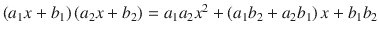。多项式特征提取可以利用一系列多项式公式创建一个超平面，将任意数据集细分为正确的聚类组。多项式复杂度越高，所能达到的结果就越精确。

示例：

```python
import numpy as np

import matplotlib.pyplot as plt

from sklearn.linear_model import Ridge

from sklearn.preprocessing import PolynomialFeatures

from sklearn.pipeline import make_pipeline

def f(x):

    """ function to approximate by polynomial interpolation"""

    return x * np.sin(x)
```

# generate points used to plot

`x_plot` = `np.linspace`(0, 10, 100)

```
x_plot = np.linspace(0, 10, 100)
```

# generate points and keep a subset of them

```
x = np.linspace(0, 10, 100)

rng = np.random.RandomState(0)

rng.shuffle(x)

x = np.sort(x[:20])

y = f(x)
```

# create matrix versions of these arrays

```python
X = x[:, np.newaxis]
X_plot = x_plot[:, np.newaxis]
colors = ['teal', 'yellowgreen', 'gold']
lw = 2
plt.plot(x_plot, f(x_plot), color="cornflowerblue", linewidth=lw, label="Ground Truth")
plt.scatter(x, y, color="navy", s=30, marker="o", label="training points")
for count, degree in enumerate([3, 4, 5]):
    model = make_pipeline(`PolynomialFeatures`(`degree`), `Ridge`())
    model.fit(`X`, `y`)
    y_plot = model.predict(`X_plot`)
    plt.plot(`x_plot`, `y_plot`, color=`colors`[count], linewidth=`lw`, label="Degree %d" % `degree`)
plt.legend(loc='lower left')
plt.show()
```

现在您已经了解如何生成多项式公式来拟合任意曲线，接下来我将使用一个真实数据集向您展示其实际应用。

### 常见的数据拟合问题

然而，高阶多项式公式更容易出现过拟合问题，而低阶公式则更可能欠拟合。在这两个极端之间取得微妙的平衡，才能支撑良好的数据科学实践。

示例：

```python
import numpy as np
import matplotlib.pyplot as plt
from sklearn.pipeline import `Pipeline`
from sklearn.preprocessing import `PolynomialFeatures`
from sklearn.linear_model import `LinearRegression`
from sklearn.model_selection import `cross_val_score`

def `true_fun`(X):
    return np.cos(1.5 * np.pi * X)

np.random.seed(0)
n_samples = 30
degrees = [1, 4, 15]
X = np.sort(np.random.rand(n_samples))
y = `true_fun`(X) + np.random.randn(n_samples) * 0.1
plt.figure(figsize=(14, 5))
for i in range(len(degrees)):
    ax = plt.subplot(1, len(degrees), i + 1)
    plt.setp(ax, xticks=(), yticks=())
    polynomial_features = `PolynomialFeatures`(degree=`degrees`[i], include_bias=False)
    linear_regression = `LinearRegression`()
    pipeline = `Pipeline`([("polynomial_features", polynomial_features), ("linear_regression", linear_regression)])
    pipeline.fit(X[:, np.newaxis], y)
```

# Evaluate the models using crossvalidation

```python
scores = cross_val_score(pipeline, X[:, np.newaxis], y,
                         scoring="neg_mean_squared_error", cv=10)
X_test = np.linspace(0, 1, 100)
plt.plot(X_test, pipeline.predict(X_test[:, np.newaxis]), label="Model")
plt.plot(X_test, true_fun(X_test), label="True function")
plt.scatter(X, y, edgecolor="b", s=20, label="Samples")
plt.xlabel("x")
plt.ylabel("y")
plt.xlim((0, 1))
plt.ylim((-2, 2))
plt.legend(loc="best")
plt.title("Degree {}\nMSE = {:.2e}(+/- {:.2e})".format(
    degrees[i], -scores.mean(), scores.std()))
plt.show()
```

## 精确率-召回率

精确率-召回率是衡量在类别极度不平衡时能否成功预测的有效指标。在信息检索中，
- **精确率**是衡量结果相关性的指标。
- **召回率**是衡量返回的真正相关结果数量的指标。

### 精确率-召回率曲线

精确率-召回率曲线展示了不同阈值下精确率与召回率之间的权衡关系。曲线下面积越大，表示召回率和精确率都越高——高精确率对应低假正例率，高召回率对应低假负例率。两者得分均高表明分类器不仅返回了准确的结果（高精确率），还返回了大部分正类结果（高召回率）。

高召回率但低精确率的系统会返回大量结果，但与训练标签相比，其预测的标签大多不正确。高精确率但低召回率的系统则恰恰相反，只返回很少的结果，但与训练标签相比，其预测的标签大多正确。理想系统兼具高精确率和高召回率，能返回大量结果且所有结果标签均正确。

精确率（`P`）定义为真正例（`Tp`）数量除以真正例（`Tp`）数量与假正例（`Fp`）数量之和。

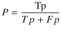

召回率（`R`）定义为真正例（`Tp`）数量除以真正例（`Tp`）数量与假负例（`Fn`）数量之和。

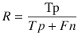

真负例率（`TNR`）表示负类样本的召回率指标。

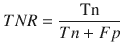

准确率（`A`）定义为：

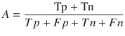

### 灵敏度与特异度

灵敏度与特异度是衡量二分类测试（在统计学中也被称为分类函数）性能的统计指标。灵敏度（也称为真正例率、召回率或检测概率）衡量正确识别为正类的比例（例如，被正确识别为患病的病人百分比）。特异度（也称为真负例率）衡量正确识别为负类的比例（例如，被正确识别为未患病的健康人百分比）。

### F1-Measure

`F1-score` 是一种结合了精确率和召回率的度量，它是精确率和召回率的调和平均数。

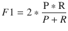

注意：精确率可能不会随召回率下降。

我发现以下 `sklearn` 函数在计算这些度量时非常有用：
- `sklearn.metrics.average_precision_score`
- `sklearn.metrics.recall_score`
- `sklearn.metrics.precision_score`
- `sklearn.metrics.f1_score`

我建议你用数据集进行练习，理解这些参数以及它们正面或负面的影响因素。它们是你数据科学成功与否的指标。

示例：
```

# In binary classification settings


# --------------------------------------------------------

#


# Create simple data


# 
#

# Try to differentiate the two first classes of the iris data

`from sklearn import svm, datasets`

`from sklearn.model_selection import train_test_split`

`import numpy as np`

`iris = datasets.load_iris()`

`X = iris.data`

`y = iris.target`

# Add noisy features

```python
random_state = np.random.RandomState(0)

n_samples, n_features = X.shape

X = np.c_[X, random_state.randn(n_samples, 200 * n_features)]
```

# Limit to the two first classes, and split into training and test

X_train, X_test, y_train, y_test = train_test_split(X[y = 0], y[y >= 0], color="gray", alpha=0.2)

plt.annotate('f1={0:0.1f}'.format(f_score), xy=(0.9, y[45] + 0.02))

lines.append(l)

labels.append('iso-f1 curves')

l, = plt.plot(recall["micro"], precision["micro"], color="gold", lw=2)

lines.append(l)

labels.append('micro-average Precision-recall (area = {0:0.2f})'

''.format(average_precision["micro"]))

for i, color in zip(range(n_classes), colors):

l, = plt.plot(recall[i], precision[i], color=color, lw=2)

lines.append(l)

labels.append('Precision-recall for class {0} (area = {1:0.2f})'

''.format(i, average_precision[i]))

fig = plt.gcf()

fig.subplots_adjust(bottom=0.25)

plt.xlim([0.0, 1.0])

plt.ylim([0.0, 1.05])

plt.xlabel('Recall')

plt.ylabel('Precision')

plt.title('Extension of Precision-Recall curve to multi-class')

plt.legend(lines, labels, loc=(0, -.38), prop=dict(size=14))

plt.show()

### Receiver Operating Characteristic (ROC) Analysis Curves

受试者工作特征（`ROC`）分析曲线是一种图形化图表，用于展示二分类系统在其判别阈值变化时的诊断能力。`ROC`曲线在不同的阈值设置下绘制真阳性率（`TPR`）与假阳性率（`FPR`）之间的关系。真阳性率也称为灵敏度、召回率或检测概率。

你会发现 `ROC` 分析曲线对于评估你的分类或特征工程是否足以确定你所发现见解的价值非常有用。这有助于在实际数据集上获得可重复的结果。因此，如果你建议客户根据你的发现采取特定行动，`ROC`分析曲线将支持你的建议和见解，同时也能传达在给定参数下见解的质量。

你现在应该打开你的 `Python` 编辑器，创建以下生态系统。

示例：

```

import numpy as np

from scipy import interp

import matplotlib.pyplot as plt

from sklearn import svm, datasets

from sklearn.metrics import roc_curve, auc

from sklearn.model_selection import StratifiedKFold

```

# 分隔线


# Data IO and generation


```python
# Import some data to play with

iris = datasets.load_iris()

X = iris.data

y = iris.target

X, y = X[y != 2], y[y != 2]

n_samples, n_features = X.shape
```

# Import some data to play with

`iris` = `datasets.load_iris()`

`X` = `iris.data`

`y` = `iris.target`

`X`, `y` = `X`[`y` != 2], `y`[`y` != 2]

`n_samples`, `n_features` = `X.shape`

# Add noisy features

`random_state = np.random.RandomState(0)`

`X = np.c_[X, random_state.randn(n_samples, 200 * n_features)]`

# #########################################################################

# Classification and ROC analysis

# Run classifier with cross-validation and plot ROC curves

```python
cv = StratifiedKFold(n_splits=6)

classifier = svm.SVC(kernel='linear', probability=True,
                     random_state=random_state)

tprs = []
aucs = []
mean_fpr = np.linspace(0, 1, 100)

i = 0

for train, test in cv.split(X, y):
    probas_ = classifier.fit(X[train], y[train]).predict_proba(X[test])
```

# Compute ROC Curve and Area Under Curve

```python
fpr, tpr, thresholds = roc_curve(y[test], probas_[:, 1])

tprs.append(interp(mean_fpr, fpr, tpr))

tprs[-1][0] = 0.0

roc_auc = auc(fpr, tpr)

aucs.append(roc_auc)

plt.plot(fpr, tpr, lw=1, alpha=0.3,

label='ROC fold %d (AUC = %0.2f)' % (i, roc_auc))

i += 1

plt.plot([0, 1], [0, 1], linestyle="--", lw=2, color="r",

label='Luck', alpha=.8)

mean_tpr = np.mean(tprs, axis=0)

mean_tpr[-1] = 1.0

mean_auc = auc(mean_fpr, mean_tpr)

std_auc = np.std(aucs)

plt.plot(mean_fpr, mean_tpr, color="b",

label=r'Mean ROC (AUC = %0.2f $\pm$ %0.2f)' % (mean_auc, std_auc),

lw=2, alpha=.8)

std_tpr = np.std(tprs, axis=0)

tprs_upper = np.minimum(mean_tpr + std_tpr, 1)

tprs_lower = np.maximum(mean_tpr - std_tpr, 0)

plt.fill_between(mean_fpr, tprs_lower, tprs_upper, color="gray", alpha=.2,

label=r'$\pm$ 1 std. dev.')

plt.xlim([-0.05, 1.05])

plt.ylim([-0.05, 1.05])

plt.xlabel('False Positive Rate')

plt.ylabel('True Positive Rate')

plt.title('Receiver operating characteristic example')

plt.legend(loc="lower right")

plt.show()
```

## Cross-Validation Test

交叉验证是一种模型验证技术，用于评估统计分析结果对独立数据集的泛化能力。它主要用于以预测为目标的任务中。了解如何执行此类测试，使你能够验证模型在实际（即独立）数据集上的应用效果。

我将指导你进行一次测试。打开你的`Python`编辑器，创建以下生态系统：

```python
import numpy as np

from sklearn.model_selection import cross_val_score

from sklearn import datasets, svm

import matplotlib.pyplot as plt

digits = datasets.load_digits()

X = digits.data

y = digits.target
```

让我们选择三个不同的`kernel`，并比较它们的表现。

```python
kernels=['linear', 'poly', 'rbf']

for kernel in kernels:

svc = svm.SVC(kernel=kernel)

C_s = np.logspace(-15, 0, 15)

scores = list()

scores_std = list()

for C in C_s:

svc.C = C

this_scores = cross_val_score(svc, X, y, n_jobs=1)

scores.append(np.mean(this_scores))

scores_std.append(np.std(this_scores))
```

你必须绘制结果图。

```python
Title="Kernel:>" + kernel

fig=plt.figure(1, figsize=(8, 6))

plt.clf()

fig.suptitle(Title, fontsize=20)

plt.semilogx(C_s, scores)

plt.semilogx(C_s, np.array(scores) + np.array(scores_std), 'b--')

plt.semilogx(C_s, np.array(scores) - np.array(scores_std), 'b--')

locs, labels = plt.yticks()

plt.yticks(locs, list(map(lambda x: "%g" % x, locs)))

plt.ylabel('Cross-Validation Score')

plt.xlabel('Parameter C')

plt.ylim(0, 1.1)

plt.show()
```

做得很好。现在你可以对你的结果执行交叉验证了。

## Univariate Analysis

单变量分析是最简单的数据分析形式。“单”意味着“一”，因此你的数据只有一个变量。它不涉及因果关系，其主要目的是描述性分析。它获取数据，对数据进行汇总，并找出数据中的模式。

单变量数据中发现的模式包括集中趋势（均值、众数和中位数）以及离散程度、范围、方差、最大值、最小值、分位数（包括四分位距）和标准差。

示例：有多少学生即将获得数据科学学位？你可以使用多种选项通过单变量方法来描述数据。你可以使用频数分布表、频数多边形、直方图、条形图或饼图。

### 双变量分析

双变量分析是指同时分析两个变量，以探究它们之间可能存在的关联或经验关系，例如，性别与获得数据科学学位之间是否存在相关性？在实验研究中，典型相关性分析则是取两组变量，并观察这两组变量之间的共同之处。

适用于双变量分析的图表取决于变量的类型。对于两个连续变量，散点图是常用图表。当一个变量是分类变量而另一个是连续变量时，箱线图是常用图表。当两个变量都是分类变量时，马赛克图是常用图表。

### 多变量分析

多变量数据分析是指用于分析源自多个变量的数据的任何统计技术。这本质上是模拟现实世界，因为现实中的每种情境、产品或决策都涉及多个变量。

当分析超过两个变量时，会同时探究它们之间可能存在的关联或交互作用。

例如：性别、居住国家与获得数据科学学位之间有何相关性？任何统计建模练习，例如回归、决策树、支持向量机和聚类，本质上都是多变量的。当最终结果由两个以上的变量决定时，就会使用这种分析方法。

## 线性回归

线性回归是一种统计建模技术，它通过将观测到的数据点拟合到线性方程上，来尝试建立解释变量与因变量之间的关系模型。例如，利用个体的体重来建立其身体质量指数（BMI）的模型。

> **警告**：包含一个因变量和四个自变量的回归分析不是多变量回归，而是多元回归。多变量分析始终指的是因变量。

### 简单线性回归

如果变量之间存在关系或显著关联，则使用线性回归。这可以通过散点图进行检查。如果变量之间不存在线性关联，那么对数据拟合线性回归模型将无法提供有用的模型。

线性回归线的方程形式如下：

`Y = a + bX`，其中，`X` = 解释变量，`Y` = 因变量，`b` = 直线的斜率，`a` = 截距（当`x` = 0 时`y`的值）。

示例：

# -*- coding: utf-8 -*-

```python
import sys

import os

import pandas as pd

import sqlite3 as sq

import matplotlib.pyplot as plt

import numpy as np

# ################################################################

if sys.platform == 'linux':
    Base = os.path.expanduser('~') + '/VKHCG'
else:
    Base = 'C:/VKHCG'

print('################################')
print('Working Base :', Base, ' using ', sys.platform)
print('################################')

# ################################################################

Company = '01-Vermeulen'

# ################################################################

sDataBaseDir = Base + '/' + Company + '/04-Transform/SQLite'
if not os.path.exists(sDataBaseDir):
    os.makedirs(sDataBaseDir)

sDatabaseName = sDataBaseDir + '/Vermeulen.db'
conn1 = sq.connect(sDatabaseName)

# ################################################################

sDataVaultDir = Base + '/88-DV'
if not os.path.exists(sDataVaultDir):
    os.makedirs(sDataVaultDir)

sDatabaseName = sDataVaultDir + '/datavault.db'
conn2 = sq.connect(sDatabaseName)

# ################################################################

sDataWarehouseDir = Base + '/99-DW'
if not os.path.exists(sDataWarehouseDir):
    os.makedirs(sDataWarehouseDir)

sDatabaseName = sDataWarehouseDir + '/datawarehouse.db'
conn3 = sq.connect(sDatabaseName)

# ################################################################

t = 0
tMax = ((300 - 100) / 10) * ((300 - 30) / 5)

for heightSelect in range(100, 300, 10):
    for weightSelect in range(30, 300, 5):
        height = round(heightSelect / 100, 3)
        weight = int(weightSelect)
        bmi = weight / (height * height)

        if bmi < 18.5:
            BMI_Result = 1
        elif bmi < 25 and bmi > 18.5:
            BMI_Result = 2
        elif bmi < 30 and bmi > 25:
            BMI_Result = 3
        else:
            BMI_Result = 4

        PersonLine = [('PersonID', [str(t)]),
                      ('Height', [height]),
                      ('Weight', [weight]),
                      ('bmi', [bmi]),
                      ('Indicator', [BMI_Result])]
        t += 1

        print('Row:', t, 'of', tMax)

        if t == 1:
            PersonFrame = pd.DataFrame.from_items(PersonLine)
        else:
            PersonRow = pd.DataFrame.from_items(PersonLine)
            PersonFrame = PersonFrame.append(PersonRow)

# ################################################################

DimPerson = PersonFrame
DimPersonIndex = DimPerson.set_index(['PersonID'], inplace=False)

# ################################################################

sTable = 'Transform-BMI'
print('\n#################################')
print('Storing :', sDatabaseName, '\n Table:', sTable)
print('\n#################################')
DimPersonIndex.to_sql(sTable, conn1, if_exists="replace")

# ################################################################

sTable = 'Person-Satellite-BMI'
print('\n#################################')
print('Storing :', sDatabaseName, '\n Table:', sTable)
print('\n#################################')
DimPersonIndex.to_sql(sTable, conn2, if_exists="replace")

# ################################################################

sTable = 'Dim-BMI'
print('\n#################################')
print('Storing :', sDatabaseName, '\n Table:', sTable)
print('\n#################################')
DimPersonIndex.to_sql(sTable, conn3, if_exists="replace")

# ################################################################

fig = plt.figure()

PlotPerson = DimPerson[DimPerson['Indicator'] == 1]
x = PlotPerson['Height']
y = PlotPerson['Weight']
plt.plot(x, y, ".")

PlotPerson = DimPerson[DimPerson['Indicator'] == 2]
x = PlotPerson['Height']
y = PlotPerson['Weight']
plt.plot(x, y, "o")

PlotPerson = DimPerson[DimPerson['Indicator'] == 3]
x = PlotPerson['Height']
y = PlotPerson['Weight']
plt.plot(x, y, "+")

PlotPerson = DimPerson[DimPerson['Indicator'] == 4]
```

x=`PlotPerson['Height']`

y=`PlotPerson['Weight']`

`plt.plot(x, y, "^")`

`plt.axis('tight')`

`plt.title("BMI Curve")`

`plt.xlabel("Height(meters)")`

`plt.ylabel("Weight(kg)")`

`plt.plot()`

现在我们已经识别出有风险的人群，可以研究这些糖尿病患者的线性回归。

**注意**：你将使用`sklearn`库附带的标准糖尿病数据样本集，原因是医疗数据的保护。由于这些数据属于公共领域，你可以访问它们。

**警告**：在处理个人隐私信息时，你需要对处理过程中引发的任何问题负责。因此，请谨慎操作。

**注意**：在下一个示例中，我们将使用标准`sklearn`库中的医疗数据集。这可以确保你不会使用未经授权的医疗结果。

按如下方式设置环境：

```python
import matplotlib.pyplot as plt

import numpy as np

from sklearn import datasets, linear_model

from sklearn.metrics import mean_squared_error, r2_score
```

加载数据集。

# 加载糖尿病数据集

```
diabetes = datasets.load_diabetes()
```

进行特征开发。

# 仅使用一个特征

```python
diabetes_X = diabetes.data[:, np.newaxis, 2]
```

将数据拆分为训练数据集和测试数据集。

```python
diabetes_X_train = diabetes_X[:-30]
diabetes_X_test = diabetes_X[-50:]
```

将目标变量拆分为训练集和测试集。

```python
diabetes_y_train = diabetes.target[:-30]
diabetes_y_test = diabetes.target[-50:]
```

生成线性回归模型。

```python
regr = linear_model.LinearRegression()
```

使用训练集训练模型。

```python
regr.fit(diabetes_X_train, diabetes_y_train)
```

使用测试集创建预测。

```python
diabetes_y_pred = regr.predict(diabetes_X_test)
```

显示系数。

```python
print('Coefficients: \n', regr.coef_)
```

显示均方误差。

```python
print("Mean squared error: %.2f"
      % mean_squared_error(diabetes_y_test, diabetes_y_pred))
```

显示方差分数（提示：分数为 1 表示完美预测）。

```python
print('Variance score: %.2f' % r2_score(diabetes_y_test, diabetes_y_pred))
```

绘制输出结果。

```python
plt.scatter(diabetes_X_test, diabetes_y_test,  color='black')
plt.plot(diabetes_X_test, diabetes_y_pred, color="blue", linewidth=3)
plt.xticks(())
plt.yticks(())
plt.axis('tight')
plt.title("Diabetes")
plt.xlabel("BMI")
plt.ylabel("Age")
plt.show()
```

做得好！你已经成功计算了 `BMI` 并确定了我们员工的糖尿病发病率。

### RANSAC 线性回归

`RANSAC`（随机采样一致性）是一种迭代算法，用于从完整数据集的内部点子集中进行鲁棒参数估计。`RANSAC` 的一个优势是它能够对模型参数进行鲁棒估计，即即使在数据集中存在大量异常值时，它也能以高精度估计参数。由于其鲁棒性，该过程总能找到解决方案。

通常，该技术用于处理图像处理领域，因为该领域存在噪声。参见 [`http://scikit-learn.org/stable/modules/generated/sklearn.linear_model.RANSACRegressor.html`](http://scikit-learn.org/stable/modules/generated/sklearn.linear_model.RANSACRegressor.html)。

示例：

```python
import numpy as np
from matplotlib import pyplot as plt
from sklearn import linear_model, datasets

n_samples = 1000
n_outliers = 50

X, y, coef = datasets.make_regression(n_samples=n_samples, n_features=1,
                                      n_informative=1, noise=10,
                                      coef=True, random_state=0)
```

# 添加异常值数据
```python
np.random.seed(0)
X[:n_outliers] = 3 + 0.5 * np.random.normal(size=(n_outliers, 1))
y[:n_outliers] = -3 + 10 * np.random.normal(size=n_outliers)
```

# 使用所有数据拟合直线

```
lr = linear_model.LinearRegression()

lr.fit(X, y)
```

# 使用 RANSAC 算法鲁棒地拟合线性模型

```
ransac = linear_model.RANSACRegressor()
ransac.fit(X, y)
inlier_mask = ransac.inlier_mask_
outlier_mask = np.logical_not(inlier_mask)
```

# 预测估计模型的输出

```python
line_X = np.arange(X.min(), X.max())[:, np.newaxis]

line_y = lr.predict(line_X)

line_y_ransac = ransac.predict(line_X)
```

# 比较估计系数

```
print("Estimated coefficients (true, linear regression, RANSAC):")
print(coef, lr.coef_, ransac.estimator_.coef_)
lw = 2
plt.scatter(X[inlier_mask], y[inlier_mask], color="yellowgreen", marker='.', label='Inliers')
plt.scatter(X[outlier_mask], y[outlier_mask], color="gold", marker='.', label='Outliers')
plt.plot(line_X, line_y, color="navy", linewidth=lw, label='Linear regressor')
plt.plot(line_X, line_y_ransac, color="cornflowerblue", linewidth=lw, label='RANSAC regressor')
plt.legend(loc='lower right')
plt.xlabel("Input")
plt.ylabel("Response")
plt.show()
```

这种回归技术在机器人学和机器人视觉领域极为有用，因为机器人需要回归两个数据帧或数据集之间的变化。

## 霍夫变换

霍夫变换是一种用于图像分析、计算机视觉和数字图像处理的特征提取技术。该技术的目的是通过投票过程来寻找特定形状类别中物体的不完美实例。这个投票过程在参数空间中进行，通过该过程，物体候选者被作为局部最大值，在所谓的累加器空间中获得。这个累加器空间是由算法为了计算霍夫变换而显式构建的。

请参见[`http://scikit-image.org/docs/dev/api/skimage.transform.html#skimage.transform.hough_line`](http://scikit-image.org/docs/dev/api/skimage.transform.html%23skimage.transform.hough_line)、[`http://scikit-image.org/docs/dev/api/skimage.transform.html#skimage.transform.hough_line_peaks`](http://scikit-image.org/docs/dev/api/skimage.transform.html%23skimage.transform.hough_line_peaks)和[`http://scikit-image.org/docs/dev/api/skimage.transform.html#skimage.transform.probabilistic_hough_line`](http://scikit-image.org/docs/dev/api/skimage.transform.html%23skimage.transform.probabilistic_hough_line)。

借助霍夫变换，这种回归改进了`RANSAC`技术的分辨率，这在机器人学和机器人视觉中极为有用。因为机器人需要通过回归两个数据帧或数据集之间的变化来在环境中移动。

## 逻辑回归

逻辑回归是一种用于寻找一组输入变量与一个输出变量之间关系的技术（就像任何回归一样），但在这种情况下，输出变量是一个二分类结果（可以视为 0/1 或是/否）。

### 简单逻辑回归

我将引导你完成一个仅比较两个值的简单逻辑回归。一个现实世界的商业案例是使用二元变量研究伦敦某地点的交通拥堵情况。输出结果是分类变量：是或否。因此，是否存在交通拥堵？是或否？

交通拥堵发生的概率可能取决于诸如天气状况、星期几和月份、一天中的时段、车辆数量等属性。使用逻辑回归，你可以找到最佳拟合模型，该模型解释了独立属性与交通拥堵发生率之间的关系，并预测拥堵发生的概率。

这个过程被称为二元逻辑回归。交通状态从否 = 零变为是 = 一，其变化路径沿一条由以下代码建模的曲线进行，如图 10-10 所示。

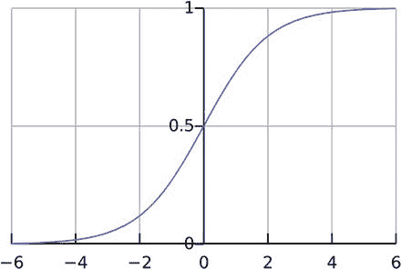

图 10-10 — 二元逻辑回归

```
for x in range(-10,10,1): print(math.sin(x/10))
```

现在，我将使用一个示例数据集来讨论逻辑回归。

示例：

```python
from sklearn import datasets, neighbors, linear_model
```

加载数据。

```python
digits = datasets.load_digits()
X_digits = digits.data
y_digits = digits.target
n_samples = len(X_digits)
```

选择训练数据集。

```python
X_train = X_digits[:int(.9 * n_samples)]
y_train = y_digits[:int(.9 * n_samples)]
X_test = X_digits[int(.9 * n_samples):]
y_test = y_digits[int(.9 * n_samples):]
```

选择 K 近邻分类器。

```python
knn = neighbors.KNeighborsClassifier()
```

选择逻辑回归模型。

```python
logistic = linear_model.LogisticRegression()
```

训练模型以执行逻辑回归。

```python
print('KNN score: %f' % knn.fit(X_train, y_train).score(X_test, y_test))
```

将训练好的模型应用于测试数据集。

```python
print('LogisticRegression score: %f'
% logistic.fit(X_train, y_train).score(X_test, y_test))
```

做得好。你刚刚成功完成了下一个转换步骤，即针对示例数据集部署了一个带有 K 近邻分类器的逻辑回归模型。

> **提示：** 通过使用这个简单的过程，我发现了许多发人深省的关联关系，或者打破了一些关于数据值之间关系的迷思。

### 多项逻辑回归

多项逻辑回归是一种线性回归分析形式，当因变量为名义变量且具有两个以上类别时使用。它用于描述数据，并解释一个名义因变量与一个或多个连续型（区间或比率尺度）自变量之间的关系。你可以将名义变量视为没有内在排序的变量。

这类数据在商业世界中最为常见，因为它通常涵盖数据源中的大多数数据条目，并直接表明你在普通数据湖中可能期望的结果。这些数据没有内在的顺序或关联关系。

现在，我将通过示例向你展示如何处理这些数据集。你需要以下库来搭建生态环境：

```python
import time
import matplotlib.pyplot as plt
import numpy as np
from sklearn.datasets import fetch_mldata
from sklearn.linear_model import LogisticRegression
from sklearn.model_selection import train_test_split
from sklearn.preprocessing import StandardScaler
from sklearn.utils import check_random_state
```

设置结果目标。

```python
sPicNameOut='../VKHCG/01-Vermeulen/04-Transform/01-EDS/02-Python/Letters.png'
```

你需要调整一些参数。

```python
t0 = time.time()
train_samples = 5000
```

从模拟数据湖中获取样本数据。

```python
mnist = fetch_mldata('MNIST original')
```

对数据湖中的数据进行工程处理。

```python
X = mnist.data.astype('float64')
y = mnist.target
random_state = check_random_state(0)
permutation = random_state.permutation(X.shape[0])
X = X[permutation]
```

# 有序逻辑回归

有序逻辑回归是二项逻辑回归的一种类型。有序回归用于预测具有有序多类别和自变量的因变量。换句话说，它用于促进因变量（具有多个有序级别）与一个或多个自变量之间的交互作用。

这种数据类型是极好的待处理数据集，因为你已经知道数据条目之间存在关联关系。部署转换步骤的算法将让你深入了解这种关联关系对数据发现过程的支持强度是强还是弱。

> **提示：** 我通常会将所有结果作为太阳模型存回数据仓库，然后在数据仓库中物化为事实表和维度表。

## 训练与评估示例

以下是使用有序逻辑回归进行模型训练、评估和可视化的代码示例。

```python
y = y[permutation]
X = X.reshape((X.shape[0], -1))
```

训练数据模型。

```python
X_train, X_test, y_train, y_test = train_test_split(
    X, y, train_size=train_samples, test_size=10000)
```

对训练数据应用缩放器以防止过拟合。

```python
scaler = StandardScaler()
X_train = scaler.fit_transform(X_train)
X_test = scaler.transform(X_test)
```

调整容差（`tol = 0.1`）以加快收敛速度。

```python
clf = LogisticRegression(C=50. / train_samples,
                        multi_class='multinomial',
                        penalty='l2', solver="sag", tol=0.1)
```

将模型应用于数据集。

```python
clf.fit(X_train, y_train)
sparsity = np.mean(clf.coef_ == 0) * 100
```

对模型进行评分。

```python
score = clf.score(X_test, y_test)
print('Best C % .4f' % clf.C_)
print("Sparsity with L1 penalty: %.2f%%" % sparsity)
print("Test score with L1 penalty: %.4f" % score)
coef = clf.coef_.copy()
```

显示结果。

```python
Fig=plt.figure(figsize=(15, 6))
scale = np.abs(coef).max()
for i in range(10):
    l1_plot = plt.subplot(2, 5, i + 1)
    l1_plot.imshow(coef[i].reshape(28, 28), interpolation="nearest",
                  cmap=plt.cm.RdBu, vmin=-scale, vmax=scale)
    l1_plot.set_xticks(())
    l1_plot.set_yticks(())
    l1_plot.set_xlabel('Letter %i' % i)
plt.suptitle('Classification vector for...')
run_time = time.time() - t0
print('Process run in %.3f s' % run_time)
plt.show()
```

将结果保存到磁盘。

```python
Fig.savefig(sPicNameOut, dpi=300)
```

你在示例中表现良好。现在，你可以处理没有内在顺序的数据了。如果你理解了这一过程，那么你就成功地在理解如何通过转换步骤，利用数据仓库对数据湖进行转换方面取得了重要的里程碑。

# 业务问题

以 1 到 5 分的等级对学生进行评分，以判断其是否具备进入大学的必要资格（“声望”）。该评分引入了这些项目可通过等级区分的一种偏好或可能性。我将使用一组生成的潜在学生，带您了解一个数据科学解决方案。问题是：“哪些标准决定了最终决定？”

示例如下：

打开您的 Python 编辑器并执行以下操作。

## 设置环境

```python
import sys
import os
import pandas as pd
import statsmodels.api as sm
import pylab as pl
import numpy as np

if sys.platform == 'linux':
    Base=os.path.expanduser('~') + '/VKHCG'
else:
    Base='C:/VKHCG'
```

## 检索学生数据

检索`StudentData`（学生数据）。

```python
sFileName=Base + '/01-Vermeulen/00-RawData/StudentData.csv'
StudentFrame = pd.read_csv(sFileName, header=0)
StudentFrame.columns = ["sname", "gre", "gpa", "prestige", "admit", "QR", "VR", "gpatrue"]
StudentSelect=StudentFrame[["admit", "gre", "gpa", "prestige"]]
print('Record select:', StudentSelect.shape[0])
df=StudentSelect
```

如果您想加快处理速度，可以添加以下两行代码，但这会降低预测的准确性。所以，请按需使用。

```python
#df=StudentSelect.drop_duplicates(subset=None, keep="first", inplace=False)
#print('Records Unique:', df.shape[0])
```

以下是数据集各列的说明：

```python
print(df.columns)
```

以下是数据概况的描述：

```python
print(df.describe())
```

您是否注意到`admit`（录取）概况中有趣的“偏斜”？您可以使用以下命令进行调查：

```python
print(df.std())
```

**注意：**`admit`的标准差约为 +/-0.2，而其取值范围是 0 到 1。

| admit | 0.201710 |
| gre | 1.030166 |
| gpa | 145.214383 |
| prestige | 1.030166 |

这是一个非常严格的录取模型！能通过筛选的学生并不多。

## 探索“声望”与录取的关系

让我们调查一下`prestige`（声望）对被录取的影响。

| prestige | 1 | 2 | 3 | 4 |
| --- | --- | --- | --- | --- |
| 0 | 16810 | 15810 | 15810 | 7905 |
| 1 | 0 | 1000 | 1000 | 500 |

```python
print(pd.crosstab(df['admit'], df['prestige'], rownames=['admit']))
```

显然存在一个与`prestige`相关的标准。学生至少需要`Prestige = 2`的条件。您也注意到了吗？如果您绘制所有列的图表，会看得更清楚。我建议您使用`histogram`（直方图）函数来为您的图表进行分箱简化，如下所示：

```python
df.hist()
```

以下是您得到的结果：

```python
pl.tight_layout()
pl.show()
```

## 特征工程与模型训练

现在您应该为`prestige`创建一个排名。

```python
dummy_ranks = pd.get_dummies(df['prestige'], prefix="prestige")
print(dummy_ranks.head())
```

现在您有了一个可以填入正确值的网格，具体根据您的数据来定。

您需要创建一个空的数据框用于回归分析，如下所示：

```python
cols_to_keep = ['admit', 'gre', 'gpa']
data = df[cols_to_keep].join(dummy_ranks.loc[:, 'prestige_1':])
print(data.head())
```

您能看到数据现在是如何变换的吗？这被称为特征工程。

接下来，您必须添加截距值。

```python
data['intercept'] = 1.00
```

您已成功将数据转换为算法能够理解的结构。干得好！

现在您可以训练模型了。

```python
train_cols = data.columns[1:]
logit = sm.Logit(data['admit'], data[train_cols])
```

现在您有了一个训练好的模型。

您可以为该数据集拟合模型。请注意，`maxiter = 500`控制着处理时间。您可以增加或减少它，以控制模型的处理工作量。尝试找出适合您的参数。

```python
result = logit.fit(maxiter=500)
```

现在您可以查看结果了。

print(`Results`)

print(`result.summary()`)

```

`注意：` 有趣的发现是，`GPA`（平均绩点）分数决定了录取与否。

现在您将检查每个系数的置信区间。

```

print(`result.conf_int()`)

```

模型识别出了 `GPA`。干得好，因为这才是真正的驱动因素：`nRank = int(GPA)`，也就是 `prestige`。

现在您可以查看比值比。

```

print(`np.exp(result.params)`)

```

您能识别出这个趋势吗？

|      | Odds | Odds(Real) |
|------|------|------------|
| gre  | 1.02E-02 | 0.010 |
| gpa  | 1.06E+00 | 1.063 |
| prestige_1 | 1.13E-18 | 0.000 |
| prestige_2 | 2.17E-01 | 0.217 |
| prestige_3 | 2.14E+01 | 21.376 |
| prestige_4 | 2.10E+03 | 2101.849 |

趋势是，如果学生的 `GPA` 大于 4，他/她被录取的比值是 2100 比 1。

让我们检查这些比值比和 95% 置信区间。

```

`params = result.params`

`conf = result.conf_int()`

`conf['OR'] = params`

`conf.columns = ['2.5%', '97.5%', 'OR']`

print(`np.exp(conf)`)

```

您能看出这个过程的本质吗？`GPA` 是主要驱动因素，更高的 `GPA` 能确保被录取。

现在您可以生成所有可能的 `GRE`（美国研究生入学考试）和 `GPA` 值，但我建议您只使用从最小值到最大值的、均匀间隔的十个值。这是一种简单的数据分箱方法，可以减少复杂性。将故事结果转换为更小的结果集，同时保留核心发现，这是数据科学家需要具备的技能。

以下是您的分箱：

```

`gres = np.linspace(data['gre'].min(), data['gre'].max(), 10)`

print(`gres`)

`gpas = np.linspace(data['gpa'].min(), data['gpa'].max(), 10)`

print(`gpas`)

```

现在您必须执行一些额外的数据工程。您需要定义一个笛卡尔函数来辅助您的转换过程。

```

def `cartesian`(arrays, out=None):

    arrays = [np.asarray(x) for x in arrays]

    dtype = arrays[0].dtype

    n = np.prod([x.size for x in arrays])

    if out is None:

        out = np.zeros([n, len(arrays)], dtype=dtype)

    m = int(n / arrays[0].size)

    out[:,0] = np.repeat(arrays[0], m)

    if arrays[1:]:

        cartesian(arrays[1:], out=out[0:m,1:])

        for j in range(1, arrays[0].size):

            out[j*m:(j+1)*m,1:] = out[0:m,1:]

    return out

```

现在您有了新函数，我建议您按如下方式将其应用到您的数据中：您必须枚举所有可能性以供调查。

```

`combos = pd.DataFrame(cartesian([gres, gpas, [1, 2, 3, 4], [1,]]))`

```

现在您重新创建虚拟变量。

```

`combos.columns = ['gre', 'gpa', 'prestige', 'intercept']`

`dummy_ranks = pd.get_dummies(combos['prestige'], prefix="prestige")`

`dummy_ranks.columns = ['prestige_1', 'prestige_2', 'prestige_3', 'prestige_4']`

```

现在，我建议您只保留进行预测所需的部分。

```

`cols_to_keep = ['gre', 'gpa', 'prestige', 'intercept']`

`combos = combos[cols_to_keep].join(dummy_ranks.loc[:, 'prestige_1':])`

```

现在对枚举后的数据集计算预测值。

```

`combos['admit_pred'] = result.predict(combos[train_cols])`

```

以下是您的结果：

```

print(`combos.head()`)

```

您还需要一个函数。这个函数将隔离并绘制数据集的特定特征。

```

def `isolate_and_plot`(variable):
```

# isolate gre and class rank

group the code

```
grouped = pd.pivot_table(combos, values=['admit_pred'], index=[variable, 'prestige'],
aggfunc=np.mean)
```

# 聚类技术

聚类（或称细分）是一种无监督学习算法，它将数据集划分为独特的、有差异的集群。假设我们有包含 1000 行数据的客户记录。利用聚类技术，我们可以根据变量将客户划分为不同的集群或细分群体。在客户数据中，变量可以是人口统计信息或购买行为。

聚类属于无监督学习算法，因为数据科学家无法得知其输入——没有可用的训练集来预训练解决方案模型。你并非基于已有的输入-输出信息来训练算法，而是让算法自行定义输出结果。因此，聚类算法不存在"正确"的解决方案，只有基于业务可用性的、合理的最佳拟合方案。聚类也被称为无监督分类。

聚类技术主要有两种基本类型。

## 层次聚类

层次聚类是一种构建集群层次结构的分析方法。它特别适用于那些具有复杂结构且各集群数据特征分明的数据集。

以下是一个示例：预算有限的顾客更容易被你的促销商品和组合优惠吸引，而较为富裕的购物者则更看重品牌。这是两个驱动购买动机截然不同的集群。

层次聚类有两种设计风格：

### 凝聚式

这是一种自下而上的方法。每个观测值最初自成一类，随着层次的上移，成对的集群逐步合并。

### 分裂式

这是一种自上而下的方法。所有观测值最初属于一个集群，随着层次的下移，通过递归方式执行分裂操作。下面我将带你了解生成层次聚类的转换过程。

注意：聚类在生物统计学领域中用于评估基于 DNA 序列的聚类模型。人类基因组图谱是人类最伟大的科学突破之一，而数据科学正致力于将其推向新高度。请探索生物信息学在聚类中的应用。

打开 Python 编辑器并设置新的环境。

```python
from matplotlib import pyplot as plt
from scipy.cluster.hierarchy import dendrogram, linkage
import numpy as np
```

接下来，你将生成两个集群：(a) 包含 100 个点，(b) 包含 50 个点。

```python
np.random.seed(4711)
a = np.random.multivariate_normal([10, 0], [[3, 1], [1, 4]], size=[100,])
b = np.random.multivariate_normal([0, 20], [[3, 1], [1, 4]], size=[50,])
X = np.concatenate((a, b),)
```

这将创建 150 个二维样本。

```python
print( X.shape)
```

让我们快速显示它。

```python
plt.scatter(X[:,0], X[:,1])
plt.show()
```

你必须生成链接矩阵。该矩阵包含链接准则，该准则根据观测值之间的成对距离来确定观测值集合之间的距离。有关此矩阵的更多信息，请参见[此链接](https://docs.scipy.org/doc/scipy-0.19.1/reference/generated/scipy.cluster.hierarchy.linkage.html)。

```python
Z = linkage(X, 'ward')
```

通过添加额外的库来增强环境。

```python
from scipy.cluster.hierarchy import cophenet
from scipy.spatial.distance import pdist
```

触发共表相关系数。共表相关系数是衡量树状图在多大程度上保留了原始未建模数据点之间成对距离的指标。简单来说，就是衡量的准确性。

```python
c, coph_dists = cophenet(Z, pdist(X))
print('Cophenetic Correlation Coefficient:',c)
```

现在，你将计算一个完整的树状图。

```python
plt.figure(figsize=(25, 10))
plt.title('Hierarchical Clustering Dendrogram')
plt.xlabel('Sample Index')
plt.ylabel('Distance')
dendrogram(
    Z,
    leaf_rotation=90,
    leaf_font_size=8,
)
plt.show()
```

现在，你可以截断集群（仅显示最后 p 个合并的集群）。

```python
plt.title('Hierarchical Clustering Dendrogram (truncated)')
plt.xlabel('sample index')
plt.ylabel('distance')
dendrogram(
    Z,
    truncate_mode='lastp',
    p=12,
    show_leaf_counts=False,
    leaf_rotation=90,
    leaf_font_size=12,
    show_contracted=True,
)
plt.show()
```

现在，你必须定义一个新函数来优化图表的显示效果。

```python
def fancy_dendrogram(*args, **kwargs):
    max_d = kwargs.pop('max_d', None)
    if max_d and 'color_threshold' not in kwargs:
        kwargs['color_threshold'] = max_d
    annotate_above = kwargs.pop('annotate_above', 0)
    ddata = dendrogram(*args, **kwargs)
    if not kwargs.get('no_plot', False):
        plt.title('Hierarchical Clustering Dendrogram (truncated)')
        plt.xlabel('sample index or (cluster size)')
        plt.ylabel('distance')
        for i, d, c in zip(ddata['icoord'], ddata['dcoord'], ddata['color_list']):
            x = 0.5 * sum(i[1:3])
            y = d[1]
            if y > annotate_above:
                plt.plot(x, y, 'o', c=c)
                plt.annotate("%.3g" % y, (x, y), xytext=(0, -5),
                             textcoords='offset points',
                             va='top', ha="center")
        if max_d:
            plt.axhline(y=max_d, c="k")
    return ddata
```

现在您有了这个函数，我建议您调查以下两个值：

```
isolate_and_plot('gre')
isolate_and_plot('gpa')
```

故事很简单。如果你的成绩（平均绩点 [GPA]）较低，那么你的美国研究生入学考试（GRE）（能力）可以让你进入大学。但高 GPA 表明了一种成功的抱负，因为能力被大学视为理所当然。

恭喜！您已完成有序逻辑回归部分。

警告：有序逻辑回归需要大量的训练数据集，因为它们有额外的步骤排序要求。

### 关联脚本

# make a plot

```python
colors = 'rbgyrbgy'

for col in combos.prestige.unique():

    plt_data = grouped.loc[grouped.index.get_level_values(1)==col]

    pl.plot(plt_data.index.get_level_values(0), \

            plt_data['admit_pred'], color=colors[int(col)])

    pl.xlabel(variable)

    pl.ylabel("P(admit=1)")

    pl.legend(['1', '2', '3', '4'], loc='upper left', title="Prestige")

    pl.title("Prob(admit=1) isolating " + variable + " and presitge")

    pl.show()
```

现在，你可以对你的集群应用这个新函数了。

```python
fancy_dendrogram(
    Z,
    truncate_mode='lastp',
    p=12,
    leaf_rotation=90.,
    leaf_font_size=12.,
    show_contracted=True,
    annotate_above=10,  # useful in small plots so annotations don't overlap
)
plt.show()
```

让我们将截断值设为 50。

```python
max_d = 50
```

现在，只需重新绘制新数据。

```python
fancy_dendrogram(
    Z,
    truncate_mode='lastp',
    p=12,
    leaf_rotation=90.,
    leaf_font_size=12.,
    show_contracted=True,
    annotate_above=10,
    max_d=max_d,
)
plt.show()
```

将截断值改为 16。

```python
fancy_dendrogram(
    Z,
    truncate_mode='lastp',
    p=12,
    leaf_rotation=90.,
    leaf_font_size=12.,
    show_contracted=True,
    annotate_above=10,
    max_d=16,
)
plt.show()
```

现在，你添加一些额外的函数来查看你的变换结果。

```python
from scipy.cluster.hierarchy import inconsistent
```

# 聚类算法探索

## 你可以调查深度为 5 的情况

```python
depth = 5

incons = inconsistent(Z, depth)

print(incons[-10:])
```

你看到了什么？

将深度改为 3。

```python
depth = 3

incons = inconsistent(Z, depth)

print(incons[-10:])
```

你看到了什么？用图形展示会看得更清楚。

```python
last = Z[-10:, 2]

last_rev = last[::-1]

idxs = np.arange(1, len(last) + 1)

plt.plot(idxs, last_rev)
```

现在你应该观察加速度值。

```python
acceleration = np.diff(last, 2)

acceleration_rev = acceleration[::-1]

plt.plot(idxs[:-2] + 1, acceleration_rev)

plt.show()

k = acceleration_rev.argmax() + 2  # 如果索引 0 是最大值，我们想要 2 个聚类

print("Clusters:", k)

c = np.random.multivariate_normal([40, 40], [[20, 1], [1, 30]], size=[200,])

d = np.random.multivariate_normal([80, 80], [[30, 1], [1, 30]], size=[200,])

e = np.random.multivariate_normal([0, 100], [[100, 1], [1, 100]], size=[200,])

X2 = np.concatenate((X, c, d, e),)

plt.scatter(X2[:,0], X2[:,1])

plt.show()
```

你能看到这些聚类吗？下面是一个正式的聚类图：

```python
Z2 = linkage(X2, 'ward')

plt.figure(figsize=(10,10))

fancy_dendrogram(
    Z2,
    truncate_mode='lastp',
    p=30,
    leaf_rotation=90.,
    leaf_font_size=12.,
    show_contracted=True,
    annotate_above=40,
    max_d=170,
)

plt.show()
```

# 划分聚类

### 层次聚类分析

让我们更详细地查看这些数据。

```python
last = Z2[-10:, 2]
last_rev = last[::-1]
idxs = np.arange(1, len(last) + 1)
plt.plot(idxs, last_rev)
```

现在你可以执行更多分析。

```python
acceleration = np.diff(last, 2)  # 距离的二阶导数
acceleration_rev = acceleration[::-1]
plt.plot(idxs[:-2] + 1, acceleration_rev)
plt.show()

k = acceleration_rev.argmax() + 2  # 如果索引 0 是最大值，我们想要 2 个聚类
print("Clusters:", k)
print(inconsistent(Z2, 5)[-10:])
```

让我们来看一个 F-聚类。

```python
from scipy.cluster.hierarchy import fcluster
max_d = 50
clusters = fcluster(Z, max_d, criterion="distance")
print(clusters)
```

你能看到这些聚类吗？

```python
k=2
fcluster(Z, k, criterion="maxclust")
```

现在你能识别出这些聚类了吗？识别出聚类并不那么容易，对吧？让我们换个角度试试。

```python
from scipy.cluster.hierarchy import fcluster
fcluster(Z, 8, depth=10)

plt.figure(figsize=(10, 8))
plt.scatter(X[:,0], X[:,1], c=clusters, cmap="winter")
plt.show()
```

现在你能看到它们了！

`注意` 可视化洞察。人们更容易理解图形。列式数据集需要解释和额外的上下文信息。在第 11 章中，我将讨论如何以一种简单但有效的方式报告你的洞察。

你已经成功完成了层次聚类。这应该能让你明白，有大量的子聚类可以组合成更大的聚类结构。

## 划分聚类

划分聚类简单来说就是将数据对象集合划分成不重叠的子集（聚类），使得每个数据对象恰好属于一个子集。还记得你上学的时候吗？课间玩游戏时，你只能属于蓝队或红队。如果你忘了自己是哪个队的，游戏通常会以灾难收场！

打开你的 Python 编辑器，让我们进行一次变换，演示如何创建一个合适的划分聚类解决方案。和往常一样，你需要先导入生态工具包。

```python
import numpy as np
from sklearn.cluster import DBSCAN
from sklearn import metrics
from sklearn.datasets.samples_generator import make_blobs
from sklearn.preprocessing import StandardScaler
```

你可以按如下方式生成一些样本数据：

```python
centers = [[4, 4], [-4, -4], [4, -4], [6, 0], [0, 0]]
X, labels_true = make_blobs(n_samples=750, centers=centers, cluster_std=0.5,
                            random_state=0)
```

让我们应用一个缩放器变换。

```python
X = StandardScaler().fit_transform(X)
```

现在你可以应用 DBSCAN 变换。

```python
db = DBSCAN(eps=0.3, min_samples=10).fit(X)
core_samples_mask = np.zeros_like(db.labels_, dtype=bool)
core_samples_mask[db.core_sample_indices_] = True
labels = db.labels_
```

选择标签中的聚类数量。如果存在噪声，可以忽略它。

```python
n_clusters_ = len(set(labels)) - (1 if -1 in labels else 0)
```

# 以下是你的发现：

```python
print('Estimated number of clusters: %d' % n_clusters_)

print("Homogeneity: %0.3f" % metrics.homogeneity_score(labels_true, labels))

print("Completeness: %0.3f" % metrics.completeness_score(labels_true, labels))

print("V-measure: %0.3f" % metrics.v_measure_score(labels_true, labels))

print("Adjusted Rand Index: %0.3f"
      % metrics.adjusted_rand_score(labels_true, labels))

print("Adjusted Mutual Information: %0.3f"
      % metrics.adjusted_mutual_info_score(labels_true, labels))

print("Silhouette Coefficient: %0.3f"
      % metrics.silhouette_score(X, labels))
```

你也可以绘制它。记住：图形解释效果更好。

```python
import matplotlib.pyplot as plt

unique_labels = set(labels)

colors = [plt.cm.Spectral(each)
          for each in np.linspace(0, 1, len(unique_labels))]

for k, col in zip(unique_labels, colors):
    if k == -1:
        col = [0, 0, 0, 1]
    class_member_mask = (labels == k)
    xy = X[class_member_mask & core_samples_mask]
    plt.plot(xy[:, 0], xy[:, 1], 'o', markerfacecolor=tuple(col),
             markeredgecolor='k', markersize=14)
    xy = X[class_member_mask & ~core_samples_mask]
    plt.plot(xy[:, 0], xy[:, 1], 'o', markerfacecolor=tuple(col),
             markeredgecolor='k', markersize=6)

plt.title('Estimated number of clusters: %d' % n_clusters_)
plt.show()
```

如果你看到了这个布局，恭喜你。你可以执行划分聚类了。这种类型的聚类很常用，因为它能将任何数据条目划分到不同的聚类中，而不会重叠（见图 10-11）。

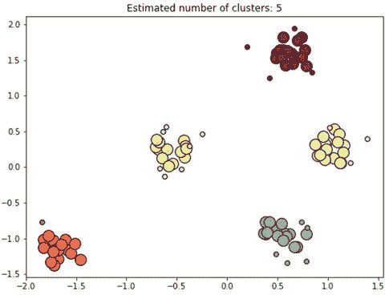
**图 10-11** – 划分聚类

### 位置聚类

在 Python 编辑器中打开一个新文件，尝试以下位置聚类。先设置好生态工具包。

```python
import sys
import os
from math import radians, cos, sin, asin, sqrt
from scipy.spatial.distance import pdist, squareform
from sklearn.cluster import DBSCAN
import matplotlib.pyplot as plt
import pandas as pd
```

还记得这个距离测量函数吗？它计算地球上两点（以十进制度数指定）之间的大圆距离。

```python
def haversine(lonlat1, lonlat2):
    # 将十进制度数转换为弧度
    lat1, lon1 = lonlat1
    lat2, lon2 = lonlat2
    lon1, lat1, lon2, lat2 = map(radians, [lon1, lat1, lon2, lat2])

    # 半正矢公式
    dlon = lon2 - lon1
    dlat = lat2 - lat1
    a = sin(dlat/2)**2 + cos(lat1) * cos(lat2) * sin(dlon/2)**2
    c = 2 * asin(sqrt(a))
    r = 6371  # 地球半径，单位为公里。使用 3956 则为英里
    return c * r
```

让我们获取位置数据。

```python
if sys.platform == 'linux':
    Base=os.path.expanduser('~') + '/VKHCG'
else:
    Base='C:/VKHCG'

sFileName=Base + '/01-Vermeulen/00-RawData/IP_DATA_ALL.csv'
print('Loading :',sFileName)

scolumns=("Latitude","Longitude")
RawData = pd.read_csv(sFileName,usecols=scolumns,header=0,low_memory=False)
print(RawData)
```

现在，你需要一个包含 1000 个数据点的样本。

```python
X=RawData.sample(n=1000)
```

接下来，计算聚类距离参数。

```python
distance_matrix = squareform(pdist(X, (lambda u,v: haversine(u,v))))
print(distance_matrix)
```

然后，应用聚类算法。

```python
db = DBSCAN(eps=0.2, min_samples=2, metric="precomputed", algorithm="auto")
y_db = db.fit_predict(distance_matrix)
X['cluster'] = y_db
C = X.cluster.unique()
```

我们来可视化数据。

```python
fig=plt.figure(1, figsize=(20, 20))
plt.title('Estimated number of clusters: %d' % len(C))
plt.scatter(X['Latitude'], X['Longitude'], c=X['cluster'],marker='D')
plt.show()
```

现在保存你的结果。

```python
sImageFile = Base + '/01-Vermeulen/04-Transform/01-EDS/02-Python/Location_Cluster.jpg'
fig.savefig(sImageFile)
plt.close(fig)
```

你应该会看到类似图 10-12 所示的布局。

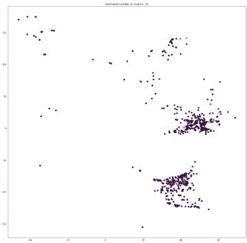
**图 10-12** 位置聚类

注意：本章前文讨论的潜在狄利克雷分配（LDA）可归类为聚类算法，应在其他聚类算法中提及。

至此，你已完成分区聚类解决方案。

## 方差分析（ANOVA）

单因素方差分析（ANOVA）检验用于确定两组以上数据集的均值是否与每个数据集存在显著差异。

示例：
针对 5 组客户（每组 100 人）执行了一次“买一送一”（BOGOF）促销活动。每组客户的人口统计属性各不相同。我们希望确定这五组客户对活动的响应是否存在差异。这将有助于我们为正确的人口统计群体优化合适的活动方案，从而提高响应率并降低活动成本。

方差分析的原理是比较组间方差与组内方差。该技术的核心在于评估所有组是否实际上属于同一个更大的总体，还是具有不同特征的完全不同总体。

打开你的 Python 编辑器，并设置以下环境：

```python
import pandas as pd

datafile='../VKHCG/01-Vermeulen/00-RawData/PlantGrowth.csv'
data = pd.read_csv(datafile)
```

现在，你需要根据数据创建一个箱线图。

```python
data.boxplot('weight', by="group", figsize=(12, 8))
```

# 特征提取和工程

接下来，你必须执行特征提取和工程。

```python
ctrl = data['weight'][data.group == 'ctrl']
grps = pd.unique(data.group.values)
d_data = {grp:data['weight'][data.group == grp] for grp in grps}
k = len(pd.unique(data.group))  # 条件数量
N = len(data.values)  # 条件乘以参与者数量
n = data.groupby('group').size()[0] # 每个条件下的参与者数量
```

你现在需要从额外库中导入函数：

```python
from scipy import stats
```

现在，针对“两个或多个组具有相同总体均值”的原假设，激活单因素方差分析检验。

```python
F, p = stats.f_oneway(d_data['ctrl'], d_data['trt1'], d_data['trt2'])
```

你需要设置一些参数。

```python
DFbetween = k - 1
DFwithin = N - k
DFtotal = N - 1
```

现在，你可以进一步研究转换后的结果。

```python
SSbetween = (sum(data.groupby('group').sum()['weight']**2)/n) \
- (data['weight'].sum()**2)/N
sum_y_squared = sum([value**2 for value in data['weight'].values])
SSwithin = sum_y_squared - sum(data.groupby('group').sum()['weight']**2)/n
SStotal = sum_y_squared - (data['weight'].sum()**2)/N
MSbetween = SSbetween/DFbetween
MSwithin = SSwithin/DFwithin
F = MSbetween/MSwithin
eta_sqrd = SSbetween/SStotal
omega_sqrd = (SSbetween - (DFbetween * MSwithin))/(SStotal + MSwithin)
```

以下是你分析的结果：

```python
print(F,p,eta_sqrd,omega_sqrd)
```

干得漂亮。你已成功执行了一次单因素方差分析检验。

# 主成分分析（PCA）

降维技术旨在将高维数据集降低到较低维度，同时不丢失数据集所传达的信息特征。这里的维度可以理解为数据集所包含的变量数量。

以下介绍两种常用的变量减少技术。

## 因子分析

PCA 的关键在于从主成分的角度衡量数据。数据集的主成分是方差最大的方向。PCA 分析涉及将每个变量的轴旋转到最高特征值/特征向量对，并定义主成分，即方差最大的轴，或者说最能定义数据的方向。主成分是不相关且正交的。

PCA 本质上是一种降维算法，但它同样可用作可视化、噪声过滤、特征提取和特征工程的工具。以下是一个示例。

打开你的 Python 编辑器并搭建以下环境：

```python
import matplotlib.pyplot as plt
from mpl_toolkits.mplot3d import Axes3D
from sklearn import datasets
from sklearn.decomposition import PCA
```

导入一些数据来应用你的技能。

```python
iris = datasets.load_iris()
```

仅取前两个特征。

```python
X = iris.data[:, :2]
```

你需要以下目标变量：

```python
y = iris.target
x_min, x_max = X[:, 0].min() - .5, X[:, 0].max() + .5
y_min, y_max = X[:, 1].min() - .5, X[:, 1].max() + .5
```

你可以快速可视化该数据集。

```python
plt.clf()
plt.figure(2, figsize=(8, 6))
```

现在绘制训练点。

```python
plt.scatter(X[:, 0], X[:, 1], c=y, cmap=plt.cm.Set1, edgecolor='k')
plt.xlabel('花萼长度')
plt.ylabel('花萼宽度')
plt.xlim(x_min, x_max)
plt.ylim(y_min, y_max)
plt.xticks(())
plt.yticks(())
```

我建议你更好地理解各维度之间的相互作用。绘制前三个 PCA 维度。

```python
fig = plt.figure(1, figsize=(8, 6))
ax = Axes3D(fig, elev=-150, azim=110)
X_reduced = PCA(n_components=3).fit_transform(iris.data)
ax.scatter(X_reduced[:, 0], X_reduced[:, 1], X_reduced[:, 2], c=y,
           cmap=plt.cm.Set1, edgecolor="k", s=40)
ax.set_title("前三个 PCA 方向")
ax.set_xlabel("第一特征向量")
ax.w_xaxis.set_ticklabels([])
ax.set_ylabel("第二特征向量")
ax.w_yaxis.set_ticklabels([])
ax.set_zlabel("第三特征向量")
ax.w_zaxis.set_ticklabels([])
plt.show()
```

你能看出以可控方式减少特征的优势吗？接下来将你的新知识应用于一个更复杂的数据集。

# 示例

Hillman 有限公司在其主大门上引入了闭路电视追踪流程，因其怀疑通过港口仓库发生了未经授权的卸货行为。你将加载摄像头拍摄的一组数字图像，以协助该公司读取离开仓库的集装箱侧面的编号。

打开你的 Python 编辑器并搭建以下环境：

```python
from sklearn.datasets import load_digits
from sklearn.decomposition import PCA
import matplotlib.pyplot as plt
import numpy as np
```

从预处理后的图像软件中加载数字数据。

```python
digits = load_digits()
```

现在应用变换，将数据从 64 维投影到 2 维。

```python
pca = PCA(2)
projected = pca.fit_transform(digits.data)
print(digits.data.shape)
print(projected.shape)
```

展示你的发现。

```python
plt.figure(figsize=(10, 15))
plt.scatter(projected[:, 0], projected[:, 1],
            c=digits.target, edgecolor="none", alpha=0.5,
            cmap=plt.cm.get_cmap('nipy_spectral_r', 10))
plt.xlabel('值 1')
plt.ylabel('值 2')
plt.colorbar()
```

应用 PCA 变换。

```python
pca = PCA().fit(digits.data)
plt.plot(np.cumsum(pca.explained_variance_ratio_))
plt.xlabel('主成分数量')
plt.ylabel('累积解释方差')
```

你需要以下函数来绘制数字图像：

```python
def plot_digits(data):
    fig, axes = plt.subplots(4, 10, figsize=(10, 4),
                             subplot_kw={'xticks':[], 'yticks':[]},
                             gridspec_kw=dict(hspace=0.1, wspace=0.1))
    for i, ax in enumerate(axes.flat):
        ax.imshow(data[i].reshape(8, 8),
```

## 可视化

```python
cmap='binary', interpolation="nearest",
                  clim=(0, 16))
```

现在你可以绘制结果。

```python
plot_digits(digits.data)
```

然而，其中一台摄像头并未生成完美的图像。

```python
np.random.seed(42)
noisy = np.random.normal(digits.data, 4)
plot_digits(noisy)
```

你仍然可以使用这些数据，只是需要更多的处理。

```python
pca = PCA(0.50).fit(noisy)
pca.n_components_
```

你可以通过过滤噪声因子来确定失真程度。

```python
components = pca.transform(noisy)
filtered = pca.inverse_transform(components)

# 可视化你的结果：
plot_digits(filtered)
```

## 问题

你能看清摄像头捕捉到的数字吗？

你认为我们有一个可行的解决方案吗？

现在你已经证明，你可以处理一个复杂的 64 维数据集，并使用 `PCA` 将其降至 2 维，同时仍然取得良好的数据科学成果。你在进步方面做得不错。

## 联合分析

[联合分析](http://analyticsindiamag.com/applying-conjoint-analysis-provisioning-of-a-new-restaurant/%23_blank)广泛应用于市场研究，用于识别顾客对构成产品的不同属性的偏好。这些属性可以是各种特征，例如尺寸、颜色、易用性、价格等。

通过使用联合（权衡）分析，品牌经理可以识别出顾客愿意为某个特定价格点放弃哪些特征。因此，这类分析在新产品设计或定价策略中是一种非常常用的技术。

**示例**：数据是对三种不同特征（电视尺寸、电视类型、电视颜色）的排名。

- 电视尺寸选项为 42 寸、47 寸或 60 寸。
- 电视类型选项为液晶或等离子。
- 电视颜色选项为红色、蓝色或粉色。

该数据对每个客户的不同刺激类型进行了评分。你的任务是确定在克伦沃尔纳的广告牌上展示哪些电视。

打开你的 Python 编辑器并设置以下环境：

```python
import numpy as np
import pandas as pd
```

获取客户的购买选择。

```python
sFile = 'C:/VKHCG/01-Vermeulen/00-RawData/BuyChoices.txt'
caInputeDF = pd.read_csv(sFile, sep=";")
```

你可以显示这些选择。

```python
print(caInputeDF)
```

你需要一个新的数据结构，并且必须为每个刺激创建虚拟变量。总共，你需要 9 个不同的刺激和 18 种不同的组合。

```python
ConjointDummyDF = pd.DataFrame(np.zeros((18, 9)),
                               columns=["Rank", "A1", "A2", "A3", "B1", "B2", "C1", "C2", "C3"])
```

现在，你需要将数据选择特征工程化为新的结构：

```python
ConjointDummyDF.Rank = caInputeDF.Rank

for index, row in caInputeDF.iterrows():
    stimuli1 = str(caInputeDF["Stimulus"].iloc[index][:2])
    stimuli2 = str(caInputeDF["Stimulus"].iloc[index][2:4])
    stimuli3 = str(caInputeDF["Stimulus"].iloc[index][4:6])
    stimuliLine = [stimuli1, stimuli2, stimuli3]
    Columns = ConjointDummyDF.columns

    for stimuli in stimuliLine:
        for i in range(len(Columns)):
            if stimuli == Columns[i]:
                ConjointDummyDF.iloc[index, i] = 1
```

做得好。让我们看看你的新结构。

```python
print(ConjointDummyDF.head())
```

你看到的只有未知数字。我建议你添加合适的刺激名称。请注意你通常向业务人员展示的转换步骤。他们明白等离子电视并不适用于 `TVType3`。

```python
fullNames = {
    "Rank": "Rank",
    "A1": '42" (106cm)',
    "A2": '47" (120cm)',
    "A3": '60" (152cm)',
    "B1": "Plasma",
    "B2": "LCD",
    "C1": "Blue",
    "C2": "Red",
    "C3": "Pink",
}
ConjointDummyDF.rename(columns=fullNames, inplace=True)
```

这样好多了。现在查看数据结构。

```python
#ConjointDummyDF.head()
```

接下来，你通过线性回归来估计主效应。你需要额外的库来实现此操作。

```python
import statsmodels.api as sm
```

你可以为你的模型选择这些列中的任何一列。

```python
print(ConjointDummyDF.columns)
```

我建议你选择以下这些：

```python
X = ConjointDummyDF[[u'42" (106cm)', u'47" (120cm)',
                     u'60" (152cm)', u'Plasma', u'LCD', u'Red', u'Blue', u'Pink']]
```

你现在需要建立模型。

```python
X = sm.add_constant(X)
Y = ConjointDummyDF.Rank
```

现在，你根据新的数据结构激活模型。

```python
linearRegression = sm.OLS(Y, X).fit()
```

你现在可以查看结果了。

- 有许多指标需要你研究。我不会详细讲解其中任何一个，因为有些需要复杂的数学才能完全解释清楚。我们感兴趣的指标是各刺激的分值效用和相对重要性：
    - 刺激的重要性 = `Max(beta) - Min(beta)`
    - 刺激的相对重要性 = `单个刺激的重要性 / 所有刺激重要性之和`

```python
print(linearRegression.summary())
```

你现在将研究这些指标。为此，你需要进行一些数据工程处理。你现在需要几个基本指标变量来启动这个过程。

```python
importance = []
relative_importance = []
rangePerFeature = []
begin = "A"
tempRange = []
```

你现在需要加载刺激数据。

```python
for stimuli in fullNames.keys():
    if stimuli[0] == begin:
        tempRange.append(linearRegression.params[fullNames[stimuli]])
    elif stimuli == "Rank":
        rangePerFeature.append(tempRange)
    else:
        rangePerFeature.append(tempRange)
        begin = stimuli[0]
        tempRange = [linearRegression.params[fullNames[stimuli]]]
```

然后，你需要各特征的范围。

```python
for item in rangePerFeature:
    importance.append(max(item) - min(item))
```

接着计算一个特征的重要性。

```python
for item in importance:
    relative_importance.append(100 * round(item / sum(importance), 3))
```

为分值效用值创建一个基础数据结构。

```python
partworths = []
item_levels = [1, 3, 5, 8]
```

你现在计算分值效用值。

```python
for i in range(1, 4):
```

part_worth_range = linearRegression.params[item_levels[i-1]:item_levels[i]]
print(part_worth_range)
```

你需要确定数据集的平均排名。
```python
meanRank = []
for i in ConjointDummyDF.columns[1:]:
    newmeanRank = ConjointDummyDF["Rank"].loc[ConjointDummyDF[i] == 1].mean()
    meanRank.append(newmeanRank)
```

我建议你使用称为“基础效用”的总体平均值，作为“零替代方案”。
```python
totalMeanRank = sum(meanRank) / len(meanRank)
```

你现在将对每个刺激部分的效用值进行排名，即电视的哪些特征重要？
```python
partWorths = {}
for i in range(len(meanRank)):
    name = fullNames[sorted(fullNames.keys())[i]]
    partWorths[name] = meanRank[i] - totalMeanRank
```

你现在有了一个结果集。
```python
print(partWorths)
```

现在，我将帮助你将这些结果转化为洞察，并为总结和结果报告提供基础。
```python
print ("Relative Importance of Feature:\n\nMonitor Size:",relative_importance[0], "%","\nType of Monitor:", relative_importance[1], "%", "\nColor of TV:", relative_importance[2], "%\n\n")
print ("--"*30)
print ("Importance of Feature:\n\nMonitor Size:",importance[0],"\nType of Monitor:", importance[1],  "\nColor of TV:", importance[2])
```

那么，最佳的产品组合是什么？我建议选择 60 寸、液晶、红色。你同意吗？让我们来测试这个假设。
```python
optBundle = [1,0,0,1,0,1,0,1,0]
print ("The best possible Combination of Stimuli would have the highest rank:",linearRegression.predict(optBundle)[0])
optimalWorth = partWorths["60\" (152cm)"] + partWorths["LCD"] + partWorths["Red"]
print ("Choosing the optimal Combination brings the Customer an extra ", optimalWorth, "'units' of utility")
```

你的科学依据是否支持我的假设？恭喜你，你刚刚完成了一次联合分析。

`提示`
我建议你尝试使用其他数据集进行等效分析，因为这是我经常被问到的问题。是什么让人们选择一种产品而不是另一种？你应该练习使用各种规模的数据集，以理解公式如何响应刺激因素的变化。我相信，你在克伦沃尔纳作为数据科学家是有前途的。

## [决策树](http://analyticsindiamag.com/predictive-attrition-model/%23_blank)
决策树，顾名思义，是一种树状的视觉化表示形式，它通过列出所有选项及其发生概率，展示了可遵循的路径，以达成特定决策。决策树非常易于理解和解读。在树的每个节点上，都可以解读选择该节点或选项所带来的后果。一系列决策会将你引向最终结果，如图 10-13 所示。
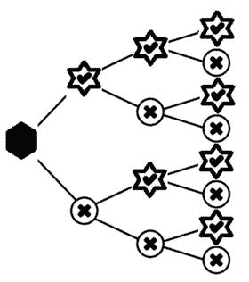
**图 10-13** 简单决策树

在开始示例之前，我必须介绍一种常见的决策树附加算法，称为`AdaBoost`。`AdaBoost`是“自适应增强”（`adaptive boosting`）的缩写，是一种机器学习元算法。

该分类器是一种元估计器，因为它首先在原始数据集上拟合一个分类器，然后在同一数据集上拟合该分类器的额外副本，但会调整错误分类实例的权重，使得后续分类器更专注于困难案例。通过为特定变量中不太清晰的差异增加渐进权重以增强其影响，它提升了学习效果。详情请参阅[`http://scikit-learn.org/stable/modules/generated/sklearn.ensemble.AdaBoostClassifier.html`](http://scikit-learn.org/stable/modules/generated/sklearn.ensemble.AdaBoostClassifier.html)。

这种增强机制使得数据科学家能够针对特定数据实体，沿着不清晰的决策路径强制做出决策，从而优化结果。

### 使用`AdaBoost`的决策树示例：
打开你的 Python 编辑器并设置以下环境：
```
import numpy as np
import matplotlib.pyplot as plt
from sklearn.tree import DecisionTreeRegressor
from sklearn.ensemble import AdaBoostRegressor
```

你需要一个数据集。因此，你可以构建一个随机数据集。
```
rng = np.random.RandomState(1)
X = np.linspace(0, 6, 1000)[:, np.newaxis]
y = np.sin(X).ravel() + np.sin(6 * X).ravel() + rng.normal(0, 0.1, X.shape[0])
```

然后将标准回归模型拟合到数据集上。
```
regr_1 = DecisionTreeRegressor(max_depth=4)
```

接着，再将一个`AdaBoost`模型应用于数据集。如果你想进行实验，可以更改参数。
```
regr_2 = AdaBoostRegressor(DecisionTreeRegressor(max_depth=4),
                           n_estimators=300, random_state=rng)
```

然后训练模型。
```
regr_1.fit(X, y)
regr_2.fit(X, y)
```

激活预测功能。
```
y_1 = regr_1.predict(X)
y_2 = regr_2.predict(X)
```

绘制结果。
```
plt.figure(figsize=(15, 10))
plt.scatter(X, y, c="k", label="Training Samples")
plt.plot(X, y_1, c="g", label="n_Estimators=1", linewidth=2)
plt.plot(X, y_2, c="r", label="n_Estimators=300", linewidth=2)
plt.xlabel("Data")
plt.ylabel("Target")
plt.title("Boosted Decision Tree Regression")
plt.legend()
plt.show()
```

恭喜！你刚刚构建了一个决策树。现在你可以通过一个更复杂的示例来测试你的新技能了。

再次打开你的 Python 编辑器并设置此环境：
```
import numpy as np
import matplotlib.pyplot as plt
from sklearn.ensemble import AdaBoostClassifier
from sklearn.tree import DecisionTreeClassifier
from sklearn.datasets import make_gaussian_quantiles
```

你正在构建一个更复杂的数据集。
```
X1, y1 = make_gaussian_quantiles(cov=2.,
                                 n_samples=2000, n_features=2,
                                 n_classes=2, random_state=1)
X2, y2 = make_gaussian_quantiles(mean=(3, 3), cov=1.5,
                                 n_samples=3000, n_features=2,
                                 n_classes=2, random_state=1)
```

## 支持向量机、网络、聚类与网格

支持向量机（`SVM`）在高维或无限维空间中构建一个超平面或一组超平面，可用于分类和回归。支持向量网络（`SVN`）将多个`SVM`以菊花链方式连接，形成一个网络。所有数据都流经同一系列`SVM`。

支持向量聚类（`SVC`）在数据的不同聚类上并行运行`SVM`。因此，并非所有数据都流经所有的`SVM`。

支持向量网格（`SVG`）是`SVN`的`SVC`，或者是`SVC`的`SVN`。这种解决方案很可能是你在客户现场最常开发的配置。它使用`SVM`来处理较小的数据聚类，以应用特定的转换步骤。作为初学数据科学家，你只需了解它们的存在即可。

### 支持向量机

支持向量机是一种判别式分类器，其正式定义由分离超平面给出。该方法计算一个具有最大间隔的最优超平面（图 10-14），以确保将数据集分类成不同的数据点簇。

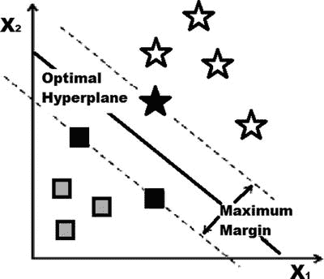

图 10-14 简单支持向量机的最优超平面

我将引导你完成一个 `SVM` 示例。打开你的 Python 编辑器并创建以下环境：

```python
import numpy as np
import matplotlib.pyplot as plt
from sklearn import svm
```

以下是你的数据集和目标值。

```python
X = np.c_[(.4, -.7),
(-1.5, -1),
(-1.4, -.9),
(-1.3, -1.2),
(-1.1, -.2),
(-1.2, -.4),
(-.5, 1.2),
(-1.5, 2.1),
(1, 1),
(1.3, .8),
(1.2, .5),
(.2, -2),
(.5, -2.4),
(.2, -2.3),
(0, -2.7),
(1.3, 2.1)].T
Y = [0] * 8 + [1] * 8
```

你将结果显示为图编号 1。

```python
fignum = 1
```

你有几个可用于拟合数据模型的核函数。我将带你逐一了解它们。

```python
for kernel in ('linear', 'poly', 'rbf'):
    clf = svm.SVC(kernel=kernel, gamma=2)
    clf.fit(X, Y)
```

现在绘制线、点以及离超平面最近的向量。

```python
plt.figure(fignum, figsize=(8, 6))
plt.clf()
plt.scatter(clf.support_vectors_[:, 0], clf.support_vectors_[:, 1], s=80,
            facecolors='none', zorder=10, edgecolors="k")
plt.scatter(X[:, 0], X[:, 1], c=Y, zorder=10, cmap=plt.cm.Paired,
            edgecolors='k')
plt.axis('tight')
x_min = -3
x_max = 3
y_min = -3
y_max = 3
XX, YY = np.mgrid[x_min:x_max:200j, y_min:y_max:200j]
Z = clf.decision_function(np.c_[XX.ravel(), YY.ravel()])
```

现在将结果应用到彩色图中。

```python
Z = Z.reshape(XX.shape)
plt.figure(fignum, figsize=(8, 6))
plt.pcolormesh(XX, YY, Z > 0, cmap=plt.cm.Paired)
plt.contour(XX, YY, Z, colors=['k', 'k', 'k'], linestyles=['--', '-', '--'],
            levels=[-.5, 0, .5])
plt.xlim(x_min, x_max)
plt.ylim(y_min, y_max)
plt.xticks(())
plt.yticks(())
fignum = fignum + 1
```

现在显示你的图。

```python
plt.show()
```

做得好，你刚刚完成了一个复杂的决策树。

```python
X = np.concatenate((X1, X2))
y = np.concatenate((y1, - y2 + 1))
```

现在你有了一个准备好的数据集。创建一个 `AdaBoost` 增强的决策树并拟合到数据集上。

```python
bdt = AdaBoostClassifier(DecisionTreeClassifier(max_depth=1),
                        algorithm="SAMME",
                        n_estimators=200)
```

你训练模型。

```python
bdt.fit(X, y)
```

现在需要设置一些你将用到的参数。

```python
plot_colors = "br"
plot_step = 0.02
class_names = "AB"
```

现在创建结果的可视化。

```python
plt.figure(figsize=(10, 5))
```

添加决策边界的绘图。

```python
plt.subplot(121)
x_min, x_max = X[:, 0].min() - 1, X[:, 0].max() + 1
y_min, y_max = X[:, 1].min() - 1, X[:, 1].max() + 1
xx, yy = np.meshgrid(np.arange(x_min, x_max, plot_step),
                     np.arange(y_min, y_max, plot_step))
Z = bdt.predict(np.c_[xx.ravel(), yy.ravel()])
Z = Z.reshape(xx.shape)
cs = plt.contourf(xx, yy, Z, cmap=plt.cm.Paired)
plt.axis("tight")
```

绘制你的训练点。

```python
for i, n, c in zip(range(2), class_names, plot_colors):
    idx = np.where(y == i)
    plt.scatter(X[idx, 0], X[idx, 1],
                c=c, cmap=plt.cm.Paired,
                s=20, edgecolor="k",
                label="Class %s" % n)
plt.xlim(x_min, x_max)
plt.ylim(y_min, y_max)
plt.legend(loc='upper right')
plt.xlabel('x')
plt.ylabel('y')
plt.title('Decision Boundary')
```

绘制两个类别的决策分数。

```python
twoclass_output = bdt.decision_function(X)
plot_range = (twoclass_output.min(), twoclass_output.max())
plt.subplot(122)
for i, n, c in zip(range(2), class_names, plot_colors):
    plt.hist(twoclass_output[y == i],
             bins=10,
             range=plot_range,
             facecolor=c,
             label='Class %s' % n,
             alpha=.5,
             edgecolor='k')
x1, x2, y1, y2 = plt.axis()
plt.axis((x1, x2, y1, y2 * 1.2))
plt.legend(loc='upper right')
plt.ylabel('Samples')
plt.xlabel('Score')
plt.title('Decision Scores')
plt.tight_layout()
plt.subplots_adjust(wspace=0.35)
plt.show()
```

干得漂亮。你刚刚完成了三种不同类型的 SVM。

### 支持向量网络

支持向量网络是多个支持向量机组成的集成网络，这些支持向量机通过使用不同的参数甚至不同的核函数，共同对同一数据集进行分类。这是一种通过创建 SVM 链来进行特征工程的常用方法。

提示：你可以在同一流程中更改核函数以揭示新的特征。使用不同的核函数练习处理数据集，以理解它们能为你带来什么。

### 支持向量聚类

支持向量聚类用于将数据点分类成簇，并由支持向量机在簇的层面上执行分类。这种方法常用于高维数据集，其中聚类会创建一个分组，然后 SVM 可以利用该分组，使用不同的核函数和其他参数来细分数据点。

在我每天处理的许多深度学习算法中，我都看到过 `SVC`、`SVN`、`SVM` 和 `SVG` 的过程。数据的数量、多样性和速度要求深度学习进行多阶段分类，以便在初步结果发布后能够对数据点进行更详细的分析。

## 数据挖掘

数据挖掘是处理数据以查明模式并建立数据实体之间的关系。以下是关于数据模式你需要了解的一些关键数据挖掘理论，掌握这些理论有助于成功进行数据挖掘。

### 关联模式

这涉及检测一个事件与另一个事件相关联的模式。例如，如果一个装卸平台的门被打开，那么可以合理地假设一辆卡车正在装卸货物。模式关联仅仅是发现数据中事件的关联性。你将使用一些核心统计技能来进行此处理。

警告：“相关关系并不意味着因果关系。”

相关性仅仅是两个数据集之间的一种关系或行为指示。这种关系并非由因果驱动的行为。

示例：如果你发现炎热天气与冰淇淋销售之间存在关系，这并不意味着冰淇淋销量高会导致天气炎热，反之亦然。这只是一种观察到的关系。

这在零售购物篮分析和推荐系统中很常见。我将在第 11 章中进一步讨论这个因果因素，届时我们将开始准备我们的洞察和可操作的知识提取。现在，我将引导你完成一个示例。

请打开你的 Python 编辑器并创建以下环境：

```python
import pandas as pd

df1 = pd.DataFrame({'A': range(8), 'B': [2*i for i in range(8)]})
df2 = pd.DataFrame({'A': range(8), 'B': [-2*i for i in range(8)]})
```

这是你的数据。

```python
print('正数据集')
print(df1)
print('负数据集')
print(df2)
```

以下是你的结果。

```python
print('结果')
print('正相关:', df1['A'].corr(df1['B']))
print('负相关:', df2['A'].corr(df2['B']))
```

你应该会看到相关系数为 `+1` 或 `-1`。如果是 `+1`，这意味着两个值之间 100% 正相关，因此它们以相同的速率变化。如果是 `-1`，这意味着 100% 负相关，表明两个值之间存在关系，即一个增加而另一个减少。

提示：在真实世界的数据集中，`+1` 和 `-1` 这两种极端情况不会出现。范围通常是 `i-1 < C < +1`。

现在你将应用会干扰相关性的修改。

```python
df1.loc[2, 'B'] = 10
df2.loc[2, 'B'] = -10
```

现在你可以看到影响。

```python
print('正数据集')
print(df1)
print('负数据集')
print(df2)
print('结果')
print('正相关:', df1['A'].corr(df1['B']))
print('负相关:', df2['A'].corr(df2['B']))
```

你能感受到微小的变化对模型产生的影响吗？

那么，让我们添加一个更大的变化。

```python
df1.loc[3, 'B'] = 100
df2.loc[3, 'B'] = -100
```

你检查一下影响。

```python
print('正数据集')
print(df1)
print('负数据集')
print(df2)
print('结果')
print('正相关:', df1['A'].corr(df1['B']))
print('负相关:', df2['A'].corr(df2['B']))
```

如果你理解了干扰关系的那些变化，那么干得漂亮。如果你看到了这种关系，你就已经理解了关联模式。

这些“假设？”分析是数据科学家日常任务中常见的。例如，这样一种分析可能涉及以下问题：如果我裁掉 1000 名员工中的 300 名，会发生什么？裁减员工在什么程度上会产生影响？这些模拟影响的逐步递增可用于模拟未来渐进式的计划变更。

### 分类模式

该技术发现数据中的新模式，以提高整个数据集的质量。数据分类是将数据整合到不同类别中的过程，以便数据处理能最有效、最高效地使用它。例如，如果数据与运输部门相关，那么你必须在数据上添加一个标签来表明这一事实。

一个精心规划的数据分类系统会创建易于查找和检索的重要数据结构。你肯定不希望每次想要分析新的数据模式时，都在整个数据湖中到处搜索数据。

### 聚类模式

聚类是指发现并对先前未知的特定数据组进行标记的过程。例如，当顾客在周一晚上同时购买面包和牛奶时，通过观察他们典型的基本购物篮，你可以将这些顾客归为"周初小规模购物者"这一类别。

任何能够将数据条目聚类到特定分组的变量组合，都可以被视为某种形式的聚类。对于数据科学家而言，掌握以下聚类类型大有裨益。

### 基于连接性的聚类

通过研究数据项之间的连接关系，你可以发现它们之间的相互作用。这一过程有时也被称为层次聚类。

### 基于质心的聚类（`K-Means` 聚类）

"基于质心"这一概念将聚类描述为数据条目与数据集中虚拟中心点之间的关系。`K-means` 聚类是最流行的基于质心聚类算法。我将通过一个示例来为你讲解。

打开你的 Python 编辑器，并搭建以下环境：

```python
import numpy as np
import matplotlib.pyplot as plt
from mpl_toolkits.mplot3d import Axes3D
from sklearn.cluster import KMeans
from sklearn import datasets
```

现在设置一个用于研究的数据集。

```python
np.random.seed(5)
iris = datasets.load_iris()
X = iris.data
y = iris.target
```

为聚类配置估计器。

```python
estimators = [('k_means_iris_8', KMeans(n_clusters=8)),
             ('k_means_iris_3', KMeans(n_clusters=3)),
             ('k_means_iris_bad_init', KMeans(n_clusters=3, n_init=1,
                                              init='random'))]
```

准备好可视化结果。

```python
fignum = 1
titles = ['8 个簇', '3 个簇', '3 个簇，初始化不佳']
for name, est in estimators:
    fig = plt.figure(fignum, figsize=(4, 3))
    ax = Axes3D(fig, rect=[0, 0, .95, 1], elev=48, azim=134)
    est.fit(X)
    labels = est.labels_
    ax.scatter(X[:, 3], X[:, 0], X[:, 2],
               c=labels.astype(np.float), edgecolor="k")
    ax.w_xaxis.set_ticklabels([])
    ax.w_yaxis.set_ticklabels([])
    ax.w_zaxis.set_ticklabels([])
    ax.set_xlabel('花瓣宽度')
    ax.set_ylabel('花萼长度')
    ax.set_zlabel('花瓣长度')
    ax.set_title(titles[fignum - 1])
    ax.dist = 12
    fignum = fignum + 1
```

绘制结果。

```python
fig = plt.figure(fignum, figsize=(4, 3))
ax = Axes3D(fig, rect=[0, 0, .95, 1], elev=48, azim=134)
for name, label in [('Setosa', 0),
                    ('Versicolour', 1),
                    ('Virginica', 2)]:
    ax.text3D(X[y == label, 3].mean(),
              X[y == label, 0].mean(),
              X[y == label, 2].mean() + 2, name,
              horizontalalignment='center',
              bbox=dict(alpha=.2, edgecolor="w", facecolor="w"))
```

重新排序标签，使颜色与聚类结果匹配。

```python
y = np.choose(y, [1, 2, 0]).astype(np.float)

ax.scatter(X[:, 3], X[:, 0], X[:, 2], c=y, edgecolor="k")

ax.w_xaxis.set_ticklabels([])

ax.w_yaxis.set_ticklabels([])

ax.w_zaxis.set_ticklabels([])

ax.set_xlabel('花瓣宽度')

ax.set_ylabel('花萼长度')

ax.set_zlabel('花瓣长度')

ax.set_title('真实标签')

ax.dist = 12

fig.show()
```

做得好。你应该能看到你辛勤工作得到的一组结果。你能看出基于连接性的聚类是如何利用数据点之间的相互作用来解决转换步骤的吗？

# 基于分布的聚类

这类聚类模型将数据集与统计分布模型相关联。最广泛使用的基于密度的聚类技术是`DBSCAN`。

## 基于密度的聚类

在基于密度的聚类中，密度较高的区域会与数据集的其他部分分离开来。稀疏区域中的数据条目会被归入单独的聚类。这些聚类被视为噪声、异常点和边界数据。

# 基于网格的方法

基于网格的方法常用于挖掘大型多维空间聚类，这些聚类具有比周围环境更密集的区域。基于网格的聚类方法与传统聚类算法的不同之处在于，它不直接使用数据点，而是使用数据点周围的值空间。

# 贝叶斯分类

朴素贝叶斯分类器是一类概率分类器，其基础是应用贝叶斯定理，并假设数据集中的特征之间具有强独立性。还有一种更具体的贝叶斯分类方法你需要注意，它被称为树增强朴素贝叶斯（TAN）。

树增强朴素贝叶斯是一种半朴素贝叶斯学习方法。它通过分配一个树结构来放宽朴素贝叶斯的属性独立性假设，在该结构中，每个属性仅依赖于类别和另一个属性。通过使用一个最大化训练数据似然度的最大加权生成树来执行分类。接下来将讨论朴素贝叶斯分类器和树增强朴素贝叶斯分类器这两个著名模型。以下是一个示例：

打开你的 Python 编辑器，并从以下环境开始。

```python
import numpy as np

import urllib
```

通过网络接口加载数据。

```python
url = "http://archive.ics.uci.edu/ml/machine-learning-databases/pima-indians-diabetes/pima-indians-diabetes.data"
```

下载文件。

```python
raw_data = urllib.request.urlopen(url)
```

将 CSV 文件加载到 `numpy` 矩阵中。

```python
dataset = np.loadtxt(raw_data, delimiter=",")
```

将数据与数据集中的目标属性分离。

```python
X = dataset[:,0:8]

y = dataset[:,8]
```

添加额外的处理能力。

```python
from sklearn import metrics

from sklearn.naive_bayes import GaussianNB

model = GaussianNB()

model.fit(X, y)

print(model)
```

生成预测。

```python
expected = y

predicted = model.predict(X)
```

# 总结模型的拟合效果

```
print(metrics.classification_report(expected, predicted))

print(metrics.confusion_matrix(expected, predicted))
```

你已经成功构建了你的朴素贝叶斯分类器。干得漂亮！

好的，作为一名高级文档工程师和翻译员，我将严格遵循您的注意事项和示例，将给定的英文文本翻译成中文。

## 序列或路径分析

此分析用于识别一个事件如何引发另一个事件，从而最终洞察业务。路径分析是指某个业务实体在特定时间段内执行的一系列连续事件，旨在了解其行为，从而从数据中获得可执行的见解。

我建议您结合使用多种工具来处理此类分析。我通常借助图数据库来建模序列或路径，对于较小的项目，我会使用 Python 中一个名为 `networkx` 的库。

**示例：**

您当地的电信公司希望了解导致客户将电话套餐转投至其竞争对手的原因或事件流。

打开您的 Python 编辑器并设置此环境。

```
################################################################
```

导入和设置代码：

```python
# -*- coding: utf-8 -*-

################################################################

import sys

import os

import pandas as pd

import sqlite3 as sq

import networkx as nx

import datetime

pd.options.mode.chained_assignment = None

################################################################

if sys.platform == 'linux':

    Base=os.path.expanduser('~') + '/VKHCG'

else:

    Base='C:/VKHCG'

print('################################')

print('Working Base :',Base, ' using ', sys.platform)

print('################################')

################################################################

Company='01-Vermeulen'

################################################################

sDataBaseDir=Base + '/' + Company + '/04-Transform/SQLite'

if not os.path.exists(sDataBaseDir):

    os.makedirs(sDataBaseDir)

################################################################

sDatabaseName=sDataBaseDir + '/Vermeulen.db'

conn = sq.connect(sDatabaseName)
```

您必须创建一个新图，以追踪过去九个月中每位客户的个人旅程路径。

```python
G=nx.Graph()
```

以下循环结构使您能够比较连续两个月的状态并确定变化：

```python
for M in range(1,10):

    print('Month: ', M)

    MIn = str(M - 1)

    MOut = str(M)

    sFile0 = 'ConnectionsChurn' + MIn + '.csv'

    sFile1 = 'ConnectionsChurn' + MOut + '.csv'

    sTable0 = 'ConnectionsChurn' + MIn

    sTable1 = 'ConnectionsChurn' + MOut

    sFileName0=Base + '/' + Company + '/00-RawData/' + sFile0

    ChurnData0=pd.read_csv(sFileName0,header=0,low_memory=False, encoding="latin-1")

    sFileName1=Base + '/' + Company + '/00-RawData/' + sFile1

    ChurnData1=pd.read_csv(sFileName1,header=0,low_memory=False, encoding="latin-1")
```

由于提取过程中的错误，文件日期不正确，因此您需要进行数据质量校正。

```python
dt1 = datetime.datetime(year=2017, month=1, day=1)

dt2 = datetime.datetime(year=2017, month=2, day=1)

ChurnData0['Date'] = dt1.strftime('%Y/%m/%d')

ChurnData1['Date'] = dt2.strftime('%Y/%m/%d')
```

现在，您比较所有客户的相关特征，以查看在调查的月份中采取了哪些操作。

```python
TrackColumns=['SeniorCitizen', 'Partner',

    'Dependents', 'PhoneService', 'MultipleLines',

    'OnlineSecurity', 'OnlineBackup', 'DeviceProtection', 'TechSupport',

    'StreamingTV', 'PaperlessBilling', 'StreamingMovies', 'InternetService',

    'Contract', 'PaymentMethod', 'MonthlyCharges']

################################################################

for i in range(ChurnData0.shape[0]):

    for TColumn in TrackColumns:

        t=0

        if ChurnData0[TColumn][i] == 'No':

            t+=1

        if t > 4:

            ChurnData0['Churn'][i] = 'Yes'

        else:

            ChurnData0['Churn'][i] = 'No'

################################################################

for i in range(ChurnData1.shape[0]):

    for TColumn in TrackColumns:

        t=0

        if ChurnData1[TColumn][i] == 'No':

            t+=1

        if t > 4:

            ChurnData1['Churn'][i] = 'Yes'

        else:

            ChurnData1['Churn'][i] = 'No'

################################################################

print('Store CSV Data')

ChurnData0.to_csv(sFileName0, index=False)

ChurnData1.to_csv(sFileName1, index=False)

################################################################

print('Store SQLite Data')

ChurnData0.to_sql(sTable0, conn, if_exists="replace")

ChurnData1.to_sql(sTable1, conn, if_exists="replace")
```

您总是从一个`Root`节点开始，然后连接客户。接着，您连接状态的每一次变化，并执行完整的路径分析。

```python
for TColumn in TrackColumns:

    for i in range(ChurnData0.shape[0]):

        Node0 = 'Root'

        Node1 = '(' + ChurnData0['customerID'][i] + '-Start)'

        G.add_edge(Node0, Node1)

        Node5 = '(' + ChurnData0['customerID'][i] + '-Stop)'

        G.add_node(Node5)

        if ChurnData0['Churn'][i] == 'Yes':

            NodeA = '(' + ChurnData0['customerID'][i] + '-Start)'

            NodeB = '(' + ChurnData0['customerID'][i] + '-Stop)'

            if nx.has_path(G, source=NodeA, target=NodeB) == False:

                NodeC = '(' + ChurnData0['customerID'][i] + '):(Churn)=>(' + ChurnData1['Churn'][i] + ')'
```

G.add_edge(NodeA, NodeC)
G.add_edge(NodeC, NodeB)
else:
    if ChurnData0[TColumn][i] != ChurnData1[TColumn][i]:
        #print(M,ChurnData0['customerID'][i],ChurnData0['Date'][i],ChurnData1['Date'][i],TColumn, ChurnData0[TColumn][i], ChurnData1[TColumn][i])
        Node2 = '(' + ChurnData0['customerID'][i] + ')-(' + ChurnData0['Date'][i] + ')'
        G.add_edge(Node1, Node2)
        Node3 = Node2 + '-(' + TColumn + ')'
        G.add_edge(Node2, Node3)
        Node4 = Node3 + ':(' + ChurnData0[TColumn][i] + ')=>(' + ChurnData1[TColumn][i] + ')'
        G.add_edge(Node3, Node4)
        if M == 9:
            Node6 = '(' + ChurnData0['customerID'][i] + '):(Churn)=>(' + ChurnData1['Churn'][i] + ')'
            G.add_edge(Node4, Node6)
            G.add_edge(Node6, Node5)
        else:
            G.add_edge(Node4, Node5)
```

您可以使用这几行代码来检查您创建的节点和边。
```python
for n in G.nodes():
    print(n)
for e in G.edges():
    print(e)
```

现在，您必须存储您的图以备将来使用。
```python
sGraphOutput = Base + '/' + Company + \
    '/04-Transform/01-EDS/02-Python/Transform_ConnectionsChurn_Graph.gml.gz'
nx.write_gml(G, sGraphOutput)
```

现在，您将调查客户在九个月内所走的路径，并输出客户在该期间内所采取的所有步骤。
```python
sFile0 = 'ConnectionsChurn9.csv'
sFileName0 = Base + '/' + Company + '/00-RawData/' + sFile0
ChurnData0 = pd.read_csv(sFileName0, header=0, low_memory=False, encoding="latin-1")
c = 0
for i in range(ChurnData0.shape[0]):
    sCustomer = ChurnData0['customerID'][i]
    NodeX = '(' + ChurnData0['customerID'][i] + '-Start)'
    NodeY = '(' + ChurnData0['customerID'][i] + '-Stop)'
    if nx.has_path(G, source=NodeX, target=NodeY) == False:
        NodeZ = '(' + ChurnData0['customerID'][i] + '):(Churn)=>(' + ChurnData0['Churn'][i] + ')'
        G.add_edge(NodeX, NodeZ)
        G.add_edge(NodeZ, NodeX)
    if nx.has_path(G, source=NodeX, target=NodeY) == True:
```

此函数使您能够为您为每位客户创建的两个节点之间的所有路径进行曝光。

# 排版后的内容

```python
        pset = nx.all_shortest_paths(G, source=NodeX, target=NodeY, weight=None)
        t = 0
        for p in pset:
            t = 0
            ps = 'Path: ' + str(p)
            for s in p:
                c += 1
                t += 1
                ts = 'Step: ' + str(t)
                #print(NodeX, NodeY, ps, ts, s)
                if c == 1:
                    pl = [[sCustomer, ps, ts, s]]
                else:
                    pl.append([sCustomer, ps, ts, s])
```

现在将路径分析结果存储到 `CSV` 文件中，以备后续使用。
```python
sFileOutput = Base + '/' + Company + \
    '/04-Transform/01-EDS/02-Python/Transform_ConnectionsChurn.csv'
df = pd.DataFrame(pl, columns=['Customer', 'Path', 'Step', 'StepName'])
df.index.name = 'RecID'
sTable = 'ConnectionsChurnPaths'
df.to_sql(sTable, conn, if_exists="replace")
df.to_csv(sFileOutput)
################################################################
print('### Done!! ############################################')
################################################################
```

干得漂亮！你刚刚完成了跨越九个月时间的首次路径分析。

## 洞察

你能理解为什么每个客户的路径各不相同，却最终导向相同的结果吗？你能解释为什么一位客户会流失而另一位不会吗？

你会注意到的常见行为是，客户在开始流失时会逐渐移除你方提供的服务，以便为自己启用新的流失后服务，他们不再会百分百支持你的业务。如果客户拥有的服务数量少于五个，他们通常会流失，因为此时他们很可能已经转向了另一家电信公司。

如果你要给客户提供建议，我会建议你强调，触发客户即将流失的最佳配置指标是：客户是否修改了其配置，从而减少了你方提供的服务数量。如果你能在客户降到最低五个服务数量之前进行干预，你仍然可以防止流失。

恭喜你！你现在已经能够执行路径分析的转换步骤，获取节点与边（关系）的简单列表，构建图形模型，并提出相关的问题。

### 预测

这项技术用于发现数据中的模式，从而对未来结果做出实际预测，如通过预测分析未来概率与趋势所示。我们在本书的多个章节中都进行了预测操作。

### 模式识别

模式识别用于识别数据集中的规律性与异常性。其最常见的应用是在文本分析中，用于发现数据中的复杂模式。

我将引导你完成一个文本提取的示例。该示例将从通用的 20 个新闻组数据集中提取文本文件，然后创建在同一文档中共同出现的文本类别。这将为你提供新闻组中最常使用的词语。

打开你的 Python 编辑器，并搭建以下环境：
```python
from pprint import pprint
from time import time
import logging
from sklearn.datasets import fetch_20newsgroups
from sklearn.feature_extraction.text import CountVectorizer
from sklearn.feature_extraction.text import TfidfTransformer
from sklearn.linear_model import SGDClassifier
from sklearn.model_selection import GridSearchCV
from sklearn.pipeline import Pipeline
```

修改日志记录设置，以便在 `stdout`（标准输出）上显示进度日志。
```python
logging.basicConfig(level=logging.INFO,
                    format='%(asctime)s %(levelname)s %(message)s')
```

现在你可以从训练集中加载类别。
```python
categories = [
    'sci.space',
    'comp.sys.ibm.pc.hardware',
    'sci.electronics',
    'sci.crypt',
    'rec.autos',
    'rec.motorcycles',
]
```

你可以对所有类别都使用这种方法，但我建议将其作为后续实验，因为它会因从数据湖中加载大量数据而拖慢处理速度。
```python
#categories = None
```

现在可以检查已加载的内容。

# 机器学习

商业世界充斥着关于机器学习及其在各类商业环境中应用的活动与哲学理念。机器学习是指系统无需显式软件开发即可学习的能力。它源于模式识别与计算学习理论的研究。

其影响在于，借助适当的处理能力和技能，你可以增强自身的数据处理能力——例如，在你喝杯咖啡的功夫，就能训练一个处理环境完成海量数据的发现工作，并将其转化为可操作的知识。这项技能是实现大幅缩短数据到知识周期的重要一环。

我只会介绍有限的基础理论，但机器学习涵盖的专业领域非常广泛，足以单独成书。因此，我仅向你介绍其核心理论。

## 代码示例：使用管道和网格搜索

以下是一段用于演示文本分类的代码示例。

```python
print("Loading 20 newsgroups dataset for categories:")
print(categories)
```

你必须加载训练数据。

```python
data = fetch_20newsgroups(subset='train', categories=categories)
print("%d documents" % len(data.filenames))
print("%d categories" % len(data.target_names))
```

现在你需要定义一个管道，将文本特征提取器与一个简单的分类器结合起来。

```python
pipeline = Pipeline([
    ('vect', CountVectorizer()),
    ('tfidf', TfidfTransformer()),
    ('clf', SGDClassifier()),
])
```

**警告**：取消注释以下更多参数将提供更强的探索能力，但会以组合方式增加处理时间。

```python
parameters = {
    'vect__max_df': (0.5, 0.75, 1.0),
    #'vect__max_features': (None, 5000, 10000, 50000),
    'vect__ngram_range': ((1, 1), (1, 2)),
    #'tfidf__use_idf': (True, False),
    #'tfidf__norm': ('l1', 'l2'),
    'clf__alpha': (0.00001, 0.000001),
    'clf__penalty': ('l2', 'elasticnet'),
    #'clf__n_iter': (10, 50, 80),
}
```

现在可以构建主处理引擎。

```python
if __name__ == "__main__":
    grid_search = GridSearchCV(pipeline, parameters, n_jobs=-1, verbose=1)
    print("Performing grid search...")
    print("pipeline:", [name for name, _ in pipeline.steps])
    print("parameters:")
    pprint(parameters)
    t0 = time()
    grid_search.fit(data.data, data.target)
    print("done in %0.3fs" % (time() - t0))
    print()
    print("Best score: %0.3f" % grid_search.best_score_)
    print("Best parameters set:")
    best_parameters = grid_search.best_estimator_.get_params()
    for param_name in sorted(parameters.keys()):
        print("\t%s: %r" % (param_name, best_parameters[param_name]))
```

当你执行程序后，你就成功完成了一次文本提取。此类提取的数据源通常是文档、电子邮件、Twitter 或数据库中的备注字段。任何文本源都可以应用转换步骤。

## 监督学习

`监督学习`是一种机器学习任务，旨在从带标签的训练数据中推断出一个函数。训练数据由一组训练样本组成。在`监督学习`中，每个样本都包含一对数据：输入对象和期望的输出值。当你已知一组输入特征的预期结果时，就可以使用这种方法。

### 示例

如果你买了面包和果酱，就可以做成果酱三明治。缺少其中任何一样，都做不出果酱三明治。

如果研究这个数据集，你可以轻松从指标中发现哪些是面包、哪些是果酱。数据科学模型也可以通过`监督学习`完成同样的任务。

| 基础食物名称 | 馅料名称 | 是否为面包 | 是否为果酱 | 是否为果酱三明治 |
| --- | --- | --- | --- | --- |
| Aish Merahrah | 苹果派 | 1 | 1 | 1 |
| Aish Merahrah | 苹果与木梨 | 1 | 1 | 1 |
| Ajdov Kruh | 苹果派 | 1 | 1 | 1 |
| Ajdov Kruh | 苹果与木梨 | 1 | 1 | 1 |
| Aish Merahrah | 阿尔莫格罗特奶酪酱 | 1 | 0 | 0 |
| Aish Merahrah | 阿卢埃特奶酪 | 1 | 0 | 0 |
| Ajdov Kruh | 阿尔莫格罗特奶酪酱 | 1 | 0 | 0 |
| Ajdov Kruh | 阿卢埃特奶酪 | 1 | 0 | 0 |
| 天使蛋糕 | 苹果派 | 0 | 1 | 0 |
| 天使蛋糕 | 苹果与木梨 | 0 | 1 | 0 |
| 天使海绵蛋糕 | 苹果派 | 0 | 1 | 0 |
| 天使海绵蛋糕 | 苹果与木梨 | 0 | 1 | 0 |
| 天使蛋糕 | 阿尔莫格罗特奶酪酱 | 0 | 0 | 0 |
| 天使蛋糕 | 阿卢埃特奶酪 | 0 | 0 | 0 |
| 天使海绵蛋糕 | 阿尔莫格罗特奶酪酱 | 0 | 0 | 0 |
| 天使海绵蛋糕 | 阿卢埃特奶酪 | 0 | 0 | 0 |

如果你研究存储在目录`..\VKHCG\03-Hillman\00-RawData`中`KitchenData.csv`文件里的更大数据集，就能看到如何利用上述知识来推断哪些物品组合能产生果酱三明治这一正确结论。

## 无监督学习

`无监督学习`是一种机器学习任务，旨在从无标签数据中推断出一个函数来描述隐藏结构。这涵盖了许多其他技术，这些技术致力于总结和解释数据的关键特征。

### 示例

你可以取一袋不同颜色、大小和材质的弹珠，通过应用一组特征和模型，将它们分成三个相等的组。你事先并不知道分割弹珠的标准是什么。

## 强化学习

`强化学习`（`RL`）是一个受行为心理学启发的机器学习领域，研究软件代理如何在一个环境中采取行动，从而或多或少地最大化累计奖励的概念。该技术应用于多个不同领域，例如博弈论、群体智能、控制理论、运筹学、基于仿真的优化、多智能体系统、统计学和遗传算法（图 10-15）。

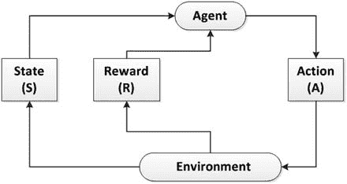
图 10-15：强化学习示意图

这个过程很简单。你的智能体从环境中提取特征，这些特征要么是“状态”，要么是“奖励”。状态特征表明已经发生了某事。奖励特征表明发生了某些事，使得感知到的奖励收益有所增加或减少。智能体利用状态和奖励来决定改变环境的行动。

这种提取状态和奖励，并相应采取行动的过程将持续进行，直到达到预先约定的最终奖励为止。这类强化学习在现实世界中的应用是无限的。你可以将强化学习应用于任何能够通过智能体进行控制的环境。

我构建了许多`RL`系统来监控流程，例如采购分类系统或产品组装系统。它也是大多数机器人项目的核心，因为机器人是可以与环境交互的物理智能体。我还构建了许多“软机器人”，它们能在诸如贷款审批、支付款项和数据错误修复等数据处理任务中做出决策。

## 袋装数据

Bootstrap 聚合，也称为袋装法（`bagging`），是一种机器学习集成元算法，旨在提高用于统计分类和回归的机器学习算法的稳定性和准确性。它能减少方差，并帮助系统避免过拟合。

我想介绍这个概念，是因为在过去几年中，我看到许多数据科学解决方案存在过拟合问题，原因是它们使用已知数据集进行训练，最终导致只能处理这一个数据集。由于处理过程和算法效率低下，我们自然在数据方差方面有了一定的容错空间。

基于新式 GPU（图形处理单元）的系统非常精确，以至于如果训练数据是一个一致性较强的集合，且数据集内模式几乎没有或没有重大变化，它们就很容易过拟合。

现在你将看到如何执行一个简单的袋装过程。打开你的 Python 编辑器并创建以下环境：

```python
import numpy as np
import matplotlib.pyplot as plt
from sklearn.ensemble import BaggingRegressor
from sklearn.tree import DecisionTreeRegressor
```

你需要进行一些选择性设置。

```python
n_repeat = 100       # 迭代次数
n_train = 100        # 训练数据集的大小
```

`n_test = 10000`       # 测试数据集的大小

`noise = 0.1`          # 引入噪声的标准差

`np.random.seed(0)`

你将选择两个估计器进行比较。

```python
estimators = [("Tree", DecisionTreeRegressor()),
              ("Bagging(Tree)", BaggingRegressor(DecisionTreeRegressor()))]
n_estimators = len(estimators)
```

你需要一组数据进行袋装处理，因此生成一个随机数据集。

```python
def f(x):
    x = x.ravel()
    return np.exp(-x ** 2) - 2 * np.exp(-(x - 2) ** 2)
```

如果你想观察这个过程的运行效果，也可以尝试其他数据配置。

你需要创建一个函数来向数据添加噪声。

```python
def generate(n_samples, noise, n_repeat=1):
    X = np.random.rand(n_samples) * 10 - 5
    X = np.sort(X)
    if n_repeat == 1:
        y = f(X) + np.random.normal(0.0, noise, n_samples)
    else:
        y = np.zeros((n_samples, n_repeat))
        for i in range(n_repeat):
            y[:, i] = f(X) + np.random.normal(0.0, noise, n_samples)
    X = X.reshape((n_samples, 1))
    return X, y
```

现在你可以使用这些转换步骤来训练系统。

```python
X_train = []
y_train = []
```

通过在每个循环中获取一个样本，用袋装数据集来训练系统。这会让模型接触到更多样化的数据训练分布。

```python
for i in range(n_repeat):
    X, y = generate(n_samples=n_train, noise=noise)
    X_train.append(X)
    y_train.append(y)
```

现在你可以测试你的模型了。

```python
X_test, y_test = generate(n_samples=n_test, noise=noise, n_repeat=n_repeat)
```

你现在可以循环遍历估计器，通过计算预测值来比较结果。

```python
for n, (name, estimator) in enumerate(estimators):
    y_predict = np.zeros((n_test, n_repeat))
    for i in range(n_repeat):
        estimator.fit(X_train[i], y_train[i])
        y_predict[:, i] = estimator.predict(X_test)
```

# 均方误差的偏差² + 方差 + 噪声分解

```python
y_error = np.zeros(n_test)

for i in range(n_repeat):

for j in range(n_repeat):

y_error += (y_test[:, j] - y_predict[:, i]) ** 2

y_error /= (n_repeat * n_repeat)

y_noise = np.var(y_test, axis=1)

y_bias = (f(X_test) - np.mean(y_predict, axis=1)) ** 2

y_var = np.var(y_predict, axis=1)
```

现在你可以显示结果了。

```python
print("{0}: {1:.4f} (error) = {2:.4f} (bias²) "

" + {3:.4f} (var) + {4:.4f} (noise)".format(name,

np.mean(y_error),

np.mean(y_bias),

np.mean(y_var),

np.mean(y_noise)))
```

现在你可以绘制结果图表了。

```python
plt.subplot(2, n_estimators, n + 1)
plt.plot(X_test, f(X_test), "b", label="$f(x)$")
plt.plot(X_train[0], y_train[0], ".b", label="LS ~ $y = f(x)+noise$")
for i in range(n_repeat):
    if i == 0:
        plt.plot(X_test, y_predict[:, i], "r", label="$\^y(x)$")
    else:
        plt.plot(X_test, y_predict[:, i], "r", alpha=0.05)
plt.plot(X_test, np.mean(y_predict, axis=1), "c",
    label="$\mathbb{E}_{LS} \^y(x)$")
plt.xlim([-5, 5])
plt.title(name)
if n == 0:
    plt.legend(loc="upper left", prop={"size": 11})

plt.subplot(2, n_estimators, n_estimators + n + 1)
plt.plot(X_test, y_error, "r", label="$error(x)$")
plt.plot(X_test, y_bias, "b", label="$bias²(x)$"),
plt.plot(X_test, y_var, "g", label="$variance(x)$"),
plt.plot(X_test, y_noise, "c", label="$noise(x)$")
plt.xlim([-5, 5])
plt.ylim([0, 0.1])
if n == 0:
    plt.legend(loc="upper left", prop={"size": 11})
```

展示你的辛勤成果！

```python
plt.show()
```

干得好！你已经完成了你的装袋示例。

请记住：装袋使得训练引擎可以在你期望处理的不同数据集上进行训练。这消除了异常值和极端值对数据模型的影响。所以，记住你已经获取了一个模型，并用从同一数据总体中采样的多个训练集对其进行了训练。

## 随机森林

随机森林，或称随机决策森林，是一种用于分类和回归的集成学习方法。其工作原理是在训练时构建大量的决策树，并输出各棵树在类别（分类）上的众数预测结果或在（回归）上的均值预测结果。随机决策森林纠正了决策树容易过拟合训练集的习惯。

最终的结果是所有树的结果的聚合，具体方式是对结果范围进行多数投票。因此，如果五棵树返回三个“是”和两个“否”，那么在转换步骤中就会输出“是”。

有时，这也被称为树装袋，因为你将装袋概念提升了一个层次：不仅要用来自数据总体的多个样本训练模型，而且实际上要用数据包执行完整的过程，然后聚合数据结果。

### 警告

如果你执行一个十因子的随机森林，意味着你执行了十倍的运算量。因此，请研究你的森林的最佳扩展规模。

### 提示

我发现，对于我所处理的平均数据集大小，`15+`的扩展规模能优化结果。但请务必进行实验，因为我也遇到过 `5` 个因子就完美运行的方案，以及一个痛苦的案例——由于存在异常不稳定的离群值，最终采用 `100+`的扩展规模才获得合适的结果。

让我引导你完成这个过程。打开你的 Python 编辑器，准备以下代码环境：

```python
from sklearn.ensemble import RandomForestClassifier
import pandas as pd
import numpy as np
import sys
import os
import datetime as dt
import calendar as cal
```

设置数据位置并加载数据。

```python
if sys.platform == 'linux':
    Base=os.path.expanduser('~') + 'VKHCG'
else:
    Base='C:/VKHCG'
print('################################')
print('Working Base :',Base, ' using ', sys.platform)
print('################################')
basedate = dt.datetime(2018,1,1,0,0,0)
Company='04-Clark'
InputFileName='Process_WIKI_UPS.csv'
InputFile=Base+'/'+Company+'/03-Process/01-EDS/02-Python/' + InputFileName
ShareRawData=pd.read_csv(InputFile,header=0,\
usecols=['Open','Close','UnitsOwn'], \
low_memory=False)
```

你必须执行一些预处理来揭示数据中的特征。

```python
ShareRawData.index.names = ['ID']
ShareRawData['nRow'] = ShareRawData.index
ShareRawData['TradeDate']=ShareRawData.apply(lambda row:\
(basedate - dt.timedelta(days=row['nRow'])),axis=1)
ShareRawData['WeekDayName']=ShareRawData.apply(lambda row:\
(cal.day_name[row['TradeDate'].weekday()])\
,axis=1)
ShareRawData['WeekDayNum']=ShareRawData.apply(lambda row:\
(row['TradeDate'].weekday())\
,axis=1)
ShareRawData['sTarget']=ShareRawData.apply(lambda row:\
'true' if row['Open'] < row['Close'] else 'false'\
,axis=1)
```

这是你的数据集：

```python
print(ShareRawData.head())
```

选择包含两个特征变量的数据框。

```python
sColumns=['Open','Close','WeekDayNum']
df = pd.DataFrame(ShareRawData, columns=sColumns)
```

让我们看看前五行数据。

```python
print(df.head())
```

你需要选择目标列。

```python
df2 = pd.DataFrame(['sTarget'])
df2.columns =['WeekDayNum']
```

你必须选择一个训练数据集。

```python
df['is_train'] = np.random.uniform(0, 1, len(df)) <= .75
```

现在，创建两个新的数据框，一个包含训练行，另一个包含测试行。

```python
train, test = df[df['is_train']==True], df[df['is_train']==False]
```

以下是测试和训练数据框的观测数量：

```python
print('Number of observations in the training data:', len(train))
print('Number of observations in the test data:',len(test))
```

通过创建特征列名称列表开始处理数据。

```python
features = df.columns[:3]
```

展示你的特征。

```
print(features)
```

你必须对目标进行因子化，才能使用我选择的模型。

```
y = pd.factorize(train['WeekDayNum'])[0]
```

你现在可以查看目标值了。

```
print(y)
```

你现在训练随机森林分类器。

创建一个随机森林分类器。

**提示**

按照惯例，数据科学家使用“clf”代表“分类器（Classifier）”。这样，他们只需更改分类器的类型，就能简单地更改 `clf`。

```
clf = RandomForestClassifier(n_jobs=2, random_state=0)
```

你现在训练分类器，使其获取训练特征并学习它们与训练集 `y`（星期几的数字表示）之间的关系。

```
clf.fit(train[features], y)
```

现在将分类器应用于测试数据。此操作称为“评分”。

```
clf.predict(test[features])
```

你可以查看前十个观测值的预测概率。

```
print(clf.predict_proba(test[features])[0:10])
```

评估分类器。它表现得好吗？

```
preds = clf.predict(test[features])[3:4]
```

查看前十个观测值的`预测的星期几数字`。

```
print('PREDICTED Week Number:',preds[0:10])
```

查看前十个观测值的`实际的星期几名称`。

```
print(test['WeekDayNum'].head(10))
```

我建议你创建一个混淆矩阵。

```
c=pd.crosstab(df2['WeekDayNum'], preds, rownames=['Actual Week Day Number'], colnames=['Predicted Week Day Number'])

print(c)
```

你还可以查看特征列表及其重要性评分。

```
print(list(zip(train[features], clf.feature_importances_)))
```

你已经完成了随机森林解决方案的转换步骤。至此，我想解释一下随机森林的另一个方面。这其实就是将一系列随机森林进行菊花链式连接以创建一个解决方案。我发现，随着解决方案要求越来越高、数据集越来越大，这种方法在过去两年变得越来越流行。相同的基本原理仍然适用；只是在一个链条中重复应用它们几次而已。

## 计算机视觉（CV）

计算机视觉是一个复杂的特征提取领域，但一旦特征被提取出来，它就简单地变成了一个数值矩阵。

注意：在本书中，我仅对数据科学中的计算机视觉部分提供基本介绍。这本身就是一个庞大的领域。我只是希望你能注意到，这将成为你未来工作领域的一部分。

打开你的 Python 编辑器并输入这个快速示例：

```
import matplotlib.pyplot as plt

from PIL import Image

import numpy as np

sPicNameIn='C:/VKHCG/01-Vermeulen/00-RawData/AudiR8.png'

imageIn = Image.open(sPicNameIn)

fig1=plt.figure(figsize=(10, 10))

fig1.suptitle('Audi R8', fontsize=20)

imgplot = plt.imshow(imageIn)

plt.show()
```

你应该会看到一辆汽车。

```
imagewidth, imageheight = imageIn.size

imageMatrix=np.asarray(imageIn)

pixelscnt = (imagewidth * imageheight)

print('Pixels:', pixelscnt)

print('Size:', imagewidth, ' x', imageheight,)

print(imageMatrix)
```

这就是你的计算机所看到的！你已经实现了计算机视觉。还记得我向你展示电影是如何转换多个帧的吗？每一帧都成为了矩阵中的一个条目，现在你可以让你的数据科学“看见”了。

## 自然语言处理（NLP）

自然语言处理是数据科学中的一个领域，它研究我们人类相互交流的过程。这主要涵盖了构成更大概念的书面和口头语言。你的数据科学旨在与人类进行交互或互动，并对自然语言做出反应。

注意：这是数据科学中的一个主要研究领域。我仅对这个有趣的课题提供基本介绍。

自然语言处理有两个明确的需求。第一个是与人类的直接交互，例如当你对着智能手机说话，它就会给出合适的回答。例如，你说“打电话回家”，手机就会拨打设置为“家”的号码。

第二种交互类型是获取交互的详细内容，并理解其语境以及与其他文本或记录信息之间的关系。这方面的例子包括对新闻报道进行分析，并在不同新闻报道中发现共同趋势。这是对自然语言含义的研究，而不仅仅是对人类互动的响应。

### 基于文本

如果你想处理文本，你必须建立一个生态系统来执行基本的文本处理。我建议你使用 `nltk` 库（`conda install -c anaconda nltk`）。

警告：此过程会在你的本地电脑上生成一个大型文本参考库。请确保你拥有超过 3.3GB 的空间来下载完整数据集。

打开你的 Python 编辑器并建立你的生态系统。然后你需要基础数据。

```
import nltk

nltk.download()
```

你将看到一个程序，它允许你下载几个文本库，这将有助于对你提交分析的任何文本执行文本分析。基本原理是，该库将你的文本与数据库中存储的文本进行匹配，并返回正确的匹配文本分析。

打开你的 Python 编辑器并创建以下生态系统，以便你研究该库：

```
from nltk.tokenize import sent_tokenize, word_tokenize

Txt = "Good Day Mr. Vermeulen,\

how are you doing today?\

The weather is great, and Data Science is awesome.\

You are doing well!"

print(Txt,'\n')

print('Identify sentences')

print(sent_tokenize(Txt),'\n')

print('Identify Word')

print(word_tokenize(Txt))
```

# 基于语音和神经网络的特征工程

## 基于语音

对于语音到文本的转换以提取特征，存在很大的需求。我建议查看 `SpeechRecognition` 库（[`pypi.python.org/pypi/SpeechRecognition/`](https://pypi.python.org/pypi/SpeechRecognition/)）。你可以通过使用 `conda install -c conda-forge speechrecognition` 来安装它。

这个转换领域高度专业化，我不会就此主题提供更多细节。

## 神经网络

神经网络（也称为人工神经网络）的灵感来源于人类神经系统。它们模拟复杂信息如何被人类系统吸收和处理。就像人类一样，神经网络通过示例学习，并针对特定应用进行配置。

神经网络用于在极其复杂的数据中寻找模式，从而提供预测并对数据点进行分类。神经网络通常按层组织。层由许多相互连接的“节点”组成。模式（特征）通过“输入层”呈现给网络，该层与一个或多个“隐藏层”通信，实际处理就在其中进行。然后隐藏层连接到一个“输出层”，答案在此输出，如图 10-16 所示。

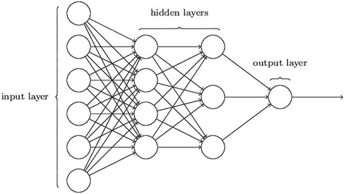
图 10-16：通用人工神经网络

提示：当我为神经网络进行特征开发时，我会构建一个问题以便得到一个简单的答案（是/否），但我会创建成百上千个问题。

让我提供一个神经网络特征开发的例子。假设你必须为你的狗的新球选择三种颜色：蓝色、黄色或粉色。特征将是：

- 球是蓝色的吗？是/否
- 球是黄色的吗？是/否
- 球是粉色的吗？是/否

当你将这些输入到神经网络时，它会将它们用作简单的 `0` 或 `1` 值，而这正是神经网络真正擅长的。不幸的是，为狗买球时最重要的特征是“狗能钻到房子底下吗？”我花了两个小时才从一个我钻不进去的空间里捞出一只狗和一个黑色的球！

经验教训：在开发神经网络时，你必须改变标准。如果你保持问题简单，你可以直接添加更多的问题，甚至移除那些产生特征的问题。

警告：当你开始使用神经网络时，它们可能会变得异常庞大。我有一个解决方案，它拥有近 `500` 万个特征，并且在特定的处理周期中，涉及 `25` 万个隐藏层，最终为一个产品范围的联合分析提供略超过一千个输出。我发现普通的神经网络大概有三到十个隐藏层，特征少于二十个。任何更大的网络在规模上大多属于异常值。

另外请注意，你可以将神经网络串联起来，我经常设计这样的系统。我将其称为“神经网络流水线和聚类”，并作为一项服务出售。

提示：研究 `GPU` 如何提升神经网络性能。你也可以看看 `TensorFlow` 在 `GPU` 上的表现（本章后面会讲到）。

在开始你的示例之前，你必须理解两个概念。

### 梯度下降

梯度下降是一种一阶迭代优化算法，用于寻找函数的最小值。要使用梯度下降法找到函数的局部最小值，需要沿着当前点函数梯度的负方向按比例迈出步长。

示例：打开你的 Python 编辑器并研究这段代码：

```python
cur_x = 3 # The algorithm starts at x=3
gamma = 0.01 # step size multiplier
precision = 0.00001
previous_step_size = cur_x
df = lambda x: 4 * x**3 - 9 * x**2

while previous_step_size > precision:
    prev_x = cur_x
    cur_x += -gamma * df(prev_x)
    previous_step_size = abs(cur_x - prev_x)

print("Current X at %f" % cur_x, " with step at %f" % previous_step_size)
print("The local minimum occurs at %f" % cur_x)
```

你看到这些步长是如何开始改进寻找局部最小值的过程了吗？梯度下降可能需要多次迭代才能以所需的精度计算出局部最小值。当你想找到一个适合你模型的未知值时，这个过程非常有用。在神经网络中，这支持对隐藏层进行加权，以计算达到所需的精度。

#### 正则化强度

`正则化强度`是防止神经网络过拟合的参数。该参数能使神经网络针对通用数据集匹配最佳的权重组合。此设置的常见名称是 `epsilon` 参数，也称为学习率。

#### 简单神经网络

既然你已经了解了这些基本参数，我将为你展示一个神经网络的示例。现在你可以打开一个新的 Python 文件以及你的 Python 编辑器。

让我们构建一个简单的神经网络。

```python
# Setup the eco-system.
import numpy as np
from sklearn import datasets, linear_model
import matplotlib.pyplot as plt
```

你需要一个可视化程序。

```python
def plot_decision_boundary(pred_func):
```

# Set min and max values and give it some padding

```
x_min, x_max = X[:, 0].min() - .5, X[:, 0].max() + .5
y_min, y_max = X[:, 1].min() - .5, X[:, 1].max() + .5
h = 0.01
```

# Generate a grid of points with distance `h` between them

```
xx, yy = np.meshgrid(np.arange(x_min, x_max, h), np.arange(y_min, y_max, h))
```

# Predict the function value for the whole gid

`Z` = `pred_func`(`np.c_`[`xx.ravel()`, `yy.ravel()`])

`Z` = `Z.reshape`(`xx.shape`)

# Plot the contour and training examples

```python
plt.contourf(xx, yy, Z, cmap=plt.cm.Spectral)
plt.scatter(X[:, 0], X[:, 1], c=y, cmap=plt.cm.Spectral)
```

You will generate a data set for the example.

我建议设置 200 个点，不过你在试验自己的神经网络时可以随意增加或减少点数。

```python
np.random.seed(0)
X, y = datasets.make_moons(200, noise=0.20)
```

你可以绘制数据图来查看生成的内容。

```python
plt.scatter(X[:,0], X[:,1], s=40, c=y, cmap=plt.cm.Spectral)
```

我建议我们训练一个逻辑回归分类器来输入特征。

```python
clf = linear_model.LogisticRegressionCV()
clf.fit(X, y)
# Now you can plot the decision boundary
plot_decision_boundary(lambda x: clf.predict(x))
plt.title("Logistic Regression")
```

现在你配置神经网络。我把它设计得很简单，有两个输入和两个输出。

```python
num_examples = len(X) # training set size
nn_input_dim = 2 # input layer dimensionality
nn_output_dim = 2 # output layer dimensionality
```

你设置梯度下降参数。这决定了你求解神经网络的速度。

Set learning rate for gradient descent and regularization strength, experiment with this as it drives the transform speeds.

```python
epsilon = 0.01
reg_lambda = 0.01 #
```

你必须设计一个辅助函数，用于评估数据集上的总损失。

```python
def calculate_loss(model):
    W1, b1, W2, b2 = model['W1'], model['b1'], model['W2'], model['b2']
```

# Forward propagation to calculate our predictions

`z1 = X.dot(W1) + b1`
`a1 = np.tanh(z1)`
`z2 = a1.dot(W2) + b2`
`exp_scores = np.exp(z2)`
`probs = exp_scores / np.sum(exp_scores, axis=1, keepdims=True)`

# Calculating the loss

```
corect_logprobs = -np.log(probs[range(num_examples), y])

data_loss = np.sum(corect_logprobs)
```

# Add regulatization term to loss (optional)

```
data_loss += reg_lambda/2 * (np.sum(np.square(W1)) + np.sum(np.square(W2)))

return 1./num_examples * data_loss
```

## Predict Output

你还需要一个辅助函数，用于预测输出（0 或 1）。

```
def predict(model, x):

W1, b1, W2, b2 = model['W1'], model['b1'], model['W2'], model['b2']
```

# Forward propagation

z1 = x.dot(W1) + b1
a1 = np.tanh(z1)
z2 = a1.dot(W2) + b2
exp_scores = np.exp(z2)
probs = exp_scores / np.sum(exp_scores, axis=1, keepdims=True)
return np.argmax(probs, axis=1)

你接下来要设计的函数是神经网络的核心。该函数学习神经网络的参数并返回模型。

- `nn_hdim`：隐藏层中的节点数
- `num_passes`：梯度下降时对训练数据的遍历次数。我建议设为 20000，但你可以试验不同的大小。
- `print_loss`：如果设为`True`，则每 1000 次迭代打印一次损失值。

```python
def build_model(nn_hdim, num_passes=20000, print_loss=False):
```

# Initialize the parameters to random values. We need to learn these.

```
np.random.seed(0)

W1 = np.random.randn(nn_input_dim, nn_hdim) / np.sqrt(nn_input_dim)

b1 = np.zeros((1, nn_hdim))

W2 = np.random.randn(nn_hdim, nn_output_dim) / np.sqrt(nn_hdim)

b2 = np.zeros((1, nn_output_dim))
```

# This is what we return at the end

```python
model = {}
```

# Gradient descent. For each batch...

```
for i in range(0, num_passes):
```

# Forward propagation

```
z1 = X.dot(W1) + b1
a1 = np.tanh(z1)
z2 = a1.dot(W2) + b2
exp_scores = np.exp(z2)
probs = exp_scores / np.sum(exp_scores, axis=1, keepdims=True)
```

# Backpropagation

```python
`delta3 = probs`

`delta3[range(num_examples), y] -= 1`

`dW2 = (a1.T).dot(delta3)`

`db2 = np.sum(delta3, axis=0, keepdims=True)`

`delta2 = delta3.dot(W2.T) * (1 - np.power(a1, 2))`

`dW1 = np.dot(X.T, delta2)`

`db1 = np.sum(delta2, axis=0)`
```

# Add regularization terms

b1 and b2 don't have regularization terms.

```
dW2 += reg_lambda * W2

dW1 += reg_lambda * W1
```

# Gradient descent parameter update

```
W1 += -epsilon * dW1
b1 += -epsilon * db1
W2 += -epsilon * dW2
b2 += -epsilon * db2
```

# Assign new parameters to the model

```
model = { 'W1': W1, 'b1': b1, 'W2': W2, 'b2': b2}
```

# Optionally print the loss.

# This is expensive because it uses the whole dataset, so we don't want to do it too often.

```python
if print_loss and i % 1000 == 0:
    print ("Loss after iteration %i: %f" %(i, calculate_loss(model)))
```

`model`

现在你定义一个带有三维隐藏层的模型。

```python
model = build_model(3, print_loss=True)
```

现在你可以绘制决策边界。

```python
plot_decision_boundary(lambda x: predict(model, x))
plt.title("Decision Boundary for hidden layer size 3")
```

现在你可以将所取得的成果可视化。

```python
plt.figure(figsize=(16, 32))
hidden_layer_dimensions = [1, 2, 3, 4, 5, 20, 50]
for i, nn_hdim in enumerate(hidden_layer_dimensions):
    plt.subplot(5, 2, i+1)
    plt.title('Hidden Layer size %d' % nn_hdim)
    print('Model:',nn_hdim)
    model = build_model(nn_hdim, print_loss=True)
    plot_decision_boundary(lambda x: predict(model, x))
plt.show()
```

你现在可以构建神经网络了。做得好。

**建议**

你应该花时间理解如何构建神经网络，因为我发现使用神经网络处理数据科学的解决方案数量大幅增加。GPU 驱动处理的快速进展正在进一步推动这一趋势。至少，我必须构建 `100` 个输入和 `10` 个隐藏层，才能处理我定期收到的请求中最小规模的网络。

另外，请关注我在本章讨论的通过其他转换过程进行的链式连接。

以上就是最简形式的神经网络。

### TensorFlow

`TensorFlow` 是一个利用数据流图进行数值计算的开源软件库。图中的节点代表数学运算，而图的边则代表节点间传递的多维数据数组（张量）。其灵活的架构允许你将计算部署到一个或多个 `CPU` 或 `GPU` 上。

`TensorFlow` 最初由谷歌机器智能研究组织内 `Google Brain` 团队的研究人员和工程师开发，旨在进行机器学习和深度神经网络研究，但该系统通用性足够强，也适用于其他众多领域。

我将通过几个示例来向你展示其能力。我有几个使用了该生态系统的安装实例，它在数据科学社区中日益流行。

要使用它，你需要一个名为 `tensorflow` 的库。你可以通过 `conda install -c conda-forge tensorflow` 来安装它。关于该库的详细信息，请访问 [`www.tensorflow.org`](http://www.tensorflow.org)。

下一个巨大优势是云张量处理单元（`TPU`，[`https://cloud.google.com/tpu/`](https://cloud.google.com/tpu/)）硬件产品，它是专门设计的，能以比标准 `CPU` 或 `GPU` 硬件更优的性能水平来计算张量处理。`TPU` 凭借极其高效的硬件生态系统来支持 `TensorFlow` 流程。`TensorFlow Research Cloud` 为用户提供了访问这些第二代云 `TPU` 的权限，每个 `TPU` 可提供 `180 teraflops` 的机器学习加速能力。

**注**：我使用 [`www.tensorflow.org/tfrc/`](http://www.tensorflow.org/tfrc/) 上的开放研究平台来测试我拥有的任何新模型，它提供了一个出色的研发生态系统。我建议你为自己的生态研究一下这个平台。

### 基础 TensorFlow

我将通过一个基础示例来讲解，首先说明如何将以下数学方程转换为 `TensorFlow`：

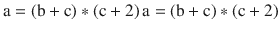

我将为你计算以下内容：

- `B = 2.5`
- `C = 10`

打开你的 `Python` 编辑器并创建以下生态系统：

```python
import tensorflow as tf
```

创建一个 `TensorFlow` 常量。

```python
const = tf.constant(2.0, name="const")
```

创建 `TensorFlow` 变量。

```python
b = tf.Variable(2.5, name="b")
c = tf.Variable(10.0, name="c")
```

现在你必须创建运算。

```python
d = tf.add(b, c, name="d")
e = tf.add(c, const, name="e")
a = tf.multiply(d, e, name="a")
```

接下来，设置变量初始化。

```python
init_op = tf.global_variables_initializer()
```

现在你可以启动会话。

```python
with tf.Session() as sess:
```

# 初始化变量

```
sess.run(init_op)
```

# 计算图的输出

`a_out = sess.run(a)`

`print("变量 a 的值为 {}".format(a_out))`

```
```

干得漂亮。你已经成功部署了一个 `TensorFlow` 解决方案。现在我将引导你学习一个更高级的示例：如何向 `TensorFlow` 输入一系列的值。

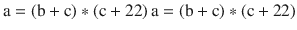

我将计算以下内容：

- `B = range (-5,-4,-3,-2,-1,0,1,2,3,4,5)`
- `C = 3`

打开你的 Python 编辑器并创建以下生态系统：

```
import tensorflow as tf

import numpy as np
```

创建一个 `TensorFlow` 常量。

```
const = tf.constant(22.0, name="const")
```

现在创建 `TensorFlow` 变量。注意变量 `b` 的范围格式。

```
b = tf.placeholder(tf.float32, [None, 1], name="b")

c = tf.Variable(3.0, name="c")
```

接下来你将创建所需的运算。

```
d = tf.add(b, c, name="d")

e = tf.add(c, const, name="e")

a = tf.multiply(d, e, name="a")
```

开始设置变量初始化。

```
init_op = tf.global_variables_initializer()
```

开始构建会话。

```
with tf.Session() as sess:
```

# 初始化变量

`sess.run(init_op)`

# 计算图的输出

```python
a_out = sess.run(a, feed_dict={b: np.arange(-5, 5)[:, np.newaxis]})
print("变量 a 的值为 {}".format(a_out))
```

你是否注意到，只需微小的改动，`TensorFlow` 就能轻松处理更大量的数据？`TensorFlow` 的优势在于其用于创建它的基本构建块非常简单，以及数据流水线自然的图结构特性，这使得你能够轻松地将现实世界的数据流转换为 `TensorFlow` 生态系统内复杂的模拟。

我将用一个名为“独臂强盗”的有趣游戏来展示这项技术的一个真实世界应用示例。打开你的 `Python` 编辑器并创建以下生态系统：

```python
import tensorflow as tf
import numpy as np
```

让我们为你的强盗构建一个模型。这里有四个独臂强盗，当前，强盗 4 被设置为最常提供正向奖励。

```python
bandits = [0.2,0.0,-0.2,-2.0]
num_bandits = len(bandits)
```

你必须通过创建一个拉杆行动来建模强盗。

```python
def pullBandit(bandit):
```

# 获取一个随机数。

```
result = np.random.randn(1)
if result > bandit:
```

# 返回一个正向奖励。

```
return 1

else:
```

# 返回一个负向奖励。

return -1

现在，重置生态系统。

```
tf.reset_default_graph()
```

你需要以下两行来建立网络的前馈部分。你使用此公式执行实际的选择。

```
weights = tf.Variable(tf.ones([num_bandits]))
chosen_action = tf.argmax(weights,0)
```

接下来的六行建立了训练流程。你将奖励和所选行动输入网络，通过计算损失并使用它来更新网络。

```
reward_holder = tf.placeholder(shape=[1],dtype=tf.float32)
action_holder = tf.placeholder(shape=[1],dtype=tf.int32)
responsible_weight = tf.slice(weights,action_holder,[1])
loss = -(tf.log(responsible_weight)*reward_holder)
optimizer = tf.train.GradientDescentOptimizer(learning_rate=0.001)
update = optimizer.minimize(loss)
```

现在，你必须训练系统使其表现得像一个独臂强盗。

```
total_episodes = 1000 # 设置训练强盗的总轮数。
total_reward = np.zeros(num_bandits) # 将强盗的得分板设置为 0。
e = 0.1 # 设置采取随机行动的概率。
```

立即初始化生态系统。

```
init = tf.initialize_all_variables()
```

启动 `TensorFlow` 图处理。

```
with tf.Session() as sess:
    sess.run(init)
    i = 0
    while i < total_episodes:
```

# 选择随机行动或来自网络的行动。

if np.random.rand(1) < e:

action = np.random.randint(num_bandits)

else:

action = sess.run(chosen_action)

reward = pullBandit(bandits[action])

```
_,resp,ww = sess.run([update,responsible_weight,weights], feed_dict={reward_holder:[reward],action_holder:[action]})
```

从选择一个强盗处收集你的奖励并更新网络。

```
total_reward[action] += reward
if i % 50 == 0:
    print (f"目前 {num_bandits} 个强盗的运行奖励: {total_reward}")
i+=1
print (f"代理人认为强盗 {np.argmax(ww)+1} 最有潜力....")
if np.argmax(ww) == np.argmax(-np.array(bandits)):
    print ("...而且它是对的！")
else:
    print ("...而且它错了！")
```

恭喜！你拥有了一个功能完备的 `TensorFlow` 解决方案。你能想到三个可以使用此生态系统建模的现实生活例子吗？

### TensorFlow 的现实世界用途

在过去的 12 个月里，我已将 `TensorFlow` 流程用于以下三个模型：

-   购物篮分析：人们买什么？他们一起买什么？
-   外汇交易：根据公司需求提供何时购买外汇的建议。
-   大宗商品交易：买卖期货。

### 单臂老虎机（情境版本）

想尝试更复杂的老虎机吗？我准备了下述示例，一起来玩一玩吧。

打开你的 `Python` 编辑器，创建以下生态系统：

```python
import tensorflow as tf
import tensorflow.contrib.slim as slim
import numpy as np
```

创建情境老虎机。

```python
class contextual_bandit():
    def __init__(self):
        self.state = 0
        #列出我们的老虎机。
        self.bandits = np.array([
            [0.4,0,-0.0,-8],
            [0.9,-55,1,0.75],
            [-15,5,9,5],
            [-5,1,9,55],
            [15,51,9,5],
            [-15,51,9,55],
            [-5,51,99,55],
            [-65,51,9,55],
            [0.9,-55,1,0.75]
        ])
        self.num_bandits = self.bandits.shape[0]
        self.num_actions = self.bandits.shape[1]
```

创建老虎机。

```python
    def getBandit(self):
        self.state = np.random.randint(0,len(self.bandits)) #为每一轮返回一个随机状态。
        return self.state
```

创建拉臂动作。

```python
    def pullArm(self,action):
        #获取一个随机数。
        bandit = self.bandits[self.state,action]
        result = np.random.randn(1)
        if result > bandit:
            #返回正向奖励。
            return 1
        else:
            #返回负向奖励。
            return -1
```

配置老虎机的规则。

```python
class agent():
    def __init__(self, lr, s_size,a_size):
        #这几行建立了网络的前馈部分。智能体接收一个状态并产生一个动作。
        self.state_in= tf.placeholder(shape=[1],dtype=tf.int32)
        state_in_OH = slim.one_hot_encoding(self.state_in,s_size)
        output = slim.fully_connected(state_in_OH,a_size,\
            biases_initializer=None,activation_fn=tf.nn.sigmoid,weights_initializer=tf.ones_initializer())
        self.output = tf.reshape(output,[-1])
        self.chosen_action = tf.argmax(self.output,0)
```

接下来的六行建立了训练流程。再次将奖励和所选动作输入网络。

```python
        #用于计算损失，并以此更新网络。
        self.reward_holder = tf.placeholder(shape=[1],dtype=tf.float32)
        self.action_holder = tf.placeholder(shape=[1],dtype=tf.int32)
        self.responsible_weight = tf.slice(self.output,self.action_holder,[1])
        self.loss = -(tf.log(self.responsible_weight)*self.reward_holder)
        optimizer = tf.train.GradientDescentOptimizer(learning_rate=lr)
        self.update = optimizer.minimize(self.loss)
```

现在训练你的智能体。

```python
tf.reset_default_graph() #清空 Tensorflow 图。
cBandit = contextual_bandit() #加载老虎机。
myAgent = agent(lr=0.001,s_size=cBandit.num_bandits,a_size=cBandit.num_actions) #加载智能体。
weights = tf.trainable_variables()[0] #我们将评估的权重，用于观察网络内部。
total_episodes = 10000 #设置训练智能体的总轮数。
total_reward = np.zeros([cBandit.num_bandits,cBandit.num_actions]) #将老虎机的计分板归零。
e = 0.1 #设置采取随机动作的概率。
init = tf.initialize_all_variables()
```

启动 `TensorFlow` 图。

```python
with tf.Session() as sess:
    sess.run(init)
    i = 0
    while i < total_episodes:
        s = cBandit.getBandit() #从环境中获取一个状态。
        #选择随机动作或来自网络的动作。
        if np.random.rand(1) < e:
            action = np.random.randint(cBandit.num_actions)
        else:
            action = sess.run(myAgent.chosen_action,feed_dict={myAgent.state_in:[s]})
        reward = cBandit.pullArm(action) #根据老虎机采取动作后获得奖励。
        #更新网络。
        feed_dict={myAgent.reward_holder:[reward],myAgent.action_holder:[action],myAgent.state_in:[s]}
```

## 导论

```python
_,ww = sess.run([myAgent.update, weights], feed_dict=feed_dict)

# 更新我们的实时得分记录。

total_reward[s,action] += reward

if i % 500 == 0:

    print ("Mean reward for each of the " + str(cBandit.num_bandits) + " bandits: " + str(np.mean(total_reward,axis=1)))

i+=1

for a in range(cBandit.num_bandits):

    print ("The agent thinks action " + str(np.argmax(ww[a])+1) + " for bandit " + str(a+1) + " is the most promising....")

    if np.argmax(ww[a]) == np.argmin(cBandit.bandits[a]):

        print ("...and it was right!")

    else:

        print ("...and it was wrong!")
```

你能理解该过程如何帮助你模拟现实活动吗？

## 处理容器上的数字

这是一个更实际的应用程序。你需要识别希尔曼有限公司爱丁堡仓库的货运场中移动的容器侧面的数字。由于大多数时间都在下雨，当容器经过摄像头记录数字时，扫描设备无法产生最佳图像。你能解决识别数字的问题吗？

打开你的 Python 编辑器，创建以下生态系统：

```python
import tensorflow as tf

from tensorflow.examples.tutorials.mnist import input_data

mnist = input_data.read_data_sets("MNIST_data/", one_hot=True)
```

你必须设置这些优化变量。之后你可以尝试不同的数值，以了解它们对结果的影响。

```python
learning_rate = 0.5

epochs = 10

batch_size = 100
```

你必须声明训练数据格式。设置输入 `x`——对于 28 × 28 像素 = 784。

```python
x = tf.placeholder(tf.float32, [None, 784])
```

现在声明输出数据占位符——十个数字

```python
y = tf.placeholder(tf.float32, [None, 10])
```

声明连接输入层到隐藏层的权重。是的，你猜对了；这是一个神经网络。

```python
W1 = tf.Variable(tf.random_normal([784, 300], stddev=0.03), name="W1")

b1 = tf.Variable(tf.random_normal([300]), name="b1")
```

现在添加连接隐藏层到输出层的权重。

```python
W2 = tf.Variable(tf.random_normal([300, 10], stddev=0.03), name="W2")

b2 = tf.Variable(tf.random_normal([10]), name="b2")
```

计算隐藏层的输出。

```python
hidden_out = tf.add(tf.matmul(x, W1), b1)

hidden_out = tf.nn.relu(hidden_out)
```

使用 Softmax 回归激活的输出层。

```python
y_ = tf.nn.softmax(tf.add(tf.matmul(hidden_out, W2), b2))

y_clipped = tf.clip_by_value(y_, 1e-10, 0.9999999)

cross_entropy = -tf.reduce_mean(tf.reduce_sum(y * tf.log(y_clipped)

    + (1 - y) * tf.log(1 - y_clipped), axis=1))
```

你需要添加一个优化器。

```python
optimizer = tf.train.GradientDescentOptimizer(learning_rate=learning_rate).minimize(cross_entropy)
```

接下来，设置初始化操作符。

```python
init_op = tf.global_variables_initializer()
```

设置准确率评估操作。

```python
correct_prediction = tf.equal(tf.argmax(y, 1), tf.argmax(y_, 1))

accuracy = tf.reduce_mean(tf.cast(correct_prediction, tf.float32))
```

现在你只需要启动会话即可。

```python
with tf.Session() as sess:

    # 初始化变量

    sess.run(init_op)

    total_batch = int(len(mnist.train.labels) / batch_size)

    for epoch in range(epochs):

        avg_cost = 0

        for i in range(total_batch):

            batch_x, batch_y = mnist.train.next_batch(batch_size=batch_size)

            _, c = sess.run([optimiser, cross_entropy],

                feed_dict={x: batch_x, y: batch_y})

            avg_cost += c / total_batch

        print("Epoch:", (epoch + 1), "cost =", "{:.3f}".format(avg_cost))

    print(sess.run(accuracy, feed_dict={x: mnist.test.images, y: mnist.test.labels}))
```

你能看出 TensorFlow 如何帮助你轻松构建复杂操作吗？

## 使用 TensorFlow 进行线性回归

你是否觉得用 TensorFlow 执行线性回归已经得心应手了？打开你的 Python 编辑器，并创建以下环境：

```python
import tensorflow as tf

import numpy

import matplotlib.pyplot as plt

rng = numpy.random
```

设置参数。

```
learning_rate = 0.01

training_epochs = 10000

display_step = 50
```

获取训练数据。

```
train_X = numpy.asarray([3.3,4.4,5.5,6.71,6.93,4.168,9.779,6.182,7.59,2.167,

7.042,10.791,5.313,7.997,5.654,9.27,3.1])

train_Y = numpy.asarray([1.7,2.76,2.09,3.19,1.694,1.573,3.366,2.596,2.53,1.221,

2.827,3.465,1.65,2.904,2.42,2.94,1.3])

n_samples = train_X.shape[0]
```

设置 TensorFlow 的计算图输入。

```
X = tf.placeholder("float")

Y = tf.placeholder("float")
```

设置模型权重。

```
W = tf.Variable(rng.randn(), name="weight")

b = tf.Variable(rng.randn(), name="bias")
```

现在，构建一个线性模型。

```
pred = tf.add(tf.multiply(X, W), b)
```

计算均方误差。

```
cost = tf.reduce_sum(tf.pow(pred-Y, 2))/(2*n_samples)
```

计算梯度下降。


