# 11. 组织与报告超级步骤

本章首先介绍**组织**超级步骤，然后进入**报告**超级步骤。这两部分将帮助你（作为数据科学家）首先从你准备好的数据仓库中收集相关信息，以满足特定客户决策者群体的需求。例如，你将使用同一个数据仓库向首席财务官 (CFO) 和苏格兰威克镇的会计师报告，但 CFO 将收到一个包含所有地区详细视图的概览，而威克镇的会计师则只会看到与威克相关的详细信息。这被称为将数据组织成一个更小的数据结构，称为`数据集市`。

本章的第二部分将介绍各种报告技术，你可以使用这些技术为不同的客户可视化数据。我将讨论每种技术的用途，并提供各个报告技术的示例。

那么，让我们开始将数据仓库中的数据组织成数据集市。

## 组织超级步骤

`组织`超级步骤将你在 `Transform` 超级步骤结束时构建的完整数据仓库进行细分，形成面向特定业务的数据集市。数据集市是数据仓库环境的访问层，旨在向用户公开数据。数据集市是数据仓库的一个子集，通常面向特定的业务部门。

我在本书中引用的任何源代码或其他补充材料，读者都可以通过本书的产品页面（位于 `www.apress.com/9781484230534`）在 GitHub 上获取。请注意，此源代码假定你已经完成了第 2 章中概述的源代码设置。

### 水平样式

对数据仓库进行水平样式切片或子集化，是通过应用一种过滤技术实现的，该技术强制数据仓库仅显示针对数据总体的、预先选定的一组过滤结果的数据。水平样式切片从总体中选择行的子集，同时保留各列。也就是说，数据科学工具可以查看到子集记录中每条记录的完整信息。

我们通过以下示例来了解这一技术：

从标准生态系统开始。

```python
optimizer = tf.train.GradientDescentOptimizer(learning_rate).minimize(cost)
```

初始化变量。

```python
init = tf.global_variables_initializer()
```

启动计算图。

```python
with tf.Session() as sess:
    sess.run(init)
    # 拟合所有训练数据
    for epoch in range(training_epochs):
        for (x, y) in zip(train_X, train_Y):
            sess.run(optimizer, feed_dict={X: x, Y: y})
        # 每个 epoch 步骤显示日志
        if (epoch+1) % display_step == 0:
            c = sess.run(cost, feed_dict={X: train_X, Y:train_Y})
            print("Epoch:", '%04d' % (epoch+1), "cost=", "{:.9f}".format(c), \
                  "W=", sess.run(W), "b=", sess.run(b))
    print("优化完成！")
    training_cost = sess.run(cost, feed_dict={X: train_X, Y: train_Y})
    print("训练成本=", training_cost, "W=", sess.run(W), "b=", sess.run(b), '\n')
    # 图形显示
    plt.plot(train_X, train_Y, 'ro', label='原始数据')
    plt.plot(train_X, sess.run(W) * train_X + sess.run(b), label='拟合线')
    plt.legend()
    plt.show()
    # 测试示例，按要求（问题 #2）
    test_X = numpy.asarray([6.83, 4.668, 8.9, 7.91, 5.7, 8.7, 3.1, 2.1])
    test_Y = numpy.asarray([1.84, 2.273, 3.2, 2.831, 2.92, 3.24, 1.35, 1.03])
    print("测试中...（均方损失对比）")
    testing_cost = sess.run(
        tf.reduce_sum(tf.pow(pred - Y, 2)) / (2 * test_X.shape[0]),
        feed_dict={X: test_X, Y: test_Y})  # 与上述成本函数相同
    print("测试成本=", testing_cost)
    print("绝对均方损失差异:", abs(
        training_cost - testing_cost))
    plt.plot(test_X, test_Y, 'bo', label='测试数据')
    plt.plot(train_X, sess.run(W) * train_X + sess.run(b), label='拟合线')
    plt.legend()
    plt.show()
```

恭喜！你已成功使用 `Transform` 步骤在 TensorFlow 中完成了线性模型。TensorFlow 的使用极大地增强了你的能力。TensorFlow 生态系统为在云端处理庞大且复杂的数据集开辟了许多新机遇，并能将结果返回给客户的设备。

## 总结

本章是对复杂且重要的 `Transform` 步骤的一次马拉松式学习。现在，让我们回顾一下你所学的知识。

-   你学会了如何将**处理**步骤中的数据仓库转换为包含维度和事实的数据仓库。
-   你了解了星型模型，以及如何通过将模型作为与客户和领域专家讨论的基础，来帮助你传达调查结果。
-   你接触了几种 `Transform` 步骤及其他技术，你可以将其应用于数据仓库甚至数据仓库，以获得关于数据对业务意义的新见解。

至此，我对你取得的进展表示祝贺，因为现在你可以构建一条从数据湖出发，经过**检索**步骤、**评估**步骤和**处理**步骤，最终进入数据仓库的稳定管道。你现在可以将数据转换为数据仓库。

下一章将向你展示如何采集你的见解，并将其组织到针对我们业务实体的特定分组中。你还将看到如何向业务社区报告这些见解。

现在，你可以用一份当之无愧的茶点来庆祝一下，然后开始第 11 章。

## 水平样式

`################################################################`


# -*- coding: utf-8 -*-

import sys
import os
import pandas as pd
import sqlite3 as sq

如果`sys.platform == 'linux'`或`sys.platform == 'darwin'`：
```python
Base = os.path.expanduser('~') + '/VKHCG'
else:
    Base = 'C:/VKHCG'
    print('################################')
    print('Working Base :', Base, ' using ', sys.platform)
    print('################################')
```

Company = '01-Vermeulen'

sDataWarehouseDir = Base + '/99-DW'
```python
if not os.path.exists(sDataWarehouseDir):
    os.makedirs(sDataWarehouseDir)
```

sDatabaseName = sDataWarehouseDir + '/datawarehouse.db'
```python
conn1 = sq.connect(sDatabaseName)
```

sDatabaseName = sDataWarehouseDir + '/datamart.db'
```python
conn2 = sq.connect(sDatabaseName)
```

从数据仓库加载完整的 BMI 数据集。

**注意**

你将数据加载到内存中进行处理。代码假设你有足够的内存来执行内存分析。为了帮助移除不需要或无效的数据，你将减少内存需求。

接下来的查询将所有数据加载到内存中，这意味着你将在内存中准备好完整的数据集，但也意味着你将分配可能不需要用于后续分析的内存。

```python
print('################')
sTable = 'Dim-BMI'
print('Loading :', sDatabaseName, ' Table:', sTable)
sSQL = "SELECT * FROM [Dim-BMI];"
PersonFrame0 = pd.read_sql_query(sSQL, conn1)
```

下面通过使用数据切片技术来介绍一种解决方案。先来看“水平”切片：仅加载身高超过 1.5 米且指示符为 1 的人员数据。这将减少数据集大小，从而降低内存需求。

从数据仓库加载身体质量指数（BMI）的水平数据切片。

```python
print('################')
sTable = 'Dim-BMI'
print('Loading :', sDatabaseName, ' Table:', sTable)
sSQL = "SELECT PersonID,\
Height,\
Weight,\
bmi,\
Indicator\
FROM [Dim-BMI]\
WHERE \
Height > 1.5 \
and Indicator = 1\
ORDER BY  \
Height,\
Weight;"
PersonFrame1 = pd.read_sql_query(sSQL, conn1)
################################################################
DimPerson = PersonFrame1
DimPersonIndex = DimPerson.set_index(['PersonID'], inplace=False)
```

**注意**

现在，你将用缩减后的数据切片替换数据库中的数据。这将使所有未来的查询结果降低内存需求。

将 BMI 的水平数据切片存储到数据仓库中。

```python
sTable = 'Dim-BMI'
print('\n#################################')
print('Storing :', sDatabaseName, '\n Table:', sTable)
print('\n#################################')
DimPersonIndex.to_sql(sTable, conn2, if_exists="replace")
################################################################
print('################')
sTable = 'Dim-BMI'
print('Loading :', sDatabaseName, ' Table:', sTable)
sSQL = "SELECT * FROM [Dim-BMI];"
PersonFrame2 = pd.read_sql_query(sSQL, conn2)
```

你可以通过打印以下代码来展示结果。你将看到所取得的改进。

```python
print('Full Data Set (Rows):', PersonFrame0.shape[0])
print('Full Data Set (Columns):', PersonFrame0.shape[0])
print('Horizontal Data Set (Rows):', PersonFrame2.shape[0])
print('Horizontal Data Set (Columns):', PersonFrame2.shape[1])
```

你应该会看到如下输出：

```
################################
Full Data Set (Rows): 1080
Full Data Set (Columns): 5
################################
Horizontal Data Set (Rows): 194
Horizontal Data Set (Columns): 5
################################
```

这表明你已成功将记录从 1080 条减少到与特定数据切片相关的 194 条，同时保留了 5 列数据。干得好！你已经通过修改数据仓库中的记录数量，成功实现了水平样式切片。

**警告**

执行水平样式切片时，在将结果写回数据仓库时，请确保不要覆盖完整的数据集。

水平样式切片是你将执行的最常见的组织流程。这是因为大多数维度通常被设置成包含业务所需的所有列。

**注意**

在生成组织子集时，你可以选择创建表的路径或创建视图的路径。这可以确保你根据特定客户需求选择最适合自己的工作方式。

在执行示例时，你永久替换了该表，但也可以组织创建一个视图，这样每次调用该视图时都会执行水平切片。这可以保护原始数据集，但每次将数据调入内存时需要额外的数据库处理，同时仍能减少内存需求。这两种方式我使用得差不多各占一半。

## 垂直风格

实现数据仓库的垂直风格切片或子集化，需要通过应用一种过滤技术，强制数据仓库仅显示针对数据总体的特定预选过滤结果的数据。垂直风格切片从总体中选择列的子集，同时保留行。也就是说，数据科学工具只能看到数据总体中所有记录的预选列。

**注意：** 由于安全或隐私规定，某些数据列可能无法向所有人展示，在这种情况下，系统中常采用垂直风格数据切片。这是对同一数据集实施不同安全组的最常见方式。

让我们通过以下示例来了解该技术。

根据隐私规则，你将仅返回体重、身高和指标，以防止其他列被看到。

从标准生态系统开始。

```python
################################################################
```

# -*- coding: utf-8 -*-

```python
################################################################

import sys

import os

import pandas as pd

import sqlite3 as sq

################################################################

if sys.platform == 'linux' or sys.platform == ' darwin':

Base=os.path.expanduser('~') + '/VKHCG'

else:

Base='C:/VKHCG'

print('################################')

print('Working Base :',Base, ' using ', sys.platform)

print('################################')

################################################################

################################################################

Company='01-Vermeulen'

################################################################

sDataWarehouseDir=Base + '/99-DW'

if not os.path.exists(sDataWarehouseDir):

os.makedirs(sDataWarehouseDir)

################################################################

sDatabaseName=sDataWarehouseDir + '/datawarehouse.db'

conn1 = sq.connect(sDatabaseName)

################################################################

sDatabaseName=sDataWarehouseDir + '/datamart.db'

conn2 = sq.connect(sDatabaseName)

################################################################
```

从数据仓库加载完整的 BMI 数据集。

```python
print('################')

sTable = 'Dim-BMI'

print('Loading :',sDatabaseName,' Table:',sTable)

sSQL="SELECT * FROM [Dim-BMI];"

PersonFrame0=pd.read_sql_query(sSQL, conn1)
```

从数据仓库加载 BMI 的垂直数据切片。

```python
print('################')

sTable = 'Dim-BMI'

print('Loading :',sDatabaseName,' Table:',sTable)

sSQL="SELECT \

Height,\

Weight,\

Indicator\

FROM [Dim-BMI];"

PersonFrame1=pd.read_sql_query(sSQL, conn1)

################################################################

DimPerson=PersonFrame1

DimPersonIndex=DimPerson.set_index(['Indicator'],inplace=False)

################################################################

sTable = 'Dim-BMI'

print('\n#################################')

print('Storing :',sDatabaseName,'\n Table:',sTable)

print('\n#################################')

DimPersonIndex.to_sql(sTable, conn2, if_exists="replace")

################################################################

print('################')

sTable = 'Dim-BMI'

print('Loading :',sDatabaseName,' Table:',sTable)

sSQL="SELECT * FROM [Dim-BMI];"

PersonFrame2=pd.read_sql_query(sSQL, conn2)

################################################################
```

你可以通过打印以下内容来显示结果：

```python
print('Full Data Set (Rows):', PersonFrame0.shape[0])

print('Full Data Set (Columns):', PersonFrame0.shape[1])

print('Horizontal Data Set (Rows):', PersonFrame2.shape[0])

print('Horizontal Data Set (Columns):', PersonFrame2.shape[1])
```

你应该会看到以下输出：

```
################################

Full Data Set (Rows): 1080

Full Data Set (Columns): 5

################################

Horizontal Data Set (Rows): 1080

Horizontal Data Set (Columns): 3

################################
```

这表明你已成功将列从 5 个减少到与特定数据切片相关的 3 个，同时保留了 1080 行数据。干得好！你已通过修改数据仓库中的列数，成功实现了垂直风格切片。

**注意：** 对于维度较宽且包含多个不同业务需求维度属性的数据仓库，垂直切片是一种常见做法。

### 孤岛式

对数据仓库进行孤岛式切片或子集提取，是通过结合水平和垂直切片来实现的。这会同时生成一个包含特定行和特定列的子集。

**注意**  
这类孤岛切片通常用于每月对缩减后的数据集进行快照。项目可能包括未付账款、逾期交付和损坏的广告牌。您不必存储整个数据仓库，只需获取特定的数据子集。

该技术会生成一组数据孤岛，以满足业务中的特定需求。

从标准生态系统开始。

```
################################################################
```

# -*- coding: utf-8 -*-

################################################################

import sys

import os

import pandas as pd

import sqlite3 as sq

################################################################

if `sys.platform` == 'linux' or `sys.platform` == ' darwin':

`Base`=`os.path.expanduser('~')` + '/VKHCG'

else:

`Base`='C:/VKHCG'

print('################################')

print('Working Base :',`Base`, ' using ', `sys.platform`)

print('################################')

################################################################

################################################################

`Company`='01-Vermeulen'

################################################################

`sDataWarehouseDir`=`Base` + '/99-DW'

if not `os.path.exists`(`sDataWarehouseDir`):

`os.makedirs`(`sDataWarehouseDir`)

################################################################

`sDatabaseName`=`sDataWarehouseDir` + '/datawarehouse.db'

`conn1` = `sq.connect`(`sDatabaseName`)

################################################################

`sDatabaseName`=`sDataWarehouseDir` + '/datamart.db'

`conn2` = `sq.connect`(`sDatabaseName`)

### 从数据仓库加载数据

print('################')

`sTable` = 'Dim-BMI'

print('Loading :',`sDatabaseName`,' Table:',`sTable`)

`sSQL`="SELECT * FROM [Dim-BMI];"

`PersonFrame0`=`pd.read_sql_query`(`sSQL`, `conn1`)

### 从数据仓库加载 BMI 数据孤岛

print('################')

`sTable` = 'Dim-BMI'

print('Loading :',`sDatabaseName`,' Table:',`sTable`)

`注意`

这就是数据孤岛。您只从数据仓库中提取那些指标大于 2 的特定列，从而创建一个数据孤岛。

`sSQL`="SELECT \

Height,\

Weight,\

Indicator\

FROM [Dim-BMI]\

WHERE Indicator > 2\

ORDER BY  \

Height,\

Weight;"

`PersonFrame1`=`pd.read_sql_query`(`sSQL`, `conn1`)

################################################################

`DimPerson`=`PersonFrame1`

`DimPersonIndex`=`DimPerson.set_index`(['Indicator'],inplace=False)

################################################################

`sTable` = 'Dim-BMI'

print('\n#################################')

print('Storing :',`sDatabaseName`,'\n Table:',`sTable`)

print('\n#################################')

`DimPersonIndex.to_sql`(`sTable`, `conn2`, if_exists="replace")

################################################################

print('################')

`sTable` = 'Dim-BMI-Vertical'

print('Loading :',`sDatabaseName`,' Table:',`sTable`)

`sSQL`="SELECT * FROM [Dim-BMI-Vertical];"

`PersonFrame2`=`pd.read_sql_query`(`sSQL`, `conn2`)

您可以通过打印以下内容来显示结果：

```python
print('Full Data Set (Rows):', `PersonFrame0.shape`[0])
print('Full Data Set (Columns):', `PersonFrame0.shape`[1])
print('Horizontal Data Set (Rows):', `PersonFrame2.shape`[0])
print('Horizontal Data Set (Columns):', `PersonFrame2.shape`[1])
```

您应该会返回以下内容：

```
################################
Full Data Set (Rows): 1080
Full Data Set (Columns): 5
################################
Horizontal Data Set (Rows): 771
Horizontal Data Set (Columns): 3
################################
```

请注意，您已成功组织了一个符合需求的数据孤岛。您同时减少了记录数和列数。

### 安全保险库式

安全保险库是水平、垂直或孤岛切片技术的一种变体，但其结果会与执行查询的人员相关联。这在多安全环境中很常见，其中不同用户被允许查看不同的数据集。

如果您使用基于角色的访问控制（RBAC）方法来限制系统对授权用户的访问，此过程效果良好。安全性是针对“角色”应用的，然后通过安全系统，可以简单地将人员添加到角色或从角色中移除，以启用或禁用访问权限。

我处理的大多数数据湖中的安全性都是由 RBAC 模型驱动的，该模型通过将授权用户分配到数据湖为支持安全访问而组织的一系列角色层，来限制系统对授权用户的访问。

还可以使用有时间限制的 RBAC，其在办公时间和非办公时间具有不同的访问权限。

`警告`

RBAC 是我日常接触的大多数客户实际采用的安全流程。请确保您理解此流程，以遵守安全合规要求。

从标准生态系统开始：

```python
################################################################
```

# Python ETL脚本示例

## 初始化与环境配置

```python
# -*- coding: utf-8 -*-

import sys
import os
import pandas as pd
import sqlite3 as sq
```

```python
if sys.platform == 'linux' or sys.platform == ' darwin':
    Base=os.path.expanduser('~') + '/VKHCG'
else:
    Base='C:/VKHCG'

print('################################')
print('Working Base :',Base, ' using ', sys.platform)
print('################################')
```

```python
Company='01-Vermeulen'
```

## 数据仓库连接

```python
sDataWarehouseDir=Base + '/99-DW'
if not os.path.exists(sDataWarehouseDir):
    os.makedirs(sDataWarehouseDir)

sDatabaseName=sDataWarehouseDir + '/datawarehouse.db'
conn1 = sq.connect(sDatabaseName)

sDatabaseName=sDataWarehouseDir + '/datamart.db'
conn2 = sq.connect(sDatabaseName)
```

## 数据加载与转换任务

### 任务1：从数据仓库加载完整的 BMI 数据集。

```python
print('################')
sTable = 'Dim-BMI'
print('Loading :',sDatabaseName,' Table:',sTable)
sSQL="SELECT * FROM [Dim-BMI];"
PersonFrame0=pd.read_sql_query(sSQL, conn1)
```

### 任务2：从数据仓库加载安全的 BMI 数据集。

```python
print('################')
sTable = 'Dim-BMI'
print('Loading :',sDatabaseName,' Table:',sTable)
sSQL="SELECT \
    Height,\
    Weight,\
    Indicator,\
    CASE Indicator\
        WHEN 1 THEN 'Pip'\
        WHEN 2 THEN 'Norman'\
        WHEN 3 THEN 'Grant'\
        ELSE 'Sam'\
    END AS Name\
    FROM [Dim-BMI]\
    WHERE Indicator > 2\
    ORDER BY \
        Height,\
        Weight;"
PersonFrame1=pd.read_sql_query(sSQL, conn1)
```

```python
DimPerson=PersonFrame1
DimPersonIndex=DimPerson.set_index(['Indicator'],inplace=False)

sTable = 'Dim-BMI-Secure'
print('\n#################################')
print('Storing :',sDatabaseName,'\n Table:',sTable)
print('\n#################################')
DimPersonIndex.to_sql(sTable, conn2, if_exists="replace")
```

### 任务3：从数据仓库加载 Sam 视角的 BMI 数据集。

```python
print('################################')
sTable = 'Dim-BMI-Secure'
print('Loading :',sDatabaseName,' Table:',sTable)
print('################################')
sSQL="SELECT * FROM [Dim-BMI-Secure] WHERE Name = 'Sam';"
PersonFrame2=pd.read_sql_query(sSQL, conn2)
```

## 结果输出

```python
print('################################')
print('Full Data Set (Rows):', PersonFrame0.shape[0])
print('Full Data Set (Columns):', PersonFrame0.shape[1])
print('################################')
print('Horizontal Data Set (Rows):', PersonFrame2.shape[0])
print('Horizontal Data Set (Columns):', PersonFrame2.shape[1])
print('Only Sam Data')
print(PersonFrame2.head())
print('################################')
```

程序输出：

```
################################
Full Data Set (Rows): 1080
Full Data Set (Columns): 5
################################
Horizontal Data Set (Rows): 692
Horizontal Data Set (Columns): 4
```

# 关联规则挖掘

## 注意
最好像示例中那样创建角色而非命名引用。原理是相同的，但安全性更加灵活。

## 关联规则挖掘简介
关联规则学习是一种基于规则的机器学习方法，用于发现大型数据库（类似于数据湖中的数据）中变量之间的有趣关联。该技术使您能够研究同一群体内部数据之间的交互作用。

我将讨论的这个示例也称为“市场购物篮分析”。它将分析客户在一段时间内的购买行为。

## 核心度量：“提升度”
您需要理解的新度量称为“提升度”。提升度简单地通过两个商品`x`和`y`的联合概率除以它们各自概率的乘积来估计：

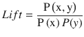

如果两个商品在统计上独立，那么`P(x,y) = P(x)P(y)`，对应`提升度 = 1`。请注意，负相关会产生小于 1 的提升度值，这也是一种有趣的发现，对应那些很少同时出现的互斥商品。

## 环境准备与算法介绍
您将需要以下附加库：`conda install -c conda-forge mlxtend`。

为此使用的通用算法是 Apriori 算法，用于在数据湖内容上进行频繁项集挖掘和关联规则学习。该算法通过识别数据湖中频繁出现的单个商品，并将它们扩展到越来越大的项集，只要这些项集在数据湖中足够频繁地出现。Apriori 确定的频繁项集可用于发现突出整体数据湖共同趋势的关联规则。我将引导您完成一个示例。

## 示例代码
从标准生态系统开始。

```
################################################################
```

# -*- coding: utf-8 -*-

import sys
import os
import pandas as pd
from mlxtend.frequent_patterns import apriori
from mlxtend.frequent_patterns import association_rules

if `sys.platform` == 'linux' or `sys.platform` == ' darwin':
    Base = `os.path.expanduser('~') + '/VKHCG'`
else:
    Base = 'C:/VKHCG'

print('################################')
print('Working Base :', Base, ' using ', `sys.platform`)
print('################################')

Company = '01-Vermeulen'
InputFileName = 'Online-Retail-Billboard.xlsx'
EDSAssessDir = '02-Assess/01-EDS'
InputAssessDir = EDSAssessDir + '/02-Python'

sFileAssessDir = Base + '/' + Company + '/' + InputAssessDir
if not `os.path.exists(sFileAssessDir)`:
    `os.makedirs(sFileAssessDir)`

sFileName = Base + '/' + Company + '/00-RawData/' + InputFileName

将 Excel 工作表导入到生态系统中。

```
df = `pd.read_excel(sFileName)`
print(df.shape)
```

执行一些特征工程，以在模型中构建购物篮模拟。

```
df['Description'] = df['Description'].str.strip()
df.dropna(axis=0, subset=['InvoiceNo'], inplace=True)
df['InvoiceNo'] = df['InvoiceNo'].astype('str')
df = df[~df['InvoiceNo'].str.contains('C')]

basket = (df[df['Country'] == "France"]
          .groupby(['InvoiceNo', 'Description'])['Quantity']
          .sum().unstack().reset_index().fillna(0)
          .set_index('InvoiceNo'))
```

def encode_units(x):
    if x == 1:
        return 1

basket_sets = `basket.applymap(encode_units)`
basket_sets.drop('POSTAGE', inplace=True, axis=1)

将 Apriori 算法应用于数据模型。

```
frequent_itemsets = `apriori(basket_sets, min_support=0.07, use_colnames=True)`
rules = `association_rules(frequent_itemsets, metric="lift", min_threshold=1)`
print(rules.head())

rules[(rules['lift'] >= 6) & (rules['confidence'] >= 0.8)]
```

现在您可以查看“绿色时钟”的结果。

```
sProduct1 = 'ALARM CLOCK BAKELIKE GREEN'
print(sProduct1)
print(basket[sProduct1].sum())
```

以及“红色时钟”……

```
sProduct2 = 'ALARM CLOCK BAKELIKE RED'
print(sProduct2)
print(basket[sProduct2].sum())
```

现在您可以查看“德国”购物篮的结果。

```
basket2 = (df[df['Country'] == "Germany"]
           .groupby(['InvoiceNo', 'Description'])['Quantity']
           .sum().unstack().reset_index().fillna(0)
           .set_index('InvoiceNo'))

basket_sets2 = `basket2.applymap(encode_units)`
basket_sets2.drop('POSTAGE', inplace=True, axis=1)

frequent_itemsets2 = `apriori(basket_sets2, min_support=0.05, use_colnames=True)`
rules2 = `association_rules(frequent_itemsets2, metric="lift", min_threshold=1)`

print(rules2[(rules2['lift'] >= 4) & (rules2['confidence'] >= 0.5)])
```

您已成功使用复杂的 Apriori 算法将数据科学组织成一个模型，可用于提取客户购买行为的洞察。

注意：优秀的数据科学家可以部署多种算法和技术来将数据组织成逻辑数据集。我建议您研究最适合客户数据的算法，并针对它们进行练习，以成为专家。

## 设计一个实用的组织超步骤

现在我已经解释了组织超步骤的各个方面，我将向您展示如何帮助我们公司进行数据处理。

### Vermeulen PLC

我将展示如何将组织超步骤应用于我们的 VKHCG 公司。那么，我将从一个网络需求开始。您能为 VKHCG 公司生成一个网络路由图吗？

#### 创建网络路由图

我将引导您完成该需求的一个可能解决方案，通过构建一个岛屿风格的`Organize`超级步骤，该步骤使用图数据模型来减少数据集中的记录和列。作为额外收获，它创建了一个视觉上改进的图表，可用于说明路由。

打开您的 Python 编辑器，从标准环境开始。

```python
import sys
import os
import pandas as pd
import networkx as nx
import matplotlib.pyplot as plt

pd.options.mode.chained_assignment = None

if `sys.platform` == 'linux' or `sys.platform` == ' darwin':
    Base = `os.path.expanduser('~') + 'VKHCG'`
else:
    Base = 'C:/VKHCG'

print('################################')
print('Working Base :', Base, ' using ', `sys.platform`)
```

# 网络路由图生成

## 准备数据

```python
print('################################')
```

```python
################################################################

sInputFileName='02-Assess/01-EDS/02-Python/Assess-Network-Routing-Company.csv'

################################################################

sOutputFileName1='05-Organise/01-EDS/02-Python/Organise-Network-Routing-Company.gml'

sOutputFileName2='05-Organise/01-EDS/02-Python/Organise-Network-Routing-Company.png'

Company='01-Vermeulen'

################################################################
```

现在从逗号分隔值文件中加载公司信息。

```python
################################################################

#### 导入国家数据

################################################################

sFileName=`Base` + '/' + `Company` + '/' + `sInputFileName`

print('################################')

print('加载中 :', `sFileName`)

print('################################')

CompanyData=`pd.read_csv`(`sFileName`, `header`=0, `low_memory`=False, `encoding`="latin-1")

print('################################')
```

现在，您可以检查公司信息。

```python
################################################################

print(`CompanyData.head()`)

print(`CompanyData.shape`)

################################################################
```

让我们开始一个新的图表来加载公司信息。

```python
G=`nx.Graph()`()

for i in `range`(`CompanyData.shape`[0]):

    for j in `range`(`CompanyData.shape`[0]):

        Node0=`CompanyData['Company_Country_Name']`[i]

        Node1=`CompanyData['Company_Country_Name']`[j]

        if `Node0` != `Node1`:

            `G.add_edge`(`Node0`, `Node1`)

for i in `range`(`CompanyData.shape`[0]):

    Node0=`CompanyData['Company_Country_Name']`[i]

    Node1=`CompanyData['Company_Place_Name']`[i] + '('+ `CompanyData['Company_Country_Name']`[i] + ')'

    if `Node0` != `Node1`:

        `G.add_edge`(`Node0`, `Node1`)
```

现在您可以在图表中检查公司信息。

```python
print('节点数:', `G.number_of_nodes()`)

print('边数:', `G.number_of_edges()`)
```

我建议您现在将图表存储到磁盘。

```python
################################################################

sFileName=`Base` + '/' + `Company` + '/' + `sOutputFileName1`

print('################################')

print('存储中 :', `sFileName`)

print('################################')

`nx.write_gml`(`G`, `sFileName`)

################################################################
```

现在您可以针对您的需求提供见解。我建议您创建图表的图像，以支持您的发现。

```python
sFileName=`Base` + '/' + `Company` + '/' + `sOutputFileName2`

print('################################')

print('存储图表图像:', `sFileName`)

print('################################')

`plt.figure`(`figsize`=(15, 15))

pos=`nx.spectral_layout`(`G`, `dim`=2)

`nx.draw_networkx_nodes`(`G`, `pos`, `node_color`="k", `node_size`=10, `alpha`=0.8)

`nx.draw_networkx_edges`(`G`, `pos`, `edge_color`='r', `arrows`=False, `style`="dashed")

`nx.draw_networkx_labels`(`G`, `pos`, `font_size`=12, `font_family`='sans-serif', `font_color`='b')

`plt.axis`('off')

`plt.savefig`(`sFileName`, `dpi`=600)

`plt.show`()

################################################################

print('################################')

print('### 完成!! #####################')

print('################################')

################################################################
```

恭喜！您现在可以回答需求了。您能否为 VKHCG 公司生成一个网络路由图？是的，您刚刚完成了。您的网络是一个具有轮状枢纽结构的核心三个节点（图 11-1）。

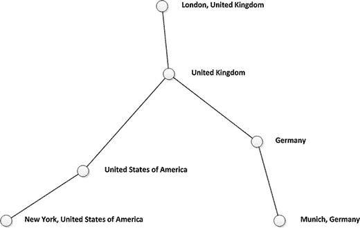

**图 11-1** 美国、英国和德国的节点图

## Krennwallner AG

Krennwallner 集团需要为广告牌挑选内容。您能组织一个模型来支持他们的查询吗？

### 为广告牌挑选内容

为了让市场营销人员能够销售广告牌内容，他们需要一张图表来显示哪些广告牌连接到哪个办公内容发布器。克伦沃尔纳的每块广告牌都配有一个接近传感器，使内容管理者能够记录注册访客何时将智能手机指向广告牌内容，或用手机触碰近场感应垫。

因此，我将协助您构建一个有序的广告牌位置数据图表，以帮助您深入了解广告牌位置和内容挑选过程。

打开您的 Python 编辑器，从标准生态系统开始。

```python
################################################################

import sys

import os

import pandas as pd

import networkx as nx

import matplotlib.pyplot as plt

import numpy as np

################################################################

`pd.options.mode.chained_assignment` = None

################################################################

if `sys.platform` == 'linux' or `sys.platform` == ' darwin':

    `Base`=`os.path.expanduser`('~') + 'VKHCG'

else:

    `Base`='C:/VKHCG'
```

# 导入接近传感器数据

```python
print('################################')
print('Working Base :', Base, ' using ', sys.platform)
print('################################')
```

定义文件路径与目标文件：

```python
sInputFileName = '02-Assess/01-EDS/02-Python/Assess-DE-Billboard-Visitor.csv'
sOutputFileName1 = '05-Organise/01-EDS/02-Python/Organise-Billboards.gml'
sOutputFileName2 = '05-Organise/01-EDS/02-Python/Organise-Billboards.png'
Billboard = '02-Krennwallner'
```

加载每块广告牌的接近传感器数据。

```python
sFileName = Base + '/' + Billboard + '/' + sInputFileName
print('################################')
print('Loading :', sFileName)
print('################################')
BillboardDataRaw = pd.read_csv(sFileName, header=0, low_memory=False, encoding="latin-1")
print('################################')
```

# 探索数据

让我们深入了解数据。

```python
print(BillboardDataRaw.head())
print(BillboardDataRaw.shape)
BillboardData = BillboardDataRaw
```

# 生成样本与图表

我建议从总数据集中抽取一个样本，用于创建训练集和测试集。

```python
sSample = list(np.random.choice(BillboardData.shape[0], 20))
```

我建议从样本中生成一个图表数据集。

```python
G = nx.Graph()
for i in sSample:
    for j in sSample:
        Node0 = BillboardData['BillboardPlaceName'][i] + '(' + BillboardData['BillboardCountry'][i] + ')'
        Node1 = BillboardData['BillboardPlaceName'][j] + '(' + BillboardData['BillboardCountry'][i] + ')'
        if Node0 != Node1:
            G.add_edge(Node0, Node1)
for i in sSample:
    Node0 = BillboardData['BillboardPlaceName'][i] + '(' + BillboardData['VisitorPlaceName'][i] + ')'
    Node1 = BillboardData['BillboardPlaceName'][i] + '(' + BillboardData['VisitorCountry'][i] + ')'
    if Node0 != Node1:
        G.add_edge(Node0, Node1)
```

现在您可以从图表中获得各种见解。

```python
print('Nodes:', G.number_of_nodes())
print('Edges:', G.number_of_edges())
```

# 保存结果

保存您辛勤劳动的成果。

```python
sFileName = Base + '/' + Billboard + '/' + sOutputFileName1
print('################################')
print('Storing :', sFileName)
print('################################')
nx.write_gml(G, sFileName)
```

# 可视化图表

接下来，我将引导您完成可视化过程。

```python
sFileName = Base + '/' + Billboard + '/' + sOutputFileName2
print('################################')
print('Storing Graph Image:', sFileName)
print('################################')
plt.figure(figsize=(15, 15))
pos = nx.circular_layout(G, dim=2)
nx.draw_networkx_nodes(G, pos, node_color="k", node_size=150, alpha=0.8)
nx.draw_networkx_edges(G, pos, edge_color='r', arrows=False, style="solid")
nx.draw_networkx_labels(G, pos, font_size=12, font_family='sans-serif', font_color='b')
plt.axis('off')
plt.savefig(sFileName, dpi=600)
plt.show()
```

```python
print('################################')
print('### Done!! #####################')
print('################################')
```

成功！您已获得一张图表，可以支持任何进一步的查询，以及一张可以分发给市场营销部门的图片（图 11-2）。

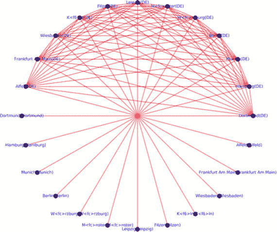

图 11-2

克伦沃尔纳的市场营销部门

## 希尔曼有限公司

希尔曼公司正在扩展业务，计划新增一个仓库和几家商店。您能否帮助该公司制定一个标准规划包，以便为激活 13 号仓库的物流做好准备？

**提示**

系统将 13 号仓库记录为 `WH-KA13`。您之前见过这个吗？是的，您没有猜错；本书前面部分已经处理过它了。

### 创建配送路线

希尔曼公司需要为 KA-13 号仓库的配送区域制定一份新的配送路线方案。总经理必须了解以下信息：

- 如果每英里成本为 1.50 英镑，且每日计划运行两趟，最昂贵的路线是哪条
- 该区域每 30 天一个月的平均行驶里程是多少

运用您将数据湖转化为业务资产的技术栈新知识，能否将“评估”环节中名为“评估 _ 最佳物流”的图转换为两点之间的最短路径？打开您的 Python 编辑器，从标准生态系统开始。

```python
```

# -*- coding: utf-8 -*-

```python
import sys
import os
import pandas as pd

if sys.platform == 'linux' or sys.platform == 'darwin':
    Base = os.path.expanduser('~') + 'VKHCG'
else:
    Base = 'C:/VKHCG'

print('################################')
print('Working Base :', Base, ' using ', sys.platform)
print('################################')

sInputFileName = '02-Assess/01-EDS/02-Python/Assess_Shipping_Routes.txt'
sOutputFileName = '05-Organise/01-EDS/02-Python/Organise-Routes.csv'
Company = '03-Hillman'
```

现在导入您之前处理过并存储在本书前文中的可行路线数据。

```python
#### Import Routes Data
sFileName = Base + '/' + Company + '/' + sInputFileName
print('################################')
print('Loading :', sFileName)
print('################################')
RouteDataRaw = pd.read_csv(sFileName, header=0, low_memory=False, sep='|', encoding="latin-1")
print('################################')
```

通过水平切片方式，隔离出与 `WH-KA13` 相关的特定数据。

```python
RouteStart = RouteDataRaw[RouteDataRaw['StartAt'] == 'WH-KA13']
```

通过第二次水平切片，隔离出 `WH-KA13` 的英里里程数据。

```python
RouteDistance = RouteStart[RouteStart['Cost'] == 'DistanceMiles']
```

现在按逻辑顺序对其进行整理。

```python
RouteDistance = RouteDistance.sort_values(by=['Measure'], ascending=False)
```

确定最大距离，并计算以每英里 1.50 英镑价格运行两趟的成本。

```python
RouteMax = RouteStart["Measure"].max()
RouteMaxCost = round((((RouteMax / 1000) * 1.5 * 2)), 2)
print('################################')
print('Maximum (£) per day:')
print(RouteMaxCost)
print('################################')
```

确定平均距离，并计算 30 天月份的月里程。

```python
RouteMean = RouteStart["Measure"].mean()
RouteMeanMonth = round((((RouteMean / 1000) * 2 * 30)), 6)
print('################################')
print('Mean per Month (Miles):')
print(RouteMeanMonth)
print('################################')
```

您刚刚利用现有的数据科学成果和一系列额外的整理过程，回答了物流总监的问题。做得好！如果您的数字正确，13 号仓库将会大获成功。

## 克拉克有限公司

我们的金融服务公司受命调查将 100 万英镑转化为额外收入的选项。克拉克小先生建议利用英镑兑美元每日汇率的简单波动，通过交易来产生额外收入。您的首席财务官想知道这是否可行？

### 简单外汇交易规划

您的挑战是，用 100 万美元或略超过 60 万英镑的资金，通过在英镑和美元之间进行简单的兑换来实现盈利。您准备好迎接这个挑战了吗？

我将向您展示如何对此问题进行建模并取得积极成果。外汇数据由克拉克的会计部门根据之前的海外交易每日收集。

打开您的 Python 编辑器，从标准生态系统开始。

```python
```

# -*- coding: utf-8 -*-

```python
import sys
import os
import pandas as pd
import sqlite3 as sq
import re
```

如果 `sys.platform` 是 `'linux'` 或 `'darwin'`，则 `Base` 设置为 `os.path.expanduser('~') + 'VKHCG'`，否则 `Base` 设置为 `'C:/VKHCG'`。

```python
if sys.platform == 'linux' or sys.platform == 'darwin':
    Base = os.path.expanduser('~') + 'VKHCG'
else:
    Base = 'C:/VKHCG'
```

```python
print('################################')
print('Working Base :', Base, ' using ', sys.platform)
print('################################')
```

以下是输入输出文件路径和公司标识：

```python
sInputFileName = '03-Process/01-EDS/02-Python/Process_ExchangeRates.csv'
sOutputFileName = '05-Organise/01-EDS/02-Python/Organise-Forex.csv'
Company = '04-Clark'
```

连接到 SQLite 数据库 `clark.db`。

```python
sDatabaseName = Base + '/' + Company + '/05-Organise/SQLite/clark.db'
conn = sq.connect(sDatabaseName)
#conn = sq.connect(':memory:')
```

## 将外汇数据导入生态系统。

```python
#### Import Forex Data
sFileName = Base + '/' + Company + '/' + sInputFileName
print('################################')
print('Loading :', sFileName)
print('################################')
ForexDataRaw = pd.read_csv(sFileName, header=0, low_memory=False, encoding="latin-1")
print('################################')
```

```python
ForexDataRaw.index.names = ['RowID']
sTable = 'Forex_All'
print('Storing :', sDatabaseName, ' Table:', sTable)
ForexDataRaw.to_sql(sTable, conn, if_exists="replace")
```

## 现在以 1,000,000.00 英镑作为初始资金。

```python
sSQL = "SELECT 1 as Bag\
, CAST(min(Date) AS VARCHAR(10)) as Date \
,CAST(1000000.0000000 as NUMERIC(12,4)) as Money \
,'USD' as Currency \
FROM Forex_All \
;"
sSQL = re.sub("\s\s+", " ", sSQL)
nMoney = pd.read_sql_query(sSQL, conn)
```

```python
nMoney.index.names = ['RowID']
sTable = 'MoneyData'
print('Storing :', sDatabaseName, ' Table:', sTable)
nMoney.to_sql(sTable, conn, if_exists="replace")
```

```python
sTable = 'TransactionData'
print('Storing :', sDatabaseName, ' Table:', sTable)
nMoney.to_sql(sTable, conn, if_exists="replace")
```

## 现在模拟克拉克小先生建议的交易模型。

> **注意**
> 克拉克小先生的假设——即基于有限证据作为您进一步研究起点的解释——是，如果您简单地持续兑换同一“袋”资金，将会产生利润。

```python
ForexDay=pd.read_sql_query("SELECT Date FROM Forex_All GROUP BY Date;", conn)

t=0
for i in range(ForexDay.shape[0]):
    sDay=ForexDay['Date'][i]
    sSQL='\
SELECT M.Bag as Bag, \
F.Date as Date, \
round(M.Money * F.Rate,6) AS Money, \
F.CodeIn AS PCurrency, \
F.CodeOut AS Currency \
FROM MoneyData AS M \
JOIN \
( \
SELECT \
CodeIn, CodeOut, Date, Rate \
FROM \
Forex_All \
WHERE\
CodeIn = "USD" AND CodeOut = "GBP" \
UNION \
SELECT \
CodeOut AS CodeIn, CodeIn AS CodeOut,  Date, (1/Rate) AS Rate \
FROM \
Forex_All \
WHERE\
CodeIn = "USD" AND CodeOut = "GBP" \
) AS F \
ON \
M.Currency=F.CodeIn \
AND \
F.Date ="' + sDay + '";'
    sSQL=re.sub("\s\s+", " ", sSQL)
    ForexDayRate=pd.read_sql_query(sSQL, conn)
    for j in range(ForexDayRate.shape[0]):
        sBag=str(ForexDayRate['Bag'][j])
        nMoney=str(round(ForexDayRate['Money'][j],2))
        sCodeIn=ForexDayRate['PCurrency'][j]
        sCodeOut=ForexDayRate['Currency'][j]
        sSQL='UPDATE MoneyData SET Date= "' + sDay + '", '
```

```
        sSQL= sSQL + ' Money = ' + nMoney + ', Currency="' + sCodeOut + '"'

        sSQL= sSQL + ' WHERE Bag=' + sBag + ' AND Currency="' + sCodeIn + '";'

        sSQL=re.sub("\s\s+", " ", sSQL)

        cur = conn.cursor()

        cur.execute(sSQL)

        conn.commit()

        t+=1

        print('Trade :', t, sDay, sCodeOut, nMoney)

        sSQL=' \

INSERT INTO TransactionData ( \

RowID, \

Bag, \

Date, \

Money, \

Currency \

)  \

SELECT ' + str(t) + ' AS RowID, \

Bag, \

Date, \

Money, \

Currency \

FROM MoneyData \

;'

        sSQL=re.sub("\s\s+", " ", sSQL)

        cur = conn.cursor()

        cur.execute(sSQL)

        conn.commit()

################################################################
```

接下来，加载交易日志，以深入了解实现这一额外收入流程的内在洞察。

```python
sSQL="SELECT RowID, Bag, Date, Money, Currency FROM TransactionData ORDER BY RowID;"

sSQL=re.sub("\s\s+", " ", sSQL)

TransactionData=pd.read_sql_query(sSQL, conn)

OutputFile=Base + '/' + Company + '/' + sOutputFileName

TransactionData.to_csv(OutputFile, index = False)

################################################################
```

这个挑战是，以1999年1月4日的1,000,000美元或603,189.41英镑为起点，通过将全部金额兑换为英镑或美元来获利。最终结果：到2017年5月5日，你赚取了119,828.98美元，即投资回报率为19.87%。干得漂亮。

**警告**
这是一个简单的例子。外汇交易属于高风险行为。在为客户尝试此操作前，请务必寻求专业建议。

## 报告超级步骤

`报告`超级步骤是生态系统中的一个环节，它通过讲故事和数据可视化的艺术来提升数据科学成果的价值。你可以进行最优秀的数据科学分析，但如果你无法通过执行一个可靠且值得信赖的`报告`步骤，将数据科学转化为可操作的商业洞察，那么你就没有为你的业务带来任何优势。让我通过一个例子来指导你，展示你到目前为止从本书中学到的内容。

### 结果摘要

任何分析中最重要的步骤就是结果摘要。你的数据科学技术和算法可以产生最严谨、最先进的数学或最具体的统计结果来满足需求，但如果你不能将这些结果总结成一个好的故事，你就没有达到你的要求。

#### 理解背景

区分优秀数据科学家与顶尖数据科学家的，不是算法或数据工程，而是数据科学家将其发现应用于客户背景的能力。

**示例：**
酒吧在23:45提供了最后一轮酒水，还剩一位客人。到23:50时，这位饮酒者杯中剩下的啤酒不到5%。

从饮酒者的背景来看，如果他必须赶午夜巴士，他要么喝得更慢以撑到午夜，要么立刻喝完剩下的酒。从酒吧员工的背景来看，他们想在23:45关门，并且必须让这最后一位顾客离开才能锁门，因为他们也想赶午夜巴士。

显然，如果你能确定双方是否都想赶午夜巴士，你就能理解饮酒者杯中啤酒量的背景。单纯的数据科学指标——杯中还剩5%——是毫无价值的。

我曾有一位初级数据科学家试图利用啤酒厂闭路电视系统进行图像处理，来判断人们杯中啤酒的液位，以便让他的数据科学系统在夜间通知酒吧员工顾客的饮酒速度。其目的是在晚班时段多赚取3%的利润。

但问题更为复杂，因为每晚都有几位当地的常客会在午夜后留下来，去赶对面公交枢纽在12:30之后新推出的有补贴的“安全驾驶”夜班车回家，这样他们就不用支付常规的公交车费。所以，他们喝酒的花费比回家的车费还少，而且还能免费乘车，前提是他们身上有酒味。

结果，啤酒厂不得不为三家酒吧的六名员工支付午夜后的双倍加班费，原因在于午夜过后，出于安全考虑，员工不能单独与顾客待在酒吧里。

员工们总是很晚才回家，因为他们不符合慈善夜班车的资格，只能打车回家。直到啤酒厂向数据科学家提供了外部闭路电视录像，我们才发现了真正的问题所在。解决方案是：如果顾客在23:30之前乘坐常规公交车，并在啤酒厂购买了啤酒，就为他们提供一张常规公交车票的优惠券。晚班总利润因此增加了7.3%。不需要复杂的数据科学，只需要一些背景理解。

我见过太多数据科学家花费大量时间，用最复杂的算法得出优秀的结果，却无法以业务能理解的方式向业务方阐述他们的发现。甚至更糟的是，他们的结果无法投入生产，因为在更大规模上，这些结果根本不像数据科学家设计的那样有效——这使得整个工作从一开始就毫无意义。

**警告**
经验告诉我，这是数据科学家成败的关键领域。始终要确定你结果的完整背景环境。理解结果背后的故事。

#### 恰当的可视化

一图胜千言，这句话没错。但在数据科学中，你只希望你的可视化传达一个故事：即你准备的数据科学发现。确保你的受众能清晰无误地接收到你最重要的信息，这一点至关重要。

**警告**
当心使用过多颜色和选择不清晰的图表格式。你会失去想要传达的信息！保持简洁，切中要点。

勤加练习你的可视化工具，达到高水平的熟练度。我见过无数数据科学家因为没能进行恰当的可视化呈现，而失去了优秀数据科学成果的价值。

#### 消除冗余

你是否参加过这样的演示：演讲者费尽心思准备了50张幻灯片来反馈他的数据科学成果？最痛苦的景象就是听众们在忍受这种超过两小时的演示时脸上的表情。

**提示**
平均而言，讲解一张幻灯片需要五分钟。你绝不应该展示超过十张幻灯片。

数据科学家最大的任务就是消除数据集中的冗余。虽然有各种算法，例如主成分分析（`PCA`），利用方差膨胀因子处理多重共线性来消除维度、填补或消除缺失值，用决策树进行细分，以及后向特征消除等，但消除冗余的最大贡献者是扎实可靠的特征工程。

**提示**
如果不需要，就舍弃它！应用恰当的特征工程每次都能胜出。

#### 在需要聚焦的地方引起注意

请记住：作为一名数据科学家，你的目标是为客户传递洞见，以便他们能够实施解决方案，来解决一个他们甚至可能尚未意识到的问题。你必须将注意力放在洞见本身，而非过程上。然而，你务必确保你的流程经过验证，并能支撑起一种经公认的算法或技术。

> **警告**
> 不要陷入这样一种境地：你的发现之所以受到质疑，仅仅是因为你的方法和步骤不够清晰和精确。

只讲述当前最重要的故事。以后你随时可以回来讲述下一个故事。

#### 讲述故事（弗赖塔格金字塔）

根据弗赖塔格金字塔，一个故事的剧情由五部分组成：铺垫、上升动作、高潮、下降动作和结局。这是书籍和剧本作者用来构建任何故事的基本框架。同理，你也必须引导你的业务经历数据科学流程。

- **铺垫**是故事中向观众介绍重要背景信息的部分。在数据科学中，你要讲述你所开展调查的背景。
- **上升动作**指的是一系列事件，它们共同推向最引人入胜的关键点。在数据科学中，你要指出重要的发现或结果。保持简洁，切中要害。
- **高潮**是决定故事人物命运好坏的转折点。在数据科学中，你要展示你的解决方案或发现将如何改变你所完成工作的结果。
- **在下降动作阶段**，高潮前后发生的事件之间的冲突得以展开。在数据科学中，你要证明，在试点中实施你的建议之后，同样的技术可以用来找出问题，并证实这些问题最终可以被解决。
- **结局**是故事的结果。在数据科学中，你要提出解决方案，并让改进得以永久化。

决定使用哪个可重复的“金句”来帮助你的核心信息在听众心中留下印象。人们通过你的重复来记住核心内容。你必须确保一件事：客户能记住你的核心信息。

确保你清晰无误地传达了这一信息。通过在会议中反复使用“金句”来强化核心信息。

一位优秀数据科学家的艺术，在于能够讲述关于数据的故事，并让人们记住其基线。

> **提示**
> 与朋友和家人一起练习你的故事讲述技巧。让他们给你反馈。确保你在众人面前讲话时感到自如。

既然你已经能轻松地讲述故事了，接下来我将为你提供更多示例，展示如何为数据科学创建报告步骤。

### 工程化实用报告超步骤

我在本书中引用的任何源代码或其他补充材料，读者均可通过本书的产品页面在GitHub上获取，地址为[`www.apress.com/9781484230534`](http://www.apress.com/9781484230534)。请注意，该源代码假设你已经完成了第2章中概述的源代码设置。

现在来检查一下你的图形能力。

```python
import matplotlib.pyplot as plt
import matplotlib.patheffects as path_effects

fig = plt.figure(figsize=(21, 3))
t = fig.text(0.2, 0.5, 'Practical Data Science', fontsize=75, weight=1000, va="center")
t.set_path_effects([path_effects.PathPatchEffect(offset=(4, -4), hatch="xxxx", facecolor='gray'), path_effects.PathPatchEffect(edgecolor='white', linewidth=1.1, facecolor='black')])
plt.plot()
plt.show()
```

既然我已经解释了报告超步骤的各个方面，我将展示如何帮助VKHC集团公司处理他们的流程。尝试以下代码，了解你在数据科学公司规模上的进展：

```python
import matplotlib.pyplot as plt
from numpy.random import randn

z = randn(8)
plt.figure(figsize=(15, 5))
red_dot, = plt.plot(z, "ro-", markersize=18)
white_cross, = plt.plot(z[:5], "w+", markeredgewidth=3, markersize=15)
black_cross, = plt.plot(z[:2], "y+", markeredgewidth=3, markersize=15)
plt.legend([red_dot, (red_dot, white_cross),(red_dot,black_cross)], ["Krennwallner", "Clark","Hillman"])
```

# Vermeulen PLC 公司

Vermeulen 公司需要一份所有客户数据链接的地图。你能提供一份报告来满足这个需求吗？我将通过一个示例来指导你如何实现这一需求。

## 创建网络路由图

让我们加载客户数据并创建一个图数据库。你可以使用该图数据库来生成图像，从而支撑你关于客户的故事叙述。

打开你的 `Python` 编辑器，并创建标准环境。

```python
import sys
import os
import pandas as pd
import networkx as nx
import matplotlib.pyplot as plt

pd.options.mode.chained_assignment = None

if sys.platform == 'linux' or sys.platform == 'darwin':
    Base=os.path.expanduser('~') + 'VKHCG'
else:
    Base='C:/VKHCG'

print('################################')
print('Working Base :',Base, ' using ', sys.platform)
print('################################')

sInputFileName='02-Assess/01-EDS/02-Python/Assess-Network-Routing-Customer.csv'

sOutputFileName1='06-Report/01-EDS/02-Python/Report-Network-Routing-Customer.gml'
sOutputFileName2='06-Report/01-EDS/02-Python/Report-Network-Routing-Customer.png'
Company='01-Vermeulen'
```

从接入步骤中导入网络客户数据。

```python
#### 导入国家数据

sFileName=Base + '/' + Company + '/' + sInputFileName
print('################################')
print('加载中 :',sFileName)
print('################################')
CustomerDataRaw=pd.read_csv(sFileName,header=0,low_memory=False, encoding="latin-1")
CustomerData=CustomerDataRaw.head(100)
print('已加载国家数据:',CustomerData.columns.values)
print('################################')

print(CustomerData.head())
print(CustomerData.shape)

G=nx.Graph()
for i in range(CustomerData.shape[0]):
    for j in range(CustomerData.shape[0]):
        Node0=CustomerData['Customer_Country_Name'][i]
        Node1=CustomerData['Customer_Country_Name'][j]
        if Node0 != Node1:
            G.add_edge(Node0,Node1)

for i in range(CustomerData.shape[0]):
    Node0=CustomerData['Customer_Country_Name'][i]
    Node1=CustomerData['Customer_Place_Name'][i] + '('+ CustomerData['Customer_Country_Name'][i] + ')'
    Node2='('+ "{:.9f}".format(CustomerData['Customer_Latitude'][i]) + ')' \
          '('+ "{:.9f}".format(CustomerData['Customer_Longitude'][i]) + ')'
    if Node0 != Node1:
        G.add_edge(Node0,Node1)
    if Node1 != Node2:
        G.add_edge(Node1,Node2)
```

以下是你对网络客户数据的洞察结果：

```python
print('节点数:', G.number_of_nodes())
print('边数:', G.number_of_edges())
```

导出网络客户数据。

```python
sFileName=Base + '/' + Company + '/' + sOutputFileName1
print('################################')
print('存储中 :',sFileName)
print('################################')
nx.write_gml(G, sFileName)

sFileName=Base + '/' + Company + '/' + sOutputFileName2
print('################################')
print('存储图图像:',sFileName)
print('################################')
```

现在，你可以为网络客户准备一张图像，用于解释你所获得的洞察。

```python
plt.figure(figsize=(25, 25))
pos=nx.spectral_layout(G,dim=2)
nx.draw_networkx_nodes(G,pos, node_color="k", node_size=10, alpha=0.8)
nx.draw_networkx_edges(G, pos,edge_color='r', arrows=False, style="dashed")
nx.draw_networkx_labels(G,pos,font_size=12,font_family='sans-serif',font_color='b')
plt.axis('off')
plt.savefig(sFileName,dpi=600)
plt.show()
print('################################')
print('### 完成!! #####################')
print('################################')
```

干得好。你已经为 Vermeulen 的管理层生成了一份关于其客户网络需求的报告。

## Krennwallner AG

Krennwallner 市场部门希望将广告牌的位置部署到公司 Web 服务器上。你能为位置信息准备三个版本的网页吗？

-   缩小视图时，位置以气泡形式聚集显示
-   位置以图钉形式显示
-   位置以热力图形式显示

要实现这个目标，我必须向你介绍一个新的库：`folium`。这个库能帮助你利用地理位置信息创建网页。使用 `conda install -c conda-forge folium` 命令安装它。

### 为广告牌挑选内容

打开你的 Python 编辑器，搭建以下环境：

```

# 德国广告牌数据处理与可视化

```python
# -*- coding: utf-8 -*-

################################################################

import sys

import os

import pandas as pd

from folium.plugins import FastMarkerCluster, HeatMap

from folium import Marker, Map

import webbrowser

################################################################

if sys.platform == 'linux' or sys.platform == ' darwin':
    Base=os.path.expanduser('~') + '/VKHCG'
else:
    Base='C:/VKHCG'

print('################################')
print('Working Base :',Base, ' using ', sys.platform)
print('################################')

################################################################
```

## 导入与数据准备

导入公司在德国的广告牌所需数据。

```python
sFileName=Base+'/02-Krennwallner/01-Retrieve/01-EDS/02-Python/Retrieve_DE_Billboard_Locations.csv'

df = pd.read_csv(sFileName,header=0,low_memory=False, encoding="latin-1")

df.fillna(value=0, inplace=True)

print(df.shape)
```

数据需要处理一些缺失值。我建议直接通过 `try-except` 流程来移除“质量差”的记录。

```python
################################################################

t=0

for i in range(df.shape[0]):
    try:
        sLongitude=df["Longitude"][i]
        sLongitude=float(sLongitude)
    except Exception:
        sLongitude=float(0.0)
    try:
        sLatitude=df["Latitude"][i]
        sLatitude=float(sLatitude)
    except Exception:
        sLatitude=float(0.0)
    try:
        sDescription=df["Place_Name"][i] + ' (' + df["Country"][i]+')'
    except Exception:
        sDescription='VKHCG'

    if sLongitude != 0.0 and sLatitude != 0.0:
        DataClusterList=list([sLatitude, sLongitude])
        DataPointList=list([sLatitude, sLongitude, sDescription])
        t+=1
        if t==1:
            DataCluster=[DataClusterList]
            DataPoint=[DataPointList]
        else:
            DataCluster.append(DataClusterList)
            DataPoint.append(DataPointList)

data=DataCluster
```

## 创建可视化网页

现在你拥有了一份可用于创建网页内容的数据集。你可以先创建聚集图网页。

```python
pins=pd.DataFrame(DataPoint)

pins.columns = [ 'Latitude','Longitude','Description']

################################################################

billbords_map1 = Map(location=[48.1459806, 11.4985484], zoom_start=5)

marker_cluster = FastMarkerCluster(data).add_to(billbords_map1)

sFileNameHtml=Base+'/01-Vermeulen/06-Report/01-EDS/02-Python/Billboard1.html'

billbords_map1.save(sFileNameHtml)
```

网页已保存，现在打开它，看看你的成果。

```python
webbrowser.open('file://' + os.path.realpath(sFileNameHtml))
```

接下来，你可以生成仅包含标记的网页。

```python
################################################################

billbords_map2 = Map(location=[48.1459806, 11.4985484], zoom_start=5)

for name, row in pins.iloc[:100].iterrows():
    Marker([row["Latitude"],row["Longitude"]], popup=row["Description"]).add_to(billbords_map2)

sFileNameHtml=Base+'/01-Vermeulen/06-Report/01-EDS/02-Python/Billboard2.html'

billbords_map2.save(sFileNameHtml)

webbrowser.open('file://' + os.path.realpath(sFileNameHtml))
```

这个示例进展顺利。你还可以将数据制作成热力图版本的网页。

```python
################################################################

billbords_heatmap = Map(location=[48.1459806, 11.4985484], zoom_start=5)

billbords_heatmap.add_child(HeatMap([[row["Latitude"], row["Longitude"]] for name, row in pins.iloc[:100].iterrows()]))

sFileNameHtml=Base+'/01-Vermeulen/06-Report/01-EDS/02-Python/Billboard_heatmap.html'

billbords_heatmap.save(sFileNameHtml)

webbrowser.open('file://' + os.path.realpath(sFileNameHtml))

################################################################

print('### Done!! ############################################')

################################################################
```

# 希尔曼公司

希尔曼博士刚刚安装了一套摄像系统，使公司能够拍摄视频，从而间接获取所有进出仓库的集装箱的图像。你能将集装箱侧面的数字转换成数字编码吗？

## 读取容器

我将协助你通过一个快速实验来证明你能够完成所需任务。打开你的 Python 编辑器并搭建如下环境：

```python
from time import time

import numpy as np

import matplotlib.pyplot as plt

from matplotlib import offsetbox

from sklearn import (manifold, datasets, decomposition, ensemble,
                    discriminant_analysis, random_projection)

digits = datasets.load_digits(n_class=6)

X = digits.data

y = digits.target

n_samples, n_features = X.shape

n_neighbors = 30
```

创建一个用于缩放和可视化嵌入向量的函数。

```python
def plot_embedding(X, title=None):
```


现在你可以绘制已识别数字的图像。

```python
n_img_per_row = 20
img = np.zeros((10 * n_img_per_row, 10 * n_img_per_row))

for i in range(n_img_per_row):
    ix = 10 * i + 1
    for j in range(n_img_per_row):
        iy = 10 * j + 1
        img[ix:ix + 8, iy:iy + 8] = X[i * n_img_per_row + j].reshape((8, 8))

plt.figure(figsize=(10, 10))
plt.imshow(img, cmap=plt.cm.binary)
plt.xticks([])
plt.yticks([])
plt.title('从 64 维数字数据集中选取的样本')
```

你可以使用随机酉矩阵进行随机二维投影处理。

```python
print("Computing random projection")
rp = random_projection.SparseRandomProjection(n_components=2, random_state=42)
X_projected = rp.fit_transform(X)
plot_embedding(X_projected, "数字的随机投影")
```

现在添加一个在前两个主成分上的投影。

```python
print("Computing PCA projection")
t0 = time()
X_pca = decomposition.TruncatedSVD(n_components=2).fit_transform(X)
plot_embedding(X_pca,
              "数字的主成分投影 (用时 %.2fs)" %
              (time() - t0))
```

添加一个在前两个线性判别成分上的投影。

```python
print("Computing Linear Discriminant Analysis projection")
X2 = X.copy()
X2.flat[::X.shape[1] + 1] += 0.01  # 使 X 可逆
t0 = time()
X_lda = discriminant_analysis.LinearDiscriminantAnalysis(n_components=2).fit_transform(X2, y)
plot_embedding(X_lda,
              "数字的线性判别投影 (用时 %.2fs)" %
              (time() - t0))
```

添加数字数据集的 Isomap 投影。

```python
print("Computing Isomap embedding")
t0 = time()
X_iso = manifold.Isomap(n_neighbors, n_components=2).fit_transform(X)
print("Done.")
plot_embedding(X_iso,
              "数字的 Isomap 投影 (用时 %.2fs)" %
              (time() - t0))
```

添加数字数据集的局部线性嵌入。

```python
print("Computing LLE embedding")
clf = manifold.LocallyLinearEmbedding(n_neighbors, n_components=2,
                                      method='standard')
t0 = time()
X_lle = clf.fit_transform(X)
print("Done. Reconstruction error: %g" % clf.reconstruction_error_)
plot_embedding(X_lle,
              "数字的局部线性嵌入 (用时 %.2fs)" %
              (time() - t0))
```

添加数字数据集的修正局部线性嵌入。

```python
print("Computing modified LLE embedding")
clf = manifold.LocallyLinearEmbedding(n_neighbors, n_components=2,
                                      method='modified')
t0 = time()
X_mlle = clf.fit_transform(X)
print("Done. Reconstruction error: %g" % clf.reconstruction_error_)
plot_embedding(X_mlle,
              "数字的修正局部线性嵌入 (用时 %.2fs)" %
              (time() - t0))
```

添加数字数据集的 Hessian LLE 嵌入。

```python
print("Computing Hessian LLE embedding")
clf = manifold.LocallyLinearEmbedding(n_neighbors, n_components=2,
                                      method='hessian')
t0 = time()
X_hlle = clf.fit_transform(X)
print("Done. Reconstruction error: %g" % clf.reconstruction_error_)
plot_embedding(X_hlle,
              "数字的 Hessian 局部线性嵌入 (用时 %.2fs)" %
              (time() - t0))
```

添加数字数据集的 LTSA 嵌入。

```python
print("Computing LTSA embedding")
clf = manifold.LocallyLinearEmbedding(n_neighbors, n_components=2,
                                      method='ltsa')
t0 = time()
```


## 数字数据集嵌入实验

执行数字数据集的各种流形嵌入。

### 局部切空间对齐 (LTSA)

```python
X_ltsa = clf.fit_transform(X)

print("Done. Reconstruction error: %g" % clf.reconstruction_error_)

plot_embedding(X_ltsa,
              "数字的局部切空间对齐 (用时 %.2fs)" %
              (time() - t0))
```

### MDS 嵌入

添加数字数据集的 MDS 嵌入。

```python
print("Computing MDS embedding")

clf = manifold.MDS(n_components=2, n_init=1, max_iter=100)

t0 = time()

X_mds = clf.fit_transform(X)

print("Done. Stress: %f" % clf.stress_)

plot_embedding(X_mds,
              "数字的 MDS 嵌入 (用时 %.2fs)" %
              (time() - t0))
```

### 随机树嵌入

添加数字数据集的随机树嵌入。

```python
print("Computing Totally Random Trees embedding")

hasher = ensemble.RandomTreesEmbedding(n_estimators=200, random_state=0,
                                       max_depth=5)

t0 = time()

X_transformed = hasher.fit_transform(X)

pca = decomposition.TruncatedSVD(n_components=2)

X_reduced = pca.fit_transform(X_transformed)

plot_embedding(X_reduced,
              "数字的随机森林嵌入 (用时 %.2fs)" %
              (time() - t0))
```

### 谱嵌入

添加数字数据集的谱嵌入。

```python
print("Computing Spectral embedding")

embedder = manifold.SpectralEmbedding(n_components=2, random_state=0,
                                      eigen_solver="arpack")

t0 = time()

X_se = embedder.fit_transform(X)

plot_embedding(X_se,
              "数字的谱嵌入 (用时 %.2fs)" %
              (time() - t0))
```

### t-SNE 嵌入

添加数字数据集的 t-SNE 嵌入。

```python
print("Computing t-SNE embedding")

tsne = manifold.TSNE(n_components=2, init="pca", random_state=0)

t0 = time()

X_tsne = tsne.fit_transform(X)

plot_embedding(X_tsne,
              "数字的 t-SNE 嵌入 (用时 %.2fs)" %
              (time() - t0))

plt.show()
```

干得漂亮！你已成功完成容器实验。你觉得哪种显示格式最好？

正确答案取决于你的选择，因为它必须与你自己对数据的洞察相匹配，而且实际上并没有错误的答案。

## Clark 有限公司

VKHCG 旗下的金融公司是 Clark 会计师事务所，VKHCG 持有其 60% 的股份。这些会计师是集团的财务顾问，负责处理与国际会计复杂工作相关的所有事务。

### 财务状况

VKHCG 公司去年表现良好，Clark 团队的成员需要为集团内每家公司准备一份资产负债表。这些公司要求使用示例目录 `(..\VKHCG\04-Clark\00-RawData`) 中的模板文件 (`Balance-Sheet-Template.xlsx`) 为每家公司生成资产负债表。图 11-3 展示了基本布局。

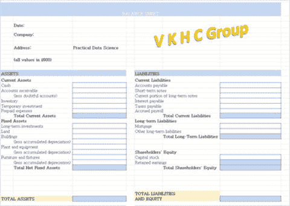

图 11-3  
VKHCG 公司的基本内部资产负债表

我将引导您完成一个流程，使您能够将数据科学与预格式化的 Microsoft Excel 模板相结合，为每家 VKHCG 公司生成资产负债表。

`注意`

一个名为 `openpyxl` 的新库可以帮助您编辑 Microsoft Excel 工作簿。

使用命令 `"conda install -c anaconda openpyxl"` 安装这个新库。打开您的 Python 生态系统，并将以下代码构建到其中。

设置一个标准生态系统。

```python
```

# 脚本：处理财务报表数据

## 初始化环境

```python
import sys
import os
import pandas as pd
import sqlite3 as sq
import re
from openpyxl import load_workbook
```

## 确定工作目录

根据操作系统设置基础路径。

```python
if sys.platform == 'linux' or sys.platform == 'darwin':
    Base = os.path.expanduser('~') + 'VKHCG'
else:
    Base = 'C:/VKHCG'
```

## 打印状态信息

```python
print('################################')
print('Working Base :', Base, ' using ', sys.platform)
print('################################')
```

## 设置输入数据

为示例设置输入数据。

```python
sInputTemplateName = '00-RawData/Balance-Sheet-Template.xlsx'
```

## 设置输出文件

为示例的输出设置前言。

```python
sOutputFileName = '05-Organise/01-EDS/02-Python/Report-Balance-Sheet'
Company = '04-Clark'
```

## 连接数据库

这里有一个选择。您可以使用基于磁盘的 SQLite 数据库，将数据存储到硬盘以供后续阶段使用，但速度不如第二个选项快。

```python
sDatabaseName = Base + '/' + Company + '/06-Report/SQLite/clark.db'
conn = sq.connect(sDatabaseName)
```

第二个选项是将数据保存在基于内存的数据库中，访问速度更快，但不是永久存储。

```python
#conn = sq.connect(':memory:')
```

## Import Balance Sheet Data

### 导入原始数据

```python
for y in range(1, 13):
    sInputFileName = '00-RawData/BalanceSheets' + str(y).zfill(2) + '.csv'
    sFileName = Base + '/' + Company + '/' + sInputFileName
    print('################################')
    print('Loading :', sFileName)
    print('################################')
    ForexDataRaw = pd.read_csv(sFileName, header=0, low_memory=False, encoding="latin-1")
print('################################')
```

### 将数据存入数据库

```python
ForexDataRaw.index.names = ['RowID']
sTable = 'BalanceSheets'
print('Storing :', sDatabaseName, ' Table:', sTable)
if y == 1:
    print('Load Data')
    ForexDataRaw.to_sql(sTable, conn, if_exists="replace")
else:
    print('Append Data')
    ForexDataRaw.to_sql(sTable, conn, if_exists="append")
```

### 查询并准备日期列表

```python
sSQL = "SELECT \
    Year, \
    Quarter, \
    Country, \
    Company, \
    CAST(Year AS INT) || 'Q' || CAST(Quarter AS INT) AS sDate, \
    Company || ' (' || Country || ')' AS sCompanyName , \
    CAST(Year AS INT) || 'Q' || CAST(Quarter AS INT) || '-' ||\
    Company || '-' || Country AS sCompanyFile \
    FROM BalanceSheets \
    GROUP BY \
    Year, \
    Quarter, \
    Country, \
    Company \
    HAVING Year is not null \
    ;"
sSQL = re.sub(r"\s\s+", " ", sSQL)
sDatesRaw = pd.read_sql_query(sSQL, conn)
print(sDatesRaw.shape)
sDates = sDatesRaw.head(5)
```

## Loop Dates

### 遍历日期并填充报表

```python
for i in range(sDates.shape[0]):
    sFileName = Base + '/' + Company + '/' + sInputTemplateName
    wb = load_workbook(sFileName)
    ws = wb.get_sheet_by_name("Balance-Sheet")
    sYear = sDates['sDate'][i]
    sCompany = sDates['sCompanyName'][i]
    sCompanyFile = sDates['sCompanyFile'][i]
    sCompanyFile = re.sub(r"\s+", "", sCompanyFile)
    ws['D3'] = sYear
    ws['D5'] = sCompany
    sFields = pd.DataFrame(
        [
            ['Cash', 'D16', 1],
            ['Accounts_Receivable', 'D17', 1],
            ['Doubtful_Accounts', 'D18', 1],
            ['Inventory', 'D19', 1],
            ['Temporary_Investment', 'D20', 1],
            ['Prepaid:Expenses', 'D21', 1],
            ['Long_Term_Investments', 'D24', 1],
            ['Land', 'D25', 1],
            ['Buildings', 'D26', 1],
            ['Depreciation_Buildings', 'D27', -1],
            ['Plant_Equipment', 'D28', 1],
            ['Depreciation_Plant_Equipment', 'D29', -1],
            ['Furniture_Fixtures', 'D30', 1],
        ]
    )
```

```python
[
    ['Depreciation_Furniture_Fixtures', 'D31', -1],
    ['Accounts_Payable', 'H16', 1],
    ['Short_Term_Notes', 'H17', 1],
    ['Current_Long_Term_Notes', 'H18', 1],
    ['Interest_Payable', 'H19', 1],
    ['Taxes_Payable', 'H20', 1],
    ['Accrued_Payroll', 'H21', 1],
    ['Mortgage', 'H24', 1],
    ['Other_Long_Term_Liabilities', 'H25', 1],
    ['Capital_Stock', 'H30', 1]
]

nYear = str(int(sDates['Year'][i]))
nQuarter = str(int(sDates['Quarter'][i]))
sCountry = str(sDates['Country'][i])
sCompany = str(sDates['Company'][i])
sFileName = Base + '/' + Company + '/' + sOutputFileName + \
    '-' + sCompanyFile + '.xlsx'
print(sFileName)

for j in range(sFields.shape[0]):
    sSumField = sFields[0][j]
    sCellField = sFields[1][j]
    nSumSign = sFields[2][j]
    sSQL = "SELECT \
        Year, \
        Quarter, \
        Country, \
        Company, \
        SUM(" + sSumField + ") AS nSumTotal \
        FROM BalanceSheets \
        GROUP BY \
        Year, \
        Quarter, \
        Country, \
        Company \
        HAVING \
        Year=" + nYear + " \
        AND \
        Quarter=" + nQuarter + " \
        AND \
        Country='" + sCountry + "' \
        AND \
        Company='" + sCompany + "' \
        ;"
    sSQL = re.sub("\s\s+", " ", sSQL)
    sSumRaw = pd.read_sql_query(sSQL, conn)
    ws[sCellField] = sSumRaw["nSumTotal"][0] * nSumSign
    print('Set cell', sCellField, ' to ', sSumField, 'Total')
    wb.save(sFileName)
```

干得好！现在您已获得所需的所有报告。

## 图形与图表

到目前为止，您看到的示例中几乎没有图形化可视化。接下来，我将引导您了解几种可视化方法，这些方法在向客户展示数据时特别有用。

### 绘图选项

首先，让我们看看生态系统中的几种绘图选项。打开您的 Python 编辑器，并设置以下生态系统：

```python
################################################################
```

# 数据可视化示例

```python
# -*- coding: utf-8 -*-

import sys
import os
import pandas as pd
import matplotlib as ml
from matplotlib import pyplot as plt
```

如果`sys.platform`是`'linux'`或`'darwin'`，则`Base`路径设置为`os.path.expanduser('~') + '/VKHCG'`，否则设置为`'C:/VKHCG'`。

```python
if sys.platform == 'linux' or sys.platform == ' darwin':
    Base=os.path.expanduser('~') + '/VKHCG'
else:
    Base='C:/VKHCG'
```

`print`函数会输出工作基础路径。

```python
print('################################')
print('Working Base :',Base, ' using ', sys.platform)
print('################################')
```

`GBase`变量定义了图表输出目录。

```python
GBase = Base+'/01-Vermeulen/06-Report/01-EDS/02-Python/'
ml.style.use('ggplot')
```

这里有一个专门的数据集，用于演示可视化效果。

```python
data=[
    ['London',    29.2, 17.4],
    ['Glasgow',    18.8, 11.3],
    ['Cape Town',    15.3, 9.0],
    ['Houston',    22.0, 7.8],
    ['Perth',    18.0, 23.7],
    ['San Francisco',    11.4, 33.3]
]
os_new=pd.DataFrame(data)
pd.Index(['Item', 'Value', 'Value Percent', 'Conversions', 'Conversion Percent',
    'URL', 'Stats URL'],
    dtype='object')
os_new.rename(columns = {0 : "Warehouse Location"}, inplace=True)
os_new.rename(columns = {1 : "Profit 2016"}, inplace=True)
os_new.rename(columns = {2 : "Profit 2017"}, inplace=True)
```

### 饼图

让我们从一个简单的饼图开始。

```python
explode = (0, 0, 0, 0, 0, 0.1)
labels=os_new['Warehouse Location']
colors_mine = ['yellowgreen', 'gold', 'lightskyblue', 'lightcoral', 'lightcyan','lightblue']
os_new.plot(figsize=(10, 10),kind="pie", y="Profit 2017",autopct='%.2f%%', \
    shadow=True, explode=explode, legend = False, colors = colors_mine,\
    labels=labels, fontsize=20)
sPicNameOut1=GBase+'pie_explode.png'
plt.savefig(sPicNameOut1,dpi=600)
```

图 11-4 展示了生成的饼图。

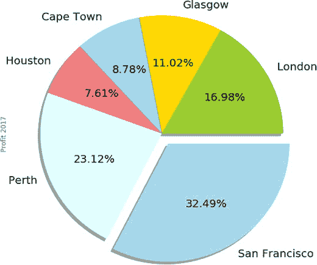

**图 11-4** 饼图

### 双饼图

通过以下代码，你可以并排放置两个饼图：

```python
explode = (0, 0, 0, 0, 0, 0)
colors_mine = ['yellowgreen', 'gold', 'lightskyblue', 'lightcoral', 'lightcyan','lightblue']
os_new.plot(figsize=(10, 5),kind="pie", y=['Profit 2016','Profit 2017'],autopct='%.2f%%', \
    shadow=True, explode=explode, legend = False, colors = colors_mine,\
    subplots=True, labels=labels, fontsize=10)
sPicNameOut2=GBase+'pie.png'
plt.savefig(sPicNameOut2,dpi=600)
```

图 11-5 展示了生成的双饼图。

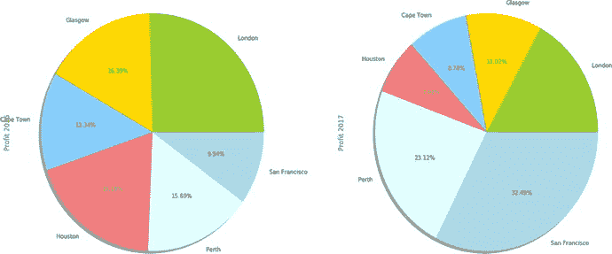

**图 11-5** 双饼图

### 折线图

我们也可以以折线图的形式来可视化数据。

```python
os_new.iloc[:5].plot(figsize=(10, 10),kind='Line',x='Warehouse Location',\
    y=['Profit 2016','Profit 2017']);
sPicNameOut3=GBase+'line.png'
plt.savefig(sPicNameOut3,dpi=600)
```

图 11-6 展示了生成的折线图。

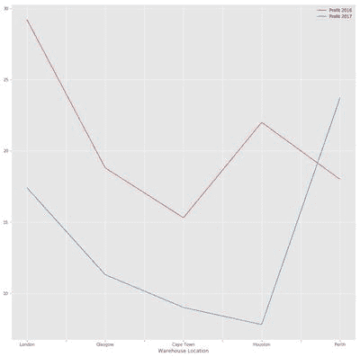

**图 11-6** 折线图

### 条形图

以下代码生成一个条形图：

```python
os_new.iloc[:5].plot(figsize=(10, 10),kind='bar',x='Warehouse Location',\
    y=['Profit 2016','Profit 2017']);
sPicNameOut4=GBase+'bar.png'
plt.savefig(sPicNameOut4,dpi=600)
```

图 11-7 展示了生成的条形图。

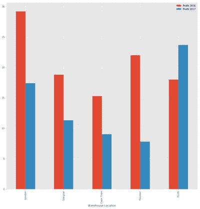

**图 11-7** 条形图

### 水平条形图

你也可以创建水平条形图。

```python
os_new.iloc[:5].plot(figsize=(10, 10),kind='barh',x='Warehouse Location',\
    y=['Profit 2016','Profit 2017']);
sPicNameOut5=GBase+'hbar.png'
plt.savefig(sPicNameOut5,dpi=600)
```

图 11-8 展示了生成的水平条形图。

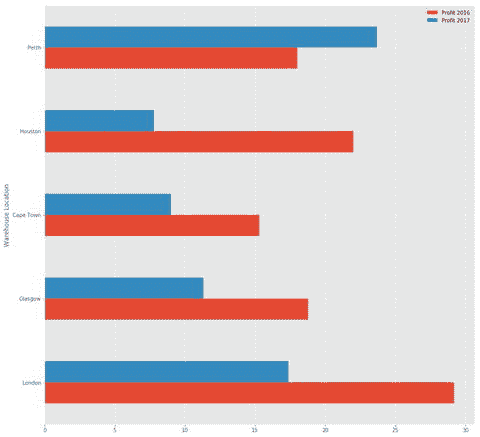

**图 11-8** 水平条形图

### 面积图

也可以采用面积图的形式。

```python
os_new.iloc[:5].plot(figsize=(10, 10),kind='area',x='Warehouse Location',\
    y=['Profit 2016','Profit 2017'],stacked=False);
sPicNameOut6=GBase+'area.png'
plt.savefig(sPicNameOut6,dpi=600)
```

图 11-9 展示了生成的面积图。

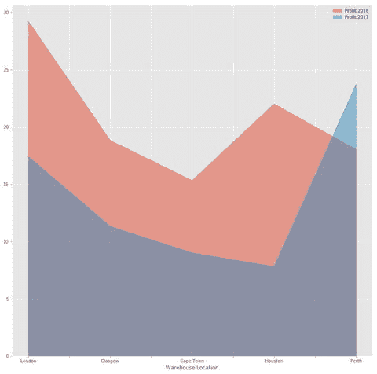

**图 11-9** 面积图

### 散点图

如果你愿意，我们也可以使用散点图进行可视化。

```python
os_new.iloc[:5].plot(figsize=(10, 10),kind='scatter',x='Profit 2016',\
    y='Profit 2017',color='DarkBlue',marker='D');
sPicNameOut7=GBase+'scatter.png'
plt.savefig(sPicNameOut7,dpi=600)
```

图 11-10 展示了生成的散点图。

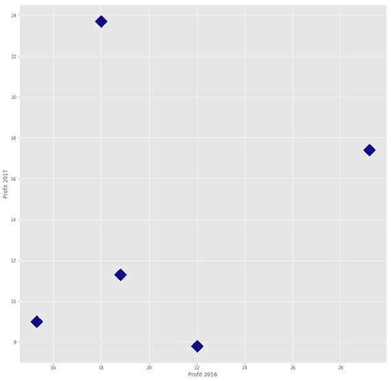

**图 11-10** 散点图

## 六边形分箱图

这里有一个我发现的有趣内容——六边形分箱图。之所以包含六边形图，是因为如果你能进行数据科学分析，你就可以：
-   凭借内置的比例尺轻松判断距离
-   同样凭借内置的比例尺轻松判断感兴趣点的密度
-   轻松放大或缩小地图，并将事物大致放置在它们在地理空间报告格式中应有的位置

让我们看一个关于六边形图的简单示例。我们有一个大约 25`×`25 英里的农场。如果我们测量每平方英里农田产生的利润，就可以发现农场的盈利区域和非盈利区域。

```python
os_new.iloc[:5].plot(figsize=(13, 10),kind='hexbin',x='Profit 2016',\
y='Profit 2017', gridsize=25);
sPicNameOut8=GBase+'hexbin.png'
plt.savefig(sPicNameOut8,dpi=600)
```

图 11-11 展示了生成的六边形分箱图，该图显示有五个区域在 2016 年和 2017 年都产生了利润。

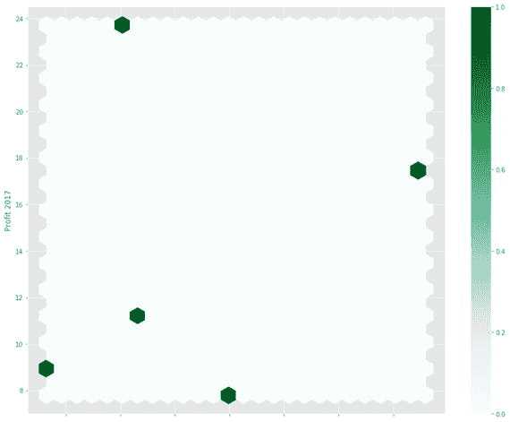

**图 11-11** 农场的六边形分箱图

## 更复杂的图形

接下来，我将向你展示一些我在处理来自不同数据源的数据时使用过的、更复杂的图形技术。通常，普通的饼图、折线图或条形图无法完全传达结果的可视化效果，或者数据过于复杂，以至于不应用一些额外的数据科学技术来解决复杂性就无法进行可视化。

现在，我将引导你了解一些我经常使用的、比较常见的技术。

### 核密度估计图

核密度估计是一种重要的数据平滑技术，它基于有限的数据样本来准备关于总体的推断。

```
################################################################
```

# 核密度估计图

```python
# -*- coding: utf-8 -*-

################################################################

import sys

import os

import pandas as pd

import matplotlib as ml

import numpy as np

from matplotlib import pyplot as plt

################################################################

if sys.platform == 'linux' or sys.platform == ' darwin':

    Base=os.path.expanduser('~') + '/VKHCG'

else:

    Base='C:/VKHCG'

print('################################')

print('Working Base :',Base, ' using ', sys.platform)

print('################################')

################################################################

ml.style.use('ggplot')

fig1=plt.figure(figsize=(10, 10))

ser = pd.Series(np.random.randn(1000))

ser.plot(figsize=(10, 10),kind='kde')

sPicNameOut1=Base+'/01-Vermeulen/06-Report/01-EDS/02-Python/kde.png'

plt.savefig(sPicNameOut1,dpi=600)

plt.tight_layout()

plt.show()
```

图 11-12 展示了生成的 `KDE` 图，该图说明了随机变量的概率密度函数的估计。它将随机的一千个点缩减为一条曲线，指示出数值在总体中的变化方式，而不显示每个单独的值。

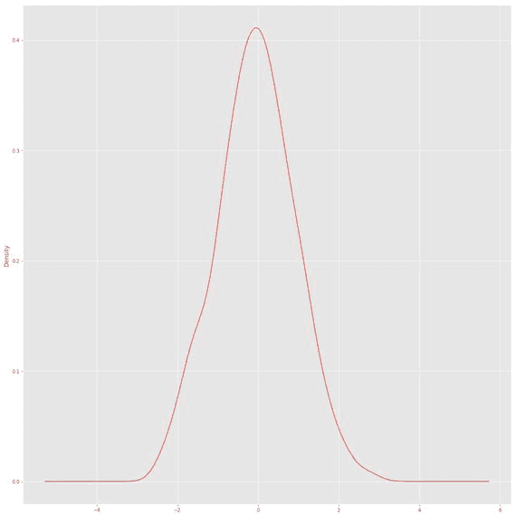

**图 11-12** 核密度估计图

## 散点矩阵图

散点矩阵是一种用于估计协方差矩阵的统计工具。

```python
fig2=plt.figure(figsize=(10, 10))

from pandas.plotting import scatter_matrix

df = pd.DataFrame(np.random.randn(1000, 5), columns=['Y2014','Y2015', 'Y2016', 'Y2017', 'Y2018'])

scatter_matrix(df, alpha=0.2, figsize=(10, 10), diagonal="kde")

sPicNameOut2=Base+'/01-Vermeulen/06-Report/01-EDS/02-Python/scatter_matrix.png'

plt.savefig(sPicNameOut2,dpi=600)

plt.tight_layout()

plt.show()
```

图 11-13 展示了生成的散点矩阵图。

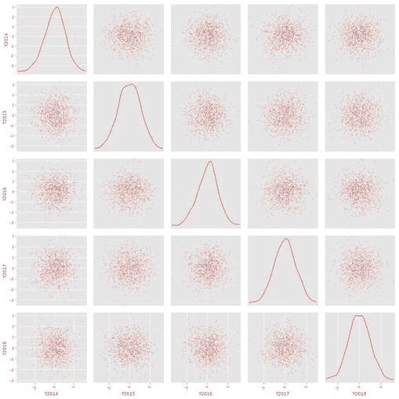

**图 11-13** 散点矩阵图

## 安德鲁斯曲线

利用安德鲁斯曲线进行可视化是一种在高维数据中观察结构的方法。安德鲁斯曲线是用于可视化多元数据的空间变换可视化（`STV`）技术的示例，它使用正交基函数，通过二维或三维空间中的轮廓线来表示 k 维数据点。安德鲁斯曲线基于傅里叶级数，其中系数是观测值的数值。简单来说，它们允许你以一种结构化的方式，将超过三维的降维结果转换为可视化格式。

打开你的 Python 编辑器并搭建这个基本环境：

```python
import sys

import os

import pandas as pd

from matplotlib import pyplot as plt

################################################################

if sys.platform == 'linux' or sys.platform == ' darwin':

    Base=os.path.expanduser('~') + '/VKHCG'

else:

    Base='C:/VKHCG'

print('################################')

print('Working Base :',Base, ' using ', sys.platform)

print('################################')

################################################################

sDataFile=Base+'/01-Vermeulen/00-RawData/irisdata.csv'

data = pd.read_csv(sDataFile)

from pandas.plotting import andrews_curves

plt.figure(figsize=(10, 10))

andrews_curves(data, 'Name')

sPicNameOut1=Base+'/01-Vermeulen/06-Report/01-EDS/02-Python/andrews_curves.png'

plt.savefig(sPicNameOut1,dpi=600)

plt.tight_layout()

plt.show()
```

图 11-14 展示了结果：一个四维到二维的降维图。

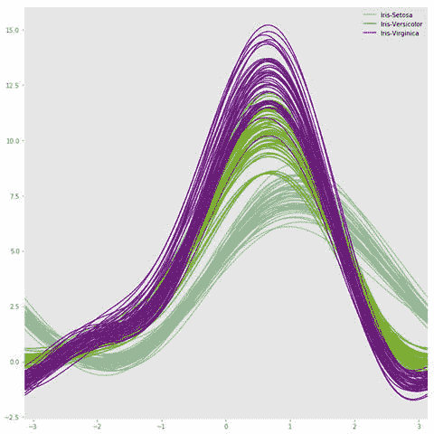

图 11-14 使用安德鲁斯曲线生成的图形

## 平行坐标

平行坐标通常用于可视化高维几何图形和分析多元数据。

```python
from pandas.plotting import parallel_coordinates

plt.figure(figsize=(10, 10))

parallel_coordinates(data, 'Name')

sPicNameOut2=Base+'/01-Vermeulen/06-Report/01-EDS/02-Python/parallel_coordinates.png'

plt.savefig(sPicNameOut2,dpi=600)

plt.tight_layout()

plt.show()
```

图 11-15 展示了此图的结果。

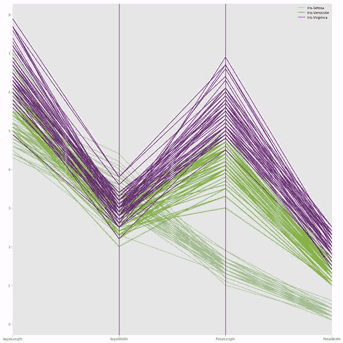

图 11-15 使用平行坐标生成的图形

## RADVIZ 方法

`RADVIZ` 方法将一组多维点映射到二维空间。

```python
from pandas.plotting import radviz

plt.figure(figsize=(10, 10))

radviz(data, 'Name')

sPicNameOut3=Base+'/01-Vermeulen/06-Report/01-EDS/02-Python/radviz.png'

plt.savefig(sPicNameOut3,dpi=600)

plt.tight_layout()

plt.show()
```

图 11-16 展示了结果。

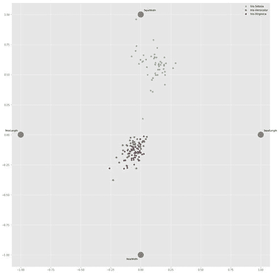

图 11-16 由 `RADVIZ` 方法生成的图形

## 滞后图

滞后图允许数据科学家检查数据集是否为随机数据。

创建滞后图可以让你检查数据的随机性。随机数据在水平和垂直方向上都会相当均匀地分布。如果你在图中看不到任何模式，那么你的数据很可能是随机的。

下面的例子将向你展示它在实际数据科学中是如何工作的：

```python
################################################################
```

# 数据可视化示例

## 滞后图代码与说明

```python
# -*- coding: utf-8 -*-

################################################################

import sys

import os

import pandas as pd

from matplotlib import style

from matplotlib import pyplot as plt

import numpy as np

################################################################

if sys.platform == 'linux' or sys.platform == ' darwin':

    Base=os.path.expanduser('~') + '/VKHCG'

else:

    Base='C:/VKHCG'

print('################################')

print('Working Base :',Base, ' using ', sys.platform)

print('################################')

################################################################

style.use('ggplot')

from pandas.plotting import lag_plot

plt.figure(figsize=(10, 10))

data = pd.Series(0.1 * np.random.rand(1000) + \

0.9 * np.sin(np.linspace(-99 * np.pi, 99 * np.pi, num=1000)))

lag_plot(data)

sPicNameOut1=Base+'/01-Vermeulen/06-Report/01-EDS/02-Python/lag_plot.png'

plt.savefig(sPicNameOut1,dpi=600)

plt.tight_layout()

plt.show()
```

图 11-17 展示了结果。

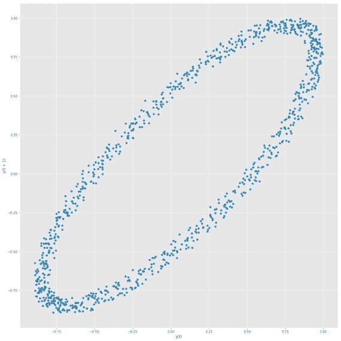

图 11-17：滞后图

## 自相关图

自相关图是样本自相关与时间滞后关系的设计图。

```python
from pandas.plotting import autocorrelation_plot

plt.figure(figsize=(10, 10))

data = pd.Series(0.7 * np.random.rand(1000) + \

0.3 * np.sin(np.linspace(-9 * np.pi, 9 * np.pi, num=1000)))

autocorrelation_plot(data)

sPicNameOut2=Base+'/01-Vermeulen/06-Report/01-EDS/02-Python/autocorrelation_plot.png'

plt.savefig(sPicNameOut2,dpi=600)

plt.tight_layout()

plt.show()
```

图 11-18 展示了结果。

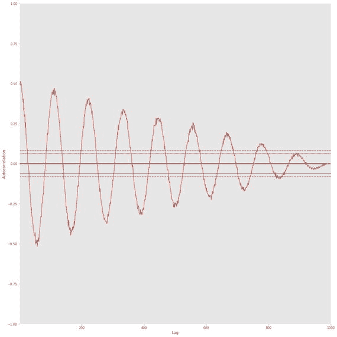

图 11-18：自相关图

## 自助法图

为了从一组数据中生成给定统计量的自助法不确定性估计，会从数据中生成一个大小小于或等于数据集大小的子样本，并计算其统计量。这个子样本的生成是有放回的，因此任何数据点可以被多次采样，或者完全不被采样。这个过程会对许多子样本重复进行。

下面是一个从 `1000` 个总体点中抽取 `50` 个元素的 `500` 个样本的示例。

```python
from pandas.plotting import bootstrap_plot

data = pd.Series(np.random.rand(1000))

plt.figure(figsize=(10, 10))

bootstrap_plot(data, size=50, samples=500, color="grey")

sPicNameOut3=Base+'/01-Vermeulen/06-Report/01-EDS/02-Python/bootstrap_plot.png'

plt.savefig(sPicNameOut3,dpi=600)

plt.tight_layout()

plt.show()
```

图 11-19 展示了提议的自助法的结果。这使数据科学家能够展示用于数据自助法处理的样本的分布情况。

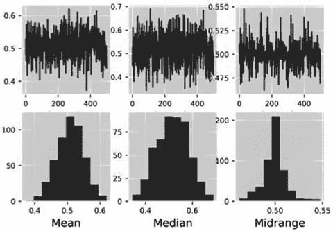

图 11-19：自助法图

## 等高线图

等高线图是一种图形化技术，通过在二维平面上绘制恒定的 `z` 切片（称为等高线）来展示三维曲面。对于 5G 和机器人技术等新科技的最新地理空间洞察，要求数据科学家在进行数据分析时，开始将客户周边的地形纳入考量。数据科学还表明，先前关于具有共同影响中心的同心圆的信念是错误的。最新发现显示，其结果类似于地球的等高线，如同影响力的模式。

以下是一个示例，向你展示如何将这些等高线地图可视化。打开你的 Python 编辑器并设置好以下环境：

```python
################################################################
```

```python
# -*- coding: utf-8 -*-

################################################################

import sys

import os

import matplotlib

import numpy as np

import matplotlib.cm as cm

import matplotlib.mlab as mlab

import matplotlib.pyplot as plt

################################################################

if sys.platform == 'linux' or sys.platform == ' darwin':

Base=os.path.expanduser('~') + '/VKHCG'

else:

Base='C:/VKHCG'

print('################################')

print('Working Base :',Base, ' using ', sys.platform)

print('################################')

################################################################

matplotlib.rcParams['xtick.direction'] = 'out'

matplotlib.rcParams['ytick.direction'] = 'out'
```

这是你的数据集。

```python
delta = 0.025

x = np.arange(-3.0, 3.0, delta)

y = np.arange(-2.0, 2.0, delta)

X, Y = np.meshgrid(x, y)

Z1 = mlab.bivariate_normal(X, Y, 1.0, 1.0, 0.0, 0.0)

Z2 = mlab.bivariate_normal(X, Y, 1.5, 0.5, 1, 1)
```

# 差分高斯

`Z = 10.0 * (Z2 - Z1)`

你现在可以创建一个带有标签的简单等高线图。

```python
plt.figure(figsize=(10, 10))

CS = plt.contour(X, Y, Z)

plt.clabel(CS, inline=1, fontsize=10)

plt.title('Simply default with labels')

sPicNameOut0 = Base + '/01-Vermeulen/06-Report/01-EDS/02-Python/contour0.png'

plt.savefig(sPicNameOut0, dpi=600)

plt.tight_layout()

plt.show()
```

以下是输出结果（图 11-20）。获得了清晰的等高线。

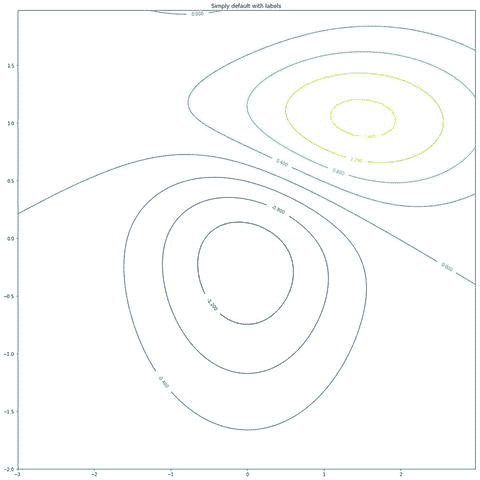

图 11-20 等高线图

你能看到 `matplotlib` 如何帮助你创建复杂的可视化效果吗？这种等高线可用于地形等高线的常规映射。我也用它来展示特定事件或行动的影响区域，例如，希尔曼开设新仓库或克伦瓦尔纳新建广告牌。另一种用途是，当你可以将数据集与时序关联起来时，只需用一个循环生成相同代码，例如生成 12 张图像。然后，我只需执行一个命令来生成 MP4 格式的视频。

看看 `ffmpeg -f image2 -r 1/5 -i yourimage%03d.png -vcodec mpeg4 -y yourmovie.mp4`。它只需将三位数填充的图像（`yourimage001.png`）转换为 MPEG4 QuickTime 影片。

`提示`

人们可以快速观看一段小视频，以直观了解你所展示结果的效果或背景。

现在我们可以看看如何改变等高线的格式。我发现强制为标签设置手动定位是一个有用的功能，因为在为你的系列影片制作图像时，它能更好地控制演示格式。

```python
plt.figure(figsize=(10, 10))

CS = plt.contour(X, Y, Z)

manual_locations = [(-1, -1.4), (-0.62, -0.7), (-2, 0.5),
                    (1.7, 1.2), (2.0, 1.4), (2.4, 1.7)]

plt.clabel(CS, inline=1, fontsize=10, manual=manual_locations)

plt.title('Labels at selected locations')

sPicNameOut1 = Base + '/01-Vermeulen/06-Report/01-EDS/02-Python/contour1.png'

plt.savefig(sPicNameOut1, dpi=600)

plt.tight_layout()

plt.show()
```

在图 11-21 中，你能看到等高线标签现在是如何被固定到特定位置的吗？

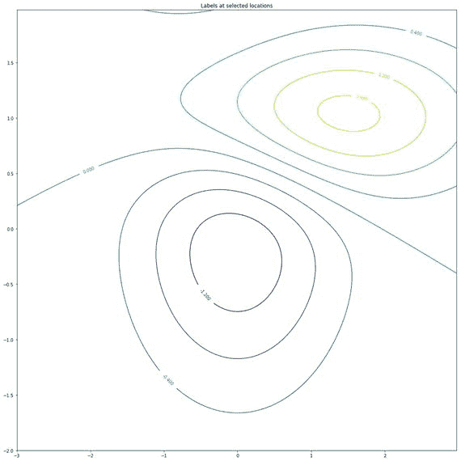

图 11-21 带有固定等高线标签的图表

`提示`

只移动或更改你想要传达的项。人的眼睛会捕捉到最细微的变化，这可能会分散他们的兴趣。

你也可以改变线型，以传达流程中的新方面。

```python
plt.figure(figsize=(10, 10))

CS = plt.contour(X, Y, Z, 6,
                 colors='k',  # negative contours will be dashed by default
                 )

plt.clabel(CS, fontsize=9, inline=1)

plt.title('Single color - negative contours dashed')

sPicNameOut2 = Base + '/01-Vermeulen/06-Report/01-EDS/02-Python/contour2.png'

plt.savefig(sPicNameOut2, dpi=600)

plt.tight_layout()

plt.show()
```

结果如图 11-22 所示。

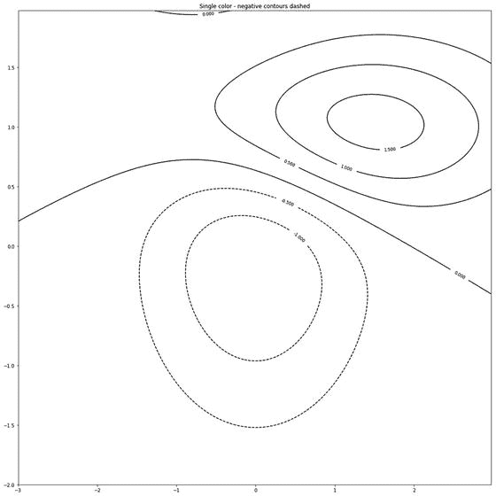

图 11-22 具有对比等高线的图表

如你所见，你可以调整图标的许多方面。

```python
plt.figure(figsize=(10, 10))

matplotlib.rcParams['contour.negative_linestyle'] = 'solid'

plt.figure(figsize=(10, 10))

CS = plt.contour(X, Y, Z, 6,
                 colors='k',
                 )

plt.clabel(CS, fontsize=9, inline=1)

plt.title('Single color - negative contours solid')

sPicNameOut3 = Base + '/01-Vermeulen/06-Report/01-EDS/02-Python/contour3.png'

plt.savefig(sPicNameOut3, dpi=600)

plt.tight_layout()

plt.show()
```

更多结果显示在图 11-23 中。

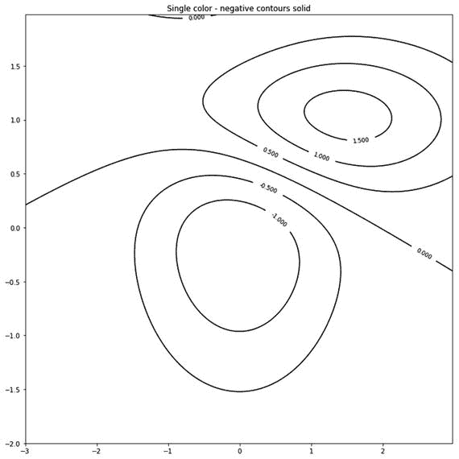

图 11-23 具有实线等高线的图表

那么，让我们构建一个等高线图来展示你能达到的效果。

```python
plt.figure(figsize=(10, 10))

CS = plt.contour(X, Y, Z, 6,
                 linewidths=np.arange(.5, 4, .5),
                 colors=('r', 'green', 'blue',
                         (1, 1, 0), '#afeeee', '0.5')
                 )

plt.clabel(CS, fontsize=9, inline=1)

plt.title('Crazy lines')

sPicNameOut4 = Base + '/01-Vermeulen/06-Report/01-EDS/02-Python/contour4.png'

plt.savefig(sPicNameOut4, dpi=600)

plt.tight_layout()

plt.show()
```

你觉得怎么样？在图 11-24 中，你能看到确保改变线条颜色或线型的好处吗？我发现它是一个很好的沟通工具。

`提示`

将不重要的信息变灰，但切勿删除，因为这能为观众提供一个比较点，让他们了解你认为什么重要或什么不重要，同时又不丢失数据集。

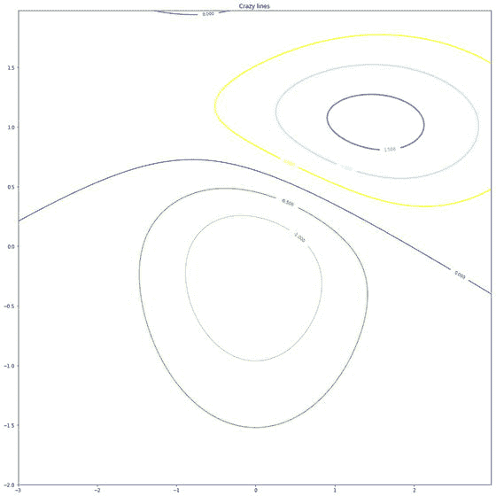

图 11-24 具有突出显示等高线的图表

你可以制作一些令人惊叹的图表。

```python
plt.figure(figsize=(12, 10))

im = plt.imshow(Z, interpolation="bilinear", origin="lower",
                cmap=cm.gray, extent=(-3, 3, -2, 2))

levels = np.arange(-1.2, 1.6, 0.2)

CS = plt.contour(Z, levels,
                 origin='lower',
                 linewidths=2,
                 extent=(-3, 3, -2, 2))
```

现在让我们加粗零值等高线。

```python
zc = CS.collections[6]

plt.setp(zc, linewidth=4)

plt.clabel(CS, levels[1::2],  # label every second level
           inline=1,
           fmt='%1.1f',
           fontsize=14)
```

现在为等高线添加一个颜色条。

```python
CB = plt.colorbar(CS, shrink=0.8, extend="both")

plt.title('Lines with colorbar')

#plt.hot()  # Now change the colormap for the contour lines and colorbar

plt.flag()
```

你仍然可以为图像也添加一个颜色条。

```python
CBI = plt.colorbar(im, orientation="horizontal", shrink=0.8)
```

这会让原有的颜色条看起来有点不协调，所以让我们恢复它的位置。

```python
l, b, w, h = plt.gca().get_position().bounds
```

```
ll, bb, ww, hh = `CB.ax.get_position().bounds`

`CB.ax.set_position([ll, b + 0.1*h, ww, h*0.8])`

`sPicNameOut5=Base+'/01-Vermeulen/06-Report/01-EDS/02-Python/contour5.png'`

`plt.savefig(sPicNameOut5,dpi=600)`

`plt.tight_layout()`

`plt.show()`

哇，你已经创建了一个超级等高线图（图 11-25）。

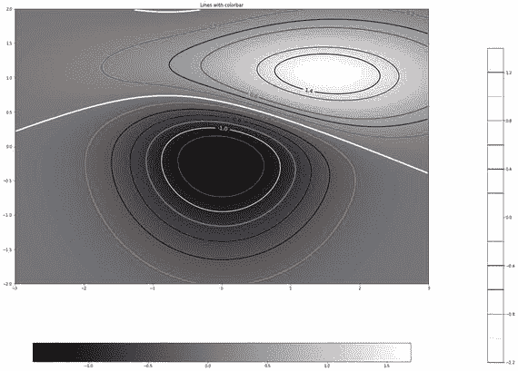

图 11-25

多维复杂等高线图

## 我有一个疑问：创建这个超精细轮廓图的额外工作，是否为图表传递的信息增添了更多价值？除非我想证明自己具备生成复杂可视化的能力，否则我不会制作这种复杂程度的图表。

> **警告**  
> 请始终确保你的信息被有效传递！

不过，我本质上也是一名科学家，所以当你有空闲时间时，可以尝试不同的修改、更换其他颜色，并探索每个参数的控制效果。简而言之，享受这个过程。

## 3D 图表

让我们将图表升级到 3D。许多数据集涉及两个以上的影响因素，而 3D 图表有助于传达这些信息。

打开你的 Python 编辑器，构建以下代码环境：

```python
################################################################
```

# 图表与可视化

## 三维图表示例

```python
# -*- coding: utf-8 -*-

import sys
import os
import numpy as np
import matplotlib.pyplot as plt
from mpl_toolkits.mplot3d import Axes3D
from sklearn import decomposition
from sklearn import datasets

if sys.platform == 'linux' or sys.platform == 'darwin':
    Base = os.path.expanduser('~') + '/VKHCG'
else:
    Base = 'C:/VKHCG'

print('################################')
print('Working Base :', Base, ' using ', sys.platform)
print('################################')
```

现在生成一个数据集。

```python
np.random.seed(5)
centers = [[1, 1], [-1, -1], [1, -1]]
iris = datasets.load_iris()
X = iris.data
y = iris.target
```

现在开始 3D 绘图。

```python
fig = plt.figure(1, figsize=(16, 12))
plt.clf()
ax = Axes3D(fig, rect=[0, 0, .95, 1], elev=48, azim=134)
plt.cla()
pca = decomposition.PCA(n_components=3)
pca.fit(X)
X = pca.transform(X)

for name, label in [('Setosa', 0), ('Versicolour', 1), ('Virginica', 2)]:
    ax.text3D(X[y == label, 0].mean(),
              X[y == label, 1].mean() + 1.5,
              X[y == label, 2].mean(), name,
              horizontalalignment='center',
              bbox=dict(alpha=.5, edgecolor="w", facecolor="w"))
```

我建议你重新排列标签，使颜色与聚类结果匹配。

```python
y = np.choose(y, [1, 2, 0]).astype(np.float)
ax.scatter(X[:, 0], X[:, 1], X[:, 2], c=y, cmap=plt.cm.spectral,
           edgecolor='k', marker='p', s=300)
ax.w_xaxis.set_ticklabels([])
ax.w_yaxis.set_ticklabels([])
ax.w_zaxis.set_ticklabels([])

sPicNameOut0 = Base + '/01-Vermeulen/06-Report/01-EDS/02-Python/3DPlot.png'
plt.savefig(sPicNameOut0, dpi=600)
plt.show()
```

做得好。现在你可以创建 3D 图表了。结果参见图 11-26。

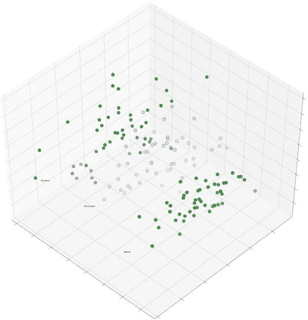

**图 11-26** — 三维图表

## 总结

你已经成功完成了本章图表部分的学习。

让我们总结一下你学到的内容：

- 你现在可以创建各种 2D 和 3D 图表类型。
- 你可以通过使用我在本书前面讨论的技术，将图表转换为电影。你也可以直接在常用的演示软件中添加一系列图片。
- 你可以通过更改颜色、线型或其他参数来增强图表的特定部分。

> **提示**
> 我仅仅为你开启了使用图表进行可视化世界的大门。请进一步研究，并参考他人的作品。

我有一位图形专家为我工作。我通常会将所有最终图表交给她修改，因为她是一位擅长制作高质量演示文稿的艺术家。请利用所有可用的技能，确保你的沟通完美无缺。

下一节是可视化的一部分，它将向你展示如何在数据科学中使用预先准备好的可视化内容。

## 图片

图片是数据科学中一个有趣的专业方向。电影和图片的处理本身就是一个科学领域。我将向你介绍这个领域，但必须承认这只是对数据科学这一子领域的浅尝。

### 图像的通道

任何图片都有一个有趣的事实：每张图片都是一个复杂的数据集。图片是由许多层或通道构成的，这些层或通道帮助可视化工具渲染所需的图像。

打开你的 Python 编辑器，让我们一起探究图像的内在结构。

```python
import sys
import os
import matplotlib.pyplot as plt
import matplotlib.image as mpimg

if sys.platform == 'linux' or sys.platform == 'darwin':
    Base = os.path.expanduser('~') + '/VKHCG'
else:
    Base = 'C:/VKHCG'

print('################################')
print('Working Base :', Base, ' using ', sys.platform)
print('################################')
```

这是一张典型的便携式网络图形（PNG）格式图像：

```python
sPicName = Base + '/01-Vermeulen/00-RawData/AudiR8.png'
```

你可以将其加载到一个数值矩阵中。

```python
t = 0
img = mpimg.imread(sPicName)
print('Size:', img.shape)

plt.figure(figsize=(10, 10))
t += 1
sTitle = '(' + str(t) + ') 原始图像'
plt.title(sTitle)
plt.imshow(img)
plt.show()

for c in range(img.shape[2]):
    t += 1
    plt.figure(figsize=(10, 10))
    sTitle = '(' + str(t) + ') 通道: ' + str(c)
    plt.title(sTitle)
    lum_img = img[:, :, c]
    plt.imshow(lum_img)
    plt.show()
```

你可以清楚地看到图像尺寸为：`1073`，`1950`，`4`。这意味着每个通道包含 `1073 × 1950` 个像素，即每层有 `2,092,350` 个像素。由于有四层，总共用 `8,369,400` 个值来描述图像大小。你可以通过执行 `img.size` 来获取这个尺寸。

接下来，让我们探索如何对图像进行变换。

### 边缘检测

大多数数据科学项目所需的常见技术之一，就是确定物品图像的边缘。这在机器人物体选择和面部识别等领域非常有用，这里仅举两个特例。

我将向你展示如何确定你之前看到的那张图像的边缘。打开你的 Python 编辑器，并创建以下环境：

```python
################################################################
```

# -*- coding: utf-8 -*-

```python
import sys
import os
import matplotlib.pyplot as plt
from PIL import Image
```

```python
if sys.platform == 'linux' or sys.platform == ' darwin':
    Base=os.path.expanduser('~') + '/VKHCG'
else:
    Base='C:/VKHCG'
print('################################')
print('Working Base :',Base, ' using ', sys.platform)
print('################################')
```

```python
sPicNameIn=Base+'/01-Vermeulen/00-RawData/AudiR8.png'
sPicNameOut=Base+'/01-Vermeulen/06-Report/01-EDS/02-Python/AudiR8Edge1.png'
```

现在你可以打开了。

```python
imageIn = Image.open(sPicNameIn)
fig1=plt.figure(figsize=(10, 10))
fig1.suptitle('Audi R8', fontsize=20)
imgplot = plt.imshow(imageIn)
```

现在将图像转换为黑白图像。

```python
mask=imageIn.convert("L")
```

下一个值需要根据你想要试验效果的图像进行调整。你可以选择一个介于 `0` 到 `255` 之间的范围，来检查你的研究结果。

```python
th=49
imageOut = mask.point(lambda i: i < th and 255)
```

你可以保存你的实验，或者尝试其他方法。

```python
imageOut.save(sPicNameOut)
imageTest = Image.open(sPicNameOut)
fig2=plt.figure(figsize=(10, 10))
fig2.suptitle('Audi R8 Edge', fontsize=20)
imgplot = plt.imshow(imageTest)
```

图 11-27 显示了结果。


图 11-27

提取了边缘的图像

现在我将向你展示一个略有不同的方法。这种方法在机器人技术中很常见，因为它是一种快速识别视线中物体是否存在的方法。

打开你的 Python 编辑器，并搭建以下环境：

```python
################################################################
```

# 图像边缘检测与比较

## 环境设置与代码加载

```python
# -*- coding: utf-8 -*-

################################################################

import sys

import os

import numpy

import scipy

from scipy import ndimage

################################################################

if sys.platform == 'linux' or sys.platform == ' darwin':

Base=os.path.expanduser('~') + '/VKHCG'

else:

Base='C:/VKHCG'

print('################################')

print('Working Base :',Base, ' using ', sys.platform)

print('################################')

################################################################
sPicNameIn=Base+'/01-Vermeulen/00-RawData/AudiR8.png'

sPicNameOut=Base+'/01-Vermeulen/06-Report/01-EDS/02-Python/AudiR8Edge2.png'

################################################################
```

现在加载图像。

```python
im = scipy.misc.imread(sPicNameIn)
```

现在你可以应用一些简单的数学计算，就能得到一幅边缘图像。

```python
im = im.astype('int32')

dx = ndimage.sobel(im, 0) # horizontal derivative

dy = ndimage.sobel(im, 1) # vertical derivative

mag = numpy.hypot(dx, dy) # magnitude

mag *= 255.0 / numpy.max(mag) # normalize (Q&D)
```

现在你可以保存图像了。

```python
scipy.misc.imsave(sPicNameOut, mag)
```

现在你可以比较这两张图像了。

```python
import matplotlib.pyplot as plt

from PIL import Image

imageIn = Image.open(sPicNameIn)

plt.figure(figsize=(10, 10))

imgplot = plt.imshow(imageIn)

imageTest = Image.open(sPicNameOut)

plt.figure(figsize=(10, 10))

imgplot = plt.imshow(imageTest)
```

结果如图 11-28 所示。


图 11-28

边缘化图像

做得好。现在你可以进行边缘检测并比较结果了。这是处理图像的两项重要技能。

## 无法一招通用

我们处理的图像大多具有不同的大小和质量。在多数数据科学工作中，你必须将图像调整到特定尺寸。

**警告**

如果对图像进行了修改，请确保将结果保存为新的文件名。我见过太多图像处理操作直接覆盖了原始文件。

接下来的示例将演示降低像素质量对图像的影响。打开你的 Python 编辑器，并创建以下环境：

```python

################################################################
```

## 图像加载与显示

# -*- coding: utf-8 -*-

################################################################

```python
import sys
import os
import matplotlib.pyplot as plt
from PIL import Image
```

################################################################

```python
if sys.platform == 'linux' or sys.platform == ' darwin':
    Base=os.path.expanduser('~') + '/VKHCG'
else:
    Base='C:/VKHCG'

print('################################')
print('Working Base :',Base, ' using ', sys.platform)
print('################################')
```

################################################################

```python
sPicName=Base+'/01-Vermeulen/00-RawData/AudiR8.png'
nSize=4
```

让我们加载原始图像。

```python
img = Image.open(sPicName)
plt.figure(figsize=(nSize, nSize))
sTitle='Unchanges'
plt.title(sTitle)
imgplot = plt.imshow(img)
```

现在应用一个缩略图函数，它会创建一张 64 × 64 像素的缩略图。

```python
img.thumbnail((64, 64), Image.ANTIALIAS) # resizes image in-place
plt.figure(figsize=(nSize, nSize))
sTitle='Resized'
plt.title(sTitle)
imgplot = plt.imshow(img)

plt.figure(figsize=(nSize, nSize))
sTitle='Resized with Bi-Cubic'
plt.title(sTitle)
imgplot = plt.imshow(img, interpolation="bicubic")
```

################################################################

```python
print('### Done!! ############################################')
```

################################################################

你能看到这对图像质量产生的影响吗？

## 展示差异

我想向你展示这项技术，让你能够生成两个重叠的结果，但同时又能表明两者都存在。在数据科学演示中，当需要说明图表上的两组节点相同时，你必须让每组节点以有序的方式略微不同，以便于可视化。如果没有这种微小的偏移，这两组节点就会完全重叠在一起。

```python
import numpy as np
from matplotlib import pyplot as plt
from matplotlib.collections import LineCollection
from sklearn import manifold
from sklearn.metrics import euclidean_distances
from sklearn.decomposition import PCA

n_samples = 25
seed = np.random.RandomState(seed=3)
X_true = seed.randint(0, 20, 2 * n_samples).astype(np.float)
X_true = X_true.reshape((n_samples, 2))
```

# 对数据进行中心化处理

```
X_true -= X_true.mean()

similarities = euclidean_distances(X_true)
```

你只需向相似度矩阵中添加噪声即可。

```python
noise = np.random.rand(n_samples, n_samples)

noise = noise + noise.T

noise[np.arange(noise.shape[0]), np.arange(noise.shape[0])] = 0

similarities += noise

mds = manifold.MDS(n_components=2, max_iter=3000, eps=1e-9, random_state=seed,

dissimilarity="precomputed", n_jobs=1)

pos = mds.fit(similarities).embedding_

nmds = manifold.MDS(n_components=2, metric=False, max_iter=3000, eps=1e-12,

dissimilarity="precomputed", random_state=seed, n_jobs=1,

n_init=1)

npos = nmds.fit_transform(similarities, init=pos)
```

然后，对数据进行重新缩放。

```python
pos *= np.sqrt((X_true ** 2).sum()) / np.sqrt((pos ** 2).sum())

npos *= np.sqrt((X_true ** 2).sum()) / np.sqrt((npos ** 2).sum())
```

接下来，对数据进行小幅旋转。

```python
clf = PCA(n_components=2)

X_true = clf.fit_transform(X_true)

pos = clf.fit_transform(pos)

npos = clf.fit_transform(npos)

fig = plt.figure(1)

ax = plt.axes([0., 0., 1., 1.])

s = 100

plt.scatter(X_true[:, 0], X_true[:, 1], color="navy", s=s, lw=0,

label='真实位置')

plt.scatter(pos[:, 0], pos[:, 1], color="turquoise", s=s, lw=0, label="MDS")

plt.scatter(npos[:, 0], npos[:, 1], color="darkorange", s=s, lw=0, label="NMDS")

plt.legend(scatterpoints=1, loc="best", shadow=False)

similarities = similarities.max() / similarities * 100

similarities[np.isinf(similarities)] = 0
```

# 绘制边缘

```
start_idx, end_idx = np.where(pos)
```

# 一个`线段 0`、`线段 1`、`线段 2`的序列

# 线段 n = (x0, y0), (x1, y1), ... (xm, ym)

```
segments = [[X_true[i, :], X_true[j, :]]
for i in range(len(pos)) for j in range(len(pos))]
values = np.abs(similarities)
lc = LineCollection(segments,
zorder=0, cmap=plt.cm.Blues,
norm=plt.Normalize(0, values.max()))
lc.set_array(similarities.flatten())
lc.set_linewidths(0.5 * np.ones(len(segments)))
ax.add_collection(lc)
plt.show()
```

你应该会看到与图 11-29 所示相同的结果。

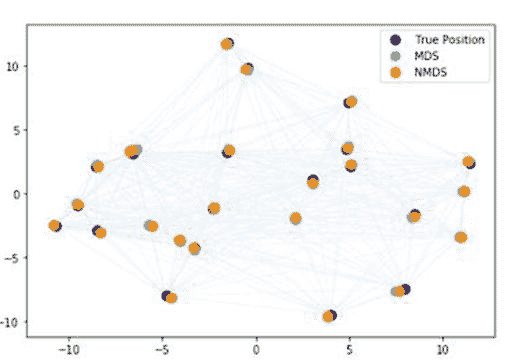

**图 11-29** 通过数值偏移改进的可视化效果

成功，你已经改进了可视化效果。

## 总结

恭喜！你已经完成了我个人数据科学项目中使用的整个流程。现在，你应该能够通过完整的“检索 ➤ 评估 ➤ 处理 ➤ 转化 ➤ 组织 ➤ 报告”步骤，为数据湖中的任何数据构建管线，从而将数据湖转化为业务资产的技术栈。

## 结语

你已经成功读完了这本书。为你的所有努力和成就喝彩。

感谢你跟随我走完了从数据湖到业务洞察的整个管线。希望你的实用数据科学能为你未来带来一切你所期望的成果。

你能取得的最大成就是……

> 一路乐在其中！

# 索引

## 索引 A

### 绝对位置

### 加法器工具

### Akka

### 海拔

### Amazon Redshift

### Amazon Simple Storage Service (Amazon S3)

* `Boto` 包
* Python 的 `s3` 模块

### Amazon Web Services

### 方差分析 (ANOVA)

### 分析模型

* 列
* 数据字段名称验证
* 数据模式
* 数据列的数据类型
* 列的直方图
* 最大值
* 平均值
* 中位数
* 最小值
* 缺失/未知值
* 众数
* 四分位数
* 极差
* 样本数据集
* 偏度
* 标准差
* 唯一标识符，数据条目

### 安德鲁斯曲线

### 动物

* 纲
* 科
* 属
* 界
* 目
* 门
* 种

## ANOVA

参见方差分析 (ANOVA)

### Apache Cassandra

### Apache Hadoop

* `Luigi`
* `Pydoop`

### Apache Hive

### Apache Mesos

### Apache Spark

### Apriori 算法

### 面积图

### Assess_Best_Logistics

### 评估超步

* `Clark Ltd` 参见 `Clark Ltd`
* 数据分析
* 数据剖析
* 数据质量
* 错误数据
  * 错误接受
  * 修正默认值
  * 拒绝
* `Hillman Ltd` 参见 `Hillman Ltd`
* `Krennwallner AG` 参见 `Krennwallner AG`
* `pandas`，缺失值
* `Assess-Good-Bad-01.py`, `Assess-Good-Bad-02.py`, `Assess-Good-Bad-03.py`, `Assess-Good-Bad-05.py`
* 基本概念
* `Good-or-Bad-01.csv`, `Good-or-Bad-02.csv`, `Good-or-Bad-03.csv`, `Good-or-Bad-05.csv`
* `Vermeulen PLC` 参见 `Vermeulen PLC`

### 评估工具

参见特征工程

### 关联规则学习

* `Apriori` 算法
* 提升度
* 购物篮分析

### 审计

* 基本日志记录
* 内置日志记录
* 数据科学工具
  * 调试观察器
  * 错误观察器
  * 致命错误观察器
  * 信息观察器
  * 警告观察器
* 数据沿袭
* 数据起源
* 定义
* 流程追踪
* 统计

### 自相关图

## B

### Bagging 数据

### 平衡层

### 条形图

### 广告牌

* `Assess-DE-Billboard.py`
* `Assess-DE-Billboard-Visitor.csv`
* `DE_Billboard_Locations`，加载
* IP 地址
* 在线访客数据
* 组织超步
* 报告超步
* `sqlite3` 和 `pandas` 包

### 二元逻辑回归

### 分箱

### 双变量分析

### 身体质量指数 (BMI)

* 水平样式
* 孤岛样式
* 安全保险库样式
* 垂直样式

### Bootstrap 图

### 商业动态，数据湖

* `Clark Ltd`
  * `Euro_EchangeRates`，加载
  * `Profit_And_Loss`，加载
* `Hillman Ltd`
  * `GB_Postcode_Full`，加载
  * `GB_Postcode_Shops`，加载
  * `GB_Postcode_Warehouse`，加载
* `Krennwallner AG`
  * `DE_Billboard_Locations`，加载
  * Python 检索方案
  * R 检索方案
* `Vermeulen PLC`
  * `Country_Codes`，加载
  * `IP_DATA_ALL`，加载
  * `IP_DATA_CORE`，加载
  * `IP_DATA_C_VKHCG`，加载

### 业务层

* 歧义性
* 描述
* 功能需求
* 数据映射矩阵
* 通用 MoSCoW
* 选项
* 太阳模型 参见 太阳模型
* “业务意愿”
* 隐含集合
* 非功能需求
  * 可访问性
  * 审计与控制
  * 可用性
  * 备份
  * 容量
  * 并发性
  * 配置管理
  * 部署
  * 灾难恢复 (DR)
  * 磁盘存储
  * 文档
  * 有效性
  * 效率
  * 可扩展性
  * 故障管理
  * 容错性
  * 互操作性
  * 延迟
  * 可维护性
  * 内存存储
  * 可修改性
  * 网络拓扑
  * 隐私
  * 质量
  * 恢复/可恢复性
  * 可靠性
  * 韧性
  * 资源约束
  * 可重用性
  * 可伸缩性
  * 安全性
  * 存储 (GPU)
  * 可测试性
  * 吞吐能力
  * 同比年增长
* 可选择性
* 实用性
* 主要结构
* 需求
* 需求注册表
* 追溯矩阵
* 主观性
* 无界列表
* 引用不足
* 规定不足
* 模糊性
* 弱词

## C

### Cassandra

### 因果回路图 (CLD)

### 因果分析系统

### CentOS/RHEL

### 基于质心的聚类

### 首席财务官 (CFO)

### 卡方检验

### Clark Ltd

* `Euro_EchangeRates`，加载
* 财务基础数据
* 财务日历
* 财务状况
* 外汇
* 外汇基础数据
* 组织超步
* 人员
* 人员基础数据
* `Profit_And_Loss`，加载
* Python 检索方案
* 报告超步

### 清理工具

### 云端张量处理单元 (TPU)

### 聚类

* 基于质心
* 连通性
* 定义
* 密度
* 分布
* 基于网格
* 层次化 参见 层次聚类
* 划分式
* 变量

### 计算机视觉 (CV)

### 配置管理 (CM)

### 消费者

### 等高线图

* 构造
* 等高线标签
* 对比
* 定义
* 生态系统
* 高亮
* 多维
* 复杂立体

### 控制层

### 协调世界时 (UTC)

### 跨行业数据挖掘标准流程 (CRISP-DM)

* 业务理解
* 数据准备
* 数据理解
* 部署
* 描述
* 评估
* 流程图
* 建模

### 交叉验证测试

### 客户数据集

## CV

参见计算机视觉 (CV)

## D

### 数据分析

* 准确性
* 完整性
* 一致性
* 及时性
* 唯一性
* 有效性

### 数据湖

* 可操作业务知识
* 业务客户
* 商业动态 参见 商业动态，数据湖
* 特征化
* 定义

### 数据沿袭

### 数据映射矩阵

### 数据集市

### 数据挖掘

* 关联模式
* 贝叶斯分类
* 聚类模式 参见 聚类
* 数据分类
* 定义
* 预测
* 序列/路径分析

### 数据处理工具

* 数据科学 参见 数据科学工具
* 数据仓库
* 描述
* 特征工程
* 组织
* 报告
* 检索
* 工具 参见 递归统一模式的同构本体论 (HORUS)
* 转换

### 数据起源

### 数据科学

* 基本步骤
  * CLD
  * 相关分析
  * 客户与领域专家
  * 数据追溯矩阵
  * 特征提取 参见 特征提取技术
  * 鱼骨图
  * 预测
  * 猜测，潜在模式
  * 缺失值处理
  * 特征工程
  * 不一致性，数据湖
  * 方法
  * 异常值检测 参见 异常值检测技术 | 原因
  * 蒙特卡洛模拟
  * 观察与假设
  * 帕累托图
  * 真实世界证据
  * 从假设性问题开始
  * 5 个为什么

### 数据科学框架

* 定义
* 顶层

### 数据处理工具

* `Akka`
* `Cassandra`
* `elastic search`
* `Kafka`
* `Mesos`
* `MQTT`
* `Python`
* `R`
* `Scala`
* `Spark` 参见 `Spark`

### 数据科学技术栈

* 数据湖
* 数据仓库
* 数据仓库总线矩阵
* 描述
* 枢纽
* 链接
* 处理工具 参见 数据处理工具
* 快速信息工厂生态系统
* 卫星
* 存储工具
  * 读时模式生态系统
  * 写时模式生态系统

### 数据科学工具

* 数据平均
* 分箱/存储桶
* 异常值检测

### 数据源

* Amazon Redshift
* Amazon S3 存储
* Amazon Web Services
* Apache Cassandra
* Apache Hadoop
  * `Luigi`
  * `Pydoop`
* Apache Hive
* Apache Spark
* 数据库
* 日期和时间
* Microsoft Excel
* Microsoft SQL server
* MySQL
* Oracle
* PostgreSQL
* SQLite

### 数据沼泽

* 审计与版本管理
* 具体的业务问题
* 数据治理
  * 分析模型使用
  * 业务术语表
  * 数据源目录
  * 数据质量训练师模型角色

### `Data.Table` 包

### 数据仓库

* 基本配置
* 定义
* 枢纽
* 链接
* 建模
* 卫星

### 数据仓库

### 数据仓库总线矩阵

### 日

### 年日

### 调试观察器

### 决策模型与表示法 (DMN)

### 决策树

### 配送路线计划

### 基于密度的聚类

### 3D 图

### 迪杰斯特拉算法

### 有向无环图 (DAG)

* 定义
* 作业调度 参见 作业调度，DAG
* 非单一路径
* Spark, Pig, 和 Tez

### 灾难恢复 (DR)

### 文档

### 双饼图

### 荷兰文化，命名

## E

### 边缘图像

### Elastic search

### 企业总线矩阵

### 错误观察器

### 事件，流程超步

* 数据实体
  * 显式
  * 隐式

### 汇率数据集

## F

### 故障管理

### 致命错误观察器

### 容错性

### 特征工程

* 加法器工具
* 修正器工具
* 处理工具

### 特征提取技术

* 平均
* 分箱
* LDA

### 财务日历

### 鱼骨图

### 修正器工具

### 预测

### 外汇交易规划器

### 秒的小数部分

### 弗雷塔格金字塔

### 功能层

* 数据模型
* 数据模式与数据格式
* 基础设施提供
* 处理算法
  * 评估
  * 组织
  * 处理
  * 报告
  * 检索
  * 转换
* 处理数据湖
  * 评估
  * 组织
  * 处理
  * 报告
  * 检索
  * 转换

## G

### 属

### 通用数据保护条例 (GDPR)

### 地理空间

### `Ggplot2` 包

### 黄金标准记录

### 梯度下降

### 图形

* 安德鲁斯曲线
* 自相关图
* bootstrap
* 等高线 参见 等高线图
* 3D
* KDE
* 滞后图
* 平行坐标图
* 选项
  * 面积图
  * 条形图
  * 双饼图
  * 生态系统
  * 六边形分箱图
  * 水平条形图
  * 折线图
  * 饼图
  * 散点图
* RADVIZ 方法
* 散点图矩阵

### 图形处理单元 (GPU)

### 图论

* DAG 参见 有向无环图 (DAG)
* 描述
* 边
* 节点

### GraphX

### 公历

### 基于网格的聚类

## H

### 1996 年健康保险便携与责任法案 (HIPAA)

### 六边形分箱图

### 层次聚类

* 凝聚式
* 定义
* 分裂式

### Hillman Ltd

* 配送路线
  * `Assess_Shipping_Routes.gml`
  * `Assess-Shipping-Routes.py`
  * 创建图论
  * 总部节点到图
  * 使用文森特距离的总部路线
  * 总部到仓库的路线
  * 商店间路线
  * 仓库间路线
  * `nx.shortest_path(G,x,y)`
  * 商店节点
  * 仓库节点
  * 仓库到商店路线
  * 仓库到仓库路线
* `GB_Postcode_Full`，加载
* `GB_Postcode_Shops`，加载
* `GB_Postcode_Warehouse`，加载
* 全球邮政编码
* Incoterm 2010
  * 运费和保险费 (CIP)
  * 运费付至 (CPT)
  * 目的地交货 (DAP)
  * 终端交货 (DAT)
  * 完税后交货 (DDP)
  * 工厂交货 (EXW)
  * 货交承运人 (FCA)
* 组织超步
* 报告超步
* 运输链
  * 咨询专家
  * 可能的运输路线
  * 运输容器 参见 运输容器
  * 运输信息
  * 运输路线 参见 运输路线，最佳国际物流
  * 仓库 参见 仓库

### 递归统一模式的同构本体论 (HORUS)

* 音频
* 数据库
* 数据格式
* 数据湖
* 数据流
* JSON
* 图片
* 文本分隔
* 视频帧到 horus
* 电影到帧
* XML

### 水平样式切片

## HORUS

参见递归统一模式的同构本体论 (HORUS)

### 霍夫变换

### 小时

### 轮毂-辐条

## `Data.Hub` 转换

### 枢纽

### 假设检验

* 卡方检验
* 定义
* t 检验

## I

### 图像，通道

### Incoterm 2010

* 运费和保险费 (CIP)
* 运费付至 (CPT)
* 目的地交货 (DAP)
* 终端交货 (DAT)
* 完税后交货 (DDP)
* 工厂交货 (EXW)
* 货交承运人 (FCA)

### 信息观察器

### 互操作性

### IP 地址数据集

### 孤岛样式

### ISO 8601-2004 标准

### ISO 8601 (欧洲)

### ISO 8601 (美国)

## J

### 作业调度，DAG

* `Assess-DAG-Company-Country-Place.png`
* `Assess-DAG-Company-Country.png`
* `Assess-DAG-Company-GPS.png`
* `Assess-DAG-GPS.py`
* `Assess-DAG-Location.py`
* `Assess-DAG-Schedule.gml`
* `Assess-DAG-Schedule.py`
* 基本验证
* `G.add_node()`
* 特性
* `nodes_iter(G)`
* `Retrieve_IP_DATA.csv`
* SQLite 数据库 参见 SQLite 数据库
* 传输代理
* 有效路由网络

### JSONLite 包

### 儒略历

## K

### Kafka

* Kafka Connect
* Kafka Core
* Kafka Streams

### 核密度估计 (KDE) 图

### 基里巴斯共和国

### K-means 聚类

### Krennwallner AG

* 成就
* 广告牌 参见 广告牌
* 在线访客数据
* 组织超步
* 处理卸载，前十名客户
* 报告超步

## L

### 滞后图

### 延迟

### 潜在狄利克雷分配 (LDA)

### 纬度

### 分层框架

* CRISP-DM 参见 跨行业数据挖掘标准流程 (CRISP-DM)
* 数据科学定义
* 高级数据科学和工程 HORUS
* Linux
* 顶层
  * 审计
  * 平衡
  * 业务层
  * 卓越中心
  * 控制
  * 数据科学框架
  * 数据科学技能
  * 功能层
  * 运营管理层
  * 工具层
  * 警告
* Windows

## LDA

参见潜在狄利克雷分配 (LDA)

### 闰年

### 线性回归

* 定义
* 霍夫变换
* RANSAC
* 简单
* TensorFlow

### 折线图

### 链接

### Linux

### 局部异常因子 (LOF)

### 当地时间

### 位置簇

### 位置，流程超步

* 特征
* 绝对位置
* 人文
* 自然
* 相对位置
* GLONASS
* GPS
* 人地交互
* 纬度，经度和海拔

## LOF

参见局部异常因子 (LOF)

### 逻辑回归

* 定义
* MLR
* 有序 参见 有序逻辑回归
* 简单

### 物流数据集

* 汇率
* 邮政编码
* 损益表
* 商店
* 仓库

### 经度

### `Luigi`

## M

### 机器学习

* 定义
* 影响
* RL
* 监督
* 无监督

### 维护工具

* 备份与恢复
* 检查
* 数据完整性
* 描述
* 历史
* 清理
* 通知操作员
* 重建数据结构
* 重新组织索引
* 收缩/移动数据结构
* 方案
* 统计

### 购物篮分析

### `Matplotlib`

* CentOS/RHEL
* PIP
* Ubuntu

### 平均故障间隔时间 (MTBF)

### 平均恢复时间 (MTTR)

### Mesos

### 消息队列遥测传输 (MQTT)

### 元数据管理

### Microsoft Excel

### Microsoft SQL server

### 分钟

## MLR

参见多项逻辑回归 (MLR)

### 蒙特卡洛模拟

### 月

### MoSCoW

### MQ 遥测传输 (MQTT)

### 多项逻辑回归 (MLR)

### 多变量分析

### MySQL

## N

### 朴素贝叶斯 (NB)

### 自然语言处理 (NLP)

* 定义
* 需求
* 语音转文本转换
* 基于文本

### 网络路由图

* `Assess-Network-Routing-Company.csv`
* `Assess-Network-Routing-Company.py`
* `Assess-Network-Routing-Customer.csv`
* `Assess-Network-Routing-Customer.py`
* `Assess-Network-Routing-Node.csv`
* `Assess-Network-Routing-Node.py`
* 公司数据
* 问题
* 图论 参见 图论
* 组织超步
* 报告超步

### 网络拓扑

### `Networkx`

### 神经网络

* 菊花链
* 定义
* 特征
* 梯度下降
* 层
* 正则化强度
* 简单

### `NumPy`

## O

### 对象，流程超步

* 动物
  * 纲
  * 界
  * 目
  * 门
  * 种
* 化合物
* 科
* 属
* 车辆

### 运营管理层

* 警报
* 沟通
* 描述
* 监控
* 参数
* 处理流定义与管理
* 调度

### Oracle

### 有序逻辑回归

* 业务问题
* 数据类型
* 定义

### 组织超步

* 关联规则学习
* 广告牌内容
* `Clark Ltd`
* 数据集市
* 配送路线计划
* 外汇交易规划器
* `Hillman Ltd`
* 水平样式
* 孤岛样式
* `Krennwallner AG`
* 网络路由图
* 安全保险库样式
* `Vermeulen PLC`
* 垂直样式

### 组织工具

### 异常值检测技术

* 椭圆包络
* 孤立森林
* LOF
* 新颖性检测

### 异常值

# P, Q

### `Pandas`

* Centos/RHEL
* PIP
* Ubuntu

### 平行坐标图

### 帕累托图

### 划分聚类

### 模式识别

### 人，流程超步

* 黄金标准记录
* 姓名
  * 荷兰文化
  * 母姓和父姓的继承
  * 顺序

### 门

### 图片

* 图像通道
* 定义
* 不同尺寸和质量
* 边缘图像
* 改进的可视化

### 饼图

### 绘图选项

* 面积图
* 条形图
* 双饼图
* 生态系统
* 六边形分箱图
* 水平条形图
* 折线图
* 饼图
* 散点图

### 便携式网络图形 (PNG)

### 邮政编码

### PostgreSQL

### 精确率-召回率曲线

* F1 度量
* ROC 分析曲线
* 敏感性与特异性

### 主成分分析 (PCA)

* 联合分析
* 因子分析

### 处理生态系统

* `Akka`
* `Apache Cassandra`
* `Apache Mesos`
* `Apache Spark`
* `Kafka`
* `MQTT`
* `Python` 参见 Python
* `R` 参见 R
* `Scala`
* `Vermeulen`

### 处理工具

* 描述
* 监控
* 调度
  * 积压
  * 进行中
  * 已完成
  * 待办

### 流程超步

* 数据类别
* 数据科学 参见 数据科学
* 数据仓库
* 事件
* 位置
* 对象
* 人
* 时间

### 生产者

### 损益表数据集

### `Pydoop`

### Python

* CentOS/RHEL
* 定义
* Ubuntu
* Windows
* `Python3`
* `Matplotlib`
* `NumPy`
* `Pandas`
* `PyPI`
* `Scikit-Learn`
* `SymPy`

### Python 包索引 (PyPI)

### R

### R

* 能力
  * `dplyr`
  * `forecast`
  * `gbm`
  * `ggplot2`
  * 安装
    * CentOS/RHEL
    * Ubuntu
    * Windows
  * `lubridate`
  * 包
    * `Data.Table`
    * `Ggplot2`
    * `JSONLite`
    * `ReadR`
    * `Spark`
    * `randomForest`
    * `reshape2`
    * `RODBC`, `RSQLite`, 和 `RCassandra`
    * `RStudio`
    * `sqldf`
    * `stringr`

### RADVIZ 方法

### 随机森林

### 随机采样一致性 (RANSAC) 线性回归

### 快速信息工厂生态系统

### `ReadR` 包

### 接收者操作特征 (ROC) 分析曲线

### 参考卫星

### 强化学习 (RL)

### 相对位置

### 报告超步

* 合适的可视化
* 广告牌内容
* `Clark Ltd`
* 容器
* 数据科学
* 数据科学公司规模
* 消除杂乱
* 财务状况
* 弗雷塔格金字塔
* 图形能力
* `Hillman Ltd`
* `Krennwallner AG`
* 网络路由图
* 理解上下文
* `Vermeulen PLC`

### 报告工具

### 韧性

### 资源约束

### 检索超步

* `Clark Ltd`
* `Hillman Ltd`
* `Krennwallner AG`
* `Vermeulen PLC`

### 可重用性

### 上升动作

## RL

参见强化学习 (RL)

### ROC 分析曲线

参见接收者操作特征 (ROC) 分析曲线

### 基于角色的访问控制 (RBAC)

### `RStudio`

* CentOS/RHEL
* Ubuntu
* Windows

## S

### 卫星

* 定义
* 参考
* 工具

### `Scala`

### 可伸缩性

### 散点图

### 散点图矩阵

### `Scikit-Learn`

### 秒

### 安全保险库样式

### 安全性

* 访问
* 物理
* 隐私

### 运输容器

* 采用
* 空运体积重量 (计费重量)
* `Assess-Shipping-Containers.py`
* 将箱子放入托盘
* 将产品放入箱子
* 长度值
* 装载托盘 1000
* 包装箱
* 包装材料厚度
* 托盘装容器选项
* 产品装箱和箱子摆盘选项
* 产品
* 陆运体积重量 (计费重量)
* 托盘尺寸
* 箱子强度等级

### 运输信息

* 买方
* 承运人
* 指定地点
* 港口
* 卖方
* 船舶
* 运输条款
* 码头

### 运输路线，最佳国际物流

* `Assess-Best-Fit-Logistics.py`
* `Assess_RoutePointsCountry`
* `Assess_RoutePointsPlaceName`
* `Assess_RoutePointsPostCode`
* 平均纬度和经度
* 国家到国家路线
* 国家到邮政编码路线
* 库
* 加载数据
* 地图
* 新地点
* 国家数据库维护隐藏特性
* 地名
* 邮政编码
* 图中存储的位置之间的最短路径
* 参数
* 邮政编码到地名的路线
* 文森特公式

### 商店数据集

### 简单线性回归

### 简单逻辑回归

### 简单网络时间协议 (SNTP)

### 偏度

### 缓慢变化维度 (SCDs)

* SCD 类型 1，仅更新
* SCD 类型 2 Jacob Roggeveen 博士，位置
  * 生效日期
  * 标记
  * 版本控制
* SCD 类型 3，转换
* SCD 类型 4，快速增长

### 空间变换可视化 (STV)

### Spark

* 描述
* GraphX
* IBM
* MLlib
* 机器学习库
* SAP, Tableau, 和 Talend
* Spark Core
* Spark MLlib
* Spark SQL
* Spark Streaming

### SQLite 数据库

* `add_edge()`
* 链接
* `Assess-DAG-Schedule-All.gml`
* `Assess_IP_Country`
* `Assess_IP_GPS`
* `Assess_IP_PlaceName`
* `Assess_IP_PostCode`
* `CompanyData`
* `df.tosql()` 命令
* `G=nx.Graph()`
* 节点
* `pandas` 数据结构
* 移除节点和边
* `Retrieve-IP_2_SQLite_2_DAG.py`
* SQL `DISTINCT` 命令

### 标准差

### 领域专家

### 太阳模型

* 基础知识
* 描述
* 开发
* Jacob Roggeveen 博士
  * 记录事实
* 模型内整合矩阵
  * 维度和事实
* 事件，日期和时间
* 对象，人，日期和时间
* 人，日期，时间和位置
* `PersonBornAtTime` 事实
* 人对事件
* 人对位置
* 人对对象
* 人对时间
* SCDs 参见 缓慢变化维度 (SCDs)
* 转换步骤模板
* 典型版本 2.0

### 监督学习

### 支持向量聚类 (SVC)

### 支持向量网格 (SVG)

### 支持向量机 (SVM)

### 支持向量网络 (SVN)

### `SymPy`

## T

### TensorFlow

* 基础
* 购物篮分析
* 商品交易
* 定义
* 开发
* 容器上的数字
* 外汇交易
* 线性回归
* 单臂老虎机

### 可测试性

* 可控性
* 定义
* 隔离能力
* 可理解性

### 撒迪厄斯·文森特公式

### 时间-人-对象-位置-事件 (T-P-O-L-E) 设计

* 事件枢纽
* 链接
* 位置枢纽
* 对象枢纽
* 人员枢纽
* 卫星
* 时间枢纽
* 位置事件枢纽
* 枢纽链接
* 对象枢纽
* 人员枢纽
* 卫星
* 时间枢纽
* 对象事件枢纽
* 枢纽链接
* 位置枢纽
* 人员枢纽
* 卫星
* 时间枢纽
* 人员事件枢纽
* 枢纽链接
* 位置枢纽
* 对象枢纽
* 卫星
* 时间枢纽
* 时间事件枢纽
* 枢纽链接
* 位置枢纽
* 对象枢纽
* 人员枢纽
* 卫星

### 时间，流程超步

* 组合日期和日
* 定义
* 秒的小数部分
* 小时
* 基里巴斯共和国
* 当地时间
* 分钟
* 月
* 秒
* 特殊日期格式
  * 星期几
  * 年日
  * 周日期
  * 开始和结束日期
* UTC
* 年
* 时区

## T-P-O-L-E

参见时间-人-对象-位置-事件 (T-P-O-L-E)

### 追溯矩阵

### 转换超步

* ANOVA
* Bagging 数据
* 双变量分析
* 聚类 参见 聚类
* 交叉验证测试
* CV
* 数据分类
* 数据挖掘 参见 数据挖掘
* 数据科学 参见 数据科学
* 数据仓库
* 决策树
* 维度整合
  * 数据仓库
  * 数据仓库
* 人员 Python 生态系统设置公司
* 时间 T-P-O-L-E 高级设计
* `Transform-Gunnarsson_is_Born.py`
* 工作目录
* 假设检验 参见 假设检验
* 线性回归
* 逻辑回归
* 机器学习 参见 机器学习
* 多变量分析
* 神经网络
* NLP
* 过拟合与欠拟合
  * 数据拟合问题
  * 定义
  * 多项式特征
* 模式识别
* PCA 参见 主成分分析 (PCA)
* 精确率-召回率
* 随机森林
* 源代码
* 太阳模型 参见 太阳模型
* TensorFlow 参见 TensorFlow
* 单变量分析
* 转换工具
  * 维度
  * 事实

### 树增强朴素贝叶斯 (TAN)

### T 检验

## U

### Ubuntu

### 单变量分析

### 无监督学习

### 工具

* 算法
* 基本设计
* 数据处理 参见 数据处理工具
* 描述
* GDPR
* HIPAA
* 维护
* 处理
* 三阶段流程
* 类型

## V

### 模糊性

### 车辆识别号码 (VIN)

### Vermeulen-Krennwallner-Hillman-Clark 集团 (VKHCG)

* `Clark Ltd`
  * 客户数据集
* `Hillman Ltd`
  * IP 地址数据集
* `Krennwallner AG`
  * Linux
  * 物流数据集 参见 物流数据集
  * 处理生态系统 参见 处理生态系统
  * 样本数据
* `Vermeulen PLC`
  * Windows

### Vermeulen PLC

* `Country_Codes`，加载
* 作业调度图
* 图论
* `IP_DATA_ALL`，加载
* `IP_DATA_CORE`，加载
* `IP_DATA_C_VKHCG`，加载
* 作业调度 参见 作业调度，DAG
* 网络路由 参见 网络路由图
* 组织超步
* 报告超步

### 文森特公式

## VKHCG

参见 Vermeulen-Krennwallner-Hillman-Clark 集团 (VKHCG)

# W, X

### 仓库

* 成就
* `Assess_GB_Warehouse_Address.csv`
* `Assess-Warehouse-Address.py`
* 数据集
* 全球 GPS 位置
* 位置
* 在线服务提供商
* 参数，地址定位服务

### 警告观察器

### 弱词

### 周日期

### Windows

# Y, Z

### 年

### Yoke 方案

* 消费者
* DAG 调度
* `Kafka Master-Yoke.py`
* 生产者
* `Run-Yoke.py`
* `Slave-Yoke.py`