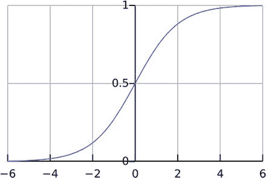

# 比较估计系数
print("Estimated coefficients (true, linear regression, RANSAC):")
print(coef, lr.coef_, ransac.estimator_.coef_)
lw = 2
plt.scatter(X[inlier_mask], y[inlier_mask], color="yellowgreen", marker='.',
label='Inliers')
plt.scatter(X[outlier_mask], y[outlier_mask], color="gold", marker='.',
label='Outliers')
plt.plot(line_X, line_y, color="navy", linewidth=lw, label='Linear regressor')
plt.plot(line_X, line_y_ransac, color="cornflowerblue", linewidth=lw,
label='RANSAC regressor')
plt.legend(loc='lower right')
plt.xlabel("Input")
plt.ylabel("Response")
plt.show()
```

这种回归技术在机器人学和机器人视觉领域极为有用，因为机器人需要回归两个数据帧或数据集之间的变化。

### 霍夫变换

霍夫变换是一种用于图像分析、计算机视觉和数字图像处理的特征提取技术。该技术的目的是通过投票过程来寻找特定形状类别中物体的不完美实例。这个投票过程在参数空间中进行，通过该过程，物体候选者被作为局部最大值，在所谓的累加器空间中获得。这个累加器空间是由算法为了计算霍夫变换而显式构建的。

请参见[`http://scikit-image.org/docs/dev/api/skimage.transform.html#skimage.transform.hough_line`](http://scikit-image.org/docs/dev/api/skimage.transform.html%23skimage.transform.hough_line)、[`http://scikit-image.org/docs/dev/api/skimage.transform.html#skimage.transform.hough_line_peaks`](http://scikit-image.org/docs/dev/api/skimage.transform.html%23skimage.transform.hough_line_peaks)和[`http://scikit-image.org/docs/dev/api/skimage.transform.html#skimage.transform.probabilistic_hough_line`](http://scikit-image.org/docs/dev/api/skimage.transform.html%23skimage.transform.probabilistic_hough_line)。

借助霍夫变换，这种回归改进了`RANSAC`技术的分辨率，这在机器人学和机器人视觉中极为有用。因为机器人需要通过回归两个数据帧或数据集之间的变化来在环境中移动。

## [逻辑回归](http://analyticsindiamag.com/developing-a-predictive-model-to-identify-festive-shoppers/%23_blank)

逻辑回归是一种用于寻找一组输入变量与一个输出变量之间关系的技术（就像任何回归一样），但在这种情况下，输出变量是一个二分类结果（可以视为 0/1 或是/否）。


### 简单逻辑回归

我将引导你完成一个仅比较两个值的简单逻辑回归。一个现实世界的商业案例是使用二元变量研究伦敦某地点的交通拥堵情况。输出结果是分类变量：是或否。因此，是否存在交通拥堵？是或否？

交通拥堵发生的概率可能取决于诸如天气状况、星期几和月份、一天中的时段、车辆数量等属性。使用逻辑回归，你可以找到最佳拟合模型，该模型解释了独立属性与交通拥堵发生率之间的关系，并预测拥堵发生的概率。

这个过程被称为二元逻辑回归。交通状态从否 = 零变为是 = 一，其变化路径沿一条由以下代码建模的曲线进行，如图 10-10 所示。



图 10-10 — 二元逻辑回归

```
for x in range(-10,10,1): print(math.sin(x/10))
```

现在，我将使用一个示例数据集来讨论逻辑回归。

示例：

```python
from sklearn import datasets, neighbors, linear_model
```

加载数据。

```python
digits = datasets.load_digits()
X_digits = digits.data
y_digits = digits.target
n_samples = len(X_digits)
```

选择训练数据集。

```python
X_train = X_digits[:int(.9 * n_samples)]
y_train = y_digits[:int(.9 * n_samples)]
X_test = X_digits[int(.9 * n_samples):]
y_test = y_digits[int(.9 * n_samples):]
```

选择 K 近邻分类器。

```python
knn = neighbors.KNeighborsClassifier()
```

选择逻辑回归模型。

```python
logistic = linear_model.LogisticRegression()
```

训练模型以执行逻辑回归。

```python
print('KNN score: %f' % knn.fit(X_train, y_train).score(X_test, y_test))
```

将训练好的模型应用于测试数据集。

```python
print('LogisticRegression score: %f'
% logistic.fit(X_train, y_train).score(X_test, y_test))
```

做得好。你刚刚成功完成了下一个转换步骤，即针对示例数据集部署了一个带有 K 近邻分类器的逻辑回归模型。

> **提示：** 通过使用这个简单的过程，我发现了许多发人深省的关联关系，或者打破了一些关于数据值之间关系的迷思。

### 多项逻辑回归

多项逻辑回归是一种线性回归分析形式，当因变量为名义变量且具有两个以上类别时使用。它用于描述数据，并解释一个名义因变量与一个或多个连续型（区间或比率尺度）自变量之间的关系。你可以将名义变量视为没有内在排序的变量。

这类数据在商业世界中最为常见，因为它通常涵盖数据源中的大多数数据条目，并直接表明你在普通数据湖中可能期望的结果。这些数据没有内在的顺序或关联关系。

现在，我将通过示例向你展示如何处理这些数据集。你需要以下库来搭建生态环境：

```python
import time
import matplotlib.pyplot as plt
import numpy as np
from sklearn.datasets import fetch_mldata
from sklearn.linear_model import LogisticRegression
from sklearn.model_selection import train_test_split
from sklearn.preprocessing import StandardScaler
from sklearn.utils import check_random_state
```

设置结果目标。

```python
sPicNameOut=../VKHCG/01-Vermeulen/04-Transform/01-EDS/02-Python/Letters.png'
```

你需要调整一些参数。

```python
t0 = time.time()
train_samples = 5000
```

从模拟数据湖中获取样本数据。

```python
mnist = fetch_mldata('MNIST original')
```

对数据湖中的数据进行工程处理。

```python
X = mnist.data.astype('float64')
y = mnist.target
random_state = check_random_state(0)
permutation = random_state.permutation(X.shape[0])
X = X[permutation]
y = y[permutation]
X = X.reshape((X.shape[0], -1))
```

训练数据模型。

```python
X_train, X_test, y_train, y_test = train_test_split(
X, y, train_size=train_samples, test_size=10000)
```

对训练数据应用缩放器以防止过拟合。

```python
scaler = StandardScaler()
X_train = scaler.fit_transform(X_train)
X_test = scaler.transform(X_test)
```

调整容差（`tol = 0.1`）以加快收敛速度。

```python
clf = LogisticRegression(C=50\. / train_samples,
multi_class='multinomial',
penalty='l2', solver="sag", tol=0.1)
```

将模型应用于数据集。

```python
clf.fit(X_train, y_train)
sparsity = np.mean(clf.coef_ == 0) * 100
```

对模型进行评分。

```python
score = clf.score(X_test, y_test)
print('Best C % .4f' % clf.C_)
print("Sparsity with L1 penalty: %.2f%%" % sparsity)
print("Test score with L1 penalty: %.4f" % score)
coef = clf.coef_.copy()
```

显示结果。

```python
Fig=plt.figure(figsize=(15, 6))
scale = np.abs(coef).max()
for i in range(10):
l1_plot = plt.subplot(2, 5, i + 1)
l1_plot.imshow(coef[i].reshape(28, 28), interpolation="nearest",
cmap=plt.cm.RdBu, vmin=-scale, vmax=scale)
l1_plot.set_xticks(())
l1_plot.set_yticks(())
l1_plot.set_xlabel('Letter %i' % i)
plt.suptitle('Classification vector for...')
run_time = time.time() - t0
print('Process run in %.3f s' % run_time)
plt.show()
```

将结果保存到磁盘。

```python
Fig.savefig(sPicNameOut,dpi=300)
```

你在示例中表现良好。现在，你可以处理没有内在顺序的数据了。如果你理解了这一过程，那么你就成功地在理解如何通过转换步骤，利用数据仓库对数据湖进行转换方面取得了重要的里程碑。

> **提示：** 我通常会将所有结果作为太阳模型存回数据仓库，然后在数据仓库中物化为事实表和维度表。

### 有序逻辑回归

有序逻辑回归是二项逻辑回归的一种类型。有序回归用于预测具有有序多类别和自变量的因变量。换句话说，它用于促进因变量（具有多个有序级别）与一个或多个自变量之间的交互作用。

这种数据类型是极好的待处理数据集，因为你已经知道数据条目之间存在关联关系。部署转换步骤的算法将让你深入了解这种关联关系对数据发现过程的支持强度是强还是弱。


# 业务问题

以 1 到 5 分的等级对学生进行评分，以判断其是否具备进入大学的必要资格（“声望”）。该评分引入了这些项目可通过等级区分的一种偏好或可能性。我将使用一组生成的潜在学生，带您了解一个数据科学解决方案。问题是：“哪些标准决定了最终决定？”

示例如下：

打开您的 Python 编辑器并执行以下操作。

设置环境。

```
import sys
import os
import pandas as pd
import statsmodels.api as sm
import pylab as pl
import numpy as np
if sys.platform == 'linux':
Base=os.path.expanduser('~') + '/VKHCG'
else:
Base='C:/VKHCG'
```

检索 `StudentData`（学生数据）。

```
sFileName=Base + '/01-Vermeulen/00-RawData/StudentData.csv'
StudentFrame = pd.read_csv(sFileName,header=0)
StudentFrame.columns = ["sname", "gre", "gpa", "prestige","admit","QR","VR","gpatrue"]
StudentSelect=StudentFrame[["admit", "gre", "gpa", "prestige"]]
print('Record select:',StudentSelect.shape[0])
df=StudentSelect
```

如果您想加快处理速度，可以添加以下两行代码，但这会降低预测的准确性。所以，请按需使用。

```
#df=StudentSelect.drop_duplicates(subset=None, keep="first", inplace=False)
#print('Records Unique:', df.shape[0])
```

以下是数据集各列的说明：

```
print(df.columns)
```

以下是数据概况的描述：

```
print(df.describe())
```

您是否注意到 `admit`（录取）概况中有趣的“偏斜”？您可以使用以下命令进行调查：

```
print(df.std())
```

**注意：** `admit` 的标准差约为 +/-0.2，而其取值范围是 0 到 1。

| admit | 0.201710 |
| gre | 1.030166 |
| gpa | 145.214383 |
| prestige | 1.030166 |

这是一个非常严格的录取模型！能通过筛选的学生并不多。

让我们调查一下 `prestige`（声望）对被录取的影响。

| prestige | 1 | 2 | 3 | 4 |
| admit |   |   |   |   |
| 0 | 16810 | 15810 | 15810 | 7905 |
| 1 | 0 | 1000 | 1000 | 500 |

```
print(pd.crosstab(df['admit'], df['prestige'], rownames=['admit']))
```

显然存在一个与 `prestige` 相关的标准。学生至少需要 `Prestige = 2` 的条件。您也注意到了吗？如果您绘制所有列的图表，会看得更清楚。我建议您使用 `histogram`（直方图）函数来为您的图表进行分箱简化，如下所示：

```
df.hist()
```

以下是您得到的结果：

```
pl.tight_layout()
pl.show()
```

现在您应该为 `prestige` 创建一个排名。

```
dummy_ranks = pd.get_dummies(df['prestige'], prefix="prestige")
print(dummy_ranks.head())
```

现在您有了一个可以填入正确值的网格，具体根据您的数据来定。

您需要创建一个空的数据框用于回归分析，如下所示：

```
cols_to_keep = ['admit', 'gre', 'gpa']
data = df[cols_to_keep].join(dummy_ranks.loc[:, 'prestige_1':])
print(data.head())
```

您能看到数据现在是如何变换的吗？这被称为特征工程。

接下来，您必须添加截距值。

```
data['intercept'] = 1.00
```

您已成功将数据转换为算法能够理解的结构。干得好！

现在您可以训练模型了。

```
train_cols = data.columns[1:]
logit = sm.Logit(data['admit'], data[train_cols])
```

现在您有了一个训练好的模型。

您可以为该数据集拟合模型。请注意，`maxiter = 500` 控制着处理时间。您可以增加或减少它，以控制模型的处理工作量。尝试找出适合您的参数。

```
result = logit.fit(maxiter=500)
```

现在您可以查看结果了。

```
print('Results')
print(result.summary())
```

**注意：** 有趣的发现是，GPA（平均绩点）分数决定了录取与否。

现在您将检查每个系数的置信区间。

```
print(result.conf_int())
```

模型识别出了 GPA。干得好，因为这才是真正的驱动因素：`nRank = int(GPA)`，也就是 `prestige`。

现在您可以查看比值比。

```
print(np.exp(result.params))
```

您能识别出这个趋势吗？

|   | Odds | Odds(Real) |
| gre | 1.02E-02 | 0.010 |
| gpa | 1.06E+00 | 1.063 |
| prestige_1 | 1.13E-18 | 0.000 |
| prestige_2 | 2.17E-01 | 0.217 |
| prestige_3 | 2.14E+01 | 21.376 |
| prestige_4 | 2.10E+03 | 2101.849 |

趋势是，如果学生的 GPA 大于 4，他/她被录取的比值是 2100 比 1。

让我们检查这些比值比和 95% 置信区间。

```
params = result.params
conf = result.conf_int()
conf['OR'] = params
conf.columns = ['2.5%', '97.5%', 'OR']
print(np.exp(conf))
```

您能看出这个过程的本质吗？GPA 是主要驱动因素，更高的 GPA 能确保被录取。

现在您可以生成所有可能的 GRE（美国研究生入学考试）和 GPA 值，但我建议您只使用从最小值到最大值的、均匀间隔的十个值。这是一种简单的数据分箱方法，可以减少复杂性。将故事结果转换为更小的结果集，同时保留核心发现，这是数据科学家需要具备的技能。

以下是您的分箱：

```
gres = np.linspace(data['gre'].min(), data['gre'].max(), 10)
print(gres)
gpas = np.linspace(data['gpa'].min(), data['gpa'].max(), 10)
print(gpas)
```

现在您必须执行一些额外的数据工程。您需要定义一个笛卡尔函数来辅助您的转换过程。

```
def cartesian(arrays, out=None):
arrays = [np.asarray(x) for x in arrays]
dtype = arrays[0].dtype
n = np.prod([x.size for x in arrays])
if out is None:
out = np.zeros([n, len(arrays)], dtype=dtype)
m = int(n / arrays[0].size)
out[:,0] = np.repeat(arrays[0], m)
if arrays[1:]:
cartesian(arrays[1:], out=out[0:m,1:])
for j in range(1, arrays[0].size):
out[j*m:(j+1)*m,1:] = out[0:m,1:]
return out
```

现在您有了新函数，我建议您按如下方式将其应用到您的数据中：您必须枚举所有可能性以供调查。

```
combos = pd.DataFrame(cartesian([gres, gpas, [1, 2, 3, 4], [1,]]))
```

现在您重新创建虚拟变量。

```
combos.columns = ['gre', 'gpa', 'prestige', 'intercept']
dummy_ranks = pd.get_dummies(combos['prestige'], prefix="prestige")
dummy_ranks.columns = ['prestige_1', 'prestige_2', 'prestige_3', 'prestige_4']
```

现在，我建议您只保留进行预测所需的部分。

```
cols_to_keep = ['gre', 'gpa', 'prestige', 'intercept']
combos = combos[cols_to_keep].join(dummy_ranks.loc[:, 'prestige_1':])
```

现在对枚举后的数据集计算预测值。

```
combos['admit_pred'] = result.predict(combos[train_cols])
```

以下是您的结果：

```
print(combos.head())
```

您还需要一个函数。这个函数将隔离并绘制数据集的特定特征。

```
def isolate_and_plot(variable):
