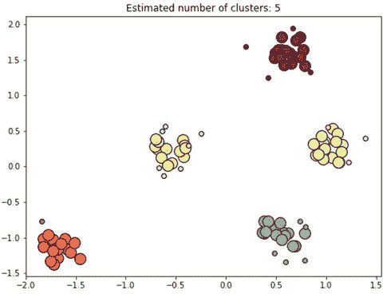
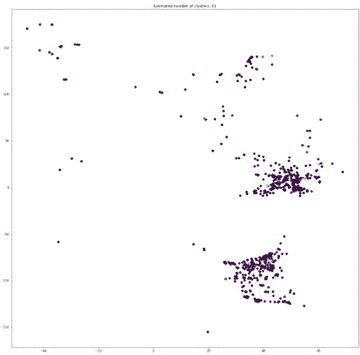
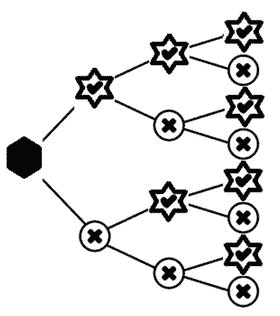
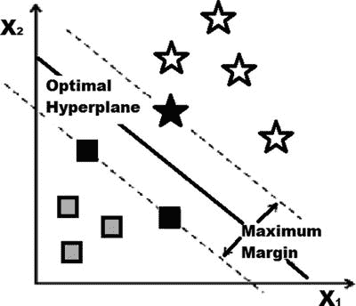

# 以下是你的发现：

```python
print('Estimated number of clusters: %d' % n_clusters_)

print("Homogeneity: %0.3f" % metrics.homogeneity_score(labels_true, labels))

print("Completeness: %0.3f" % metrics.completeness_score(labels_true, labels))

print("V-measure: %0.3f" % metrics.v_measure_score(labels_true, labels))

print("Adjusted Rand Index: %0.3f"
      % metrics.adjusted_rand_score(labels_true, labels))

print("Adjusted Mutual Information: %0.3f"
      % metrics.adjusted_mutual_info_score(labels_true, labels))

print("Silhouette Coefficient: %0.3f"
      % metrics.silhouette_score(X, labels))
```

你也可以绘制它。记住：图形解释效果更好。

```python
import matplotlib.pyplot as plt

unique_labels = set(labels)

colors = [plt.cm.Spectral(each)
          for each in np.linspace(0, 1, len(unique_labels))]

for k, col in zip(unique_labels, colors):
    if k == -1:
        col = [0, 0, 0, 1]
    class_member_mask = (labels == k)
    xy = X[class_member_mask & core_samples_mask]
    plt.plot(xy[:, 0], xy[:, 1], 'o', markerfacecolor=tuple(col),
             markeredgecolor='k', markersize=14)
    xy = X[class_member_mask & ~core_samples_mask]
    plt.plot(xy[:, 0], xy[:, 1], 'o', markerfacecolor=tuple(col),
             markeredgecolor='k', markersize=6)

plt.title('Estimated number of clusters: %d' % n_clusters_)
plt.show()
```

如果你看到了这个布局，恭喜你。你可以执行划分聚类了。这种类型的聚类很常用，因为它能将任何数据条目划分到不同的聚类中，而不会重叠（见图 10-11）。


**图 10-11** – 划分聚类

### 位置聚类

在 Python 编辑器中打开一个新文件，尝试以下位置聚类。先设置好生态工具包。

```python
import sys
import os
from math import radians, cos, sin, asin, sqrt
from scipy.spatial.distance import pdist, squareform
from sklearn.cluster import DBSCAN
import matplotlib.pyplot as plt
import pandas as pd
```

还记得这个距离测量函数吗？它计算地球上两点（以十进制度数指定）之间的大圆距离。

```python
def haversine(lonlat1, lonlat2):
    # 将十进制度数转换为弧度
    lat1, lon1 = lonlat1
    lat2, lon2 = lonlat2
    lon1, lat1, lon2, lat2 = map(radians, [lon1, lat1, lon2, lat2])

    # 半正矢公式
    dlon = lon2 - lon1
    dlat = lat2 - lat1
    a = sin(dlat/2)**2 + cos(lat1) * cos(lat2) * sin(dlon/2)**2
    c = 2 * asin(sqrt(a))
    r = 6371  # 地球半径，单位为公里。使用 3956 则为英里
    return c * r
```

让我们获取位置数据。

```python
if sys.platform == 'linux':
    Base=os.path.expanduser('~') + '/VKHCG'
else:
    Base='C:/VKHCG'

sFileName=Base + '/01-Vermeulen/00-RawData/IP_DATA_ALL.csv'
print('Loading :',sFileName)

scolumns=("Latitude","Longitude")
RawData = pd.read_csv(sFileName,usecols=scolumns,header=0,low_memory=False)
print(RawData)
```

现在，你需要一个包含 1000 个数据点的样本。

```python
X=RawData.sample(n=1000)
```

接下来，计算聚类距离参数。

```python
distance_matrix = squareform(pdist(X, (lambda u,v: haversine(u,v))))
print(distance_matrix)
```

然后，应用聚类算法。

```python
db = DBSCAN(eps=0.2, min_samples=2, metric="precomputed", algorithm="auto")
y_db = db.fit_predict(distance_matrix)
X['cluster'] = y_db
C = X.cluster.unique()
```

我们来可视化数据。

```python
fig=plt.figure(1, figsize=(20, 20))
plt.title('Estimated number of clusters: %d' % len(C))
plt.scatter(X['Latitude'], X['Longitude'], c=X['cluster'],marker='D')
plt.show()
```

现在保存你的结果。

```python
sImageFile = Base + '/01-Vermeulen/04-Transform/01-EDS/02-Python/Location_Cluster.jpg'
fig.savefig(sImageFile)
plt.close(fig)
```

你应该会看到类似图 10-12 所示的布局。


**图 10-12** 位置聚类

注意：本章前文讨论的潜在狄利克雷分配（LDA）可归类为聚类算法，应在其他聚类算法中提及。

至此，你已完成分区聚类解决方案。

## 方差分析（ANOVA）

单因素方差分析（ANOVA）检验用于确定两组以上数据集的均值是否与每个数据集存在显著差异。

示例：
针对 5 组客户（每组 100 人）执行了一次“买一送一”（BOGOF）促销活动。每组客户的人口统计属性各不相同。我们希望确定这五组客户对活动的响应是否存在差异。这将有助于我们为正确的人口统计群体优化合适的活动方案，从而提高响应率并降低活动成本。

方差分析的原理是比较组间方差与组内方差。该技术的核心在于评估所有组是否实际上属于同一个更大的总体，还是具有不同特征的完全不同总体。

打开你的 Python 编辑器，并设置以下环境：

```python
import pandas as pd

datafile='../VKHCG/01-Vermeulen/00-RawData/PlantGrowth.csv'
data = pd.read_csv(datafile)
```

现在，你需要根据数据创建一个箱线图。

```python
data.boxplot('weight', by="group", figsize=(12, 8))
```

# 特征提取和工程

接下来，你必须执行特征提取和工程。

```python
ctrl = data['weight'][data.group == 'ctrl']
grps = pd.unique(data.group.values)
d_data = {grp:data['weight'][data.group == grp] for grp in grps}
k = len(pd.unique(data.group))  # 条件数量
N = len(data.values)  # 条件乘以参与者数量
n = data.groupby('group').size()[0] # 每个条件下的参与者数量
```

你现在需要从额外库中导入函数：

```python
from scipy import stats
```

现在，针对“两个或多个组具有相同总体均值”的原假设，激活单因素方差分析检验。

```python
F, p = stats.f_oneway(d_data['ctrl'], d_data['trt1'], d_data['trt2'])
```

你需要设置一些参数。

```python
DFbetween = k - 1
DFwithin = N - k
DFtotal = N - 1
```

现在，你可以进一步研究转换后的结果。

```python
SSbetween = (sum(data.groupby('group').sum()['weight']**2)/n) \
- (data['weight'].sum()**2)/N
sum_y_squared = sum([value**2 for value in data['weight'].values])
SSwithin = sum_y_squared - sum(data.groupby('group').sum()['weight']**2)/n
SStotal = sum_y_squared - (data['weight'].sum()**2)/N
MSbetween = SSbetween/DFbetween
MSwithin = SSwithin/DFwithin
F = MSbetween/MSwithin
eta_sqrd = SSbetween/SStotal
omega_sqrd = (SSbetween - (DFbetween * MSwithin))/(SStotal + MSwithin)
```

以下是你分析的结果：

```python
print(F,p,eta_sqrd,omega_sqrd)
```

干得漂亮。你已成功执行了一次单因素方差分析检验。

# 主成分分析（PCA）

降维技术旨在将高维数据集降低到较低维度，同时不丢失数据集所传达的信息特征。这里的维度可以理解为数据集所包含的变量数量。

以下介绍两种常用的变量减少技术。

## 因子分析

PCA 的关键在于从主成分的角度衡量数据。数据集的主成分是方差最大的方向。PCA 分析涉及将每个变量的轴旋转到最高特征值/特征向量对，并定义主成分，即方差最大的轴，或者说最能定义数据的方向。主成分是不相关且正交的。

PCA 本质上是一种降维算法，但它同样可用作可视化、噪声过滤、特征提取和特征工程的工具。以下是一个示例。

打开你的 Python 编辑器并搭建以下环境：

```python
import matplotlib.pyplot as plt
from mpl_toolkits.mplot3d import Axes3D
from sklearn import datasets
from sklearn.decomposition import PCA
```

导入一些数据来应用你的技能。

```python
iris = datasets.load_iris()
```

仅取前两个特征。

```python
X = iris.data[:, :2]
```

你需要以下目标变量：

```python
y = iris.target
x_min, x_max = X[:, 0].min() - .5, X[:, 0].max() + .5
y_min, y_max = X[:, 1].min() - .5, X[:, 1].max() + .5
```

你可以快速可视化该数据集。

```python
plt.clf()
plt.figure(2, figsize=(8, 6))
```

现在绘制训练点。

```python
plt.scatter(X[:, 0], X[:, 1], c=y, cmap=plt.cm.Set1, edgecolor='k')
plt.xlabel('花萼长度')
plt.ylabel('花萼宽度')
plt.xlim(x_min, x_max)
plt.ylim(y_min, y_max)
plt.xticks(())
plt.yticks(())
```

我建议你更好地理解各维度之间的相互作用。绘制前三个 PCA 维度。

```python
fig = plt.figure(1, figsize=(8, 6))
ax = Axes3D(fig, elev=-150, azim=110)
X_reduced = PCA(n_components=3).fit_transform(iris.data)
ax.scatter(X_reduced[:, 0], X_reduced[:, 1], X_reduced[:, 2], c=y,
           cmap=plt.cm.Set1, edgecolor="k", s=40)
ax.set_title("前三个 PCA 方向")
ax.set_xlabel("第一特征向量")
ax.w_xaxis.set_ticklabels([])
ax.set_ylabel("第二特征向量")
ax.w_yaxis.set_ticklabels([])
ax.set_zlabel("第三特征向量")
ax.w_zaxis.set_ticklabels([])
plt.show()
```

你能看出以可控方式减少特征的优势吗？接下来将你的新知识应用于一个更复杂的数据集。

# 示例

Hillman 有限公司在其主大门上引入了闭路电视追踪流程，因其怀疑通过港口仓库发生了未经授权的卸货行为。你将加载摄像头拍摄的一组数字图像，以协助该公司读取离开仓库的集装箱侧面的编号。

打开你的 Python 编辑器并搭建以下环境：

```python
from sklearn.datasets import load_digits
from sklearn.decomposition import PCA
import matplotlib.pyplot as plt
import numpy as np
```

从预处理后的图像软件中加载数字数据。

```python
digits = load_digits()
```

现在应用变换，将数据从 64 维投影到 2 维。

```python
pca = PCA(2)
projected = pca.fit_transform(digits.data)
print(digits.data.shape)
print(projected.shape)
```

展示你的发现。

```python
plt.figure(figsize=(10, 15))
plt.scatter(projected[:, 0], projected[:, 1],
            c=digits.target, edgecolor="none", alpha=0.5,
            cmap=plt.cm.get_cmap('nipy_spectral_r', 10))
plt.xlabel('值 1')
plt.ylabel('值 2')
plt.colorbar()
```

应用 PCA 变换。

```python
pca = PCA().fit(digits.data)
plt.plot(np.cumsum(pca.explained_variance_ratio_))
plt.xlabel('主成分数量')
plt.ylabel('累积解释方差')
```

你需要以下函数来绘制数字图像：

```python
def plot_digits(data):
    fig, axes = plt.subplots(4, 10, figsize=(10, 4),
                             subplot_kw={'xticks':[], 'yticks':[]},
                             gridspec_kw=dict(hspace=0.1, wspace=0.1))
    for i, ax in enumerate(axes.flat):
        ax.imshow(data[i].reshape(8, 8),
```

## 可视化

```python
cmap='binary', interpolation="nearest",
                  clim=(0, 16))
```

现在你可以绘制结果。

```python
plot_digits(digits.data)
```

然而，其中一台摄像头并未生成完美的图像。

```python
np.random.seed(42)
noisy = np.random.normal(digits.data, 4)
plot_digits(noisy)
```

你仍然可以使用这些数据，只是需要更多的处理。

```python
pca = PCA(0.50).fit(noisy)
pca.n_components_
```

你可以通过过滤噪声因子来确定失真程度。

```python
components = pca.transform(noisy)
filtered = pca.inverse_transform(components)

# 可视化你的结果：
plot_digits(filtered)
```

## 问题

你能看清摄像头捕捉到的数字吗？

你认为我们有一个可行的解决方案吗？

现在你已经证明，你可以处理一个复杂的 64 维数据集，并使用 `PCA` 将其降至 2 维，同时仍然取得良好的数据科学成果。你在进步方面做得不错。

## 联合分析

[联合分析](http://analyticsindiamag.com/applying-conjoint-analysis-provisioning-of-a-new-restaurant/%23_blank)广泛应用于市场研究，用于识别顾客对构成产品的不同属性的偏好。这些属性可以是各种特征，例如尺寸、颜色、易用性、价格等。

通过使用联合（权衡）分析，品牌经理可以识别出顾客愿意为某个特定价格点放弃哪些特征。因此，这类分析在新产品设计或定价策略中是一种非常常用的技术。

**示例**：数据是对三种不同特征（电视尺寸、电视类型、电视颜色）的排名。

- 电视尺寸选项为 42 寸、47 寸或 60 寸。
- 电视类型选项为液晶或等离子。
- 电视颜色选项为红色、蓝色或粉色。

该数据对每个客户的不同刺激类型进行了评分。你的任务是确定在克伦沃尔纳的广告牌上展示哪些电视。

打开你的 Python 编辑器并设置以下环境：

```python
import numpy as np
import pandas as pd
```

获取客户的购买选择。

```python
sFile = 'C:/VKHCG/01-Vermeulen/00-RawData/BuyChoices.txt'
caInputeDF = pd.read_csv(sFile, sep=";")
```

你可以显示这些选择。

```python
print(caInputeDF)
```

你需要一个新的数据结构，并且必须为每个刺激创建虚拟变量。总共，你需要 9 个不同的刺激和 18 种不同的组合。

```python
ConjointDummyDF = pd.DataFrame(np.zeros((18, 9)),
                               columns=["Rank", "A1", "A2", "A3", "B1", "B2", "C1", "C2", "C3"])
```

现在，你需要将数据选择特征工程化为新的结构：

```python
ConjointDummyDF.Rank = caInputeDF.Rank

for index, row in caInputeDF.iterrows():
    stimuli1 = str(caInputeDF["Stimulus"].iloc[index][:2])
    stimuli2 = str(caInputeDF["Stimulus"].iloc[index][2:4])
    stimuli3 = str(caInputeDF["Stimulus"].iloc[index][4:6])
    stimuliLine = [stimuli1, stimuli2, stimuli3]
    Columns = ConjointDummyDF.columns

    for stimuli in stimuliLine:
        for i in range(len(Columns)):
            if stimuli == Columns[i]:
                ConjointDummyDF.iloc[index, i] = 1
```

做得好。让我们看看你的新结构。

```python
print(ConjointDummyDF.head())
```

你看到的只有未知数字。我建议你添加合适的刺激名称。请注意你通常向业务人员展示的转换步骤。他们明白等离子电视并不适用于 `TVType3`。

```python
fullNames = {
    "Rank": "Rank",
    "A1": '42" (106cm)',
    "A2": '47" (120cm)',
    "A3": '60" (152cm)',
    "B1": "Plasma",
    "B2": "LCD",
    "C1": "Blue",
    "C2": "Red",
    "C3": "Pink",
}
ConjointDummyDF.rename(columns=fullNames, inplace=True)
```

这样好多了。现在查看数据结构。

```python
#ConjointDummyDF.head()
```

接下来，你通过线性回归来估计主效应。你需要额外的库来实现此操作。

```python
import statsmodels.api as sm
```

你可以为你的模型选择这些列中的任何一列。

```python
print(ConjointDummyDF.columns)
```

我建议你选择以下这些：

```python
X = ConjointDummyDF[[u'42" (106cm)', u'47" (120cm)',
                     u'60" (152cm)', u'Plasma', u'LCD', u'Red', u'Blue', u'Pink']]
```

你现在需要建立模型。

```python
X = sm.add_constant(X)
Y = ConjointDummyDF.Rank
```

现在，你根据新的数据结构激活模型。

```python
linearRegression = sm.OLS(Y, X).fit()
```

你现在可以查看结果了。

- 有许多指标需要你研究。我不会详细讲解其中任何一个，因为有些需要复杂的数学才能完全解释清楚。我们感兴趣的指标是各刺激的分值效用和相对重要性：
    - 刺激的重要性 = `Max(beta) - Min(beta)`
    - 刺激的相对重要性 = `单个刺激的重要性 / 所有刺激重要性之和`

```python
print(linearRegression.summary())
```

你现在将研究这些指标。为此，你需要进行一些数据工程处理。你现在需要几个基本指标变量来启动这个过程。

```python
importance = []
relative_importance = []
rangePerFeature = []
begin = "A"
tempRange = []
```

你现在需要加载刺激数据。

```python
for stimuli in fullNames.keys():
    if stimuli[0] == begin:
        tempRange.append(linearRegression.params[fullNames[stimuli]])
    elif stimuli == "Rank":
        rangePerFeature.append(tempRange)
    else:
        rangePerFeature.append(tempRange)
        begin = stimuli[0]
        tempRange = [linearRegression.params[fullNames[stimuli]]]
```

然后，你需要各特征的范围。

```python
for item in rangePerFeature:
    importance.append(max(item) - min(item))
```

接着计算一个特征的重要性。

```python
for item in importance:
    relative_importance.append(100 * round(item / sum(importance), 3))
```

为分值效用值创建一个基础数据结构。

```python
partworths = []
item_levels = [1, 3, 5, 8]
```

你现在计算分值效用值。

```python
for i in range(1, 4):
```

part_worth_range = linearRegression.params[item_levels[i-1]:item_levels[i]]
print(part_worth_range)
```

你需要确定数据集的平均排名。
```python
meanRank = []
for i in ConjointDummyDF.columns[1:]:
    newmeanRank = ConjointDummyDF["Rank"].loc[ConjointDummyDF[i] == 1].mean()
    meanRank.append(newmeanRank)
```

我建议你使用称为“基础效用”的总体平均值，作为“零替代方案”。
```python
totalMeanRank = sum(meanRank) / len(meanRank)
```

你现在将对每个刺激部分的效用值进行排名，即电视的哪些特征重要？
```python
partWorths = {}
for i in range(len(meanRank)):
    name = fullNames[sorted(fullNames.keys())[i]]
    partWorths[name] = meanRank[i] - totalMeanRank
```

你现在有了一个结果集。
```python
print(partWorths)
```

现在，我将帮助你将这些结果转化为洞察，并为总结和结果报告提供基础。
```python
print ("Relative Importance of Feature:\n\nMonitor Size:",relative_importance[0], "%","\nType of Monitor:", relative_importance[1], "%", "\nColor of TV:", relative_importance[2], "%\n\n")
print ("--"*30)
print ("Importance of Feature:\n\nMonitor Size:",importance[0],"\nType of Monitor:", importance[1],  "\nColor of TV:", importance[2])
```

那么，最佳的产品组合是什么？我建议选择 60 寸、液晶、红色。你同意吗？让我们来测试这个假设。
```python
optBundle = [1,0,0,1,0,1,0,1,0]
print ("The best possible Combination of Stimuli would have the highest rank:",linearRegression.predict(optBundle)[0])
optimalWorth = partWorths["60\" (152cm)"] + partWorths["LCD"] + partWorths["Red"]
print ("Choosing the optimal Combination brings the Customer an extra ", optimalWorth, "'units' of utility")
```

你的科学依据是否支持我的假设？恭喜你，你刚刚完成了一次联合分析。

`提示`
我建议你尝试使用其他数据集进行等效分析，因为这是我经常被问到的问题。是什么让人们选择一种产品而不是另一种？你应该练习使用各种规模的数据集，以理解公式如何响应刺激因素的变化。我相信，你在克伦沃尔纳作为数据科学家是有前途的。

## [决策树](http://analyticsindiamag.com/predictive-attrition-model/%23_blank)
决策树，顾名思义，是一种树状的视觉化表示形式，它通过列出所有选项及其发生概率，展示了可遵循的路径，以达成特定决策。决策树非常易于理解和解读。在树的每个节点上，都可以解读选择该节点或选项所带来的后果。一系列决策会将你引向最终结果，如图 10-13 所示。

**图 10-13** 简单决策树

在开始示例之前，我必须介绍一种常见的决策树附加算法，称为`AdaBoost`。`AdaBoost`是“自适应增强”（`adaptive boosting`）的缩写，是一种机器学习元算法。

该分类器是一种元估计器，因为它首先在原始数据集上拟合一个分类器，然后在同一数据集上拟合该分类器的额外副本，但会调整错误分类实例的权重，使得后续分类器更专注于困难案例。通过为特定变量中不太清晰的差异增加渐进权重以增强其影响，它提升了学习效果。详情请参阅[`http://scikit-learn.org/stable/modules/generated/sklearn.ensemble.AdaBoostClassifier.html`](http://scikit-learn.org/stable/modules/generated/sklearn.ensemble.AdaBoostClassifier.html)。

这种增强机制使得数据科学家能够针对特定数据实体，沿着不清晰的决策路径强制做出决策，从而优化结果。

### 使用`AdaBoost`的决策树示例：
打开你的 Python 编辑器并设置以下环境：
```
import numpy as np
import matplotlib.pyplot as plt
from sklearn.tree import DecisionTreeRegressor
from sklearn.ensemble import AdaBoostRegressor
```

你需要一个数据集。因此，你可以构建一个随机数据集。
```
rng = np.random.RandomState(1)
X = np.linspace(0, 6, 1000)[:, np.newaxis]
y = np.sin(X).ravel() + np.sin(6 * X).ravel() + rng.normal(0, 0.1, X.shape[0])
```

然后将标准回归模型拟合到数据集上。
```
regr_1 = DecisionTreeRegressor(max_depth=4)
```

接着，再将一个`AdaBoost`模型应用于数据集。如果你想进行实验，可以更改参数。
```
regr_2 = AdaBoostRegressor(DecisionTreeRegressor(max_depth=4),
                           n_estimators=300, random_state=rng)
```

然后训练模型。
```
regr_1.fit(X, y)
regr_2.fit(X, y)
```

激活预测功能。
```
y_1 = regr_1.predict(X)
y_2 = regr_2.predict(X)
```

绘制结果。
```
plt.figure(figsize=(15, 10))
plt.scatter(X, y, c="k", label="Training Samples")
plt.plot(X, y_1, c="g", label="n_Estimators=1", linewidth=2)
plt.plot(X, y_2, c="r", label="n_Estimators=300", linewidth=2)
plt.xlabel("Data")
plt.ylabel("Target")
plt.title("Boosted Decision Tree Regression")
plt.legend()
plt.show()
```

恭喜！你刚刚构建了一个决策树。现在你可以通过一个更复杂的示例来测试你的新技能了。

再次打开你的 Python 编辑器并设置此环境：
```
import numpy as np
import matplotlib.pyplot as plt
from sklearn.ensemble import AdaBoostClassifier
from sklearn.tree import DecisionTreeClassifier
from sklearn.datasets import make_gaussian_quantiles
```

你正在构建一个更复杂的数据集。
```
X1, y1 = make_gaussian_quantiles(cov=2.,
                                 n_samples=2000, n_features=2,
                                 n_classes=2, random_state=1)
X2, y2 = make_gaussian_quantiles(mean=(3, 3), cov=1.5,
                                 n_samples=3000, n_features=2,
                                 n_classes=2, random_state=1)
```

## 支持向量机、网络、聚类与网格

支持向量机（`SVM`）在高维或无限维空间中构建一个超平面或一组超平面，可用于分类和回归。支持向量网络（`SVN`）将多个`SVM`以菊花链方式连接，形成一个网络。所有数据都流经同一系列`SVM`。

支持向量聚类（`SVC`）在数据的不同聚类上并行运行`SVM`。因此，并非所有数据都流经所有的`SVM`。

支持向量网格（`SVG`）是`SVN`的`SVC`，或者是`SVC`的`SVN`。这种解决方案很可能是你在客户现场最常开发的配置。它使用`SVM`来处理较小的数据聚类，以应用特定的转换步骤。作为初学数据科学家，你只需了解它们的存在即可。

### 支持向量机

支持向量机是一种判别式分类器，其正式定义由分离超平面给出。该方法计算一个具有最大间隔的最优超平面（图 10-14），以确保将数据集分类成不同的数据点簇。



图 10-14 简单支持向量机的最优超平面

我将引导你完成一个 `SVM` 示例。打开你的 Python 编辑器并创建以下环境：

```python
import numpy as np
import matplotlib.pyplot as plt
from sklearn import svm
```

以下是你的数据集和目标值。

```python
X = np.c_[(.4, -.7),
(-1.5, -1),
(-1.4, -.9),
(-1.3, -1.2),
(-1.1, -.2),
(-1.2, -.4),
(-.5, 1.2),
(-1.5, 2.1),
(1, 1),
(1.3, .8),
(1.2, .5),
(.2, -2),
(.5, -2.4),
(.2, -2.3),
(0, -2.7),
(1.3, 2.1)].T
Y = [0] * 8 + [1] * 8
```

你将结果显示为图编号 1。

```python
fignum = 1
```

你有几个可用于拟合数据模型的核函数。我将带你逐一了解它们。

```python
for kernel in ('linear', 'poly', 'rbf'):
    clf = svm.SVC(kernel=kernel, gamma=2)
    clf.fit(X, Y)
```

现在绘制线、点以及离超平面最近的向量。

```python
plt.figure(fignum, figsize=(8, 6))
plt.clf()
plt.scatter(clf.support_vectors_[:, 0], clf.support_vectors_[:, 1], s=80,
            facecolors='none', zorder=10, edgecolors="k")
plt.scatter(X[:, 0], X[:, 1], c=Y, zorder=10, cmap=plt.cm.Paired,
            edgecolors='k')
plt.axis('tight')
x_min = -3
x_max = 3
y_min = -3
y_max = 3
XX, YY = np.mgrid[x_min:x_max:200j, y_min:y_max:200j]
Z = clf.decision_function(np.c_[XX.ravel(), YY.ravel()])
```

现在将结果应用到彩色图中。

```python
Z = Z.reshape(XX.shape)
plt.figure(fignum, figsize=(8, 6))
plt.pcolormesh(XX, YY, Z > 0, cmap=plt.cm.Paired)
plt.contour(XX, YY, Z, colors=['k', 'k', 'k'], linestyles=['--', '-', '--'],
            levels=[-.5, 0, .5])
plt.xlim(x_min, x_max)
plt.ylim(y_min, y_max)
plt.xticks(())
plt.yticks(())
fignum = fignum + 1
```

现在显示你的图。

```python
plt.show()
```

做得好，你刚刚完成了一个复杂的决策树。

```python
X = np.concatenate((X1, X2))
y = np.concatenate((y1, - y2 + 1))
```

现在你有了一个准备好的数据集。创建一个 `AdaBoost` 增强的决策树并拟合到数据集上。

```python
bdt = AdaBoostClassifier(DecisionTreeClassifier(max_depth=1),
                        algorithm="SAMME",
                        n_estimators=200)
```

你训练模型。

```python
bdt.fit(X, y)
```

现在需要设置一些你将用到的参数。

```python
plot_colors = "br"
plot_step = 0.02
class_names = "AB"
```

现在创建结果的可视化。

```python
plt.figure(figsize=(10, 5))
```

添加决策边界的绘图。

```python
plt.subplot(121)
x_min, x_max = X[:, 0].min() - 1, X[:, 0].max() + 1
y_min, y_max = X[:, 1].min() - 1, X[:, 1].max() + 1
xx, yy = np.meshgrid(np.arange(x_min, x_max, plot_step),
                     np.arange(y_min, y_max, plot_step))
Z = bdt.predict(np.c_[xx.ravel(), yy.ravel()])
Z = Z.reshape(xx.shape)
cs = plt.contourf(xx, yy, Z, cmap=plt.cm.Paired)
plt.axis("tight")
```

绘制你的训练点。

```python
for i, n, c in zip(range(2), class_names, plot_colors):
    idx = np.where(y == i)
    plt.scatter(X[idx, 0], X[idx, 1],
                c=c, cmap=plt.cm.Paired,
                s=20, edgecolor="k",
                label="Class %s" % n)
plt.xlim(x_min, x_max)
plt.ylim(y_min, y_max)
plt.legend(loc='upper right')
plt.xlabel('x')
plt.ylabel('y')
plt.title('Decision Boundary')
```

绘制两个类别的决策分数。

```python
twoclass_output = bdt.decision_function(X)
plot_range = (twoclass_output.min(), twoclass_output.max())
plt.subplot(122)
for i, n, c in zip(range(2), class_names, plot_colors):
    plt.hist(twoclass_output[y == i],
             bins=10,
             range=plot_range,
             facecolor=c,
             label='Class %s' % n,
             alpha=.5,
             edgecolor='k')
x1, x2, y1, y2 = plt.axis()
plt.axis((x1, x2, y1, y2 * 1.2))
plt.legend(loc='upper right')
plt.ylabel('Samples')
plt.xlabel('Score')
plt.title('Decision Scores')
plt.tight_layout()
plt.subplots_adjust(wspace=0.35)
plt.show()
```

干得漂亮。你刚刚完成了三种不同类型的 SVM。

### 支持向量网络

支持向量网络是多个支持向量机组成的集成网络，这些支持向量机通过使用不同的参数甚至不同的核函数，共同对同一数据集进行分类。这是一种通过创建 SVM 链来进行特征工程的常用方法。

提示：你可以在同一流程中更改核函数以揭示新的特征。使用不同的核函数练习处理数据集，以理解它们能为你带来什么。

### 支持向量聚类

支持向量聚类用于将数据点分类成簇，并由支持向量机在簇的层面上执行分类。这种方法常用于高维数据集，其中聚类会创建一个分组，然后 SVM 可以利用该分组，使用不同的核函数和其他参数来细分数据点。

在我每天处理的许多深度学习算法中，我都看到过 `SVC`、`SVN`、`SVM` 和 `SVG` 的过程。数据的数量、多样性和速度要求深度学习进行多阶段分类，以便在初步结果发布后能够对数据点进行更详细的分析。

## 数据挖掘

数据挖掘是处理数据以查明模式并建立数据实体之间的关系。以下是关于数据模式你需要了解的一些关键数据挖掘理论，掌握这些理论有助于成功进行数据挖掘。

### 关联模式

这涉及检测一个事件与另一个事件相关联的模式。例如，如果一个装卸平台的门被打开，那么可以合理地假设一辆卡车正在装卸货物。模式关联仅仅是发现数据中事件的关联性。你将使用一些核心统计技能来进行此处理。

警告：“相关关系并不意味着因果关系。”

相关性仅仅是两个数据集之间的一种关系或行为指示。这种关系并非由因果驱动的行为。

示例：如果你发现炎热天气与冰淇淋销售之间存在关系，这并不意味着冰淇淋销量高会导致天气炎热，反之亦然。这只是一种观察到的关系。

这在零售购物篮分析和推荐系统中很常见。我将在第 11 章中进一步讨论这个因果因素，届时我们将开始准备我们的洞察和可操作的知识提取。现在，我将引导你完成一个示例。

请打开你的 Python 编辑器并创建以下环境：

```python
import pandas as pd

df1 = pd.DataFrame({'A': range(8), 'B': [2*i for i in range(8)]})
df2 = pd.DataFrame({'A': range(8), 'B': [-2*i for i in range(8)]})
```

这是你的数据。

```python
print('正数据集')
print(df1)
print('负数据集')
print(df2)
```

以下是你的结果。

```python
print('结果')
print('正相关:', df1['A'].corr(df1['B']))
print('负相关:', df2['A'].corr(df2['B']))
```

你应该会看到相关系数为 `+1` 或 `-1`。如果是 `+1`，这意味着两个值之间 100% 正相关，因此它们以相同的速率变化。如果是 `-1`，这意味着 100% 负相关，表明两个值之间存在关系，即一个增加而另一个减少。

提示：在真实世界的数据集中，`+1` 和 `-1` 这两种极端情况不会出现。范围通常是 `i-1 < C < +1`。

现在你将应用会干扰相关性的修改。

```python
df1.loc[2, 'B'] = 10
df2.loc[2, 'B'] = -10
```

现在你可以看到影响。

```python
print('正数据集')
print(df1)
print('负数据集')
print(df2)
print('结果')
print('正相关:', df1['A'].corr(df1['B']))
print('负相关:', df2['A'].corr(df2['B']))
```

你能感受到微小的变化对模型产生的影响吗？

那么，让我们添加一个更大的变化。

```python
df1.loc[3, 'B'] = 100
df2.loc[3, 'B'] = -100
```

你检查一下影响。

```python
print('正数据集')
print(df1)
print('负数据集')
print(df2)
print('结果')
print('正相关:', df1['A'].corr(df1['B']))
print('负相关:', df2['A'].corr(df2['B']))
```

如果你理解了干扰关系的那些变化，那么干得漂亮。如果你看到了这种关系，你就已经理解了关联模式。

这些“假设？”分析是数据科学家日常任务中常见的。例如，这样一种分析可能涉及以下问题：如果我裁掉 1000 名员工中的 300 名，会发生什么？裁减员工在什么程度上会产生影响？这些模拟影响的逐步递增可用于模拟未来渐进式的计划变更。

### 分类模式

该技术发现数据中的新模式，以提高整个数据集的质量。数据分类是将数据整合到不同类别中的过程，以便数据处理能最有效、最高效地使用它。例如，如果数据与运输部门相关，那么你必须在数据上添加一个标签来表明这一事实。

一个精心规划的数据分类系统会创建易于查找和检索的重要数据结构。你肯定不希望每次想要分析新的数据模式时，都在整个数据湖中到处搜索数据。

### 聚类模式

聚类是指发现并对先前未知的特定数据组进行标记的过程。例如，当顾客在周一晚上同时购买面包和牛奶时，通过观察他们典型的基本购物篮，你可以将这些顾客归为"周初小规模购物者"这一类别。

任何能够将数据条目聚类到特定分组的变量组合，都可以被视为某种形式的聚类。对于数据科学家而言，掌握以下聚类类型大有裨益。

### 基于连接性的聚类

通过研究数据项之间的连接关系，你可以发现它们之间的相互作用。这一过程有时也被称为层次聚类。

### 基于质心的聚类（`K-Means` 聚类）

"基于质心"这一概念将聚类描述为数据条目与数据集中虚拟中心点之间的关系。`K-means` 聚类是最流行的基于质心聚类算法。我将通过一个示例来为你讲解。

打开你的 Python 编辑器，并搭建以下环境：

```python
import numpy as np
import matplotlib.pyplot as plt
from mpl_toolkits.mplot3d import Axes3D
from sklearn.cluster import KMeans
from sklearn import datasets
```

现在设置一个用于研究的数据集。

```python
np.random.seed(5)
iris = datasets.load_iris()
X = iris.data
y = iris.target
```

为聚类配置估计器。

```python
estimators = [('k_means_iris_8', KMeans(n_clusters=8)),
             ('k_means_iris_3', KMeans(n_clusters=3)),
             ('k_means_iris_bad_init', KMeans(n_clusters=3, n_init=1,
                                              init='random'))]
```

准备好可视化结果。

```python
fignum = 1
titles = ['8 个簇', '3 个簇', '3 个簇，初始化不佳']
for name, est in estimators:
    fig = plt.figure(fignum, figsize=(4, 3))
    ax = Axes3D(fig, rect=[0, 0, .95, 1], elev=48, azim=134)
    est.fit(X)
    labels = est.labels_
    ax.scatter(X[:, 3], X[:, 0], X[:, 2],
               c=labels.astype(np.float), edgecolor="k")
    ax.w_xaxis.set_ticklabels([])
    ax.w_yaxis.set_ticklabels([])
    ax.w_zaxis.set_ticklabels([])
    ax.set_xlabel('花瓣宽度')
    ax.set_ylabel('花萼长度')
    ax.set_zlabel('花瓣长度')
    ax.set_title(titles[fignum - 1])
    ax.dist = 12
    fignum = fignum + 1
```

绘制结果。

```python
fig = plt.figure(fignum, figsize=(4, 3))
ax = Axes3D(fig, rect=[0, 0, .95, 1], elev=48, azim=134)
for name, label in [('Setosa', 0),
                    ('Versicolour', 1),
                    ('Virginica', 2)]:
    ax.text3D(X[y == label, 3].mean(),
              X[y == label, 0].mean(),
              X[y == label, 2].mean() + 2, name,
              horizontalalignment='center',
              bbox=dict(alpha=.2, edgecolor="w", facecolor="w"))
```

重新排序标签，使颜色与聚类结果匹配。

```python
y = np.choose(y, [1, 2, 0]).astype(np.float)

ax.scatter(X[:, 3], X[:, 0], X[:, 2], c=y, edgecolor="k")

ax.w_xaxis.set_ticklabels([])

ax.w_yaxis.set_ticklabels([])

ax.w_zaxis.set_ticklabels([])

ax.set_xlabel('花瓣宽度')

ax.set_ylabel('花萼长度')

ax.set_zlabel('花瓣长度')

ax.set_title('真实标签')

ax.dist = 12

fig.show()
```

做得好。你应该能看到你辛勤工作得到的一组结果。你能看出基于连接性的聚类是如何利用数据点之间的相互作用来解决转换步骤的吗？

# 基于分布的聚类

这类聚类模型将数据集与统计分布模型相关联。最广泛使用的基于密度的聚类技术是`DBSCAN`。

## 基于密度的聚类

在基于密度的聚类中，密度较高的区域会与数据集的其他部分分离开来。稀疏区域中的数据条目会被归入单独的聚类。这些聚类被视为噪声、异常点和边界数据。

# 基于网格的方法

基于网格的方法常用于挖掘大型多维空间聚类，这些聚类具有比周围环境更密集的区域。基于网格的聚类方法与传统聚类算法的不同之处在于，它不直接使用数据点，而是使用数据点周围的值空间。

# 贝叶斯分类

朴素贝叶斯分类器是一类概率分类器，其基础是应用贝叶斯定理，并假设数据集中的特征之间具有强独立性。还有一种更具体的贝叶斯分类方法你需要注意，它被称为树增强朴素贝叶斯（TAN）。

树增强朴素贝叶斯是一种半朴素贝叶斯学习方法。它通过分配一个树结构来放宽朴素贝叶斯的属性独立性假设，在该结构中，每个属性仅依赖于类别和另一个属性。通过使用一个最大化训练数据似然度的最大加权生成树来执行分类。接下来将讨论朴素贝叶斯分类器和树增强朴素贝叶斯分类器这两个著名模型。以下是一个示例：

打开你的 Python 编辑器，并从以下环境开始。

```python
import numpy as np

import urllib
```

通过网络接口加载数据。

```python
url = "http://archive.ics.uci.edu/ml/machine-learning-databases/pima-indians-diabetes/pima-indians-diabetes.data"
```

下载文件。

```python
raw_data = urllib.request.urlopen(url)
```

将 CSV 文件加载到 `numpy` 矩阵中。

```python
dataset = np.loadtxt(raw_data, delimiter=",")
```

将数据与数据集中的目标属性分离。

```python
X = dataset[:,0:8]

y = dataset[:,8]
```

添加额外的处理能力。

```python
from sklearn import metrics

from sklearn.naive_bayes import GaussianNB

model = GaussianNB()

model.fit(X, y)

print(model)
```

生成预测。

```python
expected = y

predicted = model.predict(X)
```