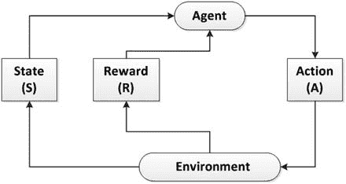

导入和设置代码：

```python
# -*- coding: utf-8 -*-

################################################################

import sys

import os

import pandas as pd

import sqlite3 as sq

import networkx as nx

import datetime

pd.options.mode.chained_assignment = None

################################################################

if sys.platform == 'linux':

    Base=os.path.expanduser('~') + '/VKHCG'

else:

    Base='C:/VKHCG'

print('################################')

print('Working Base :',Base, ' using ', sys.platform)

print('################################')

################################################################

Company='01-Vermeulen'

################################################################

sDataBaseDir=Base + '/' + Company + '/04-Transform/SQLite'

if not os.path.exists(sDataBaseDir):

    os.makedirs(sDataBaseDir)

################################################################

sDatabaseName=sDataBaseDir + '/Vermeulen.db'

conn = sq.connect(sDatabaseName)
```

您必须创建一个新图，以追踪过去九个月中每位客户的个人旅程路径。

```python
G=nx.Graph()
```

以下循环结构使您能够比较连续两个月的状态并确定变化：

```python
for M in range(1,10):

    print('Month: ', M)

    MIn = str(M - 1)

    MOut = str(M)

    sFile0 = 'ConnectionsChurn' + MIn + '.csv'

    sFile1 = 'ConnectionsChurn' + MOut + '.csv'

    sTable0 = 'ConnectionsChurn' + MIn

    sTable1 = 'ConnectionsChurn' + MOut

    sFileName0=Base + '/' + Company + '/00-RawData/' + sFile0

    ChurnData0=pd.read_csv(sFileName0,header=0,low_memory=False, encoding="latin-1")

    sFileName1=Base + '/' + Company + '/00-RawData/' + sFile1

    ChurnData1=pd.read_csv(sFileName1,header=0,low_memory=False, encoding="latin-1")
```

由于提取过程中的错误，文件日期不正确，因此您需要进行数据质量校正。

```python
dt1 = datetime.datetime(year=2017, month=1, day=1)

dt2 = datetime.datetime(year=2017, month=2, day=1)

ChurnData0['Date'] = dt1.strftime('%Y/%m/%d')

ChurnData1['Date'] = dt2.strftime('%Y/%m/%d')
```

现在，您比较所有客户的相关特征，以查看在调查的月份中采取了哪些操作。

```python
TrackColumns=['SeniorCitizen', 'Partner',

    'Dependents', 'PhoneService', 'MultipleLines',

    'OnlineSecurity', 'OnlineBackup', 'DeviceProtection', 'TechSupport',

    'StreamingTV', 'PaperlessBilling', 'StreamingMovies', 'InternetService',

    'Contract', 'PaymentMethod', 'MonthlyCharges']

################################################################

for i in range(ChurnData0.shape[0]):

    for TColumn in TrackColumns:

        t=0

        if ChurnData0[TColumn][i] == 'No':

            t+=1

        if t > 4:

            ChurnData0['Churn'][i] = 'Yes'

        else:

            ChurnData0['Churn'][i] = 'No'

################################################################

for i in range(ChurnData1.shape[0]):

    for TColumn in TrackColumns:

        t=0

        if ChurnData1[TColumn][i] == 'No':

            t+=1

        if t > 4:

            ChurnData1['Churn'][i] = 'Yes'

        else:

            ChurnData1['Churn'][i] = 'No'

################################################################

print('Store CSV Data')

ChurnData0.to_csv(sFileName0, index=False)

ChurnData1.to_csv(sFileName1, index=False)

################################################################

print('Store SQLite Data')

ChurnData0.to_sql(sTable0, conn, if_exists="replace")

ChurnData1.to_sql(sTable1, conn, if_exists="replace")
```

您总是从一个`Root`节点开始，然后连接客户。接着，您连接状态的每一次变化，并执行完整的路径分析。

```python
for TColumn in TrackColumns:

    for i in range(ChurnData0.shape[0]):

        Node0 = 'Root'

        Node1 = '(' + ChurnData0['customerID'][i] + '-Start)'

        G.add_edge(Node0, Node1)

        Node5 = '(' + ChurnData0['customerID'][i] + '-Stop)'

        G.add_node(Node5)

        if ChurnData0['Churn'][i] == 'Yes':

            NodeA = '(' + ChurnData0['customerID'][i] + '-Start)'

            NodeB = '(' + ChurnData0['customerID'][i] + '-Stop)'

            if nx.has_path(G, source=NodeA, target=NodeB) == False:

                NodeC = '(' + ChurnData0['customerID'][i] + '):(Churn)=>(' + ChurnData1['Churn'][i] + ')'
```

G.add_edge(NodeA, NodeC)
G.add_edge(NodeC, NodeB)
else:
    if ChurnData0[TColumn][i] != ChurnData1[TColumn][i]:
        #print(M,ChurnData0['customerID'][i],ChurnData0['Date'][i],ChurnData1['Date'][i],TColumn, ChurnData0[TColumn][i], ChurnData1[TColumn][i])
        Node2 = '(' + ChurnData0['customerID'][i] + ')-(' + ChurnData0['Date'][i] + ')'
        G.add_edge(Node1, Node2)
        Node3 = Node2 + '-(' + TColumn + ')'
        G.add_edge(Node2, Node3)
        Node4 = Node3 + ':(' + ChurnData0[TColumn][i] + ')=>(' + ChurnData1[TColumn][i] + ')'
        G.add_edge(Node3, Node4)
        if M == 9:
            Node6 = '(' + ChurnData0['customerID'][i] + '):(Churn)=>(' + ChurnData1['Churn'][i] + ')'
            G.add_edge(Node4, Node6)
            G.add_edge(Node6, Node5)
        else:
            G.add_edge(Node4, Node5)
```

您可以使用这几行代码来检查您创建的节点和边。
```python
for n in G.nodes():
    print(n)
for e in G.edges():
    print(e)
```

现在，您必须存储您的图以备将来使用。
```python
sGraphOutput = Base + '/' + Company + \
    '/04-Transform/01-EDS/02-Python/Transform_ConnectionsChurn_Graph.gml.gz'
nx.write_gml(G, sGraphOutput)
```

现在，您将调查客户在九个月内所走的路径，并输出客户在该期间内所采取的所有步骤。
```python
sFile0 = 'ConnectionsChurn9.csv'
sFileName0 = Base + '/' + Company + '/00-RawData/' + sFile0
ChurnData0 = pd.read_csv(sFileName0, header=0, low_memory=False, encoding="latin-1")
c = 0
for i in range(ChurnData0.shape[0]):
    sCustomer = ChurnData0['customerID'][i]
    NodeX = '(' + ChurnData0['customerID'][i] + '-Start)'
    NodeY = '(' + ChurnData0['customerID'][i] + '-Stop)'
    if nx.has_path(G, source=NodeX, target=NodeY) == False:
        NodeZ = '(' + ChurnData0['customerID'][i] + '):(Churn)=>(' + ChurnData0['Churn'][i] + ')'
        G.add_edge(NodeX, NodeZ)
        G.add_edge(NodeZ, NodeX)
    if nx.has_path(G, source=NodeX, target=NodeY) == True:
```

此函数使您能够为您为每位客户创建的两个节点之间的所有路径进行曝光。

# 排版后的内容

```python
        pset = nx.all_shortest_paths(G, source=NodeX, target=NodeY, weight=None)
        t = 0
        for p in pset:
            t = 0
            ps = 'Path: ' + str(p)
            for s in p:
                c += 1
                t += 1
                ts = 'Step: ' + str(t)
                #print(NodeX, NodeY, ps, ts, s)
                if c == 1:
                    pl = [[sCustomer, ps, ts, s]]
                else:
                    pl.append([sCustomer, ps, ts, s])
```

现在将路径分析结果存储到 `CSV` 文件中，以备后续使用。
```python
sFileOutput = Base + '/' + Company + \
    '/04-Transform/01-EDS/02-Python/Transform_ConnectionsChurn.csv'
df = pd.DataFrame(pl, columns=['Customer', 'Path', 'Step', 'StepName'])
df.index.name = 'RecID'
sTable = 'ConnectionsChurnPaths'
df.to_sql(sTable, conn, if_exists="replace")
df.to_csv(sFileOutput)
################################################################
print('### Done!! ############################################')
################################################################
```

干得漂亮！你刚刚完成了跨越九个月时间的首次路径分析。

## 洞察

你能理解为什么每个客户的路径各不相同，却最终导向相同的结果吗？你能解释为什么一位客户会流失而另一位不会吗？

你会注意到的常见行为是，客户在开始流失时会逐渐移除你方提供的服务，以便为自己启用新的流失后服务，他们不再会百分百支持你的业务。如果客户拥有的服务数量少于五个，他们通常会流失，因为此时他们很可能已经转向了另一家电信公司。

如果你要给客户提供建议，我会建议你强调，触发客户即将流失的最佳配置指标是：客户是否修改了其配置，从而减少了你方提供的服务数量。如果你能在客户降到最低五个服务数量之前进行干预，你仍然可以防止流失。

恭喜你！你现在已经能够执行路径分析的转换步骤，获取节点与边（关系）的简单列表，构建图形模型，并提出相关的问题。

### 预测

这项技术用于发现数据中的模式，从而对未来结果做出实际预测，如通过预测分析未来概率与趋势所示。我们在本书的多个章节中都进行了预测操作。

### 模式识别

模式识别用于识别数据集中的规律性与异常性。其最常见的应用是在文本分析中，用于发现数据中的复杂模式。

我将引导你完成一个文本提取的示例。该示例将从通用的 20 个新闻组数据集中提取文本文件，然后创建在同一文档中共同出现的文本类别。这将为你提供新闻组中最常使用的词语。

打开你的 Python 编辑器，并搭建以下环境：
```python
from pprint import pprint
from time import time
import logging
from sklearn.datasets import fetch_20newsgroups
from sklearn.feature_extraction.text import CountVectorizer
from sklearn.feature_extraction.text import TfidfTransformer
from sklearn.linear_model import SGDClassifier
from sklearn.model_selection import GridSearchCV
from sklearn.pipeline import Pipeline
```

修改日志记录设置，以便在 `stdout`（标准输出）上显示进度日志。
```python
logging.basicConfig(level=logging.INFO,
                    format='%(asctime)s %(levelname)s %(message)s')
```

现在你可以从训练集中加载类别。
```python
categories = [
    'sci.space',
    'comp.sys.ibm.pc.hardware',
    'sci.electronics',
    'sci.crypt',
    'rec.autos',
    'rec.motorcycles',
]
```

你可以对所有类别都使用这种方法，但我建议将其作为后续实验，因为它会因从数据湖中加载大量数据而拖慢处理速度。
```python
#categories = None
```

现在可以检查已加载的内容。

# 机器学习

商业世界充斥着关于机器学习及其在各类商业环境中应用的活动与哲学理念。机器学习是指系统无需显式软件开发即可学习的能力。它源于模式识别与计算学习理论的研究。

其影响在于，借助适当的处理能力和技能，你可以增强自身的数据处理能力——例如，在你喝杯咖啡的功夫，就能训练一个处理环境完成海量数据的发现工作，并将其转化为可操作的知识。这项技能是实现大幅缩短数据到知识周期的重要一环。

我只会介绍有限的基础理论，但机器学习涵盖的专业领域非常广泛，足以单独成书。因此，我仅向你介绍其核心理论。

## 代码示例：使用管道和网格搜索

以下是一段用于演示文本分类的代码示例。

```python
print("Loading 20 newsgroups dataset for categories:")
print(categories)
```

你必须加载训练数据。

```python
data = fetch_20newsgroups(subset='train', categories=categories)
print("%d documents" % len(data.filenames))
print("%d categories" % len(data.target_names))
```

现在你需要定义一个管道，将文本特征提取器与一个简单的分类器结合起来。

```python
pipeline = Pipeline([
    ('vect', CountVectorizer()),
    ('tfidf', TfidfTransformer()),
    ('clf', SGDClassifier()),
])
```

**警告**：取消注释以下更多参数将提供更强的探索能力，但会以组合方式增加处理时间。

```python
parameters = {
    'vect__max_df': (0.5, 0.75, 1.0),
    #'vect__max_features': (None, 5000, 10000, 50000),
    'vect__ngram_range': ((1, 1), (1, 2)),
    #'tfidf__use_idf': (True, False),
    #'tfidf__norm': ('l1', 'l2'),
    'clf__alpha': (0.00001, 0.000001),
    'clf__penalty': ('l2', 'elasticnet'),
    #'clf__n_iter': (10, 50, 80),
}
```

现在可以构建主处理引擎。

```python
if __name__ == "__main__":
    grid_search = GridSearchCV(pipeline, parameters, n_jobs=-1, verbose=1)
    print("Performing grid search...")
    print("pipeline:", [name for name, _ in pipeline.steps])
    print("parameters:")
    pprint(parameters)
    t0 = time()
    grid_search.fit(data.data, data.target)
    print("done in %0.3fs" % (time() - t0))
    print()
    print("Best score: %0.3f" % grid_search.best_score_)
    print("Best parameters set:")
    best_parameters = grid_search.best_estimator_.get_params()
    for param_name in sorted(parameters.keys()):
        print("\t%s: %r" % (param_name, best_parameters[param_name]))
```

当你执行程序后，你就成功完成了一次文本提取。此类提取的数据源通常是文档、电子邮件、Twitter 或数据库中的备注字段。任何文本源都可以应用转换步骤。

## 监督学习

`监督学习`是一种机器学习任务，旨在从带标签的训练数据中推断出一个函数。训练数据由一组训练样本组成。在`监督学习`中，每个样本都包含一对数据：输入对象和期望的输出值。当你已知一组输入特征的预期结果时，就可以使用这种方法。

### 示例

如果你买了面包和果酱，就可以做成果酱三明治。缺少其中任何一样，都做不出果酱三明治。

如果研究这个数据集，你可以轻松从指标中发现哪些是面包、哪些是果酱。数据科学模型也可以通过`监督学习`完成同样的任务。

| 基础食物名称 | 馅料名称 | 是否为面包 | 是否为果酱 | 是否为果酱三明治 |
| --- | --- | --- | --- | --- |
| Aish Merahrah | 苹果派 | 1 | 1 | 1 |
| Aish Merahrah | 苹果与木梨 | 1 | 1 | 1 |
| Ajdov Kruh | 苹果派 | 1 | 1 | 1 |
| Ajdov Kruh | 苹果与木梨 | 1 | 1 | 1 |
| Aish Merahrah | 阿尔莫格罗特奶酪酱 | 1 | 0 | 0 |
| Aish Merahrah | 阿卢埃特奶酪 | 1 | 0 | 0 |
| Ajdov Kruh | 阿尔莫格罗特奶酪酱 | 1 | 0 | 0 |
| Ajdov Kruh | 阿卢埃特奶酪 | 1 | 0 | 0 |
| 天使蛋糕 | 苹果派 | 0 | 1 | 0 |
| 天使蛋糕 | 苹果与木梨 | 0 | 1 | 0 |
| 天使海绵蛋糕 | 苹果派 | 0 | 1 | 0 |
| 天使海绵蛋糕 | 苹果与木梨 | 0 | 1 | 0 |
| 天使蛋糕 | 阿尔莫格罗特奶酪酱 | 0 | 0 | 0 |
| 天使蛋糕 | 阿卢埃特奶酪 | 0 | 0 | 0 |
| 天使海绵蛋糕 | 阿尔莫格罗特奶酪酱 | 0 | 0 | 0 |
| 天使海绵蛋糕 | 阿卢埃特奶酪 | 0 | 0 | 0 |

如果你研究存储在目录`..\VKHCG\03-Hillman\00-RawData`中`KitchenData.csv`文件里的更大数据集，就能看到如何利用上述知识来推断哪些物品组合能产生果酱三明治这一正确结论。

## 无监督学习

`无监督学习`是一种机器学习任务，旨在从无标签数据中推断出一个函数来描述隐藏结构。这涵盖了许多其他技术，这些技术致力于总结和解释数据的关键特征。

### 示例

你可以取一袋不同颜色、大小和材质的弹珠，通过应用一组特征和模型，将它们分成三个相等的组。你事先并不知道分割弹珠的标准是什么。

## 强化学习

`强化学习`（`RL`）是一个受行为心理学启发的机器学习领域，研究软件代理如何在一个环境中采取行动，从而或多或少地最大化累计奖励的概念。该技术应用于多个不同领域，例如博弈论、群体智能、控制理论、运筹学、基于仿真的优化、多智能体系统、统计学和遗传算法（图 10-15）。


图 10-15：强化学习示意图

这个过程很简单。你的智能体从环境中提取特征，这些特征要么是“状态”，要么是“奖励”。状态特征表明已经发生了某事。奖励特征表明发生了某些事，使得感知到的奖励收益有所增加或减少。智能体利用状态和奖励来决定改变环境的行动。

这种提取状态和奖励，并相应采取行动的过程将持续进行，直到达到预先约定的最终奖励为止。这类强化学习在现实世界中的应用是无限的。你可以将强化学习应用于任何能够通过智能体进行控制的环境。

我构建了许多`RL`系统来监控流程，例如采购分类系统或产品组装系统。它也是大多数机器人项目的核心，因为机器人是可以与环境交互的物理智能体。我还构建了许多“软机器人”，它们能在诸如贷款审批、支付款项和数据错误修复等数据处理任务中做出决策。

## 袋装数据

Bootstrap 聚合，也称为袋装法（`bagging`），是一种机器学习集成元算法，旨在提高用于统计分类和回归的机器学习算法的稳定性和准确性。它能减少方差，并帮助系统避免过拟合。

我想介绍这个概念，是因为在过去几年中，我看到许多数据科学解决方案存在过拟合问题，原因是它们使用已知数据集进行训练，最终导致只能处理这一个数据集。由于处理过程和算法效率低下，我们自然在数据方差方面有了一定的容错空间。

基于新式 GPU（图形处理单元）的系统非常精确，以至于如果训练数据是一个一致性较强的集合，且数据集内模式几乎没有或没有重大变化，它们就很容易过拟合。

现在你将看到如何执行一个简单的袋装过程。打开你的 Python 编辑器并创建以下环境：

```python
import numpy as np
import matplotlib.pyplot as plt
from sklearn.ensemble import BaggingRegressor
from sklearn.tree import DecisionTreeRegressor
```

你需要进行一些选择性设置。

```python
n_repeat = 100       # 迭代次数
n_train = 100        # 训练数据集的大小
```

`n_test = 10000`       # 测试数据集的大小

`noise = 0.1`          # 引入噪声的标准差

`np.random.seed(0)`

你将选择两个估计器进行比较。

```python
estimators = [("Tree", DecisionTreeRegressor()),
              ("Bagging(Tree)", BaggingRegressor(DecisionTreeRegressor()))]
n_estimators = len(estimators)
```

你需要一组数据进行袋装处理，因此生成一个随机数据集。

```python
def f(x):
    x = x.ravel()
    return np.exp(-x ** 2) - 2 * np.exp(-(x - 2) ** 2)
```

如果你想观察这个过程的运行效果，也可以尝试其他数据配置。

你需要创建一个函数来向数据添加噪声。

```python
def generate(n_samples, noise, n_repeat=1):
    X = np.random.rand(n_samples) * 10 - 5
    X = np.sort(X)
    if n_repeat == 1:
        y = f(X) + np.random.normal(0.0, noise, n_samples)
    else:
        y = np.zeros((n_samples, n_repeat))
        for i in range(n_repeat):
            y[:, i] = f(X) + np.random.normal(0.0, noise, n_samples)
    X = X.reshape((n_samples, 1))
    return X, y
```

现在你可以使用这些转换步骤来训练系统。

```python
X_train = []
y_train = []
```

通过在每个循环中获取一个样本，用袋装数据集来训练系统。这会让模型接触到更多样化的数据训练分布。

```python
for i in range(n_repeat):
    X, y = generate(n_samples=n_train, noise=noise)
    X_train.append(X)
    y_train.append(y)
```

现在你可以测试你的模型了。

```python
X_test, y_test = generate(n_samples=n_test, noise=noise, n_repeat=n_repeat)
```

你现在可以循环遍历估计器，通过计算预测值来比较结果。

```python
for n, (name, estimator) in enumerate(estimators):
    y_predict = np.zeros((n_test, n_repeat))
    for i in range(n_repeat):
        estimator.fit(X_train[i], y_train[i])
        y_predict[:, i] = estimator.predict(X_test)
```