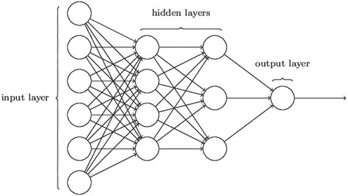

# 均方误差的偏差² + 方差 + 噪声分解
y_error = np.zeros(n_test)
for i in range(n_repeat):
for j in range(n_repeat):
y_error += (y_test[:, j] - y_predict[:, i]) ** 2
y_error /= (n_repeat * n_repeat)
y_noise = np.var(y_test, axis=1)
y_bias = (f(X_test) - np.mean(y_predict, axis=1)) ** 2
y_var = np.var(y_predict, axis=1)
```

现在你可以显示结果了。

```python
print("{0}: {1:.4f} (error) = {2:.4f} (bias²) "
" + {3:.4f} (var) + {4:.4f} (noise)".format(name,
np.mean(y_error),
np.mean(y_bias),
np.mean(y_var),
np.mean(y_noise)))
```

现在你可以绘制结果图表了。


```
plt.subplot(2, n_estimators, n + 1)
plt.plot(X_test, f(X_test), "b", label="$f(x)$")
plt.plot(X_train[0], y_train[0], ".b", label="LS ~ $y = f(x)+noise$")
for i in range(n_repeat):
if i == 0:
plt.plot(X_test, y_predict[:, i], "r", label="$\^y(x)$")
else:
plt.plot(X_test, y_predict[:, i], "r", alpha=0.05)
plt.plot(X_test, np.mean(y_predict, axis=1), "c",
label="$\mathbb{E}_{LS} \^y(x)$")
plt.xlim([-5, 5])
plt.title(name)
if n == 0:
plt.legend(loc="upper left", prop={"size": 11})
plt.subplot(2, n_estimators, n_estimators + n + 1)
plt.plot(X_test, y_error, "r", label="$error(x)$")
plt.plot(X_test, y_bias, "b", label="$bias²(x)$"),
plt.plot(X_test, y_var, "g", label="$variance(x)$"),
plt.plot(X_test, y_noise, "c", label="$noise(x)$")
plt.xlim([-5, 5])
plt.ylim([0, 0.1])
if n == 0:
plt.legend(loc="upper left", prop={"size": 11})
```

展示你的辛勤成果！

```
plt.show()
```

干得好！你已经完成了你的装袋示例。

请记住：装袋使得训练引擎可以在你期望处理的不同数据集上进行训练。这消除了异常值和极端值对数据模型的影响。所以，记住你已经获取了一个模型，并用从同一数据总体中采样的多个训练集对其进行了训练。

### 随机森林

随机森林，或称随机决策森林，是一种用于分类和回归的集成学习方法。其工作原理是在训练时构建大量的决策树，并输出各棵树在类别（分类）上的众数预测结果或在（回归）上的均值预测结果。随机决策森林纠正了决策树容易过拟合训练集的习惯。

最终的结果是所有树的结果的聚合，具体方式是对结果范围进行多数投票。因此，如果五棵树返回三个“是”和两个“否”，那么在转换步骤中就会输出“是”。

有时，这也被称为树装袋，因为你将装袋概念提升了一个层次：不仅要用来自数据总体的多个样本训练模型，而且实际上要用数据包执行完整的过程，然后聚合数据结果。

**警告**

如果你执行一个十因子的随机森林，意味着你执行了十倍的运算量。因此，请研究你的森林的最佳扩展规模。

**提示**

我发现，对于我所处理的平均数据集大小，15+的扩展规模能优化结果。但请务必进行实验，因为我也遇到过 5 个因子就完美运行的方案，以及一个痛苦的案例——由于存在异常不稳定的离群值，最终采用 100+的扩展规模才获得合适的结果。

让我引导你完成这个过程。打开你的 Python 编辑器，准备以下代码环境：

```
from sklearn.ensemble import RandomForestClassifier
import pandas as pd
import numpy as np
import sys
import os
import datetime as dt
import calendar as cal
```

设置数据位置并加载数据。

```
if sys.platform == 'linux':
Base=os.path.expanduser('~') + 'VKHCG'
else:
Base='C:/VKHCG'
print('################################')
print('Working Base :',Base, ' using ', sys.platform)
print('################################')
basedate = dt.datetime(2018,1,1,0,0,0)
Company='04-Clark'
InputFileName='Process_WIKI_UPS.csv'
InputFile=Base+'/'+Company+'/03-Process/01-EDS/02-Python/' + InputFileName
ShareRawData=pd.read_csv(InputFile,header=0,\
usecols=['Open','Close','UnitsOwn'], \
low_memory=False)
```

你必须执行一些预处理来揭示数据中的特征。

```
ShareRawData.index.names = ['ID']
ShareRawData['nRow'] = ShareRawData.index
ShareRawData['TradeDate']=ShareRawData.apply(lambda row:\
(basedate - dt.timedelta(days=row['nRow'])),axis=1)
ShareRawData['WeekDayName']=ShareRawData.apply(lambda row:\
(cal.day_name[row['TradeDate'].weekday()])\
,axis=1)
ShareRawData['WeekDayNum']=ShareRawData.apply(lambda row:\
(row['TradeDate'].weekday())\
,axis=1)
ShareRawData['sTarget']=ShareRawData.apply(lambda row:\
'true' if row['Open'] < row['Close'] else 'false'\
,axis=1)
```

这是你的数据集：

```
print(ShareRawData.head())
```

选择包含两个特征变量的数据框。

```
sColumns=['Open','Close','WeekDayNum']
df = pd.DataFrame(ShareRawData, columns=sColumns)
```

让我们看看前五行数据。

```
print(df.head())
你需要选择目标列。
df2 = pd.DataFrame(['sTarget'])
df2.columns =['WeekDayNum']
```

你必须选择一个训练数据集。

```
df['is_train'] = np.random.uniform(0, 1, len(df)) <= .75
```

现在，创建两个新的数据框，一个包含训练行，另一个包含测试行。

```
train, test = df[df['is_train']==True], df[df['is_train']==False]
```

以下是测试和训练数据框的观测数量：

```
print('Number of observations in the training data:', len(train))
print('Number of observations in the test data:',len(test))
通过创建特征列名称列表开始处理数据
features = df.columns[:3]
```

展示你的特征。

```
print(features)
```

你必须对目标进行因子化，才能使用我选择的模型。

```
y = pd.factorize(train['WeekDayNum'])[0]
```

你现在可以查看目标值了。

```
print(y)
你现在训练随机森林分类器
```

创建一个随机森林分类器。

**提示**

按照惯例，数据科学家使用“clf”代表“分类器（Classifier）”。这样，他们只需更改分类器的类型，就能简单地更改 clf。

```
clf = RandomForestClassifier(n_jobs=2, random_state=0)
```

你现在训练分类器，使其获取训练特征并学习它们与训练集 y（星期几的数字表示）之间的关系。

```
clf.fit(train[features], y)
```

现在将分类器应用于测试数据。此操作称为“评分”。

```
clf.predict(test[features])
```

你可以查看前十个观测值的预测概率。

```
print(clf.predict_proba(test[features])[0:10])
```

评估分类器。它表现得好吗？

```
preds = clf.predict(test[features])[3:4]
```

查看前十个观测值的`预测的星期几数字`。

```
print('PREDICTED Week Number:',preds[0:10])
```

查看前十个观测值的`实际的星期几名称`。

```
print(test['WeekDayNum'].head(10))
```

我建议你创建一个混淆矩阵。

```
c=pd.crosstab(df2['WeekDayNum'], preds, rownames=['Actual Week Day Number'], colnames=['Predicted Week Day Number'])
print(c)
```

你还可以查看特征列表及其重要性评分。

```
print(list(zip(train[features], clf.feature_importances_)))
```

你已经完成了随机森林解决方案的转换步骤。至此，我想解释一下随机森林的另一个方面。这其实就是将一系列随机森林进行菊花链式连接以创建一个解决方案。我发现，随着解决方案要求越来越高、数据集越来越大，这种方法在过去两年变得越来越流行。相同的基本原理仍然适用；只是在一个链条中重复应用它们几次而已。


## 计算机视觉（CV）

计算机视觉是一个复杂的特征提取领域，但一旦特征被提取出来，它就简单地变成了一个数值矩阵。

注意：在本书中，我仅对数据科学中的计算机视觉部分提供基本介绍。这本身就是一个庞大的领域。我只是希望你能注意到，这将成为你未来工作领域的一部分。

打开你的 Python 编辑器并输入这个快速示例：

```
import matplotlib.pyplot as plt
from PIL import Image
import numpy as np
sPicNameIn='C:/VKHCG/01-Vermeulen/00-RawData/AudiR8.png'
imageIn = Image.open(sPicNameIn)
fig1=plt.figure(figsize=(10, 10))
fig1.suptitle('Audi R8', fontsize=20)
imgplot = plt.imshow(imageIn)
plt.show()
```

你应该会看到一辆汽车。

```
imagewidth, imageheight = imageIn.size
imageMatrix=np.asarray(imageIn)
pixelscnt = (imagewidth * imageheight)
print('Pixels:', pixelscnt)
print('Size:', imagewidth, ' x', imageheight,)
print(imageMatrix)
```

这就是你的计算机所看到的！你已经实现了计算机视觉。还记得我向你展示电影是如何转换多个帧的吗？每一帧都成为了矩阵中的一个条目，现在你可以让你的数据科学“看见”了。

## 自然语言处理（NLP）

自然语言处理是数据科学中的一个领域，它研究我们人类相互交流的过程。这主要涵盖了构成更大概念的书面和口头语言。你的数据科学旨在与人类进行交互或互动，并对自然语言做出反应。

注意：这是数据科学中的一个主要研究领域。我仅对这个有趣的课题提供基本介绍。

自然语言处理有两个明确的需求。第一个是与人类的直接交互，例如当你对着智能手机说话，它就会给出合适的回答。例如，你说“打电话回家”，手机就会拨打设置为“家”的号码。

第二种交互类型是获取交互的详细内容，并理解其语境以及与其他文本或记录信息之间的关系。这方面的例子包括对新闻报道进行分析，并在不同新闻报道中发现共同趋势。这是对自然语言含义的研究，而不仅仅是对人类互动的响应。

### 基于文本

如果你想处理文本，你必须建立一个生态系统来执行基本的文本处理。我建议你使用 `library nltk`（`conda install -c anaconda nltk`）。

警告：此过程会在你的本地电脑上生成一个大型文本参考库。请确保你拥有超过 3.3GB 的空间来下载完整数据集。

打开你的 Python 编辑器并建立你的生态系统。然后你需要基础数据。

```
import nltk
nltk.download()
```

你将看到一个程序，它允许你下载几个文本库，这将有助于对你提交分析的任何文本执行文本分析。基本原理是，该库将你的文本与数据库中存储的文本进行匹配，并返回正确的匹配文本分析。

打开你的 Python 编辑器并创建以下生态系统，以便你研究该库：

```
from nltk.tokenize import sent_tokenize, word_tokenize
Txt = "Good Day Mr. Vermeulen,\
how are you doing today?\
The weather is great, and Data Science is awesome.\
You are doing well!"
print(Txt,'\n')
print('Identify sentences')
print(sent_tokenize(Txt),'\n')
print('Identify Word')
print(word_tokenize(Txt))
```

### 基于语音

对于语音到文本的转换以提取特征，存在很大的需求。我建议查看 `SpeechRecognition` 库（[`pypi.python.org/pypi/SpeechRecognition/`](https://pypi.python.org/pypi/SpeechRecognition/)）。你可以通过使用 `conda install -c conda-forge speechrecognition` 来安装它。

这个转换领域高度专业化，我不会就此主题提供更多细节。

### 神经网络

神经网络（也称为人工神经网络）的灵感来源于人类神经系统。它们模拟复杂信息如何被人类系统吸收和处理。就像人类一样，神经网络通过示例学习，并针对特定应用进行配置。

神经网络用于在极其复杂的数据中寻找模式，从而提供预测并对数据点进行分类。神经网络通常按层组织。层由许多相互连接的“节点”组成。模式（特征）通过“输入层”呈现给网络，该层与一个或多个“隐藏层”通信，实际处理就在其中进行。然后隐藏层连接到一个“输出层”，答案在此输出，如图 10-16 所示。



图 10-16：通用人工神经网络

提示：当我为神经网络进行特征开发时，我会构建一个问题以便得到一个简单的答案（是/否），但我会创建成百上千个问题。

让我提供一个神经网络特征开发的例子。假设你必须为你的狗的新球选择三种颜色：蓝色、黄色或粉色。特征将是：

- 球是蓝色的吗？是/否
- 球是黄色的吗？是/否
- 球是粉色的吗？是/否

当你将这些输入到神经网络时，它会将它们用作简单的 `0` 或 `1` 值，而这正是神经网络真正擅长的。不幸的是，为狗买球时最重要的特征是“狗能钻到房子底下吗？”我花了两个小时才从一个我钻不进去的空间里捞出一只狗和一个黑色的球！

经验教训：在开发神经网络时，你必须改变标准。如果你保持问题简单，你可以直接添加更多的问题，甚至移除那些产生特征的问题。

警告：当你开始使用神经网络时，它们可能会变得异常庞大。我有一个解决方案，它拥有近 500 万个特征，并且在特定的处理周期中，涉及 25 万个隐藏层，最终为一个产品范围的联合分析提供略超过一千个输出。我发现普通的神经网络大概有三到十个隐藏层，特征少于二十个。任何更大的网络在规模上大多属于异常值。

另外请注意，你可以将神经网络串联起来，我经常设计这样的系统。我将其称为“神经网络流水线和聚类”，并作为一项服务出售。

提示：研究 GPU 如何提升神经网络性能。你也可以看看 TensorFlow 在 GPU 上的表现（本章后面会讲到）。

在开始你的示例之前，你必须理解两个概念。

### 梯度下降

梯度下降是一种一阶迭代优化算法，用于寻找函数的最小值。要使用梯度下降法找到函数的局部最小值，需要沿着当前点函数梯度的负方向按比例迈出步长。

示例：打开你的 Python 编辑器并研究这段代码：

```
cur_x = 3 # The algorithm starts at x=3
gamma = 0.01 # step size multiplier
precision = 0.00001
previous_step_size = cur_x
df = lambda x: 4 * x**3 - 9 * x**2
while previous_step_size > precision:
prev_x = cur_x
cur_x += -gamma * df(prev_x)
previous_step_size = abs(cur_x - prev_x)
print("Current X at %f" % cur_x, " with step at %f" % previous_step_size )
print("The local minimum occurs at %f" % cur_x)
```

你看到这些步长是如何开始改进寻找局部最小值的过程了吗？梯度下降可能需要多次迭代才能以所需的精度计算出局部最小值。当你想找到一个适合你模型的未知值时，这个过程非常有用。在神经网络中，这支持对隐藏层进行加权，以计算达到所需的精度。


#### 正则化强度

`正则化强度`是防止神经网络过拟合的参数。该参数能使神经网络针对通用数据集匹配最佳的权重组合。此设置的常见名称是`epsilon`参数，也称为学习率。

#### 简单神经网络

既然你已经了解了这些基本参数，我将为你展示一个神经网络的示例。现在你可以打开一个新的 Python 文件以及你的 Python 编辑器。

让我们构建一个简单的神经网络。

```
Setup the eco-system.
import numpy as np
from sklearn import datasets, linear_model
import matplotlib.pyplot as plt
```

你需要一个可视化程序。

```
def plot_decision_boundary(pred_func):
