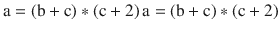

# This is expensive because it uses the whole dataset, so we don't want to do it too often.

```python
if print_loss and i % 1000 == 0:
    print ("Loss after iteration %i: %f" %(i, calculate_loss(model)))
```

`model`

现在你定义一个带有三维隐藏层的模型。

```python
model = build_model(3, print_loss=True)
```

现在你可以绘制决策边界。

```python
plot_decision_boundary(lambda x: predict(model, x))
plt.title("Decision Boundary for hidden layer size 3")
```

现在你可以将所取得的成果可视化。

```python
plt.figure(figsize=(16, 32))
hidden_layer_dimensions = [1, 2, 3, 4, 5, 20, 50]
for i, nn_hdim in enumerate(hidden_layer_dimensions):
    plt.subplot(5, 2, i+1)
    plt.title('Hidden Layer size %d' % nn_hdim)
    print('Model:',nn_hdim)
    model = build_model(nn_hdim, print_loss=True)
    plot_decision_boundary(lambda x: predict(model, x))
plt.show()
```

你现在可以构建神经网络了。做得好。

**建议**

你应该花时间理解如何构建神经网络，因为我发现使用神经网络处理数据科学的解决方案数量大幅增加。GPU 驱动处理的快速进展正在进一步推动这一趋势。至少，我必须构建 `100` 个输入和 `10` 个隐藏层，才能处理我定期收到的请求中最小规模的网络。

另外，请关注我在本章讨论的通过其他转换过程进行的链式连接。

以上就是最简形式的神经网络。

### TensorFlow

`TensorFlow` 是一个利用数据流图进行数值计算的开源软件库。图中的节点代表数学运算，而图的边则代表节点间传递的多维数据数组（张量）。其灵活的架构允许你将计算部署到一个或多个 `CPU` 或 `GPU` 上。

`TensorFlow` 最初由谷歌机器智能研究组织内 `Google Brain` 团队的研究人员和工程师开发，旨在进行机器学习和深度神经网络研究，但该系统通用性足够强，也适用于其他众多领域。

我将通过几个示例来向你展示其能力。我有几个使用了该生态系统的安装实例，它在数据科学社区中日益流行。

要使用它，你需要一个名为 `tensorflow` 的库。你可以通过 `conda install -c conda-forge tensorflow` 来安装它。关于该库的详细信息，请访问 [`www.tensorflow.org`](http://www.tensorflow.org)。

下一个巨大优势是云张量处理单元（`TPU`，[`https://cloud.google.com/tpu/`](https://cloud.google.com/tpu/)）硬件产品，它是专门设计的，能以比标准 `CPU` 或 `GPU` 硬件更优的性能水平来计算张量处理。`TPU` 凭借极其高效的硬件生态系统来支持 `TensorFlow` 流程。`TensorFlow Research Cloud` 为用户提供了访问这些第二代云 `TPU` 的权限，每个 `TPU` 可提供 `180 teraflops` 的机器学习加速能力。

**注**：我使用 [`www.tensorflow.org/tfrc/`](http://www.tensorflow.org/tfrc/) 上的开放研究平台来测试我拥有的任何新模型，它提供了一个出色的研发生态系统。我建议你为自己的生态研究一下这个平台。

### 基础 TensorFlow

我将通过一个基础示例来讲解，首先说明如何将以下数学方程转换为 `TensorFlow`：



我将为你计算以下内容：

- `B = 2.5`
- `C = 10`

打开你的 `Python` 编辑器并创建以下生态系统：

```python
import tensorflow as tf
```

创建一个 `TensorFlow` 常量。

```python
const = tf.constant(2.0, name="const")
```

创建 `TensorFlow` 变量。

```python
b = tf.Variable(2.5, name="b")
c = tf.Variable(10.0, name="c")
```

现在你必须创建运算。

```python
d = tf.add(b, c, name="d")
e = tf.add(c, const, name="e")
a = tf.multiply(d, e, name="a")
```

接下来，设置变量初始化。

```python
init_op = tf.global_variables_initializer()
```

现在你可以启动会话。

```python
with tf.Session() as sess:
```