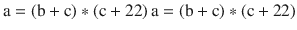

# 计算图的输出

`a_out = sess.run(a)`

`print("变量 a 的值为 {}".format(a_out))`

```
```

干得漂亮。你已经成功部署了一个 `TensorFlow` 解决方案。现在我将引导你学习一个更高级的示例：如何向 `TensorFlow` 输入一系列的值。



我将计算以下内容：

- `B = range (-5,-4,-3,-2,-1,0,1,2,3,4,5)`
- `C = 3`

打开你的 Python 编辑器并创建以下生态系统：

```
import tensorflow as tf

import numpy as np
```

创建一个 `TensorFlow` 常量。

```
const = tf.constant(22.0, name="const")
```

现在创建 `TensorFlow` 变量。注意变量 `b` 的范围格式。

```
b = tf.placeholder(tf.float32, [None, 1], name="b")

c = tf.Variable(3.0, name="c")
```

接下来你将创建所需的运算。

```
d = tf.add(b, c, name="d")

e = tf.add(c, const, name="e")

a = tf.multiply(d, e, name="a")
```

开始设置变量初始化。

```
init_op = tf.global_variables_initializer()
```

开始构建会话。

```
with tf.Session() as sess:
```