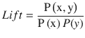

# Python ETL脚本示例

## 初始化与环境配置

```python
# -*- coding: utf-8 -*-

import sys
import os
import pandas as pd
import sqlite3 as sq
```

```python
if sys.platform == 'linux' or sys.platform == ' darwin':
    Base=os.path.expanduser('~') + '/VKHCG'
else:
    Base='C:/VKHCG'

print('################################')
print('Working Base :',Base, ' using ', sys.platform)
print('################################')
```

```python
Company='01-Vermeulen'
```

## 数据仓库连接

```python
sDataWarehouseDir=Base + '/99-DW'
if not os.path.exists(sDataWarehouseDir):
    os.makedirs(sDataWarehouseDir)

sDatabaseName=sDataWarehouseDir + '/datawarehouse.db'
conn1 = sq.connect(sDatabaseName)

sDatabaseName=sDataWarehouseDir + '/datamart.db'
conn2 = sq.connect(sDatabaseName)
```

## 数据加载与转换任务

### 任务1：从数据仓库加载完整的 BMI 数据集。

```python
print('################')
sTable = 'Dim-BMI'
print('Loading :',sDatabaseName,' Table:',sTable)
sSQL="SELECT * FROM [Dim-BMI];"
PersonFrame0=pd.read_sql_query(sSQL, conn1)
```

### 任务2：从数据仓库加载安全的 BMI 数据集。

```python
print('################')
sTable = 'Dim-BMI'
print('Loading :',sDatabaseName,' Table:',sTable)
sSQL="SELECT \
    Height,\
    Weight,\
    Indicator,\
    CASE Indicator\
        WHEN 1 THEN 'Pip'\
        WHEN 2 THEN 'Norman'\
        WHEN 3 THEN 'Grant'\
        ELSE 'Sam'\
    END AS Name\
    FROM [Dim-BMI]\
    WHERE Indicator > 2\
    ORDER BY \
        Height,\
        Weight;"
PersonFrame1=pd.read_sql_query(sSQL, conn1)
```

```python
DimPerson=PersonFrame1
DimPersonIndex=DimPerson.set_index(['Indicator'],inplace=False)

sTable = 'Dim-BMI-Secure'
print('\n#################################')
print('Storing :',sDatabaseName,'\n Table:',sTable)
print('\n#################################')
DimPersonIndex.to_sql(sTable, conn2, if_exists="replace")
```

### 任务3：从数据仓库加载 Sam 视角的 BMI 数据集。

```python
print('################################')
sTable = 'Dim-BMI-Secure'
print('Loading :',sDatabaseName,' Table:',sTable)
print('################################')
sSQL="SELECT * FROM [Dim-BMI-Secure] WHERE Name = 'Sam';"
PersonFrame2=pd.read_sql_query(sSQL, conn2)
```

## 结果输出

```python
print('################################')
print('Full Data Set (Rows):', PersonFrame0.shape[0])
print('Full Data Set (Columns):', PersonFrame0.shape[1])
print('################################')
print('Horizontal Data Set (Rows):', PersonFrame2.shape[0])
print('Horizontal Data Set (Columns):', PersonFrame2.shape[1])
print('Only Sam Data')
print(PersonFrame2.head())
print('################################')
```

程序输出：

```
################################
Full Data Set (Rows): 1080
Full Data Set (Columns): 5
################################
Horizontal Data Set (Rows): 692
Horizontal Data Set (Columns): 4
```

# 关联规则挖掘

## 注意
最好像示例中那样创建角色而非命名引用。原理是相同的，但安全性更加灵活。

## 关联规则挖掘简介
关联规则学习是一种基于规则的机器学习方法，用于发现大型数据库（类似于数据湖中的数据）中变量之间的有趣关联。该技术使您能够研究同一群体内部数据之间的交互作用。

我将讨论的这个示例也称为“市场购物篮分析”。它将分析客户在一段时间内的购买行为。

## 核心度量：“提升度”
您需要理解的新度量称为“提升度”。提升度简单地通过两个商品`x`和`y`的联合概率除以它们各自概率的乘积来估计：



如果两个商品在统计上独立，那么`P(x,y) = P(x)P(y)`，对应`提升度 = 1`。请注意，负相关会产生小于 1 的提升度值，这也是一种有趣的发现，对应那些很少同时出现的互斥商品。

## 环境准备与算法介绍
您将需要以下附加库：`conda install -c conda-forge mlxtend`。

为此使用的通用算法是 Apriori 算法，用于在数据湖内容上进行频繁项集挖掘和关联规则学习。该算法通过识别数据湖中频繁出现的单个商品，并将它们扩展到越来越大的项集，只要这些项集在数据湖中足够频繁地出现。Apriori 确定的频繁项集可用于发现突出整体数据湖共同趋势的关联规则。我将引导您完成一个示例。

## 示例代码
从标准生态系统开始。

```
################################################################
```