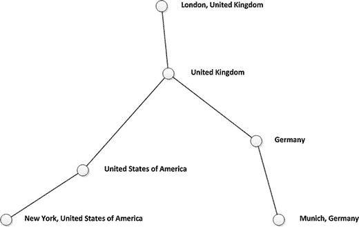
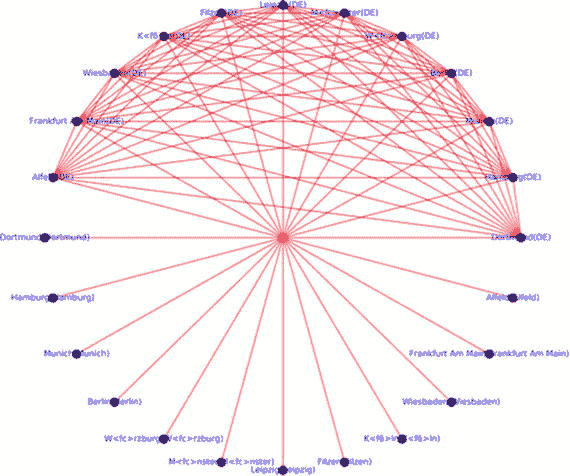

# -*- coding: utf-8 -*-
################################################################
import sys
import os
import pandas as pd
from mlxtend.frequent_patterns import apriori
from mlxtend.frequent_patterns import association_rules
################################################################
if sys.platform == 'linux' or sys.platform == ' darwin':
Base=os.path.expanduser('~') + '/VKHCG'
else:
Base='C:/VKHCG'
print('################################')
print('Working Base :',Base, ' using ', sys.platform)
print('################################')
################################################################
Company='01-Vermeulen'
InputFileName='Online-Retail-Billboard.xlsx'
EDSAssessDir='02-Assess/01-EDS'
InputAssessDir=EDSAssessDir + '/02-Python'
################################################################
sFileAssessDir=Base + '/' + Company + '/' + InputAssessDir
if not os.path.exists(sFileAssessDir):
os.makedirs(sFileAssessDir)
################################################################
sFileName=Base+'/'+ Company + '/00-RawData/' + InputFileName
################################################################
```

将 Excel 工作表导入到生态系统中。

```
df = pd.read_excel(sFileName)
print(df.shape)
```

执行一些特征工程，以在模型中构建购物篮模拟。

```
df['Description'] = df['Description'].str.strip()
df.dropna(axis=0, subset=['InvoiceNo'], inplace=True)
df['InvoiceNo'] = df['InvoiceNo'].astype('str')
df = df[~df['InvoiceNo'].str.contains('C')]
basket = (df[df['Country'] =="France"]
.groupby(['InvoiceNo', 'Description'])['Quantity']
.sum().unstack().reset_index().fillna(0)
.set_index('InvoiceNo'))
################################################################
def encode_units(x):
if x = 1:
return 1
################################################################
basket_sets = basket.applymap(encode_units)
basket_sets.drop('POSTAGE', inplace=True, axis=1)
```

将 Apriori 算法应用于数据模型。

```
frequent_itemsets = apriori(basket_sets, min_support=0.07, use_colnames=True)
rules = association_rules(frequent_itemsets, metric="lift", min_threshold=1)
print(rules.head())
rules[ (rules['lift'] >= 6) &
(rules['confidence'] >= 0.8) ]
```

现在您可以查看“绿色时钟”的结果。

```
sProduct1='ALARM CLOCK BAKELIKE GREEN'
print(sProduct1)
print(basket[sProduct1].sum())
```

以及“红色时钟”……

```
sProduct2='ALARM CLOCK BAKELIKE RED'
print(sProduct2)
print(basket[sProduct2].sum())
```

现在您可以查看“德国”购物篮的结果。

```
basket2 = (df[df['Country'] =="Germany"]
.groupby(['InvoiceNo', 'Description'])['Quantity']
.sum().unstack().reset_index().fillna(0)
.set_index('InvoiceNo'))
basket_sets2 = basket2.applymap(encode_units)
basket_sets2.drop('POSTAGE', inplace=True, axis=1)
frequent_itemsets2 = apriori(basket_sets2, min_support=0.05, use_colnames=True)
rules2 = association_rules(frequent_itemsets2, metric="lift", min_threshold=1)
print(rules2[ (rules2['lift'] >= 4) &
(rules2['confidence'] >= 0.5)])
```

您已成功使用复杂的 Apriori 算法将数据科学组织成一个模型，可用于提取客户购买行为的洞察。

注意

优秀的数据科学家可以部署多种算法和技术来将数据组织成逻辑数据集。我建议您研究最适合客户数据的算法，并针对它们进行练习，以成为专家。

## 设计一个实用的组织超步骤

现在我已经解释了组织超步骤的各个方面，我将向您展示如何帮助我们公司进行数据处理。

### Vermeulen PLC

我将展示如何将组织超步骤应用于我们的 VKHCG 公司。那么，我将从一个网络需求开始。您能为 VKHCG 公司生成一个网络路由图吗？


#### 创建网络路由图

我将引导您完成该需求的一个可能解决方案，通过构建一个岛屿风格的`Organize`超级步骤，该步骤使用图数据模型来减少数据集中的记录和列。作为额外收获，它创建了一个视觉上改进的图表，可用于说明路由。

打开您的 Python 编辑器，从标准环境开始。

```python
################################################################
import sys
import os
import pandas as pd
import networkx as nx
import matplotlib.pyplot as plt
################################################################
pd.options.mode.chained_assignment = None
################################################################
if sys.platform == 'linux' or sys.platform == ' darwin':
Base=os.path.expanduser('~') + 'VKHCG'
else:
Base='C:/VKHCG'
################################################################
print('################################')
print('Working Base :',Base, ' using ', sys.platform)
print('################################')
################################################################
sInputFileName='02-Assess/01-EDS/02-Python/Assess-Network-Routing-Company.csv'
################################################################
sOutputFileName1='05-Organise/01-EDS/02-Python/Organise-Network-Routing-Company.gml'
sOutputFileName2='05-Organise/01-EDS/02-Python/Organise-Network-Routing-Company.png'
Company='01-Vermeulen'
################################################################
```

现在从逗号分隔值文件中加载公司信息。

```python
################################################################
#### 导入国家数据
################################################################
sFileName=Base + '/' + Company + '/' + sInputFileName
print('################################')
print('加载中 :',sFileName)
print('################################')
CompanyData=pd.read_csv(sFileName,header=0,low_memory=False, encoding="latin-1")
print('################################')
```

现在，您可以检查公司信息。

```python
################################################################
print(CompanyData.head())
print(CompanyData.shape)
################################################################
```

让我们开始一个新的图表来加载公司信息。

```python
G=nx.Graph()
for i in range(CompanyData.shape[0]):
for j in range(CompanyData.shape[0]):
Node0=CompanyData['Company_Country_Name'][i]
Node1=CompanyData['Company_Country_Name'][j]
if Node0 != Node1:
G.add_edge(Node0,Node1)
for i in range(CompanyData.shape[0]):
Node0=CompanyData['Company_Country_Name'][i]
Node1=CompanyData['Company_Place_Name'][i] + '('+ CompanyData['Company_Country_Name'][i] + ')'
if Node0 != Node1:
G.add_edge(Node0,Node1)
```

现在您可以在图表中检查公司信息。

```python
print('节点数:', G.number_of_nodes())
print('边数:', G.number_of_edges())
```

我建议您现在将图表存储到磁盘。

```python
################################################################
sFileName=Base + '/' + Company + '/' + sOutputFileName1
print('################################')
print('存储中 :',sFileName)
print('################################')
nx.write_gml(G, sFileName)
################################################################
```

现在您可以针对您的需求提供见解。我建议您创建图表的图像，以支持您的发现。

```python
sFileName=Base + '/' + Company + '/' + sOutputFileName2
print('################################')
print('存储图表图像:',sFileName)
print('################################')
plt.figure(figsize=(15, 15))
pos=nx.spectral_layout(G,dim=2)
nx.draw_networkx_nodes(G,pos, node_color="k", node_size=10, alpha=0.8)
nx.draw_networkx_edges(G, pos,edge_color='r', arrows=False, style="dashed")
nx.draw_networkx_labels(G,pos,font_size=12,font_family='sans-serif',font_color='b')
plt.axis('off')
plt.savefig(sFileName,dpi=600)
plt.show()
################################################################
print('################################')
print('### 完成!! #####################')
print('################################')
################################################################
```

恭喜！您现在可以回答需求了。您能否为 VKHCG 公司生成一个网络路由图？是的，您刚刚完成了。您的网络是一个具有轮状枢纽结构的核心三个节点（图 11-1）。



**图 11-1** 美国、英国和德国的节点图

### Krennwallner AG

Krennwallner 集团需要为广告牌挑选内容。您能组织一个模型来支持他们的查询吗？


#### 为广告牌挑选内容

为了让市场营销人员能够销售广告牌内容，他们需要一张图表来显示哪些广告牌连接到哪个办公内容发布器。克伦沃尔纳的每块广告牌都配有一个接近传感器，使内容管理者能够记录注册访客何时将智能手机指向广告牌内容，或用手机触碰近场感应垫。

因此，我将协助您构建一个有序的广告牌位置数据图表，以帮助您深入了解广告牌位置和内容挑选过程。

打开您的 Python 编辑器，从标准生态系统开始。

```
################################################################
import sys
import os
import pandas as pd
import networkx as nx
import matplotlib.pyplot as plt
import numpy as np
################################################################
pd.options.mode.chained_assignment = None
################################################################
if sys.platform == 'linux' or sys.platform == ' darwin':
Base=os.path.expanduser('~') + 'VKHCG'
else:
Base='C:/VKHCG'
################################################################
print('################################')
print('Working Base :',Base, ' using ', sys.platform)
print('################################')
################################################################
sInputFileName='02-Assess/01-EDS/02-Python/Assess-DE-Billboard-Visitor.csv'
################################################################
sOutputFileName1='05-Organise/01-EDS/02-Python/Organise-Billboards.gml'
sOutputFileName2='05-Organise/01-EDS/02-Python/Organise-Billboards.png'
Billboard='02-Krennwallner'
################################################################
```

加载每块广告牌的接近传感器数据。

```
################################################################
#### Import Proximity Sensor Data
################################################################
sFileName=Base + '/' + Billboard + '/' + sInputFileName
print('################################')
print('Loading :',sFileName)
print('################################')
BillboardDataRaw=pd.read_csv(sFileName,header=0,low_memory=False, encoding="latin-1")
print('################################')
```

让我们深入了解数据。

```
################################################################
print(BillboardDataRaw.head())
print(BillboardDataRaw.shape)
BillboardData=BillboardDataRaw
```

我建议从总数据集中抽取一个样本，用于创建训练集和测试集。

```
sSample=list(np.random.choice(BillboardData.shape[0],20))
```

我建议从样本中生成一个图表数据集。

```
G=nx.Graph()
for i in sSample:
for j in sSample:
Node0=BillboardData['BillboardPlaceName'][i] + '('+ BillboardData['BillboardCountry'][i] + ')'
Node1=BillboardData['BillboardPlaceName'][j] + '('+ BillboardData['BillboardCountry'][i] + ')'
if Node0 != Node1:
G.add_edge(Node0,Node1)
for i in sSample:
Node0=BillboardData['BillboardPlaceName'][i] + '('+ BillboardData['VisitorPlaceName'][i] + ')'
Node1=BillboardData['BillboardPlaceName'][i] + '('+ BillboardData['VisitorCountry'][i] + ')'
if Node0 != Node1:
G.add_edge(Node0,Node1)
```

现在您可以从图表中获得各种见解。

```
print('Nodes:', G.number_of_nodes())
print('Edges:', G.number_of_edges())
```

保存您辛勤劳动的成果。

```
################################################################
sFileName=Base + '/' + Billboard + '/' + sOutputFileName1
print('################################')
print('Storing :',sFileName)
print('################################')
nx.write_gml(G, sFileName)
```

接下来，我将引导您完成可视化过程。

```
################################################################
sFileName=Base + '/' + Billboard + '/' + sOutputFileName2
print('################################')
print('Storing Graph Image:',sFileName)
print('################################')
plt.figure(figsize=(15, 15))
pos=nx.circular_layout(G,dim=2)
nx.draw_networkx_nodes(G,pos, node_color="k", node_size=150, alpha=0.8)
nx.draw_networkx_edges(G, pos,edge_color='r', arrows=False, style="solid")
nx.draw_networkx_labels(G,pos,font_size=12,font_family='sans-serif',font_color='b')
plt.axis('off')
plt.savefig(sFileName,dpi=600)
plt.show()
################################################################
print('################################')
print('### Done!! #####################')
print('################################')
################################################################
```

成功！您已获得一张图表，可以支持任何进一步的查询，以及一张可以分发给市场营销部门的图片（图 11-2）。



图 11-2

克伦沃尔纳的市场营销部门

## 希尔曼有限公司

希尔曼公司正在扩展业务，计划新增一个仓库和几家商店。您能否帮助该公司制定一个标准规划包，以便为激活 13 号仓库的物流做好准备？

**提示**

系统将 13 号仓库记录为 `WH-KA13`。您之前见过这个吗？是的，您没有猜错；本书前面部分已经处理过它了。


### 创建配送路线

希尔曼公司需要为 KA-13 号仓库的配送区域制定一份新的配送路线方案。总经理必须了解以下信息：

- 如果每英里成本为 1.50 英镑，且每日计划运行两趟，最昂贵的路线是哪条
- 该区域每 30 天一个月的平均行驶里程是多少

运用您将数据湖转化为业务资产的技术栈新知识，能否将“评估”环节中名为“评估 _ 最佳物流”的图转换为两点之间的最短路径？打开您的 Python 编辑器，从标准生态系统开始。

```python
