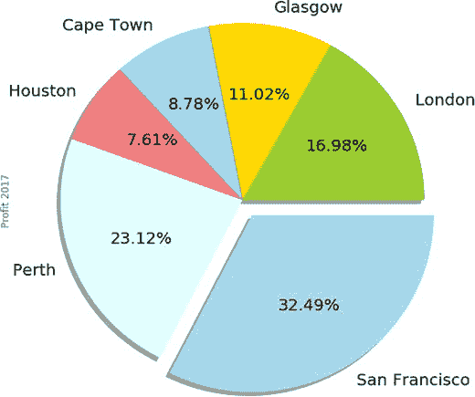
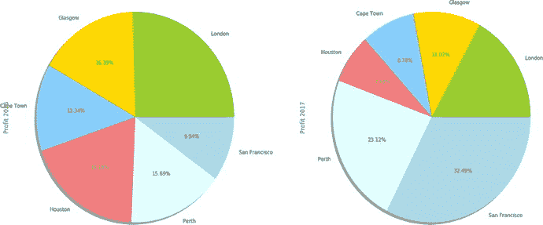
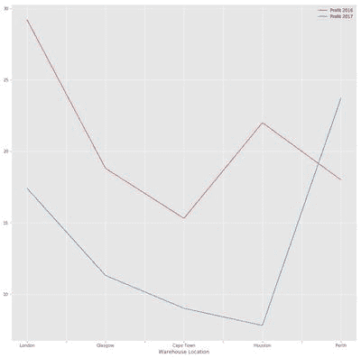
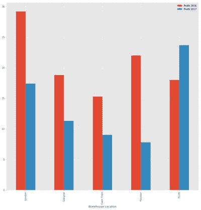
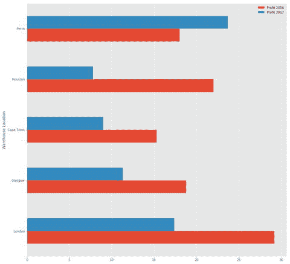
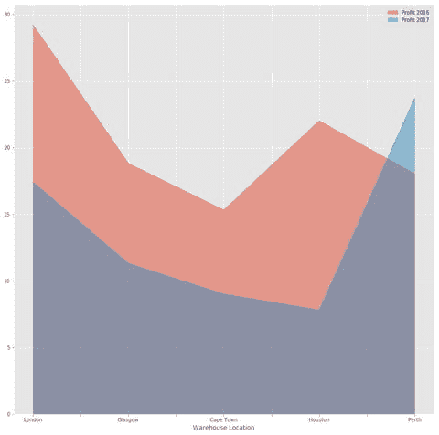
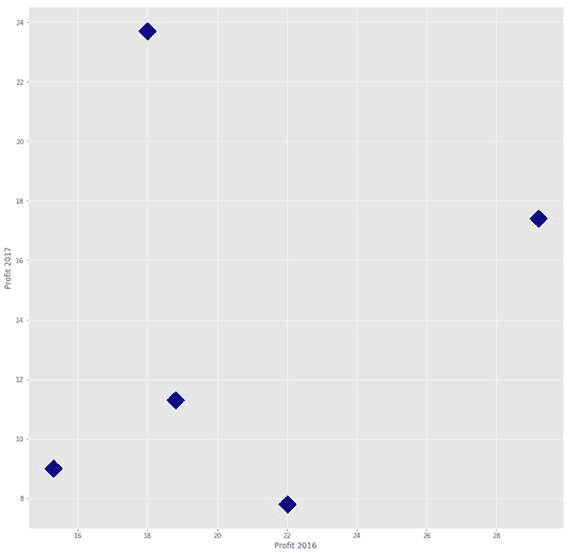
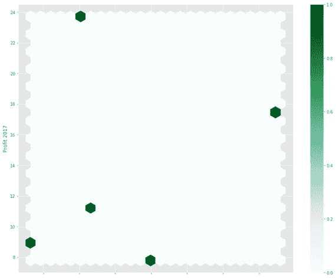

# -*- coding: utf-8 -*-
################################################################
import sys
import os
import pandas as pd
import matplotlib as ml
from matplotlib import pyplot as plt
################################################################
if sys.platform == 'linux' or sys.platform == ' darwin':
    Base=os.path.expanduser('~') + '/VKHCG'
else:
    Base='C:/VKHCG'
print('################################')
print('Working Base :',Base, ' using ', sys.platform)
print('################################')
################################################################
GBase = Base+'/01-Vermeulen/06-Report/01-EDS/02-Python/'
ml.style.use('ggplot')
```

这里有一个专门的数据集，用于演示可视化效果。

```python
data=[
    ['London',    29.2, 17.4],
    ['Glasgow',    18.8, 11.3],
    ['Cape Town',    15.3, 9.0],
    ['Houston',    22.0, 7.8],
    ['Perth',    18.0, 23.7],
    ['San Francisco',    11.4, 33.3]
]
os_new=pd.DataFrame(data)
pd.Index(['Item', 'Value', 'Value Percent', 'Conversions', 'Conversion Percent',
'URL', 'Stats URL'],
dtype='object')
os_new.rename(columns = {0 : "Warehouse Location"}, inplace=True)
os_new.rename(columns = {1 : "Profit 2016"}, inplace=True)
os_new.rename(columns = {2 : "Profit 2017"}, inplace=True)
```


### 饼图

让我们从一个简单的饼图开始。

```
explode = (0, 0, 0, 0, 0, 0.1)
labels=os_new['Warehouse Location']
colors_mine = ['yellowgreen', 'gold', 'lightskyblue', 'lightcoral', 'lightcyan','lightblue']
os_new.plot(figsize=(10, 10),kind="pie", y="Profit 2017",autopct='%.2f%%', \
shadow=True, explode=explode, legend = False, colors = colors_mine,\
labels=labels, fontsize=20)
sPicNameOut1=GBase+'pie_explode.png'
plt.savefig(sPicNameOut1,dpi=600)
```

图 11-4 展示了生成的饼图。



**图 11-4** 饼图

### 双饼图

通过以下代码，你可以并排放置两个饼图：

```
explode = (0, 0, 0, 0, 0, 0)
colors_mine = ['yellowgreen', 'gold', 'lightskyblue', 'lightcoral', 'lightcyan','lightblue']
os_new.plot(figsize=(10, 5),kind="pie", y=['Profit 2016','Profit 2017'],autopct='%.2f%%', \
shadow=True, explode=explode, legend = False, colors = colors_mine,\
subplots=True, labels=labels, fontsize=10)
sPicNameOut2=GBase+'pie.png'
plt.savefig(sPicNameOut2,dpi=600)
```

图 11-5 展示了生成的双饼图。



**图 11-5** 双饼图

### 折线图

我们也可以以折线图的形式来可视化数据。

```
os_new.iloc[:5].plot(figsize=(10, 10),kind='Line',x='Warehouse Location',\
y=['Profit 2016','Profit 2017']);
sPicNameOut3=GBase+'line.png'
plt.savefig(sPicNameOut3,dpi=600)
```

图 11-6 展示了生成的折线图。



**图 11-6** 折线图

### 条形图

以下代码生成一个条形图：

```
os_new.iloc[:5].plot(figsize=(10, 10),kind='bar',x='Warehouse Location',\
y=['Profit 2016','Profit 2017']);
sPicNameOut4=GBase+'bar.png'
plt.savefig(sPicNameOut4,dpi=600)
```

图 11-7 展示了生成的条形图。



**图 11-7** 条形图

### 水平条形图

你也可以创建水平条形图。

```
os_new.iloc[:5].plot(figsize=(10, 10),kind='barh',x='Warehouse Location',\
y=['Profit 2016','Profit 2017']);
sPicNameOut5=GBase+'hbar.png'
plt.savefig(sPicNameOut5,dpi=600)
```

图 11-8 展示了生成的水平条形图。



**图 11-8** 水平条形图

### 面积图

也可以采用面积图的形式。

```
os_new.iloc[:5].plot(figsize=(10, 10),kind='area',x='Warehouse Location',\
y=['Profit 2016','Profit 2017'],stacked=False);
sPicNameOut6=GBase+'area.png'
plt.savefig(sPicNameOut6,dpi=600)
```

图 11-9 展示了生成的面积图。



**图 11-9** 面积图

### 散点图

如果你愿意，我们也可以使用散点图进行可视化。

```
os_new.iloc[:5].plot(figsize=(10, 10),kind='scatter',x='Profit 2016',\
y='Profit 2017',color='DarkBlue',marker='D');
sPicNameOut7=GBase+'scatter.png'
plt.savefig(sPicNameOut7,dpi=600)
```

图 11-10 展示了生成的散点图。



**图 11-10** 散点图

### 六边形分箱图

这里有一个我发现的有趣内容——六边形分箱图。之所以包含六边形图，是因为如果你能进行数据科学分析，你就可以：

-   凭借内置的比例尺轻松判断距离
-   同样凭借内置的比例尺轻松判断感兴趣点的密度
-   轻松放大或缩小地图，并将事物大致放置在它们在地理空间报告格式中应有的位置

让我们看一个关于六边形图的简单示例。我们有一个大约 25`×`25 英里的农场。如果我们测量每平方英里农田产生的利润，就可以发现农场的盈利区域和非盈利区域。

```
os_new.iloc[:5].plot(figsize=(13, 10),kind='hexbin',x='Profit 2016',\
y='Profit 2017', gridsize=25);
sPicNameOut8=GBase+'hexbin.png'
plt.savefig(sPicNameOut8,dpi=600)
```

图 11-11 展示了生成的六边形分箱图，该图显示有五个区域在 2016 年和 2017 年都产生了利润。



**图 11-11** 农场的六边形分箱图

## 更复杂的图形

接下来，我将向你展示一些我在处理来自不同数据源的数据时使用过的、更复杂的图形技术。通常，普通的饼图、折线图或条形图无法完全传达结果的可视化效果，或者数据过于复杂，以至于不应用一些额外的数据科学技术来解决复杂性就无法进行可视化。

现在，我将引导你了解一些我经常使用的、比较常见的技术。

### 核密度估计图

核密度估计是一种重要的数据平滑技术，它基于有限的数据样本来准备关于总体的推断。

```
################################################################
