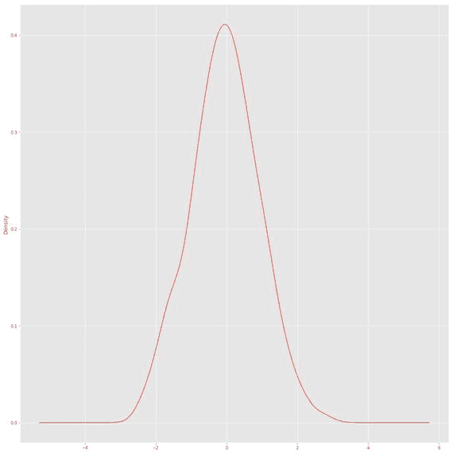
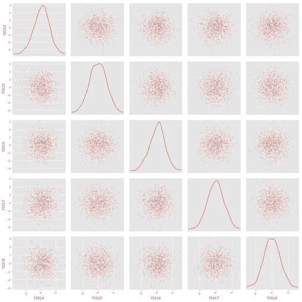
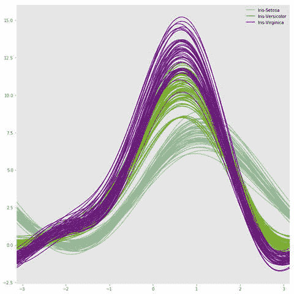
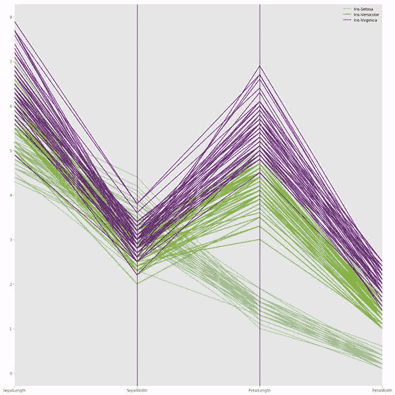
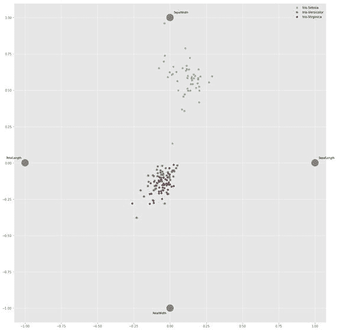

# -*- coding: utf-8 -*-
################################################################
import sys
import os
import pandas as pd
import matplotlib as ml
import numpy as np
from matplotlib import pyplot as plt
################################################################
if sys.platform == 'linux' or sys.platform == ' darwin':
Base=os.path.expanduser('~') + '/VKHCG'
else:
Base='C:/VKHCG'
print('################################')
print('Working Base :',Base, ' using ', sys.platform)
print('################################')
################################################################
ml.style.use('ggplot')
fig1=plt.figure(figsize=(10, 10))
ser = pd.Series(np.random.randn(1000))
ser.plot(figsize=(10, 10),kind='kde')
sPicNameOut1=Base+'/01-Vermeulen/06-Report/01-EDS/02-Python/kde.png'
plt.savefig(sPicNameOut1,dpi=600)
plt.tight_layout()
plt.show()
```

图 11-12 展示了生成的 KDE 图，该图说明了随机变量的概率密度函数的估计。它将随机的一千个点缩减为一条曲线，指示出数值在总体中的变化方式，而不显示每个单独的值。



**图 11-12** 核密度估计图

### 散点矩阵图

散点矩阵是一种用于估计协方差矩阵的统计工具。

```
fig2=plt.figure(figsize=(10, 10))
from pandas.plotting import scatter_matrix
df = pd.DataFrame(np.random.randn(1000, 5), columns=['Y2014','Y2015', 'Y2016', 'Y2017', 'Y2018'])
scatter_matrix(df, alpha=0.2, figsize=(10, 10), diagonal="kde")
sPicNameOut2=Base+'/01-Vermeulen/06-Report/01-EDS/02-Python/scatter_matrix.png'
plt.savefig(sPicNameOut2,dpi=600)
plt.tight_layout()
plt.show()
```

图 11-13 展示了生成的散点矩阵图。



**图 11-13** 散点矩阵图


### 安德鲁斯曲线

利用安德鲁斯曲线进行可视化是一种在高维数据中观察结构的方法。安德鲁斯曲线是用于可视化多元数据的空间变换可视化（`STV`）技术的示例，它使用正交基函数，通过二维或三维空间中的轮廓线来表示 k 维数据点。安德鲁斯曲线基于傅里叶级数，其中系数是观测值的数值。简单来说，它们允许你以一种结构化的方式，将超过三维的降维结果转换为可视化格式。

打开你的 Python 编辑器并搭建这个基本环境：

```python
import sys
import os
import pandas as pd
from matplotlib import pyplot as plt
################################################################
if sys.platform == 'linux' or sys.platform == ' darwin':
    Base=os.path.expanduser('~') + '/VKHCG'
else:
    Base='C:/VKHCG'
print('################################')
print('Working Base :',Base, ' using ', sys.platform)
print('################################')
################################################################
sDataFile=Base+'/01-Vermeulen/00-RawData/irisdata.csv'
data = pd.read_csv(sDataFile)
from pandas.plotting import andrews_curves
plt.figure(figsize=(10, 10))
andrews_curves(data, 'Name')
sPicNameOut1=Base+'/01-Vermeulen/06-Report/01-EDS/02-Python/andrews_curves.png'
plt.savefig(sPicNameOut1,dpi=600)
plt.tight_layout()
plt.show()
```

图 11-14 展示了结果：一个四维到二维的降维图。



图 11-14

使用安德鲁斯曲线生成的图形

### 平行坐标

平行坐标通常用于可视化高维几何图形和分析多元数据。

```python
from pandas.plotting import parallel_coordinates
plt.figure(figsize=(10, 10))
parallel_coordinates(data, 'Name')
sPicNameOut2=Base+'/01-Vermeulen/06-Report/01-EDS/02-Python/parallel_coordinates.png'
plt.savefig(sPicNameOut2,dpi=600)
plt.tight_layout()
plt.show()
```

图 11-15 展示了此图的结果。



图 11-15

使用平行坐标生成的图形

### RADVIZ 方法

`RADVIZ` 方法将一组多维点映射到二维空间。

```python
from pandas.plotting import radviz
plt.figure(figsize=(10, 10))
radviz(data, 'Name')
sPicNameOut3=Base+'/01-Vermeulen/06-Report/01-EDS/02-Python/radviz.png'
plt.savefig(sPicNameOut3,dpi=600)
plt.tight_layout()
plt.show()
```

图 11-16 展示了结果。



图 11-16

由 `RADVIZ` 方法生成的图形

### 滞后图

滞后图允许数据科学家检查数据集是否为随机数据。

创建滞后图可以让你检查数据的随机性。随机数据在水平和垂直方向上都会相当均匀地分布。如果你在图中看不到任何模式，那么你的数据很可能是随机的。

下面的例子将向你展示它在实际数据科学中是如何工作的：

```python
################################################################
