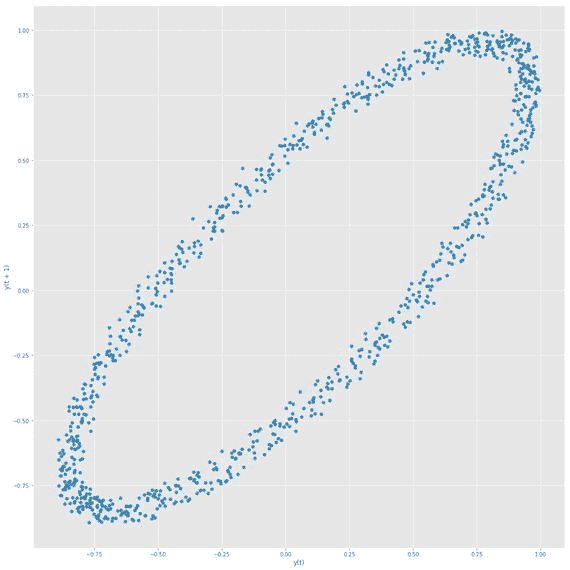
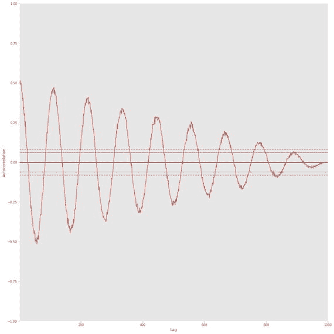
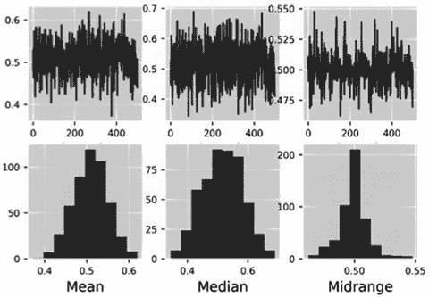

# -*- coding: utf-8 -*-
################################################################
import sys
import os
import pandas as pd
from matplotlib import style
from matplotlib import pyplot as plt
import numpy as np
################################################################
if sys.platform == 'linux' or sys.platform == ' darwin':
    Base=os.path.expanduser('~') + '/VKHCG'
else:
    Base='C:/VKHCG'
print('################################')
print('Working Base :',Base, ' using ', sys.platform)
print('################################')
################################################################
style.use('ggplot')
from pandas.plotting import lag_plot
plt.figure(figsize=(10, 10))
data = pd.Series(0.1 * np.random.rand(1000) + \
0.9 * np.sin(np.linspace(-99 * np.pi, 99 * np.pi, num=1000)))
lag_plot(data)
sPicNameOut1=Base+'/01-Vermeulen/06-Report/01-EDS/02-Python/lag_plot.png'
plt.savefig(sPicNameOut1,dpi=600)
plt.tight_layout()
plt.show()
```

图 11-17 展示了结果。



图 11-17

滞后图

### 自相关图

自相关图是样本自相关与时间滞后关系的设计图。

```python
from pandas.plotting import autocorrelation_plot
plt.figure(figsize=(10, 10))
data = pd.Series(0.7 * np.random.rand(1000) + \
0.3 * np.sin(np.linspace(-9 * np.pi, 9 * np.pi, num=1000)))
autocorrelation_plot(data)
sPicNameOut2=Base+'/01-Vermeulen/06-Report/01-EDS/02-Python/autocorrelation_plot.png'
plt.savefig(sPicNameOut2,dpi=600)
plt.tight_layout()
plt.show()
```

图 11-18 展示了结果。



图 11-18

自相关图

### 自助法图

为了从一组数据中生成给定统计量的自助法不确定性估计，会从数据中生成一个大小小于或等于数据集大小的子样本，并计算其统计量。这个子样本的生成是有放回的，因此任何数据点可以被多次采样，或者完全不被采样。这个过程会对许多子样本重复进行。

下面是一个从 1000 个总体点中抽取 50 个元素的 500 个样本的示例。

```python
from pandas.plotting import bootstrap_plot
data = pd.Series(np.random.rand(1000))
plt.figure(figsize=(10, 10))
bootstrap_plot(data, size=50, samples=500, color="grey")
sPicNameOut3=Base+'/01-Vermeulen/06-Report/01-EDS/02-Python/bootstrap_plot.png'
plt.savefig(sPicNameOut3,dpi=600)
plt.tight_layout()
plt.show()
```

图 11-19 展示了提议的自助法的结果。这使数据科学家能够展示用于数据自助法处理的样本的分布情况。



图 11-19

自助法图


### 等高线图

等高线图是一种图形化技术，通过在二维平面上绘制恒定的 `z` 切片（称为等高线）来展示三维曲面。对于 5G 和机器人技术等新科技的最新地理空间洞察，要求数据科学家在进行数据分析时，开始将客户周边的地形纳入考量。数据科学还表明，先前关于具有共同影响中心的同心圆的信念是错误的。最新发现显示，其结果类似于地球的等高线，如同影响力的模式。

以下是一个示例，向你展示如何将这些等高线地图可视化。打开你的 Python 编辑器并设置好以下环境：

```
################################################################
