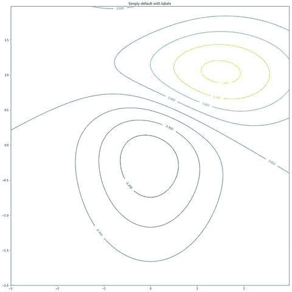
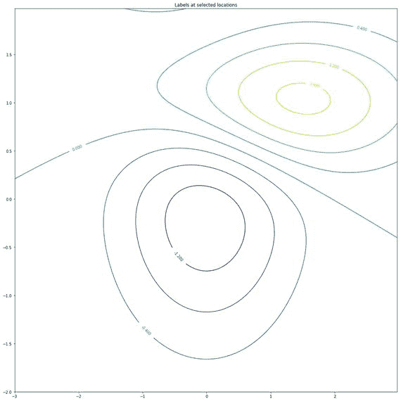
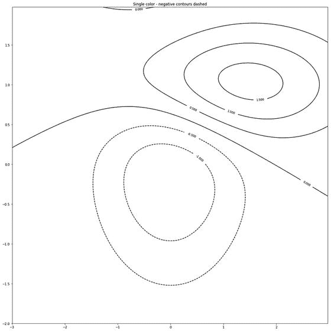
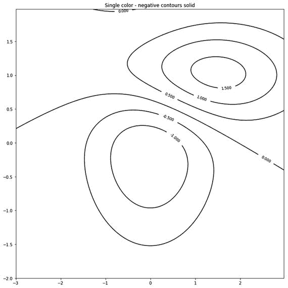
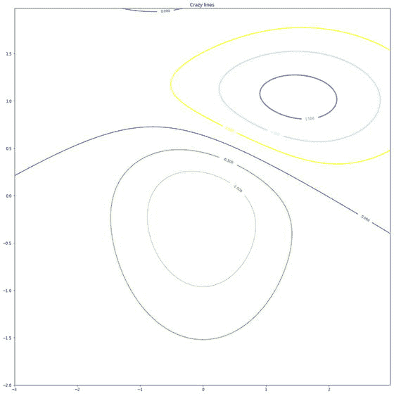
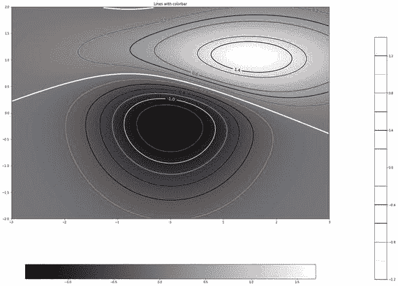

# 差分高斯

`Z = 10.0 * (Z2 - Z1)`

你现在可以创建一个带有标签的简单等高线图。

```python
plt.figure(figsize=(10, 10))

CS = plt.contour(X, Y, Z)

plt.clabel(CS, inline=1, fontsize=10)

plt.title('Simply default with labels')

sPicNameOut0 = Base + '/01-Vermeulen/06-Report/01-EDS/02-Python/contour0.png'

plt.savefig(sPicNameOut0, dpi=600)

plt.tight_layout()

plt.show()
```

以下是输出结果（图 11-20）。获得了清晰的等高线。



图 11-20 等高线图

你能看到 `matplotlib` 如何帮助你创建复杂的可视化效果吗？这种等高线可用于地形等高线的常规映射。我也用它来展示特定事件或行动的影响区域，例如，希尔曼开设新仓库或克伦瓦尔纳新建广告牌。另一种用途是，当你可以将数据集与时序关联起来时，只需用一个循环生成相同代码，例如生成 12 张图像。然后，我只需执行一个命令来生成 MP4 格式的视频。

看看 `ffmpeg -f image2 -r 1/5 -i yourimage%03d.png -vcodec mpeg4 -y yourmovie.mp4`。它只需将三位数填充的图像（`yourimage001.png`）转换为 MPEG4 QuickTime 影片。

`提示`

人们可以快速观看一段小视频，以直观了解你所展示结果的效果或背景。

现在我们可以看看如何改变等高线的格式。我发现强制为标签设置手动定位是一个有用的功能，因为在为你的系列影片制作图像时，它能更好地控制演示格式。

```python
plt.figure(figsize=(10, 10))

CS = plt.contour(X, Y, Z)

manual_locations = [(-1, -1.4), (-0.62, -0.7), (-2, 0.5),
                    (1.7, 1.2), (2.0, 1.4), (2.4, 1.7)]

plt.clabel(CS, inline=1, fontsize=10, manual=manual_locations)

plt.title('Labels at selected locations')

sPicNameOut1 = Base + '/01-Vermeulen/06-Report/01-EDS/02-Python/contour1.png'

plt.savefig(sPicNameOut1, dpi=600)

plt.tight_layout()

plt.show()
```

在图 11-21 中，你能看到等高线标签现在是如何被固定到特定位置的吗？



图 11-21 带有固定等高线标签的图表

`提示`

只移动或更改你想要传达的项。人的眼睛会捕捉到最细微的变化，这可能会分散他们的兴趣。

你也可以改变线型，以传达流程中的新方面。

```python
plt.figure(figsize=(10, 10))

CS = plt.contour(X, Y, Z, 6,
                 colors='k',  # negative contours will be dashed by default
                 )

plt.clabel(CS, fontsize=9, inline=1)

plt.title('Single color - negative contours dashed')

sPicNameOut2 = Base + '/01-Vermeulen/06-Report/01-EDS/02-Python/contour2.png'

plt.savefig(sPicNameOut2, dpi=600)

plt.tight_layout()

plt.show()
```

结果如图 11-22 所示。



图 11-22 具有对比等高线的图表

如你所见，你可以调整图标的许多方面。

```python
plt.figure(figsize=(10, 10))

matplotlib.rcParams['contour.negative_linestyle'] = 'solid'

plt.figure(figsize=(10, 10))

CS = plt.contour(X, Y, Z, 6,
                 colors='k',
                 )

plt.clabel(CS, fontsize=9, inline=1)

plt.title('Single color - negative contours solid')

sPicNameOut3 = Base + '/01-Vermeulen/06-Report/01-EDS/02-Python/contour3.png'

plt.savefig(sPicNameOut3, dpi=600)

plt.tight_layout()

plt.show()
```

更多结果显示在图 11-23 中。



图 11-23 具有实线等高线的图表

那么，让我们构建一个等高线图来展示你能达到的效果。

```python
plt.figure(figsize=(10, 10))

CS = plt.contour(X, Y, Z, 6,
                 linewidths=np.arange(.5, 4, .5),
                 colors=('r', 'green', 'blue',
                         (1, 1, 0), '#afeeee', '0.5')
                 )

plt.clabel(CS, fontsize=9, inline=1)

plt.title('Crazy lines')

sPicNameOut4 = Base + '/01-Vermeulen/06-Report/01-EDS/02-Python/contour4.png'

plt.savefig(sPicNameOut4, dpi=600)

plt.tight_layout()

plt.show()
```

你觉得怎么样？在图 11-24 中，你能看到确保改变线条颜色或线型的好处吗？我发现它是一个很好的沟通工具。

`提示`

将不重要的信息变灰，但切勿删除，因为这能为观众提供一个比较点，让他们了解你认为什么重要或什么不重要，同时又不丢失数据集。



图 11-24 具有突出显示等高线的图表

你可以制作一些令人惊叹的图表。

```python
plt.figure(figsize=(12, 10))

im = plt.imshow(Z, interpolation="bilinear", origin="lower",
                cmap=cm.gray, extent=(-3, 3, -2, 2))

levels = np.arange(-1.2, 1.6, 0.2)

CS = plt.contour(Z, levels,
                 origin='lower',
                 linewidths=2,
                 extent=(-3, 3, -2, 2))
```

现在让我们加粗零值等高线。

```python
zc = CS.collections[6]

plt.setp(zc, linewidth=4)

plt.clabel(CS, levels[1::2],  # label every second level
           inline=1,
           fmt='%1.1f',
           fontsize=14)
```

现在为等高线添加一个颜色条。

```python
CB = plt.colorbar(CS, shrink=0.8, extend="both")

plt.title('Lines with colorbar')

#plt.hot()  # Now change the colormap for the contour lines and colorbar

plt.flag()
```

你仍然可以为图像也添加一个颜色条。

```python
CBI = plt.colorbar(im, orientation="horizontal", shrink=0.8)
```

这会让原有的颜色条看起来有点不协调，所以让我们恢复它的位置。

```python
l, b, w, h = plt.gca().get_position().bounds
```

```
ll, bb, ww, hh = `CB.ax.get_position().bounds`

`CB.ax.set_position([ll, b + 0.1*h, ww, h*0.8])`

`sPicNameOut5=Base+'/01-Vermeulen/06-Report/01-EDS/02-Python/contour5.png'`

`plt.savefig(sPicNameOut5,dpi=600)`

`plt.tight_layout()`

`plt.show()`

哇，你已经创建了一个超级等高线图（图 11-25）。



图 11-25

多维复杂等高线图

## 我有一个疑问：创建这个超精细轮廓图的额外工作，是否为图表传递的信息增添了更多价值？除非我想证明自己具备生成复杂可视化的能力，否则我不会制作这种复杂程度的图表。

> **警告**  
> 请始终确保你的信息被有效传递！

不过，我本质上也是一名科学家，所以当你有空闲时间时，可以尝试不同的修改、更换其他颜色，并探索每个参数的控制效果。简而言之，享受这个过程。

## 3D 图表

让我们将图表升级到 3D。许多数据集涉及两个以上的影响因素，而 3D 图表有助于传达这些信息。

打开你的 Python 编辑器，构建以下代码环境：

```python
################################################################
```