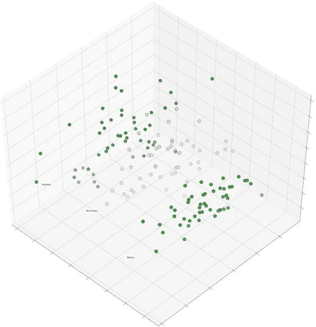

# 图表与可视化

## 三维图表示例

```python
# -*- coding: utf-8 -*-

import sys
import os
import numpy as np
import matplotlib.pyplot as plt
from mpl_toolkits.mplot3d import Axes3D
from sklearn import decomposition
from sklearn import datasets

if sys.platform == 'linux' or sys.platform == 'darwin':
    Base = os.path.expanduser('~') + '/VKHCG'
else:
    Base = 'C:/VKHCG'

print('################################')
print('Working Base :', Base, ' using ', sys.platform)
print('################################')
```

现在生成一个数据集。

```python
np.random.seed(5)
centers = [[1, 1], [-1, -1], [1, -1]]
iris = datasets.load_iris()
X = iris.data
y = iris.target
```

现在开始 3D 绘图。

```python
fig = plt.figure(1, figsize=(16, 12))
plt.clf()
ax = Axes3D(fig, rect=[0, 0, .95, 1], elev=48, azim=134)
plt.cla()
pca = decomposition.PCA(n_components=3)
pca.fit(X)
X = pca.transform(X)

for name, label in [('Setosa', 0), ('Versicolour', 1), ('Virginica', 2)]:
    ax.text3D(X[y == label, 0].mean(),
              X[y == label, 1].mean() + 1.5,
              X[y == label, 2].mean(), name,
              horizontalalignment='center',
              bbox=dict(alpha=.5, edgecolor="w", facecolor="w"))
```

我建议你重新排列标签，使颜色与聚类结果匹配。

```python
y = np.choose(y, [1, 2, 0]).astype(np.float)
ax.scatter(X[:, 0], X[:, 1], X[:, 2], c=y, cmap=plt.cm.spectral,
           edgecolor='k', marker='p', s=300)
ax.w_xaxis.set_ticklabels([])
ax.w_yaxis.set_ticklabels([])
ax.w_zaxis.set_ticklabels([])

sPicNameOut0 = Base + '/01-Vermeulen/06-Report/01-EDS/02-Python/3DPlot.png'
plt.savefig(sPicNameOut0, dpi=600)
plt.show()
```

做得好。现在你可以创建 3D 图表了。结果参见图 11-26。



**图 11-26** — 三维图表

## 总结

你已经成功完成了本章图表部分的学习。

让我们总结一下你学到的内容：

- 你现在可以创建各种 2D 和 3D 图表类型。
- 你可以通过使用我在本书前面讨论的技术，将图表转换为电影。你也可以直接在常用的演示软件中添加一系列图片。
- 你可以通过更改颜色、线型或其他参数来增强图表的特定部分。

> **提示**
> 我仅仅为你开启了使用图表进行可视化世界的大门。请进一步研究，并参考他人的作品。

我有一位图形专家为我工作。我通常会将所有最终图表交给她修改，因为她是一位擅长制作高质量演示文稿的艺术家。请利用所有可用的技能，确保你的沟通完美无缺。

下一节是可视化的一部分，它将向你展示如何在数据科学中使用预先准备好的可视化内容。

## 图片

图片是数据科学中一个有趣的专业方向。电影和图片的处理本身就是一个科学领域。我将向你介绍这个领域，但必须承认这只是对数据科学这一子领域的浅尝。

### 图像的通道

任何图片都有一个有趣的事实：每张图片都是一个复杂的数据集。图片是由许多层或通道构成的，这些层或通道帮助可视化工具渲染所需的图像。

打开你的 Python 编辑器，让我们一起探究图像的内在结构。

```python
import sys
import os
import matplotlib.pyplot as plt
import matplotlib.image as mpimg

if sys.platform == 'linux' or sys.platform == 'darwin':
    Base = os.path.expanduser('~') + '/VKHCG'
else:
    Base = 'C:/VKHCG'

print('################################')
print('Working Base :', Base, ' using ', sys.platform)
print('################################')
```

这是一张典型的便携式网络图形（PNG）格式图像：

```python
sPicName = Base + '/01-Vermeulen/00-RawData/AudiR8.png'
```

你可以将其加载到一个数值矩阵中。

```python
t = 0
img = mpimg.imread(sPicName)
print('Size:', img.shape)

plt.figure(figsize=(10, 10))
t += 1
sTitle = '(' + str(t) + ') 原始图像'
plt.title(sTitle)
plt.imshow(img)
plt.show()

for c in range(img.shape[2]):
    t += 1
    plt.figure(figsize=(10, 10))
    sTitle = '(' + str(t) + ') 通道: ' + str(c)
    plt.title(sTitle)
    lum_img = img[:, :, c]
    plt.imshow(lum_img)
    plt.show()
```

你可以清楚地看到图像尺寸为：`1073`，`1950`，`4`。这意味着每个通道包含 `1073 × 1950` 个像素，即每层有 `2,092,350` 个像素。由于有四层，总共用 `8,369,400` 个值来描述图像大小。你可以通过执行 `img.size` 来获取这个尺寸。

接下来，让我们探索如何对图像进行变换。

### 边缘检测

大多数数据科学项目所需的常见技术之一，就是确定物品图像的边缘。这在机器人物体选择和面部识别等领域非常有用，这里仅举两个特例。

我将向你展示如何确定你之前看到的那张图像的边缘。打开你的 Python 编辑器，并创建以下环境：

```python
################################################################
```