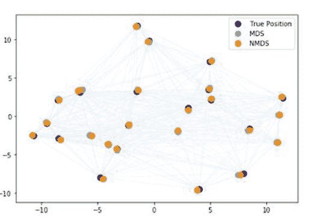

#            线段 n = (x0, y0), (x1, y1), ... (xm, ym)
segments = [[X_true[i, :], X_true[j, :]]
for i in range(len(pos)) for j in range(len(pos))]
values = np.abs(similarities)
lc = LineCollection(segments,
zorder=0, cmap=plt.cm.Blues,
norm=plt.Normalize(0, values.max()))
lc.set_array(similarities.flatten())
lc.set_linewidths(0.5 * np.ones(len(segments)))
ax.add_collection(lc)
plt.show()
```

你应该会看到与图 11-29 所示相同的结果。



**图 11-29** 通过数值偏移改进的可视化效果

成功，你已经改进了可视化效果。

## 总结

恭喜！你已经完成了我个人数据科学项目中使用的整个流程。现在，你应该能够通过完整的“检索 ➤ 评估 ➤ 处理 ➤ 转化 ➤ 组织 ➤ 报告”步骤，为数据湖中的任何数据构建管线，从而将数据湖转化为业务资产的技术栈。

## 结语

你已经成功读完了这本书。为你的所有努力和成就喝彩。

感谢你跟随我走完了从数据湖到业务洞察的整个管线。希望你的实用数据科学能为你未来带来一切你所期望的成果。

你能取得的最大成就是……

> 一路乐在其中！


# 索引 A

### 绝对位置

### 加法器工具

### Akka

### 海拔

### Amazon Redshift

### Amazon Simple Storage Service (Amazon S3)

* `Boto` 包
* Python 的 `s3` 模块

### Amazon Web Services

### 方差分析 (ANOVA)

### 分析模型

* 列
* 数据字段名称验证
* 数据模式
* 数据列的数据类型
* 列的直方图
* 最大值
* 平均值
* 中位数
* 最小值
* 缺失/未知值
* 众数
* 四分位数
* 极差
* 样本数据集
* 偏度
* 标准差
* 唯一标识符，数据条目

### 安德鲁斯曲线

### 动物

* 纲
* 科
* 属
* 界
* 目
* 门
* 种

## ANOVA

参见方差分析 (ANOVA)

### Apache Cassandra

### Apache Hadoop

* `Luigi`
* `Pydoop`

### Apache Hive

### Apache Mesos

### Apache Spark

### Apriori 算法

### 面积图

### Assess_Best_Logistics

### 评估超步

* `Clark Ltd` 参见 Clark Ltd
* 数据分析
* 数据剖析
* 数据质量
* 错误数据
  * 错误接受
  * 修正默认值
  * 拒绝
* `Hillman Ltd` 参见 Hillman Ltd
* `Krennwallner AG` 参见 Krennwallner AG
* `pandas`，缺失值
* `Assess-Good-Bad-01.py`, `Assess-Good-Bad-02.py`, `Assess-Good-Bad-03.py`, `Assess-Good-Bad-05.py`
* 基本概念
* `Good-or-Bad-01.csv`, `Good-or-Bad-02.csv`, `Good-or-Bad-03.csv`, `Good-or-Bad-05.csv`
* `Vermeulen PLC` 参见 Vermeulen PLC

### 评估工具

参见特征工程

### 关联规则学习

* `Apriori` 算法
* 提升度
* 购物篮分析

### 审计

* 基本日志记录
* 内置日志记录
* 数据科学工具
  * 调试观察器
  * 错误观察器
  * 致命错误观察器
  * 信息观察器
  * 警告观察器
* 数据沿袭
* 数据起源
* 定义
* 流程追踪
* 统计

### 自相关图

## B

### Bagging 数据

### 平衡层

### 条形图

### 广告牌

* `Assess-DE-Billboard.py`
* `Assess-DE-Billboard-Visitor.csv`
* `DE_Billboard_Locations`，加载
* IP 地址
* 在线访客数据
* 组织超步
* 报告超步
* `sqlite3` 和 `pandas` 包

### 二元逻辑回归

### 分箱

### 双变量分析

### 身体质量指数 (BMI)

* 水平样式
* 孤岛样式
* 安全保险库样式
* 垂直样式

### Bootstrap 图

### 商业动态，数据湖

* `Clark Ltd`
  * `Euro_EchangeRates`，加载
  * `Profit_And_Loss`，加载
* `Hillman Ltd`
  * `GB_Postcode_Full`，加载
  * `GB_Postcode_Shops`，加载
  * `GB_Postcode_Warehouse`，加载
* `Krennwallner AG`
  * `DE_Billboard_Locations`，加载
  * Python 检索方案
  * R 检索方案
* `Vermeulen PLC`
  * `Country_Codes`，加载
  * `IP_DATA_ALL`，加载
  * `IP_DATA_CORE`，加载
  * `IP_DATA_C_VKHCG`，加载

### 业务层

* 歧义性
* 描述
* 功能需求
* 数据映射矩阵
* 通用 MoSCoW
* 选项
* 太阳模型 参见 太阳模型
* “业务意愿”
* 隐含集合
* 非功能需求
  * 可访问性
  * 审计与控制
  * 可用性
  * 备份
  * 容量
  * 并发性
  * 配置管理
  * 部署
  * 灾难恢复 (DR)
  * 磁盘存储
  * 文档
  * 有效性
  * 效率
  * 可扩展性
  * 故障管理
  * 容错性
  * 互操作性
  * 延迟
  * 可维护性
  * 内存存储
  * 可修改性
  * 网络拓扑
  * 隐私
  * 质量
  * 恢复/可恢复性
  * 可靠性
  * 韧性
  * 资源约束
  * 可重用性
  * 可伸缩性
  * 安全性
  * 存储 (GPU)
  * 可测试性
  * 吞吐能力
  * 同比年增长
* 可选择性
* 实用性
* 主要结构
* 需求
* 需求注册表
* 追溯矩阵
* 主观性
* 无界列表
* 引用不足
* 规定不足
* 模糊性
* 弱词

## C

### Cassandra

### 因果回路图 (CLD)

### 因果分析系统

### CentOS/RHEL

### 基于质心的聚类

### 首席财务官 (CFO)

### 卡方检验

### Clark Ltd

* `Euro_EchangeRates`，加载
* 财务基础数据
* 财务日历
* 财务状况
* 外汇
* 外汇基础数据
* 组织超步
* 人员
* 人员基础数据
* `Profit_And_Loss`，加载
* Python 检索方案
* 报告超步

### 清理工具

### 云端张量处理单元 (TPU)

### 聚类

* 基于质心
* 连通性
* 定义
* 密度
* 分布
* 基于网格
* 层次化 参见 层次聚类
* 划分式
* 变量

### 计算机视觉 (CV)

### 配置管理 (CM)

### 消费者

### 等高线图

* 构造
* 等高线标签
* 对比
* 定义
* 生态系统
* 高亮
* 多维
* 复杂立体

### 控制层

### 协调世界时 (UTC)

### 跨行业数据挖掘标准流程 (CRISP-DM)

* 业务理解
* 数据准备
* 数据理解
* 部署
* 描述
* 评估
* 流程图
* 建模

### 交叉验证测试

### 客户数据集

## CV

参见计算机视觉 (CV)

## D

### 数据分析

* 准确性
* 完整性
* 一致性
* 及时性
* 唯一性
* 有效性

### 数据湖

* 可操作业务知识
* 业务客户
* 商业动态 参见 商业动态，数据湖
* 特征化
* 定义

### 数据沿袭

### 数据映射矩阵

### 数据集市

### 数据挖掘

* 关联模式
* 贝叶斯分类
* 聚类模式 参见 聚类
* 数据分类
* 定义
* 预测
* 序列/路径分析

### 数据处理工具

* 数据科学 参见 数据科学工具
* 数据仓库
* 描述
* 特征工程
* 组织
* 报告
* 检索
* 工具 参见 递归统一模式的同构本体论 (HORUS)
* 转换

### 数据起源

### 数据科学

* 基本步骤
  * CLD
  * 相关分析
  * 客户与领域专家
  * 数据追溯矩阵
  * 特征提取 参见 特征提取技术
  * 鱼骨图
  * 预测
  * 猜测，潜在模式
  * 缺失值处理
  * 特征工程
  * 不一致性，数据湖
  * 方法
  * 异常值检测 参见 异常值检测技术 | 原因
  * 蒙特卡洛模拟
  * 观察与假设
  * 帕累托图
  * 真实世界证据
  * 从假设性问题开始
  * 5 个为什么

### 数据科学框架

* 定义
* 顶层

### 数据处理工具

* `Akka`
* `Cassandra`
* `elastic search`
* `Kafka`
* `Mesos`
* `MQTT`
* `Python`
* `R`
* `Scala`
* `Spark` 参见 Spark

### 数据科学技术栈

* 数据湖
* 数据仓库
* 数据仓库总线矩阵
* 描述
* 枢纽
* 链接
* 处理工具 参见 数据处理工具
* 快速信息工厂生态系统
* 卫星
* 存储工具
  * 读时模式生态系统
  * 写时模式生态系统

### 数据科学工具

* 数据平均
* 分箱/存储桶
* 异常值检测

### 数据源

* Amazon Redshift
* Amazon S3 存储
* Amazon Web Services
* Apache Cassandra
* Apache Hadoop
  * `Luigi`
  * `Pydoop`
* Apache Hive
* Apache Spark
* 数据库
* 日期和时间
* Microsoft Excel
* Microsoft SQL server
* MySQL
* Oracle
* PostgreSQL
* SQLite

### 数据沼泽

* 审计与版本管理
* 具体的业务问题
* 数据治理
  * 分析模型使用
  * 业务术语表
  * 数据源目录
  * 数据质量训练师模型角色

### `Data.Table` 包

### 数据仓库

* 基本配置
* 定义
* 枢纽
* 链接
* 建模
* 卫星

### 数据仓库

### 数据仓库总线矩阵

### 日

### 年日

### 调试观察器

### 决策模型与表示法 (DMN)

### 决策树

### 配送路线计划

### 基于密度的聚类

### 3D 图

### 迪杰斯特拉算法

### 有向无环图 (DAG)

* 定义
* 作业调度 参见 作业调度，DAG
* 非单一路径
* Spark, Pig, 和 Tez

### 灾难恢复 (DR)

### 文档

### 双饼图

### 荷兰文化，命名

## E

### 边缘图像

### Elastic search

### 企业总线矩阵

### 错误观察器

### 事件，流程超步

* 数据实体
  * 显式
  * 隐式

### 汇率数据集

## F

### 故障管理

### 致命错误观察器

### 容错性

### 特征工程

* 加法器工具
* 修正器工具
* 处理工具

### 特征提取技术

* 平均
* 分箱
* LDA

### 财务日历

### 鱼骨图

### 修正器工具

### 预测

### 外汇交易规划器

### 秒的小数部分

### 弗雷塔格金字塔

### 功能层

* 数据模型
* 数据模式与数据格式
* 基础设施提供
* 处理算法
  * 评估
  * 组织
  * 处理
  * 报告
  * 检索
  * 转换
* 处理数据湖
  * 评估
  * 组织
  * 处理
  * 报告
  * 检索
  * 转换

## G

### 属

### 通用数据保护条例 (GDPR)

### 地理空间

### `Ggplot2` 包

### 黄金标准记录

### 梯度下降

### 图形

* 安德鲁斯曲线
* 自相关图
* bootstrap
* 等高线 参见 等高线图
* 3D
* KDE
* 滞后图
* 平行坐标图
* 选项
  * 面积图
  * 条形图
  * 双饼图
  * 生态系统
  * 六边形分箱图
  * 水平条形图
  * 折线图
  * 饼图
  * 散点图
* RADVIZ 方法
* 散点图矩阵

### 图形处理单元 (GPU)

### 图论

* DAG 参见 有向无环图 (DAG)
* 描述
* 边
* 节点

### GraphX

### 公历

### 基于网格的聚类

## H

### 1996 年健康保险便携与责任法案 (HIPAA)

### 六边形分箱图

### 层次聚类

* 凝聚式
* 定义
* 分裂式

### Hillman Ltd

* 配送路线
  * `Assess_Shipping_Routes.gml`
  * `Assess-Shipping-Routes.py`
  * 创建图论
  * 总部节点到图
  * 使用文森特距离的总部路线
  * 总部到仓库的路线
  * 商店间路线
  * 仓库间路线
  * `nx.shortest_path(G,x,y)`
  * 商店节点
  * 仓库节点
  * 仓库到商店路线
  * 仓库到仓库路线
* `GB_Postcode_Full`，加载
* `GB_Postcode_Shops`，加载
* `GB_Postcode_Warehouse`，加载
* 全球邮政编码
* Incoterm 2010
  * 运费和保险费 (CIP)
  * 运费付至 (CPT)
  * 目的地交货 (DAP)
  * 终端交货 (DAT)
  * 完税后交货 (DDP)
  * 工厂交货 (EXW)
  * 货交承运人 (FCA)
* 组织超步
* 报告超步
* 运输链
  * 咨询专家
  * 可能的运输路线
  * 运输容器 参见 运输容器
  * 运输信息
  * 运输路线 参见 运输路线，最佳国际物流
  * 仓库 参见 仓库

### 递归统一模式的同构本体论 (HORUS)

* 音频
* 数据库
* 数据格式
* 数据湖
* 数据流
* JSON
* 图片
* 文本分隔
* 视频帧到 horus
* 电影到帧
* XML

### 水平样式切片

## HORUS

参见递归统一模式的同构本体论 (HORUS)

### 霍夫变换

### 小时

### 轮毂-辐条

## `Data.Hub` 转换

### 枢纽

### 假设检验

* 卡方检验
* 定义
* t 检验

## I

### 图像，通道

### Incoterm 2010

* 运费和保险费 (CIP)
* 运费付至 (CPT)
* 目的地交货 (DAP)
* 终端交货 (DAT)
* 完税后交货 (DDP)
* 工厂交货 (EXW)
* 货交承运人 (FCA)

### 信息观察器

### 互操作性

### IP 地址数据集

### 孤岛样式

### ISO 8601-2004 标准

### ISO 8601 (欧洲)

### ISO 8601 (美国)

## J

### 作业调度，DAG

* `Assess-DAG-Company-Country-Place.png`
* `Assess-DAG-Company-Country.png`
* `Assess-DAG-Company-GPS.png`
* `Assess-DAG-GPS.py`
* `Assess-DAG-Location.py`
* `Assess-DAG-Schedule.gml`
* `Assess-DAG-Schedule.py`
* 基本验证
* `G.add_node()`
* 特性
* `nodes_iter(G)`
* `Retrieve_IP_DATA.csv`
* SQLite 数据库 参见 SQLite 数据库
* 传输代理
* 有效路由网络

### JSONLite 包

### 儒略历

## K

### Kafka

* Kafka Connect
* Kafka Core
* Kafka Streams

### 核密度估计 (KDE) 图

### 基里巴斯共和国

### K-means 聚类

### Krennwallner AG

* 成就
* 广告牌 参见 广告牌
* 在线访客数据
* 组织超步
* 处理卸载，前十名客户
* 报告超步

## L

### 滞后图

### 延迟

### 潜在狄利克雷分配 (LDA)

### 纬度

### 分层框架

* CRISP-DM 参见 跨行业数据挖掘标准流程 (CRISP-DM)
* 数据科学定义
* 高级数据科学和工程 HORUS
* Linux
* 顶层
  * 审计
  * 平衡
  * 业务层
  * 卓越中心
  * 控制
  * 数据科学框架
  * 数据科学技能
  * 功能层
  * 运营管理层
  * 工具层
  * 警告
* Windows

## LDA

参见潜在狄利克雷分配 (LDA)

### 闰年

### 线性回归

* 定义
* 霍夫变换
* RANSAC
* 简单
* TensorFlow

### 折线图

### 链接

### Linux

### 局部异常因子 (LOF)

### 当地时间

### 位置簇

### 位置，流程超步

* 特征
* 绝对位置
* 人文
* 自然
* 相对位置
* GLONASS
* GPS
* 人地交互
* 纬度，经度和海拔

## LOF

参见局部异常因子 (LOF)

### 逻辑回归

* 定义
* MLR
* 有序 参见 有序逻辑回归
* 简单

### 物流数据集

* 汇率
* 邮政编码
* 损益表
* 商店
* 仓库

### 经度

### `Luigi`

## M

### 机器学习

* 定义
* 影响
* RL
* 监督
* 无监督

### 维护工具

* 备份与恢复
* 检查
* 数据完整性
* 描述
* 历史
* 清理
* 通知操作员
* 重建数据结构
* 重新组织索引
* 收缩/移动数据结构
* 方案
* 统计

### 购物篮分析

### `Matplotlib`

* CentOS/RHEL
* PIP
* Ubuntu

### 平均故障间隔时间 (MTBF)

### 平均恢复时间 (MTTR)

### Mesos

### 消息队列遥测传输 (MQTT)

### 元数据管理

### Microsoft Excel

### Microsoft SQL server

### 分钟

## MLR

参见多项逻辑回归 (MLR)

### 蒙特卡洛模拟

### 月

### MoSCoW

### MQ 遥测传输 (MQTT)

### 多项逻辑回归 (MLR)

### 多变量分析

### MySQL

## N

### 朴素贝叶斯 (NB)

### 自然语言处理 (NLP)

* 定义
* 需求
* 语音转文本转换
* 基于文本

### 网络路由图

* `Assess-Network-Routing-Company.csv`
* `Assess-Network-Routing-Company.py`
* `Assess-Network-Routing-Customer.csv`
* `Assess-Network-Routing-Customer.py`
* `Assess-Network-Routing-Node.csv`
* `Assess-Network-Routing-Node.py`
* 公司数据
* 问题
* 图论 参见 图论
* 组织超步
* 报告超步

### 网络拓扑

### `Networkx`

### 神经网络

* 菊花链
* 定义
* 特征
* 梯度下降
* 层
* 正则化强度
* 简单

### `NumPy`

## O

### 对象，流程超步

* 动物
  * 纲
  * 界
  * 目
  * 门
  * 种
* 化合物
* 科
* 属
* 车辆

### 运营管理层

* 警报
* 沟通
* 描述
* 监控
* 参数
* 处理流定义与管理
* 调度

### Oracle

### 有序逻辑回归

* 业务问题
* 数据类型
* 定义

### 组织超步

* 关联规则学习
* 广告牌内容
* Clark Ltd
* 数据集市
* 配送路线计划
* 外汇交易规划器
* Hillman Ltd
* 水平样式
* 孤岛样式
* Krennwallner AG
* 网络路由图
* 安全保险库样式
* Vermeulen PLC
* 垂直样式

### 组织工具

### 异常值检测技术

* 椭圆包络
* 孤立森林
* LOF
* 新颖性检测

### 异常值

# P, Q

### `Pandas`

* Centos/RHEL
* PIP
* Ubuntu

### 平行坐标图

### 帕累托图

### 划分聚类

### 模式识别

### 人，流程超步

* 黄金标准记录
* 姓名
  * 荷兰文化
  * 母姓和父姓的继承
  * 顺序

### 门

### 图片

* 图像通道
* 定义
* 不同尺寸和质量
* 边缘图像
* 改进的可视化

### 饼图

### 绘图选项

* 面积图
* 条形图
* 双饼图
* 生态系统
* 六边形分箱图
* 水平条形图
* 折线图
* 饼图
* 散点图

### 便携式网络图形 (PNG)

### 邮政编码

### PostgreSQL

### 精确率-召回率曲线

* F1 度量
* ROC 分析曲线
* 敏感性与特异性

### 主成分分析 (PCA)

* 联合分析
* 因子分析

### 处理生态系统

* `Akka`
* `Apache Cassandra`
* `Apache Mesos`
* `Apache Spark`
* `Kafka`
* `MQTT`
* `Python` 参见 Python
* `R` 参见 R
* `Scala`
* `Vermeulen`

### 处理工具

* 描述
* 监控
* 调度
  * 积压
  * 进行中
  * 已完成
  * 待办

### 流程超步

* 数据类别
* 数据科学 参见 数据科学
* 数据仓库
* 事件
* 位置
* 对象
* 人
* 时间

### 生产者

### 损益表数据集

### `Pydoop`

### Python

* CentOS/RHEL
* 定义
* Ubuntu
* Windows
* `Python3`
* `Matplotlib`
* `NumPy`
* `Pandas`
* `PyPI`
* `Scikit-Learn`
* `SymPy`

### Python 包索引 (PyPI)

### R

### R

* 能力
  * `dplyr`
  * `forecast`
  * `gbm`
  * `ggplot2`
  * 安装
    * CentOS/RHEL
    * Ubuntu
    * Windows
  * `lubridate`
  * 包
    * `Data.Table`
    * `Ggplot2`
    * `JSONLite`
    * `ReadR`
    * `Spark`
    * `randomForest`
    * `reshape2`
    * `RODBC`, `RSQLite`, 和 `RCassandra`
    * `RStudio`
    * `sqldf`
    * `stringr`

### RADVIZ 方法

### 随机森林

### 随机采样一致性 (RANSAC) 线性回归

### 快速信息工厂生态系统

### `ReadR` 包

### 接收者操作特征 (ROC) 分析曲线

### 参考卫星

### 强化学习 (RL)

### 相对位置

### 报告超步

* 合适的可视化
* 广告牌内容
* Clark Ltd
* 容器
* 数据科学
* 数据科学公司规模
* 消除杂乱
* 财务状况
* 弗雷塔格金字塔
* 图形能力
* Hillman Ltd
* Krennwallner AG
* 网络路由图
* 理解上下文
* Vermeulen PLC

### 报告工具

### 韧性

### 资源约束

### 检索超步

* Clark Ltd
* Hillman Ltd
* Krennwallner AG
* Vermeulen PLC

### 可重用性

### 上升动作

## RL

参见强化学习 (RL)

### ROC 分析曲线

参见接收者操作特征 (ROC) 分析曲线

### 基于角色的访问控制 (RBAC)

### `RStudio`

* CentOS/RHEL
* Ubuntu
* Windows

## S

### 卫星

* 定义
* 参考
* 工具

### `Scala`

### 可伸缩性

### 散点图

### 散点图矩阵

### `Scikit-Learn`

### 秒

### 安全保险库样式

### 安全性

* 访问
* 物理
* 隐私

### 运输容器

* 采用
* 空运体积重量 (计费重量)
* `Assess-Shipping-Containers.py`
* 将箱子放入托盘
* 将产品放入箱子
* 长度值
* 装载托盘 1000
* 包装箱
* 包装材料厚度
* 托盘装容器选项
* 产品装箱和箱子摆盘选项
* 产品
* 陆运体积重量 (计费重量)
* 托盘尺寸
* 箱子强度等级

### 运输信息

* 买方
* 承运人
* 指定地点
* 港口
* 卖方
* 船舶
* 运输条款
* 码头

### 运输路线，最佳国际物流

* `Assess-Best-Fit-Logistics.py`
* `Assess_RoutePointsCountry`
* `Assess_RoutePointsPlaceName`
* `Assess_RoutePointsPostCode`
* 平均纬度和经度
* 国家到国家路线
* 国家到邮政编码路线
* 库
* 加载数据
* 地图
* 新地点
* 国家数据库维护隐藏特性
* 地名
* 邮政编码
* 图中存储的位置之间的最短路径
* 参数
* 邮政编码到地名的路线
* 文森特公式

### 商店数据集

### 简单线性回归

### 简单逻辑回归

### 简单网络时间协议 (SNTP)

### 偏度

### 缓慢变化维度 (SCDs)

* SCD 类型 1，仅更新
* SCD 类型 2 Jacob Roggeveen 博士，位置
  * 生效日期
  * 标记
  * 版本控制
* SCD 类型 3，转换
* SCD 类型 4，快速增长

### 空间变换可视化 (STV)

### Spark

* 描述
* GraphX
* IBM
* MLlib
* 机器学习库
* SAP, Tableau, 和 Talend
* Spark Core
* Spark MLlib
* Spark SQL
* Spark Streaming

### SQLite 数据库

* `add_edge()`
* 链接
* `Assess-DAG-Schedule-All.gml`
* `Assess_IP_Country`
* `Assess_IP_GPS`
* `Assess_IP_PlaceName`
* `Assess_IP_PostCode`
* `CompanyData`
* `df.tosql()` 命令
* `G=nx.Graph()`
* 节点
* `pandas` 数据结构
* 移除节点和边
* `Retrieve-IP_2_SQLite_2_DAG.py`
* SQL `DISTINCT` 命令

### 标准差

### 领域专家

### 太阳模型

* 基础知识
* 描述
* 开发
* Jacob Roggeveen 博士
  * 记录事实
* 模型内整合矩阵
  * 维度和事实
* 事件，日期和时间
* 对象，人，日期和时间
* 人，日期，时间和位置
* `PersonBornAtTime` 事实
* 人对事件
* 人对位置
* 人对对象
* 人对时间
* SCDs 参见 缓慢变化维度 (SCDs)
* 转换步骤模板
* 典型版本 2.0

### 监督学习

### 支持向量聚类 (SVC)

### 支持向量网格 (SVG)

### 支持向量机 (SVM)

### 支持向量网络 (SVN)

### `SymPy`

## T

### TensorFlow

* 基础
* 购物篮分析
* 商品交易
* 定义
* 开发
* 容器上的数字
* 外汇交易
* 线性回归
* 单臂老虎机

### 可测试性

* 可控性
* 定义
* 隔离能力
* 可理解性

### 撒迪厄斯·文森特公式

### 时间-人-对象-位置-事件 (T-P-O-L-E) 设计

* 事件枢纽
* 链接
* 位置枢纽
* 对象枢纽
* 人员枢纽
* 卫星
* 时间枢纽
* 位置事件枢纽
* 枢纽链接
* 对象枢纽
* 人员枢纽
* 卫星
* 时间枢纽
* 对象事件枢纽
* 枢纽链接
* 位置枢纽
* 人员枢纽
* 卫星
* 时间枢纽
* 人员事件枢纽
* 枢纽链接
* 位置枢纽
* 对象枢纽
* 卫星
* 时间枢纽
* 时间事件枢纽
* 枢纽链接
* 位置枢纽
* 对象枢纽
* 人员枢纽
* 卫星

### 时间，流程超步

* 组合日期和日
* 定义
* 秒的小数部分
* 小时
* 基里巴斯共和国
* 当地时间
* 分钟
* 月
* 秒
* 特殊日期格式
  * 星期几
  * 年日
  * 周日期
  * 开始和结束日期
* UTC
* 年
* 时区

## T-P-O-L-E

参见时间-人-对象-位置-事件 (T-P-O-L-E)

### 追溯矩阵

### 转换超步

* ANOVA
* Bagging 数据
* 双变量分析
* 聚类 参见 聚类
* 交叉验证测试
* CV
* 数据分类
* 数据挖掘 参见 数据挖掘
* 数据科学 参见 数据科学
* 数据仓库
* 决策树
* 维度整合
  * 数据仓库
  * 数据仓库
* 人员 Python 生态系统设置公司
* 时间 T-P-O-L-E 高级设计
* `Transform-Gunnarsson_is_Born.py`
* 工作目录
* 假设检验 参见 假设检验
* 线性回归
* 逻辑回归
* 机器学习 参见 机器学习
* 多变量分析
* 神经网络
* NLP
* 过拟合与欠拟合
  * 数据拟合问题
  * 定义
  * 多项式特征
* 模式识别
* PCA 参见 主成分分析 (PCA)
* 精确率-召回率
* 随机森林
* 源代码
* 太阳模型 参见 太阳模型
* TensorFlow 参见 TensorFlow
* 单变量分析
* 转换工具
  * 维度
  * 事实

### 树增强朴素贝叶斯 (TAN)

### T 检验

## U

### Ubuntu

### 单变量分析

### 无监督学习

### 工具

* 算法
* 基本设计
* 数据处理 参见 数据处理工具
* 描述
* GDPR
* HIPAA
* 维护
* 处理
* 三阶段流程
* 类型

## V

### 模糊性

### 车辆识别号码 (VIN)

### Vermeulen-Krennwallner-Hillman-Clark 集团 (VKHCG)

* Clark Ltd
  * 客户数据集
* Hillman Ltd
  * IP 地址数据集
* Krennwallner AG
  * Linux
  * 物流数据集 参见 物流数据集
  * 处理生态系统 参见 处理生态系统
  * 样本数据
* Vermeulen PLC
  * Windows

### Vermeulen PLC

* `Country_Codes`，加载
* 作业调度图
* 图论
* `IP_DATA_ALL`，加载
* `IP_DATA_CORE`，加载
* `IP_DATA_C_VKHCG`，加载
* 作业调度 参见 作业调度，DAG
* 网络路由 参见 网络路由图
* 组织超步
* 报告超步

### 文森特公式

## VKHCG

参见 Vermeulen-Krennwallner-Hillman-Clark 集团 (VKHCG)

# W, X

### 仓库

* 成就
* `Assess_GB_Warehouse_Address.csv`
* `Assess-Warehouse-Address.py`
* 数据集
* 全球 GPS 位置
* 位置
* 在线服务提供商
* 参数，地址定位服务

### 警告观察器

### 弱词

### 周日期

### Windows

# Y, Z

### 年

### Yoke 方案

* 消费者
* DAG 调度
* `Kafka Master-Yoke.py`
* 生产者
* `Run-Yoke.py`
* `Slave-Yoke.py`
