# 1. 企业数据湖简介

> “我们信仰上帝；其他人必须带来数据。”——W·爱德华兹·戴明，提出“计划-执行-学习-行动”法的统计学家

1861 年，一位 80 岁的法国土木工程师查尔斯·约瑟夫·米纳德试图用一张可视化图表来叙述拿破仑 1812 年惨败的俄国战役。图 1-1 描绘了人员流动，并展示了地理、时间、温度、军队数量、路线和方向等详细信息。

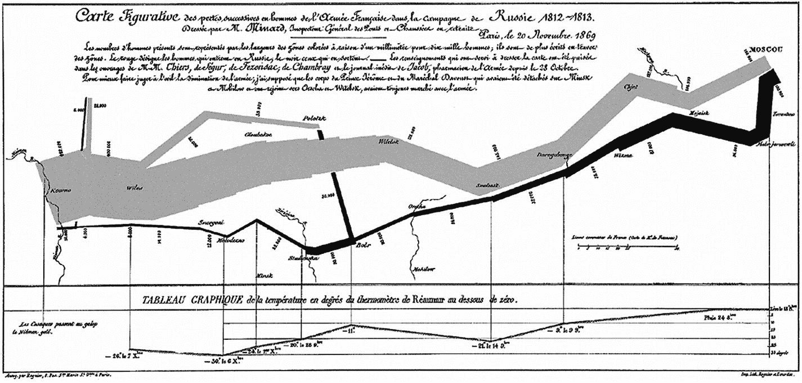

图 1-1 米纳德绘制的 1812 年拿破仑俄国战役地图 来源：“千言万语：一张好图可以讲述故事，令人哽咽，甚至改变政策。以下是历史上最杰出的三幅图。”《经济学人》，2007 年 12 月 19 日，[`https://www.economist.com/node/10278643`](https://www.economist.com/node/10278643)。

从上图可以看出，1812 年，由 422,000 名士兵组成的大军从波兰出发；其中只有 100,000 人到达莫斯科，仅有 10,000 人返回。法国社会将这场悲剧描述为“别列津纳河之劫”。这张图表清晰而精确地描绘了这段悲惨的故事。图表的优质归功于米纳德的数据分析，以及融入其中的多种因素，最终绘制出高质量的地图。它至今仍是统计可视化和数据叙事的典范之一。许多分析师花费大量时间分析米纳德的地图，并推测他在绘制这幅整个悲剧的画面之前，一定经历了痛苦的步骤。

数据分析在信息行业并非新鲜事物。多年来不断增长的是数据量，以及从数据中提炼“黄金”的期望和需求。如果说数据给行业带来的只是混乱，那无疑是轻描淡写。有时，数据会被过分炒作，尽管这种炒作有其合理性，人们将其类比为货币、石油以及这个星球上一切珍贵之物。

大约二十年前，数据还是信息行业中一个虚无缥缈的组成部分。所有数据过去都是原始存在、原始消费，其粗糙的格式从未被分析。那时，数据提取和存储的动态变化是备受尊崇的领域，始终给企业带来挑战。这一切源于业务驱动的理念，如数据的多样性、可用性、可扩展性和性能，当公司开始热爱数据时。他们意识到，在某个节点，他们需要走出关系型的世界，面对数据管理的真正挑战。这是 `Web 2.0` 公司经历的最大信息革命之一。

信息行业喜欢那些关注业务成果、学习术语上引人入胜且令人兴奋、并且尚未被充分挖掘的新趋势。大数据就抓住了这样的趋势，以至于组织似乎争先恐后地把自己置于困境之下，却未能成功制定出处理数据量或数据多样性的策略，而这些本可以产生有意义的影响。行业对于包含数据的实体有一个术语：数据仓库、数据集市、数据储备库或数据湖。这造成了很多混乱，但许多明智的组织已准备好押注数据分析。

## 数据爆炸：开端

数据爆炸是公司们过去常听到的，但从未质疑过自己处理数据的能力。数据仅仅被用来维护事件的记录系统。然而，多项研究探讨了数据在决策制定和业务发展中的潜力。“数据是新的货币”和“数据是数字经济的新石油”等说法成为头条新闻，促使许多公司将数据视为企业资产。

研究表明，数据中隐藏着巨大的价值，可以为决策制定和业务发展提供深刻见解。在“数字”生态系统中，几乎每一个行为都与数据相关，即它要么以结构化或非结构化格式消耗数据，要么生成数据。这些数据需要被及时分析，以提炼出能够帮助企业成长的信息金块。

那么，什么是大数据？它比想象中更大吗？嗯，定义大数据的最好方式是理解什么是传统数据。当你完全了解数据的大小、格式、生成速率以及目标价值时，数据集就显得传统且可以通过关系方法进行管理。但如果你对即将到来的数据一无所知呢？你不知道数据量、结构、速率和变化因素。它可能是结构化的或非结构化的，大小可能是千字节或吉字节，甚至更大。此外，你意识到这些数据所带来的价值。这种数据范式被定义为大数据 `IT`。区分传统数据集和大数据集的主要领域是`数据量（Volume）`、`数据速度（Velocity）`和`数据多样性（Variety）`。“大”是一个相对的度量，这三个“`V`”领域也是如此。数据量可能因行业和用例而异。除了这三个 `V` 之外，还有两个较新的补充：`数据价值（Value）`和`数据真实性（Veracity）`。大多数情况下，大数据所承载的价值无法用单位来衡量。其真正的潜力只能通过它赋能企业做出精准决策并转化为积极业务效益这一事实来权衡。衡量投资回报率的最佳方式是将大数据投资与其产生的业务影响进行比较。数据真实性指的是数据的准确性。在大数据项目生命周期的早期阶段，数据的质量和准确性在一定程度上很重要，但并不完全重要，因为重点在于稳定性和可扩展性，而非质量。随着生态系统和解决方案栈的成熟，越来越多的分析模型会消费大数据，商业智能（`BI`）应用报告洞察，从而对数据质量形成清晰的认识。基于这个衡量标准，可以针对数据质量采取行动。

让我们快速浏览一下 2017 年的大数据主要趋势（图 1-2）。

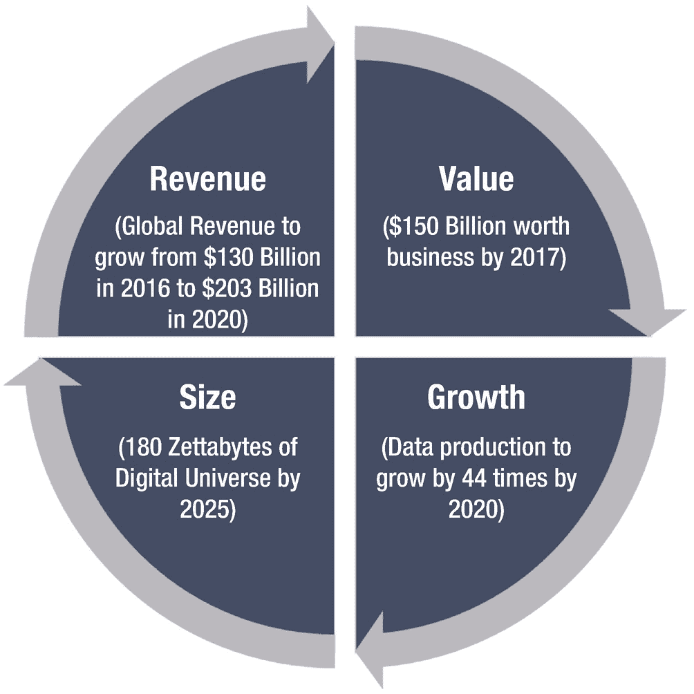

图 1-2 2017 年的大数据主要趋势。来源：数据来自“`IDC` 预测，全球大数据和商业分析市场在银行和制造业投资引领下，到 2020 年将实现两位数增长”，国际数据公司（`IDC`），2016 年 10 月，[`https://www.idc.com/getdoc.jsp?containerId=prUS41826116`](https://www.idc.com/getdoc.jsp?containerId=prUS41826116)。

关于 2017 年大数据的主要事实和预测如下：

1.  根据 `IDC`，全球大数据和商业分析（`BDA`）收入将从 2016 年的 1301 亿美元增长到 2020 年的超过 2030 亿美元。

2.  根据 `IDC`，数字宇宙预计将从 2020 年预估的 44 泽字节（`ZB`）增长到 2025 年的 180 泽字节，而 2015 年不到 10 泽字节。

3.  预计在 2020 年至 2025 年间，传统数据将增长 2.3 倍。在同一时间段内，可分析数据将增长 4.8 倍，可行动数据将增长 9.6 倍。

4.  数据敏锐度仍然是一个挑战。组织协调和管理思维被发现更以业务为中心而非以数据为中心。

5.  大数据、物联网、数据流、商业智能和云等技术将融合成一个更强大的数据管理包。基于云的分析将在加速大数据分析的采用方面发挥关键作用。

6.  深度学习，作为人工智能（`AI`）的策略之一，将成为现实。它将被广泛用于语义索引、图像和视频标记。

7.  非关系型分析数据存储将在 2015 年至 2020 年间增长 38.6%。

## 大数据生态系统

当数据集的性质超出传统（通常是关系型）数据处理方式的能力范围时，大数据 `IT` 战略便变得至关重要。从宏观层面来看，我们来探讨一下大数据带来的挑战。

1.  数据可以是结构化、半结构化的，或者根本非结构化。设计一种能够适应所有数据结构类型的通用策略是不可能的。

2.  来自不同来源的数据可能以不同的变化速率流动。这些数据可能有模式，也可能没有。

3.  如何共同处理从数 `TB` 到数 `PB` 不等、性质各异的数据集？

4.  公共基础设施必须具有成本效益和可靠性，并且应具备容错性和弹性。总拥有成本应可控，以实现高回报。

要使大数据 `IT` 战略取得成功，数据必须以预定的频率从独特且可靠的源系统流动。数据必须具有相关性和足够的成熟度，才能产生关键洞见并实现特定的业务成果。从成本角度来看，企业过去在支持存储、计算能力和并行化的基础设施上投入了巨资。

### Hadoop 与 MapReduce – 早期阶段

2004 年，为了对网络进行索引，`Google` 发布了关于面向大型分布式数据密集型应用的数据处理白皮书。其意图是直接解决两个问题陈述：存储和处理。

`Google` 引入了 `MapReduce` 作为数据处理框架，并引入 `Google File System`（`GFS`）作为可扩展的分布式文件系统。`MapReduce` 框架之所以具有高度可扩展性，关键在于并行化处理层直接下沉到分布在多台商用机器上的数据层。`Google File System` 专为容错而设计，可被多个客户端同时访问，并同时实现性能、可扩展性、可用性和可靠性。

`MapReduce` 被证明是数据密集型应用的游戏规则改变者。其概念很简单：将数据处理任务分解为一组可以在数千台商用机器上并行运行的映射器（`Mapper`）。归约器（`Reducer`）构成了第二层数据处理操作，运行在映射器生成的输出之上。

### Hadoop 的演进

2002 年，雅虎开发团队启动了一个名为 `Nutch` 的大型开源网络搜索项目。当 `Hadoop` 仍处于概念阶段时，`Nutch` 的主要挑战是其无法扩展到超过一定的页面限制。随后，`Google` 的 `GFS` 概念被引入到 `Nutch` 项目中。一个类似 `GFS` 的文件系统解决了与存储相关的问题，它允许大型文件驻留在一个具有容错性和可用性的系统中。到 2004 年，`GFS` 的一个开源实现以 `Nutch 分布式文件系统`（`NDFS`）的形式准备就绪。

2004 年，Google 推出了 `MapReduce` 处理框架，出于显而易见的原因，该框架立即被集成到 `Nutch` 项目中。到 2005 年初，`Nutch` 算法已经能够在企业级与 `NDFS` 和 `MapReduce` 协同工作。这种工具化正是 `NDFS` 和 `MapReduce` 的结合体，以至于在 2006 年，雅虎将此组合从 `Nutch` 项目中剥离出来。道格·卡廷（Doug Cutting）对一只可爱的黄色小象着迷，并为了方便记忆和发音，将这个组合命名为 `Hadoop`。2008 年，Apache 软件基金会接管了 `Hadoop`，使其超越网络搜索优化和索引的范畴。

从 2008 年开始的一系列事件中，`Hadoop` 技术栈展示了一些令人惊叹的数据，以证明其处理能力及在企业级的价值。2008 年 2 月，雅虎声称在一个拥有 10,000 个核心的 `Hadoop` 集群上生成了网络搜索索引。2008 年 4 月，`Apache Hadoop` 创造了世界纪录，成为在 910 个节点的集群上处理 1TB 数据最快的平台。`Hadoop` 仅用 209 秒就完成了 1TB 数据的排序，打破了此前 297 秒的基准记录。

`Hadoop 1.0` 于 2011 年底推出。`Hadoop` 的基本版本专注于提供存储和处理框架。`MapReduce` 处理与 `Hadoop 分布式文件系统`（`HDFS`）相结合的概念获得了广泛关注，并在业界迅速得到采用。尽管这种设置因其灵活性和易于实施而广受赞誉，但关于资源管理、可扩展性、安全性和可用性的担忧依然存在。这些缺点限制了 `HDFS` 在企业级的采用。`Hadoop 1` 的高级架构展示了 `HDFS` 存储层和 `MapReduce` 处理层的核心组件（图 1-3）。

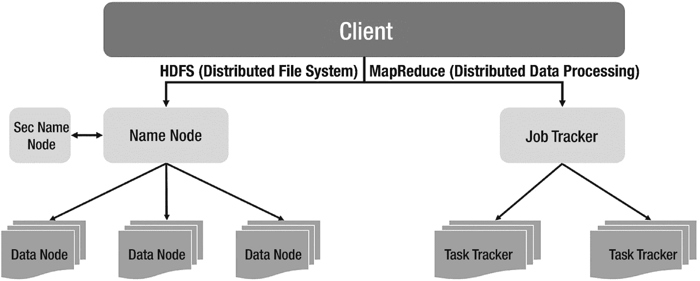
图 1-3 `Hadoop 1` 高级架构

随后在 2013 年，`Hadoop 2.0` 推出了解决可用性和安全问题的新功能。然而，`Hadoop 2.X` 中的主要组件是 `YARN`（`Yet Another Resource Negotiator`）。在 `Hadoop 1.x` 中，资源管理由作业跟踪器（Job Tracker）执行。`Hadoop 2.x` 通过 `YARN` 增加了另一层用于资源管理，并将负载管理与作业执行分离。`YARN` 负责为集群内的所有操作分配资源。`MapReduce` 操作在一个名为 `Application Master` 的 shell 中运行，它通过 `YARN` 请求并获取资源。它也与 `Hadoop 1.x` 向后兼容。图 1-4 展示了 `Hadoop 2` 的存储和处理组件。以下架构的关键要点是：

* 备用 `NameNode` 用于支持主 `NameNode` 的高可用性
* `YARN` 用于协同资源管理和高效的作业调度

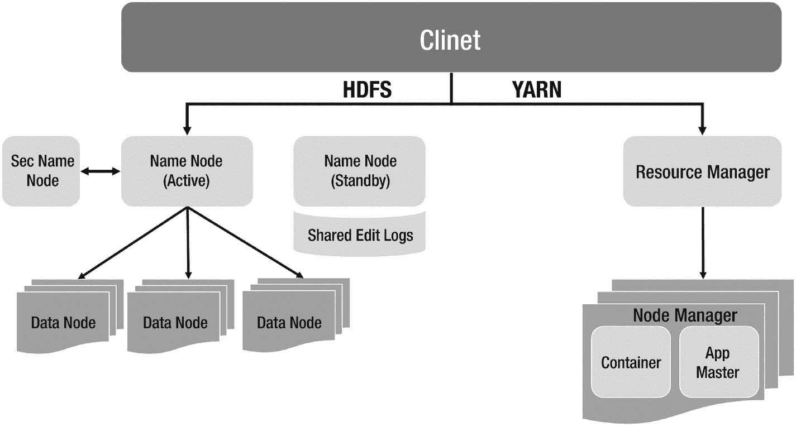
图 1-4 `Hadoop 2` 高级架构

图 1-5 在骨架层面突出了 `Hadoop 1.x` 和 `Hadoop 2.x` 之间的差异。

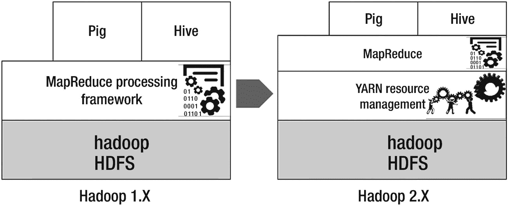
图 1-5 `Hadoop 1` 与 `Hadoop 2` 的正面比较

## 数据湖的历史

自从大数据趋势成为流行语以来，人们创造了许多营销术语来描述数据管理策略。最终，所有这些术语都代表了大数据生态系统的一种形态。

2010 年，¹詹姆斯·迪克森（James Dixon）提出了数据的“时间机器”愿景。`数据湖`（Data Lake）代表了企业在任意给定时间点的状态。其理念是将所有数据以详细的方式存储在一个地方，并利用一个“时间机器”数据存储来赋能商业分析应用、预测和深度学习模型。这引出了`数据即资产`（Data-as-an-Asset）策略，其中数据的持续流动和集成使得`数据湖`变得丰富、真实且可靠。凭借其设计和架构，`数据湖`在统一组织内的数据发现、数据科学和企业 BI 方面发挥着关键作用。

根据詹姆斯·迪克森的说法²：“如果你将数据集市视为瓶装水的商店——经过净化、包装和结构化以便于消费——那么数据湖就是处于更自然状态的一大片水域。数据湖的内容从源头流入以填充湖泊，而湖的各种用户都可以前来查看、潜入或取样。”

`数据湖`的采用了率反映了开源`Hadoop`技术的进步及其与大数据 IT 趋势的紧密关联。请记住，尽管由于`Hadoop`与大数据 IT 的平滑结合而通常认为数据湖建立在`Hadoop`之上，但这并非强制要求。如果你发现`数据湖`托管在关系型数据库上，不必感到惊讶。你必须考虑搭建非`Hadoop`技术栈的成本、数据大小以及 BI 用例。

## 数据湖：概念解读

数据湖是所有企业数据以其原始格式（无论是结构化、半结构化还是非结构化）呈现的一个单一窗口快照。从构建数据摄入管道到用于分析消费的转换层，数据湖生态系统涵盖了数据的方方面面。它旨在容纳海量且结构各异的数据。

数据湖在很大程度上是一个使用 `Hadoop` 和某个处理框架构建的产品。选择 `Hadoop` 是最直接不过的。它不仅提供了可扩展性和弹性，还降低了总体拥有成本。

从更高层面看，数据湖可分为数据落地层和分析层。来自源系统的数据直接落入数据落地层或镜像层。落地层包含来自源系统的数据副本，即原始数据。它为分析层的“战场”奠定了基础。分析层在数据湖领域是一个高度动态的层，因为它消费来自镜像层的原始数据。落地层或镜像层的数据通过一个转换层进行馈送，并构建出分析层或消费层。分析层确保数据为数据分析沙箱做好准备，因此它与数据科学家和分析师面对面。预构建的分析模型可以直接插入并在消费层上运行。或许，像数据发现或画像模型这样的动态分析也可以在消费层上直接运行。数据可视化框架可以从消费层获取数据，以呈现关键指标和数据趋势。

数据湖的另一种划分方式可以基于数据的时间维度。历史原始数据可以被归档并安全地存储在数据湖中。虽然它对数据湖的消费者来说仍是活跃的，但它可以被移动到二级存储中。我们上面讨论的镜像层可以容纳在预定时间范围内的增量数据。在这种情况下，消费层仅建立在增强后的镜像层之上。

这种模型不需要拥有为服务于单一静态模型而定制构建的物理数据市场。相反，它将数据转换为可用的格式，以支持分析和业务洞察。另一方面，数据仓库提供了特定业务分支的抽象视图。

### 数据湖架构

成本和 IT 简化是数据湖的最大特点。廉价的 `Hadoop` 存储（具有无模式写入能力）以及使用 `hive`、`pig` 或 `python` 构建的内部处理框架很大程度上是数据湖成功的关键。图 1-6 展示了一个企业级数据湖的高层级线框图。

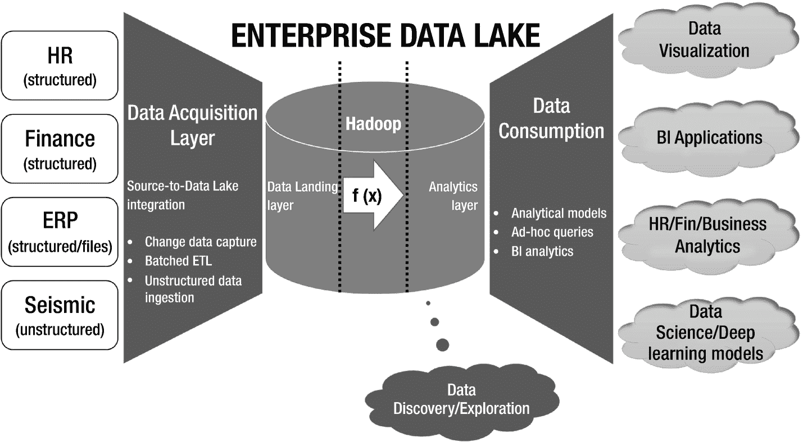
图 1-6 企业级数据湖架构

在上述架构图中，可能有多个源系统向企业数据湖倾倒数据。源系统的性质和结构多种多样。数据可能来自关系型数据源、静态文件系统、Web 日志或来自物联网设备的时间序列传感器数据。数据可能是结构化的，也可能不是。在不破坏源数据结构和避免在 `Hadoop` 中进行数据建模投入的情况下，所有源系统都按照规定的实时时间将数据摄入数据湖。

一旦数据进入数据湖的边界，它就会通过处理层传播以构建分析层。在此阶段，可能需要为原始数据定义模式和结构。此后，根据数据治理委员会制定的数据交换指南，数据将被预测学习模型、BI 应用程序和数据科学流程所消费。与此同时，数据发现的结构化分析通过直接处理原始数据，持续为 `Hadoop` 数据湖中的大数据提供可视化和探索性的面貌。

#### 为什么需要数据湖？

大数据 IT 由竞争驱动。组织希望以可控的成本利用数据分析的力量，以便在竞争者中脱颖而出。数据湖提供了一个可扩展的框架来存储海量数据并挖掘分析洞见，从而帮助它们做出有效决策和开拓新市场。它将焦点从冗长费力的基础设施规划工作转移到了数据驱动架构上。数据摄入和处理框架成为基石，而不仅仅是存储。

构建数据湖带来的另一个视角是简化的基础设施。组织花费大量精力为不同性质的数据构建可靠的堆栈，并且通常遵循“最佳适配”方法来管理数据。例如，关系型数据库几十年来一直是结构化数据的事实标准。对于通过传感器、Web 日志、社交媒体而来的半结构化和非结构化数据，传统文件系统被广泛使用。最终，它们拥有按数据结构、用例和客户需求划分的数据市场，但却产生了高昂的资本支出和运营支出。所有此类场景都可以通过数据湖及其简化基础设施轻松应对。

数据湖提升了可访问性并催化了可用性。它保证了数据发现平台能够大规模吸纳数据趋势并产生可视化洞见。它大大减少了用于数据准备和详尽数据分析的时间。图 1-7 展示了数据湖的关键属性。

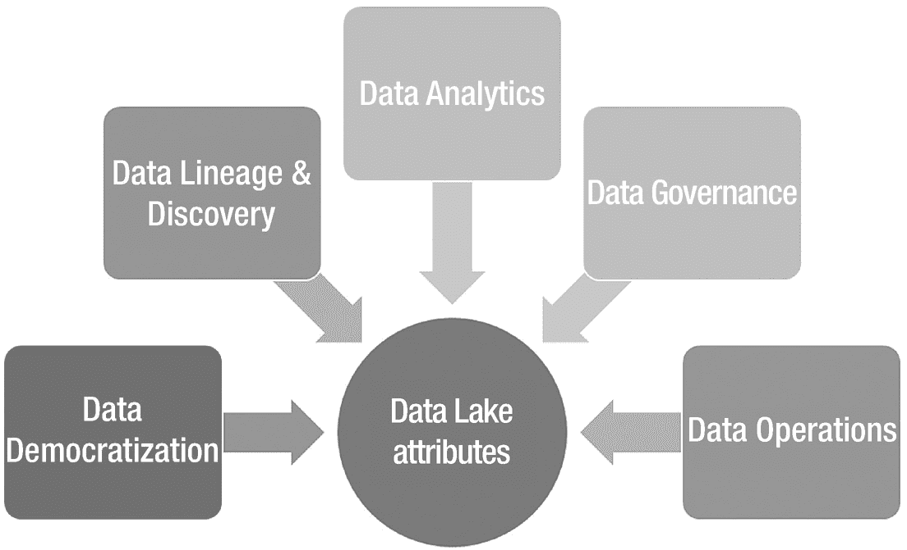
图 1-7 数据湖属性

#### 数据湖的特性

让我们了解企业数据湖的关键特性。

### 数据湖的基本原则

1. 数据湖必须采用可扩展且容错的框架构建——数据湖的概念侧重于简化和降低成本，同时不影响质量和可用性。`Apache Hadoop`通过在商用机器上运行来提供成本优势，并带来了弹性和可扩展性。

2. 可用性——数据湖中的数据必须准确无误，并在数据摄入后立即可供所有使用者使用。

3. 可访问性——采用共享访问模型，确保所有应用程序都能访问数据。除非消费层有要求，否则不建议在数据湖内部设计数据分片。另一个关键方面是数据隐私和交换法规。数据治理委员会应制定关于数据访问、隐私和移动的规范。

4. 跟踪数据谱系（从源系统到消费层）的策略——数据谱系跟踪器提供数据生命周期的单一快照。从数据源头开始，跟踪器将描绘数据在各个层级和应用程序中的移动和消费情况。

5. 源系统的数据对账策略——从数据运维角度来看，数据对账是质量的关键方面。

6. 数据治理策略不得对数据施加约束——数据治理旨在控制数据湖内的民主程度。其存在的唯一目的是通过审计、合规性和定期检查来维持质量水平。数据流，无论其规模或质量如何，都不应受到治理规范的约束。

7. 数据湖中的数据绝不应被丢弃。数据驱动策略必须定义数据的版本管理步骤，并处理源系统的删除和更新操作。

8. 支持原位数据分析——数据湖是来自所有源系统的统一视图，旨在赋能内部数据分析。下游应用程序可以从消费层提取数据，以供不同的应用程序使用。

9. 数据安全——安全是数据湖的关键组成部分。企业可以从被动方法入手，并努力采取主动方式来检测漏洞。以数据为中心的安全模型应能够构建实时风险配置文件，这有助于检测用户访问或权限中的异常情况。

10. 归档策略——作为信息生命周期管理（ILM）策略的一部分，必须制定数据保留策略。必须考虑驻留在数据湖相对“冷”区域的数据的保留因素。虽然在 Hadoop 世界中这不算什么大事，但存储消耗加上新数据的探索，为制定数据归档策略提供了大量智慧。

图 1-8 展示了数据湖规划和构建过程中涉及的步骤。在构建阶段，您会注意到任务比规划阶段更加以数据为中心。

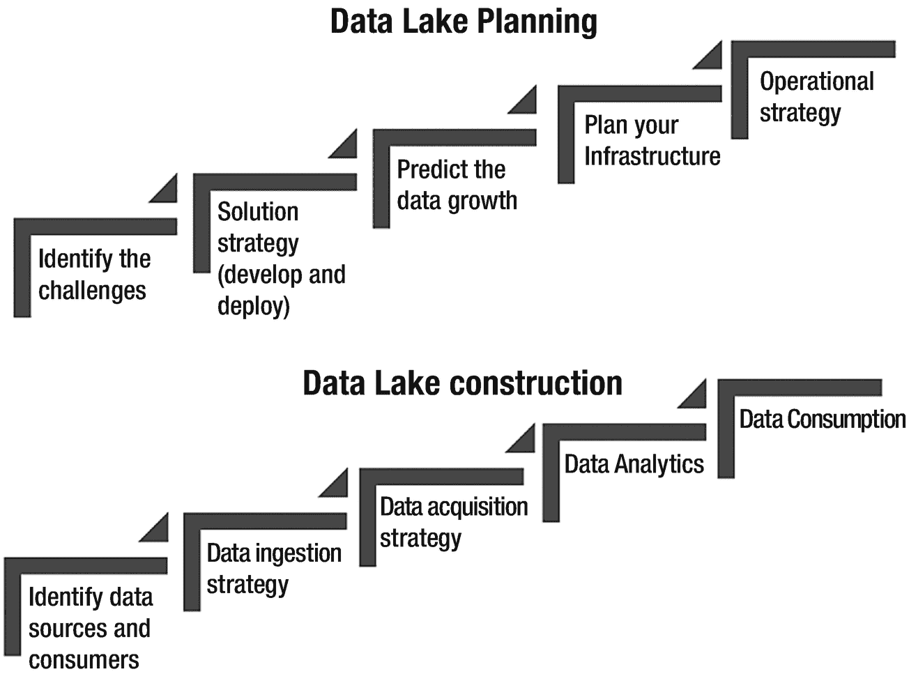

图 1-8 数据湖规划和执行涉及的步骤

### 数据湖与数据仓库

众所周知，数据仓库是一种传统方法，它将来自多个源系统的数据整合并组合到一个存储中，作为分析和商业智能报告的数据源。数据仓库的概念解决了数据异构性和低层次集成的问题。就目标而言，数据湖与数据仓库并无不同。两者都是“单一真实数据源”和“中央数据存储库”等术语的主要倡导者。

简而言之，数据湖以原始、未经处理和触碰的格式摄入所有数据，以构建一个庞大的数据存储。由于其巨大的数据量和与分布式计算的亲和力，它与 `Hadoop` 一起变得非常流行。另一方面，数据仓库从源系统中提取数据，这些数据在落入不同模式（写入时模式）之前会经过一个处理层。仓库中的所有数据都是经过处理、建模良好且结构化的。事实上，这两种存储所遵循的构建范式与其目标用户密切相关。数据仓库面向的是期望在一天结束时获得结构化分析报告的商业专业人士、管理层和业务分析师。相反，数据湖为来自多个领域的数据科学家、分析师和数据工程专家打开了数据运算、探索和精炼的作战室。

开源 `Hadoop` 不能成为构建数据仓库的首选。数据仓库运行在相对昂贵的存储上，以承受高规模的数据处理。数据湖主要托管在 `Hadoop` 上，后者是开源的，并提供免费的社区支持。在比较数据仓库和数据湖时，需要考虑总体拥有成本和投资回报。图 1-9 展示了数据仓库和数据湖之间的用例差异。

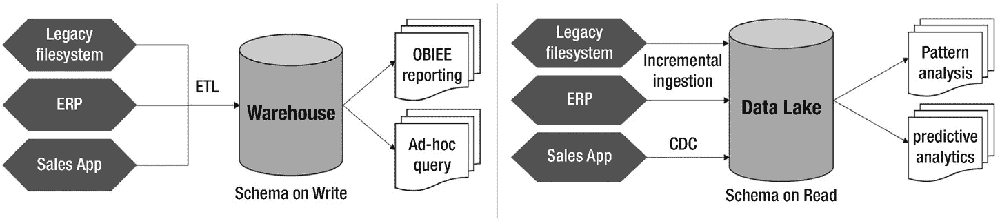

图 1-9 数据仓库与数据湖对比

数据仓库遵循预先构建的静态结构来建模源数据。结构和配置层面的任何更改都必须经过严格的业务审查流程和影响分析。数据湖非常敏捷。可以修改消费层或分析层以适应模型需求。数据湖的使用者并非固定不变；因此，模式和数据建模取决于分析师和科学家的自由决定。

人们已绘制了各种类比来阐明这两个世界之间的区别。“板球世界杯”与“奥运会”的区别，恰如数据仓库与数据湖的不同。

### 如何利用数据湖取得成功？

持有数据并提取其实际价值的策略，在证明构建数据湖所投入的资本和运营支出合理性方面起着至关重要的作用。可能存在关于数据分类及其关键性商数的问题。数据对业务的价值能持续多久？一个数据分片的潜在价值如何衡量？让我们看看几个可以确保数据湖成功的关键驱动因素。

`Facebook` 处理着 30+ PB 的用户生成数据。`Google` 关注我们每天做的每一比特。数据驱动型公司从不回避收集和存储数据。愿景清晰明确——数据没有过期时间。每一比特数据都承载着可以最大化的价值。因此，你必须清楚了解使用者是谁，数据湖当前服务于哪些用例，以及最重要的是，愿景是什么？

愿景驱动着许多数据策略。数据湖管理者需要了解什么数据正在被消费以及什么数据是必要的。首先，数据采集的速度决定了数据湖作为一项资产的富集程度。这提升了数据摄入的障碍，允许数据集中增长，并限制数据的重复和扩散。其次，原始数据的消费速率表明其变成沉睡数据的程度。这将促使数据管理员重新思考数据归档策略，并为来自现有和新增来源的新数据腾出空间。

#### 数据治理与数据运维

数据驱动型企业正迅速成为敏捷实践者和 DevOps 转型的坚定拥护者，其目标一致：加快代码部署流程，让业务用户能够分析“微小”增量修复带来的影响。Facebook 采用了“准持续发布周期”，以消除对热修复的需求，赋能全球工程团队支持开发与部署，并量化用户体验。

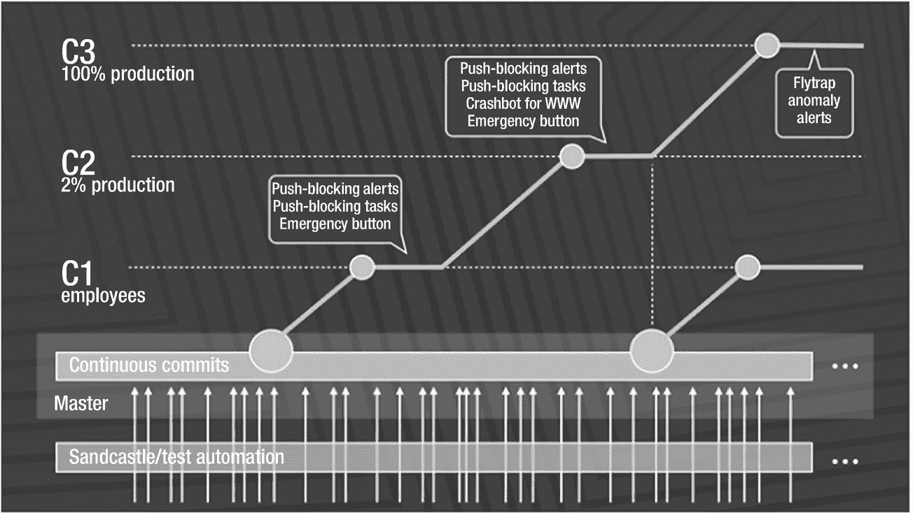

图 1-10 大规模下的快速发布。来源：Rossi, Chuck; “大规模下的快速发布”，2017 年 8 月 31 日，[`code.facebook.com/posts/270314900139291/rapid-release-at-massive-scale/`](https://code.facebook.com/posts/270314900139291/rapid-release-at-massive-scale/)

数据湖在初始阶段就像一个游乐场，用于尝试那些与现有数据高度契合的预建分析模型。随着数据湖成熟至关键层面，它为数据科学家和分析师打开了一间“作战室”，供他们对数据搅拌工作进行严苛处理。

此类情况让我们得以一窥“变化”发生的节奏。这迫切需要一个管理主体，能够以最小的影响将这些变化付诸实施。这个被称为数据运维的框架，对于确保数据湖在可用性、性能和安全性方面的平稳运行变得至关重要。在代码部署、平台升级和应用支持方面，数据运维最终成为数据湖的守门人。所有准备投入生产的代码变更都必须经过运维流程层。数据运维的关键交付成果如下所示：

1. **DevOps 握手** – 数据湖运维团队在开发和部署的关键阶段与 DevOps 团队协同工作。

2. **可用性与维护** – 运维团队肩负确保数据湖基础设施可用性的责任。他们规划并执行平台升级，协调定期维护活动。

3. **发布管理** – 代码库的维护和生产环境的发布均由数据湖运维团队把控。

4. **监控数据流并捕获关键数据湖指标** – 数据湖运维采用分层支持模型，持续监控数据从镜像层到分析层再到消费层的流动。

5. **运维手册与标准操作流程** – 描述需由数据湖运维团队执行的正式及临时操作的文档。

当 Facebook 收购 WhatsApp 时，双方有着不同的隐私规范，这进一步引发了对数据共享的调查。电子隐私信息中心与数字民主中心向美国联邦贸易委员会提出投诉，称“具体而言，WhatsApp 用户无法合理预见，选择一项注重隐私的通讯服务，反而会使他们的数据受到 Facebook 数据收集行为的约束。”这导致了《联邦贸易委员会法》第 5 条（15 U.S.C. § 45(n)）的违反。此事促使 Facebook 修改了其数据治理法律。

图 1-11 展示了企业数据湖不同层级中数据治理和数据运维所执行的任务。

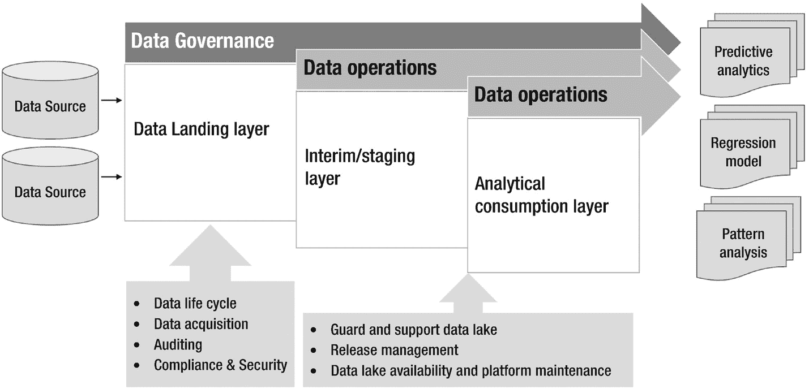

图 1-11 数据湖中数据治理与数据运维的集中体现

数据治理委员会由数据的关键利益相关者组成，他们了解数据隐私、工程、处理和流转的细微差别。在文档形式上，它可以在团队向数据湖提交变更或修复之前，作为一份问卷调查表。该问卷调查表或规则可能包括变更的运维手册、风险评估指标、影响分析以及关键利益相关者的签字确认。委员会还可以审计数据湖，以跟踪在一段时间内（而不仅仅是在部署时）所做的变更。以下列表构建了一个有效数据治理策略的投资组合。

1. **数据获取** – 制定战略，将数据湖视为一项资产。治理委员会的这一部分负责定义哪些组织数据可以被存入数据湖，以及数据应在何时进入、如何进入。

2. **数据目录** – 在阐明数据湖路线图和愿景时，编目是一个关键环节。数据科学家和分析师可以提供关键反馈，并就哪些数据对于有效分析至关重要向委员会提出建议。

3. ### **数据组织** – 治理委员会还应关注数据的结构和格式，以丰富并维护数据湖内部的协同性。

4. ### **元数据管理** – 数据治理管家密切关注数据质量、数据剖析和数据血缘。这有助于内部、机密、公开等数据类别的演进。

5. ### **合规性与安全性** – 处理数据安全、访问管理，并遵守组织的合规政策。

有效的数据治理能提升对数据湖质量和稳定性的信心，这是数据湖成功故事的关键因素。数据合规、数据共享、风险与隐私评估、访问管理和数据安全都是影响监管的要素。

## 数据湖助力数据民主化

数据仓库一个值得称道的特征是，每个 `ETL` 流程或开发都有明确的业务目标。仓库中的每一条数据都经过了严格的验证和审批流程。另一方面，数据湖一直是数据民主化的坚定支持者。

为了在当今数据驱动的经济中立足，组织倾向于处理大量数据。这些数据集形态各异、规模不一，并且可能遵循不同的消费路径。然而，这些数据只有那些熟悉数据血缘关系的人才能发现。非数据从业人员可能会觉得探索和使用感兴趣的数据很繁琐。他们一半的时间都浪费在数据发现、数据清理以及寻找可靠的数据源上。数据困于孤岛之中，无法充分释放其全部潜力。

数据民主化旨在打破数据隔离，确保数据能够及时、无缝地提供给合适的接收者。除了数据的敏捷性和可靠性，数据民主化还构建了一层数据可访问性层，有助于通过定制工具和技术快速发现数据。其目标是让数据分析师能够快速访问真实的数据集，从而实现快速的数据分析和决策。

下面我们来讨论几种方法。

1. **策划数据层** – 策划数据层有助于为功能用户扁平化数据模型。这些用户可能只对全部原始信息中的 10%感兴趣，但可能在缩小感兴趣数据的范围时遇到困难。策划层中包含的对象旨在以扁平化的结构提供切分好的数据。图 1-12 展示了基于六个基础层表构建的 `SALES` 策划层。

   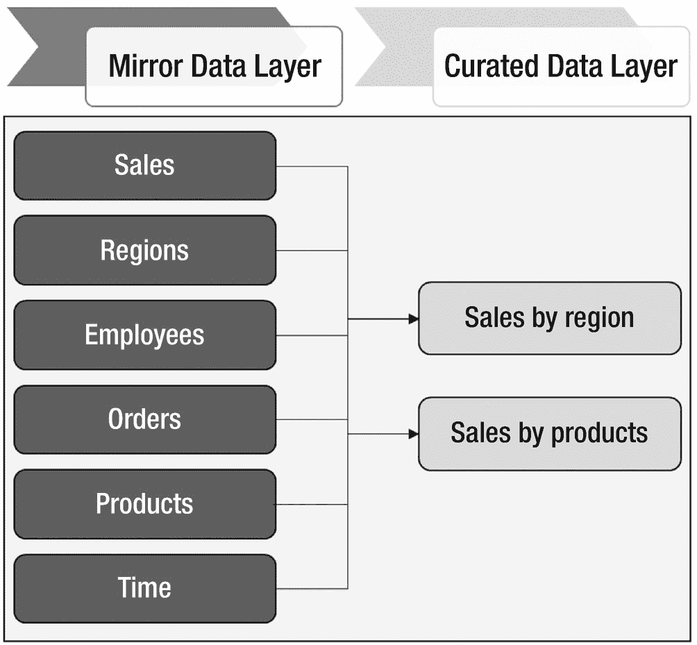

   图 1-12 从基础数据层策划出的 `SALES` 层

2. **自助服务平台** – 自助服务门户可以充当数据市场，用户可以在其中浏览数据集、根据功能含义进行发现、塑造和转换数据表现形式，并下载以供个人记录。在后端，该框架可以通过 `API` 进行数据集转换、数据发现和提取。

通过整合所有关键要素，数据民主化跨越了数据涅槃和开放数据范式的概念。数据民主化可以在企业数据湖中实现。数据湖背后的基本理念是将所有数据视为同等重要，并将其整合到单一平台中，而不受架构、模型或预定义框架的阻碍。

现在我们来谈谈与数据民主化相关的担忧。一个获得社区支持的论点认为，民主化会催化数据湖变成数据沼泽的能力。请记住，当数据流动不受监管，并且大量不相关的数据毫无理由地堆积在湖中时，沼泽就形成了。然而，我们需要将数据民主化，通过自助服务框架简化数据发现来关联开放数据概念。拥有多元化专业知识的主题专家可以轻松访问所需数据，并为组织洞察做出贡献。少数组织提出了为全体员工实现数据民主化的安全和完整性问题。这增加了负责数据分类的数据治理委员会的责任。尽管过去几年数据安全性不断提高，但公司内部和机密数据的接触面仍应受到限制。

## 快数据——超越大数据

如今，大数据分析非常流行。不涉足数据分析的企业要么已经消亡，要么濒临灭绝。虽然还有许多企业仍在摸索入门，但也有一些组织不仅早已实现了“大数据”里程碑，而且还提出了需要扩展大数据能力的需求案例。

我们在本章中认识到的一个事实是，大数据不仅仅是“大”，它还是快速的、有价值的，并且相对神秘的。大数据是一个抽象趋势，而数据湖是实现大数据分析的生态系统。来自源系统的数据，无论其原始格式是结构化还是非结构化的，都会以不同的规模流入数据湖。它可能达到每秒千兆字节或每小时兆兆字节的规模。然而，数据首先会沉淀下来，然后经过处理以构建分析层。消费模式并不知道它们消费的数据已经经历了多个层次的功能和逻辑转换。血缘关系追踪工作将反映出数据生成阶段和消费阶段之间的滞后。这种滞后归因于数据采集层中的 `ETL` 管道以及在转换过程中消耗的时间，这导致了分析的延迟。让我们看几个用例。

一家电信公司监控国内所有国际电话。它通过语音截听应用 `NLP` 算法来过滤可疑电话，并向安全机构发送通知。其期望是进行实时监控，任何延迟的警报都将被视为错失良机。尽管数据量和数据速度都很高，但数据摄入和分析至关重要。

另一个场景可能是一个板球分析网站，需要预测击球手在下一个球时是被投球出局还是跑动出局（取决于他当前的表现以及过去 10 次的出场情况）。这些案例有一个共同点。重要的不是数据量的大小，而是生成可操作洞察时数据的新鲜度。

像上面描述的那些用例引发了一场被称为快数据分析的革命。快数据在“大数据”的基础上向前迈进了一大步，它致力于为数据挖掘获取“新鲜”数据。当大数据还在与分布式存储和计算的挑战作斗争时，快数据则关注数据分析中数据的时间敏感性。`Hadoop` 提供了一个批处理平台，但它无法近实时或实时处理数据的能力一直受到质疑。尽管如此，实时处理对于 `Hadoop` 来说将是困难的。快数据分析在数据一进入数据湖时就开始对其进行处理。

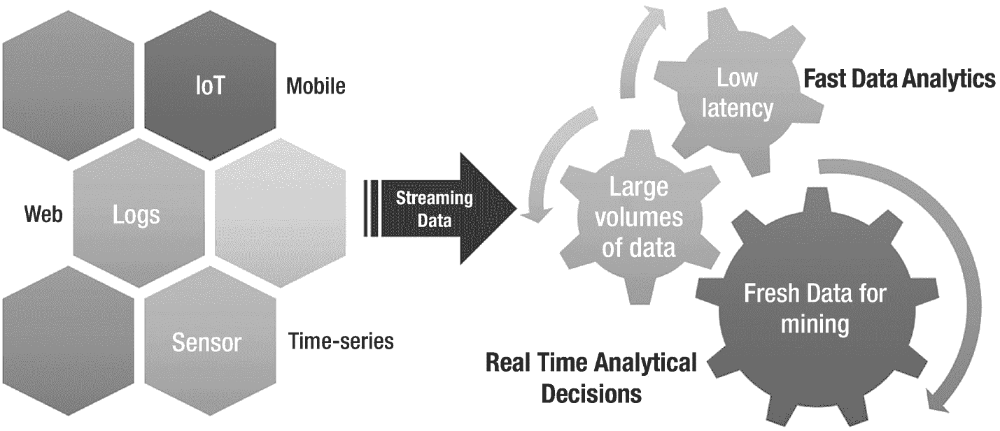

图 1-13 快数据分析是下一代分析引擎，它专注于数据分析中数据的时间敏感性因素

快数据分析实现的是主动的实时洞察。它在减少延迟、提高准确性、加快决策速度和改善客户体验方面可以发挥重要作用。在物联网中，利用传感器和机器对机器通信数据的应用程序为快数据分析提供了最佳适用场景。

## 结论

让我们快速回顾一下引入数据湖所涉及的概念。大数据可以是结构化的，也可以是非结构化的，并且在数据量、速度和价值方面都相对庞大。市场分析师预测，只要存储和分析得当，大数据将成为多个业务洞察的关键要素。各组织意识到了隐藏在这堆数据中的价值，但在存储和构建高效计算模型方面的大量投资仍是一个挑战。2004 年，谷歌提出的分布式文件系统和分布式处理框架概念解了燃眉之急。`Hadoop` 分布式文件系统的演进是一次快速的探索，因为它实现了在相对廉价的商用硬件上进行存储。分布式计算框架 `MapReduce`，则实例化了处理框架，以便连接数据并进行处理。

数据湖是实现大数据分析的生态系统。数据湖之所以取得巨大成功，在于它能够在商用机器上以原生格式保存原始数据，并允许各种数据分析模型通过一个统一的分析层来消费数据。虽然数据湖保持了高度的敏捷性和以数据为中心的特性，但数据治理委员会负责管理数据隐私规范、数据交换策略，并确保数据湖的质量和可靠性。

在大数据持续发展的趋势下，快速数据分析近来发展迅猛。它与大数据有所不同，处理相同的数据量和数据结构，但更注重数据的时效性而非数据量。如今，企业已经开始认识到数据使用的真正本质。并非所有的大数据都能做到实时，同时，所有实时数据也未必都是大数据。数据湖生态系统可以完美地补充这两个概念，使组织能够同时获得大数据和快速数据的双重视角。

在下一章中，我们将深入探讨数据摄取原则。我们将理解批量摄取、实时数据移动以及变更数据捕获的概念，同时还会涉及相关的架构和设计考量。

脚注 1

Woods, Dan; “James Dixon Imagines a Data Lake that Matters,” Forbes, [`https://www.forbes.com/sites/danwoods/2015/01/26/james-dixon-imagines-a-data-lake-that-matters/#1dd2c5e34fdb`](https://www.forbes.com/sites/danwoods/2015/01/26/james-dixon-imagines-a-data-lake-that-matters/#1dd2c5e34fdb)

2

[`https://jamesdixon.wordpress.com/2010/10/14/pentaho-Hadoop-and-data-lakes/`](https://jamesdixon.wordpress.com/2010/10/14/pentaho-hadoop-and-data-lakes/)