# 2. 数据湖摄取策略

> "如果我们有数据，那就看数据。如果我们只有意见，那就按我的来。" ——吉姆·巴克斯代尔，网景公司前 CEO

正如我们所了解到的，大数据战略是一种成本效益高、以分析为导向的灵活、可插拔、可定制的技术栈组合。投身于大数据世界的组织意识到，这不仅仅是一个要追随的趋势，更是一段要经历的旅程。大数据提供了一个充满前所未有挑战的开放平台，这些挑战要求对数据驱动技术进行逻辑性和分析性的开发利用。早期采用者通过简单的数据提取和摄取解决方案开启了他们的旅程，他们承认传统技术更偏向关系型，并且在大数据世界中并不容易实施。传统的数据存储、处理和摄取方法，在处理数据的多样性、异构性和数据量方面，能力明显不足。

在上一章中，我们介绍了数据湖的架构。它主要有三个层，即数据采集层、数据处理层和数据消费层。负责构建和扩展数据湖的是数据采集层。数据采集层奠定了从源数据系统提取数据以及编排数据湖摄取策略的框架。摄取框架通过将数据作为资产进行策略制定并挖掘企业价值，在数据湖生态系统中扮演着关键角色。

本章的重点将围绕现实世界中的数据摄取方法展开。我们将从摄取原则开始，并详细讨论设计考量。本章将高度集中于基本原理，而不是讲解商业产品。

## 什么是数据摄取？

数据摄取框架从多个数据源捕获数据，并将其摄取到大数据湖中。该框架安全地连接到不同的数据源，捕获数据变化，并在数据湖中进行复制。数据摄取框架使数据湖与源系统的数据变化保持一致，从而使其成为企业数据的单一枢纽。

一个标准的摄取框架由两个组件组成，即`数据采集器`和`数据集成器`。`数据采集器`负责从数据源收集或拉取数据，而`数据集成器`组件则负责将数据摄取到数据湖中。`数据采集器`和`数据集成器`组件的实现和设计可以根据大数据技术栈灵活调整。

在讨论摄取挑战和原则之前，让我们先探讨一下数据摄取的运行模式。它可以实时模式或批量模式运行。顾名思义，实时模式意味着一旦发生变化，就立即应用到数据湖；而批量模式摄取则分批应用这些更改。然而，需要注意的是，实时模式在变更事件发生和应用之间也存在一定的延迟。因此，实时可以更准确地理解为近实时。决定摄取运行模式的因素是源端的数据变化率和变化的数据量。数据变化率是每小时发生变化的度量。

对于实时摄取模式，变更数据捕获（`CDC`）系统足以满足摄取需求。变更数据捕获框架从事务日志中读取变化，这些日志会在数据湖中进行复制。捕获和集成阶段之间的数据延迟非常小。像 Oracle、HVR、Talend、Informatica、Pentaho 和 IBM 等顶级软件供应商都提供实时运行的数据集成工具。

在批量摄取模式下，变更会在每个定义的时间间隔内被捕获并持久化，然后分块应用到数据湖。数据延迟是捕获作业和集成作业之间的时间差。图 2-1 展示了构建摄取框架所面临的挑战。

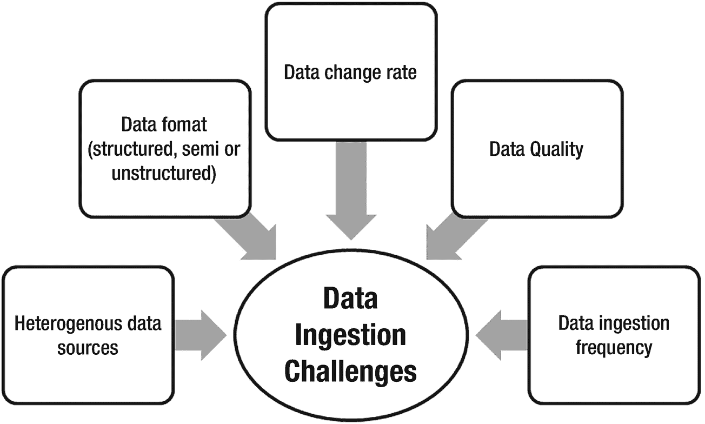

图 2-1

数据摄取挑战


### 理解数据源

为数据湖选择数据源对于提升业务陈述的分析洞察力至关重要。数据源构成了数据湖数据采集层的基础。让我们看看那些可能将数据注入数据湖的各类数据源。

- **OLTP 系统与关系型数据存储** – 来自典型关系型数据存储的结构化数据可直接注入数据湖。
- **数据管理系统** – 与业务实体相关的文档和文本文件。大多数情况下，这些属于半结构化数据，可被解析成结构化格式。
- **遗留系统** – 对于历史分析和监管分析至关重要。基于大型机的应用、客户关系管理（CRM）系统以及传统 ERP 系统有助于模式分析和构建消费者画像。
- **传感器与物联网设备** – 安装在医疗、家居、移动设备以及大型机器上的设备可定期或在安全网络区域内将日志上传至数据湖。智能实时分析有助于主动推荐、构建健康模式、推测气象活动及气候预测。
- **网络内容** – 像 Facebook、Twitter、LinkedIn、Instagram 和博客这类社交媒体平台积累了海量数据。其中可能包含用于研究用户行为、商业画像、内容及活动的自由文本、图片或视频。
- **地理信息** – 来自位置数据、地图和全球定位系统的数据流。

### 结构化数据、半结构化数据与非结构化数据

数据是信息的基本单元。从高层次来看，数据从不同的源系统流入数据湖，经过处理层，最终增强分析洞察力。这听起来相当顺畅，但需要考量的是数据格式。数据分类是数据摄取框架的关键组成部分。数据可以是结构化的、半结构化的或非结构化的。根据数据结构，可以有效地设计处理框架。

结构化数据是一种组织有序的信息，它高度符合关系型标准。可以使用结构化查询语言进行搜索，并能检索包含该数据集的结果。例如，关系型数据库主要存储结构化数据。不可否认，结构化数据只占全球数据的很小一部分。有大量信息无法以结构化格式捕获。

非结构化数据是一种不可塑形的数据格式。它缺乏结构，因此使得获取、搜索和结果整合等基本数据操作变得相当繁琐。来自复杂源系统（如网络日志、多媒体文件、图像、电子邮件和文档）的数据是非结构化的。在数据湖生态系统中，非结构化数据形成了一个需明智利用以实现分析能力的资源池。挑战来自其结构和规模。字符格式（`text`、`csv`、`word`、`XML`）的文档被视为半结构化数据，因为它们遵循可辨别的模式，并具备被解析和存储在数据库中的能力。图像、电子邮件、网络日志、数据馈送、来自物联网设备的传感器和机器生成数据、音频或视频文件则以二进制格式存在，结构化语义无法解析这些信息。

“非结构化信息是企业和政府可获得的最大、最新且增长最快的知识来源。它包括在网络上发现的文档，以及估计占全球企业所生成信息 80% 的内容。” – 结构化信息标准促进组织（OASIS），一个致力于为各种技术轨道构建标准的全球非营利联盟（`https://www.oasis-open.org/`）。

我们每个人每天都在产生大量的非结构化数据。我们每时每刻都连接着网络，并通过多种设备以这样或那样的方式分享数据。我们在社交媒体或门户网站上产生的数据量会扩散到多个下游系统。我们漫不经心地购物、分享想法、上传文件。根据数据保留规范，数据永远不会被删除，而是遵循组织设定的标准信息生命周期管理策略。同时，我们要意识到，非结构化数据文件中蕴含的信息对于数据分析可能极为有用。图 2-2 列出了现实世界中处理非结构化数据的复杂性。没有结构和元数据的数据难以理解，也难以适配预构建的模型。

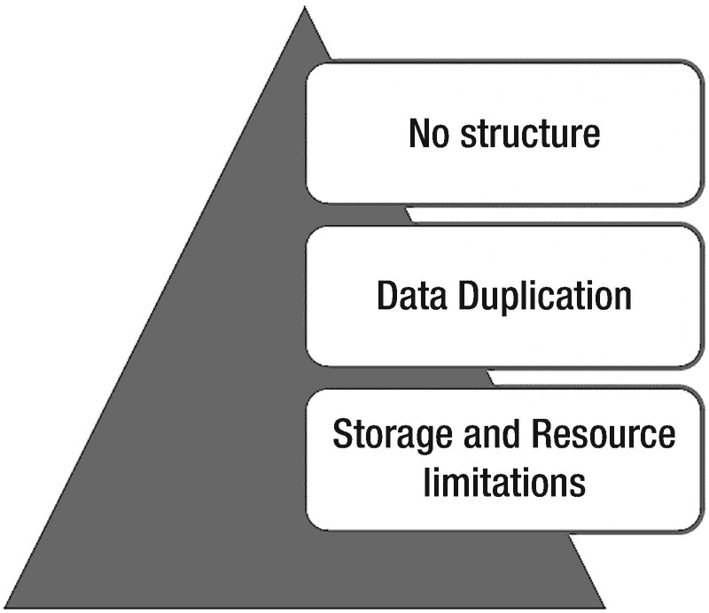

图 2-2：非结构化数据的复杂性

Apache Hadoop 是一个久经考验的平台，它通过以下方式应对非结构化数据的挑战：

1. **分布式存储与分布式计算** – Hadoop 的分布式框架有利于存储和处理海量的非结构化数据。
2. **读取时定义模式** – Hadoop 不要求在写入非结构化数据时定义模式。只有在后处理阶段，需要被分析的数据才需要读取时定义模式。
3. **复杂处理** – Hadoop 让开发者社区能够为非结构化数据分析编写复杂算法，并充分利用分布式计算的能力。


### 数据摄取框架参数

设计数据摄取策略需要深入了解源系统以及摄取框架的服务级别协议。从摄取框架的 SLA 角度来看，以下是关键因素。

- **批量、实时或编排**：根据传输数据的大小，摄取模式可以是批量或实时的。在批量模式下，只有在准备好特定大小的批次后才会触发数据移动。如果数据变化率是可定义且可控的（以便不影响延迟），则可以选择实时模式。对于增量变更的应用，可以按周期性间隔来编排摄取作业。
- **部署模型（云或本地）**：数据湖可以部署在本地，也可以部署在公有云基础设施上。近年来，由于计算和存储系统的成本不断增长，企业已开始评估云设置选项。通过云托管的数据湖，总拥有成本（TCO）大幅降低，同时投资回报率（ROI）提升。

只有当摄取策略能够有效处理不同的数据源时，它才能获得稳定性。在理解源系统时，需要考虑以下几个方面。

- **数据谱系**：维护一个源系统目录，并了解从数据生成到摄取入口点的谱系，是一项有价值的实践。这项工作可由数据治理委员会全权负责，并可能定期审查，以在持续的合规法规下对齐并覆盖目录注册者。
- **数据格式**：传入数据是数据块还是对象（半结构化或非结构化）形式。
- **性能与数据变化率**：数据变化率定义为每小时发生的变化大小。它有助于在框架中选择合适的摄取工具。
- **性能**是吞吐量和延迟的派生指标。
- **数据位置与安全性**
    - 无论数据位于本地还是公有云基础设施，网络带宽都起着重要作用。
    - 如果数据源被安全层所包围，则应启用摄取框架，并建立一个安全隧道来收集数据进行摄取。
- **传输数据大小（文件压缩与文件拆分）**：单次摄取操作中，一个块或对象的平均大小和最大大小是多少？
- **目标文件格式**：来自源系统的数据需要摄取为 Hadoop 兼容的文件格式。

表 2-1 汇总了文件格式列表、它们的特点以及推荐使用它们的场景。

**表 2-1** 文件格式及其特点

| 文件类型 | 特点 | 用途 |
| --- | --- | --- |
| `Parquet` | • 列式数据表示 • 嵌套数据结构 | • 查询性能良好 • Hive 支持模式演变 • 针对 Cloudera Impala 优化 • 写入性能较慢 |
| `Avro` | • 行式数据表示 • 嵌套数据结构 | • 存储元数据 • 支持文件拆分和块压缩 |
| `ORC` | • 优化记录列式文件 • 键值对形式的行式数据表示 • 行式与列式混合格式 • 行格式有助于将数据保持在同一节点上 • 列格式提供更好的压缩 | • 适合数据查询操作 • 压缩效果改进 • 写入性能较慢 • 不支持模式演变 • 不被 Cloudera Impala 支持 |
| `SequenceFile` | • 键值对形式的扁平文件 | • 有限的模式演变 • 支持块压缩 • 在 MapReduce 作业中用作临时文件 |
| `CSV` 或 `Text` 文件 | • 常规的半结构化文件 | • 易于解析 • 不支持块压缩 • 模式演变不简单 |
| `JSON` | • 键值对形式的记录结构 | • 不支持块压缩 • 由于元数据与数据一起存储，模式演变比 CSV 或文本文件更容易 |

#### 为什么 ORC 是首选的文件格式？

`ORC`是一种列式存储格式，通过索引支持查询的优化执行，有助于文件的快速扫描。`ORC`支持文件级、条带级和行级索引。文件和条带索引类似于关系型数据库中的存储索引，通过缩小扫描范围来帮助快速扫描数据。它们在查询执行期间有助于从扫描中削减掉条带。

**条带索引**：一个表的`ORC`文件被组织成默认大小为 64MB 的条带。条带大小可以在表级别进行配置。每个条带隐式地为列建立索引，并保存有意义的细节，如最小值/最大值或用于快速查找的字典。下面列出了一些关键的`ORC`配置参数。请注意，这些参数应在`TBLPROPERTIES`子句中于表级别设置。

1.  `orc.compress` – ORC 文件的压缩编解码器
2.  `orc.compress.size` – 压缩块的大小
3.  `orc.create.index` – 是否应创建索引
4.  `orc.stripe.size` – 用于写入的内存缓冲区大小（字节）
5.  `orc.row.index.stride` – 索引条目之间的行数
6.  `orc.bloom.filter.columns` – 为每个指定列创建的`BLOOM_FILTER`流

关于`ORC`参数的更多详情，您可以参考`ORC`的 Apache 页面：`https://orc.apache.org/docs/hive-config.html`。

例如，`CUSTOMER`表的`ORC`文件存储（图 2-3）。

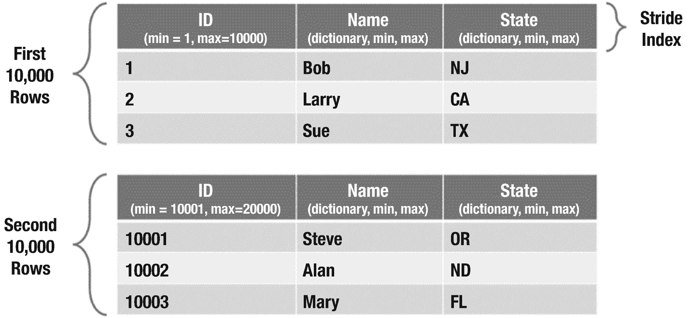

**图 2-3** `CUSTOMER`表的条带

用户发起了以下查询。该查询在 `"state"` 列上过滤结果。

```
SELECT ID, NAME
FROM CUSTOMER
WHERE CUSTOMER.state = 'CA';
```

对于`CUSTOMERS`表，两个条带各有 10,000 行。特定条带中的行数在创建表时是可配置的。每个条带都包含内联索引，例如该条带内数据的最小值、最大值以及查找/字典信息。`ORC`的谓词下推将检查这些内联索引，以确定是否可以一次性跳过整个块。第二个条带将被丢弃，因为其索引在`state`列中不包含值`"CA"`。

如果某列是排序的，相关记录将被限制在磁盘上的一个区域，而其他部分将被非常快速地跳过。跳过操作适用于数字类型和字符串类型。在这两种情况下，都是通过在内联索引中记录最小值和最大值，并判断查找值是否超出该范围来实现的。排序可以带来非常显著的加速，但需要权衡插入期间为实现排序所需的资源。

#### ORC 使用最佳实践

1.  必须分析 Hive 查询以探索使用模式，并追踪在谓词中频繁出现的列。
2.  Hive 表必须及时分析以保持统计信息更新。
3.  在数据摄取期间应对数据进行分布和排序。这将有助于在查询处理期间进行有效的资源管理。
4.  如果查询中的过滤列具有高基数，则较小的条带大小效果良好。如果基数较低，则首选较大的条带大小。
5.  从 Hive 1.2 开始，`ORC`语义中包含了布隆过滤器的支持，以提供细粒度过滤。它用于已排序的列。

`ORC`文件格式受`Hive`、`Pig`、`Apache NiFi`、`Spark`和`Presto`支持。在采用方面，Facebook 和 Yahoo 在生产环境中使用`ORC`文件存储格式，并观察到与其他格式相比显著的性能提升。


### ETL 与 ELT

如果说提取、转换、加载（ETL）协议未能满足传统数据仓库的数据移动需求，那是一种轻描淡写的说法。自数据移动策略演进以来，它一直是一个事实上的标准流程。然而，随着下一代数据仓库策略和大数据趋势的出现，ETL 方法往往需要进行调整。

与传统 ETL 方法相反，数据湖的摄取策略采用了 ELT 方法。采用这种方法，数据在收集后直接加载到数据湖中。转换则属于消费层或分析层的范畴（图 2-4）。

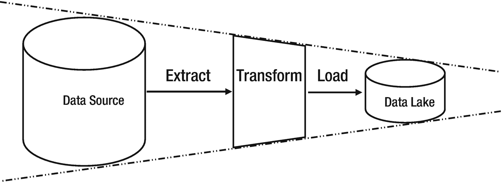

图 2-4

数据敏捷性在典型的 ETL 流程中降低

数据湖的构想是保留来自各种来源的数据的原始形态。可能存在一个薄薄的数据清洗层，用于在原始数据被摄取到数据湖并被分析模型消费之前进行清理。然而，不建议使用一个宽泛的数据转换层，因为它可能会限制数据探索的表面积，从而降低数据敏捷性。支持 ELT 方法的另一个理由是性能因素。对海量数据运行转换逻辑可能会在数据源和数据湖之间产生延迟。相反，可以将转换层灵活地降级到一个精选层，使分析模型能够调整数据状态。图 2-5 展示了 ELT 模型中的数据移动。

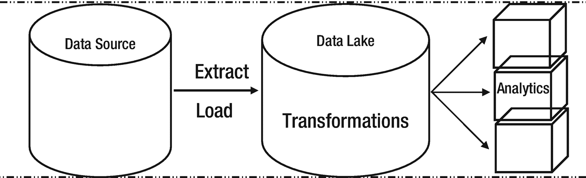

图 2-5

数据敏捷性在典型的 ELT 流程中保持不变

其他支持在数据湖中使用 ELT 的因素包括成本效益和可维护性。自从数据湖概念吸引了数据世界的所有目光以来，ELT 一直是最受信赖的方法。

## 数据湖的大数据集成

数据是一种无处不在的实体。在大数据趋势兴起之前，是关系型数据库以结构化格式持有记录系统。尽管关系型数据存储供应商正在寻找处理非结构化数据的方法，但采用率主要受成本、处理便捷性和用例等因素驱动。

数据湖旨在通过赋能分析模型，以挖掘“数据”的真正价值（无论其格式如何），来补充当代的数据仓库系统。在本章中，我们将介绍将结构化和非结构化数据引入数据湖的技术和最佳实践。本节重点介绍将结构化数据引入数据湖。我们将详细讲解摄取概念、最佳实践，以及在该过程中使用的工具和技术。

### Hadoop 分布式文件系统

尽管我们假设本书的读者精通 Hadoop 概念和 HDFS，但为了保持概念的逻辑流畅性，让我们对 HDFS 进行一个高层次的概述。

Hadoop 分布式文件系统在 POSIX（或类似）文件系统之上构成了一层抽象。在写入操作期间，一个文件被分割成小的数据块，并在集群中复制。复制在集群内透明地进行，而副本不能被单独访问。复制确保了容错性和弹性。每当一个文件在集群中被处理时，它的所有副本都被并行处理；从而提高了计算性能和可扩展性。

`hdfs dfs` 命令行实用程序可用于在 Hadoop 的 Hortonworks 发行版中发出文件系统命令。除了此实用程序，您还可以使用 Hadoop 的 Web 界面、WebHDFS REST API 或 Hue 来访问 HDFS 集群。

1.  Shell 命令类似于常见的 Linux 文件系统命令，例如 `ls`、`mkdir`、`cat`
2.  帮助命令 –
    1.  `$ hdfs dfs`
    2.  `$ hdfs dfs -help`
    3.  `$ hdfs dfs -usage <shell command>`
3.  HDFS 不支持像 `cd` 和 `pwd` 这样的目录命令。

```
hdfs dfs [GENERIC_OPTIONS] [COMMAND_OPTIONS]
```

### 将文件直接复制到 HDFS

将数据引入 Hadoop 的最简单方法之一是将文件从本地复制到 HDFS。如果本地系统上有一堆 csv 电子表格、JSON 或原始文本文件，您可以使用 `put` 命令将文件直接复制到 HDFS。

```
$ hdfs dfs mkdir /user/hdfs/sales_2017
```

将 `sales.csv` 从本地复制到 HDFS 集群。

```
$ hdfs dfs -put sales_Q1.csv sales_2017
$ hdfs dfs -put sales_Q2.csv sales_2017
```

列出集群文件。

```
$ hdfs dfs -ls /user/hdfs
```

一旦文件在 Hadoop 集群中可用，就可以被 Hadoop 处理层（如 Hive 数据存储、Pig 脚本、MapReduce 自定义程序或 Spark 引擎）消费。

### 批量数据摄取

简单来说，批量是一种基于频率的增量捕获，它根据预设的时间表启动。对于大多数 ETL 框架来说，“提取”阶段的实现基于相似的原理。数据收集器在源端触发一个 `SELECT` 查询（也称为过滤查询）来拉取增量记录或全量数据。过滤查询的性能决定了数据收集器的效率。基于查询的提取和加载数据方法易于实现，且故障率最低。

从关系型数据源中，可以通过以下任一技术使用过滤查询来提取数据。

*   **变更跟踪标志** – 如果源数据库上的每条变更记录（插入/更新/删除）都可以被标记，那么过滤查询可以只从源表中捕获被标记的记录。
    *   需要主键来合并目标端的变更。
    *   如果目标端存在主键：
        *   删除现有记录。
        *   从变更数据集中插入新记录。
    *   如果目标端不存在主键：
        *   从变更数据集中插入记录。
    *   如果目标表被建模为类型 2 SCD（缓慢变化维度），则所有变更记录可以直接插入到目标表。可以在目标端维护一个时间戳属性或事务 ID，以追踪某个主键的变更历史。
*   **增量提取** – 过滤查询基于一个有助于识别源表中变更的列来拉取差异数据。它可以是一个时间戳属性，甚至是一个序列化的 ID 列。
    *   要应用变更，主键是必需的。
    *   如果存在主键，则删除旧记录并插入新记录。
    *   如果主键不存在，则插入新记录。
    *   增量提取频率 – 从数据一致性的角度来看，了解源表何时处于事务活跃状态以及数据变更速率非常重要。如果变更速率很高，则应定期编排增量作业。
*   **全量提取** – 如果源数据库表不是很大，并且变更频率较低，则目标表可以在每次 ETL 运行时进行全量刷新。这确保了源端和目标端之间的数据一致性，直到源数据被修改。对于包含主数据和配置数据的源表，可以采用全量刷新方法。

一旦通过过滤查询从源端捕获，数据提取需要暂存到边缘节点或 ETL 服务器上，然后才能合并到 Hadoop 中。这就引入了在 Hadoop 集群之前需要一个额外存储系统的需求。这种双写入方法增加了延迟，并在数据湖中带来了不一致性。


## 挑战与设计考量

组织级数据湖需要处理所有格式的数据。无论是结构化还是非结构化的数据，在处理 Hadoop 上的可变数据时都会遇到困难。Hadoop 作为一个分布式系统，其功能依赖于并发性，但处理可变性和并发性可能是一个巨大的挑战。数据摄入框架必须确保在给定时间内只有一个进程更新可变对象，并避免脏读问题。

其他问题包括源系统与 Hive 之间的数据类型不匹配、精度字段处理、特殊字符处理，以及高效传输大小从千字节 (KB) 到太字节 (TB) 不等的表数据。

#### 设计考量

上述讨论的问题在目标系统（即 Hadoop 数据湖）中很常见。本节讨论的设计考量必须在 Hadoop 对象上实施。

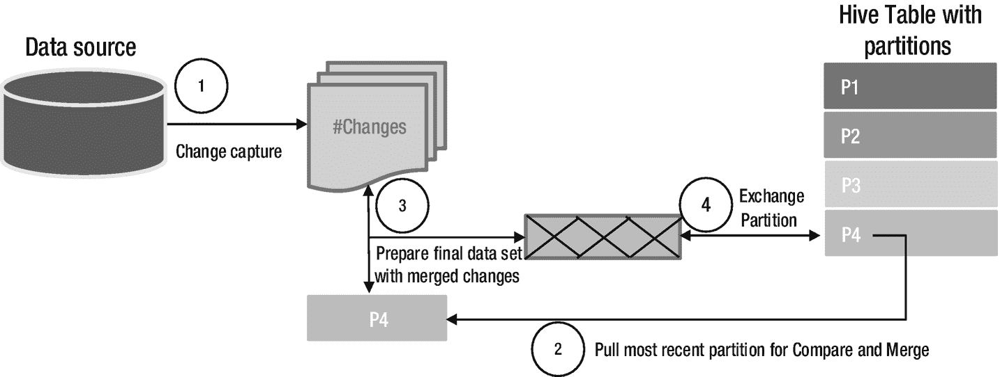

图 2-6：通过交换分区合并变更

1.  **表分区** – 将数据拆分成易于管理的小块，可以在资源消耗和数据分析方面提供更好的控制。分区策略应考虑以下参数：
    1.  低基数（cardinality）列
    2.  常用于连接和查询谓词的列
    3.  能够创建基于间隔的分区的列
2.  **文件存储格式** – `ORC` 文件存储格式相比其他文件格式能提供更好的压缩率。此外，它还存储索引头，用于优化从文件的读取访问。
3.  **全量加载或增量加载** – 如果无法进行变更数据捕获，则应采用全量加载集成。在为对象规划全量加载时，必须牢记数据大小和刷新频率。
4.  **变更合并策略** – 如果目标着陆表已分区，则可以通过表标签和最其新分区来标记变更。在交换分区过程中，可以将最新分区与“变更”数据集进行比较，以合并变更。图 2-5 展示了使用交换分区为分区 Hive 表合并变更策略的流程。

让我们考虑一个使用 PigLatin 合并变更的简单案例。我们有一个按间隔分区的 Hive 表。下面的代码将展示如何将源数据中的增量变更合并到 Hive 分区中。

---Hive 分区中的示例数据---

```
[bda@datalake sample-merge]$ cat hive_part4.txt
"20001""delhi"
"20002""mumbai"
"20003""bangalore"
"20004""chennai"
"20005""hyderabad"
"20006""pune"
"20007""kochin"
"20008""kolkata"
"20009""jaipur"
"20010""chandigarh"
```

变更通过变更捕获工具进行捕获。变更数据集的分隔符为 `ctrl A`。以下是需要与 Hive 表中最新区分合并的变更数据集。

```
[bda@datalake sample-merge]$ cat change_dataset.txt
"I"^A"20089"^A"1"^A"2014-09-04 12:38:08.000"^A"20015"^A"noida"
"D"^A"20089"^A"2"^A"2014-09-04 12:38:08.000"^A"20003"^A\N
"I"^A"20089"^A"3"^A"2014-09-04 12:38:08.000"^A"20003"^A"bengaluru"
"D"^A"20089"^A"5"^A"2014-09-04 12:38:08.000"^A"20001"^A\N
```

将变更与原始文件合并的 Pig 脚本。

```pig
A = LOAD '/user/bda/merge_change/hive_p4_merged_set.txt'
using PigStorage('\u0001')
AS (
opcode:chararray
, seqno:chararray
, row_id:chararray
, commit_timestamp:chararray
, id:chararray
, place:chararray);
B = GROUP A BY id;
C = foreach B {
D = order A by seqno, row_id desc;
top = limit D 1;
generate flatten(top);
};
```

检查并验证主文件中的变更。注意，`id = 20001` 已被删除，`id=20003` 已被更新，`id=20015` 已被插入。

```
[bda@datalake sample-merge]$ cat hive_p4_merged_set.txt
"20002""mumbai"
"20003""bengaluru"
"20004""chennai"
"20005""hyderabad"
"20006""pune"
"20007""kochin"
"20008""kolkata"
"20009""jaipur"
"20010""chandigarh"
"20015""noida"
```

让我们再看另一个使用 Spark 演示变更合并的用例。我们将使用一个主数据集和一个变更数据集。目标位置中的主数据

```scala
val main_data = spark.table(t.tablename).filter(cond) //filter on the specific partition
```

我们将按如下方式，使用主键创建两个表达式。

*   组合主键 – `pk1 AND pk2 … pk[n]`
*   组合包含空值的主键 – `pk1 is null AND pk2 is null … pk[n] is null`

以下是主数据集 A 的示例

| 主键 | 姓名 | 值 | 时间 ID | 删除标志 |
| --- | --- | --- | --- | --- |
| 1 | Pranav | 13341 | 10001 | 0 |
| 2 | Shubham | 18929 | 10002 | 0 |
| 3 | Surya | 12931 | 10003 | 0 |
| 4 | Arun | 12313 | 10004 | 0 |
| 5 | Rita | 12930 | 10005 | 0 |
| 6 | Kiran | 12301 | 10006 | 0 |
| 7 | John | 82910 | 10007 | 0 |
| 8 | Niti | 218930 | 10008 | 0 |
| 9 | Sagar | 82910 | 10009 | 0 |
| 10 | Arjun | 92901 | 10010 | 0 |

以下数据集表示通过 CDC 机制捕获的增量变更

| 主键 | 姓名 | 值 | 时间 ID | 删除标志 |
| --- | --- | --- | --- | --- |
| 1 | Pranav | 13341 | 10020 | 1 |
| 2 | Shubham | 18929 | 10022 | 1 |
| 3 | Surya | 453202 | 10034 | 2 |
| 4 | Tarun | 489503 | 10098 | 0 |
| 5 | Pranav | 129789 | 10099 | 2 |

在此，`P.K.` 是主键列，`TIME_ID` 是时间戳的定义值，`DELETE_FLAG` 是标志值，其中 `0` 表示新增插入，`1` 表示删除，`2` 表示更新。以下 Spark 代码将合并数据并将其存储为临时视图。

```scala
main_data.as("m").join(broadcast(incr_data.as("k").filter(cond)), expr(str1), "left_outer").filter(str2).select("m.*").union(incr_data.filter("del_flag != 1")).createOrReplaceTempView(mergedTable)
```

图 2-7 展示了合并工作流流程。

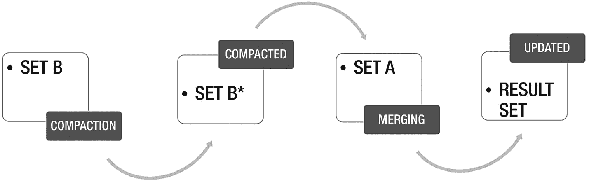

图 2-7：合并操作工作流流程

以下是合并后产生的数据集。

| 主键 | 姓名 | 值 | 时间 ID | 删除标志 |
| --- | --- | --- | --- | --- |
| 1 | Pranav | 129789 | 10099 | 0 |
| 3 | Surya | 453202 | 10034 | 0 |
| 4 | Arun | 12313 | 10035 | 0 |
| 5 | Rita | 12930 | 10036 | 0 |
| 6 | Kiran | 12301 | 10006 | 0 |
| 7 | John | 82910 | 10007 | 0 |
| 8 | Niti | 218930 | 10008 | 0 |
| 9 | Sagar | 82910 | 10009 | 0 |
| 10 | Arjun | 92901 | 10010 | 0 |
| 11 | Tarun | 489503 | 10098 | 0 |

### 商业 ETL 工具

虽然大多数第三方商业 ETL 工具的基本原理仍如上所述，但具体实现可能有所不同。例如，`Informatica PowerCenter` 将元数据存储在 Oracle 数据库仓库中，而 `Talend` 则生成 Java 代码来执行任务。另一方面，`Pentaho` 提供了一个用户友好的界面。

由于数据湖是一个新的机遇，数据集成软件供应商已经开始用以 Hadoop 为核心的能力来补充他们的 ETL 产品。现代 ETL 工具更加灵活、与平台无关，并且能够通过可重用的代码生成实现优化的数据提取，等等。

2017 年 Gartner 魔力象限（图 2-8）比较了数据集成工具，并将 Informatica 定位为领导者。

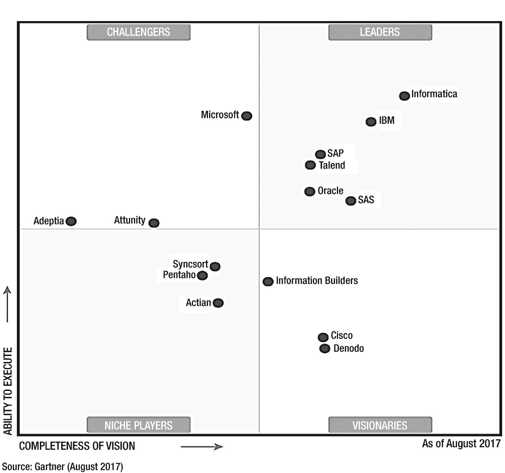

图 2-8：Gartner 商业数据集成产品魔力象限。[`https://www.informatica.com/in/data-integration-magic-quadrant.html`](https://www.informatica.com/in/data-integration-magic-quadrant.html)


## 实时数据摄取

就数据完整性检查而言，批量数据摄取技术是万无一失的。然而，由于存在延迟，它无法描绘业务的实时状况。为了提高分析框架的业务就绪性，在业务交易发生时立即进行处理是明智之举。在（准）实时处理中，变更可以以极低的延迟或实时方式被捕获。基于日志的实时处理操作被称为变更数据捕获。

`Change data capture`（变更数据捕获）指的是通过日志挖掘过程，仅从数据源事务日志中捕获已变更的数据（插入、更新、删除）。实时或微批处理`CDC`通过扫描数据库日志来检测发生时的变更事件。由于对企业资源的访问需求极低，`CDC`不会对源表产生任何负载；从而最大限度地减少延迟，并确保源系统和目标系统之间的一致性。

那么，为何要使用`CDC`？正如我们在上一节中讨论的，传统的 ETL 工具使用`SQL`来提取和批量处理增量数据。由于源数据库体量的持续增长及其并发工作负载，查询性能可能会受到影响。此外，查询本身也会在源系统上产生一部分工作负载。

图 2-9 展示了源系统和目标系统之间的变更数据捕获工作流。

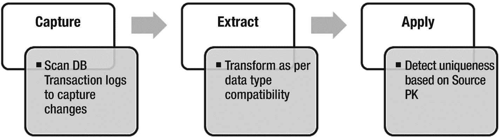

图 2-9

变更数据捕获工作流

作为商业智能和数据合规计划的一部分，`CDC`通过提供主数据管理能力并支持更快速的数据质量检查，有助于符合“数据即服务”原则。

总结要点，`CDC`摄取管道有助于：

*   消除在源系统上运行`SQL`查询的需求。对事务性源系统不产生任何负载开销。
*   实现源和目标之间的准实时复制
*   日志挖掘有助于捕获诸如截断操作等细粒度数据操作

### CDC 设计考量

为了设计`CDC`摄取管道，必须为源数据库启用日志记录功能。所有关系型数据库都通过将变更持久化到日志中来遵循前滚方法。每个事件都会在日志中持久化记录一个变更 ID（或系统变更号），并且永远不会被清除。Oracle 数据库允许在表级别启用补充日志记录。类似地，SQL Server 允许在数据库级别启用日志记录。如果不进行日志记录，就无法挖掘事务日志来捕获变更。

源数据库中的表必须具有用于复制的主键。这有助于捕获作业在已变更的数据集中建立记录的唯一性。源端主键确保变更被应用到目标端的正确记录上。如果源表没有定义主键，`CDC`作业可以指定一个复合主键来唯一标识变更表中的记录。

基于唯一约束来建立唯一性将是一个糟糕的设计，因为它允许列中存在多个`NULL`值。在应用阶段，具有空标识的变更记录将无法在目标端匹配到对应的空记录。

**基于触发器的 CDC** – 设置变更数据捕获的另一种方法是通过表级触发器。触发器有助于在单独的表中同步捕获行级变更，然后这些变更会被复制到目标端。可以捕获整条记录，也可以仅捕获变更的属性以及主键。这种方法的缺点是，在原始事务被视为完成之前，会引入额外一个事务的开销。

这种方法通常适用于两种场景：

*   源数据库未启用日志记录
*   由于事务日志采用二进制格式，读取它们是一项繁琐的任务
*   由于软件限制或保留时间过短，无法扫描事务日志

那么，是否应该总是优先选择`CDC`而非批量摄取呢？并非如此。只有在业务有需求时，才应设置实时集成或`CDC`。这是一个需要基于多种因素（如业务的服务级别协议、变更量大小以及目标系统的就绪状态）来综合考虑的功能。

### CDC 管道示例：Databus，LinkedIn 的开源解决方案

`Databus`是一个实时的变更数据捕获系统，由 LinkedIn 于 2006 年开发。2013 年，LinkedIn 发布了`Databus`的开源版本。自开发以来，`Databus`一直是 LinkedIn 数据处理框架的重要组成部分。`Databus`提供实时数据复制机制，能够处理高吞吐量和毫秒级延迟。`Databus`的源代码可在其 Git 仓库中获取，地址为[`https://github.com/linkedin/databus`](https://github.com/linkedin/databus)。

`Databus`是一个源无关的框架，可以无缝扩展到多个消费者，同时事务性源端保持正常运行。其源代码包含了针对不同关系型源（如 Oracle 和 MySQL）的适配器。图 2-10 展示了`Databus`的工作组件。

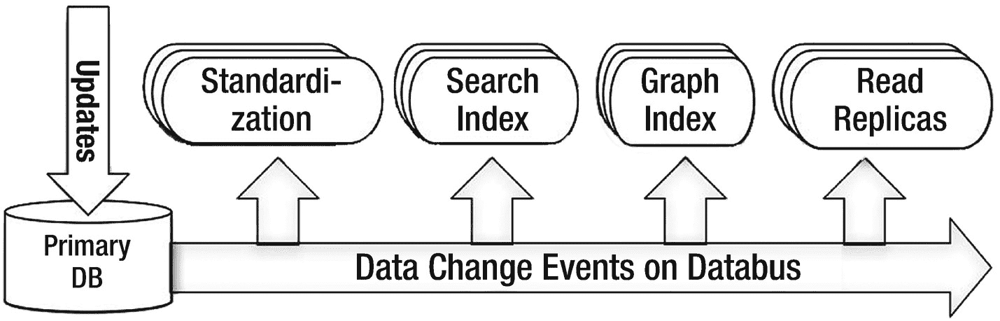

图 2-10

`Databus`组件图。来源：[`https://engineering.linkedin.com/data-replication/open-sourcing-databus-linkedins-low-latency-change-data-capture-system`](https://engineering.linkedin.com/data-replication/open-sourcing-databus-linkedins-low-latency-change-data-capture-system)

`Databus`由三个最重要的部分组成——中继器、引导程序和客户端库。宏观来看，以下列表概述了`Databus`工作流的步骤。

*   中继器负责从源端拉取最近已提交的事务
    *   中继器通过 tungsten replicator 实现
*   中继器以压缩格式将变更存储在日志或缓存中
*   消费者从中继器拉取变更
*   引导程序组件 – 临时实例上数据源的快照。它与中继器捕获的变更保持一致。（参见图 2-11）
    *   如果某个消费者落后并且无法在中继器中找到变更，引导程序组件会将变更转换并打包发送给该消费者
    *   一个新增的消费者可以在客户端库的帮助下，应用引导程序组件中截止到某个时间点的所有变更。然后客户端库会将该消费者指向中继器，以继续拉取最新的变更

    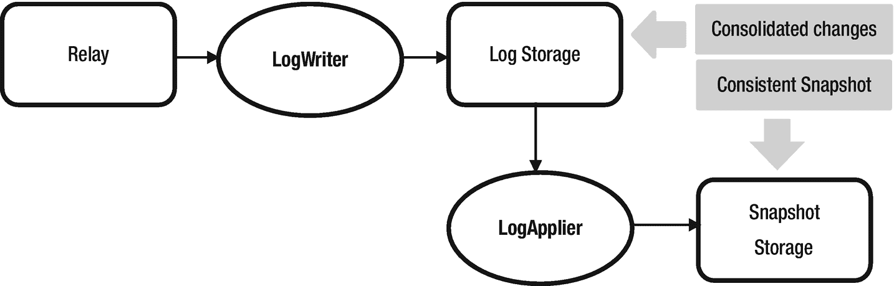

    图 2-11

    `Databus`中的引导程序组件

图 2-12 分项列出了 LinkedIn `Databus`解决方案的优势。

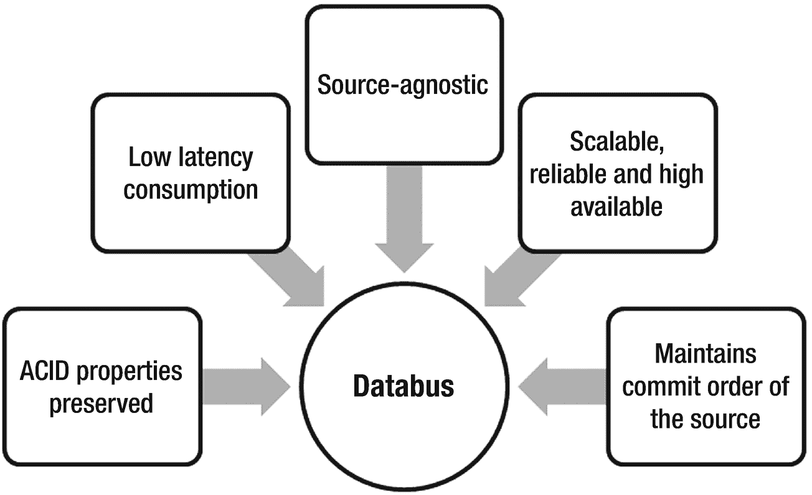

图 2-12

LinkedIn `Databus`的差异化特性

## Apache Sqoop

`Sqoop`或“SQL 到 Hadoop”一直是解决 Hadoop 数据整合需求的顶级 Apache 项目之一。它是 HDFS 层的一个原生组件，支持 Hadoop 分布式文件系统之间双向的“批量”数据流。用户不仅可以实现关系型数据库和 Hadoop 之间的数据自动传输，反向操作还能使企业数据仓库通过来自数据湖的 MapReduce 结果数据来增强其消费层。

Apache `Sqoop`有两个版本——`sqoop 1`和`sqoop 2`。


### Sqoop 1

`Sqoop`的第一个版本于 2009 年问世。2011 年 8 月，该项目移至 Apache 旗下，并迅速成为最受欢迎的数据摄取工具之一。  
连接器是`Sqoop 1`运行的核心驱动力。基于 JDBC 的不同源系统连接器负责获取源对象的元数据和进行数据传输。下面列出`Sqoop`的主要特点：

- 基于 Java 的实用工具（`Sqoop2`中提供 Web 界面），可从`MapReduce`引擎生成 Map 作业，将数据存储到`HDFS`中
- 支持全量提取和增量导入模式
- 在`HDFS`集群上运行，并可填充`Hive`、`HBase`中的表
- 可在`NoSQL`和`HDFS`之间建立数据集成层
- 可与`Oozie`集成，用于调度导入/导出任务
- 支持与多种关系型数据库的连接器，例如`Oracle`、`SQL Server`、`MySQL`

### Sqoop 2

`Sqoop2`是`Sqoop`的后续版本，主要关注优化数据传输、简化扩展框架的使用以及确保安全性。`Sqoop2`采用客户端-服务器架构（基于服务的模型），其中服务器作为两个关键组件（连接器和作业）的主机。

`Sqoop2`的特性如下：

- `Sqoop 2`可以作为任意系统之间的通用数据传输服务。
- `Sqoop 2`附带 Web 界面，交互性更好。命令行工具仍然有效。`Sqoop 2` Web 界面使用运行在`Sqoop`服务器上的 REST 服务。这有助于轻松与`Oozie`和其他框架集成。
- `Sqoop 2`在数据传输活动中同时使用 Mapper 和 Reducer 作业。Mapper 作业提取数据，而 Reducer 操作转换数据并将其加载到目标中。
- 连接器将在`Sqoop 2`服务器上设置，这需要提供源和目标系统的连接详情。对连接对象基于角色的访问可以降低对源和目标系统进行未授权访问的风险。
- 元数据仓库存储连接和作业。连接器在`Sqoop`服务器上注册元数据，以允许连接到源并创建作业。
- 连接器包括分区 API（创建分片并启用并行）、提取 API（Mapper）和加载 API（Reducer）

图 2-13 从`Sqoop`处理层的组件角度区分了`Sqoop1`和`Sqoop2`。

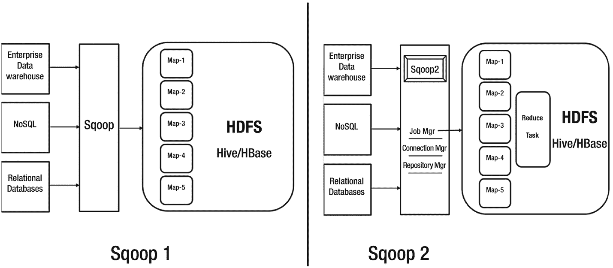

图 2-13  
`Sqoop 1` 与 `Sqoop2`

### Sqoop 是如何工作的？

`Sqoop`采用一种相当简单的方法从关系型数据库中提取数据。简而言之，它会构建一个在源端运行的 SQL 查询来捕获源数据，随后这些数据被摄取到 Hadoop 中。让我们看看`Sqoop`的内部机制。

`Sqoop`利用 Hadoop 中`MapReduce`处理层的 Mapper 作业，将数据提取并摄取到`HDFS`中。默认情况下，一个`Sqoop`作业有四个 Mapper；不过这个数量是可配置的。每个 Mapper 都会收到一个从源系统提取数据的查询。Mapper 的查询是根据拆分规则构建的。根据拆分规则，`--split-by`列的值必须均匀分配给每个 Mapper。这意味着`--split-by`列应该是一个主键。主键的整个范围会被均等切分给各个 Mapper。一旦 Mapper 作业捕获到源数据，它要么被转储到`HDFS`存储中，要么被加载到 Hive 表中。

图 2-14 演示了主键拆分机制。

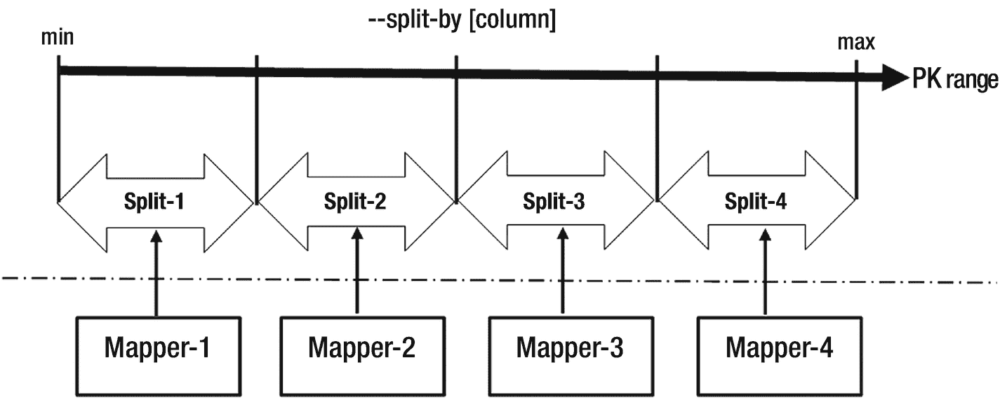

图 2-14  
`Sqoop` 拆分机制

### Sqoop 设计考虑因素

以下是能帮助有效设计`Sqoop`任务的关键因素。

1.  在`--num-mappers [n]`参数中指定 Mapper 的数量  
2.  Mapper 的数量  
    1.  注意，Mapper 在 Hadoop 内是并行运行的，就像并行查询一样  
    2.  Mapper 数量过多可能会增加源数据库的负载。应根据表的大小和源数据库的工作负载来做决策  
    3.  取决于：  
        - 源数据库处理并发查询的能力  
        - 因表、拆分配置和运行时间而异  
3.  如果源表无法按列进行拆分，请使用`--autoreset-to-one-mapper`参数，通过单个 Mapper 执行非拆分的全量提取  
4.  如果源表的所有列都是字符类型，无论是否有定义主键，我们可以采用以下方法：  
    - 添加代理键作为主键并用于拆分  
    - 创建手动数据分区，并为每个分区运行一个 Mapper 的多个`Sqoop`作业。这可能导致数据倾斜，并且作业的运行时长会因每个分片的数据量而参差不齐  
    - 如果字符型键列满足以下条件，则可照常将其用作`--split-by`列：  
      - 具有唯一值（或分区键，如位置、性别）  
      - 具有可以隐式类型转换为整数的值  
5.  稀疏的`--split-by`列  
    1.  使用`--boundary-query`来创建分片  
    2.  其工作原理类似于从另一个查找表中检索分片大小  
    3.  对于文本属性，设置：  

    ```
    -Dorg.apache.sqoop.splitter.allow_text_splitter=true
    ```

6.  导出数据子集  
    1.  如果只需要源表中的部分列，请在`--columns`参数中指定列列表。  
        - 例如，`--columns "orderId, product, sales"`  
    2.  如果只需要“sqooped”有限的行数，请使用`--where`子句并附上谓词条件。  
        - 例如，`--where "sales > 1000"`  
    3.  如果需要导入结构化查询的结果，请使用`--query`子句。  
        - 例如，`--query 'select orderId, product, sales from orders where sales>1000'`  
7.  推荐使用`--hive-import`将数据暂存到 Hive 表中  
    1.  如果表已存在，数据会被追加。可以使用`--hive-overwrite`参数覆盖数据，表示对表进行全量刷新  
    2.  如果表不存在，则会连同数据一起创建  
    3.  使用`--hive-partition-key`和`--hive-partition-value`属性，根据导入数据中的某个列键创建分区  
    4.  默认情况下，数据加载是追加性质的。数据加载方式也可以通过增量方式进行...  
    5.  分隔符可以通过以下任一方式处理：  
        - 指定`--hive-drop-import-delims`在导入过程中删除分隔符  
        - 指定`--hive-delims-replacement`用替代字符替换分隔符  
8.  连接性 – 确保从`Sqoop`节点到源数据库的连接  
    1.  在源端创建并维护一个具有所需访问权限的专用用户  
9.  始终使用`[schema].[table name]`的格式为表名加上模式名前缀  
    1.  以大写形式提供表名  
10. 连接器 – 通用（JDBC）和直接（特定于源）  
    1.  直接连接器性能更好  
    2.  对于`MySQL`、`PostgreSQL`和`Oracle`，使用`--direct`模式参数  
11. 在导出期间使用`--batch`参数来批量插入语句  
    1.  使用 JDBC 批量 API  
    2.  数据库的原生属性（如锁定、查询大小）同样适用  
    3.  `Sqoop.export.records.per.statement (10)` – 将多行数据合并到一条 INSERT 语句中  
    4.  `Sqoop.export.statements.per.transaction (10)` – 每个事务中的插入数量  
12. 保护`Sqoop`作业的方法  
    1.  为确保安全的数据传输，请使用`useSSL=true`和`requireSSL`标志  
    2.  启用 Kerberos 认证  
13. 你甚至可以创建一个`Sqoop Spark`作业来提升`Sqoop`作业的性能  
    1.  随着分片数量的增加，`MapReduce`引擎可能会变慢  
    2.  连接器无需更改。支持可插拔的处理引擎  
    3.  Spark 作业执行：  
        - 数据分片被转换为弹性分布式数据集（RDD）  
        - Extract API 读取记录，而 Load API 写入数据


## 原生数据摄取工具

自从 Hadoop 生态系统进入成熟阶段以来，该技术栈为实施者和从业者提供了极大的灵活性。大数据生态系统本身由多个可插拔组件组成，这反过来又为探索和发现开辟了广阔的空间。数据摄取模式已从紧密耦合的实用工具演变为标准和通用的框架。

许多计划向数据湖迁移的数据库软件供应商，都开发了自有的实用工具来促进其自身数据向 Hadoop 的传输。这些原生工具与通用工具的区别在于，它们在数据放置策略方面拥有深厚的专业知识，并且能够充分利用数据库架构的优势。在本节中，我们将介绍 Oracle 数据库和 Greenplum 提供的用于将数据加载到 HDFS 中的实用工具。

### Oracle `copyToBDA`

“复制到 BDA”实用工具通过将 Oracle 数据库表的数据以 Data Pump 格式导出并复制到 HDFS 中来帮助将其加载到 Hadoop。该工具执行将数据完全提取并加载到 Hadoop 的操作。如果源端数据发生变化，则必须重新运行该工具以刷新数据泵文件。一旦数据泵文件在 Hadoop 中可用，就可以通过 Hive 查询访问数据。

请注意，该工具适用于由 Oracle Exadata 和 Oracle Big Data Appliance 组成的 Oracle 大数据堆栈，最好通过 Infiniband 网络连接。它根据 Oracle Big Data SQL 进行许可。

在底层，该工具使用 `ORACLE_DATAPUMP` 访问驱动和 Exadata 上的 Hadoop 客户端来传输数据。图 2-15 展示了 `CopyToBDA` 实用工具的工作流程。


图 2-15

`CopyToBDA` 实用工具工作流程

附加说明 –

1. “复制到 BDA”工具适用于数据变化频率不高的静态表。原因在于它不允许源数据和目标之间进行持续刷新。
2. 如果表很大，数据可以导出到多个 `.dmp` 文件中。
3. 为了让 Hive 外部表访问导出文件并准备结果集，需要指定适当的 SerDe、InputFormat 和 OutputFormat。
    1. `SERDE 'oracle.Hadoop.hive.datapump.DPSerDe'`
    2. `INPUTFORMAT 'oracle.Hadoop.hive.datapump.DPInputFormat'`
    3. `OUTPUTFORMAT 'org.apache.Hadoop.hive.ql.io.HiveIgnoreKeyTextOutputFormat'`

### Greenplum `gphdfs` 实用工具

Greenplum 提供了 `gphdfs` 协议，用于在 Greenplum 和 Hadoop 集群之间进行批量数据传输操作。当 Greenplum 作为源端时，该工具已成为数据移动的事实标准机制，因为它充分利用了数据库的 MPP（大规模并行处理）能力。在目标端，它可以与多种 Hadoop 发行版配合使用，例如 Cloudera、Hortonworks、MapR、Pivotal HD 和 Greenplum HD。

`gphdfs` 工具必须安装在 Greenplum 集群的所有段节点上。在数据传输操作期间，所有段节点并发地将本地数据分片副本推送到 Hadoop 集群。Greenplum 集群中的段节点数量决定了数据传输的并行度。数据在段上的分布情况对于确定段级进程的工作量起着关键作用。如果表在集群上分布不均匀，`gphdfs` 进程将具有不规则的切片大小，这将影响数据摄取过程的性能。

该工具必须安装在每个段节点上。安装步骤如下：

1. 使用以下命令创建仓库文件

    ```
    wget -nv http://public-repo-1.hortonworks.com/HDP/centos7/2.x/updates/2.6.1.0/hdp.repo
    ```

2. 使用 YUM 安装库

    ```
    yum install Hadoop Hadoop-hdfs Hadoop-libhdfs Hadoop-yarn Hadoop-mapreduce Hadoop-client openssl -y
    ```

3. 设置 Hadoop 配置参数
    1. `gpconfig -c gp_Hadoop_home -v " '/usr/hdp/2.6.1.0-129'"`
    2. `gpconfig -c gp_Hadoop_target_version -v "'hdp2'"`
    3. 设置 Java 主目录和 Hadoop 主目录

图 2-16 展示了 `gphdfs` 实用工具的示意图。

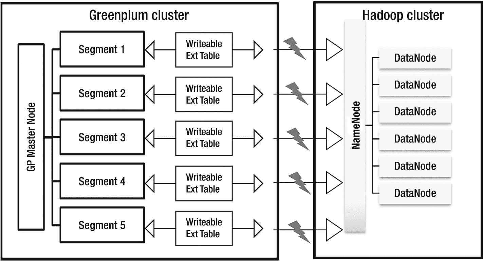

图 2-16

`GPHDFS` 工具的工作原理

#### 设计考量

1. **JVM 和 `gphdfs`** – `gphdfs` 协议在每个段主机上使用 JVM 来访问 HDFS 并写入数据。当在段主机上创建可写外部表并通过 `gphdfs` 访问时，每个段实例会使用 1GB 内存初始化 JVM 进程。如果同时读写多个表时工作负载很高，则可能出现 JVM 堆内存问题。您可以将 `$GPHOME/lib/Hadoop/Hadoop_env.sh` 中 `GP_JAVA_OPT` 参数的值从 1GB 降低到 500MB。
2. **Kerberos 和 `gphdfs`** – `gphdfs` 协议支持针对 Hadoop 集群的 Kerberos 认证。Kerberos 认证详情需要更新到以下文件中 –
    * `Yarn-site.xml`
    * `Core-site.xml`
    * `Hdfs-site.xml`
   另外，`/etc/krb5.conf` 必须存在于 Greenplum 集群中。如果在访问 HDFS 时遇到 GSSAPI 错误，请在 Greenplum 节点上安装 Java 加密扩展（JCE）（位于 `$JAVA_HOME/jre/lib/security`）。
3. **通过 ETL 触发 `gphdfs`** – `gphdfs` 工具可以嵌入到 Python 脚本中，并通过标准的摄取工具（如 Informatica、Talend、Appworx 等）触发。
4. 可写外部表的 `LOCATION` 参数必须包含 Hadoop 集群名称或 HDFS 名称节点的主机名和端口详情。
5. **压缩支持** – 在可写外部表中使用 `compress` 和 `compression_type` 参数，以压缩格式将数据加载到 HDFS 中。
6. 可以使用 Python 或任何其他脚本语言构建自定义加载框架来加载表组（按模式或类别批量加载表）。

### 使用 `gpfdist` 从 Greenplum 传输数据到 HDFS

除了 `gphdfs`，还可以使用 Greenplum 实用工具 `gpfdist` 将数据从 Greenplum 传输到 HDFS。

`gpfdist` 实用工具在 Greenplum 数据库中提供并行文件操作。它可以用于通过边缘节点将数据从 Greenplum 段节点移动到 Hadoop 集群。您可以使用以下脚本在 Greenplum 中创建一个可写外部表。

```
CREATE WRITABLE EXTERNAL TABLE schemaname.tablename_ext
(LIKE schemaname.tablename)
LOCATION ('gpfdist://<host>:<port>/<filepath>')
FORMAT 'TEXT' (DELIMITER E'\x01' NULL '')
```

一旦表数据导出到边缘节点，就需要将其推送到 Hadoop 集群。有两种方法可以将此文件复制到 Hadoop 集群：

1. 使用 Hadoop `put` 命令将文件复制到 HDFS
2. 使用安全复制（`scp`）将文件复制到 Hadoop 名称节点

## 将非结构化数据摄取到 Hadoop

由[机器学习](https://en.wikipedia.org/wiki/Machine_learning#Machine%20learning)文本分析引发的技术和分析进步促使许多企业研究应用（场景），从而推动了情感分析、语音挖掘和预测分析等领域的发展。21 世纪 00 年代末大数据（Big Data）的出现，使得人们对非结构化数据分析在自然语言处理和图像或视频分析等当代领域中的应用兴趣大增。

非结构化数据是指没有预定义数据模型或未按预定义方式组织的信息。非结构化信息通常以[文本](https://en.wikipedia.org/wiki/Plain_text#Plain%20text)为主，但也可能包含日期、数字和事实等数据。这会导致不规则性和歧义性，使得与存储在数据库字段化形式中或文档中注释的数据相比，使用传统程序难以理解。


### Apache Flume

`Apache Flume` 是一个分布式系统，用于从不同的源系统捕获大量日志数据并将其加载到数据湖中。传统上通过网络将数据集从一个系统安全复制到另一个系统的解决方案，仅在数据集相对较小、易于获取和立即可用时才有效。考虑到近乎实时的复制、批量加载以及数据量所带来的挑战，对一款健壮、灵活且可扩展工具的需求不容忽视。`Flume` 恰好符合要求，它是一个可靠的系统，能够将流式事件从不同的源传输到 `HDFS`。

`Flume` 起源于 2011 年的 Cloudera 公司，并作为 Hadoop 技术栈的原生组件进行打包。它用于收集和聚合作为事件的流式数据。该框架基于分布式管道架构构建，包含一个 `Flume 代理`（或多个独立的联邦代理），该代理由一个连接数据源和数据汇的通道组成。`Flume` 保证的是，通过实现代理之间的事务性交换以及通道的可配置数据持久性特性，来提供端到端的可靠性。`Flume` 的拓扑结构可以灵活调整，以优化事件量和负载均衡。

图 2-17 展示了一个通过 `Flume` 从数据源到通道再到数据汇的简单数据流模型。`Flume 代理` 本质上是在一台机器上运行的 JVM 守护进程。

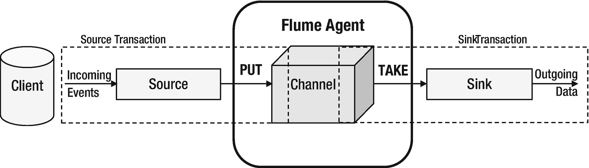

图 2-17

Apache Flume 架构

组件 –

*   一个 `Flume 事件` 是一个字节大小的数据对象，带有可选的头部信息（作为独特信息的键值对），通过代理进行传输。
*   `数据源` 是一个可扩展的组件，它从数据源接收数据并将其写入通道。它可以选择性地拥有一个拦截器，通过标记、过滤或修改来更改事件。推送到通道的事件是 `PUT` 事务。
*   `通道` 根据其配置，将接收到的 `Flume` 事件持久化地排队。它有助于持久化事件并控制数据负载的波动。
*   `数据汇` 从通道拉取数据并将其推送到目标数据存储（可能是 `HDFS` 或另一个 `Flume` 代理）。由 `数据汇` 从通道拉取的事件是 `TAKE` 事务。

从数据源到数据汇的数据流通过事务进行，这消除了管道中数据丢失的风险。`Flume` 最适用于以稳定速率生成数据流的源。源数据可以是同步的，例如 `Avro`、`Thrift`、spooldir 目录、`HTTP`、Java 消息服务，或者是异步的，例如 `SYSLOGTCP`、`SYSLOGUDP`、`NETCAT` 或 `EXEC`。对于同步源，客户端可以处理故障；而对于异步源，则无法处理。类似地，数据汇可以是 `HDFS`、`HBase`（同步和异步）、`Hive`、日志记录器、`Avro`、`Thrift`、文件滚动、`morphlineSolr`、`ElasticSearch`、`Kafka`、`Kite` 以及更多的 `Flume` 代理。

### 用于事件汇聚流的分层架构

可以建立一个包含多个代理的分层框架，以实现事件汇聚流到多个数据汇。采用分层方法可能有多种动机。主要动机是优化数据量分布，并使数据汇免受不均匀数据负载的影响。其他原因可能包括减轻源长时间持有大量事件的负担。

在最外层（第一层）中，松散耦合的独立 `Flume` 代理持有来自数据源的事件流。在后续层中，数据汇总合从前一层数据汇接收到的事件流。这种汇总和聚合过程一直持续到最后一层，然后最内层的数据汇将事件路由到 `HDFS`。代理数量在最外层最多，而事件量在最内层最大。

图 2-18 展示了三个层级，每层包含多个 `Flume` 代理，这些代理从多个 Web 源读取事件流并将数据传输到 `HDFS` 集群。每个数据汇将事件流推送到下一层代理的数据源。第一层的数据源进入第二层，第二层的数据源进入第三层。这展示了汇聚的场景。

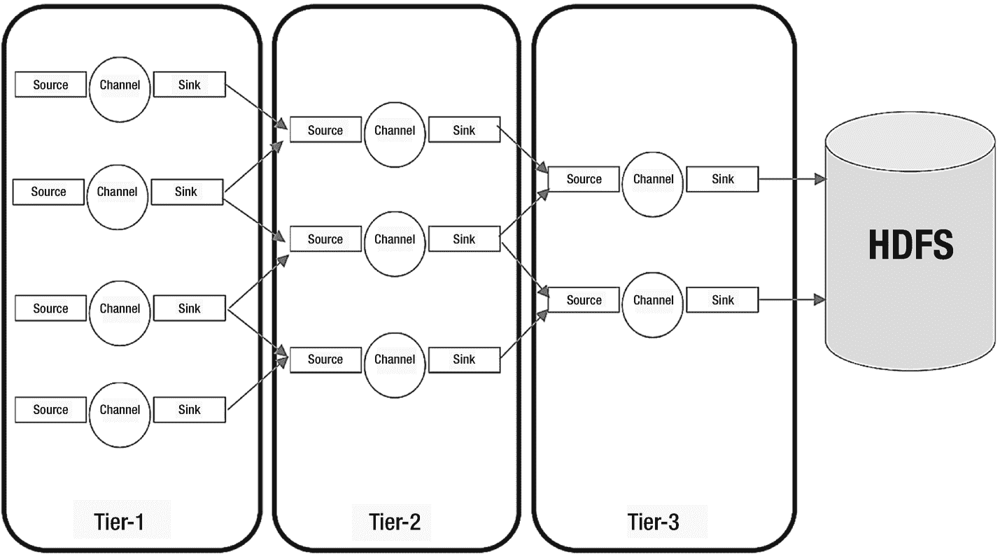

图 2-18

Apache Flume 分层模型

分层架构实现了负载均衡，并在收集器、存储器和聚合器代理之间建立了一个清晰的层级。


### 特性与设计考量

1.  **通道类型** – Flume 内置了三种通道，分别是：`MEMORY`、`JDBC` 和 `FILE`。
    1.  `MEMORY` – 事件从来源读取到内存中。由于是基于内存的操作，事件摄取速度非常快。相反，由于捕获的更改本质上是易失性的，因此代理崩溃或硬件问题等事件可能导致数据丢失。业务关键型事件并非好的选择，但低类别日志可以设置为内存通道。
        1.  你可以使用 `agent.channels.c1.capacity` 设置事件容量。同时也应根据容量增加 Java 堆空间。
        2.  使用 `keep-alive` 来确定将事件写入通道的进程的等待时间。
        3.  较低的写入和读取事务延迟，但对于大型事件来说并非经济高效的解决方案。
    2.  `FILE` – 事件从来源读取并写入文件系统上的文件。虽然速度较慢，但它被认为是三种通道中持久且可靠的选择，因为它使用了预写日志机制以及存储目录来跟踪通道中的事件。设置通道的 `checkpointDir` 和 `dataDirs` 属性以设置存储事件的目录。
    3.  `JDBC` – 事件被读取并存储在 Derby 数据库中。也支持 ACID 特性，但由于性能问题，采用率并不高。
    4.  Kafka 通道 – 事件存储在集群的 Kafka 主题中。这是近期可以适配到多种场景的集成方式之一：
        1.  存在 Flume 源和接收器 – 事件写入 Kafka 主题
        2.  存在 Flume 源 – 事件被捕获到 Kafka 主题中。与其他应用的集成由用例驱动。
        3.  存在 Flume 接收器 – 当 Kafka 从源系统捕获事件时，接收器有助于将事件传输到 HDFS、HBase 或 Solr。
2.  **通道容量和事务容量** – 通道容量是通道中事件的最大数量。事务容量是单次事务中传递给接收器的最大事件数。为通道设置 `capacity` 和 `transactionCapacity` 属性。
    1.  通道容量必须足够大以排队许多事件。这取决于事件大小、内存或磁盘大小。
    2.  对于 `MEMORY` 通道，通道容量受 RAM 大小限制。
    3.  对于 `FILE` 通道，通道容量受磁盘大小限制。
    4.  事务容量取决于为接收器配置的批处理大小。
3.  **事件批处理大小** – 事务容量或批处理大小是单次事务中可批处理的最大事件数。它在源和接收器级别设置。
    1.  在源端设置 – 写入通道的批处理中的事件数量
    2.  在接收端设置 – 接收器在刷新前单次事务中捕获的事件数量
    3.  批处理大小 `<<channel>>.batchSize` 必须小于或等于通道事务容量，以便进行适当的资源管理。
    4.  接收端的批处理大小越大，通道清空空间以容纳更多事件的速度就越快。对于文件通道，对于大容量批次，刷新后的操作可能比较耗时。
    5.  最佳实践是设置能够产生最佳性能的事务容量。没有固定公式，需要逐步尝试。
    6.  如果某个批次在中途失败，整个批次将重放；这可能导致目标端出现重复数据。
4.  **通道选择器（复制器/多路复用器）** – Flume 中的事件可以复制到所有通道，也可以根据条件复制到选定通道。例如，如果一个事件需要被 HDFS、Kafka、HBase 和 Spark 消费，则可以将通道标记为复制器。复制是默认的通道选择器类型。如果一个事件需要根据规则或上下文路由到不同的通道，则可以将选定的通道标记为多路复用器。选择器在事件流到达通道之前生效。

```
agent.sources.example.selector.type = multiplexing
agent.sources.example.selector.mapping.healthy = mychannel
agent.sources.example.selector.mapping.sick = yourchannel
agent.sources.example.selector.default = mychannel
agent.sources.example.selector.header = someHeader
```

如果复制器和多路复用器无法满足需求，也可以开发自定义的复制策略。
5.  **通道配置** – 如果在拓扑结构中通道配置不足，将在事件负载（每个代理的事件负载）和资源利用率方面造成事件流瓶颈。
6.  在多跳流或分层架构中，请注意事件在到达目标端之前所经过的跳数。请注意，代理内的通道在特定时间充当事件缓冲区。如果跳数很多，任何一个代理出现故障，其影响可能会级联到源端。
7.  Flume 遵循可扩展框架。自定义 Flume 组件需要将其 jar 包添加到 `flume-env.sh` 文件中的 `FLUME_CLASSPATH` 里。另一种方式是通过 `$FLUME_HOME` 路径下的 `plugins.d` 目录。如果插件遵循定义的格式，`flume-ng` 进程将从 `plugins.d` 目录中读取兼容的插件。
8.  Flume 拓扑结构高度依赖于用例。对于均匀生成数据的时间序列，Flume 可以发挥出色的作用。如果源数据管道出现问题，Flume 不是一个好的选择，因为它可能潜在地破坏 Flume 拓扑结构并导致长时间中断。不建议频繁更改 Flume 拓扑配置。
9.  由于全球分布，时区已成为数据摄取策略中不可或缺的一部分。所有时间和计划都必须归一化为单一的标准格式时区 UTC。

## 结论

在本章中，我们讨论了将数据接入 Hadoop 数据湖的不同方法。本章从摄取框架的原则开始，并快速回顾了基本的 ETL 和 ELT 概念。我们讨论了批量摄取概念及其设计考量。在实时处理方面，我们探讨了变更数据捕获的工作原理及其在真实场景中的关键驱动因素。本章的两个关键要点是 Apache 基金会的两个产品：Sqoop 和 Flume。两者在将结构化和非结构化数据集成到数据湖生态系统方面都已被证明非常有用。

在下一章中，我们将介绍数据流策略，主要关注 Kafka。


