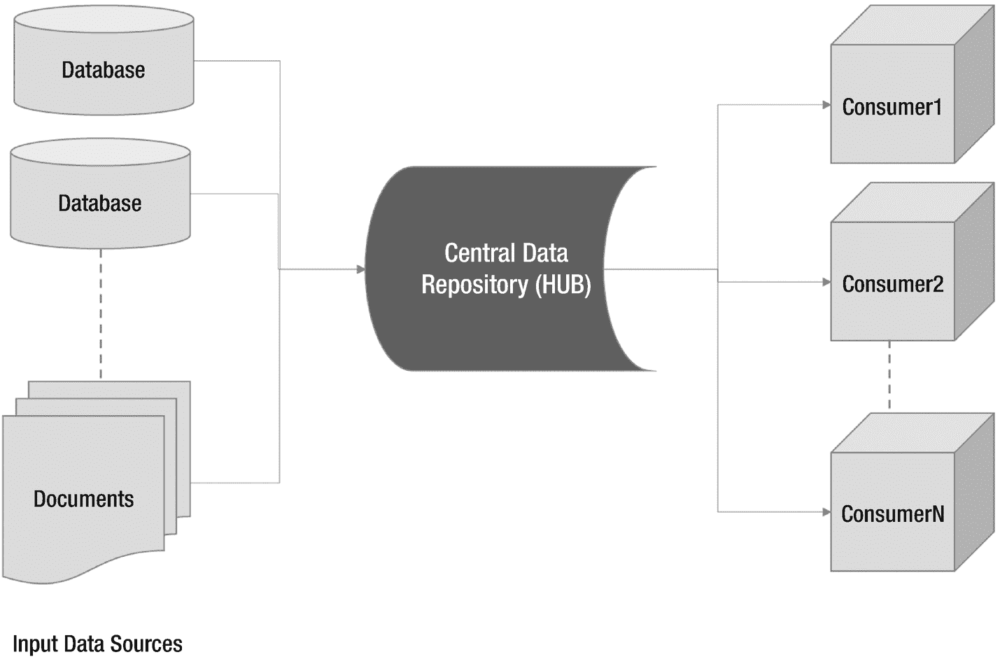
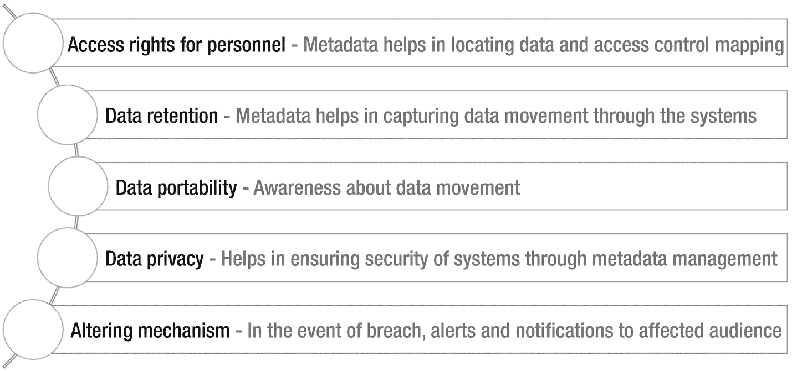
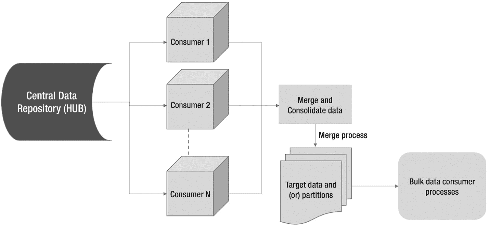
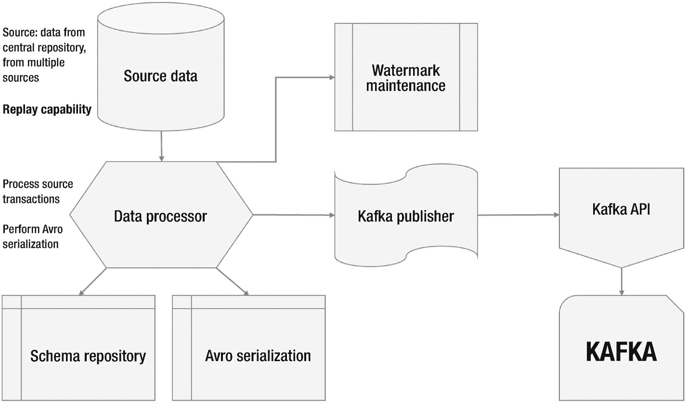

# 3. 使用变更数据捕获技术采集流式数据

> “如果你愿意倾听，数据会对你说话” — 吉姆·伯格森，Bridgz Marketing Group 总裁兼首席执行官

在设计数据湖时，如果不考虑数据源中数据流动的速度，那将是徒劳的。从实时性或“新鲜度”的角度来看，流式数据源正变得日益关键。物联网与移动趋势已如同人权一般普遍存在的时代，需要一个不仅能匹配数据流动速度，还能将其付诸行动的系统。数据湖的受益者和分析消费者面临着摄取持续不断数据流的艰巨任务。

挑战来临，克服挑战的技术也随之出现。随着数据及其产生源的复杂性稳步增长，数据工程领域已发展到能够成功摄取数据流的水平。如前所述，大数据生态系统具有高度灵活性，且解决方案趋势也在持续演进中。本章将揭示使用 `Kafka` 进行变更、数据捕获和事件流处理的原理。我们将努力理解在将数据摄取到数据湖时，变更数据捕获方法的各类范畴。在本章后半部分，我们将学习如何使用 `Kafka` 发布事件。从更宏观的层面看，本章结构如下：

*   变更数据捕获
    *   是什么与为什么？
    *   策略与权衡
    *   保留与重放
*   CDC 工具
    *   操作与挑战
*   下游传播
    *   变更数据的集中化
    *   分析：集中式数据存储
    *   元数据：关于数据的数据
    *   数据格式
    *   消费与检查点
    *   合并与整合
    *   数据质量与挑战
    *   发布到 `Kafka`

## 变更数据捕获概念

变更数据捕获（缩写为 CDC）是任何公司整体数据管理和整合策略中的关键流程。变更数据捕获的一个简单定义是：从其宿主数据存储中提取某条数据已提交的状态变更。数据存储可以是传统的企业级数据库，如 `Oracle`、`MySql`，或者是 NoSQL 存储，如 `Mongodb` 或 `Cassandra`。实际上，任何专有格式，哪怕是原始的管道分隔数据存储，都可能成为变更数据捕获的事实数据源。在此语境下，“已提交”一词非常重要，因为它（或其缺失）可能导致数据不一致，例如，在最终状态转换（具体指回滚）之前捕获变更数据，会导致源系统与下游应用程序之间的数据不匹配。

大多数情况下，系统收集到的输入记录或数据字节，仅通过为该数据服务读取流量，并不能实现其存在的承诺。它需要流向其他下游系统，以实现更宏观的大局目标。事实上，即使某条数据存在的唯一目的是服务于查询原始数据存储的读取客户端，出于验证、追踪或合规目的，仍然可能对其存在有效的变更数据捕获需求。

## 数据捕获策略

捕获数据存储中数据变更的方式有多种。最佳方法取决于各种参数，例如数据的性质和输入数据的流动速率。捕获策略可能跨越多个阶段，包括同步数据捕获以及从同步捕获中聚合捕获数据。

最优策略还取决于驱动数据捕获本身的需求，这些需求可归结为以下几个问题：

*   捕获变更数据的目的/目标是什么？
*   是为了追踪/合规，还是为了聚合/分析报告？对于消费此数据捕获的目标系统，数据可用性的 `SLA` 是什么？

上述所有因素对于确定捕获数据并将其传播到数据流流程/管道下一步的策略都至关重要。

以下是一些有助于制定变更数据捕获策略的属性。

1.  输入数据的性质
    *   数据类型 - 整数、浮点数、字符串、二进制等
    *   大小 - 平均记录大小、平均字段大小
    *   变更性质 - 插入、更新、删除的百分比
    *   变更速率 - 每种变更类型（插入、更新等）发生的频率
    以下是上述属性可能影响的几个示例。
    *   像字符串这样的自由文本数据类型可能会打翻大小和容量的估算，因为它们可能容纳范围极广的数据大小。对于像 `CLOB` 这样的大型文本数据类型，这变得更加不可预测。因此，在大小范围变化极大的数据上采用同步捕获策略（例如触发器），最终可能会使写入客户端的延迟数据偏离预期。
    *   类似的大小问题也可能基于行大小而出现。一些下游系统（如 `Kafka`）可能有消息大小限制；这可能会根据我们处理此场景的方式而改变我们的数据捕获策略。
    *   在我们捕获“前”和“后”映像的情况下，更新、插入和删除可能导致消息大小差异巨大。
2.  CDC 的驱动因素
    *   目的 - 追踪/合规、批量聚合、分析等
    *   `SLA` - （近）实时、小时内、天内等
    *   以下是上述属性如何驱动 CDC 决策的几个示例。
        1.  与数据聚合等目的相比，追踪/合规系统通常需要记录的信息较少。因此，由于涉及较低的数据处理延迟，同步捕获可能是一种可行的策略。
        2.  `SLA` 显然是一个关键驱动因素，因为它决定了数据捕获应多接近实际的数据提交时间。

## 保留与重放

提取数据的保留通常在 CDC 管道中具有很大价值。其主要目的是在发生故障和延迟时便于重用提取的数据，从而避免代价高昂（从资源和时间角度看）的数据重新提取。

由于数据提取的成本通常很高，因此会利用数据保留。根据数据提取的模式（同步或异步），源系统会因使用大量资源来提取数据而产生额外的“成本”。一旦发生任何故障，重做整个流程将是昂贵或不可行的。

数据保留允许数据重放，即，为下游流程重用提取的数据。不同的下游流程可以通过建立基本的检查点机制，从过去的不同时间点进行重放。这里的检查点，指的是保存某个消费者已经成功消费数据的进度点。

### 保留期限

保留期限应根据 ETL 管道的需求来确定。通常，会有诸多影响因素，但一旦所有依赖项得到解决，确定保留时长应该会变得直接明了。

例如，在简单的 ETL 流程中，数据从源数据库中通过异步查询提取，并以分隔符格式保存在文件中。随后，下游进程每小时会消费这些文件，并将数据合并到 `Hadoop` 中。在此简单的用例中，决定数据保留的关键因素包括：

1.  源数据量/事务速率
2.  源数据提取频率
3.  数据量的自然/预期增长
4.  `Hadoop` 合并频率
5.  存储成本与数据提取成本的分析

还可能存在其他因素，例如运行数据提取进程的主机容量，但为简单起见，我们假设其他因素都易于处理。

因素 #1 和 #2 的影响是直接的。这些数字决定了每次运行提取进程时，由于数据提取将产生多少数据。这将帮助我们预估满足数据需求所需的存储空间。

因素 #3 对于确定未来增长的存储需求至关重要。例如，如果公司将在未来几个月推出可能大幅增加数据和事务量的新功能，那么显然需要将此纳入保留规划中。此外，也应始终为数据量的意外峰值或增长预留一些缓冲空间。

因素 #4 很重要，因为它规定了提取流程对下游流程实际有用所需的最小保留期限。例如，如果 `Hadoop` 合并进程每日运行，而变更数据提取每小时发生，那么 CDC 提取的数据至少需要存储一天，以便 `Hadoop` 合并进程能够无数据间隙地消费。此外，这还能预估，如果合并失败，下游进程可能发起的重播请求量。

因素 #5 用于判断是否需要在长期存储大量数据与按需重新提取数据（用于故障和重播场景）之间进行权衡。大多数情况下，与从源系统重新提取数据相比，对已提取数据进行额外保留是更好的选择。

此方法可扩展到任何数据流管道。还可能存在其他与特定用例相关的因素，例如主机容量和网络带宽。在确定数据保留策略时，需要酌情考虑这些因素。

## CDC 的类型

让我们看看变更数据捕获的不同模式：增量式、批量式和混合式。

### 增量式

此模式在提交时或接近提交时捕获变更。其主要目的是在变更发生时提取数据，以便使捕获负载变得可控。增量模式可以是同步或异步的。

同步捕获在源端发生数据变更时立即捕获。虽然此方法具有最低的捕获负载和延迟时间的优势，但它可能会增加将数据持久化到源数据存储的应用程序或系统的延迟。对于这种方法是可行的，写入源数据存储的客户端必须接受捕获时间带来的额外延迟。客户端遭受的额外延迟也会随着输入数据量和提交块大小而变化。要使此方法成功并随时间推移保持可扩展性，必须考虑所有这些因素。

异步捕获是在源数据库提交变更后，从事务日志中捕获变更。由于是在事务提交后从日志中读取变更，因此对事务本身没有影响。必须启用适当级别的补充日志记录才能实现异步捕获。

### 批量式

批量式捕获按时间跨度分块提取数据，例如每小时提取一次数据。这种批量提取可以直接在源数据存储上进行，也可以对通过同步捕获提取的数据进行聚合/ETL 准备。

如果批量提取直接在源数据存储上进行，那么运行提取进程时会给源端带来额外的数据提取负载。此策略对源数据存储的影响取决于数据存储及其相关硬件上的资源使用水平。高影响也会间接转化为对客户端延迟的影响。

### 混合式

您可以结合使用增量式和批量式策略来进行变更数据捕获。您可以采用包含增量和批量变更捕获的多层 CDC 架构。虽然这种方法会带来数据存储客户端延迟增加的不利影响，但它也拥有前述增量数据捕获的优点。此外，这种方法还可能优化传播到下游或中间集中式系统的变更数据。

例如，如果您的增量捕获是同步的，并提取对某个数据库记录的所有变更，这可能会导致大量变更数据供下游系统消费，原因是一条给定记录可能存在众多版本。这将导致多个下游目的地中的数据占用空间增加。

虽然通常数据多是好事，但如果您的下游只关心合并所有变更并维护源系统的整合副本，这也可能导致数据过载。在这种用例中，如果服务水平协议（SLA）的增幅是可接受的，第二层批量捕获可以在给定时间周期内（例如每小时）进行整合和去重，并将其传播到下一个下游层。

总的来说，变更数据捕获方法需要考虑数据管道内部及周边的各种参数。此处的决策需要权衡利弊，以得出最优策略。让我们探讨一下我们讨论过的 CDC 策略中的一些关键权衡因素。

## CDC – 权衡取舍

如同所有理论原则一样，在实际实施过程中总是需要权衡各种因素。最佳选择可能并非理想方案；但它是最有利且最符合期望的方案，因而得以通行。在之前关于制定良好变更数据捕获流程的策略和方法的总体讨论中，我们曾略微提及一些权衡点。现在让我们详细审视这些方面。

同步增量捕获提供了最快且最接近原始状态的方式来提取系统变更。在这里，“接近原始状态”意味着数据损坏的可能性极小或为零，因为我们在持久化过程本身中提取变更。其代价是延迟；数据写入进程会在延迟方面受到影响。通过使增量提取略微延迟或异步化，可以在一定程度上缓解这一问题。也就是说，我们仍然在持久化后很短的时间内（几秒或几分钟）增量提取数据，但这与原写入进程隔离。然而，要做到这一点，我们需要一个能获取原始事务细节的场所。

对于 `Oracle` 和 `MySQL` 这类关系型数据库，重做日志和二进制日志分别记录了数据库事务活动的运行轨迹。理论上，变更捕获进程可以从这些日志中异步提取数据，且对在线数据库的影响极小或无影响。当然，在某些情况下，日志格式可能是专有的，从日志中提取数据可能需要额外的工具。我们将在后续章节中详细讨论这些工具。但这种异步方法是一种良好的权衡，因为它既能提供接近源数据持久化时间的提取能力，又不会显著影响源数据存储的性能。

这种权衡也可以是混合型的：将同步提取限制在最低必要数据量范围内，即只提取原始、简单的数据，随后再通过异步处理来满足完整的数据捕获需求。

例如，如果数据捕获需求是发送跨三个客户相关表的数据记录在特定时间点的表示，我们可以同步提取单条记录（例如通过触发器），然后异步地连接这些记录，向数据捕获进程提供完整的反规范化记录版本。对于批量捕获，运行批量处理的频率会显著影响其效率。

举个例子：在 1 小时的捕获间隔内需要处理的数据量，80% 的时间可能是可控的；但如果剩余的 20% 时间里数据量依然过大，就可能严重影响整个 ETL 管道的可靠性。如果这 20% 的极端情况导致通过 CDC 管道提供数据时出现显著延迟，那么提高数据捕获频率（例如，改为每 30 分钟一次）可能会使 CDC 管道运行得更加平稳。

## CDC 工具

变更数据可以通过现成的工具提取，也可以基于简单的查询进行提取。这些查询可以是 SQL 形式，也可以是基于源数据库类型的 API 调用。按照所需的频率，定期对 `delta` 列（一个追踪变更的时间戳列）运行查询，以提取数据并将其写入能供给下游进程的位置（如共享存储，例如 `netapp`、`filer`、另一个数据存储系统等）。查询频率需要根据其他因素设定，例如所需的服务等级协议、源数据库的负载、增量数据的峰值容量。

目前有多种免费和许可的工具可用于从 `RDBMS` 和 `NoSQL` 数据库进行增量数据提取。以下是一些常用的工具。

-   数据库触发器可为 `Oracle` 或 `MySQL` 这类关系型数据库提供良好的数据提取机制。然而，正如我们之前讨论的，触发器是同步的，可能导致数据写入操作的延迟增加。通常，由于触发器会对源数据库的性能产生影响，触发器内部的逻辑应保持非常轻量。如有需要，可以在通过触发器提取的数据之上，应用额外的异步数据提取层，以在 ETL 管道内完成进一步的数据聚合需求。

-   适用于 `Oracle` 和 `MySQL` 的 `Oracle GoldenGate` 适配器（大数据和 Java 适配器）。然而，这些工具除了需要 `Oracle GoldenGate` 许可证外，还需要额外的许可。

-   开源工具，如 `Open Replicator`、`Tungsten Replicator`（用于 `MySQL`）。

-   适用于 `Couchbase` 的视图。

### 挑战

CDC 系统的关键挑战在于为其适应当前和未来需求进行合理扩展。扩展策略取决于当前数据量、预期增长以及数据保留策略。正如我们在数据保留部分所讨论的，这些因素可能因不同用例而异。未能进行适当扩展和扩展规划，将导致系统产生巨大的运维开销，以及投入大量新工程来改造系统以适应新状况。

运维便捷性是另一个在开发阶段通常被忽视的关键因素。一个日常运维负担沉重且可用性低的系统，实际上等同于一个无功能的系统。

### 下游传播

从源数据存储捕获的数据，需要根据整个 ETL（提取、转换、加载）流程的目标，流向不同的目的地。

例如，如果目标是将来自多个源数据存储的所有数据集中到一个类似 Hadoop 的批量数据存储中，那么你需要制定一个策略，在源端捕获（增量或批量）数据并将其导向 Hadoop。根据 Hadoop 上所需数据的精细程度，在这个端到端的数据管道中可能存在多个中间阶段。

此外，可能还有其他下游消费者需要相同的数据。在这种情况下，最佳方法是利用已捕获的数据服务于所有下游消费者，而无需为不同的目标数据流设置多个捕获进程。接下来，我们通过一个简单实用的用例来进一步探讨这个场景。

### 用例

公司 A 是一家消费类网络公司，它将来自面向用户应用程序的在线数据存储在 `MySQL` 数据库中。

**下游 #1**

源 `MySQL` 数据需要流入 `Hadoop`，在那里与来自在线用户活动追踪公司的第三方数据进行合并。

**下游 #2**

在线应用程序需要展示来自 `MySQL` 数据库的用户数据。出于扩展目的，应用程序使用缓存层来加速数据访问。因此，来自 `MySQL` 数据库的数据也需要流向这些应用程序缓存。

假设存在一个数据捕获进程，它通过每小时在源数据库上运行查询来执行批量提取。这些查询是在在线数据库的只读从库上运行的。

假设条件——`Hadoop` 中的数据精细度与 `MySQL` 数据库中的记录级别一致，即源数据库中的记录需要按原样传播到 `Hadoop`。缓存中的数据精细度也是记录级别。

现在，如果整个 ETL 策略是提取数据、分块处理，然后转储到目标环境 `Hadoop`（或缓存）中。那么我们将需要两条管道来提取、处理并将数据加载到目的地。

但是，由于我们至少在其中一个数据流中保留了源数据的原始精细度，那么提取出的这份数据显然可以在两条管道中重复使用。要做到这一点，我们可以只提取一次数据，然后重复利用已捕获的数据，将其导向多个下游目的地。换句话说，建立一个通过变更数据捕获获得数据的中央存储库，将节省大量时间和资源，并极大地惠及我们的 ETL 策略。

### 变更数据的集中化

数据集中化使得源数据能够实现一对多的消费模式。它避免了数据流的重复，并便于下游系统轻松消费数据，例如发布-订阅模型。此外，对于变动缓慢的外部数据，集中化可以充当“暂存”层，该层保存所有变更，从而无需费力在变更中进行搜索。这一层带来的好处远远超过其运营开销。图 3-1 展示了如何通过从源数据系统进行单次捕获来服务多个消费者。

此外，即使下游目标需要不同粒度的数据，以所需最低粒度维护的集中式存储也能为全部或部分下游提供数据。例如，一个具有记录级粒度的集中式数据存储，既可以为一个完全聚合数据的下游数据存储提供数据，也可以为一个月度汇总下游数据存储提供数据，该月度汇总存储会将同一数据的月度汇总与其他来源的数据结合起来。

集中式数据存储还提供许多其他优势，如下所示：

-   相比于多个独立的 ETL 管道，由于数据扇出的位置更少，因此可管理性更好。

-   通过检查点和水位线对下游消费者进行控制。

-   具备重放能力，无需重新从源端提取数据；如果 CDC 运行在线系统上，这也意味着对在线系统的影响更小。



**图 3-1**

集中式数据中心有助于通过单次捕获服务多个消费者

### 分析集中式数据存储

对于低事务量的用例，集中式存储可以是平面文件的聚合。从源数据存储中提取的数据可以转储到平面文件中，这些文件可以保留一段时间，以满足管道对多个消费者进行消费和重放的需求。

对于需要更好组织、查询能力和消费者检查点设置的稍微复杂的用例，集中式存储可以是一个更大的数据存储库，其模型仿照某个源数据存储构建。

例如，如果你正在为不涉及高数据量（每天最多几 GB 增量数据）的 `MySQL` 源数据库构建 ETL 管道，你可以将来自各个源的所有增量数据持久化到一个中央 `MySQL` 数据库中。你可以对每个源数据库运行增量 SQL，并将输出导入一个中心数据库。多个消费者可以通过基于这些数据构建的检查点或水位线机制来消费数据。此中央数据存储库中的数据保留将由所有消费者中所需的最长保留期驱动。

对于高数据量和极高数据量的场景，更具可扩展性和分布式的集中式数据存储是首选方案。可以利用发布-订阅消费机制来促进多个客户端的数据消费。可以使用 `Kafka` 以及其他队列系统（如 `RabbitMQ` 和 `ActiveMQ`）来实现这一点。其中一些系统提供了集中数据的分布式存储、针对多个消费者的高效检查点设置以及并行消费能力。

#### 元数据：关于数据的数据

为了使任何数据管道卓有成效，其中流动的实际数据应伴随定义该数据的元数据。元数据是有效数据治理的关键。在此上下文中，元数据是定义数据结构和属性的数据。这可能意味着数据类型、数据隐私属性、精度和小数位数。通常，数据质量与提供的元数据数量和深度成正比。没有元数据，消费者将不得不依赖其他来源和机制。

从合规性和安全性的角度来看，元数据管理也扮演着关键角色。《通用数据保护条例》旨在加强对全球范围内（拥有欧盟公民的）公司对个人数据的控制，以加强数据保护。图 3-2 展示了元数据有助于遵守治理准则的领域。



*图 3-2*

*元数据管理在数据监管中扮演关键角色*

元数据相对于数据本身可以是同步的或异步的。在异步交付的情况下，应注意在源数据可用时尽可能及时地提供元数据；否则可能会破坏某些下游系统。但异步模式避免了元数据与数据的紧耦合，特别是在数据提取时元数据不可用、必须单独获取的情况下。

当使用 `CDC` 工具进行数据提取时，如果该工具在数据提取时未提供完整的元数据，则需要一个单独的进程从源系统中提取元数据。

元数据提取的性质（同步或非同步）应根据元数据的关键性来决定。如果下游系统能够容忍元数据可用性偶尔出现的延迟（至少部分延迟），那么异步模式将是更好的选择，因为它减少了依赖性，从而降低了整体失败的可能性。但是，需要为元数据的可用性定义明确的 `SLA`。可扩展性和高可用性的一般要求同样适用于元数据。即使只有一个下游消费者因为数据和元数据不同时可用而失败，整个数据管道也会变得不可用。

让我们来看看通常需要与数据一起提供的一些元数据特性。

##### 数据结构

数据类型精度（特别是对于数值类型，例如日期）是消费者保持数据保真度的关键要求。例如，数值数据类型的小数位数和精度信息在财务汇总和数据计算中非常重要。

##### 隐私/敏感信息

许多存储成员数据的数据存储都会有一些敏感字段，这些字段在暴露给少数下游系统时需要被屏蔽/清洗，例如 `SSN`、信用卡和收入信息。这些字段应使用所需的元数据进行标记，以便进行适当的后续处理。

##### 特殊字段

另一个常见用例是与上下文相关的字段，这些字段在一组消费者中共同使用。

例如，最后修改时间戳是一个常用值，用于下游系统中的增量数据消费和合并。在这些情况下，元数据应标识具有此值的属性。另一个例子是标识记录是否处于活动状态的属性。

##### 数据格式

只有当数据管道包含数据以及消费者可以用来理解数据的相关元数据时，它才具有实际意义。

正如我们之前讨论的，在管道内随数据一起传播元数据有多种不同方式。无论我们选择哪种方式，都会带来一个新的数据大小问题：将元数据信息与数据捆绑的实际操作。元数据越多，记录的整体数据集大小就越大，吞吐量就越慢（在其他条件相同的情况下）。

这就是我们选择的数据格式变得至关重要的地方。一如既往，过程中存在权衡，实用性必须驱动选择的决策。让我们来看一些实际的选择。

###### 分隔格式

分隔格式非常常见：以逗号/空格分隔，或采用自定义序列分隔的文本。这种选择在数据大小方面非常简单高效；相比实际数据大小，存储开销极低（仅需分隔符的额外空间）。然而，分隔格式仅输出数据，元数据需通过另一条管道流转。

数据与元数据隔离且无依赖性的优势，在以下场景中可能转化为劣势：

1. 下游消费者需要元数据才能理解数据含义。
    - 此时，消费者将阻塞直至元数据抵达。
    - 但如果元数据相对静态，消费者可在本地缓存元数据并用于处理数据。即使元数据变更，处理过程仍可能存在延迟；但如果变更频率极低，为获得紧凑且高吞吐的分隔数据，这或许是可接受的权衡。
2. 元数据频繁变更。
    - 当元数据频繁变更时，消费者必须频繁从其他存储元数据的位置查找元数据。这将增加管道延迟与潜在故障点。

###### `Avro` 文件格式

`Avro` 是一种非常常见的格式，它将元数据嵌入数据本身。这实现了同步的元数据传播与验证。当为数据定义 `Avro` 模式后，运行时将根据模式对流入的数据进行验证。

例如，若某字段定义为数字类型，运行时任何尝试向该字段编码字符串的操作都将被拒绝。这种严格的数据类型与结构验证，在数据标准化方面意义重大，并为存在多个消费者的管道提供了高度可靠性。缺乏验证可能导致因类型不匹配及数据源与下游目标管理团队沟通不当而频繁出现故障。

`Avro` 编码存储格式也相当紧凑，尤其是采用二进制编码时。`Avro` 同样支持 `JSON` 编码。

虽然 `Avro` 是高效的编码格式，但同步编码多少元数据仍需根据实际情况进行权衡。例如，数据类型信息是定义 `Avro` 结构和验证过程所必需的。但额外的元数据（如敏感性信息）必须显式提供。这类额外元数据的传播模式（同步或异步）仍需根据实际考量决定。

###### 消费与检查点机制

一旦建立集中式数据存储以托管来自源数据存储的数据，就需要定义完善的流程来支持多个消费者。

###### 简单检查点机制

一种简单的组织机制是维护一个包含消费者及其当前检查点信息的表格。检查点本身可以是一个时间戳值，表示给定消费者已提取的最后一条记录的时间戳；也可以是表示上次消费点的递增值。像 `Oracle` 这样的数据库提供了可用于下游检查点的数字。其他数据存储也可在提取（`CDC`）过程中生成类似数字。

###### 并行化

当消费者需要并行处理时，消费与检查点流程将变得复杂。例如，若一个消费者可并行运行多个消费线程来消费同一数据，检查点的管理将变得困难得多。

许多发布-订阅模型存储（如 `Kafka`）支持跨分布式节点的并行消费。它们拥有高效的方式处理跨多节点的数据扩展，并同时支持多个消费者和检查点管理。

### 合并与整合

当来自不同数据源的数据进入中央枢纽或存储库后，数据管道的下一步是构建子管道，将这些数据与目标数据存储进行整合。

整合的具体方式取决于输入数据的性质及目标数据集/存储的期望状态。例如，若数据通过增量转储方式传入，且要求维护整个数据集整合后的时间点版本，则需将增量输入数据集与目标数据集合并，以达到目标处的数据期望状态。

若每次输入数据集都是全量数据集（即每次接收源数据的完整转储），则可以每次删除并替换目标数据集。若希望保留旧版本，可将目标移至不同位置或数据存储。这种方法通常适用于中小规模数据集，因为生成大型源数据的完整转储需要大量资源；此外，处理延迟可能导致数据积压至不切实际的处理量级。图 3-3 描绘了从集中式数据枢纽到消费者进程的合并与整合流程。



*图 3-3 合并与整合工作流程*

#### 合并与整合的设计考量

合并与整合是构建目标数据集或数据存储的关键阶段，这些数据集或存储进而可为各种终端客户用例提供服务。这些用例可以用于实时分析或批量处理。通常情况下，此目标数据集会成为对终端用户或内部客户具有重要价值的关键报告的数据来源。

例如，目标 Hadoop 数据存储可以为网站的内部业务分析或用户分析提供服务。整合过程中的任何错误都会对使用此数据的用例产生连锁影响。因此，确保整合过程的健壮性和可扩展性至关重要。接下来，我们列出一些关键的设计考量。

1. **整合/合并逻辑的简洁性** - 这一点对于确保目标数据集的可靠性以及在出现问题时易于调试大有裨益。这里的简洁意味着降低数据损坏或丢失的风险，并拥有一套清晰简单的数据整合规则。例如，如果你需要在数据合并中解决冲突，请确保冲突解决过程简单明了（例如采用"`最后写入者获胜`"策略，即时间戳最新的记录获胜）。尽可能避免提供过多的选项。
2. **应用/合并过程的可重复性** – 数据管道中的环节可能因各种原因时不时发生故障。应用过程应允许数据重放，即对相同数据（全部或部分已应用数据）多次运行应用过程不应导致目标端的数据损坏或丢失。此功能还支持在数据管道内隔离任务。应用过程应能够独立于其他上游过程运行。
3. **目标数据的可管理性** – 在许多企业中，数据通常从事务性数据存储流向批量数据存储。这是因为目标数据存储旨在服务于对来自不同来源的数据进行分析和批量聚合的目的。目标/目的数据存储的大小通常远大于任何单个源数据存储。更重要的是，目标数据存储允许对大量数据进行批量操作。

大多数批量操作都能从底层数据的并行处理中受益良多。如果底层数据本身具有内在的并行性，这一因素将显著优化数据处理。对数据集进行适当的分区可以在目标数据的批量处理中带来可观的性能提升。分区应基于参与批量操作的属性来进行。

例如，如果在庞大的社交网络评论数据集上存在一个"每个用户的评论数"的分析查询用例，按用户 ID 范围对数据集进行分区将允许对底层聚合计算进行并行处理。

### 数据质量

在数据管道中流动的数据质量与管道的功能同等重要。如果管道中流动的数据不是源数据集的有效表示，那么管道就无法实现任何实际目的。在管道的不同阶段加入数据质量检查非常重要。这些检查应验证管道每个阶段数据的正确性。管道不同部分的检查之间应有明确的隔离。这些检查包括行数、结构和数据类型验证。

例如，数据提取后，应根据源数据存储验证数据质量；同样，集中式数据存储中的数据应根据整合/合并输出来验证。如果管道中存在其他中间阶段，则应加入类似的质量检查，以比较每个阶段的输入和输出。当发生数据损坏时，这种界定可以清晰且实际地调试数据质量问题。

沿管道的持续质量检查可提供最大的可靠性。这里的持续检查，是指数据在管道中流动时进行的数据质量检查。由于同一记录可能存在多个版本，持续检查可以对所有或大部分记录版本进行严格的质量验证，从而最大限度地减少随机出现、无规律可循的问题。但如果数据量过大导致持续验证不切实际，则可以批量方式进行质量检查。可以选择特定时间间隔内（给定记录的最新版本）的数据输出，并与上一阶段的批量数据输入进行比较，以验证正确性。

例如，可以将提取阶段在下午 1 点到 3 点之间输出的记录数据，与同一时间间隔内来自源数据存储的输入数据进行比较。可以使用指定此时间戳的属性/字段（例如最后修改时间戳）来提取所需的记录。也可以在全数据集中进行数据采样，以减少比较量。此样本可以基于某个列域值或时间戳的范围。

## 挑战

任何组织内数据管道的复杂性都无法基于一组固定因素以通用方式确定。不同的参数对端到端数据管道的设计和实现产生着不同类型的影响。

## 设计层面

在许多数据环境中，诸如事务量和数据大小等因素通常会产生相似的影响，即都会增加复杂性。然而，诸如数据隐私、敏感度等因素在不同公司之间有所不同，并且随数据类型而变化，即使事务量和数据大小可控，也可能使设计变得复杂。

例如，处理包含社保号等个人信息或信用卡等敏感数据，需要实施更多的检查和安防措施。这可能导致从源端到目标端的数据管道中出现更多阶段和访问限制。在某些情况下，例如 `CLOBs`、图像和 NoSQL 文档，数据可能具有低到中等的事务量，但数据量非常大。

虽然总数据量大小在提取和其他过程中可能是可控的，但下游存储可能对大型记录存在限制或性能下降。例如，`Kafka` 通常针对兆字节级别的消息大小进行了优化；处理大型消息时性能通常会下降。大消息会降低代理的速度，因为它们会给代理带来内存压力。类似地，在集中式存储库是使用某种数据库（如 `MySQL`）的自定义中心的情况下，处理非常大消息的查询性能可能会下降。

### 运维方面

对数据管道的每一个部分进行全面的监控和测量至关重要。如果无法清晰洞察其运维状况，那么维护和运行一个数据管道几乎是不可能的。我们将在单独章节中深入探讨数据传播与整合的运维细节；但以下列出的，是任何数据管道要实现实用价值都必须应对的典型挑战。

1.  **可靠的监控** – 数据管道的每个组件都需要具备监控能力。如果只对整个管道进行高层级监控，而没有对子组件级别的细粒度健康检查，就无法构建一个健壮且可靠的数据管道。子组件级别的监控是必要的，这样才能有效地调试和解决问题，尤其是在数据管道复杂或涉及多个阶段时。监控应嵌入到每个组件进程、每个程序、作业、`SQL`等所有需要运行以支持功能数据管道的环节中。只有主动监控和关注，才能修复问题。响应延迟会复杂化故障恢复过程和恢复时间。此外，对功能及支撑流程的各个方面进行主动监控，还能实现故障的主动检测和预防。例如，检测到数据提取主机上持续增加的负载模式，可以通过主动采取措施来缓解或从问题中恢复，从而防止整个系统崩溃。

2.  **指标** – 指标使我们能够持续洞察系统的运行状况。数据管道内某个组成进程可能正在运行，没有失败，但并未真正达成预期目标。如果没有合适的指标，就无法高效管理数据流，也无法向消费者保证管道的高可用性。过晚发现的功能丧失，对消费者和恢复过程都可能造成巨大的损害。指标使我们能够持续跟踪各个方面的运行情况，并将其与基线指标进行比较。基线指标是任何系统预期的标准状态数值。例如，如果公司用户数据库上层的`ETL`系统预计在周一早上每秒提取约 500 笔交易，那么对于这个数据库`ETL`的指标而言，周一早上的这个数值就是基线。任何显著偏差都可以被追踪并采取相应措施。有时，即使偏差在功能影响上不是负面的，也可能导致对基线本身的进一步修正，这可能是由于流量、功能或其他因素的变化所致。指标还能量化外部因素对核心系统的影响。例如，交易量指标的百分比变化可以量化公司网站上新功能推出或应用程序流程中其他变化所造成的影响。这种衡量方式使我们能清晰洞察影响，便于进行合理的规划。它还提供了灵活性，可以根据不同系统指标所受的影响，缓慢且渐进地推广变更和新功能。

不同的环境可能面临不同的挑战，但通过考虑特定环境的关键因素（如数据类型、数据大小等）来设计数据管道，对于确保管道功能正常并能良好扩展至关重要。另一个重要的挑战是，要确保通过监控和指标提供运维可见性，且这种可见性要具备适当的细粒度，并覆盖系统的各个独立组件。

## 发布到 Kafka

正如我们之前讨论的，有多种方法可以实现管道中源数据提取部分的集中化和整合。这有助于促进源数据在下游数据流中的高效重用和分发，并避免数据收集和聚合过程中的冗余。集中式数据存储模型有几种选择，从简单的中心数据存储（如平面文件、数据库）到高度分布式且可扩展的数据存储，后者能提供可扩展性并支持多个消费者并行处理。

`Apache Kafka` 是高吞吐量用例下作为中央数据存储的绝佳选择，并能为下游消费提供流式数据。以下摘自 `Kafka` 官方网站的详细信息描述了 `Kafka` 的关键能力和特性。`Apache Kafka` 是一个分布式流处理平台。这到底是什么意思？`Kafka` 擅长做什么？

我们认为流处理平台具有三个关键能力——

1.  它允许你发布和订阅记录流。在这方面，它类似于消息队列或企业级消息系统。

2.  它允许你以容错的方式存储记录流。

3.  它允许你在记录发生时对其进行处理。

它被用于两大类的应用——

1.  构建实时流式数据管道，在系统或应用之间可靠地传输数据。

2.  构建转换数据流或对数据流做出响应的实时流式应用。

为了理解 `Kafka` 如何做到这些，让我们深入探讨，从底层向上探索 `Kafka` 的能力。

1.  `Kafka` 作为一个集群运行在一台或多台服务器上。

2.  `Kafka` 集群将记录流存储在称为主题的类别中。

每条记录包含一个键、一个值和一个时间戳。`Kafka` 有四个核心 API——

1.  `Producer` API 允许应用向一个或多个 `Kafka` 主题发布记录流。

2.  `Consumer` API 允许应用订阅一个或多个主题，并处理发布到这些主题的记录流。

3.  `Streams` API 允许应用充当流处理器，从一个或多个主题消费输入流，并产生输出流到一个或多个输出主题，从而有效地将输入流转换为输出流。

4.  `Connector` API 允许构建和运行可重用的生产者或消费者，将 `Kafka` 主题连接到现有的应用或数据系统。例如，一个连接到关系数据库的连接器可能会捕获对表的每一次更改。

在 `Kafka` 中，客户端和服务器之间的通信是通过一个简单、高性能、与语言无关的 `TCP` 协议完成的。该协议有版本控制，并与旧版本保持向后兼容。`Kafka` 客户端支持多种语言。关于主题结构、分区、`Kafka` 内部消息的更多细节，请参考官方文档或互联网上丰富的资料。

让我们聚焦于在数据管道内利用 `Kafka` 作为集中式数据存储的实际方面。

通常，数据可以以任何格式发布到 `Kafka`。数据可以通过 `Kafka` 生产者以分隔格式甚至非结构化格式推送到 `Kafka`。但是，推送数据的结构/格式对于促进下游消费者可靠地消费数据至关重要。通过以标准化格式发布数据来最小化数据生产者和消费者之间的隔离非常重要。如果格式是如 `Avro` 这样的自描述格式，那将极大地简化数据消费者的工作，因为他们可以使用预定义的模式，连同其元数据一起消费数据。使用模式编码的数据保证符合模式定义中定义的数据类型和约束。

## 模式与数据

正如我们之前讨论的，使用定义模式的关键优势之一是能够对数据强制执行模式和约束验证。让我们以使用 `Avro` 模式将数据发布到 `Kafka` 为例。

从数据源提取的数据经过处理并编码为 `Avro` 格式。`Avro` 序列化的记录作为事件发布到 `Kafka`，可供下游消费者消费。发布事件的粒度取决于具体的用例。这意味着：相同的数据源可以以相同的记录粒度写入，也可以根据需求在某种程度的聚合后写入。具有不同聚合级别的相同数据也可以写入不同的 `Kafka` 主题。

数据被写入消费者可以订阅的 `Kafka` 主题。`Kafka` 还允许在数据主题上实施 `ACL`，从而实现访问安全。

### 示例模式

为了更好的可扩展性，数据应使用通用模式写入 `Kafka`。如果需求是将数据从源 `MySQL` 数据库发布到 `Kafka`，作为数据管道的一部分，那么我们假设所需的粒度是源记录级别。

如果源 `MySQL` 数据库有 1,000 张表，那么在发布到 `Kafka` 之前用于编码数据的 `Avro` 模式对于这 1,000 张表将是不同的，因为表结构不同。显然，随着数据源/表数量的增加，这可能会变得复杂。

解决这个问题的一个有效方法是使用通用模式，如下所示：

```json
{
"type" : "record",
"name" : "generic_payload",
"namespace" : "test.Kafka_producer",
"fields" : [ {
"name" : "table_name",
"type" : "string"
}, {
"name" : "schema_id",
"type" : "long"
}, {
"name" : "payload",
"type" : "bytes"
} ]
}
```

上面的模式使用通用格式为所有表发布数据。`payload`字段存储实际的负载数据，对于不同的表，该数据会有所不同。对于由`schema_id`字段指定的负载模式将被使用。此模式对于不同的表是不同的。下游消费者可以引用模式ID值，并使用它来反序列化负载数据。

当然，此流程还需要一个地方供消费者获取与`schema_id`字段值对应的实际模式。需要一个中央存储库供消费者获取不同模式ID对应的模式。我们将在后续章节中详细介绍此模式存储库。

通常，相同的通用负载可以用于为表`t1`发布带有模式`s1`的`payload1`，以及为表`t2`发布带有模式`s2`的`payload2`。这也允许给定表的模式演化，例如表`t1`的模式`s1`可以更改为`s1_new`。由于ID本身包含在负载中，下游消费者可以使用新ID来获取新模式。

### 模式存储库

正如我们之前讨论的，需要一个中央模式存储库来使通用负载和消费流程无缝协作。该存储库可以是一个简单的表和/或API，所有消费者都可以访问它。与数据集对应的Avro模式将使用一个ID（可以是模式本身的简单哈希）发布到模式存储库。这个ID将被嵌入到数据中（来自提供的示例模式中的`schema_id`字段值）。

作为将数据发布到Kafka的一部分，Kafka生产者有责任使此模式存储库保持最新的模式信息。来自新数据源的新模式以及现有源的演化都需要在数据发布到Kafka之前持久化到模式存储库，以便消费者可以继续无缝消费数据。当然，如果新模式向后兼容，即使新模式尚未就绪，消费者也可以继续访问数据。通常，使给定数据集的新版本Avro模式向后兼容是一种很好的做法。



图 3-4

从源数据到数据处理器（通过Avro序列化）的流程

### 多个主题与分区

发布到Kafka的数据从提供并行消费能力的Kafka主题中被消费。从技术上讲，这意味着你可以将所有数据发布到一个主题，并让所有消费者都从该主题读取数据。

但是，这种方法存在实际的限制和考虑因素。例如，来自100张表的数据被发布到单个Kafka主题。某个特定消费者只需要这100张表中的一张表的数据。该消费者可能需要处理对应于100张表的大量数据，才能找到其感兴趣的数据。这可能会给消费者引入不必要的延迟。

通过将那张特定的表写入另一个不同的主题，可以使此管道高效得多。这将为上述消费者实现更快的处理和消费。通常，这种将所需数据组织在不同主题中的方法，将极大地有助于最小化消费者的延迟。这并不总是意味着每张表都写入一个不同的主题；但发布策略需要进行优化，以最小化消费延迟，避免任何消费者处理并跳过大量数据。

类似地，在并行消费方面，可以利用Kafka主题内的分区来进一步推进这种优化策略。写入主题的数据可以按特定字段进行分区。例如，源表中的数据包含不同客户的多租户数据；每个客户由一个客户ID标识。在这种情况下，接收此表数据的Kafka主题可以按客户ID进行分区，以便不同的客户可以高效地并行处理。通过在源数据集中智能地按适当字段对数据进行分区，可以实现类似的优化。

### 规模与扩展

通常，Kafka由于其固有的分布式特性，可以很好地扩展以应对繁重的工作负载。但是，当数据事件的平均大小增加时，性能可能开始下降。具体来说，如果存在消息大小较大（> 1MB）的事件，它们可能会对整个主题的消费产生不利影响。

有一些设置可以调整以允许较大的消息大小；但与许多其他参数一样，这些设置也伴随着权衡。在最坏的情况下，一个非常大的消息可能会降低整个Kafka主题的性能。

对于消息大小较大的用例，需要采用实用的解决方案。解决此事件大小问题的方法之一是将大消息分割成多个小消息，并在消费时重新组装。你可以开发自己的自定义Kafka客户端（消费者和生产者组合），以满足你的需求，处理分割和重新集成。只有少数开源Kafka客户端提供这种分区能力。

#### 工具

将数据发布到Kafka最便捷的方式是，针对所使用的Kafka版本，自行实现并维护利用Kafka客户端的发布代码。每个Kafka版本都有相应的Kafka客户端可用。那些积极投资于Kafka基础设施并为开源社区做出贡献的公司，会发布其定制的Kafka版本和客户端。尽管这种方法要求所有者实现并维护代码和基础设施来管理向Kafka发布数据，但在schema和数据管理方面，它提供了最大的灵活性，并且可能具有最佳的性能。

有许多现成的工具可以接入源数据存储，并将数据发布到Kafka。这些工具允许指定Kafka设置参数，并将数据直接发布到Kafka主题。

然而，它们在schema管理、主题和分区管理方面存在局限性。数据管道将不得不围绕这些有限的功能进行适配，以便将数据流调整到这些工具内可用的选项。

例如，Oracle GoldenGate提供了一个大数据适配器插件，可以将来自Oracle和MySQL表的数据直接发布到Kafka。此插件提供发布到单个主题以及每个表一个主题的能力。它还提供了一个包含负载的通用schema（类似于上面讨论的），以及将schema变更发布到一个schema主题的能力。

像这样的工具能够提供即时且便捷地发布源数据的能力。但在灵活地将数据分布到多个主题和分区方面，存在明显的局限性和权衡。此外，目前的通用负载非常僵化，缺乏灵活性，无法根据需要添加更具描述性的字段，例如事件标识时间戳。

其他数据存储也存在类似的工具。但它们几乎总是在功能和设计上存在局限性。如果它们提供的功能足够好，最佳方法就是利用这些工具来简化数据管道。

## 结论

本章讨论了使用Kafka进行变更数据捕获和事件流机制的原理。在本章中，我们始终坚持一个事实：基础原理和策略远比执行更为关键。如果我们充分理解数据源，并清楚变更如何进一步流向消费者，我们就可以规划出一个高效且稳定的实现方案。

在下一章中，我们将开始探讨数据湖中的数据处理策略。这对于具有数据库开发背景的读者来说将非常有趣。读者将理解如何使用Hive、Pig和Spark在数据湖中处理数据的方法。