# 4. 数据湖中的数据处理策略

> 在拓荒时代，人们用牛来拉重物，当一头牛拉不动一根圆木时，他们不会试图去养一头更大的牛。我们不应该试图制造更大的计算机，而应该制造更多的计算机系统——格雷斯·霍珀，美国计算机科学家

数据分析的趋势具有颠覆性。说在数据分析从业者群体中，存在着关于数据处理的精益思想流派，以及提取对业务有意义的洞察的流派，这是一种轻描淡写的说法。随着对数据需求的急剧增长，数据管理实践已经成倍增加；这反过来又强化了行业中的高级分析专业知识和数据管理策略。制定数据策略背后的思考过程是由用例驱动的，并辅以技术能力、学习动力，以及最重要的是，挑选关键发现并将其放大为可操作的洞察以吸引客户和推动业务的能力。数据分析实践取得成功的秘诀在于维持一个“序言”，该序言设想了与业务用例一致的最终目标；无论是短期还是长期。在之前的章节中，我们讨论了数据分析的支柱，即数据工程、数据发现、数据科学和数据可视化。数据工程提供了一个相对更大的领域，涵盖了数据摄取原则、处理技术以及开发。

数据工程的方法涵盖了数据摄取和数据处理。自从谷歌发表了关于分布式框架的白皮书以来，通过一系列耀眼的创新，数据分析的范畴已经达到了一定的成熟度。这些创新贯穿了不同的层面，如数据摄取、处理、工程方法和数据表示。在最后两章中，我们解决了将数据引入数据湖的挑战。本章的重点是理解如何访问数据湖中的数据。我们将从经典的并行计算框架开始，涵盖关键主题，包括使用 `Hive` 在数据湖中进行数据仓库建设、使用 `Pig` 进行数据操作，以及现代处理框架，即 `Spark`。

## MapReduce 处理框架

2004 年，谷歌工程师杰弗里·迪恩和桑杰·格玛瓦特发表了一篇关于分布式处理框架的白皮书¹。该白皮书阐述了一个在操作上分布式的框架，旨在处理海量数据。以下是他们的原话：

> “我们的抽象概念受到 `Lisp` 和许多其他函数式语言中存在的 `map` 和 `reduce` 原语的启发。我们意识到，我们的大多数计算都涉及对输入中的每个逻辑“记录”应用 `map` 操作，以计算一组中间键/值对，然后对所有共享相同键的值应用 `reduce` 操作，以便适当地合并派生数据。”

简而言之，`MapReduce` 是一个用于大规模数据集的并行处理框架。让我们先粗略地看一下这个编程模型。在专用的处理范式中，数据计算层是静态的。在处理过程中，数据从存储层移动到处理层。另一方面，在分布式处理框架中，计算逻辑被下推到存储层。这意味着一个处理单元被实例化，并且每个“处理”实例都下放到数据所在的节点上。这种方法从稳定性到优化角度都带来了巨大的好处。程序单元的一个实例在 Java 容器（JVM）内的数据节点上本地运行。它消耗驻留在本地磁盘上的一部分数据。由于处理过程在多个节点上并行运行，负载分散到整个集群；从而极大地提高了性能。此外，与过去不同，网络永远不会成为瓶颈，因为没有数据移动。

### 动机：为什么需要 `MapReduce`？

> “`MapReduce` 的美妙之处在于任何程序员都能理解它，而其力量则源于能够通过那个简单接口调动数千台计算机。”——著名计算机科学家大卫·帕特森。

为什么我们需要一个分布式处理框架？其动机与该范式本身一样鲜明而简单。在标准的面向过程的架构中，两个系统通过消息（消息处理接口）进行交互。在分布式环境中，每个节点通过 `SEND` 和 `RECEIVE` 消息进行交互。消息一旦发出，另一个节点必须接收并回传确认位。网络相关的通信不仅会增加延迟，而且集群节点间通信的任何丢失都会影响集群的健康状况。在处理海量数据时，网络确实会成为瓶颈。考虑以下场景：当一个算法处理大量数据，或者你需要对 PB 级和 TB 级的数据进行排序时。

为了防止网络拥塞，可以将处理过程下推到商用集群的节点上。利用节点上的数据子集，处理操作会生成中间输出文件。`reducer` 操作对这些中间输出文件进行处理，以聚合或合并最终输出。“下推”操作是指将进程实例分配给数据节点，并将值映射到键的步骤，而值的聚合则是对多个中间输出进行 `reducer` 操作以生成最终输出。因此，包含 `map` 和 `reduce` 任务的操作被称为 `MapReduce`。

在 Hadoop 0.20 版本中可用的 `MapReduce` 风格被认为是 `MapReduce` 的第一版。在 Hadoop 0.23 中，`MapReduce` 框架引入了一个名为 `YARN`（另一种资源协调器）的资源管理组件。我们将在复习完 `MapReduce` V1 的概念之后介绍 `YARN`。

### `MapReduce` V1 复习与设计考量

图 4-1 展示了经典 `MapReduce` 操作中涉及的组件。

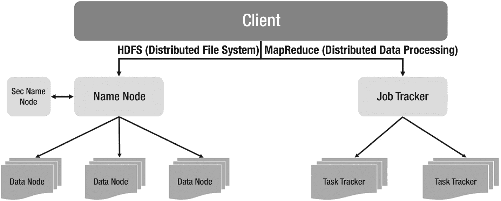

图 4-1 一个经典的 `MapReduce` 操作

作为快速复习，让我们聚焦于 `MapReduce` 框架的关键要点——

1.  两个主要阶段：`map` 和 `reduce`。两个阶段的输入和输出数据格式均为键值对。
    1.  从数据访问和可用性角度来看，基于键值的数据分布至关重要。
    2.  `Key` 和 `Value` 是 Java 对象。
        1.  `Value` 实现 `Writable` 接口。
            1.  `Writable` 使得序列化快速且简单。
            2.  例如 `IntWritable`、`LongWritable`、`FloatWritable`、`DoubleWritable`、`Text`。
        2.  `Key` 实现 `WritableComparable` 接口。
            1.  可以对 `WritableComparable` 进行比较以确定顺序。
2.  `Mapper` 任务在所需数据块所在的节点上并发运行。这避免了通过网络传输数据，并带来了并行处理的优势。`Mapper` 任务在节点本地或指定位置生成中间输出文件。
    1.  `Map` 是一个无状态操作。
    2.  继承 `Mapper` 基类。`LongWritable` 和 `Text` 是输入键值类型。`Text` 和 `IntWritable` 是输出键值类型。`Key` 是 `WritableComparable`，而 `Value` 是 `Writable`。
    ```
    public class SampleMap extends Mapper
    ```
3.  可以创建 `Map` 方法进行实际实现。
3.  `Mapper` 类——
    1.  根据 `mapper` 类的逻辑，将输入键值对转换为中间键值对。
    2.  输入和输出文件格式在类型和数量上可能不同。
    3.  每个由 `InputFormat` 生成的输入分片对应一个 `map` 任务。`InputFormat` 在驱动代码中指定，其中包含——
        1.  HDFS 上的输入数据位置。
        2.  如何创建输入分片。
        3.  创建 `RecordReader`，在 `mapper` 使用数据之前将其解析为键值对。
        4.  `TextInputFormat` 会创建 `LineRecordReader` 对象。
        5.  其他标准输入格式——
            1.  `FileInputFormat` —— 所有基于文件的 `InputFormat` 的抽象基类。
            2.  `KeyValueTextInputFormat` —— 以 '\n' 结尾的行被视为 [键值] 对（制表符分隔）。
            3.  `SequenceFileInputFormat` —— [键值] 对二进制文件。
            4.  `SequenceFileAsTextInputFormat` —— 将 [键值] 映射为 `key.toString()` 和 `value.toString()`。
4.  只有当所有 `mapper` 任务都完成后，`reducer` 任务才会在节点上并行启动。
    1.  可以通过使用上下文方法写入输出键值对，将 `Mapper` 的输出存储在 HDFS 中。
5.  `Reducer` 操作内部使用中间阶段（如 `combiner` 以及排序和 `shuffle`）来优化功能。
    1.  单个 `reducer` 或多个 `reducer`。
    2.  继承 `Reducer` 类并重写 `Reduce` 函数。注意输入和输出键值对参数。`Key` 是 `WritableComparable`，而 `Value` 是 `Writable`。
    ```
    public static class Reduce extends Reducer
    ```
6.  `Reducer` 类——
    1.  `Shuffle` 和 `Sort` 阶段在 `Mapper` 阶段结束后开始，并在为 `Reduce` 操作获取输入时进行。
        - `Shuffle（洗牌）` – 将单个机器上与某个键关联的所有值进行整理。
        - `Sort（排序）` – 对输入的键应用归并排序。

# MapReduce 和 YARN 核心概念

## 2. MapReduce 核心概念

1.  Reducer 对与每个键关联的所有值调用（顺序的）聚合函数。与键关联的 Reducer 输出，通过上下文对象写入 `RecordWriter`。

2.  并行性是通过对多个键进行并发的 Reducer 操作来实现的。

## 3. 并行性实现

### 7. Map 和 Reduce 类

Map 和 Reduce 类必须打包成一个作业才能提交给 `JobTracker`。

### 8. JobTracker 和 TaskTracker

1.  `JobTracker` 是主守护进程，负责分配 Mapper 并跟踪任务执行进度。
2.  `TaskTracker` 是从守护进程，运行在数据节点上，负责启动 JVM 来执行 Mapper/Reducer 操作。

### 9. MapReduce 流程架构（图 4-2）

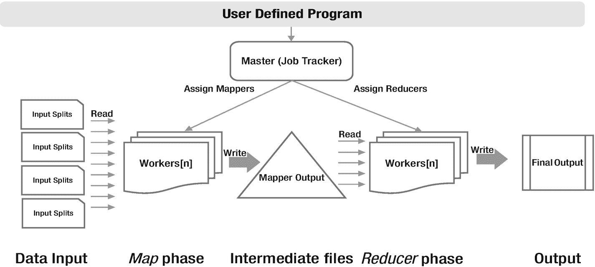

图 4-2：MapReduce 面向流程的架构

### 10. SETUP 和 CLEANUP 方法

1.  `SETUP` 方法用于执行 Mapper 前操作，如初始化数据结构、读取外部数据、设置自定义参数或状态检查。它首次在 map 方法执行前运行。
2.  `CLEANUP` 方法用于在作业操作结束后执行特定操作。

### 11. 仅 Map 操作

1.  数据采样、ETL 或图像处理只需要 Mapper 阶段。
2.  将 Reducer 数量设置为 0。
3.  `Job.setNumReduceTasks(10)`
4.  使用 `job.setOutputKeyClass` 和 `job.setOutputValueClass` 替代 `job.setOutputKeyClass` 和 `job.setMapOutputValueClass`。
5.  因此，`context.write` 会将输出的键值对写入 HDFS，而不是数据节点。

### 12. Reducer 的数量

1.  默认使用单个 Reducer。
2.  如果最终输出中的所有键都需要排序，则仅使用单个 Reducer。
3.  在以下情况下，单个 Reducer 可能成为瓶颈：
    - Mapper 输出有多个键。
    - 待处理的数据量巨大。
    - 对 Mapper 的键进行分区是一种良好的实践。

### 13. 压缩

通过在 Map 和 Reduce 阶段后压缩输出，压缩可以提高性能。

1.  将 `mapred.output.compress` 设置为 `TRUE` 以在作业输出级别启用压缩。
2.  将 `mapred.comperss.map.output` 设置为 `TRUE` 以启用 Mapper 输出的压缩。
3.  支持的压缩编解码器 – Java zlib、LZO、bzip2。

### 14. 推测执行

如果一个任务运行缓慢，Hadoop 会尝试运行它的多个实例。哪个任务先完成就视为成功，其余所有实例都会被暂停。要在 Map 和 Reduce 阶段启用推测执行，请设置以下两个参数：
- `Mapred.map.speculative.execution = true`
- `Mapred.reduce.speculative.execution = true`

### 15. 局限性

1.  `可扩展性受限` – `JobTracker` 运行在单个数据节点上，负责执行资源管理、任务调度和监控等任务。
2.  `JobTracker` 暴露了单点故障。如果 `JobTracker` 失败，所有 Mapper 操作都会中止。
3.  `资源管理次优` – 对于 `TaskTracker`，Mapper 和 Reducer 进程的数量是预先固定好的，无法灵活利用。即使有未使用的 Reducer 槽位可用，`TaskTracker` 也无法添加超过上限的 Mapper。

### 16. 遵循 MapReduce 思路的其他框架

1.  `Microsoft Dryad` – 基于有向图的处理，程序作为顶点，通道作为边。多个程序通过单向通道连接。
2.  `Yahoo! S4` – 它是一个通用的分布式流式计算平台，用于处理无界数据流。
3.  `Google Pregel`
4.  `Twitter Storm`

---

## 另一种资源协调者 – YARN

MapReduce 2.0 (MR2) 或 YARN 是在 Hadoop-0.23 中引入的，旨在通过解决 MapReduce V1 (MR1) 的复杂问题来对其进行改造。在经典的 MapReduce 框架中，集群利用率、资源管理和作业监控等关键因素被重新分配以达到最佳水平。与 MR1 不同，集群必须被视为一个资源网格，其中资源可以根据需要分配或释放。

在 MR2 中，通过维护一个用于资源管理和作业调度的中央主体来组织资源分配和作业操作。图 4-3 列出了使用 YARN 的好处。

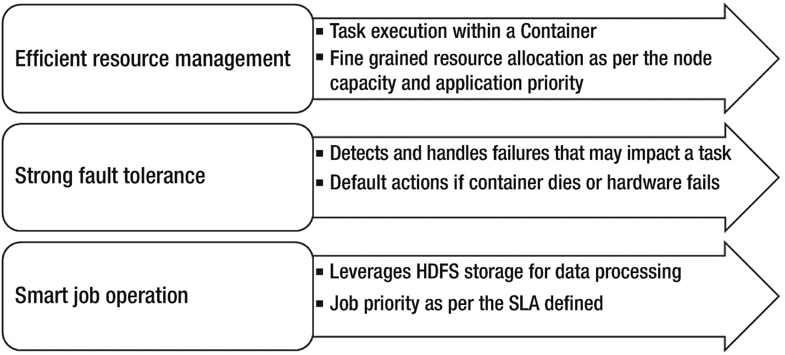

图 4-3：YARN 的好处

为了实现有效的资源管理，YARN 架构采用两个组件 – 全局资源管理器 (`RM`) 和应用管理器 (`AM`)。全局资源管理器是一个中央主体，主要负责控制 Hadoop 集群中的资源利用率。应用管理器负责处理正在数据节点上执行的应用的任务操作。它由全局资源管理器 (`RM`) 启动，为任务监督资源，并与节点管理器通信以调度、执行和监控任务。

YARN 通过检查 `applicationMaster` 的状态来确保任务执行的可用性。如有必要，`ApplicationMaster` 可以从其上次执行的状态重新启动。`Zookeeper` 有助于实现从主 `ResourceManager` 到备用 `RM` 的故障转移机制。

### YARN 概念

YARN 的工作方式是每个 MapReduce 操作都会实例化成一个 YARN 应用。让我们快速回顾一下 YARN 的关键概念：

1.  **全局 ResourceManager** – 负责集群级别的端到端资源管理。
    - 将其当前状态属性转储到 Zookeeper 中以实现高可用性。
2.  **两个主要组件**：
    - **调度器 (Scheduler)** – 为应用分配资源。它接收并整理来自 `ApplicationMaster` 的所有请求，并根据优先级和容量进一步分配资源。
    - **应用管理器 (ApplicationsManager)** – 通过 `ApplicationMaster` 管理作业操作。它确保作业处于活跃状态、经过优化，并且 AM 具有平稳的生命周期。
3.  **NodeManager** – 在每个从节点上运行的代理，负责启动应用容器、与 `Scheduler` 协调调度任务以及资源监控。`NodeManager` 和 `ResourceManager` 的联合行动构成了一个稳定的数据处理框架。
4.  **Application Master** – 根据 `ApplicationManager` 的指示与 `NodeManager` 合作，为容器分配任务。它可以针对每个应用进行自定义开发以满足需求，并根据定义的 SLA 协调作业操作。
5.  **Container** – 容器是一个 JVM，充当应用任务执行的“家园”。在 MapReduce-1 中，`JobTracker` 会为 Mapper 和 Reducer 分配槽位；这些槽位是固定的，无法确保最佳的资源利用率。容器通过在任务执行过程中进行交换，并支持基于内存和计算能力等参数进行分配，取代了固定槽位的方法。`ContainerLaunchContext` 表示一个对象，其中包含启动容器所需的资源以及要执行的命令。

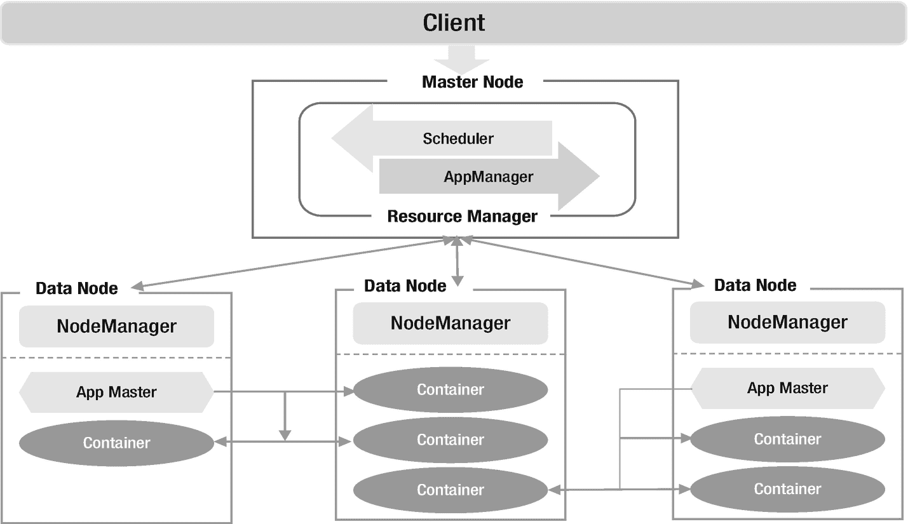

图 4-4

## YARN 的子组件级设计

YARN 应用程序的执行遵循以下步骤：

1.  客户端向资源管理器 (`RM`) 提交应用程序。
2.  `ApplicationManager` 守护进程启动并向 `RM` 注册。它估算应用程序所需的资源。
3.  `RM` 与节点管理器 (`NM`) 协调，在其中一个节点上启动 `ApplicationMaster` (`AM`)。
4.  `AM` 从 `NameNode` 收集请求详情，并向 `RM` 提交资源请求以执行任务。
5.  `RM` 将来自 `AM` 的请求放入队列，直到工作节点上的资源被释放。
6.  `AM` 从 `RM` 接收容器，以在特定主机（从节点）上执行应用程序任务。
7.  `AM` 与 `NodeManager` 协调，将任务分配给容器。`NodeManager` 协助进行任务调度和资源监控。
8.  成功执行后，`AM` 向全局资源管理器确认作业状态。

### 资源模型与资源协商要点

1.  每个节点可以启动多个大小为 512M 或 1G 的容器。
2.  每个应用程序的 `ApplicationMaster` 根据资源需求请求容器，并受限于应用程序的容量上限。

# Hive

人们普遍认为 Hadoop 平台已经很好地解决了数据量的挑战；无论是存储容量还是数据处理能力。自非传统数据源出现以来，数据的表现形式发生了根本性变化。以数据为中心的挑战不仅仅是数据量和速度，处理和操作处理增加了所谓“数据挑战”的复杂性。

大多数数据处理层都是用低级语言编写的。越来越多的学派指出，数据处理层的主要实现者和执行者是数据开发和数据分析专业人员，他们可能不熟悉 Java 或其他低级语言。数据库专业人员对结构化数据处理语言感到得心应手。这种需求催生了查询语言的概念化，这些语言可以改造 Hadoop 处理层，并在 MapReduce 之上提供一个抽象层。

Hive 项目由 Facebook 于 2007 年启动。它为在 Hadoop 上执行数据仓库的非 Java 从业者提供了一种解决方案。Hive 使用一种类似 SQL 的声明式查询语言 `HiveQL` 与 Hadoop 集群通信。它与 SQL 语义的高度相似性是其被数据分析社区广泛采用的主要原因。

Hive 是为数据专业人员提供可扩展性和易用性而创建的。Hive 查询的性能可能比预期的慢得多，因为低延迟从来不是 Hive 的目标之一。它不是为在线事务处理而设计的。然而，通过诸如 Tez 和 Long Live and Process（`LLAP`）等最新工作，可以针对低延迟需求优化 Hive 的性能。我们将在本章后面讨论这些主题。

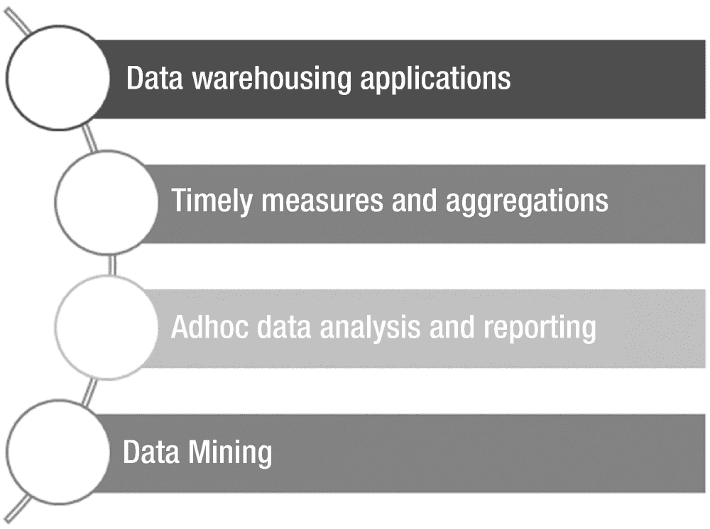

**图 4-5** – Hive 以数据为中心的能力与关键数据仓库目标保持一致

## Hive – 快速回顾

在本节中，我们将快速回顾 Hive 的架构、能力和概念。由于 Hive 在 MapReduce 之上形成了一个抽象层，所有 `HiveQL` 语句都被转换为 MapReduce 作业，然后在 Hadoop 集群上执行。

标准查询的基本结构表明，它必须使用结构化格式的数据源，而不是平面文件。Hive 能够为各种数据格式提供结构，即对非结构化数据集进行“读取时定义模式”。这是通过 Hive 元存储实现的，它充当包含表定义的目录。

### Hive 组件

以下是通过 Hive 执行查询所涉及的组件列表。

1.  **交互式 shell** – 发起查询的环境。

2.  **Hive 驱动** – 接收查询请求，负责查询操作，例如创建会话处理器并将查询传递给编译器。

3.  **编译器** – 解析查询，在元存储中查找对象验证，并生成优化的执行计划。

    -   由解析器、语义分析器、逻辑计划生成器和查询计划生成器组成：

        -   语义分析器通过访问元存储获取表定义和列属性，对查询进行完整性检查。

        -   计划生成器负责将执行计划转换为 MapReduce 任务。

    -   优化包括对不同查询块进行性能分析并实现计划转换。例如，元存储查找可以揭示表的分区策略，查询谓词可以确定是否可以修剪分区。类似地，隐式数据类型转换也在编译级别得到处理。

    -   执行计划是一个有向无环图（`DAG`），其中包含查询执行所涉及的操作阶段。

4.  **执行引擎** – 获取数据并准备查询结果集的物理操作。

5.  **Hive 元存储** – 它是 Hive 操作的核心。它构建了一个数据抽象层，并能够将数据可变性提炼为定义的形状和结构，即模式和表定义。

    -    `HiveServer` 或 `HiveServer2` 为外部应用程序提供通过 `JDBC`/`ODBC` 连接的 Thrift 接口。

图 4-6 中的架构图展示了 Hive 不同组件之间的连接。

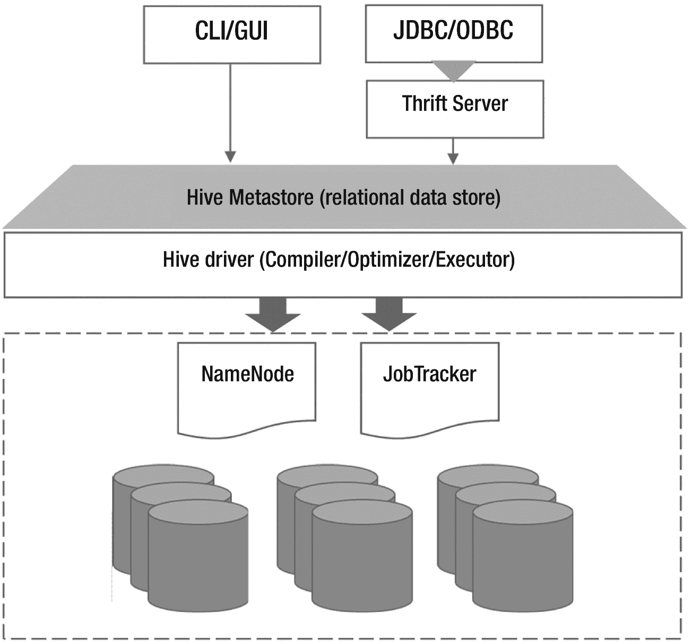

**图 4-6** – Hive 架构

### Hive Metastore（又称 HCatalog）

Hive Metastore 是 Hive 查询系统的中央模式存储库，用于存储 Hive 数据模型（表、分区和桶）的元数据、序列化器和反序列化器，以及 HDFS 文件位置信息（图 4-7）。关系型数据库存储作为 Hive Metastore 的后端。其后端部分由名为 Data Nucleus 的对象关系映射解决方案实现。Hive Metastore 可以与 Derby、MySQL、SQL Server、Oracle 和 Postgres 等关系型数据库打包使用。关系数据范式提升了可靠性，并带来了查询元数据的能力。

Metastore 与 Hive 服务或高级查询处理系统紧密耦合。一旦在 Hive Shell 中创建表，其定义会立即存储在 Hive Metastore 中。通过这种方式，Hive 服务确保了数据与 Metastore 之间的同步。另一方面，像 Pig 和 Spark 这样的其他处理框架可以利用 Hive Metastore，并复用预定义的模式定义和数据模型。

Hive Metastore 为 Hive 服务和外部客户端公开了一个 Metastore API 服务。Hive 服务使用 Metastore 服务在 Metastore 中存储表和分区元数据。外部客户端在执行查询期间调用 Metastore 服务来访问 Metastore，以获取表或分区信息。

Hive Metastore 可以在以下三种模式下运行：

1.  **嵌入式 Metastore** – Hive、Metastore API 和数据库服务这三个服务都运行在单个 JVM 容器内。它使用 Derby 作为默认数据库。一次只能打开一个 Hive 会话。

2.  **远程 Metastore** – Hive、Metastore API 和数据库服务这三个服务运行在独立的容器中。外部客户端可以通过 Thrift 服务连接到 Metastore。要设置远程 Metastore，必须在 Hive 服务级别配置 Metastore URI（设置 `hive.metastore.uris = thrift://host:port`）。

3.  **本地 Metastore** – Hive 和 Metastore API 服务运行在单个 JVM 内。其底层数据库是运行在独立 JVM 中的 MySQL。多个 Metastore API 请求可以使用 JDBC 或 ODBC 驱动程序库连接到数据库。请注意：

## YARN

### YARN 实现要点

在其协议中，`ApplicationMaster` 指定主机名、资源需求、容器和优先级。

在 MR2 中，集群资源不会被划分为映射器或归约器槽位。

`RM` 的调度器持续关注集群资源利用率，并通过检查应用程序、用户或队列的限制指标来防止资源过度分配。

资源监控 – `NodeManager` 将资源使用指标发送给 `RM 调度器`。

1.  启动一个 `YarnClient` 类型的 YARN 客户端：

    -   `YarnClient.createYarnClient();`

2.  创建一个 `YarnClientApplication` 类型的应用程序：

    -   `testYarnClient.createApplication()`

3.  设置应用程序上下文：

    -   `testYarnClientApp.getApplicationSubmissionContext`

4.  使用 `Resource` 对象设置应用程序上下文的资源需求：

    -   `Resource.newInstance(memory, cores);`

5.  启动一个 `ContainerLaunchContext` 对象的容器：

    -   `ContainerLaunchContext.newInstance(localResource, environment, byteBuffer Tokens, application acls)`

    -   `applicationContext.setAMContainer([ContainerLaunchContext])`

6.  设置 `Priority` 对象的应用程序优先级：

    -   `Priority.newInstance(priority)`

    -   `applicationContext.setPriority([Priority])`

7.  提交应用程序：

    -   `testYarnClient.submitApplication(testAppContext)`

### YARN Web UI

YARN Web UI 提供了比 Hue 更详细的任务执行视图。它运行在 `ResourceManager` 主机上，该主机也是其在 UI 上的入口点。请注意，无法从 UI 控制任何 YARN 执行。

### YARN 作业历史

YARN 不追踪作业历史。Spark 和 MapReduce 提供了作业历史服务器，用于归档作业详情（元数据和指标），并且可以通过 Hue 或其自己的 UI 进行访问。

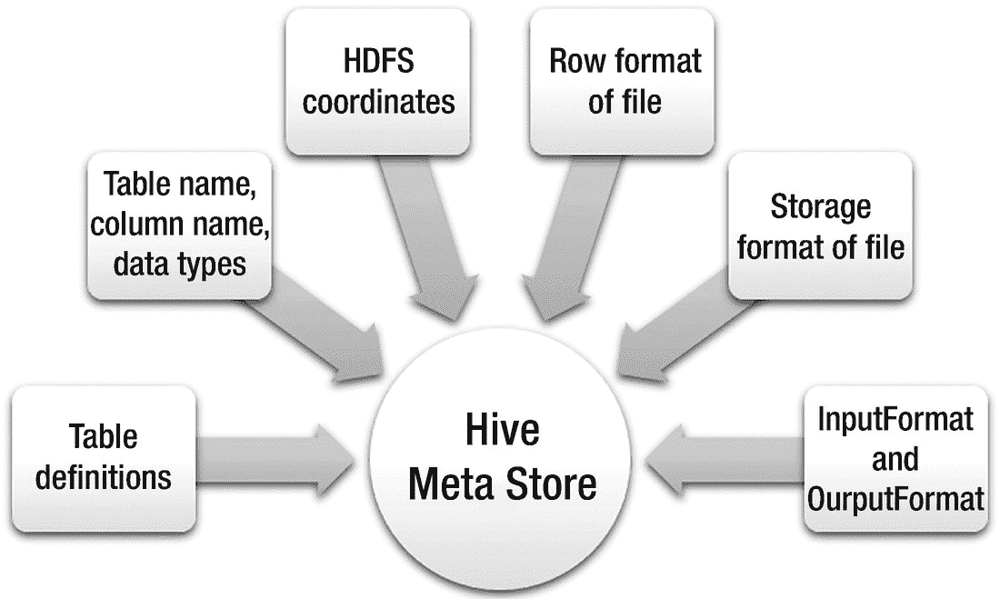

图 4-7 Hive Metastore 提供的服务不仅限于表元数据

1.  驱动程序库在 Hive 的类路径中可用。
2.  `javax.jdo.option.ConnectionDriverName` 设置为 `com.mysql.jdbc.Driver`。

# Hive – 设计考量

Hive 遵循其支持数据仓库的原则并模仿 SQL 语义，因此在临时报表、日志处理、文本挖掘、预测建模、商业智能和分析领域得到了广泛应用。在企业数据湖中，Hive 占据着关键位置，因为数据分析师和数据科学家（最终成为数据的主要消费者）非常喜欢用 SQL 来处理数据。从预定义应用程序的角度来看，MapReduce 表现良好，但在 Java 中进行以数据为中心的临时性工作可能会非常棘手。在我们深入探讨影响 Hive 设计和开发的要点之前，先来理解 Hive 中分区、分桶和反规范化这类操作的相关性。

## 分区
分区采用分治机制，通过在数据处理过程中显著减少 I/O 量来发挥作用。在传统数据仓库环境中，处理性能成为数据建模和索引、统计等调优实践的函数。Hadoop 没有索引的位置，这有助于优化数据摄取管道。然而，这也意味着即使需求仅仅是少量的数据，每个查询都必须扫描和读取整个数据集。随着数据集的不断增长，全表扫描可能会对查询性能产生负面影响。在这种情况下，分区可以通过减少处理范围并为其他以数据为中心的操作留出空间，发挥关键作用。在 Hadoop 集群中，分区或子分区将以目录的形式存在于表目录内。如果查询包含使用分区键列的谓词，分区裁剪的可能性会更大。在选择分区键时请牢记这一点，以避免 Hadoop 中产生小文件处理问题。

## 分桶
与分区类似，分桶是处理大数据集的另一种方式，通过将大数据集切片成均匀大小的子集来实现。如果你听说过并使用过哈希分区，那么分桶是一个非常相似的概念。分桶不仅有助于均匀分布数据，还有助于连接多个表。如果表基于分桶键参与连接，那么分桶连接会以更简单、更优化的方式进行。如果被连接的桶的大小较小，那么在 Mapper 阶段进行 Map 端连接的可能性就会增加。Reducer 连接资源消耗大，通常应避免使用。

再次强调，要密切关注生成的文件，确保分桶文件不会变得太小，以免导致集群资源流失。最佳桶大小应为 HDFS 块大小的倍数或 2 的指数。

## 反规范化
这是一种产生扁平化数据结构的技术，该结构包含数据处理所需的最大信息。在 Hadoop 中，查询连接是最耗费资源的操作，其中 Reducer 连接是最麻烦的。如果数据集可以在经过整理的数据层中进行建模、反规范化并定期刷新，那么它就有可能避免昂贵的连接操作。分区和分桶有助于将大数据集切片以支持并行操作，而反规范化则有助于避免数据湖中昂贵的查询连接。反规范化可以简单到联合投影多个表的列，或者在表级别进行聚合和创建派生列。

以下是实际 Hive 在设计和发展空间方面的关键要点。

1.  Hive 接口选项有：
    1.  命令行
        1.  `Hive Shell`
        2.  `Beeline Shell`
    2.  Web UI
        1.  `Ambari`
        2.  `Hue`
2.  Hive 数据模型 – Hive 数据模型由数据库、表、分区和桶组成。

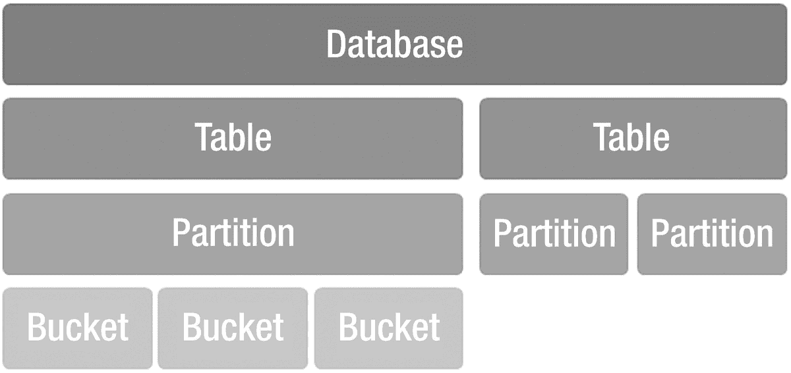

图 4-8

# Hive 数据模型

## 3. 文件处理最佳实践
支持 `parquet`、`text`、`Avro`、`RCfile` 和 `sequenceFile` 文件格式。

## 数据接入
- 推荐使用 `Avro` 格式
  - 也可使用 `JSON` 格式，但需要专门的 `SerDe` 处理器

## 数据暂存
- 列式数据处理使用 `parquet` 格式
  - 行式数据处理使用 `sequenceFile` 或 `RCfile` 格式

## 数据发布
- 配合 `Hive` 或 `Impala` 使用时，使用 `parquet` 格式以获得更佳性能

## 4. 数据类型
对于可映射为 `Java` 原生类型的列，请使用原生数据类型。不支持大型对象数据类型（`BLOB` 和 `CLOB`）。
- 支持复杂数据类型，如 `maps`、`arrays` 和 `structs`

## 5. 视图和子查询
`Hive` 支持视图，但不支持子查询。

## 6. 分析函数
`Hive` 支持聚合函数以及窗口分析函数。

## 7. Hive 对 DML 的支持
- 支持 `insert`、`update` 和 `delete` 操作
- 需在 `Hive` 配置文件中设置以下参数并重启服务器
  ```sql
  set hive.support.concurrency=true;
  set hive.enforce.bucketing=true;
  set hive.exec.dynamic.partition.mode=nonstrict;
  set hive.txn.manager=org.apache.hadoop.hive.ql.lockmgr.DbTxnManager;
  set hive.compactor.initiator.on=true;
  set hive.compactor.worker.threads=2;
  ```
- 只有事务表才支持更新。创建表时必须附加额外的存储子句：`TBLPROPERTIES('transactional'='true');`

## 8. `SORT BY`, `ORDER BY`, `DISTRIBUTED BY`, `CLUSTER BY`
- 如果存在多个 reducer，`SORT` 将对每个 reducer 中的数据进行排序。这无法保证最终结果集是排序的。
- `ORDER BY` 使用单个 reducer 来确保最终结果集是有序的。
- `DISTRIBUTE BY` 根据键列将行分布在各个 reducer 之间。但这与聚类或排序操作无关。它在 reducer 之间分配数据时很有用。具有相似模式的所有行将被分配到同一个 reducer。
  - `DISTRIBUTED` 与 `SORT` 结合使用将在每个 reducer 内对行进行排序（即 `cluster by`）。
  - `DISTRIBUTED` 与 `ORDER` 结合使用将对最终输出进行排序。
- `DISTRIBUTED` 与 `SORT BY` 结合使用构成了对单个键列的 `CLUSTER BY` 操作。所有具有相同聚类键的行将被分配到同一个 reducer。如果分布键和排序键不同，则需要显式分组或使用 `DISTRIBUTED` + `ORDER` 子句。

## 9. 批处理
为了将多行数据批量处理，请将配置参数 `hive.vectorized.execution.enabled` 设置为 `true`。

## 10. Hive 分区
分区技术能够根据分区键列将大量数据分割成小块。
- 支持 `hive 管理表` 和外部表的水平分区
- 分区作为表文件夹内的子目录存储。
- 分区键应选择一个基数可控的列。如果列的基数非常高（例如时间戳），会在系统中创建过多目录，可能导致数据碎片问题。
- 分区有助于数据组织，并在输入路径级别优化数据遍历。在谓词中使用分区键的查询得益于分区剪枝，可以极大地优化查询性能。
  - 未使用分区键的查询将进行全表扫描。
- 分区键列不应在表列规范中指定。不过，在描述对象时，它会被显示出来。
  ```sql
  CREATE TABLE dataLake_sor
  (
  sorId   INT
  ,sorName STRING
  )
  PARTITIONED BY (userId STRING)
  ROW FORMAT DELIMITED
  FIELDS TERMINATED BY '\t'
  ```
- 静态分区表示分区键列的值在加载前是已知的并用于加载。
- 动态分区有助于将数据从非分区表迁移到分区表。无需为分区键列的每个不同值单独运行加载，可以直接使用列名。
- 动态分区插入 – 如果源表中已存在分区键列，则在插入时可以跳过显式的分区值。
  - 对于分区键的每一个不同值，系统会自动在 RDS 表中添加一个分区。
- 以下参数控制动态分区插入功能：
  - `hive.exec.max.dynamic.partitions.pernode` (默认值 100) - 任何给定的 Mapper 或 Reducer 可以创建的最大动态分区数
  - `hive.exec.max.dynamic.partitions` (默认值 1000) - 单个 `HiveQL` 语句可以创建的动态分区总数
  - `hive.exec.max.created.files` (默认值 100000) - Mapper 和 Reducer 创建的最大文件总数

## 11. Hive 分桶或聚类

# 11. Hive 分桶（Bucketing）
这是一种优化技术，用于将表数据均匀分布在多个桶中，并控制宽数据扫描。分桶操作由一系列 `MapReduce` 作业执行。

- 必须基于一个基数较高且能保证数据均匀分布的列来创建桶。
- 桶作为表文件夹内的子目录被创建和存储。数据根据桶键列的哈希值分配到桶中。
- 分桶有助于逻辑数据组织，并能优化在谓词或连接中使用聚类键列的查询。
- 在向分桶表插入数据之前，设置以下两个参数：
  - `SET mapred.reduce.tasks =`
  - `Set hive.enforce.bucketing=true`
- `SET hive.optimize.bucketmapjoin=true` 将指示 `Hive` 在 map 阶段连接时利用桶级别的连接。

## Hive 分区和分桶联合使用
可以在分区内创建桶以优化数据存储，从而优化分区内的数据扫描。

例如，下表将按 `YEAR` 创建分区，在每个分区内，将有 25 个包含其人口详细信息的区域桶。

```sql
CREATE TABLE city_population_store
(
area STRING,
record_date STRING,
last_count INT,
current_count INT
)
PARTITIONED BY (year STRING)
CLUSTERED BY (area) INTO 200 BUCKETS;
```

再次强调，分区必须在低基数列上进行。

如果聚类键列基数较低（小于指定的桶数），则可能出现某些桶未被使用（即无数据）的情况。

## TABLESAMPLE
`TABLESAMPLE` 可用于选取部分数据作为查询处理的样本。

### 块采样
可以将样本指定为总行数的百分比或有限的行数。例如，在下面的查询中，`abcTelecom_logs` 表 5% 或更多的输入数据将被用于查询处理。

```sql
SELECT *
FROM abcTelecom_logs
TABLESAMPLE (5 percent)
```

也可以将样本指定为 1000 行或 100M。

### 桶采样
可以在指定的列上或随机创建桶来准备查询用的样本数据。请注意，即使对于非聚簇表，此查询也可以运行，但效率不高。

```sql
SELECT *
FROM abcTelecom_logs
TABLESAMPLE (BUCKET 5 OUT OF 50 ON city)
```

如果 `abcTelecom_logs` 是在 `CITY` 列上聚簇的，那么桶采样的效率会更高。

### Hive LLAP
在企业的数据湖生态系统中，`Tableau`、`Qlikview` 或 `SiSense` 等数据可视化工具会连接到 Hadoop 数据湖，用户可以从不同维度对数据集进行切片和切块，以实时获取洞察。查询性能会严重影响实时体验和决策能力。众所周知，`Hive` 在 MapReduce 处理层之上形成了一个抽象层。它无法提供关系型数据库 SQL 所能承诺的性能水平。一种最新的提升性能的趋势是将缓存技术与磁盘操作结合起来。简而言之，这就是 `Hive LLAP` 的核心所在。`LLAP` 代表“长生命周期处理”（Live Long and Process）。

`LLAP` 加入 `Hive 2.0`，旨在借助 `Tez` 保证 `Hive` 的查询性能，同时不牺牲 `Hive` 的原生特性。请记住，它并不会取代 `Hive` 现有的执行模型，而是对其进行补充，以满足更快数据处理的需求。在结构上，它由一个守护进程和一个基于 DAG（有向无环图）的框架组成，并由 `Tez` 执行引擎进行协调。

`LLAP` 守护进程在标准 Hadoop 集群的 `YARN` 上运行。它包含两个组件，即查询执行器和内存缓存。查询执行器控制查询执行的一些关键阶段，例如查询处理、查询片段执行、预取、访问控制、元数据和结果缓存。那些按优先级排队等待执行的片段会被限制为队列片段。

`Tez` 和 `Hive` 客户端通过确定哪个查询需要推送到 `LLAP` 守护进程执行来协调 `LLAP` 的参与。

`Hive` 负责处理查询片段（如 HDFS 位置和元数据）。显然，`YARN` 仍然是 `LLAP` 守护进程资源的看护者。查询片段无非是查询处理所需的位信息，例如运算符、元数据、表达式、主数据类型以及输入输出通道。所提到的运算符包括连接（join）、SQL 子句和扫描方法。表达式可以是各种类型的函数（SQL、标量、数值）。

那么，哪些查询可以在 `LLAP` 中运行？在 `LLAP` 中运行查询的决策可以在 `Hive` 客户端中配置为全部、无或混合模式。在自动模式下，初步判断标准是数据源（`HDFS`）、文件格式（`ORC`）和数据大小。小型查询可以直接由守护进程处理。然而，对于大型查询，`YARN` 会像往常一样接管，并通过正常的查询处理阶段进行驱动。

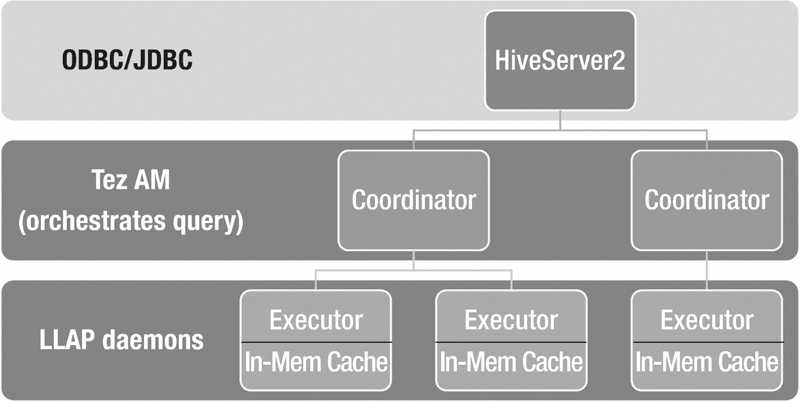
图 4-9 Hive LLAP 架构

设计考虑因素如下：

1. `Hive LLAP` 仅能通过 `Tez` 执行引擎使用。
2. 通过 API，守护进程可扩展至所有此类处理框架（`Spark` 和 `Pig`），这些框架更倾向于基于关系视图处理数据，而非基于文件处理。
3. 目前，只有 `ORC` 数据符合缓存条件。所有其他文件格式仍然可以在 `LLAP` 守护进程中处理，但不能被缓存。
4. 缓存淘汰策略 – 针对不同类型的工作负载，可配置不同的淘汰策略。
5. 默认情况下，低延迟查询优先于重量级和复杂的查询。除非指定了优先级，否则查询会在队列中等待。
6. `LLAP` 守护进程故障 - 由于 `LLAP` 守护进程并非主要执行器，因此 `Tez AM` 可以在集群的其他数据节点上处理查询片段。
7. `LLAP` 守护进程可以通过执行较大查询的微小部分，为查询在集群层面的处理做出贡献。然后，结果可以传递给主 `Hive` 查询，或进一步传递给某个任务。
8. 安全性 – 细粒度的访问安全性最高可达列级别。

## Apache Pig
与 `Hive` 类似，`Pig` 为 Hadoop 上的数据处理提供了一个抽象层。它通过提供一个脚本层，翻译成在 HDFS 集群上执行的指令，从而为用低级语言编写 MapReduce 程序提供了一种替代方案。`Pig` 通过将数千行代码减少到屈指可数的指令，简化了 MapReduce 层。

`Pig` 使用高级语言 `Pig Latin` 来设计数据转换和流程表达式。语言解释器负责将 `Pig Latin` 指令转换为 MapReduce 或 `Spark` 作业，并将其提交执行。`Pig` 引擎包含一个解析器、优化器和分布式查询执行器。`Pig` 中的程序采用一种类似以数据为中心的方法，因为每条指令都与数据流相关。

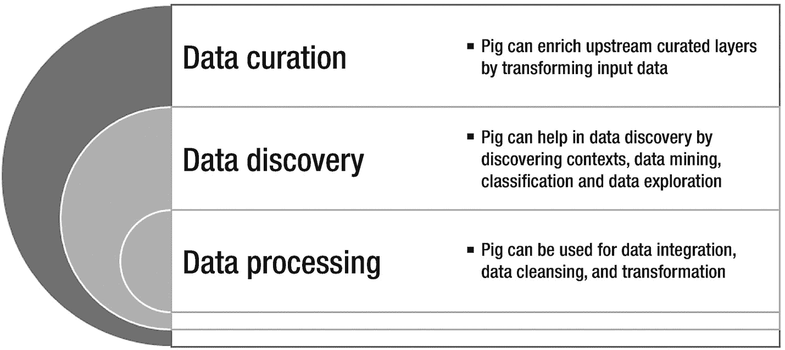
图 4-10 `Pig` 的能力

`Pig` 消除了将计算分解为 map 阶段和 reduce 阶段的挑战。如果一个问题的解决可以表述为一系列任务或一个使用标准运算符和子句（如过滤器、连接和聚合）的 DAG，那么 `Pig` 因其固有的快速开发周期优势而脱颖而出。

尽管是过程性的，`Pig` 使用类似 SQL 的声明式结构来开发用于数据处理的脚本。它可能不如 `Spark` 或 `Hive` 那样优化，但考虑到学习曲线平缓、开发快速等因素，因其低开发成本、灵活的数据模型和快速的结果产出而备受青睐。

### Pig 执行架构
下图展示了 Pig 处理过程的执行架构（图 4-11）。

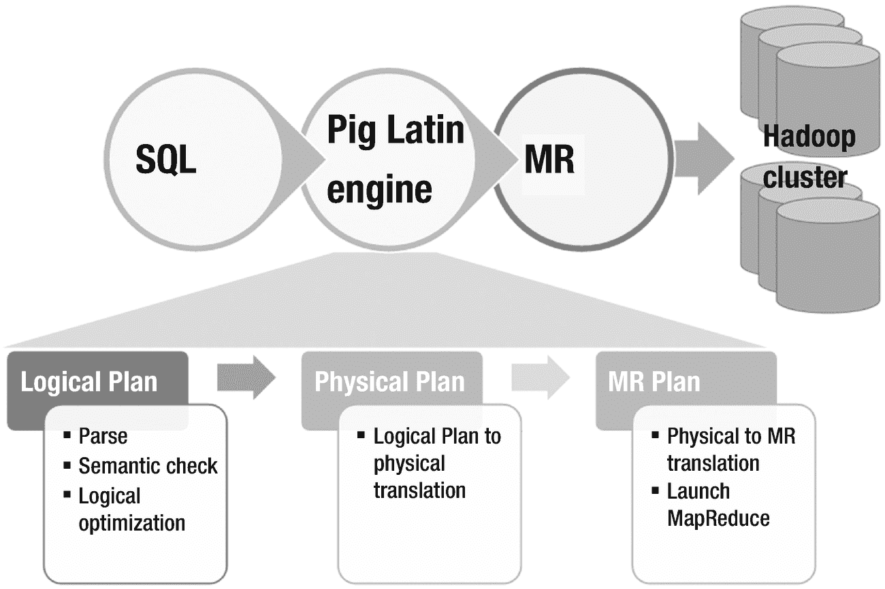
图 4-11 Pig 执行流程

从上述架构图可知：

1. **逻辑计划** – 这是脚本中按顺序排列的任务链的临时表示。Pig 使用 `ANTLR` 解析器（另一种语言识别工具）对脚本进行语义和健全性检查，随后生成一个`抽象语法树`（`AST`）。一旦 `AST` 被转换为逻辑计划，就会实施某些优化机会，例如列剪枝和过程下推。
2. **物理计划** – 逻辑计划被转换为多个物理计划，表明每个逻辑运算符的物理计算分支。例如，`JOIN` 被分解为 `LOCAL REARRANGE` 和 `GLOBAL REARRANGE` 以及 `PACKAGE`。
3. **MR 计划** – 物理计划被转换为带有阶段识别和数据输入输出的 `MapReduce` 作业。物理计算步骤在 map、combiner 和 reduce 阶段中分支出来。在此阶段，还会从优化角度检查 MR 作业。例如，可以合并 mapper 以减少数据传输，或修改 reducer 的数量。一旦冻结，MR 作业就会提交到 Hadoop 集群执行。

Pig 提供了 `EXPLAIN` 运算符来生成脚本的详细执行计划。

### 关键概念与设计考量
1. **Pig 数据模型** – 包括原子、元组、包和映射。

# Pig 数据类型与特性

## 1. Pig 数据类型
1.  原子是基本数据类型的标量值，例如 `INT`、`FLOAT`、`LONG`、`DOUBLE` 或 `CHARARRAY`。
2.  元组类似于关系数据世界中的行。它是用圆括号括起来的一系列属性。
3.  包表示一组元组，类似于关系数据世界中的表。
4.  映射表示一种键值对的灵活模式数据结构。

## 2. 输入数据流模型
将数据导入脚本时无需模式。只要 `Pig` 执行引擎能够识别数据流中的元组，就无需展平 `HDFS` 文件。

## 3. 运行时模式
尽管 `Pig` 在运行时不需要模式，但在数据缓冲和处理过程中，类型转换可能至关重要。`Pig` 可能会根据处理逻辑的性质预测原子或元组属性的数据类型。

## 4. 可扩展性
`Pig` 支持用户自定义函数，这些函数专为专门的数据处理而设计。

## 5. 安装先决条件
`Pig` 可以安装在连接到大数据湖的边缘节点上。由于 `Pig` 核心基于 `Java` 构建，因此 `Java` 成为运行 `Pig` 的主要先决条件。
1. 如果 `Pig` 使用 `UDF`，则主机上必须具有本机编译器。例如，基于 `Python` 或 `JavaScript` 的 `UDF` 必须安装 `Python` 和 `Java` 脚本组件。
2. 为了测试集成和构建自动化，必须安装相应的组件，例如 `Ant`、`Chef` 或 `Junit`。

## 6. Pig 运行模式
1. **本地模式** – 连接到本地文件系统，开发者可以在其中试用脚本、调试和测试功能。本地模式下无法实现并行性。
```
$ pig -x local
```
2. **MapReduce 模式** – 连接到数据湖的 `Hadoop` 集群。`Pig` 脚本可以部署并在大规模数据上运行。请注意，只有查询执行可以在集群节点上并行化。查询的健全性和语义操作仍在本地进行。
```
$ pig -x MapReduce
```

## 7. STORE 与 DUMP
`Pig` 在脚本执行期间采用惰性执行方法。除非脚本中遇到输出操作，否则引擎会将所有语句保留在内存的流水线中。输出操作可以是诊断运算符 – `STORE`、`DUMP`、`ILLUSTRATE`、`EXPLAIN` 或 `DESCRIBE`，它们表示创建物理和逻辑执行计划以启动 `Pig Latin` 代码执行。包扫描指令可能导致数据溢出到磁盘。
1. 如果脚本结果需要写入 `HDFS`，请使用 `STORE`。
2. 如果脚本输出只需显示在命令行上，请使用 `DUMP`。
3. 出于调试和快速测试的目的，开发者还可以使用 `ILLUSTRATE`，它应用采样算法来创建小型测试数据，应用转换，并实现性能。

## 8. PARALLEL
通过在 `PARALLEL` 子句中指定 `reducer` 数量，来操控 `ORDER`、`DISTINCT`、`JOIN`、`GROUP`、`COGROUP` 和 `CROSS` 等子句的 `reduce` 阶段。`Reducer` 数量也可以通过包含以下命令在脚本级别设置：
```
SET default_parallel [reducer_count]
```
请注意，语句级别的并行设置将覆盖脚本级别的配置。对于 `map` 阶段，并行性取决于输入数据的分片数量。如果无法显式地向脚本添加 `reducer`，可以修改以下两个参数来调整 `reduce` 操作。
1. `pig.exec.reducers.bytes.per.reducer` – 每个 `reducer` 的输入字节数。默认设置为 `1G`。对于大型数据集，根据操作不同，可以增加到 `1G` 以上。
2. `pig.exec.reducers.max` – `reducer` 的最大数量。默认值为 `999`。

## 9. SAMPLE
`SAMPLE` 运算符允许脚本操作数据子集，这在数据概况分析工作中非常有用。`Pig Latin` 脚本可以包含执行数据质量检查和构建数据概况的逻辑。

## 10. 可扩展性
`Pig` 可用于将数据流加载到 `Hadoop` 中。其优势在于能够通过增加 `Hadoop` 集群中的节点数来扩展规模。

# Apache Spark
`Spark` 是一个调度、监控和分发引擎，提供了类似 `MapReduce` 的下一代处理框架。它已逐渐开始取代经典的 `MapReduce` 模型，并已成为大数据领域的事实标准。`Spark` 于 2011 年 1 月诞生于加州大学伯克利分校的 `AMPLab` 项目。伯克利 `AmpLab` `Shark` 的开发主管 Reynold Xin 这样评价 Spark：“Spark……可以说是大数据分析工具中的瑞士军刀。”

## 为何选择 Spark？
`MapReduce` 框架一直是处理海量数据的分布式计算中值得信赖的实现者。它通过一系列在集群上分布执行并与分布式存储平台协同运作的 `mapper` 和 `reducer` 阶段，帮助解决了复杂问题。其主要处理的是磁盘上的大型数据集，这无疑非常适合批处理，但对于低延迟模型则表现不佳。`MapReduce` 处理的一个关键特性是能够在集群上存储中间数据集和最终数据集。在整个转换过程中，`MapReduce` 会执行大量的磁盘读写（`I/O`）操作。这可能是一项开销昂贵的操作，因为它既会引发数据集在磁盘 `I/O` 中的复制，也会产生网络 `I/O`，并且每个任务会启动一个新的 `JVM`，这需要时间来加载 `JAR` 包和解析 `XML` 配置。为某个问题构建 `MapReduce` 框架的开发人员需要手动编写代码，考虑到任务的复杂性，这可能变成一项繁琐的工作。`Apache Spark` 通过引入一种结合了批处理、流处理和交互式计算的完全不同的处理模型，克服了这些问题。

`Spark` 是一个开源框架，最初由马泰·扎哈里亚于 2009 年在加州大学伯克利分校的 `AMPLab` 创立，并于 2010 年开源。2013 年，该项目被捐赠给 `Apache` 软件基金会。它可用于处理部署在本地或云环境的数据湖中的海量数据。它为开发者提供了一个围绕集中式数据结构工作的应用程序框架。请记住，`Spark` 旨在提升计算速度，同时也涵盖了广泛的工作负载，例如批处理、交互式、迭代式和流处理。

`Spark` 的处理方法在很大程度上受到了微软关于并行与分布式执行的 `Dryad` 论文 ² 的影响。它引入了一种内存缓存抽象，使其非常适合多个操作尝试访问同一输入数据的工作负载。用户可以将数据集缓存在内存中，从而克服磁盘 `I/O` 开销。`Spark` 在每个节点上维护一个执行器 `JVM`，因此启动一个任务（无论 `MapReduce` 操作如何）归结为向其发起远程过程调用（`RPC`）并将一个可运行对象传递给线程池。

在 `Spark 2.0` 问世之前，`Spark` 的主要编程接口是弹性分布式数据集（`RDD`）。在 `Spark 2.0` 之后，它被 `Dataset` 所取代，`Dataset` 像 `RDD` 一样是强类型的，但在引擎内部具有更高的优化。`Spark` 提供了 `Python` 或 `Scala` 的交互式 shell，这有助于以简单的方式学习 `Spark API` 的各种功能。

`Spark` 核心及其成员库构成了 `Spark` 技术栈的构建块。这些库经过优化，可满足数据管理的各个阶段。对于数据集成，`Spark Streaming` 正合适。对于数据科学需求，有 `MLlib` 和 `SparkR` 可用。对于图形处理，`GraphX` 是该技术栈的一部分。对于数据工程，数据分析师可以使用 `SparkSQL`。`Spark` 核心充当该技术栈的大脑。图 4-12 展示了 `Spark` 核心引擎的构成。

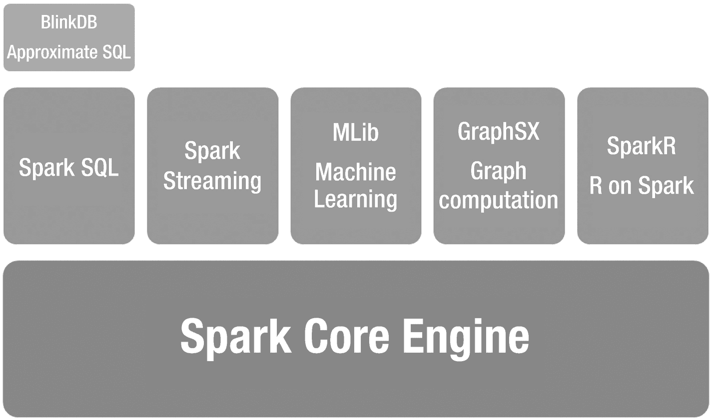

图 4-12
`Spark` 技术栈

## 弹性分布式数据集（RDD）
`RDD` 是分布在集群中的不可变集合，通过数据转换创建，并且可以在并行操作中进行缓存。弹性分布式数据集具有容错性，因为它们采用图结构组织，这使得在节点故障期间重新计算受损分区变得更加容易。让我们看看 `RDD` 的关键特性：
1. **惰性求值** – 在触发动作之前，`RDD` 中的数据不会被填充。
2. **容错性** – `RDD` 保存谱系信息，有助于重建丢失的分区。
3. **内存驻留与可缓存** – `RDD` 作为一种受内存保留时间和容量限制的内存结构存在。这些数据集会保持缓存状态，直到刷新到磁盘以实现持久性。
4. **不可变或只读** – `RDD` 只能转换为新的 `RDD`，这确保了数据集的一致性。
5. **并行、分区与类型化** – `RDD` 可以在逻辑上分区并分布在集群上，从而可以进行并行处理。记录也是类型化的。
6. **非常重要的一点**是，`RDD` 只能由一个 `SparkContext` 拥有。它们不能在多个 `SparkContext` 之间共享。
7. `RDD` 可以通过使用 `persist()` 或 `cache()` 方法在不同的存储级别（如磁盘或内存）变得持久。一个节点可以持久化其计算出的内存数据集分区，以供后续操作使用。这极大地提升了未来对该数据集操作的性能。

`RDD` 可以通过两种方式创建：

# Spark RDD

## 创建 RDD

### 并行化一个集合
通过在驱动程序中对现有集合调用`SparkContext`的`parallelize`方法来创建并行化集合。这里的`parallelize`方法中，第二个参数表示内存中 RDD 分区的数量。

```scala
val data = Array(1, 2, 3, 4, 5)
val distData = sc.parallelize(data, 4)
```

### 从外部存储创建
Spark 可以从 Hadoop 支持的任何存储源（包括本地文件系统、HDFS、Cassandra、HBase、[Amazon S3](http://wiki.apache.org/hadoop/AmazonS3) 等）创建分布式数据集。它支持 Hadoop `InputFormat` 指定的文件，例如文本文件、[SequenceFiles](http://hadoop.apache.org/common/docs/current/api/org/apache/hadoop/mapred/SequenceFileInputFormat.html)。例如，下面的代码片段使用`SparkContext`的`textFile`方法创建了一个 RDD。

```scala
val distFile = sc.textFile("data.txt")
distFile: org.apache.spark.rdd.RDD[String] = data.txt MapPartitionsRDD[10] at textFile at :26
```

RDD 可以执行动作或转换。转换会从现有的 RDD 创建一个全新的数据集，而对数据集的动作用于运行计算逻辑并返回一个值。RDD 上的`map`函数是一种转换，因为它处理数据集的每个元素以返回一个新的 RDD，而`reduce`则是一个动作，它对 RDD 元素进行聚合。类似地，`filter`、`sample`、`union`、`join`、`cache`、`groupByKey`或`reduceByKey`等操作会将一个 RDD 转换为新的 RDD。`reducer`、`collect`、`count`或`save`是将结果返回给驱动程序的动作。RDD 转换始终是惰性求值的，只有在执行动作时才会被触发。

### RDD 运行时组件
Spark 应用程序可以以分布式模式运行。资源管理可以由 Spark 集群管理器或 YARN 完成。然而，将其与对 Hadoop 集群上的数据本地性有更好认知的 YARN 集成总是更好的选择。Apache Mesos 也可以执行基于推送的资源管理，但 Spark 可以接受或拒绝 Mesos 提供的资源。

在运行时，Spark 会调度驱动器和 Worker 来完成一项任务。驱动器在 RDD 上定义并调用动作，而 Worker 则负责存储 RDD 分区并执行转换。图 4-13 展示了提交 Spark 作业时驱动器和执行器的参与情况。让我们来看看此事件过程中的一系列流程。

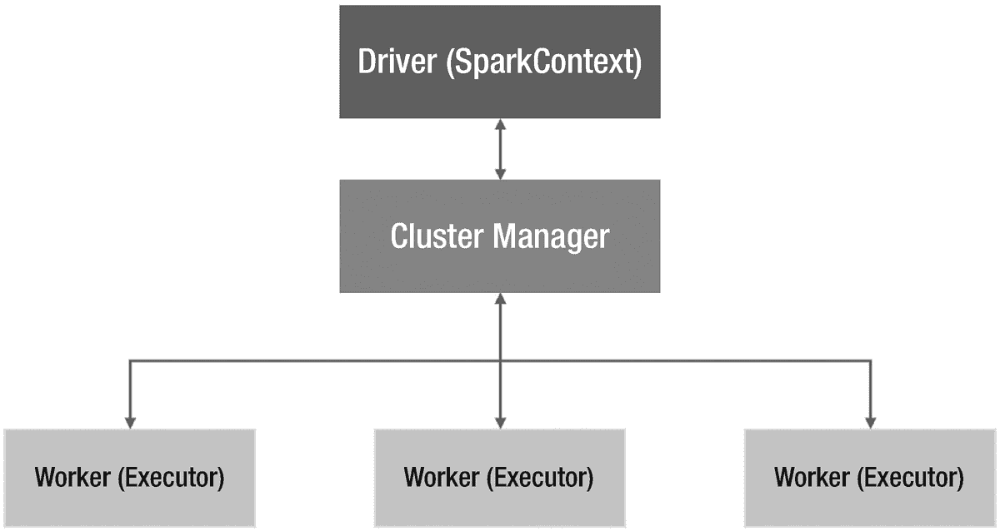

图 4-13：Spark 驱动器到执行器的通信

一旦将 Spark 应用程序提交到集群：

1.  Spark 驱动器被启动，并承担应用程序执行的端到端责任。它是一个 JVM 进程，充当主节点来托管应用程序的`SparkContext`。它负责将应用程序分解为任务，并在执行器可用时将其调度到执行器上运行。如果驱动器挂掉，或者进程因某种原因而终止，执行器也会随之关闭。

    1.  `SparkContext`是 Spark 应用程序主节点，负责设置内部服务并建立与 Spark 执行环境的连接。
    2.  它用于创建 RDD、累加器、广播变量，访问 Spark 服务，以及运行任务。
    3.  RDD 驻留在`SparkContext`的逻辑边界内，并通过其在`SparkContext`中的唯一 ID 进行区分。

2.  Spark 驱动器调用应用程序的`main()`方法。
3.  驱动器与集群管理器协调资源或执行器，以便在 Worker 节点上运行任务。
4.  集群管理器启动执行器，执行器通过 ID 和主机进行标识。执行器是在 Spark 计算节点上的 JVM 进程中运行的 Worker 从节点，并串行执行驱动器分配给它们的任务。

    1.  执行器向驱动器注册自己，以建立通信并接收要执行的任务。
    2.  执行器向驱动器发送心跳信号以及任务指标。

5.  Spark 驱动器执行应用程序并将任务分配给执行器。
6.  执行器处理已分配的任务并保存结果。
7.  在`main()`方法完成或 Spark 驱动器运行`SparkContext.stop()`之后，执行器被终止。随后，资源被释放回集群管理器。

### RDD 组成
RDD 接口包含：

1.  分区集 – 维护针对给定 RDD 在数据集上创建的分片数量。
2.  依赖关系列表 – 维护给定 RDD 与父 RDD 之间的依赖关系。

    1.  依赖关系可以是窄依赖或宽依赖。父 RDD 中的每个分区最多被一个子 RDD 使用的依赖关系称为窄依赖。如果多个子 RDD 依赖于单个父分区，则该依赖关系为宽依赖。
    2.  宽依赖可能需要在节点间进行数据混洗，而窄依赖则遵循管道化执行。

3.  `GetPartitions` – 计算给定 RDD 上的分区数量。
4.  数据本地性 – 为了避免大量的数据混洗，它会在首选位置创建结果数据集。
5.  可选的用于创建键值对 RDD 的分区信息，以便轻松访问特定数据。

### 数据集和数据框
Spark 1.6 中新增了一个接口，它提供了 RDD（强类型和使用强大的 lambda 函数的能力）和 Spark SQL 的优化执行引擎的优势。数据集可以通过 JVM 对象构建，然后使用 Spark 动作（`map`、`flatMap`、`filter`等）进行操作。目前 Java 和 Scala 支持数据集，而 Python 尚不支持，但由于其动态特性，它已经提供了 Dataset API 的许多好处。

数据框是一个结构化为命名列的数据集。它是一个增强功能，旨在为结构化数据、文件、Hive 中的表、外部数据库或现有 RDD 提供类似于关系数据库中表的感觉，但在底层具有更丰富的优化能力。数据框在 Scala、Java、Python 和 R 中可用，并具有不同类型的表示形式。

让我们运行一个小型演示，在 Spark 中创建数据框并执行基本功能：

1.  **创建 Spark 会话** – 以便轻松获取所有功能。

    ```scala
    import org.apache.spark.sql.SparkSession
    val spark = SparkSession
    .builder()
    .appName("Spark SQL basic example")
    .config("spark.some.config.option", "some-value")
    .getOrCreate()
    // 用于隐式转换，例如将 RDD 转换为 DataFrames
    import spark.implicits._
    ```

2.  在 Spark 会话中，从文件、现有 RDD、Hive 表等创建一个 DF。

    ```scala
    val df = spark.read.json("examples/src/main/resources/people.json")
    // 将 DataFrame 的内容显示到标准输出
    df.show()
    // +----+-------+
    // | age|   name|
    // +----+-------+
    // |null|  James|
    ```

3.  数据框操作

    1.  打印数据框的 Schema

        ```scala
        // 以树形格式打印 schema
        df.printSchema()
        // root
        // |-- age: long (nullable = true)
        // |-- name: string (nullable = true)
        ```

    2.  选择特定列

        ```scala
        // 只选择 "name" 列
        df.select("name").show()
        // +-------+
        // |   name|
        // +-------+
        // |  James|
        // |    Ben|
        ```

    3.  选择所有列，并将 age 列增加 1。

#### 数据框操作与SQL查询

在选择数据时，可以对列进行操作。

```scala
// 选择所有人，但将 age 增加 1
df.select($"name", $"age" + 1).show()
// +-------+---------+
// |   name|(age + 1)|
// +-------+---------+
// |  James|       22|
// |    Ben|       31|
```

4. 使用`age > 25`过滤数据框。

```scala
// 选择年龄大于 21 的人
df.filter($"age" > 21).show()
// +---+----+--+
// |age|   name|
// +---+----+--+
// | 31|    Ben|
// +---+----+--+
```

5. 按年龄统计人数。

```scala
// 按年龄统计人数
df.groupBy("age").count().show()
// +----+-----+
// | age|count|
// +----+-----+
// |  22|    1|
// |  31|    1|
// +----+-----+
```

6. **加载Hive表**

```scala
val table1 = spark.sql("[db_name].[table_name]")
table1: org.apache.spark.sql.DataFrame = [col1: datatype, col2: datatype... 71 more fields]
```

7. **运行SQL查询**

```scala
// 将 DataFrame 注册为 SQL 临时视图
df.createOrReplaceTempView("people")
val sqlDF = spark.sql("SELECT * FROM people")
sqlDF.show()
// +----+-------+
// | age|   name|
// +----+-------+
// |  21|  James|
// |  31|    Ben|
// +----+-------+
```

#### 分桶、排序和分区

在基于文件的数据源中，也可以对输出进行分桶、排序或分区。

```scala
peopleDF.write.bucketBy(42, "name").sortBy("age").saveAsTable("people_bucketed")
usersDF.write.partitionBy("favorite_color").format("parquet").save("namesPartByColor.parquet")
```

### Spark应用程序的部署模式

Spark应用程序有多种部署选项。它可以以本地模式、独立模式或集群模式提交。该模式必须在`SparkContext`的`master`参数中指定。

1. **本地模式** – 在本地模式下，所有与 Spark 作业相关的任务都在同一个 JVM 中运行。
   - `local`仅使用1个线程。
   - `local[n]`使用n个线程。
   - `local[*]`使用的线程数等于Java虚拟机可用的处理器数量。例如：

    ```
    # 在本地使用 8 个核心运行应用
    ./bin/spark-submit --class org.apache.spark.examples.SparkPi –-master local[8] /path/to/examples.jar
    ```

2. **独立模式** – 在独立集群模式下，Spark 根据核心分配资源。默认情况下，Spark 应用程序会尝试消耗集群中的所有核心。独立集群模式受到一个约束，即每个工作节点上每个应用程序只能分配一个执行器。在此模式下，用户可以为工作节点和 Spark 主节点定义容器，以在您的机器上运行。

    ```
    # 在客户端部署模式下运行于 Spark 独立集群
    ./bin/spark-submit --class org.apache.spark.examples.SparkPi --master spark://207.184.161.138:7077 --executor-memory 20G --total-executor-cores 100 /path/to/examples.jar
    # 在带有监管的集群部署模式下运行于 Spark 独立集群
    ./bin/spark-submit --class org.apache.spark.examples.SparkPi --master spark://207.184.161.138:7077 --deploy-mode cluster --supervise --executor-memory 20G --total-executor-cores 100 /path/to/examples.jar
    ```

3. **集群模式** – 在 YARN 上的 Spark 应用程序可以以集群模式或客户端模式启动。在集群模式下，Spark 驱动器成为应用程序主节点的一部分，完全由 YARN 管理。在客户端模式下，Spark 驱动器作为客户端进程运行，与应用程序主节点协调，为 Spark 应用程序管理资源。

    ```
    # 运行于 YARN 集群
    ./bin/spark-submit --class org.apache.spark.examples.SparkPi --master yarn --deploy-mode cluster # 对于客户端模式可替换为 client  --executor-memory 20G --num-executors 50 /path/to/examples.jar
    ```

Spark应用程序也可以使用Mesos部署，但由于其能够提供Spark驱动器选择资源的能力，它已被限制为一种基于推送的资源分配机制。对于Mesos，`master`参数将为`mesos://host:port`。

#### 设计考量

以下是在Hadoop集群上部署Spark应用程序的关键设计考量。

1. 在Spark中，过度分配核心是一种避免在分配任务时因上下文切换而消耗时间的有效方法。JVM内部有线程会执行shuffle和GC操作，这些操作会使用分配给应用程序的相同核心。

2. 如果资源管理器崩溃，应用程序不会受到影响，除非任何正在运行的容器崩溃，或者在动态分配的情况下，它尝试与资源管理器协商资源。

3. 资源管理器有一个调度器，其中包含有关在集群上运行的每个应用程序的信息。它知道哪个节点被分配为相应应用程序的应用程序主节点。如果某个应用程序主节点崩溃，资源管理器将通过轮询调度将其分配给另一个节点管理器。

4. 对于大型集群，如果应用程序在较少的执行器上启动，数据本地性就会发挥作用。

5. 在集群环境上以客户端模式运行有一个缺点。如果远程客户端与网络断开连接，应用程序将终止。这成为了一个单点故障。

6. 以集群模式运行可以最小化驱动器与执行器之间的网络延迟，并且由于“驱动器”和“Spark基础设施”位于同一基础设施中，它们之间网络断连的可能性会降低。这也降低了作业失败的可能性。

7. 如果执行器崩溃或丢失，那么Spark的`DAGScheduler`及其更低级别的集群管理器实现（Standalone、YARN或Mesos）将注意到任务失败，并负责在整体执行的阶段中重新调度该任务。

### Spark中RDD的缓存与持久化

在每次动作调用后重新计算RDD会因资源和时间消耗而影响程序性能。为改进此过程，Spark提出了两种优化技术：Cache和Persist。这两种方法的目的都是将数据集临时存储到内存/磁盘中，并在多阶段应用程序的多次计算中迭代重用结果。它提供了多种存储和复制数据的方式。以下是应考虑启用缓存的使用场景：

1. 在独立Spark应用程序中
2. 在机器学习应用程序中
3. 在资源受限环境中进行昂贵的RDD计算时，如果任何执行器发生故障，缓存有助于降低恢复成本。

RDD Cache用于加速多次访问同一RDD的应用程序。使用cache时，您只能使用默认存储级别`MEMORY_ONLY`。

# RDD Persist

RDD Persist 提供了多种将数据集存储在内存或磁盘上的选项。`cache` 和 `persist` 之间的区别纯粹是语法上的。`persist` 方法根据相应的存储级别进行存储，包括：
- `MEMORY_ONLY`（默认级别） – 将数据作为反序列化对象存储。如果内存不足，某些数据分区可能不会被缓存；未缓存的数据将在下次需要时重新计算。
- `MEMORY_AND_DISK` – RDD 作为反序列化数据对象存储。如果 RDD 无法完全放入内存集群，则剩余部分将存储在磁盘上。
- `MEMORY_ONLY_SER` – RDD 作为序列化的 Java 对象存储在内存中。序列化对象意味着每个分区一个字节数组。这更节省空间，从而节省内存。
- `MEMORY_AND_DISK_SER` – 类似于 `MEMORY_ONLY_SER`，但会将剩余部分保存在磁盘上。
- `DISK_ONLY` – 仅将 RDD 分区存储在磁盘上。
- `MEMORY_ONLY_2`、`MEMORY_AND_DISK_2` – 这两个级别的工作方式与前两个相同，但这两个级别会在集群节点上复制每个分区。

Spark 会隐式监控每个节点的缓存使用情况，并基于最近最少使用原则清除旧数据。可以使用 `RDD.unpersist()` 方法手动移除 RDD。

## RDD 共享变量

如果 Spark 操作需要在集群上执行一个函数，则会创建函数变量的独立副本并在每台机器上复制。对这些变量的任何更改都不会传播回 Spark 驱动器。为克服这种情况，Spark 提供了两类共享变量，即广播变量和累加器。
1.  **广播变量** – 广播变量不会创建函数变量的副本，而是在每个工作节点上缓存一个只读副本。当不同节点上的任务所需的公共数据可以在阶段之间共享时，广播就成为一种急需的操作。高效的广播算法有助于优化节点间通信。
2.  **累加器** – 累加器是关联或交换操作结果产生的变量。Spark 支持命名或未命名的数值类型累加器。

# Hadoop 上的 SQL

假设您刚刚将关系型数据仓库迁移到了 Hadoop 平台。那些习惯于使用 SQL 查询的业务用户，现在发现执行日常数据检查变得困难重重。另一种情况是，数据分析师希望运行即席查询以进行交互式分析，却因从 SQL 思维向开发思维过渡的曲线而感到束手束脚。那么，解决方案是什么呢？

在本章中，我们学习了 Hive 背后的动机、其采用历程以及从传统 MapReduce 的转型，但经典数据库社区依然强大的事实不容小觑。访问数据湖中的数据时存在两个挑战：语言和数据规模。交互式数据探索需要一门“语言”，而处理 PB 级数据集的能力则至关重要。

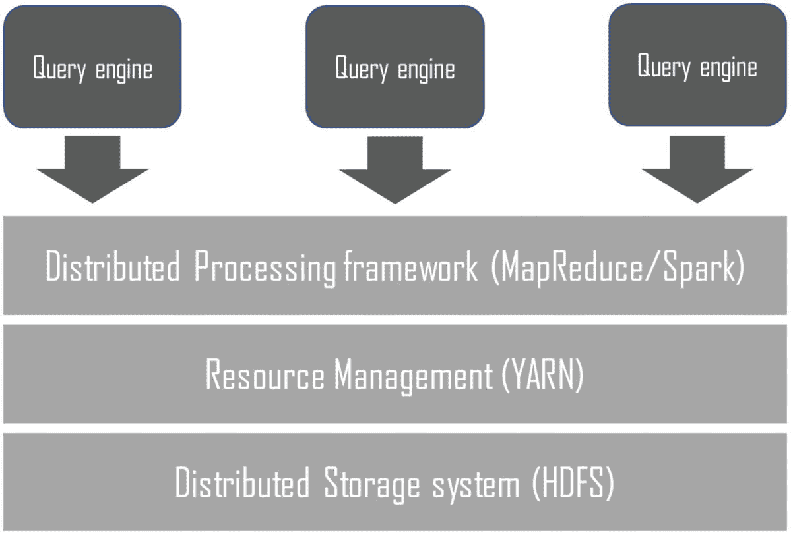
*图 4-14 数据湖中的 SQL on Hadoop 布局*

SQL on Hadoop 提供了一个平台，使数据库社区无需深入了解 MapReduce 和集群计算即可在 Hadoop 中操作数据。它绝非以“低成本”为借口取代数据仓库，或模仿数据库处理引擎；相反，它在 HDFS 和 YARN 之上提供了一层抽象，以赋能数据分析师。下图展示了 SQL on Hadoop 的使用模式。根据使用模式的不同，平台及其使用的架构准则也会有所差异。

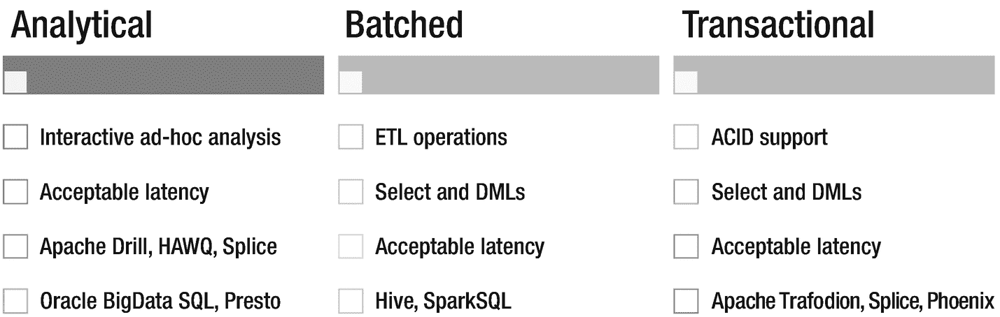
*图 4-15 SQL on Hadoop 框架的操作模式*

SQL on Hadoop 的关键在于负责解析查询并处理数据提取的引擎。一个理想的 SQL on Hadoop 引擎应当是分布式的，并且必须具备无缝扩展的能力。同时，数据进出数据湖的移动应尽可能少，并且必须克服延迟和并发瓶颈。与典型的 MapReduce 操作不同，它应在最大化并发的同时减少延迟。

Hadoop 框架上 SQL 的另一个重要特性是可扩展性，即查询其他数据源的能力。交互式查询可能需要来自其他源的数据以生成报告或填充仪表盘。这可以通过查询联合或特许经营来实现，也可以通过拉取代理将数据暂存到集中存储库来实现。

接下来几节，我们将讨论如何在数据湖生态系统中定位 Presto、Oracle Big Data SQL 或 Cloudera Impala。

## Presto

Presto 是一个分布式查询引擎，由 Facebook 于 2012 年创建，旨在对超大规模数据集实现更快、可扩展的查询。它使用 Java 开发，支持 ANSI SQL 语义，包括复杂连接、聚合和分析函数。Presto 的设计目标是为了满足低延迟数据分析和数据仓库的需求。

Presto 引擎是如何工作的？与 Hive 不同，Presto 不使用 MapReduce 来执行查询。它实现了一个标准的 MPP 查询处理引擎，包含协调器、发现服务、工作节点和连接器插件。顾名思义，发现服务充当引擎协调器，在启动时接收来自参与节点（或服务器）的通知。Presto 协调器负责语句解析、计划生成和管理工作节点。客户端通过 REST API 向协调器提交 SQL 语句，协调器与连接器插件协作，获取表元数据和分片详细信息以构建查询计划。查询计划生成后，协调器将其分解为一系列阶段，并进一步分解为任务，然后将任务分发到各个工作节点。工作节点与连接器插件协作，在内存中执行任务。它们从连接器插件获取数据分片，并根据操作并行运行驱动器进行处理。一旦完成，任务输出将被交替传输到另一个工作节点。工作节点遵循流水线聚合，即每个工作节点执行聚合，并将任务输出传输到下一个工作节点。当聚合数据到达最后一个工作节点时，它通过协调器将结果返回给客户端。

连接器只不过是访问数据存储中元信息和数据的驱动程序。Presto 不仅可以访问 HDFS 中的数据，还可以访问其他异构数据源。Presto 提供了针对 Hive、Cassandra、Postgres 以及更多数据存储的连接器。每个连接器都可以访问其元数据。例如，Hive 连接器可以访问 Hive 元存储。MySQL 连接器将访问其自己的目录信息。图 4-16 展示了从客户端提交到结果集返回的查询执行流程。

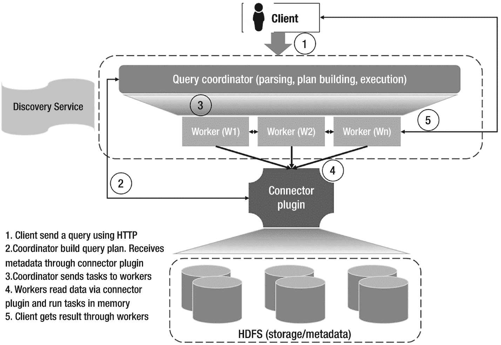
*图 4-16 Presto 查询执行架构*

### Presto 语句执行模型

图 4-17 展示了 SQL 语句执行过程中遵循的步骤。

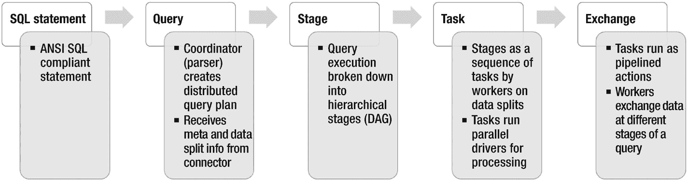
*图 4-17 Presto 语句执行步骤*

考虑一个场景：来自 Hive 的 `SALES` 数据集需要与 MySQL 中的 `PRODUCTS` 数据集进行连接。让我们检查一下目录条目是如何呈现的——

```
$ cat etc/catalog/mysql.properties
connector.name=mysql
connection-url=jdbc:mysql://localhost:3306
connection-user=root
connection-password=*****
$ cat etc/catalog/hive.properties
connector.name=hadoop2
hive.metastore.uri=thrift://localhost:8180
```

下面的 Presto 查询连接了两个数据集，以统计每个产品的销售额。此查询不言自明，遵循 ANSI SQL 编码实践。

```sql
SELECT
    p.prod_code
    ,COUNT(*) AS num_sales
FROM hive.sales.sales_ds s
JOIN mysql.products.prod_desc p
    ON s.prodid = u.prodid
GROUP BY p.prod_code
```

### Presto – 设计考量
1.  Presto 并非数据库，但通过流水线执行模型为数据处理提供 SQL 能力。
2.  SQL 语句会被转换为并行运行的查询、阶段、任务和分片。
    1.  查询计划会被动态编译为优化的 m 代码。
3.  性能管理
    1.  Presto 使用直接内存管理。
    2.  分配给工作节点的内存必须根据该节点上运行的工作负载而定。如果你运行相对复杂的查询，集群可能会报告延迟问题。
    3.  Presto 在整个查询执行过程中会执行多次内存操作，并依赖网络进行数据传输。它不负责隐式容错。
    4.  使用 ANSI SQL 最佳实践进行查询调优
        1.  `CTAS` 命令比 `SELECT *` 执行速度更快。
        2.  为优化连接，需通过减小被连接数据集的大小来缩减数据表面积。注意，Presto 默认执行广播连接，这意味着事实表可以分布式处理，而维度表则会复制到工作节点进行处理。
        3.  内联视图可放在 `WITH` 子句的子查询中。

# Presto 性能与配置指南

## 性能优化建议

1. 单节点操作可能非常消耗内存，例如 `DISTINCT` 计数、排序以及使用 `UNION` 拼接数据，应尽量避免。可使用 `APPROX_DISTINCT` 替代 `DISTINCT`。
2. 多个 `LIKE` 可替换为 `REGEXP_LIKE`。
3. 查询中超过 1000 个 `AND`/`OR` 可能会导致编译器异常。

## 目录与连接器配置

4. 在创建目录属性时，需确保连接器与 Hadoop 版本之间的兼容性。例如，Hive 连接器应能访问 Hive 元存储，并能从集群中获取表的数据分片。
5. 目录（Catalog）– Presto 中的查询是针对已注册的目录之一运行的。必须通过在 `/etc/catalog/` 目录下创建目录属性文件来注册数据源目录。连接器可使用 `connector.name` 参数挂载，该参数指示目录管理器将使用此目录创建一个连接器。
    1. 创建多个相同数据源类型但不同配置的目录。例如，两个 Hive 集群目录将具有相同的 `connector.name`（即 Hive），但配置不同。
    ```
    connector.name=hive-cdh4
    hive.metastore.uri=thrift://[master]:10000
    connector.name=hive-hadoop1
    hive.metastore.uri=thrift://[master]:10020
    ```

## 监控与管理

6. 监控（Monitoring）– Presto 提供了一个交互式 Web 界面 Presto-Admin，用于查询的管理和监控。
    1. 检查所有 Presto 节点的状态
    ```
    presto-admin server status
    ```
    2. Presto 客户端 – Airbnb 设计了一个查询执行工具 Airpal，用于轻松编写查询和浏览对象。
    3. Presto 页面 [`https://prestodb.io/resources.html`](https://prestodb.io/resources.html) 汇集了关于管理工具、客户端、驱动程序、插件和库的所有信息。它由 Facebook 维护。
    4. 为保障不间断运行，可部署一个定期监控脚本，以便在检测到配置问题时主动采取行动，并发送告警和通知。

## 配置属性

7. 配置属性
    1. 集群
        1. `task.info-refresh-max-wait` – 优化协调器工作负载
        2. `task.max-worker-threads` – 将进程拆分并分配给工作节点
        3. `distributed-joins-enabled` – 启用分布式哈希连接
        4. `query.max-memory` 和 `query.max-memory-per-node` – 引擎和节点级别的分布式内存最大分配量
        5. `discovery-server.enabled` 和 `discovery.uri` – 发现服务 URI 规范。
    2. 协调器
        1. `query.initial-hash-partitions` – 聚合操作的最大哈希桶数
        2. `node-scheduler.min-candidates` – 运行一个阶段的最大并行工作节点数
        3. `node-scheduler.include-coordinator` – 协调器是否应运行任务？
        4. `query.schedule-split-batch-size` – 阶段到任务的分片大小
    3. 工作节点
        1. `task.cpu-timer-enabled` – 详细的统计信息收集
        2. `task.max-memory` – 对 CPU 密集型操作（如连接和排序）的内存限制。
        3. `task.shard.max-threads` – 运行活动分片的工作线程数。建议设为 (4*CPU 核心数)。
    4. 性能
        1. `hive.empty-bucketed-partitions.enabled=true`
        2. `hive.bucket-execution=true`
        3. `hive.assume-canonical-partition-keys=true`
        4. `hive.multi-file-bucketing.enabled=true`
        5. `hive.immutable-partitions=true`

## 从 Hive 迁移到 Presto

8. 从 Hive 迁移到 Presto
    1. 注意 HiveSQL 与 ANSI SQL 之间的差异
    2. 使用数组、带引号的标识符和 SQL 运算符时，遵循 ANSI SQL 指南。例如，
        1. 在 Presto 中使用 `UNNEST` 展开数组，而不是 Hive 中的 `LATERAL VIEW`
        2. `'2APR2014'` 在 Presto 中无效，但 `"2APR2014"` 是有效的
    3. 进行故障排查时，关注查询谓词中运算符的使用。例如，`[column = NULL]` 与 `[column is NULL]` 是不同的
    4. `VALUES` 子句在测试 Presto 查询时可能非常有效。它有助于准备用于测试的样本数据集

## Oracle Big Data SQL

`Oracle Big Data SQL` 是 Oracle 提供的一种 Hadoop 上的 SQL 解决方案，允许从 Oracle 数据库对 Hadoop、Hive、Oracle NoSQL 和 HBase 发起查询。简而言之，它将非关系型数据纳入 Oracle 系统目录的统一管理之下。因此，Hive 表访问可以受益于 Oracle 数据库的大部分智能特性，如查询卸载、Hadoop 上的智能扫描、网络资源管理、数据编辑以及其他 Oracle 高级安全功能，且不损失任何性能。现有的 Oracle 高级分析和安全用户可以通过启用 `Big Data SQL` 来扩展其数据覆盖范围，他们所有正在运行的模型将开始考虑来自 Hadoop 数据湖的数据。

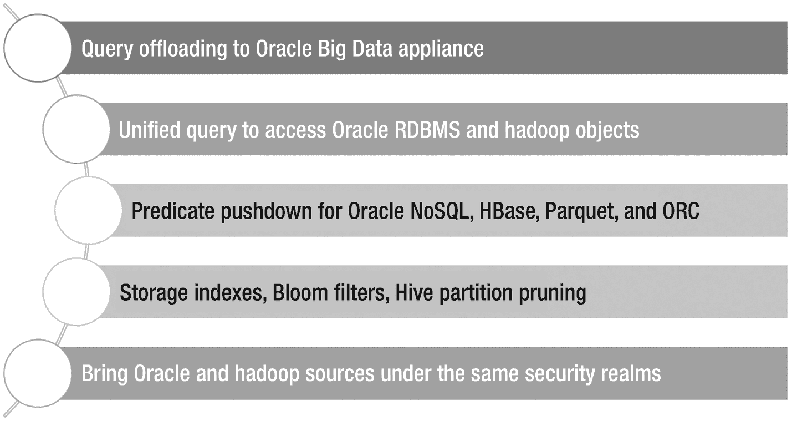

图 4-18 Oracle Big Data SQL 优势

Oracle Big Data SQL 是如何工作的？嗯，与传统的数据联邦技术相反，Oracle Big Data SQL 采用查询特许经营方法，在关系型和 Hadoop 数据源之间实现统一处理。查询特许经营推动基于驱动程序的查询执行，而不是将子查询分派到不同的数据系统由其各自的本地处理引擎来处理。驱动程序或代理是不同系统（Hadoop 数据节点）上的计算代理，它们协助执行 `Big Data SQL` 中的任务。这种特许经营模型实现的是统一的资源管理和有效的查询规划，因为 Oracle 优化器能够理解跨多个系统的数据位置和结构。代理或 `Oracle Big Data SQL` 单元通过智能扫描和存储索引来优化查询执行。

`Big Data SQL` 遵循外部表机制，通过 Hive 元存储访问表元数据。随后，它还使用底层的 Hadoop API 从 HDFS 访问数据。在 Oracle 数据库中创建外部表时，必须指定驱动程序，也称为存储处理程序。要访问 Hadoop 集群，Oracle 提供了两种访问驱动程序：

1. `ORACLE_HIVE` – 允许使用 Hive 元数据信息创建 Oracle 外部表。如果 Hive 表定义在 HBase 存储上，它还可以访问 HBase。
2. `ORACLE_HDFS` – 允许使用 HDFS 文件系统在 Oracle 中创建外部表，而无需显式创建 Hive 表。该访问驱动程序隐式模仿 Hive 语法，并为来自文件系统的数据分配模式结构。

下面的 `CREATE TABLE` 脚本为 Hive 表 `social_cmt_hv` 创建了一个外部表。

```sql
CREATE TABLE ratings_db_table (
col0 VARCHAR2(4000),
col1 VARCHAR2(4000),
col2 VARCHAR2(4000)
)
ORGANIZATION EXTERNAL
(TYPE ORACLE_HIVE DEFAULT DIRECTORY DEFAULT_DIR
ACCESS PARAMETERS
(
com.oracle.bigdata.cluster=hadoop
com.oracle.bigdata.tablename=default.social_cmt_hv
)
) PARALLEL 2 REJECT LIMIT UNLIMITED
```

`ACCESS_PARAMETERS`子句可用于指定替换操作，以取代其默认行为。例如，

- 如果 Oracle 和 Hive 中的表名不同，请在`com.oracle.bigdata.tablename`中指定 Hive 表名。
- 如果列名不同，请在`com.oracle.bigdata.colmap`中指定列映射。

### 设计注意事项

1. Oracle 数据字典`[USER] DBA_HIVE_TABLES`包含 Hive 表元数据详细信息。
2. Oracle Big Data SQL 是一个单独许可的产品，兼容 Oracle 数据库版本 12.1.0.2.0 及更高版本。
3. Oracle SQL Developer 4.0.3 具备连接到 Hive 元存储的能力。
4. 可以卸载到 Hadoop 的函数可以从`v$sqlfn_metadata`字典中查询。
5. 你可以使用`dbms_hadoop.create_extddl_for_hive`子程序生成用于在 Oracle 数据库中访问 Hive 表的外部表的 DDL。
6. Big Data SQL 3.0 及更高版本可以安装在配备 Cloudera CDH 5.5 或 Hortonworks HDP 2.3 发行版的 Hadoop 的普通硬件上。
    - 无法利用工程系统中因 InfiniBand 网络结构带来的网络优化。
7. 智能扫描 – 使用 Hive 或 HDFS 访问驱动程序的 Oracle 外部表的全扫描，通过运行在 Hadoop 数据节点上的`BigData SQL`单元的智能扫描功能进行优化。智能扫描是 Oracle 工程系统的一项功能，通过将处理下推到存储层来优化查询执行。
8. 存储索引 – Oracle `BigData SQL`单元为 HDFS 上的数据分布维护存储索引。存储索引有助于消除对那些不包含所需数据块的磁盘扇区的扫描。智能扫描和存储索引在查询优化方面相辅相成。为了有效利用存储索引，请使用频繁使用的列对查询进行排序。使用等式（`=`）、非等式（`<`、`>`、`<>`）、空值（`IS NULL`、`IS NOT NULL`）或小于/大于（`<=`、`>=`）运算符的查询可以从存储索引中受益。
9. 针对 ORC 和 Parquet 文件格式的查询，还能进一步受益于文件结构内的条带索引。
10. Oracle 数据库 12c 开发了存储和解析 JSON 数据的原生能力。使用`Oracle Big Data SQL`，可以下推`CLOB`处理。

## 结论

数据处理在最近经历了多次创新。诸如 Spark、Presto 和 Hadoop 上的 SQL 技术等现代尖端框架，减轻了从关系型领域过渡到非结构化空间的数据从业者的工作负担。这些新技术中常见的共通点是可扩展性和完整性。

本章试图讨论数据湖中的数据处理技术。你们中的许多人可能正在使用这些平台，但理解设计考虑因素和关键影响要素是成功实施的关键。在本书的范围内，我们讨论了经典的 MapReduce、Hive、Pig、Spark 和 Presto。然而，可能还有其他多种框架和设计，如 Cloudera Impala 或开源产品，它们服务于类似的目的。

在下一章中，我们将介绍数据治理及其关键责任之一：数据保留和归档策略。

脚注 1 Dean, Jeffrey; Ghemawat, Sanjay; MapReduce: Simplified Data Processing on Large Clusters, [`https://static.googleusercontent.com/media/research.google.com/en//archive/MapReduce-osdi04.pdf`](https://static.googleusercontent.com/media/research.google.com/en//archive/MapReduce-osdi04.pdf)

2 Dryad: Distributed Data-Parallel Programs from Sequential Building Blocks [`https://www.microsoft.com/en-us/research/wp-content/uploads/2007/03/eurosys07.pdf`](https://www.microsoft.com/en-us/research/wp-content/uploads/2007/03/eurosys07.pdf)