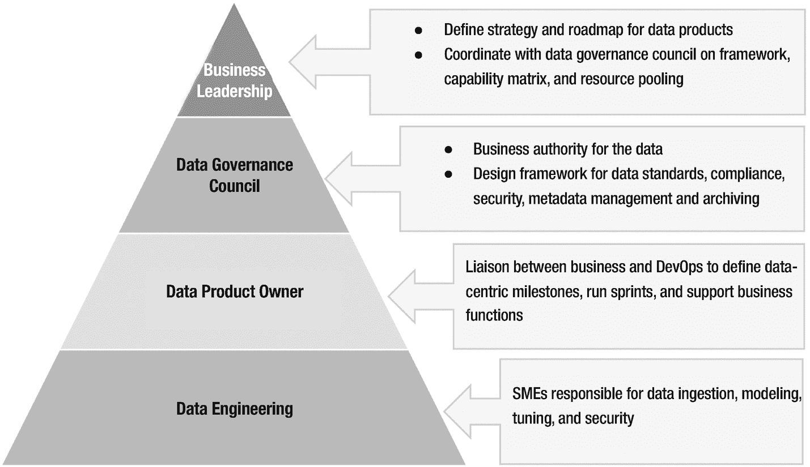
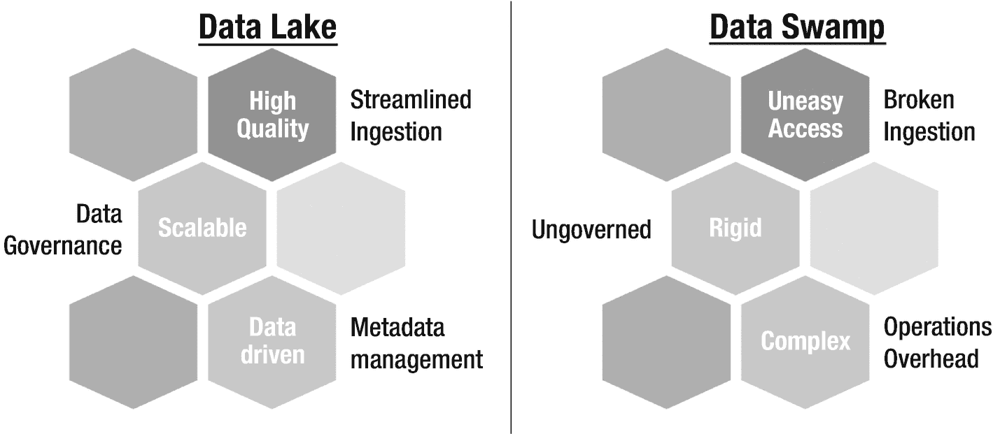
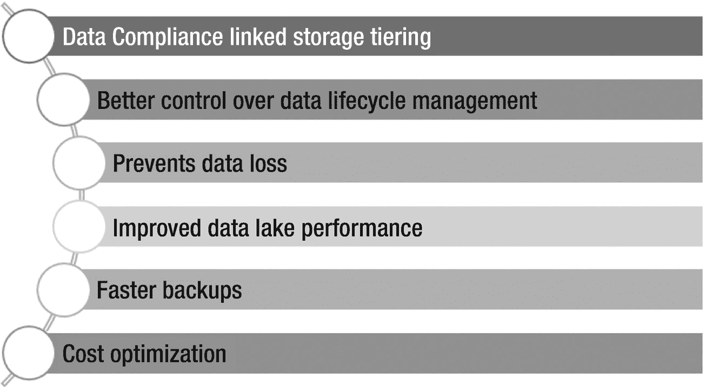
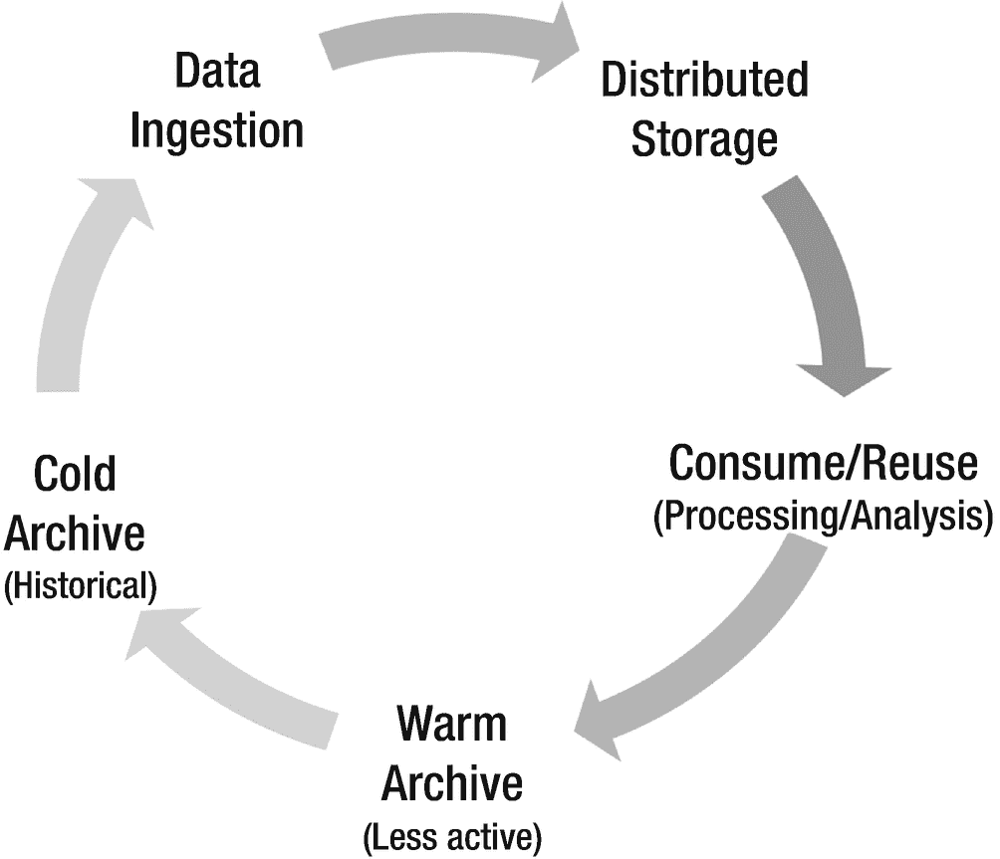
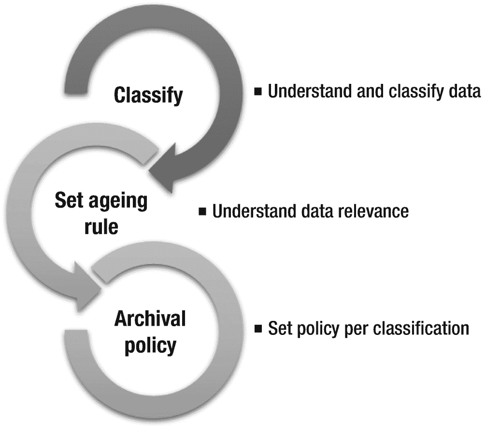
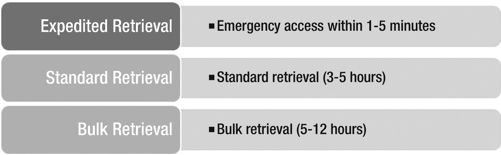
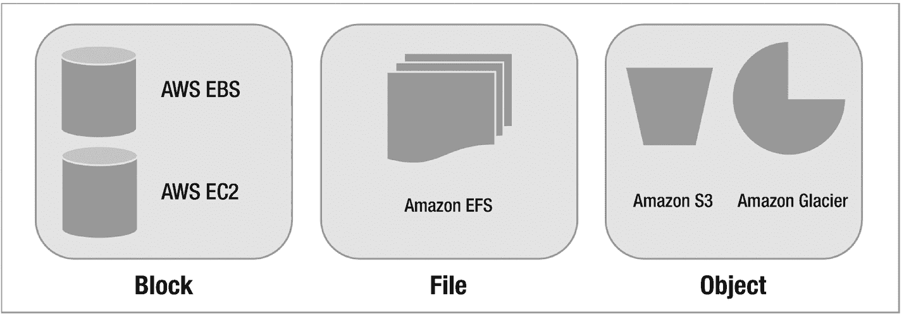
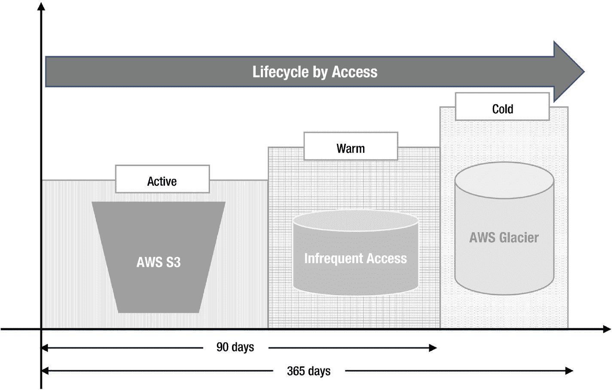

# 5. 数据湖中的数据归档策略

> “数据就像垃圾。你最好在收集它之前就知道要拿它做什么。” ——美国作家、企业家马克·吐温

数据湖成熟度呈线性增长的趋势，推动了数据分析从描述性向预测性、进而向指导性的演进。那些能带来丰厚商业成果的策略，很大程度上依赖于提供高质量和相关性数据的数据计划。企业数据湖作为现代认知数据分析的支柱，依靠一个负责在其转换和消费阶段管理其生命周期的机制。你多久会看到分析师质疑数据模型的数据充足性？安全分析师又多久会为数据湖应用标记风险区域，以衡量其脆弱性？这正是数据治理的用武之地——它是组织整体数据战略的关键支柱。

在本章中，我们将重点关注数据治理的一项成果，即数据归档策略。我们将理解为什么数据归档对企业及数据湖生态系统至关重要。随后，我们将探讨可能推动组织内数据生命周期管理策略的设计考量。

## 数据治理的行为

数据治理是一个“委员会”，它知晓业务成果的使命与愿景，并受托负责协调企业数据计划与这些成果保持一致。数据治理掌管数据湖的整个范畴，并在组织内制定愿景、策略和框架。根据 2016 年福布斯研究¹，78%的领先商业智能高管认识到治理在商业智能中的重要性，而 65%的高管承认治理提供了赋能终端用户发现新洞察的有用手段。Qlik 公司全球行业解决方案副总裁 Mike Saliter 认识到了治理委员会的重要性，并解释：

> 治理需要一种非常精妙的平衡——既要治理到确保一致性的程度，又要保持灵活性。没有完美的公式，但在组织文化中找到合适的治理水平，是充分利用商业智能机会的关键组成部分。

该委员会由首席数据官（CDO）领导，吸纳数据团队的关键利益相关者，组成一个数据领导公会。数据领导公会负责决策以下事项：

1. 简化整个组织的数据方法——为数据工程、数据摄取和数据可视化制定最佳实践、模型和流程。
2. 数据隐私与合规性——验证数据源是否合规。
3. 数据清单实践
   1. 数据采集与业务交付成果关联——采购新的数据源，将数据湖转化为数据资产。建议将策展层作为信息库，为业务分析团队保存准备好的数据。
   2. 数据保留——制定评估策略，以决定从数据湖中保留或剔除数据系统。
   3. 数据安全——在数据和平台周围实施安全防护，以降低与公司及公共网络中数据相关的风险。
      1. 数据脱敏
      2. 用户认证与授权
4. 基础设施规划
   1. 存储——实施信息生命周期管理（ILM）策略以归档数据。
   2. 容量规划——根据用户群和业务预测，规划基础设施以确保业务连续性。

图 5-1 展示了一个典型的数据治理委员会组织结构。

图 5-1
数据治理组织结构

### 数据湖 vs. 数据沼泽

数据湖遵循一种有序的方式来引入数据。它采用“一劳永逸”的方法来制定数据摄取策略、数据组织和架构。数据治理委员会会不时审查数据模式和实践，确保数据湖遵循安全、稳定和可持续的方法。采用系统性方法将所有复杂性（数据源、类型、转换）纳入一个通用层，对于成功的数据湖运营至关重要。

另一方面，数据沼泽则展现了数据湖的阴暗面。处于混乱状态的数据湖不过是变成了一个数据沼泽。它缺乏稳定的数据治理实践，缺乏元数据管理，并且在摄取框架上表现薄弱。对源数据进行不受控制且无法追踪的访问，可能会产生数据的重复副本，并对存储系统造成压力。

图 5-2 展示了数据湖与数据沼泽之间的关键区别。

图 5-2
数据湖与数据沼泽的对比

为防止出现数据沼泽的情况，企业可以采纳以下列出的最佳实践。

1. 倡导数据治理——数据治理确保对所有驻留数据拥有适当的监管，并将数据计划与可见的业务成果挂钩。它负责安全方面，并参与数据湖的容量规划。
2. 构建并维护元数据——应鼓励元数据管理，以简化数据访问并支持高质量的数据搜索。
3. 优先考虑 DevOps 章程——DevOps 保持摄取管道的完整性，并在通用框架下屏蔽数据的复杂性。

## 数据归档简介

数据归档是指以较低成本保留不常使用数据的技术。对于海量数据集，需要大规模存储。为了实现高效的数据访问，则需要智能存储。更快、更智能的存储系统可能会增加运营支出，从而提升总体拥有成本。数据委员会持续关注数据的相关性，并为分析模型设定时间线，以实现数据的时效性可见。数据湖本身原则上可作为数据归档平台，但需要避免“沼泽化”的情况。并非所有数据都具有同等相关性，数据会随时间和年限而变得沉寂。

数据的相关性和质量是推动数据归档策略的强烈动因。数据源和数据质量会随时间和年限而演变。一个 10 年前的数据集可能质量欠佳，当输入基于学习的分析模型时，可能毫无价值。请记住，快速便捷的数据访问是数据湖宣传亮点之一。尽管如此，出于监管和合规原因，沉寂的数据集仍可能保留在数据湖中，但需采用经济高效的存储方式。根据数据的年限和相关性来管理数据湖生命周期的能力，是区分一个成本高昂的数据湖与一个“精准”经济的数据湖的关键所在。

随着数据以 TB 和 PB 的规模增长并存储于一级存储系统，它可能会因拖慢数据访问速度而影响主要应用程序。显然，底层存储系统会因这种数据增长而面临成本和空间压力。此外，诸如备份、恢复、分析或克隆等数据操作，也会因数据体量庞大而运行时间更长。此类场景会直接影响 IT 预算，并降低投资回报率。数据归档实践有助于为新数据腾出空间。归档策略不仅能优化主存储系统的负载，还可能带来性能提升。性能优化是通过减少数据湖中活跃数据卷的表面积来实现的，而非通过部署任何调优技术。图 5-3 展示了数据归档优势的宣传图。

图 5-3

数据归档策略的优势

基于云的存储对企业来说可能是一个巨大的福音。公有云供应商宣称能以相当低的费率提供弹性存储服务。尽管这因情况而异，但云存储和归档服务能确保在可负担的资本下获得更好的回报，因为其运营支出更低（无需现场空间，且运营最小化）。让我们快速浏览一下架构师在定位云归档策略之前必须考虑的若干因素——

1.  恢复周转时间 — 云服务模型必须支持快速数据恢复。恢复方法必须简单且具有交互性。
2.  数据生命周期集成管理 — 归档服务必须能够与其他云存储类别集成。可以定义统一的生命周期策略，使用主存储和归档存储类别来实现存储分层。
3.  DLM 合规与法规 — 归档服务必须符合 DLM 的考量，如数据感知、数据搜索和成本优化。
4.  安全性 — 这是云与本地部署争论的关键参数之一。安全性在很大程度上取决于数据治理委员会对数据机密性和合规性的定义。然而，云服务供应商必须支持数据加密、访问管理和身份验证等安全技术。

## 数据生命周期管理

数据生命周期管理是指能够根据数据的年限和业务相关性对数据进行分类，并定义策略以在存储层级间移动数据的能力。推动有效数据生命周期管理的因素包括：

1.  数据感知 — 深入了解业务服务级别协议和数据模型意识非常重要。它有助于确定数据是什么，而不是数据位于何处。数据感知有助于了解数据的合法性和敏感性。
2.  数据保留、转换和过期策略 — 可以通过生命周期规则定义来实现存储和压缩分层。这些规则可以定义老化策略，当触发时，会执行相应的操作，如数据移动或删除。图 5-4 展示了数据湖中数据的生命周期。

    

    图 5-4

    数据湖中的数据生命周期管理流程
3.  熟悉数据源以进行业务相关分类 — 除非了解数据的意义，否则无法确定数据归档的影响。例如，超过两年的零售交易数据可以归档，但零售合同商的数据永远不能归档。
    1.  为数据湖中的所有对象设置硬性时间线并非良策。这可能对数据的业务相关性产生不利影响。例如，在硬性时间线之前创建的客户档案，在数据湖中可能不再可见，因而也无法被实施消费者分析的模型所使用。
    2.  根据业务依赖关系归档数据 — 在审阅所有依赖关系后归档数据是可行的做法。规定日期之前的客户交易可以归档。然而，客户数据仍将保持活跃并对系统可见。
4.  数据访问频率 — 有助于定义数据的老化规则。
5.  有效的治理与合规 — 数据治理全面了解数据及其存储类别。

### DLM 策略操作

可以定义 DLM 策略，使其根据业务需求和数据相关性来执行操作。数据归档可以是在线的，也可以是离线的。数据可以被迁移到连接的低成本存储，也可以被清除到与活跃数据湖断开的存储中。虽然大多数企业倾向于在线数据归档，但离线归档在两种情况下会发挥作用：

1.  源系统退役或被停用，其在数据湖中的数据足迹需要归档。
2.  源系统通过数字化举措进行转型，遗留的原始数据集需要归档。

对于在线数据归档，DLM 策略可以实现存储分层和压缩分层。存储层级指的是存储具有特定分类并遵循 DLM 策略的数据的存储桶。不同的存储层级可能具有不同的底层存储及相关属性，如压缩模式和磁盘速度。

### DLM 策略

数据生命周期管理应当是一种逐步定义归档策略的方法，而非一次性的即时操作。以下是设计策略时需要遵循的步骤：

1.  **数据优先级划分** – 数据的选择与分类应是 DLM 策略的首要步骤。数据可根据其业务关键性以及与其他实体的依赖关系进行分区。类别和参数完全取决于数据委员会的规定。不过，一个标准的数据目录可以通过将数据分类到以下类别来构建：
    1.  **主数据** – 具有高度且一致业务重要性的数据需要保留，除非数据治理部门批准归档。主数据可以是敏感信息，例如个人身份信息（PII）数据（社保号、客户、员工、患者）或公司内部数据（产品、供应商、供货商、交易和协议）。对于医疗行业，HIPAA 隐私规则规定了患者记录必须保留的年数。银行业则综合多个参数，如最后交易日期和余额，来将账户划分为休眠账户。
    2.  **事务数据** – 可以毫无问题地进行归档的数据。可以定义策略，在日事务数据达到一定期限后进行归档。
        1.  超过两年的机器或传感器生成数据
        2.  超过 30 个月的位置数据
        3.  超过五年的银行交易数据
        4.  超过一年的教育数据
    3.  **社交数据** – 社交数据的归档频率可以高于其他类别，因为大多数消费社交数据的分析模型是通过持续和渐进式学习来获取洞察的。随着这些模型逐渐成熟，它们会用自身的见解去“浸润”原始数据流，从而丰富数据。因此，来自社交媒体的数据更容易快速变得不活跃。每月将 Web 日志移到二级存储的归档策略可能足以满足存储需求。
2.  **按分类的数据期限** – 对于每种数据分类，期限参数可能因数据相关性或政府规定而异。为每种分类设定时间维度将在归档策略与数据分类之间建立联系。
3.  **定义归档策略** – 可以在存储层级为每个数据源声明归档策略。每个策略都包含名称、规则和操作。策略可以隐式触发或手动触发。

    

    图 5-5

    数据归档策略基础

### DLM 设计考量

让我们看看在实施全面的数据归档策略时可能具有战术意义的关键设计考量（图 5-5）。

1.  **将数据备份用作数据归档** – 避免将数据备份用作数据归档。关于定期数据备份是否可被视为归档，一直存在长期争论。然而，实际情况是，备份和归档是两个不同的领域。备份就像是数据丢失时的填充物，而归档是数据的查找工具。
    1.  备份用于系统恢复、克隆或灾难恢复。而归档则以性能为代价实现数据发现。
    2.  数据备份与活跃数据是断开的，而归档与数据湖紧密相连。
    3.  例如，如果客户需要超过一个季度的银行交易记录，银行会从归档中提取。如果缺少归档而必须从备份中提取，则必须先还原所有备份，然后才能访问所需数据。
2.  **归档性能** – 从归档中访问数据可能会带来次优性能，因为数据必须从二级存储中提取。
    1.  在 DLM 策略中将数据分类映射到存储层级时，这是一个关键因素。对于归档，性能取决于二级存储的磁盘速度、网络带宽和压缩模式。
    2.  如果归档采用压缩格式，则会在访问前增加解压步骤，从而进一步降低性能。
3.  **归档非结构化数据** – 对于非结构化数据，可以建立一个由二级存储系统组成的归档 Hadoop 集群。其存储范式与主 Hadoop 集群相同。有多家商业供应商提供将非结构化数据归档到文件系统的产品。
4.  **发现数据依赖关系** – 在实施归档计划之前，必须充分理解不同数据类型之间的关系。我们在 DLM 部分看到了客户档案的例子。下面还列出了一些其他情况。
    1.  主业务实体绝不应被归档，除非该实体已退役或停用。
    2.  避免固定时间线的归档 – “所有 2000 年之前的数据都将被归档” – 此规则将使 2000 年之前输入的所有主数据失效。这是期望的结果吗？数据治理部门需要做出决策。
    3.  通话数据可以在 15 年后归档。
5.  **Hadoop 归档（HAR）** – 一种基于 MapReduce 的工具，用于将 HDFS 集群上的多个小文件归档为一个不可变文件。它旨在解决 Hadoop 中的小文件问题。
    1.  `hadoop archive –archiveName dummy.har /input/location /output/location`
6.  **基于云的归档** – 公有云供应商以可承受的价格提供归档存储服务。基于云的存储不仅可作为磁带机制的替代方案，还提供了更好的可用性、企业级安全性、易于管理性和合规性。
    1.  **持久性** – 本地归档提供完全的控制权，但可能给企业带来成本压力。此外，归档的持久性、可用性和安全性是需要解决的一些紧迫问题。
    2.  **安全性** – 尽管在“云”安全这类话题上难以让所有人达成共识，但了解云供应商如何应对安全问题或许是有益的。云供应商声称数据一到达就进行加密。考虑到云公司拥有的技能水平和其遵守的合规标准，他们为客户保管了加密密钥。然而，在将数据推送到云之前自行加密一次也不失为一个好主意；这样，客户可以完全掌控其中一层的加密。
    3.  可用于归档遗留数据或非结构化数据。
    4.  提供归档服务的商业供应商
        1.  Amazon Simple Storage Service 和 AWS Glacier
        2.  Microsoft Azure Archival Storage
        3.  Oracle Cloud Infrastructure Archive Storage Classic
7.  **分层级别** – 将数据分布到冷、温、热数据桶中
    1.  **热数据** 指驻留在主存储上的最活跃数据。所有数据驱动的操作和分析模型从数据湖中访问热数据。
    2.  **温数据** 是偶尔被选中但从未真正参与事务的不活跃数据。
    3.  **冷数据** 仅出于监管和合规目的而存在。它不参与数据访问或事务活动。
8.  **检索方法** – 对于本地和基于云的归档，确保了解在需要时如何检索归档数据。

### Amazon S3 和 Glacier 存储类

Amazon 提供了高持久性的对象存储容器 S3，适用于多种场景。它提供了用于监控和生命周期控制的数据管理控制台、通过版本控制和复制实现的数据保护、事件和警报通知以及安全控制。由于本书的范围和目的所限，我们不会深入探讨 Amazon S3 服务。相反，我们将重点介绍 Amazon S3 的存储类。

Amazon 提供一种名为 AWS Glacier 的低成本归档存储服务。它用于对不常访问但因合规性而需要保留的数据进行深度归档。如果您在寻找长期备份解决方案，Glacier 可能非常适合您的需求。Amazon Glacier 提供了三种数据访问方法，即：加急、标准 和 批量服务。根据数据访问需求，可以选择合适的检索模式（图 5-6）。

*图 5-6：AWS 数据检索策略*

从安全角度来看，Glacier 中的所有数据都是加密的。此外，可以通过 AWS IAM 服务配置访问控制。

Amazon S3 的生命周期特性如下所示。

1. **分层数据管理** – Amazon S3 存储类可以是 S3-Standard、S3-Standard-IA 或 S3-Glacier。
    1. `S3 Standard` – 这是用于通用数据存储的主要对象级存储类。它服务于通常需要低延迟和高吞吐量的数据访问请求。所有热数据和活跃数据都驻留在此存储类中。
    2. `S3 Standard – 不频繁访问` – 此对象级存储类用于温数据或不常使用的数据。使用 Standard-IA 存储类可以快速提供低延迟和可管理吞吐量的数据访问请求。最短存储期限为 30 天。
    3. `Glacier` – 此对象级存储类用于归档为合规和监管目的而保留的冷数据。最短存储期限为 90 天。
2. **生命周期规则** – 数据生命周期策略可以被定义为规则，以便对数据老化采取适当的操作。数据年龄定义为天数或固定日期。操作的性质可以是：
    1. **转换** – 允许数据从 S3 移动到不频繁访问层，然后移动到 Glacier。这意味着对象存储类从 S3 转换为 `STANDARD-IA` 或 `GLACIER`。
    2. **过期** – 允许根据日期或年龄删除 S3 存储中的数据。由于 AWS 采用排队方式异步删除对象，因此过期日期和实际过期之间可能存在延迟。

应该选择云归档服务的原因在于，云的总体拥有成本远低于本地部署。与磁带库、驱动器、介质或专用框架等传统归档方法相比，AWS Glacier 以更低的成本实现了智能归档。另一个主要考虑因素是持久性。AWS 保证 99.9% 的数据持久性，并在故障期间进行定期固定性检查和自动恢复。

### 设计考虑

作为云架构师，在企业数据湖中执行数据归档策略之前，必须牢记以下几点：

1. 存储类只能向前移动。例如，`STANDARD` 类中的对象只能转换为 `STANDARD-IA` 或进一步的 `GLACIER`。`STANDARD-IA` 中的对象不能重新设置回 `STANDARD`。在这种情况下，只能从 Glacier 归档中恢复归档数据。
2. 年龄小于 30 天的对象不能转换为 `STANDARD-IA`。
3. 大小小于 128KB 的对象不能转换为 `STANDARD-IA`。
4. 根据生命周期操作，定价可能有所不同。
    1. 如果您在 30 天内从 `STANDARD-IA` 存储类删除对象，您可能需要支付提前删除费用。
    2. Amazon Glacier 中的每次归档和检索请求都是收费的。
5. 加密对象在整个转换过程中将保持加密状态。
6. 从 Glacier 归档恢复是一个耗时的过程。

图 5-7 展示了 Amazon AWS 存储类组合。

*图 5-7：Amazon AWS 存储类组合*

### DLM 案例研究 – 使用 Amazon 进行归档

一家图像处理公司 IPC 在 AWS 上搭建了其企业数据湖。虽然传统数据存储包含 10 年数据，但数据委员会已规定数据湖需保存 3 年的图像和操作数据。就数据归档而言，可能存在两种可能的情景：

1. 可以通过老化策略触发数据归档。
2. 可以直接上传数据进行归档。

在使用 AWS 的典型 DLM 框架中，Amazon Glacier 在归档策略中充当汇聚点。在上述两种情景中，数据归档都可以存储在 AWS Glacier 上。在第一种情景中，Amazon AWS 允许与 S3 存储进行生命周期集成。可以在 AWS 管理控制台中定义和配置生命周期规则，以将对象数据从 S3 移动到不频繁访问存储层，然后移动到 Glacier。图 5-8 展示了数据生命周期管理中的存储分层，从在 S3 中创建数据到根据规则在 Glacier 中进行数据归档。所有生命周期规则都根据其触发器设置进行检查。如果满足条件，数据会逐步从一个层移动到另一个层。

*图 5-8：数据生命周期管理中的存储类层级支持*

对于第二种情景，可以通过直接上传技术将遗留数据直接上传到 AWS Glacier。主要有三种方法可以将数据批量上传到 Glacier：

1. 通过安全隧道经公共互联网传输数据。
2. AWS Direct Connect，用于站点和 AWS 之间的专用网络带宽。
3. AWS Snowball Edge – AWS Snowball-edge 是一款具有本地计算和存储能力的高扩展性设备，用于物理传输数据进出 AWS。Snowball 配备了相当于 Amazon EC2（`m4.4xlarge`）的计算和存储能力，可用于云迁移、灾难恢复、数据中心下线和数据繁衍。

是否应始终通过生命周期规则来实践 DLM？这个过程是否可以手动执行？那么，S3 生命周期管理的 Amazon Glacier 带来的好处在于，索引条目保留在 S3 上，而只有对象数据从 S3 移动到 Glacier。对象元数据保留在 S3 存储中，这意味着可以通过用户定义的名称引用对象。可以使用 S3 API（而非 Glacier API）检索对象。

## 结论

企业正面临着持续存储海量数据的压力。管理这种数据增长对企业来说可能是一项真正的挑战。市场上存在多种商业归档解决方案，它们声称能为组织提供万无一失的归档服务，但区分成功与失败数据归档的关键在于对数据的理解。归档产品或许能迅速带来某些显著成果，但因数据归档策略缺陷引发的问题可能会在未来浮现。数据归档框架的核心在于研究数据依赖关系、优先级排序以及与业务服务等级协议（SLA）的认知。一套高效的数据归档策略有助于优化 IT 投资、提升数据访问性能，并增加投资回报。

在下一章中，我们将把重点转向数据治理的另一个关键组成部分，即安全性。我们将聚焦于数据湖安全原则以及架构师的考量因素。

脚注 1

[`https://www.forbes.com/sites/forbespr/2016/10/24/strong-data-governance-enables-business-intelligence-success-says-new-forbes-insights-study/#6832a44f582d`](https://www.forbes.com/sites/forbespr/2016/10/24/strong-data-governance-enables-business-intelligence-success-says-new-forbes-insights-study/#6832a44f582d)

