# 6. 数据湖中的数据安全

> “数据像酒一样成熟，应用程序则像鱼一样。”——詹姆斯·戈弗诺，RedMonk 首席分析师兼创始人

伴随数据的巨大体量和极高价值而来的是，保护数据免受外部入侵、降低意外攻击风险的责任。每年，全球都会目睹大量网络盗窃、安全漏洞和数字攻击的案例。根据 Gartner 在 2017 年第一季度的报告¹，2017 年全球安全支出估计为 900 亿美元，比 2016 年增长了 7.6%。Forrester 的一位研究员很好地总结了建立稳健安全框架的必要性，他解释道²：

> 基于边界的安全方法已经过时。安全和隐私专业人员必须采取以数据为中心的方法，确保安全与数据本身同行——不仅是为了保护数据免受网络犯罪分子的攻击，还要确保隐私政策持续有效。

在过去几年中，安全性在组织信息战略中的地位得到了加强。数据领域的主要市场参与者都认同，威胁诊断比威胁缓解更具相关性。为了防止脆弱区域被利用，组织采用了数据加密和编辑策略、主动监控以及细粒度访问控制等技术。图 6-1 展示了在为企业确定稳定安全策略方面起关键作用的因素。

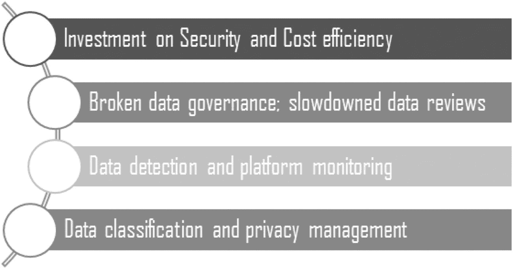
*图 6-1 在确定稳定安全策略方面起关键作用的因素*

本章将深入探讨 Hadoop 数据湖的安全方面。首先介绍标准系统架构，让读者熟悉网络安全、防火墙和 Hadoop 集群的组件。

## 系统架构

在前面的章节中，我们已经了解到 Hadoop 提供分布式存储和分布式处理范式来处理大型数据集。在处理大型集群时，我们必须牢记的领域包括操作环境、其操作模式以及网络带宽。有多个因素影响 Hadoop 操作环境的选择。由于网络和服务器技术的快速发展，Hadoop 可以存在于几种不同的环境中。

1. 内部部署 – Hadoop 可以在企业拥有和控制的数据中心进行设置。它们由一组物理机（裸机）搭建而成。
2. 托管 – 托管设置是内部部署的一种变体，包含物理服务器，但不由组织拥有或运营。这些服务器从外部供应商处租赁，由该供应商负责配置、运营和维护。
3. 云服务模型 – 这可谓是当下的热门话题。多家科技巨头已经开始提供供公众使用的虚拟化服务器，作为“云”服务。可以利用虚拟化基础设施来运行各种系统，大到数据中心，小到一个简单的应用程序。作为云客户，公司只需为他们订阅和使用的服务付费，就像在餐厅享用自助餐或点菜午餐一样。

### 网络安全

网络分段将集群环境与更大的网络在物理和逻辑上隔离开来。物理网络分段是分离物理设备，如网络交换机、路由器、VLAN 和防火墙，而逻辑网络分段则可以通过使用独立的互联网协议（IP）地址来实现。

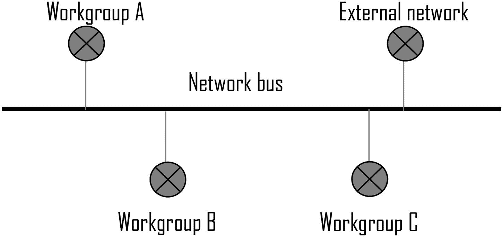
*图 6-3 使用 IP 子网的逻辑分离*

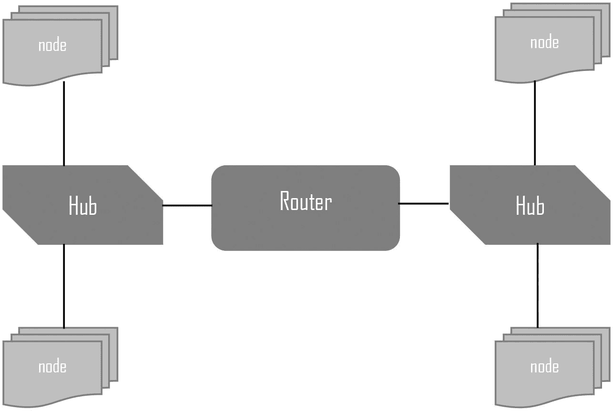
*图 6-2 使用路由器的物理分段*

网络防火墙保护内部网络免受来自外部代理的未授权和恶意访问。它可以配置为限制内部用户对外部的访问。防火墙持续监控所有入站和出站流量。它可能会限制特定应用程序访问网络、阻止 URL 加载，以及阻止通过某些网络端口的流量。

可能存在一种网络防火墙，它会阻止所有流量，只允许一个（或少数几个）被明确启用的访问。这种做法有助于保护网络免受恶意威胁。防火墙基于传入的 IP 地址、端口和协议进行分析，从而保护内部网络。

入侵检测与防御是监控网络中发生的事件，并分析这些事件以寻找可能的安全事件、违规行为或对安全策略构成迫在眉睫威胁的迹象的过程。另一方面，防御是检测入侵并阻止此类事件的过程。这些安全措施以入侵检测系统（IDS）和入侵防御系统（IPS）的形式提供，它们成为网络的一部分，用于检测和阻止潜在的安全事件。可以捕获、分析 IDS 日志并将其发送到监控系统以发出警报。入侵检测可以是基于签名的，也可以是基于异常的。入侵防御系统则监控并试图阻止入侵。

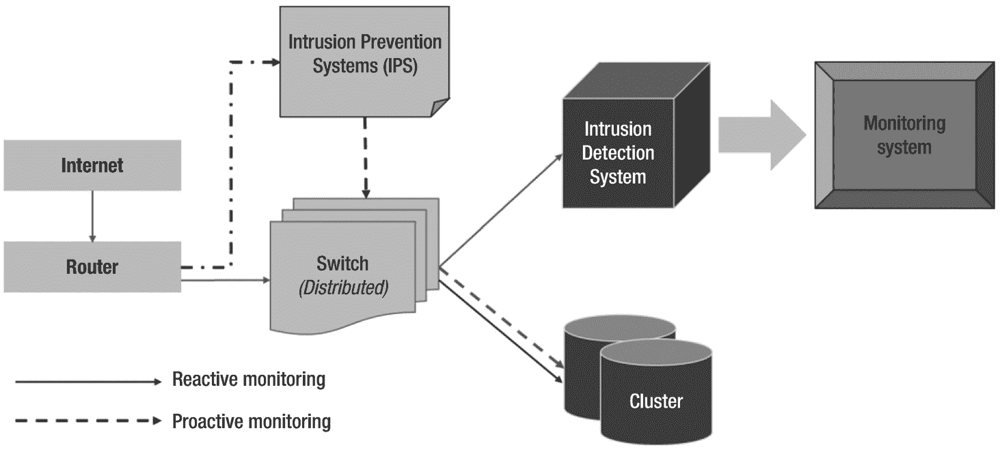
*图 6-4 使用 IPS 和 IDS 流程的被动监控与主动监控对比*

### 集群内的 Hadoop 角色

可以根据集群中各节点组扮演的角色及其提供的服务，将安全策略应用于这些节点组。在一个典型的 Hadoop 集群中，各个组可以包括 Master 节点、Worker 节点、管理节点和边缘节点。

#### Master 节点组

该组包含所有托管主服务的节点，例如 `Namenode`、`Standby name node`（备用名称节点）、`Resource Manager`（资源管理器）、`Hive Server`（Hive 服务器）和 `zookeeper`。这些服务应能访问其他服务，同时，由于它们属于重要服务，这些节点上的安全性应很高。

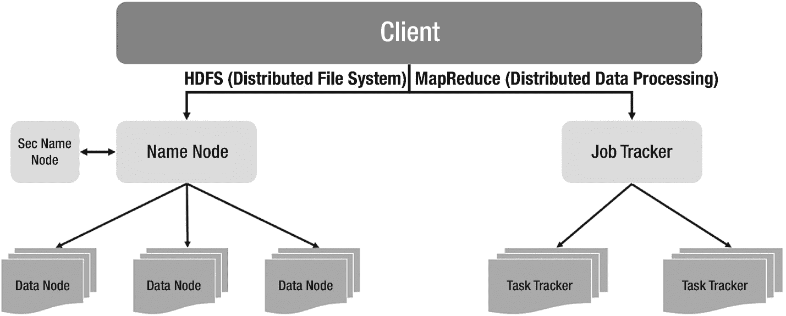
*图 6-5 Hadoop 存储和处理框架*

不应允许普通用户/程序访问这些节点，因为这可能导致意外漏洞以及诸如机密数据访问和服务中断等情况。

#### 工作节点组

该组包含所有托管工作服务的节点，例如 `Data Node` 服务、`Node Managers` 和 `Task Trackers`。工作节点需要与各自的主节点进行网络层面的通信，因为它们通过 `RPC` 和 `TCP IP` 进行交互。与主节点一样，工作节点也需要高度安全。只有管理员才应被允许访问这些节点。

#### 管理节点

管理节点通过提供配置管理、监控和告警功能，促进集群的无缝运行。这些节点通常包含用于构建整个集群的初始仓库。它们可以是 `hive metastore`、`oozie` 或 `Ambari server`。

`Apache Ambari` 是 `Hortonworks` 发行版的管理软件。安装了 `Ambari` 的服务器就是一个管理节点。它需要一个后端数据库，而该数据库本身也将是一个管理节点。由于这些节点上的安全漏洞可能导致整个集群的干扰，因此需要仔细的访问管理。

#### 边缘节点

边缘节点托管用户与之交互的各种客户端，例如 `Hive/Spark Clients`、`Gateways`、`Sqoop`、`Oozie clients` 以及 `Hue/Ambari views`。可以根据其集群使用情况对用户进行分类。

### 数据安全层

对于大型企业系统，实施跨越数据湖生态系统不同层级的数据安全解决方案非常困难。一个系统可能提供多个入口点，如存储、网络和用户群体。因此，遵循分层方法来保护所有可能暴露漏洞的点是一个良好的实践。

让我们回顾数据移动的阶段，了解如何防止不安全点受到攻击。

1. 数据通过网络进入数据湖 – 网络安全层通过在允许用户访问 Hadoop 数据湖之前对其进行身份验证，来防止恶意攻击。
2. 存储 – 存储在数据湖中的数据具有巨大的商业价值，为了确保这些数据的安全，强加密层是一个值得推荐的解决方案。我们可以采用 `Transparent Data Encryption (TDE)`、`Ranger KMS` 以及许多其他保证存储级加密的方案。
3. 当前正在访问的数据 – 从数据湖中选取的数据应在数据湖内安全传输。`Ranger` 在细粒度数据级别提供了广泛的安全功能，可用于为 `hive` 实现动态列掩码或行过滤。

## 用于操作系统安全的主机防火墙

主机防火墙可以是 Linux 内核中的 `iptables`（也称为数据包过滤器），也可以是一组拦截网络流量的程序。代理服务器代表特定的网络应用程序从一个网络到另一个网络建立连接。代理通常比数据包过滤器慢。

可以配置 `IPTables` 策略来拦截 Hadoop 集群流量。一个典型的 Hadoop 集群会为不同的服务开放一些通用端口。可以配置 `Iptables` 规则，通过 `IPs` 和这些端口来限制流量。可以根据需求收紧或放宽这些规则。例如，

```
iptables -A hdfs -p tcp -s 0.0.0.0/0 --dport 50070- -j ACCEPT
```

上述命令将允许所有服务器（`0.0.0.0`）连接到该节点，因为它没有限制传入的 IP 地址。但下面的命令则更为严格，它只允许 IP 地址为 `10.230.224.18` 的服务器进行连接。

```
iptables -A hdfs -p tcp -s 10.230.224.18/32 --dport 50070- -j ACCEPT
```

在所有发往集群的通信都通过边缘节点进行的设置中，上述命令将非常有用。必须将边缘节点的 IP 地址添加到 `iptables` 策略中。

## 传输中的数据

传输中的数据因其能够驱动可操作情报而具有首要的重要性。然而，必须清楚一个事实：数据在通信传输期间是最脆弱的。这是数据离开网络并通过未知网络组件进行路由的时期，使其容易受到各种形式的攻击，因此必须保护传输中的数据。

已经发布的研究旨在解决这个问题，其核心思想围绕着创建加密通道。`OSI`堆栈有多个层可以创建此通道，但最流行的是基于开放系统互连（`OSI`）堆栈的传输层构建的。加密传输层具有跨应用程序重用加密的优势。

### 通信问题

典型的通信可以由图 6-6 所示的场景来展示。

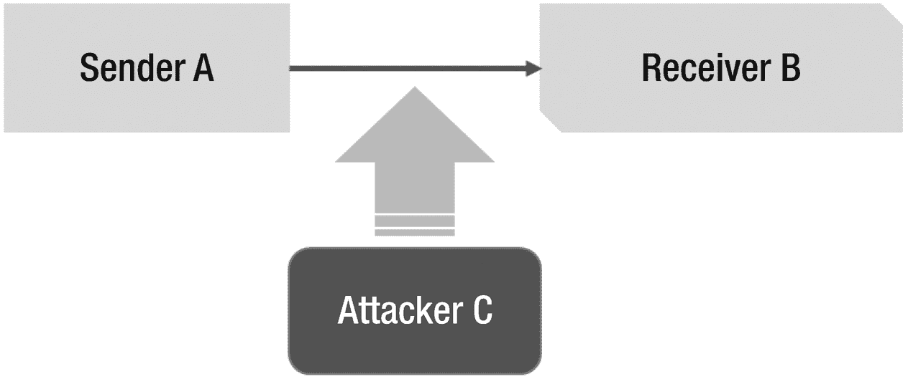

*图 6-6 对 A 和 B 之间通信信道的安全攻击*

发送者`A`想要安全地向接收者`B`发送数据。我们不希望攻击者`C`破解或篡改`A`和`B`之间的通信。这可以通过加密`A`和`B`之间的数据来实现，这样`C`就无法理解，因此也无法篡改数据。除了保密性之外，`A`和`B`在通信前还需要相互认证，因为攻击者`C`伪装成`A`或`B`都可能危及系统安全。

因此，对于安全通信，有三个主要问题需要解决。

1.  **身份验证** - 证明你是你声称的那个人
2.  **保密性** – 确保只有经过身份验证的预期用户才能读取数据
3.  **完整性** – 确保数据未被篡改

如何解决这些问题？嗯，这三个问题目前都由一类称为非对称密钥算法的算法来确保。这类算法也通常被称为公钥/私钥密码学。

用公钥加密的消息只能用私钥解密，反之亦然。私钥作为秘密保存，公钥则向公众开放。这解决了以下问题：

1.  **身份验证**，通过数字签名完成。在这种情况下，发送者使用其私钥对消息进行签名。任何拥有发送者公钥的人都可以解密该消息，如果解密成功，则可以确信只有拥有私钥的人才能加密该数据。
2.  **完整性**由加密来保证。消息成为加密算法的输入，因此只有预期消息相同时，解密才能成功。
3.  **保密性**通过使用某人的公钥对消息签名来维护。因此，只有拥有秘密私钥的人才能解密该消息。

行业中常用的两种算法是`RSA`和椭圆曲线密码学。两者都基于公钥/私钥加密。密钥本身存储在称为证书的文件中。最常见的是`X.509`证书，其中包含公钥。

为了对数据进行数字签名，使用了哈希函数。哈希函数具有以下特性。

当应用于消息时，结果消息极难破解，并且不会给出关于消息的线索，因此不可能逆向推导。其次，它们具有较低的碰撞因素，即使用相同哈希函数的两个不同消息会返回不同的结果。常用的哈希函数有`MD5`、`SHA1`和`SHA2`。

其过程是这样的：发送者创建消息哈希，并用私钥进行加密。接收者收到消息后，使用哈希函数生成公钥，并解密接收到的消息。如果两个消息匹配，那么它只能由相同的哈希函数生成，并且只有拥有私钥的人才能加密该消息，因此身份验证和完整性得以维护。

公钥的有效性由一个称为证书颁发机构（`CA`）的中央权威机构来保证。公钥基础设施（`PKI`）维护证书的有效性和生命周期。

非对称密码学的缺点在于处理大量数据时开销较大。当前可用的公共基础设施能高效加密约 100KB 的数据，远低于当前市场的需求。为解决这一问题，存在一类称为对称密钥算法的独立算法，其使用同一密钥对数据进行加密和解密。它们比非对称密钥算法快得多。这些算法的常见示例包括`AES`（64 位和 128 位）、`Blowfish`、`DES`（内部机制、三重 DES）、`Serpent`和`Twofish`。这些方法的问题在于需要将同一密钥分发给双方，这对于两个未知方来说是非常困难的任务。这通过一种称为`Diffie-Hellman`的交换协议得以规范化。

总体思路是结合使用这两类算法以发挥各自优势。我们通常使用非对称密钥算法进行身份验证以及将对称密钥传递给双方。然后，使用彼此之间传递的对称密钥对大量消息进行加密。

该策略在传输层通过`TLS`和`IPSec`等协议实现。`TLS`是旧方法`SSL`的继承者。这些策略在保护传输中数据的安全方面发挥着重要作用。

## 静态数据

静态数据指的是物理存储在数据存储、仓库、归档、在线或离线备份或任何其他设备中的数据。它可能处于活跃操作状态，也可能不处于活跃操作状态，但可用于获取历史洞察。`LUKS`（Linux 统一密钥设置）可用于加密磁盘上的静态数据。它指定了一种平台无关的标准磁盘格式，通过标准化提供了兼容性。`LUKS`的参考实现在 Linux 上运行，基于增强版的`cryptsetup`，并使用`dm-crypt`作为磁盘加密后端。`Dm-crypt`是一个透明的磁盘加密子系统，使用 Linux 内核加密 API 中的加密程序。这包括最常用的加密算法，如`AES`，以及哈希函数，如`SHA-256`。

我们需要加密磁盘上的静态数据，以防止对设备的物理攻击或离线攻击。磁盘可能位于远程位置，这使我们有必要预期并防止诸如外部组织盗窃磁盘等攻击。在`LUKS`加密的磁盘被盗的情况下，攻击者将无法在没有有效密码的情况下挂载该设备。通过`cryptsetup`挂载设备也需要密码。由于`LUKS`坚持使用强密码，并使用盐值来提高低熵密码的安全性，因此消除了其他密钥管理系统面临的大多数攻击。`LUKS`还支持一个磁盘最多拥有 8 个密码（图 6-7）。


**图 6-7** `LUKS` 的磁盘布局

从上图来看，`KM`代表[密钥材料]，而大量数据是用户数据。

### 在 LUKS 中生成和验证密钥的流程

用户提供密码。此密码后附一个盐值。基于密码的密钥派生函数（`PBKDF`）根据此值生成一个密钥。借助加密的主密钥，它被转换为实际的主密钥（`MK`）。

为了验证密钥，我们将主密钥和盐值提供给`PBKDF2`函数，并与主密钥摘要值进行比较，如图 6-8 所示。

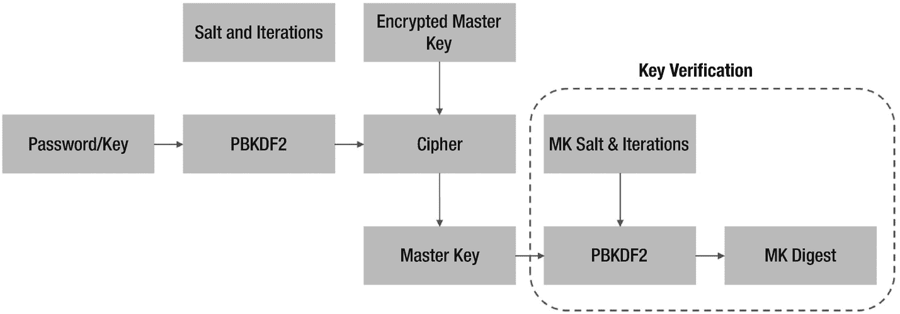

**图 6-8** `LUKS` 中的密钥生成与验证

### 用户访问流程

在通过`cryptsetup`成功认证后，用户通过挂载点与物理磁盘的映射器进行交互（图 6-9）。


**图 6-9** 通过`cryptsetup`的用户访问流程

下面，我们使用 B 树文件系统（`btrfs`）来测量`LUKS`加密前后的读写性能。以下步骤提供了安装`btrfs`、创建挂载点以及检查读写性能的信息。

**步骤 1 - 安装 btrfs**

```
$ yum install btrfs-progs
```

**步骤 2 - 在磁盘上创建 btrfs 文件系统**

```
$ mkfs.btrfs /dev/sda1
```

**步骤 3 - 出于测试目的，我们将其挂载到 /mnt**

```
$ mount /dev/sda1 /mnt
$ chmod 777 /mnt
```

**步骤 4 - 检查写入速度（文件大小：948MB，分配给文件系统的总大小为 1GB，因此无法尝试更大的文件）**

```
$ dd if=/dev/sdf/test1 of=/mnt/dd-test1 bs=1M conv=fsync
Result -  72MB/s
```

再次运行相同的命令：

```
Result -  69MB/s
```

**步骤 5 - 检查读取速度（文件大小：948MB）**

```
$ dd if=/mnt/dd-test1 of=/dev/null bs=1M
Result -  79.6MB/s
```

再次运行相同的命令：

```
Result: 3.3GB/s
Reason: Data is cached.
```

要使用`LUKS`，请执行以下步骤：

**步骤 1 - 卸载文件系统**

```
$ umount /dev/sda1
```

**使用 LUKS 加密磁盘的步骤：**

1.  在机器上安装`cryptsetup`

    ```
    $ yum install cryptsetup-luks
    ```

2.  上述命令将安装`cryptsetup`——这是我们将用来使用`LUKS`加密磁盘的前端工具。

**在磁盘 `/dev/sda1` 上设置 LUKS：**

1.  格式化磁盘，请事先做好必要备份。

    ```
    $ sudo cryptsetup luksFormat /dev/sda
    ```

2.  首次设置`luks`加密时，我们使用`luksOpen`命令，如下所示。此命令的输出是提示用户输入密码。该密钥将位于密钥槽 0 中。

    ```
    $ sudo cryptsetup luksOpen /dev/sda1 crypt
    ```

3.  然后，我们使用带有指定文件系统的`mkfs`命令——由于我们在`/dev/sda1`上部署了`btrfs`（B 树文件系统），我们使用`mkfs.btrfs`创建文件系统映射，如下所示：（`dev/mapping`是存储文件系统逻辑映射的目录）

    ```
    $ sudo mkfs.btrfs /dev/mapper/crypt
    ```

4.  我们现在如下从映射器挂载文件系统：

## Kerberos

Kerberos 是一种计算机网络认证协议，它基于票据工作，允许节点在非安全网络上以安全的方式相互证明身份。简单来说，它采用强身份验证方法来建立用户身份，从而允许安全访问数据湖。

部署 Kerberos 安全框架的用户、设备和服务只需信任密钥分发中心（`KDC`）。`KDC` 作为一个单一进程运行，提供两种服务，即认证服务和票据授予服务。`KDC` 票据支持相互认证，允许节点安全地相互证明身份。

Kerberos 的名字来源于希腊神话中的角色刻耳柏洛斯（Kerberos），即冥界的三头看门犬。它最初是为客户端-服务器模型设计的，旨在为用户和服务器提供相互身份验证以进行身份确认。Kerberos 最初由麻省理工学院（`MIT`）的雅典娜计划（Project Athena）开发。

### Kerberos 协议概述

1.  Kerberos 中的身份称为主体（principals）。每个参与 Kerberos 认证协议的用户和服务都需要一个主体来唯一标识自己。
2.  主体分为两类。
    1.  用户主体 - 用户主体与操作系统中的用户名和账户相关联。
    2.  服务主体 - 服务主体代表用户需要访问的服务，例如特定的服务器或数据库。
3.  Kerberos 领域 - Kerberos 领域是一个认证管理域。所有主体都分配到一个领域。
4.  密钥分发中心（`KDC`） - `KDC` 包含三个组件。
    1.  Kerberos 数据库 - 它存储所有关于主体及其所属领域的信息，以及其他相关信息。
        1.  数据库中的 Kerberos 主体按以下命名约定存储：
            1.  `greg@TEST.COM` - 一个用户主体，明确标识了领域 `TEST.COM` 中的用户 Greg。领域名称始终大写。
            2.  `Julie/admin@TEST.COM` - 用户主体的另一种表示方式。这里指的是领域 `TEST.COM` 中的管理员 Julie。“/”（斜杠）分隔了短名称和 admin。
            3.  `hdfs/node02.test.com@TEST.COM` - 这是来自 `TEST.COM` 领域中主机 `node02.test.com` 上的 `HDFS` 服务的服务主体示例。
    2.  认证服务 - 认证服务，也称为票据授予票据（`TGT`），是由 Kerberos 认证模型中的服务器签发的一小块加密数据，用于启动认证过程。当客户端收到认证票据后，它会将该票据连同自己的身份信息一起发送回 `KDC` 服务器。`KDC` 服务器会生成一个服务票据和一个会话密钥（其中包含一种密码形式），从而完成该会话的授权过程。
    3.  票据授予服务（`TGS`） - `TGS` 负责验证票据授予票据并授予服务票据。服务票据使经过认证的主体能够使用应用服务器提供的、由服务主体标识的服务。

### Kerberos 组件

在讨论流程之前，让我们先了解一下 Kerberos 的组件。

1.  `TGT`：票据授予票据或获取票据的票据（`TGT`）是一个小型加密标识文件，具有有限的有效期。认证后，此文件会被授予用户，以便为所需服务建立安全的客户端-服务器会话。
2.  Kerberos 主体 - 主体是集群中任何服务、节点或用户的身份标识。
3.  Kerberos 领域 - 领域一词表示一个认证管理域，它定义了一组受同一主 `KDC`（密钥分发中心/Kerberos 域控制器）服务器管理的系统。`KDC` 服务器运行两个功能服务。
    1.  `AS` - 认证服务 – 认证 Kerberos 主体
    2.  `TGS`：票据授予服务 - 授予对特定服务的访问权限

### Kerberos 流程

用户 Greg 正试图通过一个服务连接到特定节点（`node02`）上的域 `test.com`。让我们了解 Kerberos 在允许 Greg 访问所需域之前如何对其进行认证。

让我们从示例中明确识别 Kerberos 组件。

-   Kerberos 领域是域，即 `TEST.COM`。
-   拥有 Kerberos 用户主体 `greg@TEST.COM` 的系统`用户`，即 Greg
-   集群内将托管在节点 `node02.test.com` 上的一个服务，由 `testservice/node02.test.com@TEST.COM` 标识
-   Kerberos 领域 `TEST.COM` 的 `KDC` 服务器 - `kdc.test.com`

1.  Greg 需要获取一个 `TGT`。为此，他向 `kdc.test.com` 的 `AS` 发起请求，表明自己是主体 `greg@TEST.COM`。
2.  认证服务响应，提供一个用 Greg 的密钥加密的 `TGT`。
3.  收到加密消息后，系统提示 Greg 为主体 `greg@TEST.COM` 输入正确的密码以解密该消息。
4.  成功解密包含 `TGT` 的消息后，Greg 现在向 `kdc.test.com` 的 `TGS` 请求一个服务授予票据，用于领域（`TEST.COM`）内标识为 `hdfs/node02.test.com@TEST.COM` 的服务，并在请求中出示 `TGT`。
5.  `TGS` 验证 `TGT` 并向 Greg 提供一个用 `hdfs/node02.test.com@TEST.COM` 主体密钥加密的服务票据。
6.  Greg 现在将服务票据出示给托管该服务的服务器，服务器使用 `hdfs/node02.test.com@TEST.COM` 密钥解密并验证该票据。因此，在成功认证后，服务器通过建立客户端-服务器会话，允许客户端（Greg）访问并使用该服务。

### 使用 LUKS 的性能

以下命令可以给出 `LUKS` 实现的读写速度。请注意，这些数字是系统相关的，在您的系统上可能显示不同的值。

**检查写入速度：**

```
$ dd if=/dev/sdf/test1 of=/mnt/dd-test1 bs=1M conv=fsync
Result -  71MB/s
```

**检查读取速度：**

```
$ dd if=/mnt/dd-test1 of=/dev/null bs=1M
Result -  91MB/s
```

### 使用 LUKS 设置多个密码短语

要添加新密钥，请使用以下命令。该命令需要现有密码短语之一来授权设置新的密码短语。

1.  `$ cryptsetup luksAddKey /dev/sda1` 会提示输入现有密码短语，然后允许我们设置一个新密码短语。这将使密钥槽 1 变为活动状态。再次运行 `luksDump` 命令以检查活动的密钥槽。
2.  我们最多可以为单个设备设置 8 个密码短语。³

**LUKS 加密后：**

1.  在用 `Luks` 加密磁盘 `/dev/sda1` 后，检查 `luksDump` 以查看活跃的密钥槽和密文。

    ```
    $ cryptsetup luksDump /dev/sda1
    ```

2.  `luksDump` 的输出见图 6-10。

    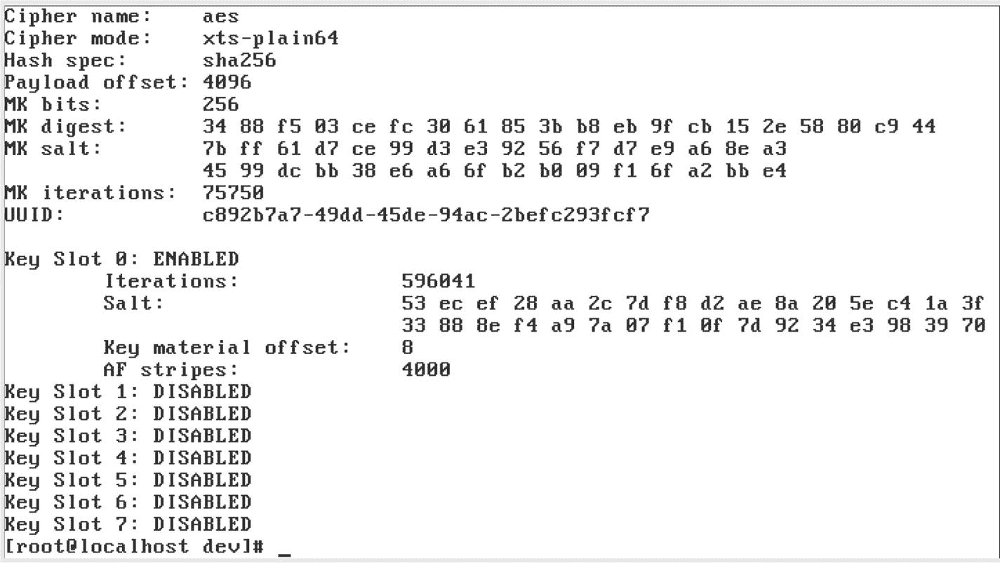

    **图 6-10** LUKS dump 输出

3.  由于 `sda1` 已加密，无法直接挂载，`$ mount /dev/sda1 /mnt` 会报错：“`unknown filesystem type:crypto-LUKS`”
4.  我们必须使用 `cryptsetup` 打开 `/dev/sda1`，这需要之前提供的密码 `$ cryptsetup open /dev/sda1 crypt` – 此命令请求输入密码，输入错误密码会再次提示，正确密码则允许通过我们命名为 `crypt` 的逻辑映射来访问设备。
5.  通过逻辑卷 `/dev/mappercrypt` 挂载 `/dev/sda1`

    ```
    $ mount /dev/mapper/crypt /mnt
    ```

6.  您现在可以通过挂载点 `/mnt` 访问 `sda1` 上的文件。

    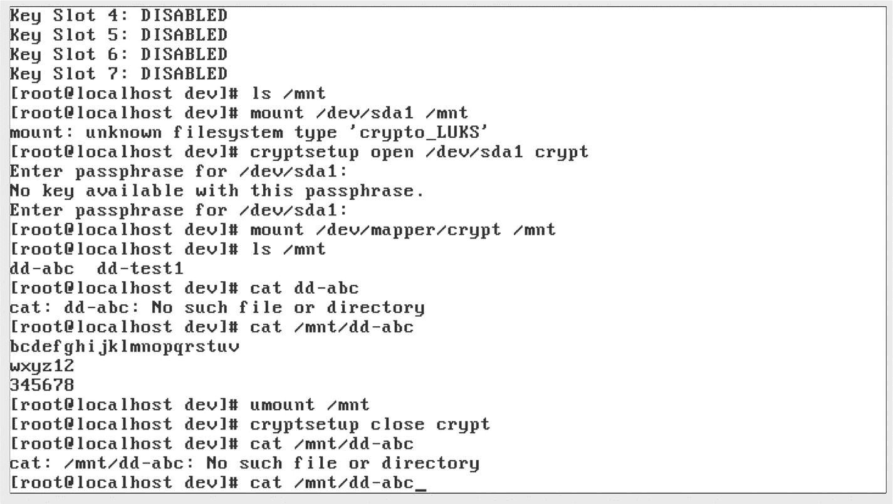

    **图 6-11** 使用 `cryptsetup` 访问设备

# 大型组织的 Kerberos 领域

虽然单个领域对组织来说运行良好，但对于某些大型企业而言，这通常不现实。随着时间的推移，大型组织最终会设置多个领域，只是为了简化并隔离组织的不同部分。默认情况下，`KDC` 知道自己的领域、主体和数据库。如果来自一个领域的用户想要使用由另一个领域控制的服务，则这两个领域之间需要建立 Kerberos 信任关系。假设一个`财务`部门的专业人员和一个`人力资源`部门的专业人员需要相互沟通，那么他们需要信任彼此领域的信息。

所以基本上，存在两种信任关系：单向信任和双向信任。假设财务领域需要访问人力资源领域。这种情况需要单向信任。要建立双向信任（即完全信任），主体需要同时存在于两个领域上。例如 - 要使 `HR.TEST.COM` 领域与 `FINANCE.TEST.COM` 领域建立完全信任，需要同时存在主体 `krbtgt/FINANCE.TEST.COM@HR.TEST.COM` 和 `kbrtgt/HR.TEST.COM@FINANCE.TEST.COM`。

## Kerberos 命令

以下是 Kerberos 管理命令的列表。

1.  `KINIT` – `kinit` 用于获取并缓存主体的初始票据授予票据。

2.  使用 keytab 文件的 `kinit` – keytab 是一个包含 Kerberos 主体与加密密钥（由 Kerberos 密码派生而来）配对的文件。你可以使用 keytab 文件通过 Kerberos 向各种远程系统进行认证，而无需输入密码。但是，当你更改 Kerberos 密码时，需要重新创建所有 keytab 文件。Keytab 文件通常用于让脚本能够自动通过 Kerberos 进行认证，无需人工交互或访问存储在纯文本文件中的密码。然后，脚本可以使用获取到的凭据来访问存储在远程系统上的文件。

3.  `KLIST` – `klist` 用于列出凭据缓存中持有的 Kerberos 主体和 Kerberos 票据，或 keytab 文件中持有的密钥。

4.  `KDESTROY` – `kdestroy` 实用程序通过覆盖并删除包含用户活动 Kerberos 授权票据的凭据缓存来销毁这些票据。如果未指定凭据缓存，则销毁默认的凭据缓存。

## Kerberos 主体到用户名的映射

Kerberos 使用两部分主体（`greg@TEST.COM`）或三部分主体（`hdfs/node02.test.com@TEST.COM`），其中包含短名称、领域以及可选的实例名称或主机名。为了简化用户名的使用，Hadoop 通过在 `krb5.conf` 文件中使用 `auth_to_local` 设置，将 Kerberos 主体名称映射到本地用户名，或者可以在 `core-site.xml` 的 `Hadoop.security.auth_to_local` 参数中配置 Hadoop 特定的规则。

映射由一组规则组成，这些规则会按照在 `Hadoop.security.auth_to_local` 属性中列出的顺序进行评估。第一个与主体名称匹配的规则将用于将该主体名称映射到短名称。列表中稍后与该主体名称匹配的任何后续规则都将被忽略。你可以在 `Hadoop.security.auth_to_local` 属性中按如下方式指定映射规则：

```
Hadoop.security.auth_to_local

RULE:[]()
RULE:[]()
DEFAULT
```

## Hadoop 用户到组的映射

用户的组由组映射服务提供程序确定。Hadoop 支持多种组映射机制，通过 `Hadoop.security.group.mapping` 属性进行配置。这意味着只有映射被调用的服务器上配置的组才对 Hadoop 可见。在实践中，确保 Hadoop 集群中所有服务器对将访问集群的用户和组具有一致的视图非常重要。

```
Hadoop.security.group.mapping
org.apache.Hadoop.security.LdapGroupsMapping
```

### 使用 LDAP 的用户到组映射

对于组仅可从 LDAP 或 Active Directory 服务器获取，而非集群节点获取的环境。Hadoop 提供了 `LdapGroupsMapping` 实现。可以通过在 NameNode、JobTracker 或 ResourceManager 上的 `core-site.xml` 中设置参数来配置此方法。

此提供程序支持使用 JNDI API 进行简单密码认证的 LDAP。必须设置参数 `Hadoop.security.group.mapping.ldap.url`。该参数指用于解析用户组的 LDAP 服务器的 URL。

`Hadoop.security.group.mapping.ldap.base` 配置 LDAP 连接的搜索基点。这是一个可分辨名称，通常会是 LDAP 目录的根。对于给定的用户名，首先查找该用户，然后查找该用户结果所属的组。如果目录设置具有不同的用户和组搜索基点，请使用参数 `Hadoop.security.group.mapping.ldap.userbase` 和 `Hadoop.security.group.mapping.ldap.groupbase` 配置。

如果 LDAP 服务器不支持匿名绑定，请在 `Hadoop.security.group.mapping.ldap.bind.user` 参数中设置要绑定的用户的可分辨名称。包含绑定用户密码的文件路径在 `Hadoop.security.group.mapping.ldap.bind.password.file` 中指定。此文件应仅由运行守护进程的 Unix 用户可读。

在搜索和等待结果时可以设置最大时间限制。如果希望无限等待，请将 `Hadoop.security.group.mapping.ldap.directory.search.timeout` 设置为 0。默认值为 10,000 毫秒（10 秒）。这是每次 LDAP 查询的限制。如果 `Hadoop.security.group.mapping.ldap.search.group.hierarchy.levels` 设置为正值，则总延迟将受限于 `max(递归深度, Hadoop.security.group.mapping.ldap.search.group.hierarchy.levels) * Hadoop.security.group.mapping.ldap.directory.search.timeout`。

`Hadoop.security.group.mapping.ldap.base` 配置了在解析组时向上遍历组层次结构的深度。默认情况下，限制为 0，即用户必须是 LDAP 中的显式成员，才能被视为组的成员。否则，它将向上遍历组层次结构 `Hadoop.security.group.mapping.ldap.search.group.hierarchy.levels` 层。

```
Hadoop.security.group.mapping.provider.ad4usersX.ldap.url
ldap://ad-host-for-users-X:389

名为 'ad4usersX' 的提供程序的 ldap url。注意此属性来自
'Hadoop.security.group.mapping.ldap.url'。

Hadoop.security.group.mapping.provider.ad4usersY.ldap.url
ldap://ad-host-for-users-Y:389

名为 'ad4usersY' 的提供程序的 ldap url。注意此属性来自
'Hadoop.security.group.mapping.ldap.url'。
```

## Hadoop 用户

在 Hadoop 环境中，集群的所有 Hadoop 用户必须预配到集群的所有服务器上。这些用户可以在本地的 `/etc/passwd` 密码文件中存在，或者更常见的是，通过让服务器访问基于网络的目录服务（如 open-LDAP 或 Active Directory）来预配。

## 认证

如果 Hadoop 使用其所有默认配置进行配置，则 Hadoop 不会对用户进行任何身份认证。认识到这一点非常重要，因为它可能在企业数据中心产生严重影响。

假设 Greg 用户有权访问 Hadoop 集群。到目前为止，尚未对 Hadoop 集群施加任何安全要求。用户可以在无需任何身份认证的情况下进行交互。尽管 Greg 既不是超级用户，也没有 hdfs 用户密码，但他可以访问配置为访问集群的客户端机器。他不负责任地发出了两个命令：

```
sudo useradd hdfs
sudo -u hdfs Hadoop fs -rmr /
```

不言而喻，集群已经离线并删除了所有内容。那么，刚刚发生了什么？在一个不安全的集群中，默认情况下，NameNode 或 JobTracker 不需要任何形式的身份认证。这意味着你可以执行所有属于 hdfs 和 mapred 用户权限范围内的操作。

在分布式系统中，确保用户的每个请求都通过用户身份进行验证至关重要。我们需要对每次交互进行身份认证。例如，在 MapReduce 作业中，认证发生在客户端和 `NameNode` 之间，以及客户端和 Job Tracker 之间。为了提交作业，JobTracker 会创建多个任务，这些任务由集群中的每个 TaskTracker 启动。每个 TaskTracker 必须与 `NameNode` 通信才能打开组成其输入分片的文件。为了让 `NameNode` 强制执行文件系统权限，每个任务都应针对 `NameNode` 进行认证。Hadoop 采用基于令牌的身份认证方法来白名单化客户端，并允许其在集群上执行操作。

Hadoop 通过分发身份认证令牌来解决此问题，这些令牌可以分发给每个任务，但仅限于特定服务。让我们看看这些委托令牌是如何工作的——

## HDFS 身份验证与委托令牌

1.  客户端发起一个`RPC`请求，通过`Kerberos`票据来申请一个委托令牌进行身份验证。

2.  `NameNode`接收请求并响应一个委托令牌。

3.  身份验证完成后，客户端被允许使用该委托令牌发起操作进行身份验证。

4.  令牌验证通过后，`NameNode`执行客户端发出的命令。

## HDFS 授权

`授权`是一种定义你可以访问什么、不可以访问什么的方法。请记住，身份验证提供了一种证明身份的技术，而授权是身份验证之后的活动，用于证明你在`Hadoop`集群中的访问权限。在`HDFS`中，授权是通过文件权限来实现的。

如果你在某个目录下运行`ls -l`，你会得到如下列表：

```
[etl@ip-etl]$ Hadoop fs -ls /apps/hive/warehouse/db/
Found 3 items
drwxrwxrwx    -etl   hdfs   0 2018-02-22 10:13 /apps/hive/warehouse/db/employees
drwxrwxrwx    -etl   hdfs   0 2018-02-22 10:13 /apps/hive/warehouse/db/departments
drwxrwxrwx    -etl   hdfs   0 2018-02-22 10:13 /apps/hive/warehouse/db/locations
[etl@ip-etl]$ Hadoop fs -ls /apps/hive/warehouse/db/employees
Found 1 items
-rwxrwxrwx   3 hive hdfs 21839221 2018-02-25 13:40 /apps/hive/warehouse/db/employees/000000_0
```

客户端如何授权访问位于数据节点上的一个块？这是通过块访问令牌机制完成的。一个标准的授权过程遵循以下步骤：

1.  经过身份验证的客户端发起一个读取请求。

2.  `NameNode`从元信息内存结构中收集关于数据块、数据节点以及最近的数据节点的信息。

3.  `NameNode`将块地址信息连同块访问令牌一起发送给客户端。

4.  客户端根据从`NameNode`收到的信息选择最近的数据节点。

5.  客户端使用块访问令牌向最近的数据节点请求该块。

6.  收到请求的数据节点验证所请求块的认证信息。

7.  根据块访问令牌和`NameNode`共享的密钥创建令牌验证器。密钥是`NameNode`和数据节点之间的身份验证令牌。它会定期更新，并通过心跳通信通道由`NameNode`共享。该密钥对客户端请求的块访问令牌进行加密。

8.  比较创建的令牌验证器和接收到的令牌验证器。如果匹配，则将请求的数据块发送给客户端。

## HDFS 权限模型

`Hadoop`分布式文件系统（`HDFS`）为文件和目录实现了一个权限模型，该模型在很大程度上沿用了`POSIX`模型。每个文件和目录都与一个所有者和一个组相关联。文件或目录对作为所有者的用户、属于该组的其他用户以及所有其他用户分别具有不同的权限。对于文件，需要`r`权限才能读取文件，需要`w`权限才能写入或追加到文件。对于目录，需要`r`权限才能列出目录内容，需要`w`权限才能创建或删除文件或目录，需要`x`权限才能访问目录的子项。

与`POSIX`模型相比，文件没有`setuid`或`setgid`位，因为没有可执行文件的概念。对于目录，作为简化，也没有`setuid`或`setgid`位。可以在目录上设置粘滞位，以防止除超级用户、目录所有者或文件所有者之外的任何人删除或移动目录中的文件。为文件设置粘滞位没有效果。文件和目录的权限统称为其模式。通常，将使用`Unix`表示和显示模式的惯例，包括在此描述中使用八进制数。当创建文件或目录时，其所有者是客户端进程的用户标识，其组是父目录的组。

## HDFS ACL

随着`Hadoop 2.4`的发布，我们现在可以使用扩展`ACL`。这些`ACL`的工作方式与任何`Unix`操作系统中的`ACL`非常相似。`ACL`对于实现不同于用户和组自然组织层次结构的权限要求非常有用。`ACL`提供了一种为特定的已命名用户或已命名组（而不仅仅是文件的所有者和文件所属组）设置不同权限的方法。

默认情况下，对`ACL`的支持是禁用的，`NameNode`不允许创建`ACL`。要启用对`ACL`的支持，请在`NameNode`配置中将`dfs.namenode.acls.enabled`设置为`true`。

## 使用 Apache Ranger 进行 HDFS 授权

`Apache Ranger`提供了一个用户同步工具，用于从`Unix`或`LDAP`或`Active Directory`拉取用户和组。用户或组信息存储在`Ranger`门户中，并用于策略定义。

`HDFS`是任何`Hadoop`部署的核心部分，为了确保`Hadoop`平台中的数据受到保护，安全性需要内置于`HDFS`层中。`HDFS`使用`Kerberos`身份验证进行保护，并使用`POSIX`风格的权限/`HDFS ACL`或`Apache Ranger`进行授权。

`Apache Ranger`是一个针对`Hadoop`的集中式安全管理解决方案，使管理员能够为`HDFS`和其他`Hadoop`平台组件创建并强制执行安全策略。`Apache Ranger`为`HDFS`提供了一个联邦授权模型。用于`HDFS`的`Ranger`插件会检查`Ranger`策略，如果策略存在，则授予用户访问权限。如果`Ranger`中不存在策略，则`Ranger`将默认使用`HDFS`中的原生权限模型（`POSIX`或`HDFS ACL`）。此联邦模型适用于`HDFS`和`Yarn`服务。

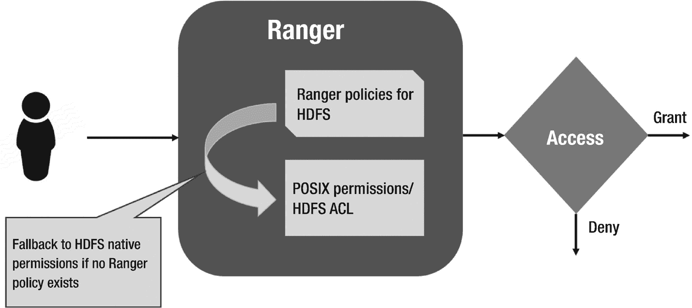

图 6-12 `Apache Ranger`的联邦授权模型

对于其他服务（如`Hive`或`HBase`），`Ranger`作为唯一的授权器运行，这意味着只有`Ranger`策略生效。回退模型的选项通过`Ambari ➤ Ranger ➤ HDFS config ➤ Advanced ranger-hdfs-security`中的属性进行配置。

### Ranger 的功能

`Apache Ranger`提供了一个集中式安全框架，用于管理跨`HDFS`、`Hive`、`HBase`、`Storm`、`Knox`、`Solr`、`Kafka`、`Nifi`和`Yarn`的细粒度访问控制。通过`Apache Ranger`控制台，安全管理员可以轻松管理对文件、文件夹、数据库、表或列的访问策略。这些策略可以为单个用户或组设置，并在`Hadoop`堆栈中一致地强制执行。

`Ranger`密钥管理服务（`Ranger KMS`）为`HDFS`的“静态数据”加密提供了一个可扩展的加密密钥管理服务。`Ranger KMS`基于最初由`Apache`社区开发的`Hadoop KMS`，并通过允许系统管理员将密钥存储在安全数据库中来扩展原生`Hadoop KMS`的功能。

`Ranger`还通过一个集中审计位置为安全管理员提供对其`Hadoop`环境的深度可见性，该审计位置实时跟踪所有访问请求，并支持包括`HDFS`和`Solr`在内的多个目标源。

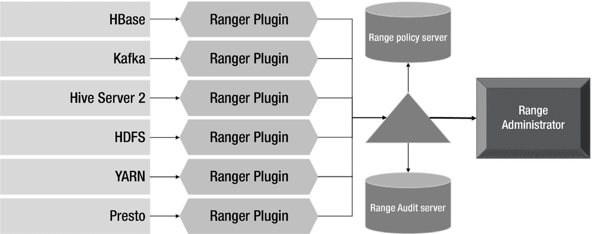

图 6-13 针对`Hadoop`堆栈的`Ranger`设置

*   **`Ranger Admin`** – `Ranger`管理门户为安全管理提供了一个交互式界面。安全管理员可以通过门户创建或修改策略。它有一个审计服务器，负责收集并将来自插件的审计数据发送到`HDFS`数据库。

*   **`Ranger Plugin`** – `Ranger`插件是基于`Java`的程序，嵌入在每个组件进程中。图 6-13 显示了嵌入在`Hive Server2`、`YARN`、`Kafka`或`Presto`中的各个`Ranger`插件。插件从中央服务器拉取策略并将其存储在本地。在用户请求事件发生时，插件会拦截该请求，以便针对策略定义进行评估。它还负责将数据发送到审计服务器。

*   **用户组同步** – `Ranger`通过从`LDAP`或`Active Directory`拉取用户和组并将其存储在`Ranger`中来帮助进行用户同步。

## 结论

本章以非传统的方式探讨了数据湖安全问题。之所以说非传统，是因为它没有深入探讨`hive`中的数据脱敏层或密码保护，而是着重于培养安全意识以及为数据湖构建安全框架时的设计思路。我们讨论了数据在传输中和静态时的安全方面。展示`Kerberos`安全框架的用例将帮助读者理解`Kerberos`如何在没有任何网络泄露风险的情况下，为客户端、主机和服务建立身份标识。不仅如此，它还可以扩展并与`LDAP`和`active directory`等其他身份管理工具集成。

下一章，我们将介绍数据湖的高可用性。不仅涉及 `Hadoop`组件的高可用性，我们还将探讨如何在主备和双活配置下设置多站点数据站点。

脚注 1
Gartner 新闻稿，2017 年 3 月 14 日 - [`https://www.gartner.com/newsroom/id/3638017`](https://www.gartner.com/newsroom/id/3638017)
2
[`https://www.forbes.com/sites/gilpress/2017/10/17/top-10-hot-data-security-and-privacy-technologies/`](https://www.forbes.com/sites/gilpress/2017/10/17/top-10-hot-data-security-and-privacy-technologies/)
3
[`https://wiki.archlinux.org/index.php/Dmcrypt/Device_encryption#Cryptsetup_passphrases_and_keys`](https://wiki.archlinux.org/index.php/Dmcrypt/Device_encryption#Cryptsetup_passphrases_and_keys)