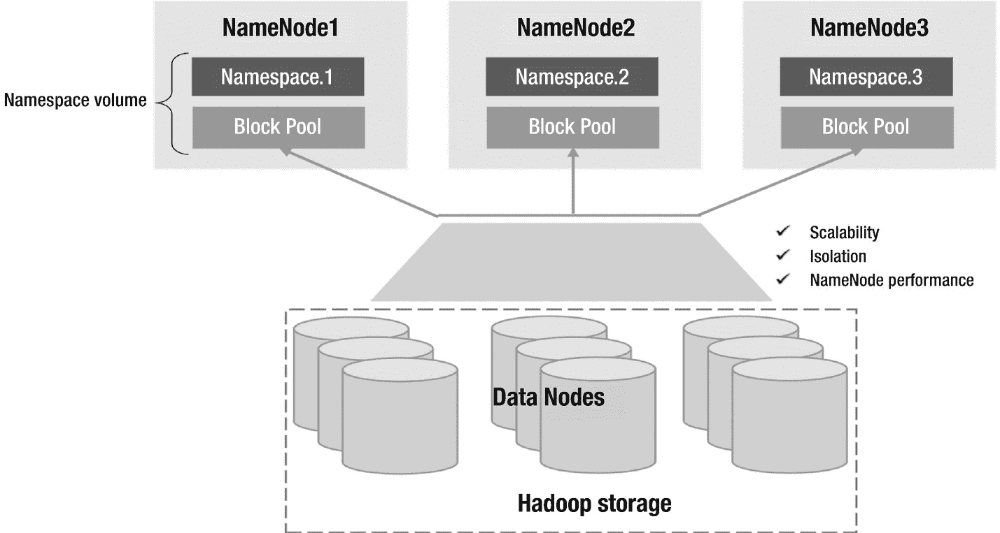
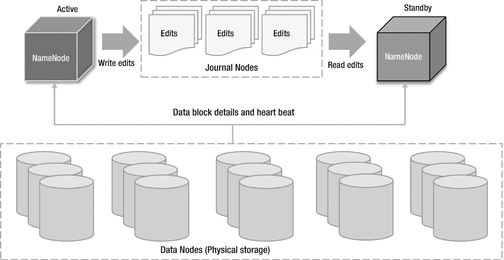
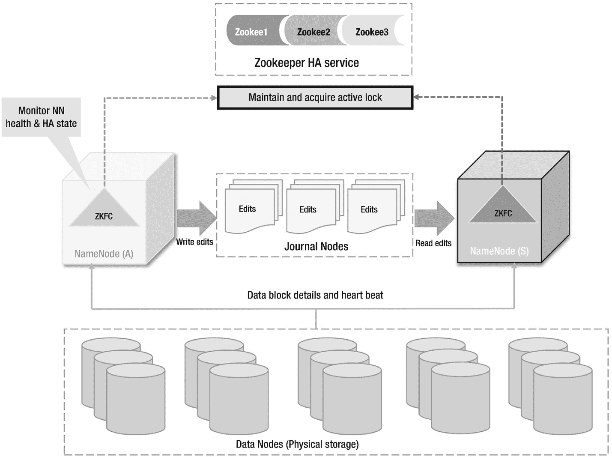
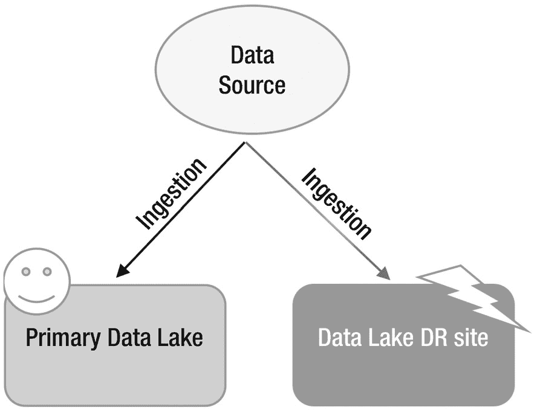
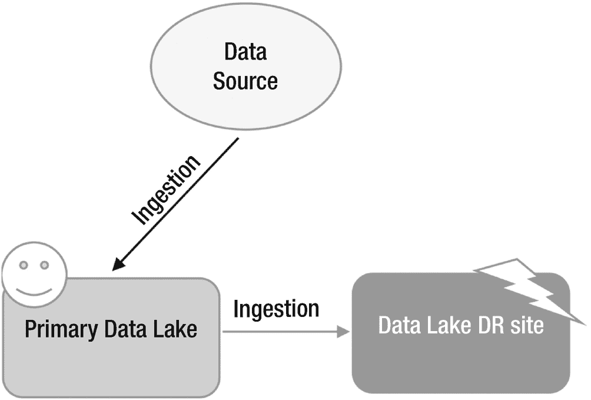
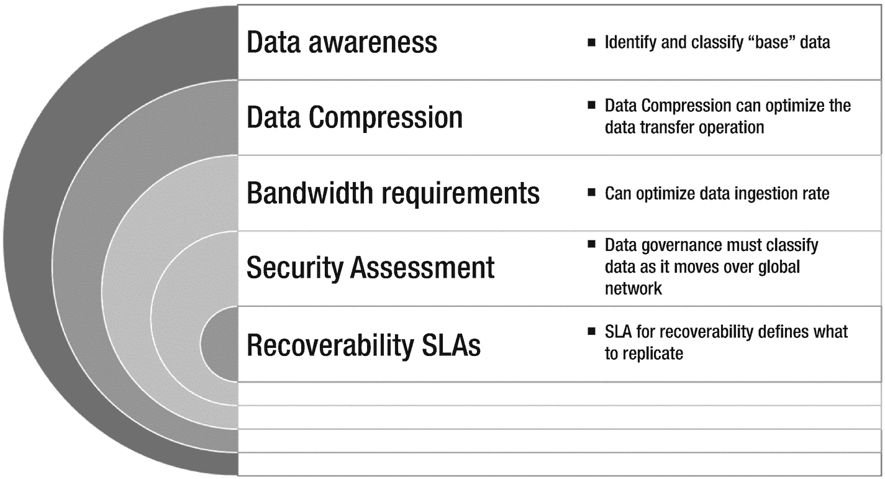
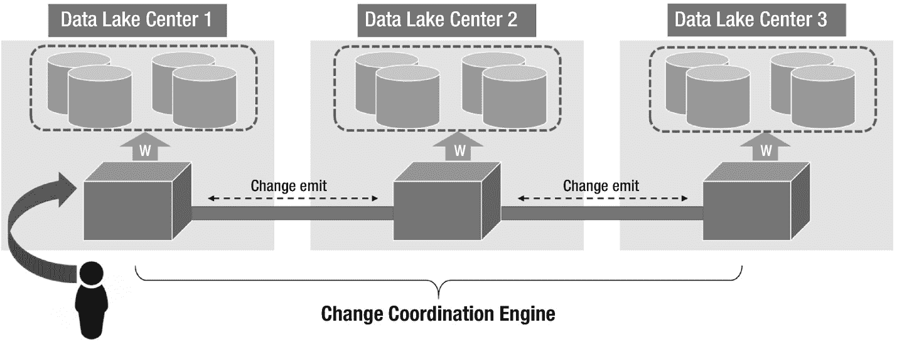
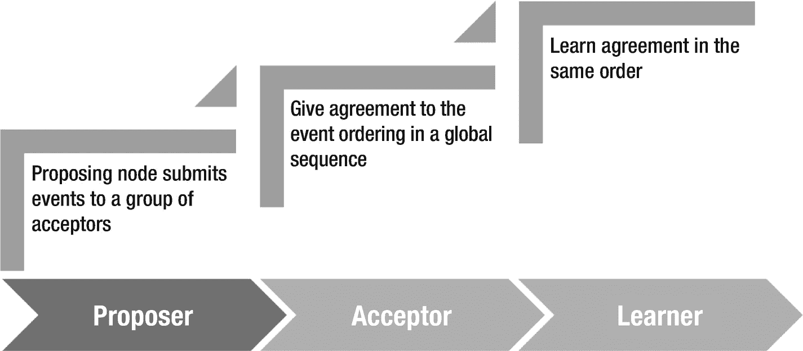
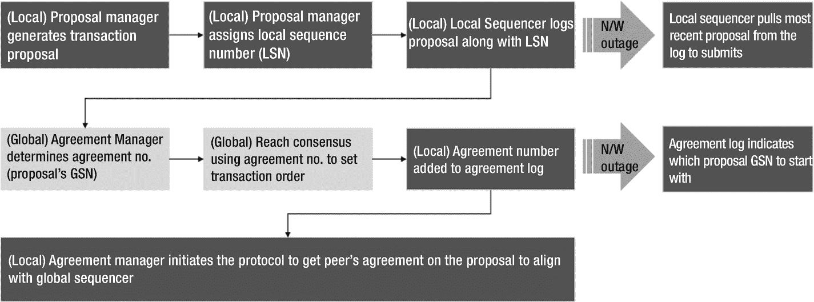

# 7. 确保数据湖的高可用性

> “当人类判断力与大数据交汇时，就会发生一些有趣的事情。” ——纳特·西尔弗，FiveThirtyEight 创始人兼主编

数据分析的力量如此强大，以至于企业几乎完全依赖每日的信息点滴来发掘和推动新的商业机会。数据积累、实时处理和数据提炼的艺术与实践，帮助企业以最凝练的信息形式获得洞见。它使企业能与市场信息保持同步，理解行业趋势并快速行动。由于日常运营对数据的高度依赖，组织对数据湖的支持功能给予了最高程度的关注。数据湖支持功能包括数据质量、治理、架构和管理。数据湖的管理方面之一便是可用性和灾难恢复。

为什么数据湖的可用性对业务至关重要？想象一个重型零件生产单元，其装配线依赖于数据，而这些数据来自企业资源规划、数据仓库、客户服务以及一些统计模型的分析结果。如果消费层的数据陈旧或不可用，可能会直接对业务产生影响。同样，如果零售分析深入运行，基于消费者行为的学习模型向潜在买家发放优惠券，那么一旦数据湖不可用，这一切都将失败。在另一个特定的数据驱动预测案例中，气象预报员需要定期或提前获取地震更新信息，以便迅速行动、确保安全、最小化资本损失并提前制定补救措施。数据湖必须保持可用，以确保日常分析洞察的连续性。

灾难恢复是与数据湖生态系统高可用性相关的另一个术语。随着“数据湖”在本质上变得更具业务关键性，在数据量、多倍数据摄入和输出方面不断增长，并以持续流的形式运行，传统的灾难恢复策略已不再适用于企业。事实上，组织正在实施一种能够为故障事件期间的停机做好准备的数据湖灾难恢复计划。

本章将转向数据治理的一个关键方面，即数据可用性。我们将讨论 `Hadoop` 集群的高可用性模式，以及停机期间的风险缓解策略。我们将在数据湖的背景下介绍灾难恢复策略。

## 通过 HDFS 联合扩展 Hadoop

数据扩展是处理海量数据集的组织所面临的一个关键问题。可扩展的数据湖能针对指数级增长和快速变化的数据集构建强大的免疫力。如果你听到用户抱怨因磁盘使用率高或内存不足导致的服务中断或性能缓慢，你必须准备好数据扩展的工具包。我们假设读者已经了解数据扩展的纵向扩展和横向扩展方法。

在深入探讨 `Hadoop` 高可用性的细节之前，让我们先了解一下 `Hadoop` 如何在关键业务环境中维持和提升可扩展性。到目前为止，`Hadoop 1` 展现了一个次优的框架，其可用性和可扩展性受限。以下是 `Hadoop 1` 架构的一些主要挑战。

1.  单点 `NameNode` 导致的可用性限制 – 单点 `NameNode` 带来了单点故障的风险。如果它发生故障，`Hadoop` 集群将陷入停机，直到 `NameNode` 被重新启动。
2.  可扩展性 – `Hadoop` 的 `DataNodes` 具有良好的可扩展性，数据可以根据块大小和复制因子跨越多个数据节点。然而，它只能有一个命名空间。`NameNode` 在内存中保存命名空间卷，而这对数据节点是不透明的。为了容纳更大的命名空间卷，`NameNode` 只能进行纵向扩展。有限可扩展性的影响如下所列。
    1.  容纳大容量和长周期命名空间卷的能力受限于 `NameNode` 的计算能力。
    2.  所有数据访问请求都由单个 `NameNode` 处理。因此，`NameNode` 和系统的性能取决于它的吞吐量。

`NameNode` 充当了 `Hadoop` 文件系统的大脑。它管理着一个命名空间卷，该卷在命名空间和物理存储层之上提供了一个抽象层。关键点包括：
*   命名空间保存了 `Hadoop` 文件系统的元数据、目录和块信息。
*   块池是块管理层，通过它 `NameNode` 执行关键的块操作，如创建、更新、删除、副本不足、副本过剩和块报告。
    *   块池既不存储数据块，数据块物理存储在数据节点中。数据节点会定期向 `NameNode` 发送心跳。

`Hadoop 2` 通过引入两项更改解决了上述挑战。首先，提供了一个备用 `NameNode`，以便在活动 `NameNode` 发生故障时能够幸存下来。活动 `NameNode` 维护的 `editLogs` 会被复制到备用 `NameNode`，并且在停机时，备用 `NameNode` 将承担主 `NameNode` 的角色。

其次，`Hadoop 2` 引入了多个 `NameNodes` 的联合架构，让它们共享命名空间卷。每个 `NameNode` 管理命名空间卷的一部分，并且与其他并行的 `NameNodes` 相隔离。`HDFS` 或 `NameNode` 联合带来了水平扩展的能力，并缓解了 `NameNode` 级别的内存限制。命名空间卷包含一个命名空间和与该命名空间相关的块池。

图 7-1 展示了 `NameNode` 联合的设置。



图 7-1

`HDFS` 联合架构

关键要点和设计考量：

## NameNode 联合与高可用性

1.  `NameNode` 联合不会影响 `Hadoop` 的工作架构。每个活跃的 `NameNode` 都有其对应的备用 `NameNode`。
2.  如果活跃的 `NameNode` 宕机，备用 `NameNode` 将接管并管理各自的命名空间卷。
3.  如果活跃和备用的 `NameNode` 都发生故障，则仅由该 `NameNode` 管理的块池将无法访问。
4.  配置
    1.  在 `dfs.nameservices` 参数中指定以逗号分隔的 `NameNode`。这应在初始配置或向集群添加 `NameNode` 时完成。
    2.  对 `NameNode`、`Secondary NameNode` 和备份节点的配置必须以命名空间服务 ID 作为后缀。例如，如果 `NS0214` 是一个命名空间服务 ID：
        1.  `dfs.namenode.rpc-address.NS0214`
        2.  `dfs.namenode.servicerpc-address.NS0214`
        3.  `dfs.namenode.http-address.NS0214`
        4.  `dfs.namenode.https-address.NS0214`
        5.  `dfs.namenode.keytab.file.NS0214`
        6.  `dfs.namenode.name.dir.NS0214`
        7.  `dfs.namenode.edits.dir.NS0214`
        8.  `dfs.namenode.checkpoint.dir.NS0214`
        9.  `dfs.namenode.checkpoint.edits.dir.NS0214`
    3.  向集群添加新的 `NameNode` 时：
        1.  添加命名空间服务参数并修改配置文件。
        2.  启动主节点和辅助节点。
        3.  刷新数据节点以识别新的 `NameNode`。

```
$HADOOP_PREFIX/bin/hdfs dfsadmin -refreshNameNodes
```

## Hadoop 组件的高可用性

在之前的章节中，我们已经讨论了 `Hadoop` 的存储和处理架构。从存储角度来看，`NameNode` 是所有读取和写入请求的守门人。同样，从处理角度来看，`Hadoop` 提供了多个入口点，以便根据技能知识、数据处理专长以及将数据活动与服务级别协议对齐的能力来启用数据处理。本节将重点介绍 `Hadoop` 不同组件的高可用性配置。

### Hive Metastore

`Hive Metastore` 是一个存储库，包含在 `Hive` 中创建的所有表的元数据。在从 `Hadoop` 集群读取数据时，它用于将数据整合为特定格式（或模式）。其他处理框架，如 `Spark`、`Cloudera Impala` 和 `Oracle Big Data SQL`，也可以利用 `Hive Metastore` 来获取模式。因此，确保 `Metastore` 服务对其消费者可用变得至关重要。

备用 `Metastore` – 可以在主机上配置 `Hive`，在这些主机上应进行 `Metastore` 复制。所有主机都可以作为列表指定在 `/etc/hive/conf.server/hive-site.xml` 配置文件中的 `hive.metastore.uris` 属性中。

```
hive.metastore.uris
thrift://hims1.domain.com,thrift://hims2.domain.com
用于 Hive Metastore 复制的 URI
```

默认情况下，`Hive Metastore` 客户端将列表中的第一个服务器视为运行 `Metastore` 服务的主机。如果主机不可用，客户端会随机选择一个服务器来运行 `Metastore`。请注意，`Metastore` 的关系数据库也应启用高可用性。可以采用类似的方法来设置 `WebHcatServer` 和 `HiveServer2` 的高可用性。

在需要主机身份验证的安全集群中，可以通过将所有运行 Metastore 服务的节点上的 `hive.cluster.delegation.token.store.class` 配置为 `org.apache.hadoop.hive.thrift.DBTokenStore` 来启用 Hive Token 存储。此设置可以通过 Ambari（如果已配置）或 `hive-site.xml` 进行。

## HiveServer2 与 Zookeeper 集成

在与 Zookeeper 集成后，HiveServer2 实例可以实现高可用性。多个 HiveServer2 实例向 Zookeeper 注册。Zookeeper 会应客户端请求返回一个随机选择的实例。这不仅保证了高可用性，还能确保适当的负载均衡。

通过 Zookeeper 处理的 Hive 查询遵循以下步骤：

1.  Hive 客户端发出一个 Hive 查询。
2.  Hive 客户端连接到 Zookeeper 以获取 HiveServer2 详细信息。
    ```
    jdbc:hive2://;serviceDiscoveryMode=zooKeeper;zooKeeperNamespace=
    ```
3.  Zookeeper 在随机选择后返回 HiveServer2 的主机和端口。
4.  客户端连接到该主机和端口。
5.  常规查询处理步骤。

## 为 Kerberos 配置高可用性

所使用的密钥分发中心 (KDC) 可以设置为主从模式，以满足 Kerberos 的高可用性 (HA) 要求。请按照以下步骤设置 Kerberos 密钥分发中心 (KDC) 的高可用性。

1.  选择一个从节点作为从 KDC，并安装 `krb5-server`、`krb5-libs`、`krb5-workstation`。
    ```
    sudo yum install -y krb5-server
    sudo yum install -y krb5-libs
    sudo yum install -y krb5-workstation
    ```
2.  在主 KDC 上备份 `krb5.conf`，并在从 KDC 节点上创建其副本。
3.  在从 KDC 节点上备份 `kdc.conf`。
4.  如下所示，在主和从 KDC 节点上编辑 `kdc.conf`。
    ```
    sudo vi /var/kerberos/krb5kdc/kdc.conf
    [kdcdefaults]
    kdc_ports = 88
    kdc_tcp_ports = 88
    [realms]
    DLSEC-SAMPLE.DOMAIN.COM = {
    #master_key_type = aes256-cts
    acl_file = /var/kerberos/krb5kdc/kadm5.acl
    dict_file = /usr/share/dict/words
    admin_keytab = /var/kerberos/krb5kdc/kadm5.keytab
    supported_enctypes = aes256-cts:normal aes128-cts:normal des3-hmac-sha1:normal arcfour-hmac:normal des-hmac-sha1:normal des-cbc-md5:normal des-cbc-crc:normal
    }
    sudo chmod 655 /var/kerberos/krb5kdc/kdc.conf
    ```
5.  在主和从 KDC 节点上更新 `kadm5.acl`。
    ```
    vi /var/kerberos/krb5kdc/kadm5.acl
    */admin@DLSEC-SAMPLE.DOMAIN.COM *
    sudo cp /var/kerberos/krb5kdc/kadm5.acl /tmp/
    sudo chmod 777 /tmp/kadm5.acl
    scp /tmp/kadm5.acl hdp@10.256.39.70:/tmp
    scp /tmp/kadm5.acl hdp@10.256.13.2:/tmp
    sudo cp /tmp/kadm5.acl /var/kerberos/krb5kdc/kadm5.acl
    sudo chmod 655 /var/kerberos/krb5kdc/kadm5.acl
    ```
6.  在 Kerberos 主节点和从节点上更新文件 `/var/kerberos/krb5kdc/kpropd.acl`。
    ```
    sudo vi /var/kerberos/krb5kdc/kpropd.acl
    host/ip-10-256-38-70.ec2.internal@DLSEC-SAMPLE.DOMAIN.COM
    host/ip-10-256-13-2.ec2.internal@DLSEC-SAMPLE.DOMAIN.COM
    sudo chmod 655 /var/kerberos/krb5kdc/kpropd.acl
    ```
7.  在 Kerberos 上安装 `xinetd`，并在主和从 KDC 节点上初始化 Kerberos 内部数据库。
    ```
    sudo yum install -y xinetd
    sudo kdb5_util create –s
    KDC Database MAster Key: xxxxxx
    ```
8.  创建一个管理员主体来管理 Kerberos 领域。
    ```
    sudo kadmin.local -q "addprinc kdcadmin/admin"
    Principal password: xxxxxxx
    ```
9.  在主 KDC 上为从 KDC 创建主机密钥表。
    ```
    kadmin.local
    addprinc -randkey host/ip-10-256-38-70.ec2.internal
    addprinc -randkey host/ip-10-256-13-2.ec2.internal
    ```
10. 提取从 KDC 的主机密钥并更新主机密钥表文件 `/etc/krb5.keytab.slave`。复制到从 KDC。
    ```
    -------在主 KDC 上--------
    ktadd –k /etc/krb5.keytab host/ip-10-256-38-70.ec2.internal
    ktadd –k /etc/krb5.keytab host/ip-10-256-13-2.ec2.internal
    sudo chmod 644 /etc/krb5.keytab
    -------在从 KDC 上--------
    scp /etc/krb5.keytab hdp@10.256.13.2:/tmp
    sudo cp /tmp/krb5.keytab /etc/krb5.keytab
    sudo chmod 644 /etc/krb5.keytab
    ```
11. 在两个 KDC 主机上更新 `/etc/services`。
    ```
    sudo vi /etc/services
    krb_prop 754/tcp # Kerberos slave propagation
    ```
12. 在两个 KDC 节点的 `/etc/xinetd.d/krb5_prop` 中配置 `kpropd`。
    ```
    sudo vi /etc/xinetd.d/krb5_prop
    service krb_prop
    {
    disable = no
    socket_type = stream
    protocol = tcp
    user = root
    wait = no
    server = /usr/sbin/kpropd
    port = 754
    }
    ```
13. 在主 KDC 上启动 KDC 和 kadmin 进程。
    ```
    sudo systemctl enable krb5kdc
    sudo systemctl start krb5kdc
    sudo systemctl status krb5kdc
    sudo systemctl enable kadmin
    sudo systemctl start kadmin
    sudo systemctl status kadmin
    ```
14. 在两个 KDC 主机上将 `xinetd` 运行为持久化服务。
    ```
    sudo systemctl enable xinetd.service
    sudo systemctl start xinetd.service
    sudo systemctl status xinetd.service
    ```
15. 将 KDC 数据库复制到从 KDC 节点并启动从 KDC。
    ```
    sudo kdb5_util dump /var/kerberos/krb5kdc/slave_datatrans
    sudo kprop -f /var/kerberos/krb5kdc/slave_datatrans ip-10-256-13-2.ec2.internal
    sudo systemctl enable krb5kdc
    sudo systemctl start krb5kdc
    sudo systemctl status krb5kdc
    ```
16. 设置一个 cron 任务，将更新从主 KDC 节点传播到从 KDC。

## NameNode 高可用性

在 Hadoop 1 之前，Hadoop 集群是通过单个 `NameNode` 进行控制的。如果 `NameNode` 因机器故障、进程损坏甚至计划内维护而不可用，整个集群将遭受停机。使用 Hadoop 2，`NameNode` 可以复制到一个热备用的 `NameNode`。备用 `NameNode` 保持被动状态，直到主动 `NameNode` 宕机。在发生故障时，该架构支持手动和自动故障转移至备用 `NameNode`。

### 架构

在 Hadoop 集群中，主动和备用 `NameNode` 位于两个不同的物理主机上；其中一个主动地服务数据块请求，而另一个则处于备用模式。备用 `NameNode` 始终保持与主动 `NameNode` 状态的同步。这种同步是如何发生的呢？让我们来看看。

主动 `NameNode` 将所有对其命名空间所做的系统更改（文件创建/更新/删除）记录在 `editLogs` 中。编辑日志包含自上次清理到 `fsimage` 之后的增量系统更改。这些编辑内容被同步写入到一个单独的节点集群，称为日志节点。日志节点是用于存储编辑内容的分布式节点集。编辑内容会在日志节点集群中进行复制。备用节点扫描来自日志节点上任何编辑副本的新更改，并将其应用到其命名空间。这实现了主动和备用命名空间之间的同步。在一个集群中，至少三个轻量级节点可以被指定为日志节点。

除了命名空间之外，高可用性架构的另一个关键方面是数据节点上的数据块坐标。数据节点是为主动和备用节点配置的。数据节点向两个节点都发送心跳，并同时向两者发送块信息。这使得备用节点能够感知数据，并有助于其在快速故障转移期间承担主角色。图 7-2 所示的架构图供参考。



图 7-2 NameNode 高可用性架构

请记住，`NameNode` 的主动-主动配置是不可能的，因为这可能导致脑裂情况。日志节点一次只允许一个写入进程。如果 `NameNode` 和日志不同步，可能会对数据精度和可用性造成巨大风险。

以下是 `hdfs-site.xml` 中用于 `NameNode` 高可用性的示例配置。

```
---------新命名服务的逻辑名称---------

dfs.nameservices
dl_clustr

---------在每个命名服务中配置 NameNode 标识符列表---------

dfs.ha.namenodes.dl_clustr
nn_active,nn_stby

---------每个 NameNode 的 RPC 地址---------

dfs.namenode.rpc-address.dl_clustr.nn_active
dlmc1.machine.com:8020

dfs.namenode.rpc-address.dl_clustr.nn_stby
dlmc2.machine.com:8020

---------每个 NameNode 的 HTTP 地址---------

dfs.namenode.http-address.dl_clustr.nn_active
dlmc1.machine.com:50070

dfs.namenode.http-address.dl_clustr.nn_stby
dlmc2.machine.com:50070

---------编辑内容将被写入和由 NameNode 读取的 JN URI-----

dfs.namenode.shared.edits.dir
qjournal://jnode1.machine.com:8485;jnode2.machine.com:8485;
jnode3.machine.com:8485/dl_clustr

---------编辑内容可以持久化的 JN 本地目录---------

dfs.journalnode.edits.dir
/dfs/journal/localdata

---------用于 ping 主动 NameNode 的 Java 类---------

dfs.client.failover.proxy.provider.dl_clustr
org.apache.Hadoop.hdfs.server.namenode.ha.ConfiguredFailoverProxyProvider

---------使用 shell 方法的 HA 隔离配置---------

dfs.ha.fencing.methods
shell(/path/to/my/script.sh arg1 arg2 ...)
```

#### 设计考量

以下是规划 Hadoop `NameNode` 高可用性时至关重要的因素。

1.  通常，建议维护奇数个 `JournalNode` 来抵御最大数量的故障。

2.  目前，只能配置两个节点来实现高可用性。在配置的两个 `NameNode` 中，首先启动的那个被视为 Active 节点。

3.  HA 配置指南
    - 所有命名服务都应添加到 `dfs.nameservices` 中。此列表应包含用于 `NameNode` 联合的所有命名服务。
    - 对于 `dfs.ha.namenodes.[nameservice ID]` 中的每个命名服务，最多应添加两个与该命名服务关联的 `NameNode`。
    - 在 `dfs.namenode.shared.edits.dir` 中添加一组 `JournalNode`，用于存储共享的编辑日志。
    - 如果未使用自定义类来确定 Active `NameNode`，请将 `dfs.client.failover.proxy.provider.[nameservice ID]` 设置为 `org.apache.Hadoop.hdfs.server.namenode.ha.ConfiguredFailoverProxyProvider`。
    - Quorum Journal Manager 可防止多个 `NameNode` 同时向 `JournalNode` 写入编辑日志。

4.  Fencing（隔离）Active `NameNode` 通过限制两个 `NameNode` 同时向 `JournalNode` 写入编辑日志来防止脑裂情况。即使在使用 Quorum Journal Manager (QJM) 时，对 `NameNode` 进行 Fencing 也是一个良好的实践。在故障切换期间，Fencing 可确保正在关闭的 `NameNode` 在完全关闭前不会处理任何读取请求。Hadoop 提供了两种可配置的 Fencing 方法：`shell` 和 `sshfence`。
    - 可以在 `org.apache.Hadoop.ha.NodeFencer` 中指定自定义的 Fencing 逻辑。
    - `shell` 允许用户运行一个 shell 命令来代替常规的 `NameNode` 操作。该 shell 命令可能不涉及业务逻辑，但会代理 `NameNode` 的数据节点请求。
      - 可以使用 `ssh.connect-timeout` 配置连接超时。连接超时表示 Fencing 失败。
    - `sshfence` 允许通过 SSH 连接到目标节点，并使用 `fuser` 命令终止 `NameNode` 进程。目标节点的密码密钥必须由 `hdfs` 用户拥有，并且应位于 `dfs.ha.fencing.ssh.private-key-files` 中。
    - Fencing 操作的结果必须是成功；否则，可能无法切换到 Standby 节点。

5.  手动故障切换 – 在候选（目标）`NameNode` 上执行
    ```
    hdfs haadmin /
    -failover /
    --forcefence /
    --forceactive
    ```

6.  自动故障切换配置 – 通过 Zookeeper 集群和 ZKFailoverController (`ZKFC`) 进程完成。
    - Apache Zookeeper 是 Hadoop 集群中的一项高可用性服务，用于监控集群组件是否发生故障。自动故障切换机制需要检测 Active `NameNode` 故障事件并选举下一个 Active 节点。Zookeeper 服务与所有 `NameNode` 保持实时会话。当 Active `NameNode` 发生故障导致会话过期时，Zookeeper 会触发故障切换通知。同时，后续的目标节点会在 Zookeeper 上获取一个独占锁，以表明其将成为下一个主 `NameNode`。
    - `ZKFC` 是一个 Zookeeper 客户端，负责通过 Ping 和管理与 Active `NameNode` 的会话来监控 `NameNode` 的健康状况。在 Active `NameNode` 选举期间，`ZKFC` 帮助健康的 `NameNode` 获取锁。

### 命名服务的自动故障切换配置

```
dfs.ha.automatic-failover.enabled.[NameService_ID]
        true

---------运行 Zookeeper 服务的主机列表---------

ha.zookeeper.quorum
        zookee1.machine.com:2181,zookee2.machine.com:2181
```

- Zookeeper 安全 – 在`core-site.xml`中设置 Zookeeper 身份验证和 ACL 以控制 Zookeeper 访问。

- 也可以使用以下命令查询 NameNode 的 HA 状态：

```
hdfs haadmin -getServiceState
```



图 7-3

将 NameNode HA 服务与 Zookeeper 集成，以实现持续监控和主动告警。

### 数据中心灾难恢复策略

到目前为止，我们关注的是 Hadoop 组件的高可用性。实际上，在企业级大数据湖中，我们需要防止丢失的是数据和分析模型。数据湖可能会在逻辑错误或硬件故障事件中丢失数据。逻辑错误属于开发人员和分析师的职责范围，而硬件故障可以进一步按风险和成本进行分类。由于成本起着决定作用，由系统崩溃、介质故障或节点故障等引起的事件虽然风险高，但成本影响低。因此，可以通过在平台层面处理故障情况来预防。然而，在某些情况下，整个数据湖可能由于硬件故障、大规模断电、网络故障或站点因民用环境关闭而变得无法访问。灾难恢复的目标正是这些情况，即一个数据中心能够在允许的服务中断阈值内接管主数据中心。

对于数据管理专业人员来说，灾难预防和恢复并不是一个新术语。虽然目标保持不变，但灾难预防策略确实会根据服务水平协议和平台架构而变化。在本节中，我们将讨论与 Hadoop 数据湖相关的灾难预防和恢复策略。

为什么要复制数据湖？建立数据湖需要在成本、规划、定义技术设计和架构以及简化日常运营方面付出巨大努力。搭建另一个基础设施将大幅增加资本投资和运营开销。因此，在进入规划阶段之前，必须有一个强有力的用例和清晰的目标来支持建立副本。有两个参数可以证明复制工作的合理性：可用性和可恢复性。通过拥有冗余或额外的资源来容忍故障或中断，而不会（或可接受地）对业务造成任何损失，可以实现可用性。可恢复性可以通过一个备用的备用站点来实现，该站点保持故障时的数据状态，并且可以快速恢复。高可用性可以通过规划站点各组件的高可用性来实现。当整个站点需要故障转移到其备用站点时，可恢复性解决了更重大的问题。因此，可用性是可恢复性的一个子集。主备站点可能是实现可恢复性和可用性的最佳方法。双活设置通过向业务用户提供活动副本来达到理想状态，同时两者互为备用。

随着云服务模式如今在 IT 领域相当普遍，大多数云供应商都承诺云托管应用程序具有高可用性（高达约 99.999%）。可恢复性可能因应用程序的性质和服务水平协议而异。例如，“客户反馈”应用程序可以容忍几个小时的停机，但“销售”应用程序则不能。关键业务应用程序需要立即恢复到其备用站点，以防止业务中断。

尽管投资成本成为主要考虑因素，但在论证备用站点提案的合理性时，组织必须对这两个因素进行量化评估。拥有全球业务和地区治理法律的公司，被迫拥有活动副本来实现不间断的分析。在类似情况下，位于自然灾害频发地区的数据中心，可能正在寻找用于恢复目的的冷备站点。

### 灾难恢复要素

从宏观层面看，灾难恢复策略涉及备用站点和切换策略。灾难恢复的备份性质略有不同，因其目标是从严重事件中恢复。接下来，我们列出制定高效灾难恢复策略时需要考虑的因素。

1.  **了解数据源与数据意识** – 在建立灾难恢复站点时，始终建议先了解数据湖的构成要素。记录系统的关键性如何？源系统位于何处？如果数据镜像层丢失会有什么影响？

2.  **复制与镜像** – 备份模式是从灾难恢复站点进行恢复操作的关键参数。镜像恢复速度比备份副本更快。

3.  **备份频率** – 数据变更频率和服务等级协议决定了数据流入灾难恢复站点的频率。

### 灾难恢复方法

接下来，我们开始探讨灾难恢复策略的构建模块。结合上述考量，可以初步考虑两种可行方法。

1.  **双路注入或 T 形复制** – 在此方法下，所有不同的源系统遵循类似 T 形的双向注入管道，将数据同时推入生产数据湖和备用（或副本）数据湖。注入管道在数据源与主数据湖之间可能相同，也可能不同。虽然它可以复用于向备用站点发送数据，但在将其用于备用目的之前，需要考量可扩展性、成本和性能等参数。不过，现代商业工具提供了灵活性，能以不同频率实现双向复制。图 7-4 所示的模型在架构师社区中引发的争议多于其带来的好处。然而，在典型的“数据即资产”世界中，仅注入镜像层是合理的。消费层可以并行构建，也可以在需要时通过运行业务模型来消费镜像层数据并产生分析洞察。

    

    **图 7-4** 用于将数据注入生产集群和副本集群的 T 形注入方法

    并行数据注入方法存在不少挑战。

    1.  并行数据注入管道会大幅增加资源消耗。注入框架的配置（如带宽、网络资源）需要重新评估，并且很可能需要扩展。在实现模型中，负载均衡器将是理想的选择。

    2.  在主备模式中，主站点被认为是关键的。如果并行写入以异步模式运行，保持备用站点与主站点同步将增加运维开销。备用站点与主站点发生偏离的可能性很高。

    3.  只有源数据可以并行注入两个站点，处理后的数据（中间层或消费层）则无法做到。数据处理模型可以在备用站点上运行，但数据一致性无法保证。如果业务用户同意将只读备用站点用于临时性工作，数据运维团队必须实施定期的检查与平衡机制，以确保数据状态的合理性。

2.  **数据中心复制或拷贝** – 这是在企业数据湖的灾难预防措施规划中，最常用且实践最广泛的方法。使用此技术，源系统的数据仅注入主数据湖。然后，数据从主数据湖复制到其灾难恢复站点，如图 7-5 所示。

    

    **图 7-5** 用于将数据从生产环境复制到副本的拷贝方法

    这种方法提供了将镜像层以及消费层复制到备用站点的灵活性。发生灾难时，备用站点可以快速承担主数据湖的角色，而不会造成长时间的停机中断。此外，由于无需在副本集群上运行处理任务，它可以用于临时性分析和可视化。与前一种方法相比，它所需资源更少，因此源到镜像的注入框架保持不变。但同时，这也增加了主数据湖向备用站点复制数据的压力。

在规划将大量数据从生产数据湖复制到其副本站点时，请考虑以下几点。



**图 7-6** 将大量数据从生产集群复制到副本集群时的关键考量

## 数据复制策略

实现高可用性的双路径方法是一种直截了当的方式。我们将重点关注第二种方法，该方法需要在活动数据湖及其备用站点之间开发新的数据摄取框架。影响摄取管道的因素几乎相同——数据量、频率、对数据湖的影响、资源管理，以及批量摄取与变更数据捕获。在本节中，我们将详细介绍可在生产数据湖站点上实践的数据复制策略。这些技术也是许多商业和开源复制工具的基础。

1.  `DistCp` – `DistCp`（分布式复制）是在同一数据中心或远程数据中心内，针对 Hadoop 文件系统最常用的复制解决方案之一。底层而言，它利用 `MapReduce` 进行数据分发和恢复。它将在命名空间下的目录和文件列表转换为 Map 任务，然后由 `taskTrackers`（任务跟踪器）将这些任务复制到目标命名空间。尽管此工具的使用非常简单，但这种方法存在一些明显的局限性。作为 `MapReduce` 操作，该工具可能会消耗一些 Map 槽位，从而影响数据湖中的业务操作。此外，由于源站点上的每个数据节点都必须具有目标站点的写入权限，因此两个集群之间的通信模式是 `SN*TN` [`SN` 是源数据节点数量，`TN` 是目标数据节点数量]。如果数据节点之间没有建立一对一的通信通道，从源到目标的数据复制可能会受到影响。使用 `distcp` 的另一个关键考虑因素是源和目标集群的 Hadoop 版本。对于 `hdfs://` 连接协议，源和目标版本必须相同。要启用源和目标站点之间不受版本限制的传输，可通过使用 `wedhdfs://` 协议并启用基于 HTTP 的数据传输。另一种启用基于 HTTP 传输的方法是使用 `httpfs://` 协议，该协议使用 `HTTPfs` 代理守护进程进行集群通信。但请记住，`webhdfs://` 和 `httpfs://` 都需要手动配置，并且比原生 `hdfs://` 连接相对慢一些。

# 数据湖复制技术与高可用性架构

1.  `HDFS Snapshots` – 快照代表了数据湖在某个时间点的状态。HDFS快照可以构建数据湖的原始镜像。此外，它们还可以用于在意外数据丢失时拼接数据。
2.  `Hive Metastore Replication` – 通过在`hdfs-site.xml`文件中进行简单配置，Hive支持将Metastore复制到其他集群。虽然可以实现自定义的复制框架，但默认情况下，系统使用`org.apache.hive.hcatalog.api.repl.exim.EximReplicationTaskFactory`实现来执行数据捕获、移动和摄取命令。
3.  `Kafka Mirror Maker` – 这是一个Apache Kafka服务，它充当活动Kafka集群中的消费者和备用Kafka集群中的生产者。

随着全球业务足迹变得越来越普遍，企业需要为分布在全球的团队提供数据可用性。为此，他们需要一个强大的数据复制解决方案，该方案能够覆盖地理位置不同的站点，并具备近乎实时地处理海量数据集的能力（当然，实时处理将备受欢迎！）。鉴于Hive在数据湖世界中扮演着数据仓库的角色，在两个区域数据湖之间建立变更集成非常合理。变更集成层完成两项任务：首先，它捕获变更并将其发送到备用站点；其次，它指示或模拟内置的写入器进程，以确保及时合并变更。借助稳定的集成层，我们可以启用双向复制并建立多站点数据湖。集成层的实现界定了数据湖的可用性与可恢复性参数。让我们深入了解建立高可用性站点的主动-被动和主动-主动模式的设计考量。

## 主动-被动数据中心复制

在主动-被动设置中，备用数据湖站点保持被动状态，直到主站点发生灾难。在灾难期间，主站点发生故障，备用站点承担起活动站点的角色。一旦原先的活动站点恢复运行，它便以备用模式运行。

由于变更必须单向流动，因此可以通过`DISTCP`进行定期同步来实现复制。自定义集成层也有助于将变更分批处理并推送到辅助站点。

主动-被动方法看起来更像是为了将来的可恢复性而备份站点，而非为了可用性。它是主站点的只读副本，由于定期同步，可能会变得不一致。因此，追赶数据延迟并跟上主站点的步伐会变成一种运维负担。

## 主动-主动数据中心复制

不久之前，多站点实时数据湖还是一个未经探索的概念，但过去几年间，用户期望、受众规模和服务协议的急剧增长推动了事情的发展。随着数据民主化成为一种趋势，以及“公民”数据科学家从博客和书籍中涌现出来，多站点“实时”数据湖开始进入实践阶段。

主动-主动复制允许您从任何一个区域站点摄取数据。新数据将被复制到网络中的所有其他站点。尽管这对数据治理提出了极大的挑战，但您可以随时随地摄取和分析数据。它实现了站点内资源的最大化利用，带来了数据一致性，提供了灾难覆盖，分担了工作负载，并在一个民主化平台上为区域性用户划定了界限。

区域性站点间主动-主动复制的高级架构图如图7-7所示。请注意“变更协调引擎”组件。它是一个分布式协调引擎，负责向所有数据湖站点发出变更。变更本质上就是来自客户端的任何写入请求。变更协调引擎有两个作用：

1.  在数据中心之间同步复制元数据。
2.  维护事务顺序并异步复制数据。



*图 7-7 使用分布式协调引擎在数据湖站点之间进行主动-主动复制*

图7-7中描绘的理想化架构由`WANDisco Fusion`实现。在接下来的几节中，我们将重点介绍该产品的主动-主动复制能力。

### WANDisco Fusion

`WANDisco Fusion`提供了跨数据中心的主动-主动复制技术。它维护了一个虚拟的服务器系统，横跨多个数据湖站点，并且能够在广泛分布的环境中达到局域网（LAN）级别的性能。其代理服务器架构会复制选定HDFS文件夹的每一个变更。

`WANDisco`以块和子块为增量复制数据，无需等待文件完全写入并关闭后才开始复制。在底层，它使用了一个高度高效且容错的协调引擎，在分布式环境中实现有序的事务管理。它采用一种基于仲裁的可配置方法来冻结事务的顺序。仲裁是协调集群中参与节点的一个子集。

### 分布式协调

分布式协调引擎是Paxos共识算法的一种实现。¹ 在Paxos算法下，²

> 分布式系统中的每个节点都安装了一个复制状态机。这些复制状态机作为对等节点，提供一种协作式的事务管理方法，确保在每个节点上事务顺序一致。

分布式协调引擎在分布式集群的节点上安装了一个代理，这些代理构成了一个虚拟命名空间。虽然融合节点的虚拟空间在事件层面上是一致的，但代理或节点可以扮演提议者、学习者或接受者的角色。你可以将这些角色理解为对活动事务达成共识过程中的不同阶段。提议者阶段标志着从虚拟命名空间中选举出一个节点。广播阶段则向集群中的其他融合节点提交“事务”提案以寻求共识。在接受阶段，法定数量的节点接受由提议者发出的提案；从而达成共识并确立全局事件的顺序。一旦达成共识，提议者便向所有融合节点广播提交消息，以指示“继续执行”该事务。请记住，只有集群写入操作由该引擎协调，而读取操作则不是。融合节点角色的流程和功能如图7-8所示。



*图 7-8 分布式协调引擎的角色和阶段*

### 设计考量

以下是有助于更好理解复制机制的关键特征和因素。

1.  现有Hadoop组件的工作模式无需更改。`NameNode`、`DataNode`和`MapReduce`继续照常运行。
2.  `Fusion`使用Hadoop间通信服务与Isilon、Hadoop、MapR和Amazon S3等存储系统交互。它还支持异构存储区域，这些区域可能执行用于数据生命周期管理的存储分层策略。
3.  性能和容错能力通过基于法定人数的协议这一概念来实现。
4.  一致性模型：
    a.  Fusion节点协调以保持确定性更新的顺序。
    b.  提案生命周期在全局协议序列上执行。由于协议消耗速率的不同，设置为复制的文件夹状态可能会有所不同。然而，在特定的全局序列号下，所有被Fusion复制的文件夹都拥有相同的状态。
    c.  提议者的选举——一个节点以其已知的最后一个序列号更高的序列号发出一个新提案。在提案广播后，如果法定人数的节点回复确认该提案序列号的值较高，那么该发出节点就被选举为领导者。一旦一个提案的领导者被选出，那些争相或假装成为协调者的节点必须等待其共识解决后才能继续。
    d.  如果有多个节点假装是同一提案的协调者，该算法会通过排序来限制它们对值的选择。
5.  `WANDisco Fusion`支持跨数据湖站点选择性地复制数据——可以配置复杂的复制用例，例如区域数据治理法规、数据限制等。

图7-9概述了从分布式协调引擎本地实例到共识状态的事务提案流程。



*图 7-9 通过协调引擎基于法定人数的方法达成共识*

## 结论

企业数据湖不亚于一片信息之海。拥有资产的同时也带来了责任和挑战。可用性和可扩展性是数据湖策略中两个最重要的任务级考虑因素。在本章中，我们讨论了Hadoop如何通过`NameNode`联邦原生地处理可扩展性，并与其他节点分担负载。从高可用性的角度来看，Hadoop没有明确定义的策略，但作为用户，可以为业务连续性和灾难预防制定指导方针。

下一章将讨论如何在数据湖中取得运营成功。一个成熟的数据湖需要一个主体，它不仅要监控数据湖的健康状况并发送通知，还要充当平台升级、数据湖可扩展性、文档及部署的守护者。

---

**脚注**
1.  Paxos算法由Leslie Lamport设计，旨在提供一个容错且去中心化的框架，以实现主动-主动复制。
2.  参考 - [`https://www.wandisco.com/assets/blt1d792cb4d9252692/WANdisco_DConE_White_Paper.pdf`](https://www.wandisco.com/assets/blt1d792cb4d9252692/WANdisco_DConE_White_Paper.pdf)