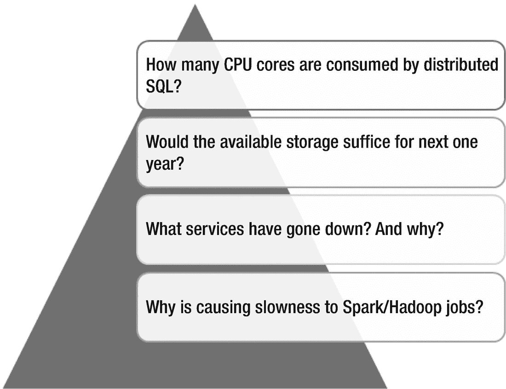
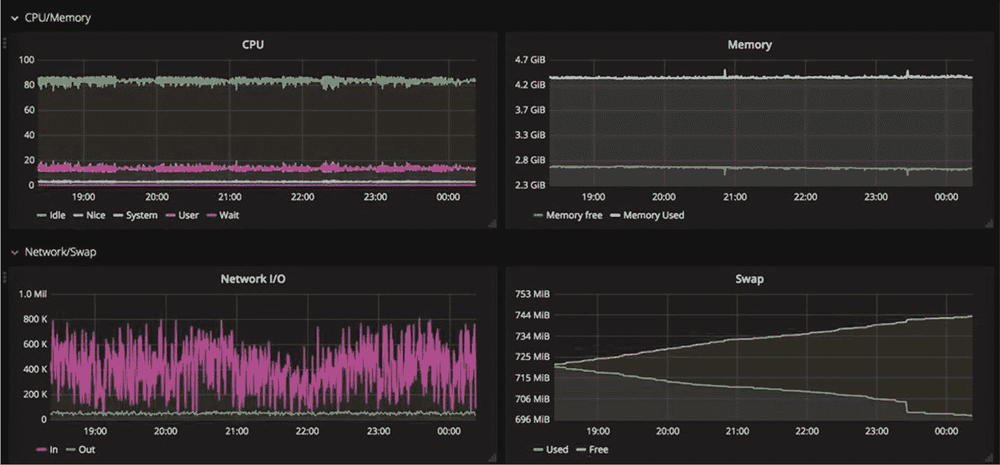
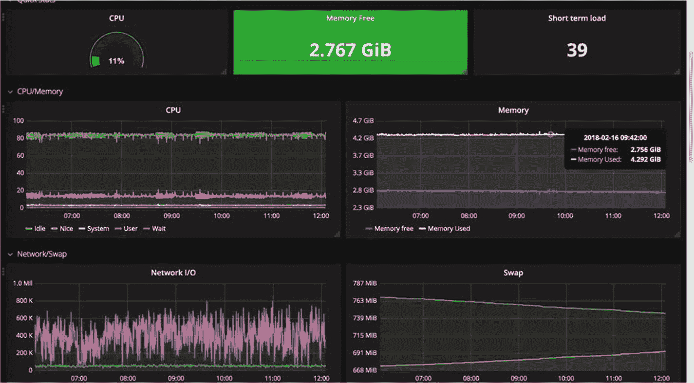
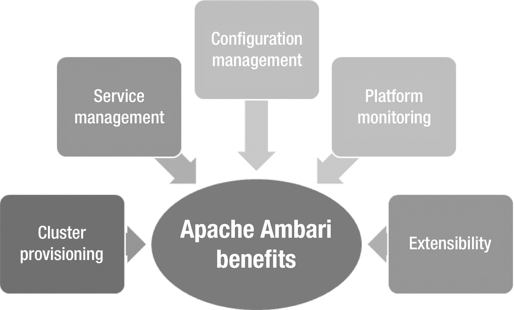

# 8. 管理数据湖运维

> “没有大数据分析，企业就如同又聋又瞎，在网络上漫无目的地游荡，好比鹿群上了高速公路。” —— 杰弗里·摩尔，《跨越鸿沟》作者

至此，读者应该对现实世界中的数据分析以及数据湖如何满足数据分析的需求有了相当的理解。所有组织的数据资产汇聚于一体，将复杂的数据集概念化，形成一个功能完备的数据湖。理解如何致力于构建一个健康、稳定且安全的数据湖至关重要。组织应如何应对安全、稳定性和可用性方面的挑战，以确保数据湖保持在线并遵守合规指南？

正如人们所说，创建容易，维护难。管理一个生产集群可能会变得极其复杂。对平台缺乏理解、不了解应用程序服务等级协议（`SLA`）以及缺乏有效的监控框架，都会导致数据湖运维变得不透明。一旦数据湖生态系统稳定并投入运营，满足其下所列的迫切需求就变得至关重要。请记住，这些需求最终会形成运维台的关键流程。该清单汇总了标准的运维检查项，同时，数据管理与运维部门之间的常规工作交接中，也可能约定更细致、更精确的任务。

1. 数据湖平台的守门人 – 运维团队始终是生产环境的所有者。与内部 `IT` 团队、数据治理委员会和数据湖开发团队保持联络，以了解数据湖的目标及其主要利益相关者。

2. 支持数据湖的可用性，符合下游消费者定义的 `SLA` – 引入主动监控和告警层，持续检查平台可用性。

3. 提供运维情报并发布指标，以突出风险领域 – 建立定期机制，对平台和业务应用进行事件分析和健康检查。发布关键指标，突出显示可用性数据、问题趋势和应用就绪度评分卡。

4. 通过定期沟通实现集成支持 – 沟通是快速解决问题、实现快速响应的关键。随着时间的推移，它能磨练出迅速感知风险并在补救行动中展现敏捷应对的能力。连接开发团队和利益相关者，以获取他们的反馈和任何问题。

5. 保持敏捷，培养“持续集成”文化，并简化部署流程 – 鼓励持续集成、持续交付和持续部署原则，以简化交付管道。

本章将重点关注监控架构的原则，这些原则将使管理员能够在数据湖生态系统中孕育卓越运维。它将让他们深入了解如何优化数据湖的强大功能，使其更加健壮，以增强透明度和问责制。在本章的范围内，不会深入探讨 `Hadoop` 的运维结构。

## 监控架构

数据湖运维团队经常面临应用用户提出的问题，如图 8-1 所示。



图 8-1

数据湖运维中常遇到的问题

一个好的监控架构不仅赋予管理员集群监控能力，还能对应用程序进行性能度量。基本的集群监控只告诉你什么失败了，却不能回答为什么失败。

### Hadoop 指标架构

对于任何系统，跟踪日志、审计日志或任何统计信息对于了解系统的健康状况和行为都至关重要。这种揭示系统状态的统计信息数据被称为指标。指标由运行在系统组件上的守护进程生成，可用于监控组件的健康状况、调优和故障排除。在 `Hadoop` 中，默认会生成大量指标。然而，对于额外的指标，可以在特定组件上安装独立的代理。

在基于 `Hadoop` 的数据湖生态系统中，指标被分组到特定的上下文（contexts）下。指标是上下文中行级别的信息。一个上下文可以配置一个插件，该插件作用于 `Hadoop` 的某个特定组件，从而生成该上下文下分组的全部指标。每个指标都带有主机名标签，以便与其余指标区分。让我们看看 `Hadoop` 指标架构中可用的关键上下文。¹

1. `jvm` – 它分组由 `Java` 进程发布的指标，揭示有关已使用和已提交的内存、线程详情以及进程跟踪日志的信息。

2. `rpc` – `rpc` 上下文下的指标在远程过程调用与主机握手期间生成。可能与身份验证、数据传输量、`RetryCache` 和开放连接有关。另一个相关的上下文 `rpcdetailed` 会为 `rpc` 方法生成额外的指标。它不包含在 `rpc` 指标记录中。

3. `dfs` – 此上下文包含 `NameNode`、`FSNamesystem`、`JournalNode` 和 `DataNode` 的指标。这是收集 `NameNode` 操作、容量、日志同步和数据节点操作指标的最重要上下文之一。

4. `yarn` – `Yarn` 上下文捕获 `NodeManager`、集群和队列管理器的指标。

5. `mapred` – 此上下文通过 `MapReduce` 守护进程生成指标。它包含与作业跟踪器（jobtrackers）和任务跟踪器（tasktrackers）相关的指标。

除了上述上下文之外，还可能存在提供额外指标的上下文，例如 `ugi`、`metricsystem` 和默认上下文。`ugi` 上下文分组与用户和组相关的指标，例如成功和失败的 `Kerberos` 登录以及组解析。`metricsystem` 上下文则揭示关于指标源的指标。

## 识别源组件

这是开发良好监控框架的第一步。组织的数据湖可能使用任何技术栈（`Hadoop`、`Cassandra` 等）构建，其中 `Hadoop` 最为著名。必须识别出在技术栈平台上运行的所有必要服务。例如，一些应被监控且需要收集其指标的 `Hadoop` 关键组件列举如下。

### YARN 指标

活跃节点或丢失节点列表 - 此指标应给出无任何问题运行的节点数量。节点可能由于网络问题到硬件资源（`CPU`、内存等）不足等各种原因与资源管理器失去联系。

如果某个 `NodeManager`（`NM`）在给定的超时阈值内无法联系上 `ResourceManager`（`RM`），则该 `NM` 将被标记为丢失，其资源对集群不可用。一旦节点被标记为“丢失”，我们就应采取行动。

已分配内存总量 - 此指标提供了集群内存使用情况的高层次概览。如果我们频繁接近集群容量，那么就该调查哪些作业可能在消耗内存，并投入足够关注来调优这些作业。另一种选择是添加 `NodeManager` 和/或增加为 `YARN` 预留的内存量。

### MapReduce 指标

为了优化其应用或发现瓶颈，开发人员应跟踪以下内容：

1. 失败的映射（map）任务数

2. 失败的归约（reduce）任务数

3. 数据本地化计数器 – `Hadoop` 还公开了一组指标，显示一个作业创建其映射任务与数据的接近程度。如果在数据本地不可用的节点上创建了大量映射任务，这很好地表明了性能下降。

### HDFS

有多个参数可以很好地指示 `HDFS` 的健康状况，例如：

1. 文件总数

2. `underReplicatedBlocks`

3. `StaleDataNodes`

4. `CapacityRemaining`

5. `BlocksTotal`：系统中当前已分配的块数

有关 `HDFS` 中每个服务（`NameNode` 和 `DataNode`）所暴露的指标的详尽列表，请参阅 Apache 文档：[`https://Hadoop.apache.org/docs/r2.6.0/Hadoop-project-dist/Hadoop-common/Metrics.html`](https://hadoop.apache.org/docs/r2.6.0/hadoop-project-dist/hadoop-common/Metrics.html)

你的组织中的数据湖最终可能包含多个生态系统组件，如 `HBase`、`Hive`、`Spark` 以及其他 `SQL-on-Hadoop` 技术，例如 `Apache Drill`、`Presto` 等。对于每个此类组件，你都必须包含某些必要的指标，这些指标将有助于在下一阶段（我们很快就会看到）对其进行监控。

这里需要注意的关键点是，几乎每个 `Hadoop` 生态系统组件都通过 `JMX` 端口暴露其指标，我们可以连接该端口并跟踪这些指标，用于监控和性能测量。除了有助于我们监控和测量性能的指标之外，收集每个 `Hadoop` 组件生成的日志也很重要。

### 指标收集工具

完成所有收集指标繁重工作的重要工具之一是 `CollectD`。一个守护进程会定期收集系统性能指标，并提供多种机制来存储这些值，或将其发送到下一阶段，在此阶段数据由其他工具聚合，最终可供可视化工具使用。它在集群中的每个节点上运行。

**注意** – 启用以下默认插件，它们有助于收集相关指标：

```
[root@vm75-132 ~]# cat /etc/collectd.conf | grep '^Load'
LoadPlugin syslog
LoadPlugin cpu
LoadPlugin df
LoadPlugin disk
LoadPlugin interface
LoadPlugin load
LoadPlugin memory
LoadPlugin network
LoadPlugin swap
```

如果你来自传统数据库背景，那么这些与代理进程非常相似，例如：`Oracle` 世界中的 `Oracle` 代理或运行在每个节点上并将指标发送到管理器进程的 `Nagios` 代理。事实上，它们被称为“收集代理”。

另一个知名的企业级组件是 `Ganglia`。它已在一些最大的云基础设施中使用，并得到活跃社区的支持。

与指标收集代理类似，其他日志收集代理包括 `FluentD` 和 `Logstash`。

# 日志收集与数据存储

`FluentD` 是一个守护进程，运行在每个节点上以收集和解析日志。这些日志随后可以被发送到像 `OpenTSDB` 这样的数据存储或像 `ElasticSearch` 这样的后端存储。`FluentD` 如今被广泛采用，因为它以其内置的可靠性和较低的内存使用而闻名。

`Logstash` 主要作为 ELK 栈（ElasticSearch-Logstash-Kibana）的一部分而闻名。用户应该对每个工具的工作方式进行很好的比较，并做出明智的决定，选择某个特定的工具而不是另一个。

## 指标和日志存储

`OpenTSDB` 是一个运行在 `HBase` 之上的分布式时间序列数据库。它可以用来存储和聚合由类似 `Fluentd` 和 `collectd` 的代理接收到的日志和指标。`OpenTSDB` 的模式针对时间序列数据的快速聚合进行了高度优化。除了本质上具有分布式特性之外，它还可以以细粒度的方式存储大量数据。

但是，`OpenTSDB` 的实现比安装和配置 `Graphite` 等系统要复杂一些。尽管如此，如果你计划将 `HBase` 作为数据湖中的生态系统组件之一进行部署，你应该认真考虑将其用作日志和指标的数据存储。

`ElasticSearch (ES)` 是一个开源的分布式全文搜索和分析引擎，它可以成为数据湖中你的 Hadoop 组件之一。复杂的搜索功能和日志分析是 `ElasticSearch` 的最佳用例之一。如果你想分析和挖掘数据以寻找趋势、统计数据、汇总信息或异常情况，它会非常有用。你还可以使用 ELK 栈中的 `Logstash` 来收集、聚合和解析数据，然后让 `Logstash` 将这些数据馈送到 `Elasticsearch`。

它会索引通过收集代理接收到的日志，以便这些日志易于访问和搜索。例如，`FluentD` 在向 ES 写入日志时使用轮询方法。如果由于某种原因，某个节点不可用，`Fluentd` 可以故障转移到其余幸存的 ES 节点之一。你不需要为 `Fluentd` 与 ES 配合使用而额外配置故障转移。但建议至少运行 3 个节点来运行 `ElasticSearch`。你必须根据需求调整集群规模，使其包含一个或多个节点。

默认情况下，它会对数据（接收到的日志和指标）索引 2 天。但可以轻松配置为更长的保留期。ES 也以其高内存消耗而闻名，并且至少使用 2Gb 的 RAM 堆大小。这同样可以根据你的需求进行配置。将所有聚合数据放入 `Elasticsearch` 后，你可以搜索任何你想要监控的节点、服务或消息严重性级别的组合，并在此基础上进一步开发告警和可视化分析功能。

`ElasticSearch` 的仓库位置在 CentOS/RHEL 系统中默认可能不可用。因此，请将 `ElasticSearch` 的公共 GPG 密钥导入 rpm，然后按照以下步骤进行安装。

```
//导入 GPG 密钥//
[root@vm75-132 ~]# rpm --import http://packages.elastic.co/GPG-KEY-elasticsearch
[root@vm75-132 ~]#
//添加仓库位置//
[root@vm75-132 ~]# vi /etc/yum.repos.d/elasticsearch.repo
[root@vm75-132 ~]# cat /etc/yum.repos.d/elasticsearch.repo [elasticsearch-2.x]
name=Elasticsearch repository for 2.x packages
baseurl=http://packages.elastic.co/elasticsearch/2.x/centos
gpgcheck=1
gpgkey=http://packages.elastic.co/GPG-KEY-elasticsearch
enabled=1
//安装 ElasticSearch 并启动服务//
[root@vm75-132 ~]# yum -y install elasticsearch
[root@vm75-132 ~]# systemctl start elasticsearch
```

这里不需要为 `ElasticSearch` 进行显式配置。唯一需要编辑的项目是 `NodeName` 和集群名称。根据你的集群/节点名称修改它们。

## 日志和指标可视化

这一层最近经历了一些快速的发展。有一些很棒的、功能丰富的前端工具和库，它们都得到了 `OpenTSDB` 和 `Elasticsearch` 的支持。

`Graphite` 在这一类别中一度非常流行。但就像 Hadoop 的所有事物一样，还有其他工具，比如 `Grafana` 和 `Kibana`，它们如今非常活跃，拥有活跃的用户群。

就本文而言，我们仅提供 `Grafana` 和 `Kibana` 功能的概述。`Grafana` 使用 REST API 从 `OpenTSDB` 访问指标数据。使用单个 `Grafana` 实例，用户可以构建自定义仪表板或使用示例仪表板来可视化指标。它还支持许多不同的数据存储，如 `Elasticsearch` 和 `Graphite`。

`Grafana` 能够组合来自多个数据源的数据，并将其显示在单个仪表板中。每个数据源都与仪表板中的一个窗格/框架紧密相关。由于后端种类繁多，要使用的查询语言也各不相同。

图 8-2 显示了一个 `Grafana` 控制台，其中展示了节点级别的 CPU、内存、网络和 Swap 使用情况，这些是系统负载的一些指标。



图 8-2：显示关键系统指标的 Grafana 控制台

你还可以调整控制台上下文以显示运行中的指标（图 8-3）。



图 8-3：可以修改 Grafana 控制台上下文以显示当前指标

### Kibana

`Kibana` 是另一款运行于 `Elasticsearch` 之上的可视化平台。它通过 `REST API` 访问和搜索 `Elasticsearch` 中的日志。用户借助单个 `Kibana` 实例，即可创建可视化图表和仪表盘来分析日志。

`Kibana` 连接单个 `Elasticsearch` 节点来读取日志。如果因 `Elasticsearch` 节点故障导致 `Kibana` 无法读取日志，则必须将 `Kibana` 配置为连接可用的 `Elasticsearch` 节点。若希望在配置的 ES 节点宕机时仍能运行 `Kibana`，可以在集群中运行 `Kibana` 的同一节点上部署一个仅协调 ES 节点。这些协调节点充当负载均衡器，将来自 `Kibana` 的传入连接请求分发至其他 ES 节点，收集结果并返回给 `Kibana` 进行可视化呈现。

## Apache Ambari

`Apache Ambari` 是一款用于管理和监控 `Hadoop` 集群的开源平台。其功能不仅限于运维操作，还能实现集群的预配置并控制安全框架。在架构上，它与其他现代管理应用并无不同。服务器与部署在其上的各组件代理协同工作，以指标和日志的形式接收组件的状态信息。

`Ambari` 为平台监控和运维管理提供以下功能：

1. **Ambari 告警** – `Apache Ambari` 会触发预定义且集中管理的告警。可修改告警以控制阈值、接收者、频率和通知方式。告警可提供集群健康状况的完整视图。`Ambari` 提供多种配置选项来定制告警机制。

2. **Ambari 指标** – 包含指标收集器、指标监控器和 `Grafana`。`Grafana` 包含多个用于可视化关键指标的预构建仪表盘。以下是指标从生成到可视化的流转过程。
    1. 指标监控器将系统指标发布至收集器
    2. Sink 将 `Hadoop` 指标推送至收集器
    3. 指标收集器聚合指标
    4. 通过 `REST API` 在 `Ambari UI` 上展示指标
    5. 从 `Ambari 2.2` 开始，`Grafana` 作为指标的原生界面提供服务
        1. 为 `HDFS` 首页、名称节点、数据节点、`YARN`、应用、作业历史等提供仪表盘

3. **Kerberos** – `Ambari` 支持通过界面进行向导驱动的 `Kerberos` 管理。用户可以创建 `Kerberos` 主体和密钥表文件，分发密钥表文件，并执行集群配置任务。

4. **基于角色的访问控制** – 通过角色和权限控制对集群的访问。例如，admin 角色可以同时扮演服务管理员和集群管理员的角色。

5. **日志搜索** – `Apache Solr` 支持在 `Ambari` 内部轻松快速地搜索组件日志，无需任何麻烦。搜索条件可以包括关键词、时间范围或日志级别。

6. **可扩展性** – `Ambari` 保持敏捷性，可扩展以添加或修改服务以适应自定义环境。`Ambari` 界面视图可扩展以修改 Web 组件。

# Hadoop 数据湖运维最佳实践

7. `SmartSense` – 这是一个自动诊断工具，用于收集事件信息，创建“数据包”，并将其上传至 Hortonworks 支持部门。这有助于加快事件解决速度，缩短周转时间。此外，它还能分析数据包并为每个集群生成建议。建议旨在减少运营问题并提升集群性能。

图 8-4 展示了 `Apache Ambari` 的功能分支。



图 8-4

## 数据湖运营化

从本质上讲，数据湖从构思、规划、预配置到运营化的整个过程，需要敏锐的商业头脑和组织愿景。撇开在基础工作、领导共识以及与组织战略对齐方面投入的努力不谈，数据湖的一些关键阶段包括容量规划、预配置、监控和安全。

以下列表讨论了能够使数据湖正常运行的若干设计考量。与其说是考量，不如将其视为确保生态系统平台稳定性的最佳实践。

## 1. 集群规划

基于 Hadoop 的数据湖可以部署在本地站点或云端。本地部署和云端部署各有优劣。虽然云服务旨在提供稳定性、可用性和更好的投资回报率（ROI），但本地部署在根据需求和使用场景进行调整方面更具灵活性。

## 2. 集群设计

- 选择更多数量的轻量级节点，而不是少量的大型节点。

- 更多的节点增强了弹性、并行性和处理能力。

- 少量大型节点会暴露诸多问题，如更长的恢复时间。

## 3. 组件布局

- 主组件应跨机架分布以降低风险。

- 工作节点上的工作组件配置应保持一致。

- 部署多个网关节点以实现客户端服务的负载均衡和分发。

- 将 `Zookeeper` 实例计数从默认的 3 个增加到 5 个：

  - 便于维护

  - 超过 5 个会因投票者过多而降低操作速度

## 4. 元数据存储

像 `Hive`、`Ambari`、`Oozie` 和 `Ranger` 等组件需要关系数据库作为元数据存储：

- 支持 Oracle、MySQL、PostgreSQL

- 考虑数据库的统一性以便于管理

- 将所有元数据存储配置在同一台服务器上

- 使元数据存储数据库的管理与常规数据库管理操作任务保持一致

## 5. 容量规划参数

### 5.1 容量计算参数

容量规划成为以下参数的函数：

- **初始数据大小** – 将迁移到数据湖的历史数据和当前数据

- **年增长率** – 每年的数据增长率

- **压缩比** – 数据的压缩倍数

- **副本因子** – 集群中的副本数量

### 5.2 副本因子权衡

较高的副本因子会影响查询性能和数据的可用性。副本因子为 3 是能够在可用性和性能之间取得平衡的最佳数值。

### 5.3 压缩因子差异

压缩因子的测量因数据类型而异。

### 5.4 临时数据大小

Hadoop 在中间阶段会创建多个临时文件。临时数据大小约占原始数据大小的 30-40%。

### 5.5 总存储需求

总存储需求 = [（初始数据大小 + 年增长率 + 临时数据大小）* 副本因子 * 1.2] / 压缩因子

注：*1.2 是用于 HDFS 存储的随机缓冲因子

### 5.6 Storm 与 Kafka

- Storm 是计算密集型，而 Kafka 是磁盘密集型：

  - 对于 Storm 监控，设置容量、延迟和失败事件计数的告警

  - 对于 Kafka 监控，设置可用磁盘空间以及读写之间延迟的告警

- 如果使用 Kafka，必须将 Kafka 日志保留期规划为 2-3 天

## 6. 资源调配与部署

- 通过 `Chef`、`Puppet`、`Jenkins`、`Ansible` 或 `CFEngine` 自动化资源调配和部署流程

- 鼓励使用 `Ambari` 或 `Cloudera Manager` 等管理控制台进行资源调配

- 添加节点后，务必在操作窗口内重新平衡 `HDFS`，以降低节点阈值水平

## 7. 管理日常运行

- 随着集群增长，调整堆大小（约 200 字节/对象）

- 使用并行垃圾回收

- 为元数据存储、`NameNode` 和安全组件设置高可用性

- 使用 `Ambari` 监控 `HDFS` 磁盘使用率、`DataNode`、集群负载、`CPU` 使用率等指标

- 如果应用程序使用 `HBase`，监控以下指标：

  - `callQueueLength`

  - `memstore size`

  - `compaction queue size`

  - `slowHLogAppendCount`

  - `GCTime`、`CPU Load`、`CPU Allocation`、`IOPS`

- 关键故障排除日志：

  - `HDFS` 审计日志

  - 组件日志（`/var/log/Hadoop*`）

  - 应用程序日志（`/app-logs/`）

  - `Hive` 日志（`/tmp/<user>/hive.log`）

## 结论

平稳且稳定的运维策略是数据湖之旅的基石。它让数据和分析社区有信心加入并开始无忧无虑地探索数据。一个破碎的数据湖运维方案会给数据治理委员会和业务领导层实现数据民主化的本质带来严峻挑战。