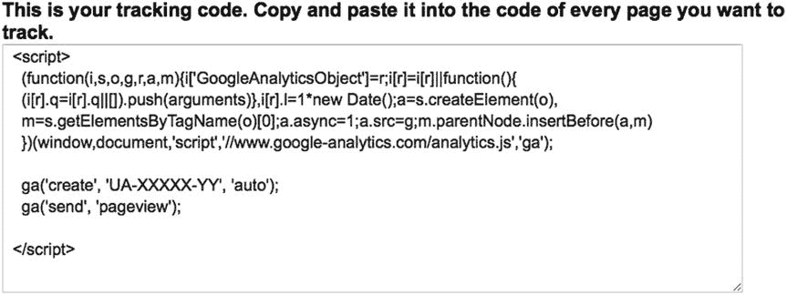
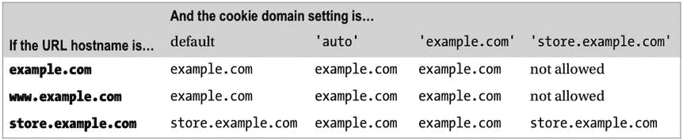
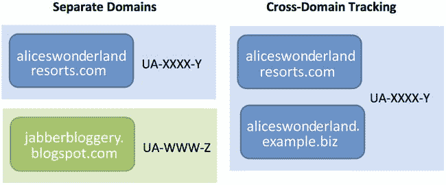

# 2. Google Analytics 基础测量

> “从开头开始，”国王非常严肃地说，“一直走到尽头，然后停下。” ——刘易斯·卡罗尔，《爱丽丝梦游仙境》

Google Analytics 对您网站的测量基于安装在网站上的 JavaScript 跟踪代码。尽管在本书的大部分内容中，我们将使用 Google 跟踪代码管理器（GTM）来管理和安装此代码（从第 3 章开始），但了解 GA 跟踪代码的基础知识及其预期工作原理仍具有指导意义。实际上，您可能不会直接使用此跟踪代码。然而，对其有基本的了解，将有助于您理解 GTM 中 GA 标签的各项选项，以及解读 GA 文档和示例，从而为您的网站设置 GTM。

## 基础 Google Analytics 跟踪代码

当您首次创建 Google Analytics 帐户时，需要提供一些基本信息，例如您网站的域名和时区。然后，GA 会提供一段 JavaScript 代码片段，并附上说明：“将此代码复制并粘贴到您要跟踪的每个网页中”（见图 2-1）。



图 2-1. GA 的跟踪代码说明

如果在初始设置过程后需要查找此建议代码，可以在“管理”设置中的“媒体资源”列下，进入“跟踪信息” ➤ “跟踪代码”部分找到。

### 跟踪代码的工作原理

让我们分解这段代码，看看它的作用。第一部分如下所示：

```
(function(i,s,o,g,r,a,m){i['GoogleAnalyticsObject']=r;i[r]=i[r]||function(){
(i[r].q=i[r].q||[]).push(arguments)},i[r].l=1*new Date();a=s.createElement(o),
m=s.getElementsByTagName(o)[0];a.async=1;a.src=g;m.parentNode.insertBefore(a,m)
})(window,document,'script','//www.google-analytics.com/analytics.js','ga');
```

您甚至无需费心重新格式化这段代码使其更具可读性，因为它在每个网站上都是相同的，并且您几乎永远不会对其进行修改。它从 Google 服务器获取 GA 跟踪库（`analytics.js`）并将其插入到页面中。（这段脚本中唯一您可能需要更改的部分是最后一部分：`'ga'`是赋予 GA 跟踪函数的名称。如果您需要避免与页面中已存在的对象名称冲突，可以重命名此函数。）

第二部分是告诉 Google Analytics 要做什么。默认代码包含两个命令：

```
ga('create', 'UA-XXXXX-YY', 'auto');
ga('send', 'pageview');
```

`ga`函数接受一系列参数，其中第一个是 GA 命令的名称。这里您看到两个不同的命令：`create`和`send`。


#### 创建 GA 跟踪器

`create` 命令用于设置 GA 跟踪器。每个跟踪器将数据发送到一个特定的 GA 媒体资源，该资源由本命令的第二个参数（即媒体资源 ID）标识。媒体资源 ID 的格式为 `UA-XXXXX-YY`，其中 `XXXXX` 是标识您 GA 帐号的数字，`YY` 是标识该帐号内某个媒体资源的数字。您可以在 GA 首页的每个媒体资源旁边，或者在“管理”设置的“媒体资源”列中找到该媒体资源 ID。

最后一个参数 `auto` 是跟踪器的一个配置参数，它与跟踪器如何为网站设置 Cookie 有关。（本章稍后会详细介绍这一点。）

#### 发送页面浏览

第二个命令 `send` 用于向 GA 发送一个跟踪匹配。

该命令的第二个参数是匹配类型，此处的类型为 `pageview`。GA 中有多种不同的匹配类型，用于收集不同类型的数据并以不同方式在 GA 中报告，例如用于用户互动的 `event` 匹配类型（详见第 5 章），或用于移动应用的 `screenview` 匹配类型（详见第 13 章）。

每当执行 `send` 命令时，数据就会被发送到 Google Analytics。系统会向 [`www.google-analytics.com/collect`](http://www.google-analytics.com/collect) 发起一个 HTTP 请求，其中包含关于该匹配的数据负载（即填充 GA 中维度和指标的数据）。

由于 GA 跟踪代码包含在您网站的每个页面中，因此每次页面加载时，都会执行发送页面浏览的命令，记录下该页面已被浏览。就是这么简单。这里展示的两个命令（用于创建跟踪器的 `create`，以及用于发送页面浏览的 `send`）是 GA 跟踪在您的网站上运行所需的最基本功能。

现在，这段默认代码并不能捕获您可能想要的所有信息——它仅仅在每次页面加载时记录页面浏览。那么，当用户通过 AJAX 表单完成多个步骤但页面并未重新加载时，该怎么办？页面内的其他互动，比如播放嵌入式视频，又该如何处理？这些都需要额外的代码（仅在完成某些操作时执行，例如加载新的 AJAX 内容或播放视频）。第 5 章 提供了针对这种额外跟踪的通用方法（使用 GTM），以及针对常见场景的具体方案。

#### GA 跟踪代码的历代版本

本书重点关注最新一代的 GA 跟踪库 `analytics.js`，它是 GA 名为“Universal Analytics”的一系列升级和扩展功能套件的一部分。还有其他更旧的 GA 跟踪库，例如 `urchin.js` 和 `ga.js`。它们的工作方式类似，但语法细节不同，并且本书描述的部分功能在旧版库中不可用。

自 2014 年起，`analytics.js` 库已成为 Google Analytics 中新媒体资源的默认代码，并且对于在该变更之前创建的媒体资源，也提供了升级流程。如果您尚未更新，您将在“管理”部分看到关于升级流程的通知（并且您将能在您的网站上看到旧代码）。尽管旧代码在一段时间内仍能继续工作并收集数据，但如果您想利用 GA 的任何较新功能，您应该尽快升级（最终升级将成为强制要求）。

GA 开发者中心包含针对旧版代码的文档，并设有升级中心引导您完成升级过程。¹

#### 多个 GA 跟踪器

关于创建 GA 跟踪器，最后一个重要细节：每个跟踪器都有一个标识其自身的名称。（默认跟踪器的实际名称是 `t0`，尽管这在任何地方都没有标明。）如果您只使用一个跟踪器，则无需担心其名称；但在某些情况下，您可能需要在网页上并行运行多个跟踪器。如果存在多个跟踪器，则每个命令必须指定它是在哪个跟踪器上调用的。（不过，对于默认跟踪器 `t0`，则无需指定名称。）

为什么可能需要多个跟踪器？在某些情况下，您可能希望将数据发送到 GA 中的多个媒体资源，这可能是出于多种原因：

*   两个不同的主体（例如，您的组织及其母公司）对某个网站有共同利益，但使用不同的 GA 帐号。
*   将您的跟踪代码添加到第三方供应商或应用提供的内容中，而该内容可能已经自带了其 GA 跟踪。
*   在某些情况下，用于测试升级，以确保您的实现是正确的（参见第 4 章）。

下面是命名跟踪器并对其调用命令的示例。名称可以是任意字符串；这里使用了 `t1`。

```
ga('create', 'UA-XXXXX-YY', 'auto');       // 默认跟踪器
ga('create', 'UA-WWWWW-ZZ', 'auto', 't1'); // 名为 t1 的额外跟踪器
ga('send', 'pageview');                    // 为默认跟踪器发送页面浏览
ga('t1.send', 'pageview');                 // 为 t1 发送页面浏览
```

对于命名的跟踪器，命令名称前会加上跟踪器名称前缀，并用点分隔：例如 `t1.send`。

#### 参数和字段名称

根据命令的不同，Google Analytics 会接受影响其工作方式或收集数据的额外字段的值。例如，正如您之前所见，`create` 命令指示了媒体资源 ID。

在许多情况下，有两种方法可以指定这些值。对于某些值，您可以直接在 `ga` 函数调用中将其指定为参数：

```
ga('create', 'UA-XXXXX-YY', 'auto');
```

这就是您已经见过的格式，它是一种提供某些最常用字段值的便捷方式。由于它使用函数参数，请注意顺序很重要，并且函数期望参数出现在特定的位置。

还有另一种可用的语法，并且它是指定某些较少使用字段的唯一方式，因为这些字段没有对应的参数。这种替代语法使用一个对象来表示字段和值：

```
ga('create',
{
   'trackingId': 'UA-XXXX-Y',
   'cookieDomain': 'auto'
});
```

由于对象包含了每个字段的名称，因此顺序无关紧要。这两种语法是等效的，工作方式相同。

### 将代码放到页面上

那么，说明是“将此代码复制并粘贴到每个您要跟踪的网页中”，幸运的是，这很可能比听起来要简单。在这个时代，您很可能有一个包含可管理数量页面模板的内容管理系统（而不是为网站的每个页面单独创建不同的 HTML 文件）。

如果是这种情况，您只需将代码放入一个或多个模板中，这样它就会自动包含在网站的每个页面中。您需要确保覆盖所有模板，因为任何缺失的页面都不会被 GA 统计。对于 GA 而言，如果页面上没有跟踪代码，就好像该页面不存在一样。


### 代码放置

GA 跟踪代码是异步的，这意味着浏览器无需等待代码加载完成，即可继续渲染页面中后续的元素。因此，您可以安全地将代码放置在页面顶部或靠近顶部的位置。建议将代码放在页面的 `<head>` 部分，不过如果您的模板中放在 `<body>` 开头更方便，那也是可以的。

> **提示**  
> 您应尽可能将代码放在页面的靠前位置。如果代码位于页面末尾，且页面加载需要较长时间，用户可能会在跟踪代码加载完成前就导航离开（点击链接或关闭浏览器窗口），这意味着您将无法捕获该次页面浏览的数据。

GA 代码与页面其余部分异步执行，但提供给 GA 的命令会按照调用顺序执行。因此，例如，`create` 命令必须位于 `send` 命令之前，这一点非常重要。

## Cookie 与域名

Google Analytics 使用一个 cookie 来存储客户端 ID，这是一个针对特定浏览器和设备随机生成的标识符。它在计算用户数量以及跨会话的用户行为（例如最近访问时间、忠诚度和多渠道漏斗报告）时会用到该客户端 ID。

您的浏览器会存储分配给特定域名的 cookie（出于安全原因，未授权的网站无法读取其他域名的 cookie）。GA 使用第一方 cookie，这意味着其名为 `_ga` 的 cookie 会被分配给您的域名。也就是说，如果我在 `aliceswonderlandresorts.com` 上部署了 GA 跟踪代码，那么该站点会有一个 `_ga` cookie（而不是针对 `google.com` 或 `google-analytics.com` 等第三方 cookie）。

在很多情况下，GA 使用 cookie 对您来说几乎是透明的。如果您只有单个域名，或拥有几个完全独立的站点，您无需担心这个问题。但是，如果您有多个域名或子域名共同构成一个网站，您可能需要指定 cookie 的设置位置以及域名之间如何共享客户端 ID 值。

### 选择 Cookie 域名

Google Analytics 会使用一些默认规则来决定 cookie 域名，您也可以显式指定要使用的域名。cookie 域名有三种可能的情况：

*   **默认设置：** `ga('create', 'UA-XXXXX-YY')` — GA 将使用 URL 主机名中显示的完整域名，但会忽略 `www.` 前缀（如果有）。如果您希望主域名的各子域名被单独对待，这是理想的选择。
*   **自动配置：** `ga('create', 'UA-XXXXX-YY', 'auto')` — GA 会从 URL 主机名中尽可能使用最高级别的域名。这是首次安装 GA 时的推荐代码。如果您希望主域名的各子域名被统一对待，这是理想的选择。
*   **手动配置：** `ga('create', 'UA-XXXXX-YY', 'store.aliceswonderlandresorts.com')` — GA 使用您指定的域名。该域名必须是 URL 主机名中域名的祖先域名。

> **注意**  
> `create` 命令可以接受 cookie 域名作为第三个参数，或者您可以使用字段对象。以下两种写法是等效的：  
> `ga('create', 'UA-XXXXX-YY', 'store.aliceswonderlandresorts.com');`  
> `ga('create', 'UA-XXXXX-YY', { 'cookieDomain': 'store.aliceswonderlandresorts.com' });`

**表 2-1. 在 `create` 命令中使用不同设置时 GA 中的 Cookie 域名**



在大多数情况下，您希望将多个子域名（例如 `www` 和 `store`）视为一个站点，并使用同一组 cookie，这正是 `auto` 选项的功能。如果您希望将子域名视为独立站点，则需要为每个域名手动指定并设置独立的 cookie。

#### 备用 Cookie 与无 Cookie 解决方案

默认的 Google Analytics cookie 名为 `_ga`。如果您需要重命名此 cookie 以避免冲突，可以在 `create` 命令中添加一个额外的字段：

`ga('create', 'UA-XXXXX-YY', { 'cookieName': 'my_ga_cookie' });`

也可以在完全不使用 cookie 的情况下使用 GA。为此，您必须从自己的来源提供客户端 ID 来识别设备。此选项对于希望避免使用第一方 cookie、或使用第三方 cookie、或从共享信息亭的应用程序提供数据的联合内容非常有用——例如：

```javascript
ga('create', 'UA-XXXXX-YY', {
     'storage': 'none',
     'clientId': '5aced0c9-1d2f-4da0-bbdf-5775d8ff7ad7'
});
```

`clientId` 应是一个遵循 UUID 版本 4 格式的全局唯一标识符。

### 将多个域名视为一个站点

有时，您需要将多个域名视为一个站点。这在包含第三方组件的站点中最为常见，例如购物车、捐赠站点或其他某些功能位于不同域名上的应用程序。例如，您的站点可能是 `aliceswonderlandresorts.com`，但为了预订酒店，用户最终会跳转到第三方站点 `aliceswonderland.example.biz`。

如果在这样的站点上使用常规的 GA 跟踪代码，那么 `aliceswonderlandresorts.com` 和 `aliceswonderland.example.biz` 会各自拥有独立的 `_ga` cookie。由于每个站点会有一组不同的客户端 ID，GA 将无法将一个站点上的行为与另一个站点关联起来——例如，在您站点上查看了特定页面的用户，最终是否在第三方站点上预订了酒店房间？这可能是您想回答的问题，但要做到这一点，您必须协调两个站点之间的客户端 ID（见图 2-2）。



**图 2-2. 多个域名与 Google Analytics**

这在 GA 中被称为跨域名跟踪。GA 提供了一些函数，用于向将用户从一个站点带到另一个站点的链接或表单中追加一个包含客户端 ID 的特殊参数，以便接收站点使用相同的客户端 ID。链接看起来像这样：

[`http://aliceswonderland.example.biz/hotelbooking.php?_ga=1.1821195.1441315.1362115890410`](http://aliceswonderland.example.biz/hotelbooking.php?_ga=1.1821195.1441315.1362115890410)

链接器参数 `_ga` 包含接收站点的客户端 ID。让我们来看看如何设置它。

#### 启用跨域名跟踪

首先，在每个站点的 `create` 命令中，您需要开启跨域名链接器功能：

```javascript
ga('create', 'UA-XXXXX-YY', 'auto', {'allowLinker': true});
```

当 `allowLinker` 设置为 `true` 时，GA 将检查页面 URL 中是否包含带有客户端 ID 的链接器参数。如果存在，GA 将使用该值，而不是为 cookie 生成一个新的客户端 ID。

> **注意**  
> 跨域名链接器参数还包含一个时间戳，GA 仅在该时间戳位于最近两分钟内时才会使用该客户端 ID。这有助于防止用户意外共享带链接器参数的链接，从而导致多个用户共享同一个客户端 ID。


### 装饰链接

接下来，您需要将 `linker` 参数附加到任一网站中指向对方网站的链接上。这被称为“装饰”链接——就像在链接末尾挂上一个小装饰品。

Google Analytics (GA) 在名为 `linker` 的插件中提供了多个实用函数来实现此功能。最简单的选项是使用 `autoLink` 命令，该命令允许您指定要包含的域名列表或模式，并自动装饰您网页上出现的链接。

```
ga('require', 'linker');
ga('linker:autoLink', ['aliceswonderlandresorts.com', 'example.biz']);
```

第一行加载了 `linker` 插件。第二行调用了 `autolink` 命令，并提供了一个您希望为其装饰链接的域名数组。域名列表会针对链接的目标进行子字符串匹配——请注意，根据您希望的具体程度，您可以列出 `example.biz` 或 `aliceswonderland.example.biz`。

提示

除了使用字符串列表，您还可以使用正则表达式来匹配域名：

```
ga('linker:autoLink', [/^aliceswonderland(resorts\.com|\.example\.biz)$/]);
```

`autoLink` 命令能够很好地自动装饰大多数网站上的链接。某些页面可能包含会阻止自动链接功能的脚本，因此与任何 JavaScript 一样，在部署到您的网站之前，您应该进行彻底测试。如果自动链接功能不适用于您的网站，`linker` 插件还提供了一个 `linker:decorate` 函数，用于手动装饰您的链接。除了标准链接之外，此函数在多种情况下都很有用：

*   装饰从一个网站向另一个网站提交数据的 HTML `form`。
*   装饰一个网站内容在另一个网站内的 `iFrame` 的目标地址。
*   如果 `autoLink` 函数与您网站上现有的脚本配合不佳时，用于装饰链接。

这些情况的具体示例可在 GA 开发者中心找到。

## 总结

*   Google Analytics 使用 JavaScript 跟踪代码来跟踪用户在网站上的活动。`analytics.js` 跟踪库会与 `create` 命令（用于设置 GA 跟踪器）和 `send` 命令（用于向 GA 发送网页浏览量数据）一起包含在网站的每个页面上。
*   Google Analytics 使用名为 `_ga` 的第一方 cookie 来存储用于识别浏览器和设备的客户端 ID。对于多个子域名或域名，可以选择指定 cookie 的域。
*   对于多个域名，Google Analytics 提供跨域跟踪功能，通过域名之间链接中的参数，在不同 cookie 的站点之间共享客户端 ID。`linker` 插件提供了用此参数装饰链接的功能。

脚注 1

[`https://developers.google.com/analytics/devguides/collection/upgrade/`](https://developers.google.com/analytics/devguides/collection/upgrade/)

2

[`www.ietf.org/rfc/rfc4122.txt`](http://www.ietf.org/rfc/rfc4122.txt)

