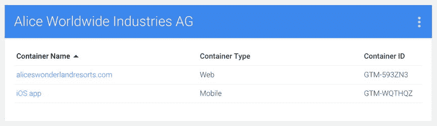
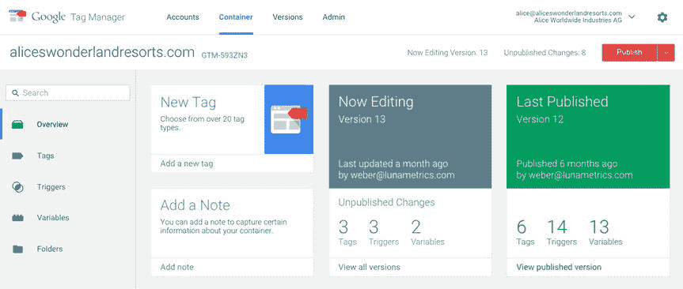
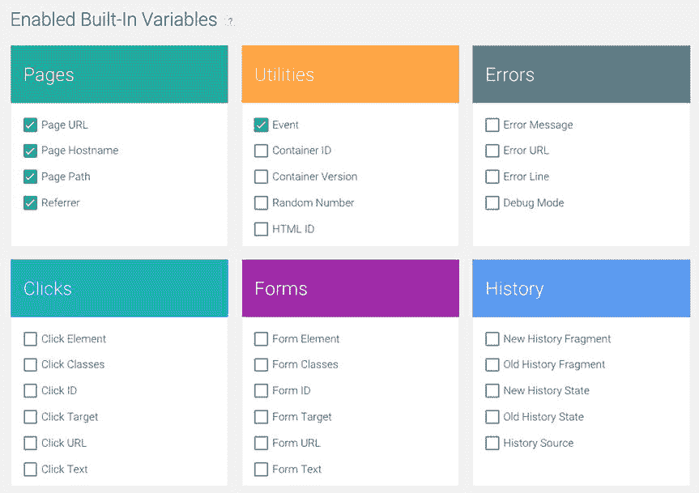
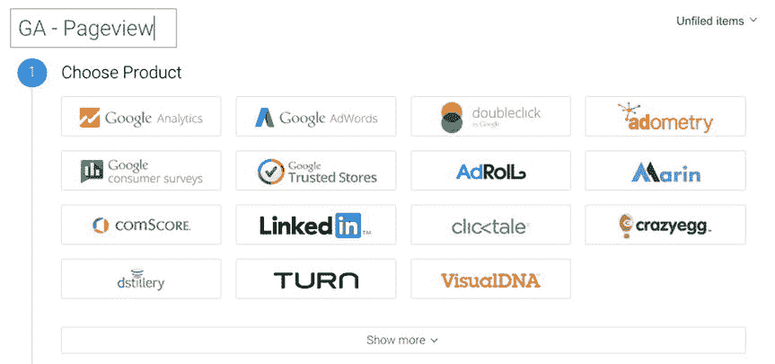
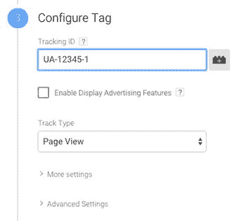
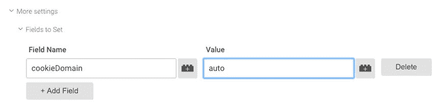
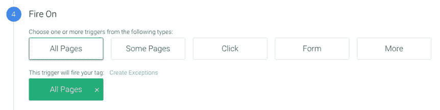
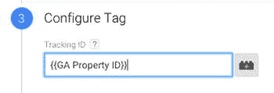

# 3. 介绍 Google 跟踪代码管理器

> 这时，国王（他一直忙着在笔记本上写东西）咯咯地叫道：“安静！”然后宣读他的书，“第四十二条规则。所有身高超过一英里的人必须离开法庭。” ——刘易斯·卡罗尔，《爱丽丝梦游仙境》

基本的 `Google Analytics` 代码（见第 2 章）并不复杂。把它放到您的模板中，就大功告成了。除非……嗯，这本书剩下的章节里还有很多您可能想用 `GA` 跟踪的额外数据类型，其中许多都涉及到添加更多的代码。这里加一小段用于 `PDF` 跟踪，那里再加一小段用于跟踪用户登录，诸如此类。您添加的代码越多，就越难以跟踪所有这些小片段、哪些片段应该在什么情况下包含、以及当您做出更改时会发生什么。

而这仅仅是 `GA`。很可能会，您的网站上还有其他用于其他跟踪工具的小型 `JavaScript` 片段，用于捕获其他有用的数据——也许是其他 `Google` 工具，如 `AdWords` 或 `DoubleClick` 的转化和再营销标签，或者用于第三方广告平台和分析工具。有时，您可能需要为两个、三个或四个不同的工具测量同一个网页浏览量或点击量，以实现不同的目的，每个工具都需要一个 `JavaScript` 标签。

如果这一切听起来有点混乱，那是因为它确实可能如此。这就是标签管理工具发挥作用的地方，它能够组织并标准化所有这些标签。

## 为什么要使用标签管理器？

就像您的内容管理系统通过允许您在基于 `Web` 的界面中插入文本、标题和图像来管理网站内容一样，标签管理系统也管理着标签——允许您插入那些 `JavaScript` 片段，例如 `Google Analytics` 跟踪代码。它提供了一个基于 `Web` 的界面，用于选择、编辑和管理这些标签在网页中的引入方式。

这种方法提供了许多优势：
* 在更新或添加标签时，无需对网站的实际源代码或其模板进行更改。
* 您可以跟踪并组织标签，以避免重复和错误。
* 拥有内置的调试、测试和预览工具。
* 您可以使用版本控制来跟踪更改。
* 拥有查看、编辑和发布标签的多级权限。

标签管理工具将添加和更新跟踪标签的过程与更改网站模板和代码的过程分离开来。目前有许多优秀的标签管理工具可用，但本书重点介绍 `Google` 跟踪代码管理器 (`GTM`)，因为它是一个免费工具，并且与 `GA` 配合得非常好。（如果您是 `GA Premium` 订阅者，`GTM` 也包含在 `GA Premium` 的服务水平协议中。）

## Google 跟踪代码管理器是如何工作的？

`Google` 跟踪代码管理器有两个协同工作的组件，用于在您的网站上包含标签：
* 一个基于 `Web` 的界面，用于设置需要包含在您网站上的跟踪标签。
* 一个放置在您网站模板中的容器脚本，用于加载这些标签。

我们来逐一看看这些部分，以便设置您的 `GTM` 帐户。

### 创建一个 `GTM` 帐户

由于 `GTM` 是另一个 `Google` 工具，您可以使用与 `GA` 相同的 `Google` 帐户登录。您可以被授予访问现有 `GTM` 帐户的权限，或者您可以创建一个全新的帐户。就像 `GA` 一样，您的登录名可以访问多个 `GTM` 帐户。

#### `GTM` 帐户结构

`GTM` 帐户被组织成多个容器。每个容器对应一段容器脚本（请参阅即将介绍的“`GTM` 容器脚本”部分），该脚本会嵌入到使用 `GTM` 的网站中。当你注册 `GTM` 帐户时，系统会创建你的第一个容器，并且你可以根据需要创建更多容器。当你登录 `GTM` 时，它会显示你的帐户和容器概览（参见图 3-1）。



图 3-1. `GTM` 的帐户和容器列表

在某些方面，`GA` 中的帐户和媒体资源与 `GTM` 中的帐户和容器之间存在明显的相似之处。在帐户层面，这种类比是成立的：在这两种工具中，一个帐户通常代表一个单一的组织或企业。

然而，`GTM` 容器的概念可能比 `GA` 媒体资源更为宽泛。例如，虽然你可能会为开发、测试和生产网站分别设置不同的 `GA` 媒体资源，但你可能只用一个 `GTM` 容器来管理这些网站上的代码，因为你希望在所有网站上部署非常相似的代码。对于 `GTM` 容器，一个通用的经验法则是：如果各个网站上的代码大致相同，则使用单个容器；如果网站之间的代码差异很大，则使用不同的容器可能更合适。（在接下来的几章中，你将看到这些代码是如何设置的，因此你可能希望在最终决定如何构建你的帐户之前，先了解一下 `GTM` 中的代码是如何工作的。）

#### `GTM` 权限

就像在 `GA` 中一样，`GTM` 中的登录用户在帐户和容器级别可以拥有不同级别的权限，从而赋予他们不同的能力。你可以在 `GTM` 的`管理`区域的`用户管理`部分分配权限。

在帐户级别，有两种不同级别的权限：
* `查看` 允许用户查看用户列表和帐户设置，但无法进行任何更改。
* `管理` 允许用户添加和移除其他用户，并编辑帐户设置。

在容器级别，有更详细的权限：
* `仅查看` 允许用户查看容器中的代码，但无法进行任何更改。
* `查看和编辑` 允许用户对容器中的代码进行更改。
* `查看、编辑、删除和发布` 允许用户对代码进行更改、删除它们，并将它们发布到在线网站。

对你的网站的更改在 `GTM` 中发布之前不会生效。通过管理容器权限，你可以确保只有应该能够更改代码或将其发布到你网站的用户才能执行这些操作。（下一章将更详细地介绍 `GTM` 中的发布过程。）

**注意**

`GTM` 帐户设置还允许你为某些活动（例如修改权限或编辑自定义代码）要求进行两步验证。两步验证是对 `Google` 帐户登录的一项额外安全措施，它会向手机或其他设备发送验证码以验证用户身份。

### `GTM` 容器脚本

为了在你的网站上包含代码，你必须添加 `GTM` 容器脚本。

从表面上看，`GTM` 容器脚本只是你添加到网站模板中的另一段代码片段（就像 `GA` 或任何其他跟踪代码一样）。但是，`GTM` 容器脚本旨在取代所有其他代码片段，成为一个你无需在网站上更新的单一脚本；所有更新都将通过 `GTM` 完成。

当你首次创建容器时，`GTM` 会为你提供容器脚本和说明。或者，你也可以通过选择顶部的`管理`选项卡，然后在右侧列中选择`安装 GTM`来找到容器脚本。

`GTM` 容器脚本看起来像这样：

```html
<!-- Google Tag Manager -->
<noscript><iframe src="//www.googletagmanager.com/ns.html?id=GTM-XXXXXX"
height="0" width="0" style="display:none;visibility:hidden"></iframe></noscript>
<script>(function(w,d,s,l,i){w[l]=w[l]||[];w[l].push({'gtm.start':
new Date().getTime(),event:'gtm.js'});var f=d.getElementsByTagName(s)[0],
j=d.createElement(s),dl=l!='dataLayer'?'&l='+l:'';j.async=true;j.src=
'//www.googletagmanager.com/gtm.js?id='+i+dl;f.parentNode.insertBefore(j,f);
})(window,document,'script','dataLayer','GTM-XXXXXX');</script>
<!-- End Google Tag Manager -->
```

这段代码包含你的 `GTM` 容器 `ID`，它是一个格式为 `GTM-XXXXXX` 的标识符，用于唯一标识你的容器。此代码会加载一个名为 `gtm.js` 的脚本，该脚本包含你在 `GTM` 中设置的所有代码。

与 `GA` 跟踪脚本类似，`GTM` 脚本是异步的，因此应尽可能将其放在页面顶部。但是，请注意 `GTM` 代码包含两部分：一个 `<noscript>` 标签和一个 `<script>` 标签。`<noscript>` 部分允许 `GTM` 即使在客户端浏览器中未启用 `JavaScript` 时也能包含某些类型的代码。这些代码包含在一个 `<iframe>` 元素中，这意味着 `GTM` 代码必须放在网页的正文部分（`head` 部分官方不支持 `<iframe>` 元素）。因此，建议将 `GTM` 代码放置在 `body` 的开头，紧跟在开头的 `<body>` 标签之后。

一旦 `GTM` 容器代码被包含在你的网站上，就可以通过 `GTM` 网页界面添加和发布代码。

## `GTM` 的构建模块

创建容器后，你将看到它列在 `GTM` 的帐户和容器列表中。选择一个容器将进入该容器的概览页面（参见图 3-2）。容器概览页面显示有关容器最近更改的信息，并提示你添加第一个代码（我们将在接下来的章节中完成此操作）。在顶部导航中，你会注意到 `帐户`（返回帐户和容器列表）、`容器`（此概览屏幕）、`版本`（容器的过往版本，在第 4 章 中讨论）和 `管理`（帐户和容器设置）选项卡。



**图 3-2.** `GTM` 的容器概览

`GTM` 有三个协同工作的构建模块：

*   **代码**，用于 `GA` 或其他工具的跟踪组件，通常由 JavaScript 或图像（跟踪像素）组成。
*   **触发器**，指定 `GTM` 容器应在何时执行代码的规则。
*   **变量**，从页面中提取信息片段，用于代码和触发器。

**注意**
如果你从 `GTM` 诞生之初就开始使用它，你可能记得触发器曾经被称为“规则”，而变量被称为“宏”。一些较旧的文档可能仍会包含这些术语。

请注意，这三个构建模块对应于 `GTM` 左侧导航栏中的项目（参见图 3-2）。单击这些导航项中的任何一个，都会显示现有代码、触发器或变量的列表，并允许你创建新的项。

此外，你还可以将这些代码、触发器和变量组织到文件夹中。随着容器中项目数量的增加，这将成为一个非常实用的组织工具。

#### 标签

`Tags`，GTM 的基础构件之一，是工具用于记录数据的跟踪脚本或像素。GTM 支持任何类型的异步 `Tag`。它内置了多个 Google 产品和第三方工具的模板，并且支持添加完全自定义的 HTML 或图片 `Tag`。

对于 `Tag` 模板，GTM 会处理所有必要的 JavaScript，提供一个包含各种选项和输入字段的表单，用于在 `Tag` 的代码中填写设置或数据。例如，谷歌分析（`GA`）标签需要你填写 `Property ID`（媒体资源 ID）。无需编辑 JavaScript，只需在一个简单的表单字段中填写该值。（你将在本章后面看到使用 GTM 完整设置 `GA` 标签的流程。）每个不同的 `Tag` 模板根据其可用的选项和收集的数据，都有各自的设置。

`Tag` 模板支持 `GA`、AdWords 转化和再营销标签、DoubleClick Floodlight 计数器和转化标签，以及各种第三方（非 Google）工具。然而，GTM 也支持完全自定义的 `Tag`——可以是自定义 HTML（你可以在其中插入任何自定义 HTML，包括脚本），或自定义图片 `Tag`（可用于使用简单跟踪像素且无需脚本的工具）。特别是自定义 HTML `Tag`，它在使用未提供模板的工具标签，或使用完全自定义的代码来跟踪页面元素或用户交互时，提供了极大的灵活性（参见第 5 章）。

#### 触发器

`Triggers`，GTM 的第二个基础构件，描述了在何种情况下应触发 `Tag`。`Triggers` 可以评估 `Variables` 上的各种条件，以判断是否应执行某个 `Tag`（关于 `Variables` 的示例请参见下一节）。

当你创建一个 GTM 容器时，它会包含一个默认的 `Trigger`——`All Pages`（所有页面），它在任何页面浏览时执行（例如，这适用于你的基本 `GA` 标签）。然而，在许多情况下，你希望 `Tag` 只在更特定的条件下执行（例如，当发生一次转化或某个用户交互发生时）。你可以创建额外的 `Trigger`，每个 `Trigger` 包含一个或多个条件。如果一个 `Trigger` 中包含多个条件，则所有条件都必须满足才能应用该 `Trigger`（逻辑与）。

在 `Triggers` 中指定的条件可以指定精确值、包含字符串的值、数值比较（如大于和小于），或者使用正则表达式来匹配模式。

一旦创建，`Triggers` 可以用于任意数量的 `Tag`。对于你在 GTM 中创建的每个 `Tag`，你可以分配触发 `Trigger` 和可选的阻止 `Trigger`。触发 `Trigger` 规定了何时应该执行 `Tag`。如果任何一个触发 `Trigger` 生效，该 `Tag` 就会被执行（逻辑或）。阻止 `Trigger` 则规定何时**不应**执行 `Tag`，并且优先于触发 `Trigger`。

一个 `Tag` 至少需要一个触发 `Trigger` 才能被执行。如果你没有为 `Tag` 分配任何 `Trigger`，它将永远不会触发。

### 变量

`Variables` 是 GTM 的第三个基础构件，它们允许你从网页中提取信息，以便在 `Tags` 和 `Triggers` 中使用。`Variables` 让你可以根据页面的实际内容来自定义所收集的信息。

GTM `Variables` 可用于填充 `Tags` 中使用的数据和设置，以及 `Rules` 中指定的标准。在 GTM 的输入字段中，你会看到一个小积木块图标，它允许你访问容器中现有 `Variables` 的下拉列表。你也可以直接在 GTM 的任何文本输入字段或自定义代码中输入 `Variable` 名称，其名称用双花括号括起来：`{{Variable Name}}`。GTM 将自动插入该 `Variable` 的值。（在本书中提及 `Variables` 时，我们也将使用这种格式。）

你的容器已经包含了许多有用的内置 `Variables`，例如 `{{Page URL}}` 和 `{{Referrer}}`。你会在 `Variables` 部分顶部的分类中看到它们（图 3-3）。



**图 3-3.** GTM 中可用的内置 `Variables`

请注意，内置的 `Variables` 可以被启用或禁用。在一个全新的容器中，一些内置的 `Variables` 默认是启用的。目前这些已经足够了，但随着后面章节中其他需求的出现，你将启用更多这类变量。我们将在下面介绍 `Variables` 的类型以及它们包含的值。

你也可以创建用户自定义的 `Variables`。在创建新 `Variable` 时，你可以从多种不同类型中进行选择。可用的 `Variable` 类型包括以下内容，它们根据用途被分成了几类：

*   基本页面属性：URL，HTTP Referrer
*   从页面内容中提取数据：DOM 元素，JavaScript 变量，第一方 Cookie，数据层变量，自定义 JavaScript
*   用户交互：自定义事件，自动事件变量
*   GTM 属性：容器版本号，调试模式
*   其他：常量字符串，查找表，随机数

#### 基本页面属性变量

这些变量基于页面的基本属性，即 URL 和 Referrer。

*   **HTTP Referrer**：访问当前页面所通过的前一页面（通过链接或表单提交）。GTM 同样包含一个内置变量 `{{Referrer}}`，其中包含完整的引荐来源 URL，但该变量类型允许你访问 URL 字符串的各个部分。
*   **URL**：你的容器已经为当前页面的 URL 提供了三个内置变量：`{{Page URL}}`（从头到尾的完整 URL）、`{{Page Hostname}}`（仅域名）和 `{{Page Path}}`（URL 中域名之后的部分）。URL 变量类型还允许你创建变量来访问 URL 的各个组成部分（参见表 3-1），可用于当前页面或任何其他 URL。这是一种避免为正则表达式匹配 URL 特定部分而创建表达式的便捷方式。

**表 3-1.** 使用 URL 变量可访问的 URL 部分

| protocol | hostname | port | path | query | fragment |
| --- | --- | --- | --- | --- | --- |
| `http://` | `aliceswonderlandresorts.com` | `:8080` | `/folder/page.html` | `?category=hats&sort=mad` | `#returns` |

#### 页面内容变量

下一组变量类型利用的是网页中包含的信息。它们通过浏览器的文档对象模型（DOM）或 JavaScript 来提取页面内容。你将在第 5 章中广泛使用以下类型的变量，并进一步探索它们的功能。

*   **DOM 元素**：你可以通过其 `id` 属性指定页面中的一个元素。该变量的内容可以是元素的文本内容或属性的文本。
*   **JavaScript 变量**：你可以指定页面上一个全局 JavaScript 变量的名称。这包括在你页面的自定义代码中可用的任何全局变量，但请注意，你也可以访问标准的 DOM 变量，例如 `document.title`。
*   **第一方 Cookie**：你可以指定一个 Cookie 的名称并访问其值。
*   **数据层变量**：你可以通过一个称为数据层的标准化对象向 GTM 提供信息。更多信息请参见本章后面的“通过数据层向 GTM 提供数据”。
*   **自定义 JavaScript**：最灵活的变量类型，允许你包含任何 JavaScript 函数。该变量的值就是该函数返回的值。

#### 用户交互变量


## 自定义事件和自动事件

`自定义事件`和`自动事件`变量类型用于捕获与页面的交互。`点击`、`表单`和`历史记录`类别中的内置变量涵盖了这些类型。这些变量将在第 5 章中介绍。

### GTM 属性变量

这些变量作为内置变量，可以访问`GTM`内部使用的信息。

- `容器版本号`：该变量的值是当前已发布`GTM`容器的版本号。
- `调试模式`：该`真/假`变量表示页面正在使用`GTM`的调试模式进行查看（参见第 4 章）。

### 其他变量类型

- `常量字符串`：此变量类型可用于简单字符串。尽管它并非动态变量，但对于在多个标签或触发器中使用的字符串来说，此变量可能很有用，因为它提供了一个统一更新值的入口。
- `查找表`：查找表变量类型允许通过一系列比较，从列表中选择一个值。
- `随机数`：此变量包含一个介于 0 和 2,147,483,647 之间的随机数。可作为内置变量使用。

## 通过数据层向 GTM 提供数据

在某些情况下，您可以使用 URL、DOM 元素等变量直接从页面捕获感兴趣的信息。但有时，您可能想要捕获的信息并非页面的一部分——关于页面本身或正在查看它的用户的元数据，这些数据并未明确显示在页面内容中。示例可能包括诸如页面分类（如果 URL 中未明确说明）或用户身份（针对用户登录的站点）等信息。

GTM 使用一个称为数据层的对象来传递此类信息。数据层提供了一个集中的信息列表，这些信息可以轻松地被 GTM 访问，但对查看页面的用户来说是不可见的。

### 数据层的结构

数据层是一个名为`dataLayer`的 JavaScript 数组，其中包含带有属性的对象。您可以通过在 GTM 容器脚本之前声明数据层来将其包含在页面中，如下所示：

```
<script>
  dataLayer = [{
    'pageCategory': 'hats',
    'userId': '12345'
  }];
</script>
```

数据层对象中提供的每个属性都有一个名称（您可以使用变量检索）和一个适用于特定页面或用户的值。这里的属性名称`pageCategory`和`userId`仅仅是示例。数据层属性可以有任何您想要的名称，尽管 GTM 使用一些具有特殊含义的属性名称（例如`event`），您将在第 5 章及后续章节中看到数据层的更详细用法。

### 填充数据层

填充数据层的值通常涉及您网站模板中的服务器端代码。例如，您的内容管理系统或应用服务器知道页面的分类或用户的登录 ID，您需要从这些系统的相应位置提取数据来填充数据层中的值。

## 使用 GTM 实现 GA 基础功能

现在您已经了解了 GTM 的基本构建块，让我们来创建您的第一个实用标签：标准的 GA 页面浏览跟踪标签（在第 2 章中描述）。假设您已经创建了一个 GTM 容器并将容器代码添加到了您的网站中。

### 第一部分：创建 GA 标签

首先，为 GA 创建一个 GTM 标签。

在容器的“标签”部分，选择**新建**按钮。编辑顶部的标签名称（“未命名标签”），为标签命名：“GA - 页面浏览”（见下方截图）。



**注意：** 您需要为标签、触发器和变量设计一个合理的命名约定，尤其是在多人添加和编辑它们的情况下。通常，标签的命名以类型或工具开头（此处为“GA”），然后是测量内容（“页面浏览”），最后是描述标签所需的任何附加信息。

从支持的标签模板列表中选择标签：**Google Analytics**。选择**继续**按钮。

选择**Universal Analytics**作为标签类型。（Universal Analytics 是 GA 跟踪代码的当前版本。如果您因某些原因需要使用旧版本，可以选择**Classic Analytics**。）选择**继续**按钮以填写 GA 标签的选项。

在**跟踪 ID**字段中输入您的媒体资源 ID（见下方截图）。这是您 GA 中网络媒体资源的`UA-XXXXX-YY`标识符。GTM 使用此字段来填充 GA 代码中`create`命令的值。



选择**跟踪类型** ➤ **页面浏览**作为您要使用的 GA 跟踪类型（见上方截图）。这对应于 GA 跟踪代码中命中类型为`pageview`的`send`命令。

如果使用标准的、开箱即用的 GA 跟踪代码，这些就是您需要提供的所有设置，因为它们对应于 GA 中的两个命令（`create`和`send`）。但是，您会注意到在**更多设置**下还有许多其他设置。这些对应于在 GA 跟踪代码中传递的附加设置。您将找到在第 2 章的自定义设置中讨论的项目，例如跟踪器名称（**高级配置** ➤ **设置跟踪器名称**）和跨域跟踪功能（**跨域跟踪**）。还有一些字段会影响其他类型的数据，例如内容组、电子商务数据以及自定义维度和指标，这些是后续章节中探讨的功能。

尽管这些类别中的许多 GA 附加字段都可作为设置使用，但您也可以使用**要设置的字段**部分，这相当于在您的 GA 代码中使用字段对象（参见第 2 章）。如果 GA 中需要更改的任何设置在 GTM 中没有对应的选项，您可以使用**要设置的字段**。

关于 GTM 中默认 GA 标签设置的两点重要说明：



- 如果未指定跟踪器名称，GTM 会为每个 GA 标签分配一个随机跟踪器名称。通过这种方式，GTM 中的每个标签都会创建一个名称不同的跟踪器。
- 如果未指定 Cookie 域名，GTM 会使用默认选项（完整域名，去除`www.`），而非`auto`选项。如果我们想使用`auto`选项，则需要使用**要设置的字段**将`cookieDomain`设置为`auto`（如下方截图所示）。

GA 代码中的这两个选项均在第 2 章中讨论过。

### 第二部分：分配触发器

在保存您的新 GA 标签之前，您需要至少分配一个触发器，以便其能够执行。

#### 创建标签触发器

在标签创建界面，选择**继续**按钮为你的标签分配触发器。你可以从一些基本的触发器类型中进行选择。由于你希望默认的 GA 页面浏览标签在每个页面都执行，可以选择提供的**所有页面**触发器（见下方截图）。



此时，你已经准备好保存标签。选择页面底部的**创建标签**按钮进行保存，并返回容器概览。

### 第三部分：使用变量增加灵活性

到目前为止，你已经设置了 GA 页面浏览标签在每个页面执行，这也是它需要做的全部工作。不过，提前做一些规划，并为任何可能复用的信息使用变量是值得的。你已配置的内容中，是否有任何部分可以从使用变量中获益？

你可能还记得，你刚刚在 GA 标签的对应设置中直接输入了 GA 属性 ID。如果你只有一个标签，这问题不大，但随着你后续添加更多类型的跟踪，你将再次用到这个属性 ID。如果你创建一个变量，就可以反复使用它，而不用担心拼写错误，并且在需要更改时，也能轻松地在所有地方进行更新。

让我们为 GA 属性 ID 创建一个变量。

在容器的**变量**部分，选择**新建**按钮。将变量命名为：`GA Property ID`。选择变量类型：**常量字符串**。输入你的属性 ID（`UA-XXXXXX-YY`）作为变量的值。选择**保存**以保存并返回容器概览。

现在你有了一个属性 ID 的变量，让我们更新 GA 标签来使用它。

在容器概览中，选择你的 GA 标签进行编辑。在**跟踪 ID**字段中，删除之前直接输入的值。选择**跟踪 ID**字段右侧的构建块图标，查看可用于填充的宏列表。选择你刚创建的`{{GA Property ID}}`变量（见下方截图）。



选择**保存**以保存并返回容器概览。

在 GTM 中，当你将变量包含到字段中时，你可以从块的下拉菜单中选择它，也可以直接输入。无论哪种方式，在标签执行时，`{{Variable Name}}`都会被 GTM 替换为变量的实际值。

### 下一步是什么

到目前为止，你已经设置了一个包含触发器和变量的标签。但是，请注意，到目前为止网站没有任何变化。GTM 中的所有更改，在你将其发布到网站之前都不会生效。第 4 章将讨论发布过程以及可用于确保一切就绪后再上线代码的测试工具。

你目前已设置的内容涵盖了基本的 GA 页面浏览跟踪。在后续章节中，你将了解你可能会发送给 GA 的所有其他类型的数据，以及如何使用 GTM 来实现这些功能。

### 边栏：迁移到 GTM


# 将 Google Analytics 迁移到 Google Tag Manager 的推荐流程

如果你刚开始使用 GA，你可以从一开始就在 GTM 中创建所有标签。但是，对于那些已经存在 GA 实施（代码直接放在页面上）的网站，如果你希望迁移到使用 GTM 来管理标签，该怎么做呢？

你希望在不停顿 GA 数据收集的情况下完成此次迁移。以下是推荐的流程：

1. 创建一个 GTM 容器，并将容器脚本添加到你的网站。此时`不要`更改或移除任何现有的 GA 代码。
2. 在 GA 中创建一个新属性。这将是一个用于测试的临时属性，你可以在迁移完成后删除它。
3. 使用新属性 ID 在 GTM 中实施 GA 标签。目标是使用 GTM 中的标签，重现网站上现有的所有 GA 跟踪。这包括标准页面浏览跟踪，以及任何其他附加跟踪，例如事件、电子商务、自定义维度等。由于你同时拥有现有属性和来自 GTM 的新属性跟踪，你将能够进行比较，以确保你跟踪了所有相同的内容并且数据匹配。继续优化，直到你确信已经用 GTM 完整复现了现有的实施。
4. 最后是最棘手的部分。大致在同一时间，你需要做两件事：
   - 从网站中移除所有现有的 GA 代码。这包括标准页面浏览跟踪代码以及你添加的任何其他自定义代码。
   - 将 GTM 中 GA 标签的属性 ID 从新属性切换回旧属性（这很快——尤其是如果你按照前面的建议为属性 ID 使用了变量）。

移除旧代码是这里最棘手的部分。理想情况下，你可以一次性完成所有操作，但这取决于你网站的部署流程和内容管理系统。请记住，在移除旧代码和切换 GTM 中的属性 ID 之间的任何间隙，都意味着有一段时间你没有向 GA 属性捕获数据。（相反，任何重叠都会导致重复计数。）因此，你需要仔细安排这个过渡时间，并在非关键时间进行。

## 总结

- Google Tag Manager 是一个免费的标签管理系统，它提供了管理、版本控制和发布跟踪标签到网站的能力。与 Google Analytics 一样，你可以使用 Google 账号登录 GTM，并且可以为用户分配多个级别的权限。
- GTM 容器通过 Web 界面进行管理，它是一个包含标签（要包含的 `JavaScript` 或图片代码片段）、触发器（指定何时触发或阻止标签的规则）和变量（从页面提取信息以填充标签数据或触发条件）的集合。GTM 容器脚本会放在受管理的网站的所有页面上，从而取代了直接将标签添加到这些页面的需求。
- GTM 变量可以访问页面中的信息，例如 `URL` 和 `HTML` 元素。GTM 还可以使用数据层，这是一种使用 `JavaScript` 对象为 GTM 在中心位置提供信息的方式。当某个信息在页面上不明显或不可用时，数据层可用于提供关于页面或其浏览者的额外信息。数据层通常由服务器端代码填充。