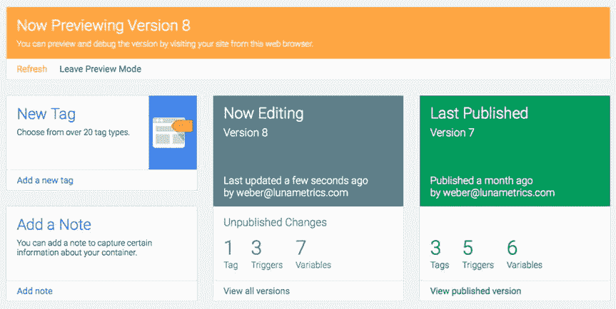
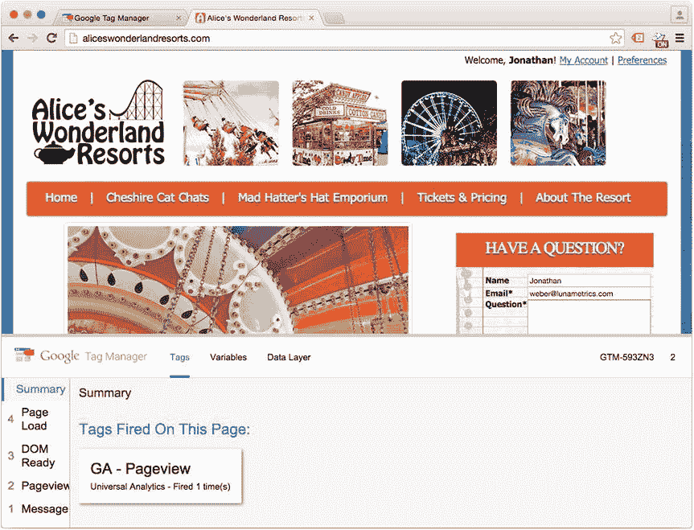
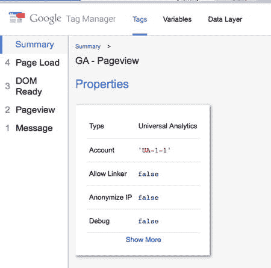
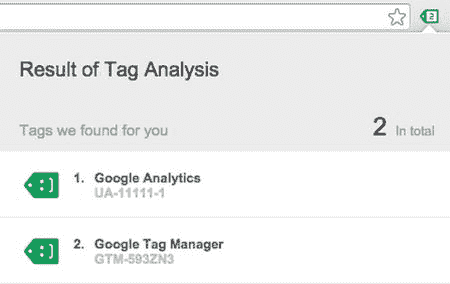
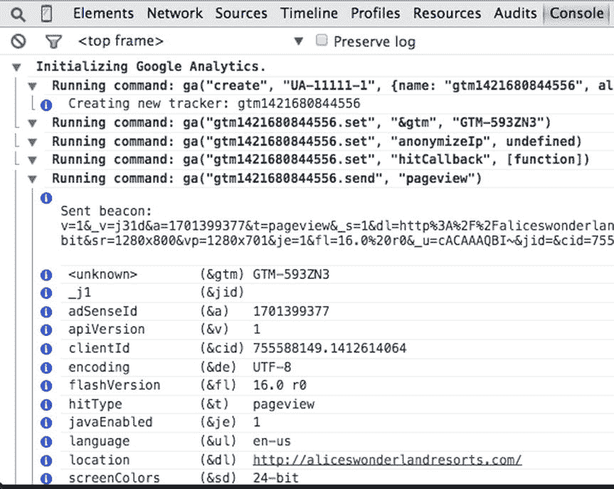
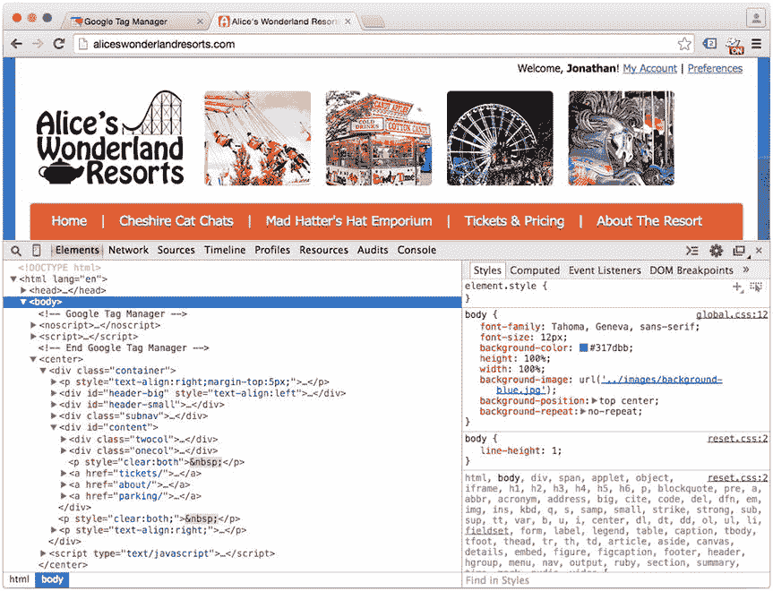
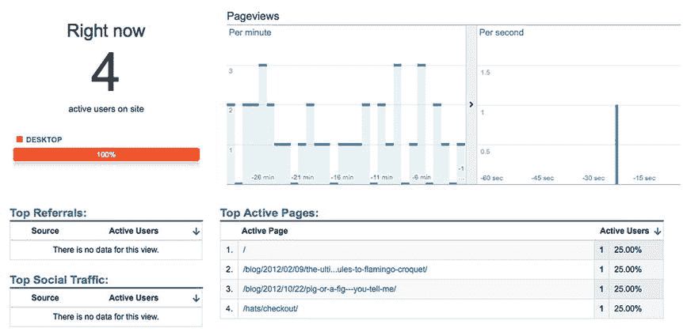

# 4. 测试你的实施

> 她通常给自己很好的建议，（虽然她很少遵循）。——刘易斯·卡罗尔，《爱丽丝梦游仙境》

Google Tag Manager (GTM) 中的“发布”按钮确实很诱人，但你应该在点击它之前了解你将要做什么。本章探讨 GTM 中的测试和发布过程，以及在 Google Analytics 中测试和评估数据准确性，以确保你已正确设置标签。

## 在 Google Tag Manager 中发布

你可以在容器中设置一组标签、触发器和变量。在你使用 Tag Manager 的发布流程部署它们之前，GTM 不会在网页加载时将它们包含在容器中。你必须显式选择发布你的更改，它们才会生效。

容器概览始终包含关于当前草稿、已发布版本以及两者之间有多少标签、触发器和变量发生了变化的信息。当你准备好测试你所做的更改时，应该首先在网站上预览它们，然后再发布。

### 预览与调试模式

你可以通过点击右上角 `Publish`（发布）按钮下的下拉菜单，选择 `Preview`（预览）来进入 GTM 的预览模式。

在容器概览页面，你会看到一个横幅，提示你已进入预览模式（见图 4-1）。在后台，GTM 设置了一个 Cookie，因此只有你的浏览器会接收到你配置的新标签、触发器和变量，而网站的所有其他访问者将继续看到之前发布的版本。这是理解预览模式最重要的一点：它在你的在线网站上生效，但仅对你个人可见。

图 4-1. 指示预览模式的 Google Tag Manager 容器概览

现在你可以访问你的网站，查看 GTM 正在做什么。当网站加载时，GTM 的预览模式会在页面底部添加一个调试面板，其中包含关于该页面哪些标签触发了（以及哪些未触发）的信息（见图 4-2）。

图 4-2. 预览模式下网站上的 Google Tag Manager 调试面板

> **注意：** 某些类型的广告拦截软件可能会阻止 GTM 的调试面板加载。如果进入预览模式后没有看到调试面板，请在浏览器中为你的网站禁用这些工具，然后重试。

你可以点击某个标签，查看其由 GTM 填充的属性的更多信息，以及导致其触发的触发器（见图 4-3）。

图 4-3. GTM 调试面板中可查看的详细信息

> **注意：** 你还可以利用调试面板顶部的其他标签页，查看页面上推送到数据层的变量值和消息。在第 5 章中，你将探讨如何使用这些功能来衡量更多的交互。

每次在 GTM 中进行更改时，在发布之前，你应该使用预览模式检查这些更改，并确保你的标签在你期望的时候触发（并且在不期望的时候不触发）。请记住，预览模式仅影响你在浏览器中看到的内容，而不影响访问你网站的其他用户看到的内容。

如果在预览模式下对 GTM 进行了更改（例如修改了标签或触发器），请选择 `Refresh`（刷新）以更新你的网站。你可以随时通过选择 `Leave Preview Mode`（离开预览模式）退出预览模式。这两个选项都位于 GTM 顶部的预览模式横幅中。

除了 GTM 的调试面板之外，还有一些其他浏览器工具可用于查看页面上包含的 GTM 和 GA 代码，你将在本章稍后部分进行了解。

### GTM 与开发、测试和暂存站点

除了 GTM 的预览模式所启用的测试功能外，你可能已经通过网站的开发、测试或暂存版本，建立了测试网站更新的额外流程。在某些情况下，GTM 允许你跳过此流程，直接使用 GTM 的预览工具，因为你可以通过 GTM 部署更改，而无需修改网站的源代码。然而，对于伴随网站内容本身变更的 GTM 更改和添加，你需要确保在这些测试站点上一切正常，然后再通过常规流程将其投入生产环境。

无论你当前的测试设置如何，GTM 的预览工具都能为你提供额外的保障，确保代码在发布到你的在线生产网站时能够正确运行。但是，所有这些工具只有在使用时才有效。不要直接跳过，直接点击 `Publish`（发布）按钮，并将 GTM 用作逃避测试的方法。全面的测试可以确保 GA 和其他分析工具中的测量数据准确无误，更重要的是，确保网站不会对用户造成故障。

第 8 章将讨论在 GA 中分离生产环境与测试环境数据的一些最佳实践，以及使用 GTM 最有效地做到这一点的技巧和窍门。

## 发布你的容器

如果你对预览模式中看到的结果满意，就可以准备发布更改，使其对网站的所有浏览者生效。

要发布，请点击 `Publish`（发布）按钮。GTM 会指示当前发布版本中正在更新的更改，然后要求确认。一旦确认，GTM 就会将更改发布到网站上。

### 版本管理

每次发布容器时，GTM 都会创建一个新版本。版本是容器标签、触发器和变量的固定快照，按顺序编号。虽然容器概览总是显示当前的草稿内容，但它也提供了查看当前已发布版本（右侧）或查看所有先前版本列表（中间）的功能。你还可以在顶部导航的 `Versions`（版本）标签页中查看所有版本的列表。

先前版本的列表包括关于版本创建和发布时间以及发布者的信息。通过选择一个版本，你可以查看该版本更详细的修订跟踪记录和发布历史，以及其包含的标签、触发器和变量。

你可以在 `Actions`（操作）下拉菜单（位于列表中条目右侧，或版本详细信息中右上角）中为版本命名并记录备注。命名版本会除了版本号之外，还添加一个描述性标签（例如“添加了 GA 标签”）。添加备注可以对更改或详细信息进行更广泛的描述。

对于任何版本，你都可以选择 `Preview`（预览）、`Publish`（发布）或 `Edit as a New Version`（作为新版本编辑）。这允许你在意外发布了某些不能正常工作的内容时，回滚到容器先前的工作版本。你还可以 `Share Preview`（共享预览），这使得你可以向其他人发送一个链接，让他们在自己的浏览器中查看预览版本。请记住，预览模式使用 Cookie，并且仅在你的浏览器中显示。可共享的链接允许其他人查看相同的内容。

最后，如果需要，你可以删除一个版本。已删除的版本将被永久移除，因此仅当需要移除损坏的版本或阻止其重新发布到网站时，才应执行此操作。

GTM 的版本管理工具能够很好地记录在 GTM 中执行的操作以及更改发布到网站的时间，并在出现问题时提供快速回滚更改的能力。

你还可以在不发布的情况下，利用容器概览上 `Publish`（发布）按钮的下拉菜单，从当前草稿创建一个版本。这允许你为已取得的进展创建已保存的检查点，而无需立即发布。

## GA 故障排除工具

GTM 的调试面板（在前面的章节中已描述）有助于了解 GTM 中哪些标签何时触发，包括用于 GA 的标签。然而，有时你希望确切了解发送到 GA 的信息究竟是什么，无论是针对已发布版本的 GTM 容器还是预览版本的 GTM 容器。

以下部分提供了各种工具的建议，这些工具可以帮助你深入了解你的标签如何工作。由于 Google 专门为 Chrome 浏览器提供了几个工具，因此主要关注 Chrome 浏览器，但所有浏览器都提供类似功能，本文也将讨论其他浏览器的选项。

### Chrome Tag Assistant

最直观的页面标签检查工具是 `Tag Assistant`，这是谷歌为 Chrome 浏览器提供的一款扩展程序，可快速查看页面上包含哪些 GA 标签及其功能。它会在 Chrome 工具栏上安装一个图标，其中包含与当前浏览器正在查看的页面中植入的谷歌相关跟踪标签的信息，例如 `GTM`、`GA`、`AdWords` 和 `DoubleClick` 标签。

点击 `Tag Assistant` 图标（见图 4-4）会显示标签的详细信息，例如 `GTM` 的容器 ID 或 `GA` 的属性 ID，如果标签的植入方式不符合标准或似乎无法正常运行，还会显示相关建议或警告。

图 4-4. Chrome 的 Tag Assistant 扩展程序

`Tag Assistant` 是一种简单的方法，用于检查页面是否包含谷歌标签，以及正在使用哪个 `GTM` 容器或 `GA` 属性来跟踪页面。

### Google Analytics 调试模式

为了查看由 Google Analytics 收集和发送的数据的更多信息，`GA` 拥有自己的调试模式。启用 `GA` 调试模式后，会将 `GA` 执行的操作信息打印到 JavaScript 控制台（即浏览器中跟踪 JavaScript 警告、错误和消息的日志）中。

#### 启用 GA 调试模式

有两种方法可以启用 `GA` 的调试模式：修改 `GA` 跟踪代码（通过 `GTM` 标签），或使用 Chrome 浏览器扩展程序。在 `GTM` 中修改 `GA` 标签需要发布容器的新版本才能生效，而使用扩展程序则可以随时打开和关闭调试模式（仅限您自己的浏览器）。

-   修改 `GTM` 中的 `GA` 标签。在 `GTM` 的 `GA` 标签中，进入`更多设置` ➤ `高级配置`部分，有一个标记为`使用调试版本`的设置。将此选项设置为`True`即可启用 `GA` 的调试模式。虽然您也可以始终将此选项设置为 `True`，但请注意，这会为网站的所有访问者启用 `GA` 的调试模式（尽管除非访客查看其浏览器的 JavaScript 控制台，否则他们不会看到任何不同）。更好的解决方案是在 `GTM` 中使用 `{{Debug Mode}}` 变量，该变量仅在 `GTM` 处于本章前面讨论的预览模式时为 `True`。（在 `GA` 标签中使用此变量之前，您需要先启用它。）当然，您需要发布容器才能使修改后的标签生效。

-   使用 `GA Debugger Chrome 扩展程序`。如果您使用 Chrome 作为浏览器，可以安装 `GA Debugger 扩展程序`，它允许您在正在查看的任何网站上开启 `GA` 调试模式。与前面描述的 `Tag Assistant` 扩展程序类似，此扩展程序会在 Chrome 工具栏中安装一个图标，允许您打开和关闭 `GA` 调试模式。只需单击图标即可开启（这将重新加载浏览器窗口中的当前页面）。再次单击即可关闭。使用扩展程序可以随时进行故障排除，无需进入 `GTM` 的预览模式或发布对容器的更改。

## 查看 GA 调试信息

一旦通过这两种方法之一启用了 `GA` 调试模式，您就可以通过 JavaScript 控制台查看 `GA` 收集和发送了哪些数据的信息。

在 Chrome 中，您可以通过 Chrome 菜单中的`更多工具` ➤ `JavaScript 控制台`访问控制台。（您也可以在`视图`菜单的`开发者`下找到它，或者在 PC 上按 `Ctrl+Shift+J`，在 Mac 上按 `Cmd+Opt+J`。）在其他浏览器中，请查看您的文档以了解访问 JavaScript 控制台的菜单项或键盘快捷键。

控制台包含 JavaScript 错误、警告和消息。`GA` 的调试模式会打印多条关于 `GA` 执行的命令的消息（见图 4-5）。

图 4-5. 在启用 `GA` 调试模式的情况下查看 JavaScript 控制台

“`Sent beacon`”消息表示 `GA` 在执行 `send` 命令后发送了一个跟踪匹配。该消息下方是匹配中包含的数据的细分。这可以确认已从包含在 `GTM` 中的 `GA` 标签发送到 `GA` 的任何数据。

## 其他浏览器工具

除了前面章节中介绍的专门用于 `GTM` 和 `GA` 的工具外，浏览器还包含许多通用的 Web 开发工具，可用于查看页面中包含的 `GA` 和 `GTM` 脚本、`GA` cookie 以及生成的 `GA` 跟踪匹配。

在 Chrome 中，除了`控制台`标签页外，开发者工具还包括一个 HTML 文档的可浏览树（`元素`标签页；见图 4-6）、当前页面包含的脚本列表和设置的 cookie 列表（`资源`标签页），以及浏览器窗口发出的传出请求和收到的响应列表（包括 `GA` 跟踪匹配，位于`网络`标签页中）。

图 4-6. Chrome 的开发者工具

Internet Explorer、Firefox 和 Safari 都包含与 Chrome 类似的开发者工具。请查看您浏览器的文档以了解访问这些工具的菜单项和键盘快捷键。

## Google Analytics 实时报告

基于浏览器的工具可以检查页面中是否包含合适的跟踪代码以及它发送了什么数据。您还可以查看由 `GA` 接收的跟踪数据。

`GA` 中的大多数报告都需要一些时间来计算，因此并非即时更新，但实时报告会在 `GA` 收到数据的同时显示实时数据流。您可以访问您的网站，查看一个页面或触发一个事件，然后查看数据出现在实时报告中（见图 4-7）。

图 4-7. `GA` 中的实时报告有助于确保在测试期间接收到数据

这些报告涵盖多种数据，但两个对故障排除最有用的报告是`内容`报告（显示 `GA` 收到的页面浏览量）和`事件`报告（显示 `GA` 收到的事件）。这些报告在第 5 章中尤为有用，该章将讨论如何衡量页面内的其他互动，例如链接点击。

## 总结

-   Google Tag Manager 的预览模式允许您在将新标签、触发器和变量发布到网站供所有人使用之前，在您的 Web 浏览器中查看它们的效果。`GTM` 会在您网站的页面中加载一个调试面板，其中包含哪些标签被触发的信息。

-   您在 `GTM` 中所做的更改在发布之前不会在您的网站上生效。发布时，`GTM` 会为您的容器内容创建一个编号版本。您可以命名版本并记录备注以记录所做的更改，如果您需要恢复到容器的早期状态，也可以发布一个版本。

-   除了 `GTM` 的预览工具之外，还有许多浏览器工具可以帮助检查代码、cookie 和跟踪匹配。`Tag Assistant` 和 `GA Debug Chrome` 扩展程序尤其有用，您还可以使用浏览器的开发者工具和 `GA` 的实时报告来验证标签是否成功发送了数据。