# 5. 使用 Google Tag Manager 追踪互动

> “爱丽丝开始觉得，真正不可能的事情确实少之又少。” ——刘易斯·卡罗尔，《爱丽丝梦游仙境》

除了衡量页面浏览量的基本功能外，您通常还希望使用 Google Analytics 追踪页面内的其他互动。这些互动可能包括点击页面元素，例如下载链接或外部网站链接、与嵌入视频的互动，或页面上的社交媒体按钮。本章将讨论如何使用 Google Tag Manager 收集这些类型的互动数据并将其发送到 Google Analytics。

## 在 Google Analytics 中追踪互动

回想一下，基本的 Google Analytics 标签会捕获页面浏览量。页面浏览量只是 GA 可以收集的多种数据类型中的一种点击类型。除了页面浏览量点击类型外，还有事件和社交这两种额外的点击类型可用于收集其他类型的互动。（还有其他类型，例如移动应用的屏幕浏览和异常类型，以及电子商务的交易和商品类型，这些将在后续章节中介绍。）

事件和社交点击类型彼此类似。事件点击类型用于页面内的任何类型的互动，而社交点击类型则专门用于社交媒体互动。每种类型都会出现在其各自的报告中（事件出现在 GA 的“行为”报告中，社交出现在“获客”报告中）。让我们首先关注事件，稍后在本章中再讨论社交互动。

要向 GA 发送事件，可以使用以下 JavaScript 命令：

`ga('send', 'event', 'category', 'action', 'label', value, {'nonInteraction': false});`

您会看到有多个信息片段用于描述该事件：

* `类别`是必填项，代表一种对您的网站中类似类型事件进行分组的方式。例如，您可能有“下载”、“站外链接”和“视频”等类别。

* `操作`也是必填项，描述该类别内的互动。例如，“视频”类别可能包含“播放”、“暂停”或“完成”等操作。

* `标签`是一个可选的文本字段，用于进一步描述事件。

* `值`是一个可选的整数，用于描述事件。该值没有特定的单位，可以是美元、秒数、游戏中的积分，或任何适合描述该事件的数字。

* 最后，`非互动参数`控制该事件是否影响跳出率。默认情况下，此参数为`false`，这意味着如果用户着陆到某个页面并触发了一个事件，那么该会话将不再被视为跳出（如果事件代表用户互动，这通常是期望的行为）。通过将其设置为`true`，该事件不再计为一次互动，除非发生其他互动，否则该会话仍被视为跳出（例如，对于页面加载时自动发生的事件，如自动播放的视频，这可能是期望的行为）。

类别、操作和标签在 GA 中作为维度出现，而值作为指标出现。这些维度和指标出现在 GA“行为”部分的“事件”报告中，您通过事件代码发送的任何数据都会显示在您的 GA 报告中。因此，为事件设计合理且一致的命名约定非常重要。本章中的示例提供了许多关于如何命名事件的建议，但您应该以对 GA 用户最有用且最易于理解的方式进行命名。

当然，GTM 包含一个内置标签来引入 GA 的事件追踪代码，就像您的页面浏览量追踪一样。在 GTM 标签中，您仍然可以指定相同的参数（类别、操作等）。

## 在 GTM 中创建基本的 GA 事件标签

您可以按照以下步骤在 GTM 中添加 GA 事件标签：

创建一个新标签。选择 **Google Analytics ➤ Universal Analytics** 作为标签类型。与页面浏览量标签中的操作一样，您需要填写**跟踪 ID**，使用先前创建的 `{{GA Property ID}}` 变量（请参阅第 3 章）。选择**跟踪类型 ➤ 事件**。您会注意到这会显示类别、操作、标签、值和非互动的输入字段（见下方截图）。

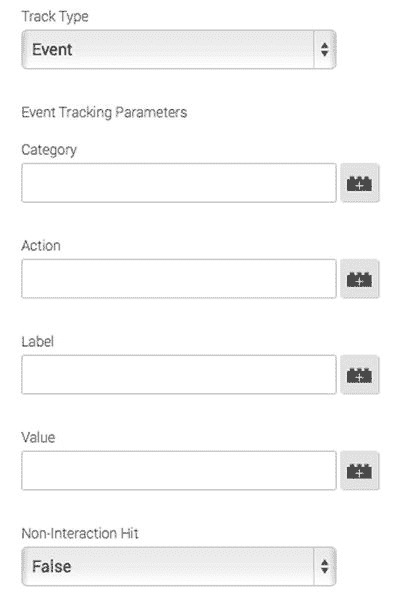

目前，您可以通过直接在事件字段中输入值来填写。在大多数情况下，您将使用变量从页面中填充相关信息。这将是本章的一个关键主题。选择**继续**进入下一步。接下来，选择标签的**触发器**。您可以暂时跳过触发器。选择正确的触发器将是本章的另一个关键主题。选择**创建标签**按钮保存标签，并为其命名：“GA – 事件”。

这就是基本流程。在本章的其余部分，您将了解用于填写空白字段的变量和触发器，以及它们如何与衡量您网站上的特定操作相关联。

## GTM 事件跟踪的设计模式

事件跟踪的标签本身很简单。关键在于创建正确的触发器（用于指定标签何时触发）和变量（用于捕获关于发生了何种交互的正确信息，并填写类别、动作和其他信息）。本章将探讨使用 GTM 进行事件跟踪的几种通用设计模式，然后介绍一些最常见的需要跟踪的项目的具体示例。

GTM 中有几种事件跟踪方法，因为你可以自行决定有多少代码由 GTM 处理，又有多少代码包含在页面本身中。哪种方法适合你，取决于你的能力以及你在网站页面或模板中添加或修改代码的权限级别。

所有这些方法都利用了 GTM 的数据层。除了在页面加载时在数据层中设置信息（如第 3 章所述）之外，你还可以随时向数据层发送额外的消息，这就是 GTM 中触发页面内事件的方式。你可以使用以下代码向数据层添加有关交互的信息：

```
dataLayer.push({'event': 'event-name'});
```

这段代码会向数据层添加一条新消息，或者说一个属性列表。`event` 属性被 GTM 用于触发标签。你需要为你页面上发生的不同事件命名，并使用这些名称来触发你的标签。你可以包含带有事件详情额外属性，以便向 GTM 变量传递更多信息，你将在本章的示例中看到这一点。

因此，数据层由关于页面上发生的不同事件的一系列顺序消息组成。实际上，GTM 会创建几个自己的事件（其名称均以 `gtm` 为前缀）。这些 GTM 事件包括：

- `gtm.js`（在调试面板中标记为“Pageview”）是数据层中的第一个事件，在 GTM 容器加载后立即发送。这是基于页面触发的标签（例如你的 GA 页面浏览标签）的默认事件。

- `gtm.dom`（在调试面板中标记为“DOM ready”）在 DOM 准备就绪时发送。这意味着你的浏览器已经加载了 DOM 的结构，但不一定所有页面内容都已加载或渲染完成。

- `gtm.load`（在调试面板中标记为“Page Load”）在页面（包括图片、脚本和其他内容）在浏览器中完全渲染时发送。

GTM 的调试面板（见第 4 章）会显示推送到数据层的所有消息，以及消息推送后所有变量的当前值。你可以点击左侧列表中的事件，然后选择顶部的“Variables”或“Data Layer”选项卡来查看此信息（见图 5-1）。

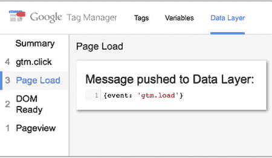

图 5-1. 在 GTM 调试面板中查看变量和数据层消息

## 边栏：JavaScript 和 DOM 事件

第一个挑战是在合适的时间触发标签：通常是在用户在浏览器中点击页面中的某个内容时。

幸运的是，JavaScript 允许你在页面内几乎任何用户操作发生时调用一个函数。浏览器使用一种称为文档对象模型（DOM）的约定来表示页面内容，并允许 JavaScript 与该内容进行交互。DOM 允许你访问页面中的某个特定元素（链接、按钮、表单字段等），并在某个特定事件发生（点击链接、在表单字段中输入文本）时调用一个 JavaScript 函数。DOM 包含了用于鼠标交互、键盘交互等的事件。通常情况下，你最关心的会是点击事件，但你也会看到其他类型交互的示例。

在点击时调用 JavaScript 的最简单示例如下所示：

```
<a id="link1" href="/some/link" onclick="someFunction();">Click me</a>
```

你可以使用相关元素上的属性来调用 JavaScript 函数。在此例中，当用户点击此链接时，会调用 `someFunction()`。

你也可以使用事件监听器将点击事件添加到元素上，事件监听器是你在页面其他位置添加的一个函数，通过元素的 id、在 DOM 中的位置或其他属性来定位该元素。

```
<script>
document.getElementById('link1').addEventListener('click', someFunction);
</script>
```

GTM 在其内置的自动事件跟踪中使用了 DOM 及其事件。如果你需要通过自定义 JavaScript 超越 GTM 的自动事件跟踪能力，那么理解 DOM 将会很有用。

本章的几个示例都使用了这些技术，并且通过 JavaScript 与 DOM 交互是你应该培养的一项有用技能，以便扩展和调整这些示例。由 Russ Ferguson 和 Christian Heilmann 合著的 *Beginning JavaScript with DOM Scripting and Ajax*（Apress, 2013 年出版）是该主题的逐步入门指南，也是一个极佳的起点。

### 设计模式 1：GTM 的自动事件跟踪

# 使用GTM进行自动事件追踪

第一种设计模式利用`GTM`的特性，将代码从页面迁移至`GTM`。在许多情况下，你可以使用`GTM`的自动事件跟踪功能来追踪页面交互，而无需在页面上添加任何额外代码。

`GTM`内置了监听点击、表单提交、错误等事件的功能。你可以通过一组内置变量和易于配置的触发器来设置这些功能，无需添加自己的JavaScript代码。这种方法的优势在于减少或消除对在网站中添加代码的依赖。

在`GTM`中创建标签时，系统会提示你从图5-2所示的类型中选择一个触发器。

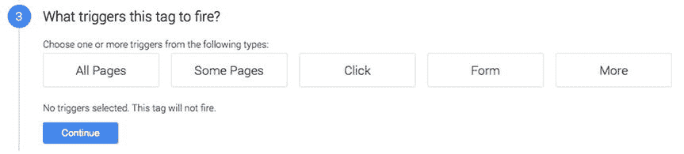

**图5-2.** 创建标签时的触发器类型选择

你之前曾使用`All Pages`触发器为`GA`创建了页面浏览跟踪标签，而`Some Pages`则允许你仅在部分页面上触发标签。`Click`和`Form`触发器选项使你能够跟踪这些类型的交互（最常见的），而选择`More`按钮则会提供更多选项。（本章主要关注`Click`触发器，但也会讨论`Custom Event`和`Timer`触发器。`Form`和`History Change`触发器将在第6章中作为跟踪目标转化漏斗的一部分进行介绍。）

这些触发器利用`GTM`的内置功能在你的网站上部署事件监听器，你无需编写任何代码即可启用它们。

除了触发器之外，还有一些变量对应于所收集到的信息，例如被点击的元素、被提交的表单等。这些内置变量可以启用或禁用，你需要确保在使用相应的触发器类型之前启用了相关变量。

对于点击事件，`GTM`提供了许多变量：

*   `{{Click Element}}`变量返回从DOM中点击的整个HTML对象，包括其所有属性。

*   `{{Click Classes}}`和`{{Click ID}}`返回元素上`class`和`id`属性的值（如果有的话）。

*   `{{Click URL}}`包含链接元素的目标地址（`href`属性）。

*   `{{Click Target}}`包含`target`属性的值（例如，`target="_blank"`用于在新窗口/标签页中打开链接）。

*   `{{Click Text}}`包含元素的文本内容。

假设点击了以下链接。`GTM`的自动事件变量将具有表5-1中列出的值。

**表5-1.** 示例链接的内置点击变量值

| 变量 | 值 |
| --- | --- |
| `{{Click Element}}` | HTML对象 |
| `{{Click Classes}}` | `button` |
| `{{Click ID}}` | `link1` |
| `{{Click URL}}` | `http://example.com` |
| `{{Click Target}}` | `_blank` |
| `{{Click Text}}` | `点击我！` |

```
<a id="link1" class="button" href="http://example.com" target="_blank">点击我！</a>
```

### 在GTM中创建基本点击触发器

让我们来看一下在`GTM`中添加点击触发器的基本流程。

1.  在左侧导航栏的`Triggers`（触发器）部分，选择`New`（新建）按钮创建一个新触发器。
2.  对于触发该触发器的事件，选择`Click`（点击）。
3.  选择该触发器是适用于所有元素的点击，还是仅适用于链接的点击（见下方截图；此选择的更多详情请参见下一节）。然后选择`Continue`（继续）按钮。

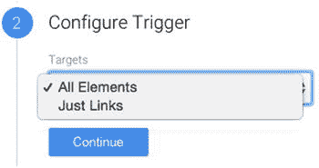

4.  （可选，如果选择了`Just Links`）选择筛选启用此触发器的页面。然后选择`Continue`（继续）按钮。
5.  选择监听`All Clicks`（所有点击）（通常不会希望在所有点击上都触发同一个事件）或`Some Clicks`（部分点击），后者允许你指定一个或多个筛选条件。筛选条件可以基于前面描述的点击变量，或者你在`GTM`中拥有的任何其他变量（见下方截图）。本章将展示各种示例。

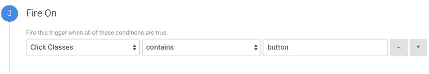

6.  保存触发器，为其指定一个描述其匹配条件的名称，例如`“Clicks – Button Links”`（点击 – 按钮链接）。

#### 所有元素与仅链接目标类型

当你创建`Click`（点击）触发器时，有一个目标类型选项，包含两个选择：`“All Elements”`（所有元素）和`“Just Links”`（仅链接）。选择`All Elements`允许你监听页面中任何元素的点击，而`Just Links`仅适用于链接（`<a>`元素）。

为什么`GTM`要区别对待它们？打开链接通常会在浏览器窗口中替换当前页面，这意味着当前页面中正在执行的任何JavaScript都会被中断。（对于在新窗口中加载的链接，或仅在同一页面中触发标签页、模态弹出窗口或其他内容的链接而言，这不是问题，但它确实会影响任何在同一浏览器窗口中替换当前页面的内容，例如指向网页或PDF的链接。）JavaScript的中断可能意味着，当链接的目标页面开始加载时，你的跟踪标签会被阻止执行。为了解决这个问题，`Link Click`（链接点击）触发器提供了一个额外选项（见图5-3），可以延迟链接跳转，直到标签执行完毕或经过一个较短的最长时间（以先发生者为准；默认2秒）。

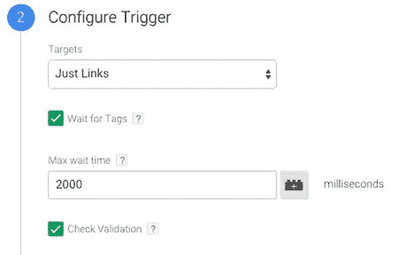

**图5-3.** 链接点击的额外配置选项

对于链接的点击，还可以限制监听器处于活动状态的页面（图5-4）。由于`“Just Links”`选项可能会临时中断点击链接所产生的其他操作，因此你应该在发布前格外小心地进行测试，以确保此行为不会影响你网站的功能。此选项允许你将触发器限制在仅需要它且经过充分测试的页面上。

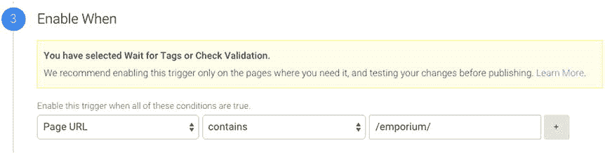

**图5-4.** 限制启用链接点击触发器的页面

## 自动事件追踪的机制

`GTM`在这些自动事件追踪触发器中的实际作用非常简单。它为DOM添加了事件监听器，当事件发生时，它会执行`dataLayer.push`操作，并推送一系列相关信息，用于填充之前描述的变量。以下是`GTM`自动事件的数据层消息示例：

```
dataLayer.push({
  'event': 'gtm.click',
  'gtm.element': 'http://aliceswonderlandresorts.com',
  'gtm.elementClasses': 'button',
  'gtm.elementId': 'link1',
  'gtm.elementUrl': 'http://aliceswonderlandresorts.com',
  'gtm.elementTarget': '_blank'
});
```

`GTM`的事件名称和属性均以`gtm`作为前缀，目的是将它们与你可能推送到数据层的任何事件区分开，防止命名冲突。除`gtm.element`外，所有值均为字符串类型，而`gtm.element`则包含被点击的完整HTML对象。

与任何其他数据层消息一样，在预览模式下，你可以在`GTM`的调试面板中看到这些信息。

## 侧边栏：ID、类名与可追踪性设计

能够使用`GTM`在页面内容中找到你想要追踪的元素，这一点非常重要。实现这一目标的最简单方法是提供一些描述符，用以帮助识别正确的元素。`class`和`id`属性是最有用的描述符之一。

`class`和`id`属性是DOM的重要组成部分。一个元素可以拥有一个`id`，该`id`在页面内必须是唯一的（仅适用于该元素）。它还可以拥有一个或多个`class`，这些类名代表特定类型的元素。多个元素可以拥有相同的`class`，而一个元素也可以同时属于多个`class`（用空格分隔）。

`GTM`提供了`{{Click ID}}`和`{{Click Class}}`变量，它们可以成为选择正确元素的简便方法。如果没有这些属性或其他属性（如链接URL）来帮助你选择正确的元素，作为最后手段，你将不得不这样指示`GTM`：在`id=content`的`<div>`中，找到第二个`<ul>`里的第三个`<li>`中的`<a>`元素。你可以看到，如果页面内容发生变化，这种方法是多么脆弱且容易失效。请确保你的站点模板结构足够完善，以便无需依赖这些方法就能选择到你想要的元素。

## 设计模式 2：GTM 中的自定义 JavaScript

自动事件追踪功能很强大，但它仅适用于特定情况。如果你希望在 GTM 支持的范围之外追踪某些事件，则必须使用一些自定义 JavaScript 来处理。一种选择是将该 JavaScript 包含在你的站点中（请参见接下来的“设计模式 3”部分）。不过，更好的做法是，你可以将自定义 JavaScript 包含在 GTM 内部的标签和变量中，这样你就可以在 GTM 中管理它们，而无需在站点上添加或修改代码。

GTM 允许你通过两种不同的方式包含自定义 JavaScript 代码：

*   自定义 HTML 标签可以包含一个 `<script>` 标签，该标签可以执行你想要的任何 JavaScript 函数。你可以添加事件监听器、添加或更改元素，以及向数据层推送事件。
*   自定义 JavaScript 变量可以返回一个值，例如，当你需要从 DOM 中获取某个元素或属性、测试某个元素是否可见等情况时。

在本章的示例中，你将同时用到这两个工具。这些工具将允许你为 GTM 自动事件追踪无法覆盖的交互创建自定义事件监听器。在这些示例中，掌握一些 JavaScript 和 DOM 知识会非常有用（有关更多信息，请参见本章前面的侧边栏）。

#### 侧边栏：JavaScript 高手的进阶技巧

如果你已经是一位熟悉 JavaScript 的开发人员，那么这种设计模式正合你意。它为你提供了包含自定义 JavaScript 的全部灵活性，同时兼具在 GTM 中进行版本控制和测试的优势。以下是一些建议。

对于你在 GTM 中包含的代码，请遵循 JavaScript 最佳实践，例如：将自定义 HTML 标签中的脚本包装在匿名函数中；在使用变量（如 `dataLayer`）之前先检查其是否存在。如果有多个独立开发者可能向站点添加 JavaScript，这些做法尤其有助于避免冲突。

此外，请记住依靠 GTM 的功能，而不是用 JavaScript 重新发明或将其复杂化。例如，使用内置的点击监听器，而不是通过 `addEventListener()` 来附加事件；并且为了明确触发器的含义，请使用 `gtm.js` 或 `gtm.dom` 事件，而不是在标签中使用依赖 `window.onload` 或其他方法的代码。

## 设计模式 3：站点代码中的显式数据层事件

GTM 中事件跟踪的最后一个设计模式，是在页面上通过代码显式指定事件的类别、操作及其他数据。

```html
<a onclick="dataLayer.push({'event': 'customEvent', 'eventInfo': {'category': 'Button', 'action': 'press'}})">...</a>
```

这里指定了事件名称 (`'customEvent'`)，以及你想要发送到 Google Analytics 的类别和操作。这对于站点的开发者来说非常灵活，因为你只需要在 GTM 中设置一个事件跟踪代码，就能处理多种不同的可能性。其缺点在于，你需要通过直接添加代码的方式，将事件信息添加到页面中。

**注意**：尽管此示例使用内联的 `onclick` 属性来调用 `dataLayer.push()` 函数，但该代码也可以用在事件监听器或站点上的任何其他现有 JavaScript 代码中。

如果你站点上已有 GA 事件跟踪代码，并且正在迁移到 GTM，同时只希望对现有代码进行简单修改以处理这些旧事件，那么这种方法效果很好。例如，你的代码可能原本是这样的：

```javascript
ga('send', 'event', 'Button', 'press');
```

只需将其简单更改为以下内容即可：

```javascript
dataLayer.push({
  'event': 'customEvent',
  'eventInfo': {
    'category':'Button',
    'action': 'press'
  }
});
```

这种方法并不能让你充分享受到 GTM 的全部好处（在 GTM 内管理和测试代码），因为你直接将代码包含在页面中了。不过，这种模式也有不少优点。它为你提供了一条快速简便的途径，将站点上的现有事件代码更新为使用 GTM。同时，它也对开发者友好，意思是如果你的开发人员编写站点代码，他们可以轻松添加事件，而无需与 GTM 交互。显然，在将控制权集中到 GTM 和为站点开发者提供灵活性之间存在一个权衡。

有了站点上的这段代码，你就可以创建 GTM 代码、触发器和变量，将数据发送到 GA。

### 创建通用事件代码

假设你的站点上有如下形式的脚本：

```javascript
dataLayer.push({
  'event': 'customEvent',
  'eventInfo': {
    'category':'someCategory',
    'action': 'someAction',
    'label': 'someLabel',
    'value': 0,
    'nonInteraction': false
  }
});
```

首先，你需要为每个事件数据输入项（类别、操作、标签、值和非交互）创建变量。

在左侧导航的**变量**部分，选择**新建**按钮来创建一个新的用户定义变量。对于变量类型，选择**数据层变量**。在**数据层变量名称**字段，输入 `eventInfo.category`（对应于前面代码中的名称）。保存变量，为其命名，例如“自定义事件类别”。对 `eventInfo.action`、`eventInfo.label`、`eventInfo.value` 和 `eventInfo.nonInteraction` 重复此操作。

现在，你可以创建代码和触发器，使用这些变量将事件发送到 GA。

创建一个新代码。选择 **Google Analytics** ➤ **通用 Analytics** 作为代码类型。在**跟踪 ID** 字段中填入你之前创建的 `{{GA Property ID}}` 变量。选择**跟踪类型** ➤ **事件**。在**类别**、**操作**、**标签**、**值**和**非互动**各个字段中，分别输入你之前创建的对应变量（参见下面的截图）。然后选择**继续**按钮。

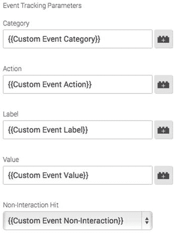

对于触发器，选择**更多**，这会显示一个现有触发器的列表。要创建一个新触发器：点击**新建**按钮。选择**自定义事件**作为触发触发器的事件。自定义事件允许你使用任何 `event` 名称在 `dataLayer.push()` 时触发。在**要匹配的事件名称**字段，输入 `customEvent`（对应于前面代码中的名称）。选择**创建触发器**按钮，为触发器命名：“自定义事件 – 点击”。GTM 会保存触发器并返回创建代码的界面。保存代码，为其命名：“GA – 事件 – 自定义”。

现在，每当发生包含 `'event': 'customEvent'` 的 `dataLayer.push()` 调用时，此代码就会被触发，使用代码中指定的 `eventCategory`、`eventAction` 及其他值向 GA 发送一个事件。

## 互动跟踪的应用

在了解了这三种设计模式之后，你现在可以看看 GTM 中跟踪的一些具体应用。作为指导原则，你将坚持使用 GTM 的自动事件跟踪（设计模式 1），并对自动事件跟踪未涵盖的情况使用 GTM 内的自定义 JavaScript（设计模式 2）。第三种设计模式始终作为备选方案存在，以备不时之需，但本章中的示例将避免使用它，而是倾向于那些将跟踪代码集中在 GTM 内、不依赖向站点添加代码的解决方案。

### 出站链接

我们先从 GA 中追踪事件最简单、最常见的场景之一开始：记录指向其他网站的链接点击。此类链接范围广泛，既可以是纯信息性链接，也可以是其他网站上的文章或内容，还可以是重要的联盟链接，或是导向与你有关联的第三方的渠道流量。在任何这些情况下，你可能都想知道谁点击了哪些链接，以及点击频率。

这个场景非常适合应用你第一个设计模式：使用 GTM 的自动事件追踪，因为这正是追踪链接点击的简单直接用法。

**注意：** GA 的网页浏览量追踪已经允许你查看用户在本次会话中浏览你网站内页面的顺序，所以你无需使用事件来追踪内部链接，除非你希望特别关注某些链接（例如，特定的促销链接，或动态轮播内容中特定位置的链接）。

你可以在触发器中使用 `Click URL` 变量，将目标仅限定为指向其他网站的链接。虽然你可以使用完整的点击 URL（包含完整网址，例如 `http://aliceswonderlandresorts.com/directions?location=wonderland`），但若能有一个仅提取主机名的变量（例如 `aliceswonderlandresorts.com`）会更方便。你可以通过设置一个额外的变量来实现这一点。让我们逐步完成整个过程。

#### 追踪出站链接

首先，创建 `Click URL Hostname` 变量。然后，你可以在创建标签和触发器时使用该变量。

## 出站链接跟踪

1. 在左侧导航中选择 `Variables`（变量）部分。然后选择 `New`（新建）按钮，创建一个新的用户自定义变量。

2. 对于变量类型，选择 `Auto-Event Variable`（自动事件变量）。

3. 对于变量类型，选择 `Element URL`（元素 URL）（见下方截图）。对于组件类型，不要选 `Full URL`（完整 URL）（这是内置变量已经具备的），而应选择 `Host Name`（主机名）。请注意，如果你愿意，还可以勾选移除前导的 `www.` 选项。

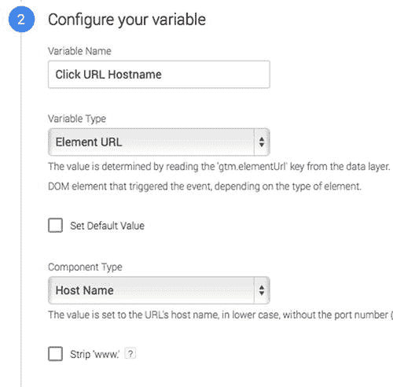

4. 保存变量，并将其命名为：`Click URL Hostname`。

现在你已经创建了变量，可以创建标签和触发器了。

1. 创建一个新标签。选择 `Google Analytics` ➤ `Universal Analytics` 作为类型。

2. 将之前创建的 `{{GA Property ID}}` 变量用于跟踪 ID。

3. 选择 `Track Type`（追踪类型）➤ `Event`（事件）。

4. 填写要发送给 GA 的 `Category`（类别）、`Action`（操作）和 `Label`（标签）。你需要根据自己的习惯选择在报告中希望看到的命名方式，但一个合理的选择可能是：
    * 类别：`Outbound Link`
    * 操作：`{{Click URL Hostname}}`（例如 `example.com`）
    * 标签：`{{Click URL}}`（完整网址，例如 `http://example.com/some-page.html`）

5. 选择 `Continue`（继续）按钮，为标签指定一个触发器。选择 `Click`（点击），然后选择 `New`（新建）按钮，创建一个新的点击触发器。

6. 选择 `Just Links`（仅链接）作为目标类型（这用于追踪在同一浏览器窗口中打开的链接；关于 `All Elements`（所有元素）和 `Just Links`（仅链接）触发器的区别，请参见本章前文讨论）。选择 `Wait for Tags`（等待标签）选项，并使用默认的最长两秒等待时间。

7. 如果需要，选择 `Continue`（继续）按钮，以筛选触发器启用的页面。如果你希望将该触发器限制为仅监听特定页面上的出站链接，可以使用条件或正则表达式来匹配某些页面。要在所有页面上监听，请使用正则表达式匹配任何 URL：`{{Page URL}} – matches RegEx – .*`

8. 选择 `Continue`（继续）按钮，选择触发条件。选择 `Some Clicks`（某些点击）。

9. 从下拉菜单中选择你创建的 `{{Click URL Hostname}}` 变量，然后选择匹配条件（见下方截图）。`{{Click URL Hostname}} – does not end with – aliceswonderlandresorts.com`

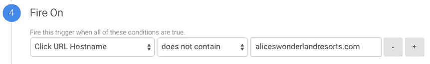

**注意：** 如有必要，你可以使用正则表达式匹配多个主机名（如果你在多个网站上使用同一个 GTM 容器）。

10. 选择 `Create Trigger`（创建触发器）按钮保存触发器，并将其命名为：`Click – Outbound Links`。GTM 会保存触发器并返回标签创建界面。

11. 保存标签，并将其命名为：`GA – Event – Outbound Links`。

### PDF 及其他下载文件

另一种常见的跟踪链接类型是任何指向可下载文件的链接（最常见的是 PDF，但指向非网页文件的链接也可跟踪）。

下载跟踪的流程将与上一节中的站外链接跟踪类似。您使用的 `Click URL` 变量将包含链接文件的文件名，您可以基于此变量使用某些条件（可能使用正则表达式）来触发您的标签。不过，仅提取文件扩展名（以便检查它是网页还是下载文件）可能会更方便。您可以创建一个变量来实现此目的。流程如下。

**跟踪下载链接**

首先，为 `Click URL File Type` 创建变量。然后使用该变量创建标签和触发器。

创建一个新变量。对于变量类型，选择“自定义 JavaScript”。以下是使用的代码¹：

```
function() {
  var clickUrlParts = {{Click URL}}.pathname.split('.');
  return clickUrlParts.length > 1 ? clickUrlParts.pop() : 'html';
}
```

此代码使用现有的 `{{Click URL}}` 变量，仅获取路径名部分（剥离域名、查询参数和锚点），查找点号（如果存在），并返回点号后的字符。如果没有点号（因此也没有文件名），则假定 URL 指向一个网页，并返回 `html` 作为文件类型。保存变量，并命名为：`Click URL File Type`。

**`{{Click URL File Type}}` 变量示例值**

| 链接 URL | 变量值 |
| --- | --- |
| `/alice/map.pdf` | `pdf` |
| `/alice/map.pdf?location=wonderland` | `pdf` |
| `/alice/index.html` | `html` |
| `/alice/` | `html` |

现在您已创建变量，可以创建标签和触发器了。

创建一个新标签。选择类型为 `Google Analytics` ➤ `Universal Analytics`。使用您之前创建的 `{{GA Property ID}}` 变量作为跟踪 ID。选择 `Track Type` ➤ `Event`。填写要发送到 GA 的 `Category`、`Action` 和 `Label`。您需要选择自己的命名惯例来确定希望在报告中如何查看这些内容，但一个合理的选择可能是：

- 类别：`Download`
- 操作：`{{Click URL File Type}}`（例如 `pdf`）
- 标签：`{{Click URL}}`（完整文件 URL，例如 `http://aliceswonderlandresorts.com/park-map.pdf`）

选择“继续”按钮，为标签指定触发器。选择“点击”，然后选择“新建”按钮以创建新的点击触发器。选择“仅链接”作为目标类型（这适用于跟踪在同一浏览器窗口中打开的链接；有关“所有元素”与“仅链接”触发器之间区别的讨论，请参见本章前面部分）。勾选“等待标签”选项，并使用默认的两秒最大值。

如果需要，选择“继续”按钮来筛选触发器启用的页面。如果您希望将此触发器仅限于监听某些页面上的下载链接，可以使用条件或正则表达式来匹配特定页面。要监听所有页面，请使用正则表达式匹配任何 URL：`{{Page URL}} – matches RegEx – .*`

选择“继续”按钮以选择触发条件。选择“部分点击”。从下拉菜单中选择您创建的 `{{Click URL File Type}}` 变量，然后选择匹配条件。您可以只使用 `contains pdf`（例如），但那样您需要为感兴趣的每种文件类型创建单独的触发器。相反，让我们使用一个正则表达式（请参见下面的截图）：`{{Click URL File Type}} – matches RegEx (ignore case) – pdf|doc|xls|zip`

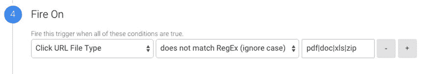

欢迎扩展此正则表达式，以纳入您网站上的其他文件类型。或者，如果您想跟踪任何非网页内容，类似这样的触发器也适用：`{{Click URL File Type}} – does not contain – htm`。请注意，这将跟踪任何非 HTML 链接，包括图像。

选择“创建触发器”按钮，并命名为：`Click – Download Links`。GTM 保存触发器并返回创建标签界面。保存标签，并命名为：`GA – Event – Downloads`。

**专家提示：会话直接着陆于下载文件**

如果您仔细观察，会发现这段代码实际上并未跟踪下载，而是跟踪了对下载链接的点击——这是一个微妙但重要的区别。如果有人通过其他网站（例如搜索引擎）的链接直接着陆到一个 PDF 文件，而没有经过您的任何网页，会发生什么情况？

由于您无法在 PDF 或其他文件中包含 JavaScript，因此它们无法直接通过 GA、GTM 和 JavaScript 进行衡量。但是，您可以使用服务器端代码拦截对 PDF 的直接请求，将数据发送到 Google Analytics，然后无缝地将用户重定向到 PDF 文件。这是 GA 测量协议（参见第 14 章）的一个完美应用场景。

### 邮件和电话链接

可以使用如下链接 URL 来创建启动新邮件或拨打电话的链接：

```
<a href="mailto:madhatter@aliceswonderlandresorts.com">给我发邮件！</a>
<a href="tel:14125550000">(412) 555-0000</a>
```

在这些情况下，您可以看到直接采用本章前面部分用于站外链接和下载的方法是很简单的。例如，您可以仅在 `{{Click URL}}` 变量以 `mailto:` 或 `tel:` 开头时触发。

## 用户与您网站页面内容进行交互的方式还有很多

在本节中，您将看到各种衡量页面内容参与度的示例。

### 标签页和其他页面内内容

标签页、手风琴菜单以及其他显示和隐藏页面内容的方式，通常是通过点击某个元素进行交互，您可以使用点击触发器来监听这些点击。理想情况下，标签页或手风琴链接具有 `class` 或 `id`，您可以利用它们在触发器条件中选择正确的元素。

```
<div class="tab">
  <span class="tab-title">迪伊小胖</span>
  <div class="tab-content">...</div>
</div>
<div class="tab">
  <span class="tab-title">邓小胖</span>
  <div class="tab-content">...</div>
</div>
```

您可以看到如何使用之前讨论过的自动事件监听器以及类似这样的过滤器：`{{Click Classes}}` – contains – `tab-title`。然而，如果您要跟踪的项目上没有简洁的 `class` 或 `id` 属性，该怎么办？

回想一下，除了像 `{{Click Classes}}` 和 `{{Click ID}}` 这样的变量之外，还有 `{{Click Element}}` 变量，它包含对所点击元素的 DOM 的引用。GTM 提供了通过 CSS 选择器进行匹配的选项，这使我们能够指定要定位的元素、类或 id 属性的层级结构（请参见图 5-5）。请记住，此方法可能很脆弱，并且会因页面上元素排列方式的变化而失效，因此应谨慎使用，并且仅在其他方法不足时使用。

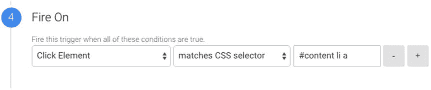

图 5-5. 使用 CSS 选择器定位包含在 `id=content` 元素内的列表项 (`<li>`) 中的链接元素 (`<a>`)

**注意：** 与标签页或其他页面内内容类似，一个相关的问题是使用 AJAX 的页面，其中单个页面内可能发生一系列复杂的交互——例如，完整的结账或注册流程——而无需重新加载页面。在这种情况下，您可能实际上希望向 GA 记录额外的页面浏览量，以便分离和跟踪该流程。此场景在第 6 章中有进一步讨论。

### 花费时间

GA 计算 `页面停留时间` 和 `会话时长` 等指标的方法非常简单：它只是用用户查看下一个页面的时间戳减去当前页面的时间戳。

这绝非完美的衡量方法。例如，用户最后查看的页面该如何计算？他们可能停留了 10 秒或 10 分钟，但你无法确切知晓。由于没有后续时间戳可供相减，该页面就没有 `页面停留时间`，也不会被计入 `会话时长`。

GTM 提供了 `计时器` 触发器，允许你每隔一段时间触发一次事件，这是一种简单的方法，可以让你更准确地了解用户在页面上花费的时间。

#### 页面停留时间的事件

创建一个新标签。选择 `Google Analytics ➤ Universal Analytics` 作为类型。在 `跟踪 ID` 中使用你之前创建的 `{{GA 属性 ID}}` 变量。选择 `跟踪类型 ➤ 事件`。填写要发送到 GA 的 `类别`、`操作` 和 `标签`。你需要根据自己的习惯来选择希望在报告中如何看到这些信息，但一个合理的选项可能是：

-   `类别`：`停留时间`
-   `操作`：`30 秒间隔`

点击 `继续` 按钮为标签指定触发器。选择 `更多`，然后点击 `新建` 按钮创建一个新触发器。选择 `计时器` 作为触发事件的事件类型。保持 `gtm.timer` 作为事件名称。（请注意，你可以同时运行多个不同名称的“秒表”，以不同的周期计时或为不同的事件计时，不过现在我们假设这只是唯一的一个。）作为间隔，我们使用 `30000`（单位为毫秒，即 30 秒）。对于限制次数，我们设定为 `60` 次（这样如果用户仍在同一页面，计时将在 30 分钟后停止）。

**注意** 请谨慎设置计时器的触发频率，并为其设定限制。GA 每个会话有 500 次点击的上限，所以不要每秒都触发事件！

点击 `继续` 按钮，根据需要筛选触发器计数的页面。如果你希望将此触发器限制为仅对某些页面计时，可以使用条件或正则表达式来匹配特定页面。要在所有页面上使用计时器，则使用正则表达式匹配任何 URL：`{{Page URL}} – matches RegEx – .*`。

点击 `继续` 按钮选择触发条件。选择 `所有计时器`。（请注意，如果需要，你可以让触发器仅在第一次计时事件、每隔一次计时事件或你设定的其他条件下触发。这里你只需要所有计时事件。）点击 `创建触发器` 按钮，为触发器命名：“Timer – 30s”。GTM 会保存触发器并返回标签创建页面。

保存标签，为其命名：“GA – Event – Time Spent”。

**警告** 请注意，实施这些计时事件将显著影响 Google Analytics 中基于时间的指标（`页面停留时间`、`会话时长`）以及 `跳出率` 指标。你应该对此有所准备，并有意识地去决定用户在一个页面上停留多久才不算“跳出”。

你还可以通过检查诸如标签页是否处于活动状态、用户向下滚动页面的距离等，来进一步衡量用户真正与内容互动的时间。请参阅下一节中关于使用滚动的示例。

### 滚动

如果你试图衡量用户如何与网站内容互动，通常你不仅仅想知道他们查看了某个页面：他们真的阅读了吗？解决这个问题的一种方法是衡量滚动深度（即用户向下滚动了页面多远）。这是 GTM 的自动事件跟踪无法满足你需求的第一个示例。因为你感兴趣的操作不是点击或其他自动事件跟踪支持的操作，所以你需要使用自定义 JavaScript 来创建自己的监听器。

#### 滚动深度的事件

此设置将涉及两个标签。第一个是带有滚动事件监听器的自定义标签，它会将消息推送到数据层以指示感兴趣的事件。第二个是 GA 事件标签，用于将这些信息发送到 GA。

首先，我们来创建事件监听器标签。

创建一个新标签。在类型中选择 `Custom HTML`。在 HTML 字段中，输入以下代码：


```html
<script id="gtm-scroll-tracking" type="text/javascript">
;(function(document, window, config) {
  // Browser dependencies, script fails silently
  if (!document.querySelector || !document.body.getBoundingClientRect) {
    return false;
  }
  // Get our dataLayer ready, in case we’re not in GTM or we’ve got a special name
  var dataLayerName = config.dataLayerName || 'dataLayer';
  var dataLayer = window[dataLayerName] || (window[dataLayerName] = []);
  var cache = {};
  // Initialize our distances, for later
  config.distances = config.distances || {};
  checkDepth();
  addEvent(window, 'scroll', throttle(checkDepth, 500));
  function getMarks(_docHeight, _offset) {
    var marks = {};
    var percents = [];
    var pixels = []
    if(config.distances.percentages) {
      if(config.distances.percentages.each) {
        percents = percents.concat(config.distances.percentages.each); }
      if(config.distances.percentages.every) {
        var _every = every_(config.distances.percentages.every, 100);
        percents = percents.concat(_every); }
    }
    if(config.distances.pixels) {
      if(config.distances.pixels.each) {
        pixels = pixels.concat(config.distances.pixels.each); }
      if(config.distances.pixels.every) {
        var _every = every_(config.distances.pixels.every, _docHeight);
        pixels = pixels.concat(_every); }
    }
    marks = addMarks_(marks, percents, '%', _docHeight, _offset);
    marks = addMarks_(marks, pixels, 'px', _docHeight, _offset);
    return marks;
  }
  function addMarks_(marks, points, symbol, _docHeight, _offset) {
    var i;
    for(i = 0; i < points.length; i++) {
      var _point = parseInt(points[i], 10);
      var height = symbol !== '%' ? _point + _offset : _docHeight * (_point / 100) + _offset;
      var mark = _point + symbol;
      if(height <= _docHeight + _offset) { marks[mark] = height; }
    }
    return marks;
  }
  function every_(n, total) {
    var n = parseInt(n, 10);
    var _num = total / n;
    var arr = [];
    for(i = 1; i < _num + 1; i++) { arr.push(i * n); }
    return arr;
  }
  function checkDepth() {
    var _bottom = parseBorder_(config.bottom);
    var _top = parseBorder_(config.top);
    var height = docHeight(_bottom, _top);
    var marks = getMarks(height, (_top || 0));
    var _curr = currentPosition();
    for(key in marks) {
      if(_curr > marks[key] && !cache[key]) {
        cache[key] = true;
        fireAnalyticsEvent(key); }
    }
  }
  function fireAnalyticsEvent(distance) {
      dataLayer.push({
        'event': 'scrollTracking',
        'attributes': { 'distance': distance }
      });
    }
  }
  function parseBorder_(border) {
    if(typeof border === 'Number' || parseInt(border, 10)) {
      return parseInt(border, 10); }
    try {
      // If we have an element or a query selector, poll getBoundingClientRect
      var el = border.nodeType && border.nodeType === 1 ? border : document.querySelector(border);
      var docTop = document.body.getBoundingClientRect().top;
      var _elTop = Math.floor(el.getBoundingClientRect().top - docTop);
      return _elTop;
    } catch (e) { return void(0); }
  }
  // Adapted from https://developer.mozilla.org/en-US/docs/Web/API/Window/scrollY
  function currentPosition() {
    var supportPageOffset = window.pageXOffset !== undefined;
    var isCSS1Compat = ((document.compatMode || "") === "CSS1Compat");
    var currScrollTop = supportPageOffset ?
                        window.pageYOffset :
                        isCSS1Compat ?
                          document.documentElement.scrollTop :
                          document.body.scrollTop;
    return parseInt(currScrollTop, 10) + parseInt(viewportHeight(), 10);
  }
  function viewportHeight() {
    var elem = (document.compatMode === "CSS1Compat") ?
               document.documentElement :
               document.body;
    return elem.clientHeight;
  }
  function docHeight(_bottom, _top) {
    var body = document.body;
    var html = document.documentElement;
    var height = Math.max(body.scrollHeight, body.offsetHeight,
                       html.clientHeight, html.scrollHeight, html.offsetHeight);
    if(_top)     { height = height - _top; }
    if(_bottom)  { height = _bottom - _top; }
    return height - 5;
  }
  /*
   * Throttle function borrowed from:
   * Underscore.js 1.5.2 http://underscorejs.org
   * (c) 2009-2013 Jeremy Ashkenas, DocumentCloud and Investigative Reporters & Editors
   * Underscore may be freely distributed under the MIT license.
   */
  function throttle(func, wait) {
    var context, args, result;
    var timeout = null;
    var previous = 0;
    var later = function() {
      previous = new Date;
      timeout = null;
      result = func.apply(context, args);
    };
    return function() {
      var now = new Date;
      if (!previous) previous = now;
      var remaining = wait - (now - previous);
      context = this;
      args = arguments;
      if (remaining <= 0) {
        clearTimeout(timeout);
        timeout = null;
        previous = now;
        result = func.apply(context, args);
      } else if (!timeout) {
        timeout = setTimeout(later, remaining); }
      return result;
    };
  }
  // Cross-browser compliant event listener
  function addEvent(el, evt, fn) {
    if (el.addEventListener) { return el.addEventListener(evt, fn); }
    if (el.attachEvent) {
      return el.attachEvent('on' + evt, function(evt) {
        // Call the event to ensure uniform 'this' handling, pass it event
        fn.call(el, evt);
      });
    }
    if (typeof el['on' + evt] === 'undefined' || el['on' + evt] === null) {
      return el['on' + evt] = function(evt) {
        // Call the event to ensure uniform 'this' handling, pass it event
        fn.call(el, evt);\
      }
    }
  }
})(document, window,
{
  // False if you just use the default dataLayer variable, otherwise enter it here
  'dataLayerName': false,
  'distances': {
    // Configure percentages of page you’d like to see if users scroll past
    'percentages': {
      'each': [10,90],
      'every': 25
    },
    // Configure for pixel measurements of page you’d like to see if users scroll past
    'pixels': {
      'each': [],
      'every': null
    }
  },
  // Accepts a number, DOM element, or query selector to determine the top of the scrolling area
  'top': null,
  // Accepts a number, DOM element, or query selector to determine the bottom of the scrolling area
  'bottom': null,
}
);
</script>
```


对于标签的触发器，选择 `All Pages`。（或者，如果你只想跟踪网站上某些页面的滚动情况，可以在此处指定更严格的触发器。）

保存标签，为其命名：`Listener – Scroll Events`。

## 理解滚动追踪脚本

你无需完全理解此脚本的所有细节即可使用它，但简而言之，它的作用是：允许我们在一个配置对象（代码末尾的加粗部分）中设置一些断点（按百分比或像素），然后监控滚动活动，并在达到这些断点时向数据层发送一条消息（你可以在前面加粗的部分看到这一点）。此脚本包含的几个智能功能如下：

- 细致的跨浏览器支持，使其能够在最广泛的浏览器和版本中正常运行。
- 一个缓存，用于捕获每个事件之前是否已被发送（例如，确保页面上只有一个 25%的滚动事件）。
- 一个计时器，用于限制滚动位置的检查频率（本例中最多每 500 毫秒检查一次），这样就不会在屏幕每次移动一个像素时都运行你的函数。

这些概念值得在你创建的任何自定义事件监听器中加以运用。

接下来，让我们为 `distance` 数据层属性创建一个变量。

创建一个新变量。对于变量类型，选择“数据层变量”。对于“数据层变量名称”，输入 `attribute.distance`（这与前面代码中的名称相对应）。保存该变量，为其命名为“滚动进度”。

最后，创建一个标签，将这些数据作为事件发送到 GA（谷歌分析）。

使用你之前创建的 `{{GA Property ID}}` 变量作为跟踪 ID。选择“跟踪类型”➤“事件”。填写要发送到 GA 的类别、操作和标签。你需要选择自己的约定来决定希望在报告中如何查看这些内容，但一个合理的选择可能是：

- 类别：滚动
- 操作：`{{Scroll Progress}}`

选择“继续”按钮来为标签指定一个触发器。选择“更多”，然后选择“新建”按钮来创建一个新的触发器。选择“自定义事件”作为触发该事件的事件类型。自定义事件允许你通过任何 `event` 名称触发 `dataLayer.push`。在要匹配的事件名称中，输入 `scrollTracking`（这与前面代码中的名称相对应）。选择“创建触发器”按钮，为其命名为“滚动追踪事件”。保存该标签，命名为“GA – 事件 – 滚动追踪”。

### 悬停及其他交互

当用户点击一个元素时，可以使用 GTM 的自动事件追踪功能。JavaScript 还支持其他类型的交互，例如 `mouseover`（即用户将鼠标移到某个元素上，这样你就可以追踪不一定导致点击的悬停行为）、`change`（用于在表单元素中输入文本或更改选择）以及其他许多交互。这些功能并未内置于 GTM 的自动事件追踪中，但你可以通过自定义 JavaScript 在现有模型基础上进行构建，以使用 GTM 追踪这些交互。

### 扩展 GTM 的自动事件追踪模型

为悬停此类交互建模数据的一个合理方式是，与 GTM 为点击捕获的相同数据片段保持一致。² 你可以使用以下数据层消息来指示 `mouseover` 事件：

```javascript
dataLayer.push({
    'event': 'mouseover',
    'gtm.element': 'http://aliceswonderlandresorts.com',
    'gtm.elementClasses': 'button',
    'gtm.elementId': 'link1',
    'gtm.elementUrl': 'http://aliceswonderlandresorts.com',
    'gtm.elementTarget': '_blank'
});
```

看起来眼熟吗？这就像 GTM 的自动事件追踪为点击所创建的数据层消息，只是事件名称是 `mouseover` 而不是 `gtm.click`。这让你可以使用同一组熟悉的变量来设置事件标签。你唯一需要添加的是一个标签，该标签在所需交互发生时将此消息生成到数据层。

要做到这一点，你需要编写一些自己的 JavaScript 代码；请参考本章前面的侧边栏获取相关资源。上一节滚动追踪代码中的 `addEvent` 和 `sendAnalyticsEvent` 函数也是将功能扩展到你自己事件监听器的一个很好的基础示例。

## 社交互动

页面中另一种常见的交互类型是社交行为：如今几乎无处不在的“点赞”和“推文”按钮（以及你能想到的任何其他社交网络）。虽然你可以使用 Google Analytics 中的事件追踪来测量这些行为，但 GA 实际上有一种独立的、特定的命中类型，专门用于捕获社交交互的特定信息，并拥有自己的报告（在 GA 的“获取”➤“社交”➤“插件”报告中，该报告将与此类信息与关于你网站的社会化流量数据整合在一起）。

用于追踪社交互动的 GA 代码与事件追踪非常相似：

```javascript
ga('send', 'social', 'network', 'action', 'target');
```

社交互动使用网络、操作和目标，而不是事件的类别、操作和标签：

- 网络指的是社交网络（Facebook、Twitter 等）
- 操作指的是用户的行为（点赞、取消点赞、关注、发布推文、转发等）
- 目标是正在被点赞或发布推文的对象，通常是一个 URL（而且往往就是当前页面的 URL）

当然，GTM 有一个标签可以为你生成 GA 代码，就像处理事件一样，你可以在其中填写网络、操作和目标变量（参见图 5-6）。

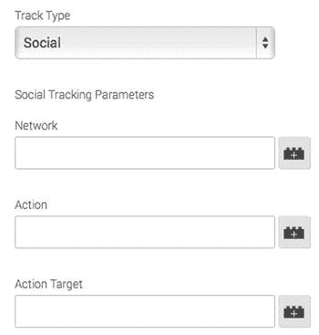

**图 5-6.** GTM 中的 GA 社交标签

### 社交行为：发起与完成

基于你在本章中已经看到的示例，为推文按钮（例如）设置一个带点击触发器的 GA 社交标签是很容易的。然而，挑战在于，点击推文按钮可能只是多个步骤中的第一步：首先，如果用户尚未登录，Twitter 会提示用户登录，然后用户可能会在最终发布前编辑推文。因此，发起这个过程的点击可能并不是你真正想要捕获的，你真正想要的是推文成功完成的那一刻。（另一个复杂之处在于，按钮可能存在于 `iframe` 元素中，这给直接追踪点击带来了额外的挑战。）

你的页面及其代码无法直接访问用户的 Twitter 活动（出于显而易见的安全和隐私原因）。因此，要测量社交行为的完成情况，通常需要与相关社交网络的 API 进行交互。Twitter 的 API（它首先允许你在页面上包含一个推文按钮）也提供了在特定事件发生时（如发布推文、转发等）的回调函数。Facebook 对点赞（和取消点赞）也有类似的功能。这里我们来看一个针对 Facebook 的具体示例；你可以将此模型扩展到其他社交交互中，尽管具体细节将取决于社交网络及其提供的 API。

### Facebook 点赞

跟踪 Facebook 点赞的基本方法与本章节中创建自定义监听器的其他示例类似：

1.  创建一个自定义 HTML 标签，其中包含一个针对社交操作完成的事件监听器，该标签将在每个页面（或者至少是所有可能发生社交互动的页面）上触发。此标签将创建一条包含社交操作相关信息的 `dataLayer` 消息。
2.  设置所需的变量，用于从 `dataLayer` 消息中提取信息。
3.  设置一个跟踪类型为“社交”的 GA 标签，并使用变量填写网络、操作和目标。

由于模式保持不变，我们在此省略分步说明，仅查看不同的部分：自定义 HTML 标签监听器。（有关整个过程的详细分步示例，请参阅滚动跟踪部分。）

用于监听 Facebook 点赞的自定义 HTML 标签可能如下所示：

```markdown
```javascript
<script type="text/javascript">
    (function(window) {
    var n = 0;
    function checkIfSocialExists(n) {
       if(typeof window.FB !== 'undefined') { bindSocial()
          } else if(n < 30) {
                 n++;
            setTimeout(function() { checkIfSocialExists(n); }, 500); }
     }
    checkIfSocialExists(0);
    function socialTrack(network, action, socialTarget, el) {
        var target = typeof socialTarget === 'undefined' ? '' : socialTarget;
        dataLayer.push({
          'event': 'socialShare',
          'attributes': {
              'network': network,
              'action': action,
              'link': target }
        });
    }
    function bindSocial() {
        FB.Event.subscribe('edge.create', function(targetUrl, el) {
          var lowerTarget = targetUrl.toLowerCase();
          var type = 'share';
          var trackTarget = targetUrl;
          socialTrack('facebook', type, trackTarget, el)
        });
      }
    })(window);
</script>
```

> **注意**：此代码假定您已经在页面中加载了 Facebook API，并在添加监听器之前检查 `FB` 对象是否存在。

此监听器使用 Facebook API 方法 `FB.Event.subscribe` 在发生分享事件时调用一个函数。推送一条包含详细信息的 `dataLayer` 消息。现在，您可以使用自定义事件 `socialShare` 在 GTM 中触发一个标签，并为 `dataLayer` 属性 `attributes.network`、`attributes.action` 和 `attributes.link` 创建变量，以填充 GA 社交标签。

此监听器仅捕获点赞事件，但可以轻松调整以捕获取消点赞事件。

### 视频

页面中另一种常见的交互类型是嵌入媒体，通常是嵌入在页面中的视频。与社交网络按钮一样，每个视频平台都有自己的播放器，其实现细节各不相同。让我们来看看最常见的视频播放器：YouTube。

到目前位置，您应该已经熟悉此代码的基本模式：首先，一个自定义 JavaScript 监听器标签（使用 YouTube API），然后是一个 Google Analytics 事件跟踪标签，将数据发送到 GA。再次，我们跳过逐步说明，直接切入正题。

监听器标签如下所示：
```

```javascript
<script type="text/javascript">
;(function( `document`, `window`, `config` ) {
    'use strict';
    `window.onYouTubeIframeAPIReady` = (function() {
        var `cached` = `window.onYouTubeIframeAPIReady`;
        return function() {
            if( `cached` ) { `cached`.apply(this, arguments); }
            // 此脚本在 IE 6 或 7 上无法运行，因此如果检测到这些 UA，我们将在此处退出
            if( !`navigator.userAgent`.match( `/MSIE [67]\./gi` ) ) { `init`(); }
        };
    })();
    var `_config` = `config` || {};
    var `forceSyntax` = `_config.forceSyntax` || 0;
    var `dataLayerName` = `_config.dataLayerName` || `'dataLayer'`;
    // 事件的默认配置
    var `eventsFired` = { 'Play': true, 'Pause' : true, 'Watch to End': true };
    // 用自定义配置覆盖默认值（如果存在）
    var `key`;
    for( `key` in `_config.events` ) {
        if( `_config.events.hasOwnProperty`( `key` ) ) {
            `eventsFired`[ `key` ] = `_config.events`[ `key` ]; }
    }
    // 当 YouTube API 就绪时由它调用
    function `init`() {
        var `iframes` = `document.getElementsByTagName`( 'iframe' );
        var `embeds`  = `document.getElementsByTagName`( 'embed' );
        `digestPotentialVideos`( `iframes` );
        `digestPotentialVideos`( `embeds` );
    }
    var `tag`            = `document.createElement`( 'script' );
    `tag.src`            = '//www.youtube.com/iframe_api';
    var `firstScriptTag` = `document.getElementsByTagName`( 'script' )[0];
    `firstScriptTag.parentNode.insertBefore`( `tag`, `firstScriptTag` );
    // 将我们的视频转换为可跟踪的、带有事件的视频
    function `digestPotentialVideos`( `potentialVideos` ) {
        var `i`;
        for( `i` = 0; `i` < `potentialVideos.length`; `i`++ ) {
            var `isYouTubeVideo` = `checkIfYouTubeVideo`( `potentialVideos`[ `i` ] );
            if( `isYouTubeVideo` ) {
                var `normalizedYouTubeIframe` = `normalizeYouTubeIframe`( `potentialVideos`[ `i` ] );
                `addYouTubeEvents`( `normalizedYouTubeIframe` ); }
        }
    }
    // 判断元素是否为 YouTube 视频
    function `checkIfYouTubeVideo`( `potentialYouTubeVideo` ) {
        var `potentialYouTubeVideoSrc` = `potentialYouTubeVideo.src` || '';
        if( `potentialYouTubeVideoSrc`.indexOf( 'youtube.com/embed/' ) > -1 ||
            `potentialYouTubeVideoSrc`.indexOf( 'youtube.com/v/' ) > -1 ) {
            return true; }
        return false;
    }
    // 将嵌入对象转换为 iframe 对象，并确保它们具有正确的参数
    function `normalizeYouTubeIframe`( `youTubeVideo` ) {
        var `a`           = `document.createElement`( 'a' );
        `a.href`      = `youTubeVideo.src`;
        `a.hostname`  = 'www.youtube.com';
        `a.protocol`  = `document.location.protocol`;
        var `tmpPathname` = `a.pathname`.charAt( 0 ) === '/' ? `a.pathname` : '/' + `a.pathname`;  // IE10 兼容处理
        // 出于安全原因，YouTube 希望设置一个与我们主机名匹配的 origin 参数
        var `origin` = `window.location.protocol` + '%2F%2F' + `window.location.hostname` + ( `window.location.port` ? ':' + `window.location.port` : '' );
        if( `a.search`.indexOf( 'enablejsapi' ) === -1 ) {
            `a.search` = ( `a.search.length` > 0 ? `a.search` + '&' : '' ) + 'enablejsapi=1'; }
        // 本地测试时不设置
        if( `a.search`.indexOf( 'origin' ) === -1  && `window.location.hostname`.indexOf( 'localhost' ) === -1 ) {
            `a.search` = `a.search` + '&origin=' + `origin`; }
        if( `youTubeVideo.type` === 'application/x-shockwave-flash' ) {
            var `newIframe`     = `document.createElement`( 'iframe' );
            `newIframe.height`  = `youTubeVideo.height`;
            `newIframe.width`   = `youTubeVideo.width`;
            `tmpPathname` = `tmpPathname`.replace('/v/', '/embed/');
            `youTubeVideo.parentNode.parentNode.replaceChild`( `newIframe`, `youTubeVideo.parentNode` );
            `youTubeVideo` = `newIframe`;
            `a.pathname` = `tmpPathname`;
            if(`youTubeVideo.src` !== `a.href` + `a.hash`) {
                `youTubeVideo.src` = `a.href` + `a.hash`;
            }
            return `youTubeVideo`;
        }
        return `youTubeVideo`;
    }
    // 为 YouTube API 发出的事件添加事件处理程序
    function `addYouTubeEvents`( `youTubeIframe` ) {
        `youTubeIframe.pauseFlag`  = false;
        new `YT.Player`( `youTubeIframe`, {
            events: {
                onStateChange: function( `evt` ) {
                    `onStateChangeHandler`( `evt`, `youTubeIframe` );
                }
            }
        } );
    }
})();
</script>
```


```javascript
// 返回百分比与所需秒数的键值对
function getMarks(duration) {
    var marks = {};
    // 为提供全面支持，我们通过已观看百分比来处理“观看至结尾”事件
    if (_config.events[ 'Watch to End' ] ) {
        marks[ 'Watch to End' ] = duration * 99 / 100;
    }
    if( _config.percentageTracking ) {
        var points = [];
        var i;
        if( _config.percentageTracking.each ) {
            points = points.concat( _config.percentageTracking.each );
        }
        if( _config.percentageTracking.every ) {
            var every = parseInt( _config.percentageTracking.every, 10 );
            var num = 100 / every;
            for( i = 1; i < num; i++ ) {
                points.push(i * every);
            }
        }
        for(i = 0; i < points.length; i++) {
            var _point = points[i];
            var _mark = _point + '%';
            var _time = duration * _point / 100;
            marks[_mark] = Math.floor( _time );
        }
    }
    return marks;
}
```

```javascript
function checkCompletion(player, marks, videoId) {
    var duration     = player.getDuration();
    var currentTime  = player.getCurrentTime();
    var playbackRate = player.getPlaybackRate();
    player[videoId] = player[videoId] || {};
    var key;
    for( key in marks ) {
        if( marks[key] <= currentTime && !player[videoId][key] ) {
            player[videoId][key] = true;
            fireAnalyticsEvent( videoId, key );
        }
    }
}
```

```javascript
// YouTube API 事件的事件处理程序
function onStateChangeHandler( evt, youTubeIframe ) {
    var stateIndex     = evt.data;
    var player         = evt.target;
    var targetVideoUrl = player.getVideoUrl();
    var targetVideoId  = targetVideoUrl.match( /[?&]v=([^&#]*)/ )[ 1 ];
    var playerState    = player.getPlayerState();
    var duration       = player.getDuration();
    var marks          = getMarks(duration);
    var playerStatesIndex = {
        '1' : 'Play',
        '2' : 'Pause'
    };
    var state = playerStatesIndex[ stateIndex ];
    youTubeIframe.playTracker = youTubeIframe.playTracker || {};
    if( playerState === 1 && !youTubeIframe.timer ) {
        clearInterval(youTubeIframe.timer);
        youTubeIframe.timer = setInterval(function() {
            checkCompletion(player, marks, youTubeIframe.videoId);
        }, 1000);
    } else {
        clearInterval(youTubeIframe.timer);
        youTubeIframe.timer = false;
    }
    if( stateIndex === 1 ) {
        youTubeIframe.playTracker[ targetVideoId ] = true;
        youTubeIframe.videoId = targetVideoId;
        youTubeIframe.pauseFlag = false;
    }
    if( !youTubeIframe.playTracker[ youTubeIframe.videoId ] ) {
        return false;
    }
    if( stateIndex === 2 ) {
        if( !youTubeIframe.pauseFlag ) {
            youTubeIframe.pauseFlag = true;
        } else {
            return false;
        }
    }
    if( eventsFired[ state ] ) {
        fireAnalyticsEvent( youTubeIframe.videoId, state );
    }
}
```

```javascript
// 向 Google Analytics 或 Google Tag Manager 发送事件
function fireAnalyticsEvent( videoId, state ) {
    var videoUrl = 'https://www.youtube.com/watch?v=' + videoId;
    window[dataLayerName].push({
        'event'     : 'youTubeTrack',
        'attributes': {
            'videoUrl': videoUrl,
            'videoAction': state
        }
    });
}
```

```javascript
})( document, window, {
    'events': {
        'Play': true,
        'Pause': true,
        'Watch to End': true
    },
    'percentageTracking': {
        'every': 25,
        'each': [ 10, 90 ]
    }
});
```

这遵循了本章前面滚动监听器的相同模型。它使用 YouTube 的播放器 API 来检测视频播放器状态的变更（如播放、暂停或观看至结尾），并将事件推送到数据层（如代码中的`events`配置所示）。它还衡量了播放完成百分比，该百分比在配置对象中的断点处可配置（代码末尾的`percentageTracking`部分）。

每次数据层推送看起来像下面的示例：

```javascript
dataLayer.push({
    'event'        : 'youTubeTrack',
    'attributes'   : {
        'videoURL'     : 'https://www.youtube.com/watch?v=msvOUUgv6m8',
        'videoAction'  : 'Play'
    }
});
```


属性 `attributes.videoAction` 是视频播放器的状态，而 `attributes.videoURL` 是直接指向 YouTube 上该视频的链接（其中也包含视频标识符）。现在，您可以使用自定义事件 `youTubeTrack` 在 GTM 中触发一个标签，并为数据层属性 `attributes.videoURL` 和 `attributes.videoAction` 创建变量，以填充 GA 事件跟踪标签的操作和标签。

## 总结

*   Google Analytics 有两种点击类型——事件和社交，用于跟踪页面内的互动。GTM 为每种类型都提供了内置标签。事件用于与页面内容的一般互动，包括下载链接、出站链接、选项卡和折叠面板、视频播放等示例。社交互动用于社交网络操作，例如在 Facebook 上点赞页面或在 Twitter 上发布推文。

*   在 GTM 中跟踪互动的挑战在于为互动选择合适的触发器，以及选择合适的变量来捕获相关数据。有三种基本方法：

    *   使用 GTM 的自动事件跟踪，该功能具有内置能力来跟踪页面内项目的点击（以及其他一些场景，如表单和计时器）。

    *   通过自定义 HTML 标签和自定义 JavaScript 变量，对 GTM 的功能进行自定义扩展。掌握 JavaScript 和 DOM 知识对于编写脚本以监听自定义事件并从页面中提取信息尤其有用。

    *   在页面上使用 JavaScript 向 GTM 发送数据。这是一种灵活且对开发者友好的方法，但此代码的管理工作将脱离 GTM 的控制范围。

*   互动事件在 GTM 的数据层中表示为消息。您可以使用这些消息来创建触发器，并为互动跟踪标签填充变量。

## 脚注

这个非常优雅的函数最初由 Stephane Hamel 在 GTM Google+社区提出。[1]

感谢 Conversion Works 的 Doug Hall 首次提出这种模式。[2]