# 6. 目标：衡量转化

> “请你告诉我，从这里我该走哪条路？” “这很大程度上取决于你想去往何方，”猫说。“我不太在乎去哪里——”爱丽丝说。“那么你走哪条路也就无关紧要了，”猫说。——刘易斯·卡罗尔，《爱丽丝梦游仙境》

网站分析中最重要的概念之一是转化，即一个单纯的网站访问者转变为客户的过程。定义转化的行为可以是任何对你有价值的用户交互，从重大行为（购买、联系请求）到次要行为（内容互动、订阅新闻通讯）。通过设置目标，Google Analytics 允许你指定希望视为转化的交互类型。

GA 有四种目标：

- **目标页**，最常见的目标类型，基于网页浏览的 URL。通常用于某种确认或感谢页面，表明用户已完成某个流程。目标页还可以包含一个渠道，即一系列通向最终目标页的步骤（例如必须填写的一系列表单等）。
- **会话时长**和**每次会话浏览页数**目标基于这些指标超过给定阈值（用户在网站上停留超过 5 分钟，或浏览了超过 3 页）。
- **事件目标**基于事件，即衡量下载、出站链接或视频播放等活动的非页面浏览交互（详见第 5 章）。

在许多情况下，基于你已在 GTM 中使用的标签和触发器，这些目标的创建是直接的。然而，在某些 URL 不会改变的情况下，例如动态的、由 AJAX 驱动的流程，你可能需要在 GTM 中添加额外的标签和触发器来适应。本章将探讨在 GA 中设置目标，以及 GTM 中为应对此类情况所需的任何标签和触发器。

**边栏：为什么要设置目标？**

请注意，这些目标并不代表 GA 数据中尚未可用的用户操作。那么，这些目标有什么用呢？

首先，创建目标迫使你真正思考你的网站为何存在，以及你希望用户完成什么。

在 GA 中，创建目标会提升这些特定操作在 GA 报告中呈现时的重要性。诸如转化率等目标指标在 GA 的所有报告类型中都能轻松获取，并且还能通过多渠道漏斗报告等工具进行进一步分析。目标指标在报告中的易获取性，使得进行比较以及找到最有价值的受众和营销渠道变得简单直接。如果没有目标，你将不得不在报告中更费力地使用细分和其他工具来找到这些答案。

你还可以为你创建的 GA 目标分配货币价值，并且存在一些指标可以让你在报告中也比较这些价值。如果网站上有实际购买行为，你可以通过电子商务跟踪来捕获（详见第 7 章）；但对于其他类型的网站，你仍然可以为目标分配一个现实世界中的价值。例如，对于潜在客户生成流程，你也许能够从 GA 外部收集数据（在过去一年网站产生的 1000 个潜在客户中，10%促成了一笔销售，而每笔销售的平均价值为 500 美元），从而得出每个潜在客户的平均价值（在本例中，如果你计算一下，是 50 美元）。

或者，如果你的网站没有任何能与你现实货币价值挂钩的转化，你仍然可以将目标价值用作权衡其重要性的一种方式。也许你的主要目标是 100 美元，几个次要目标各为 50 美元，一些较小的目标各为 10 美元。

## 创建和组织目标

目标是在 GA 的每个数据视图中创建的。你能在 GA 管理设置的视图列中找到你已创建的所有目标以及创建新目标的功能（见图 6-1）。

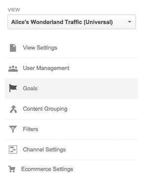

图 6-1. GA 管理部分中的目标设置

每个视图最多有 20 个目标位置（见图 6-2）。你需要拥有视图的编辑权限才能编辑或创建目标。（关于创建视图的更多信息，请参见第 8 章。）

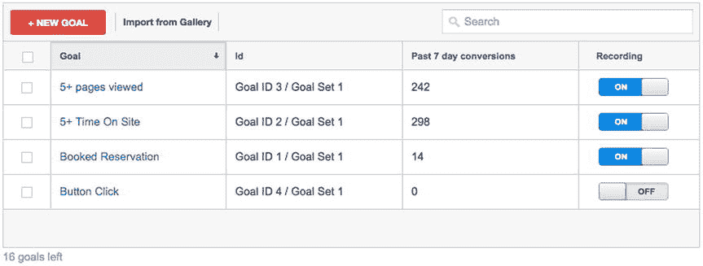

图 6-2. GA 中的目标列表

设置目标，就像对 GA 管理设置进行其他任何更改一样，不会追溯重新处理报告视图中的现有数据。创建目标将只测量该目标在未来的转化。

### 在 Google Analytics 中创建目标

让我们逐步了解如何在 GA 中创建一个目标。

1. 在 GA 管理标签页的视图列中的**目标**部分，选择 **+ 新目标** 按钮。

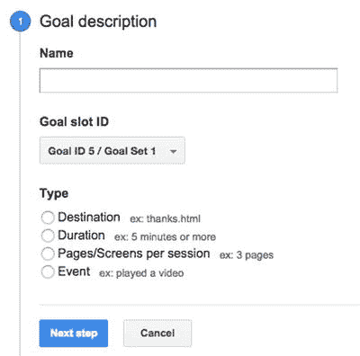

2. 输入目标的名称。该名称将作为目标在你 GA 报告中显示的标签，因此要描述得足够清楚，以便任何使用你数据的人都能明确该目标代表什么。
3. （可选）选择一个目标位置。如前所述，每个视图有 20 个目标位置。这些位置被分为四组，每组五个目标，分别对应报告中可查看的目标组。默认情况下，GA 会使用下一个空位，但你可以更改（例如，如果你想将最重要的目标放在前面，不重要的放在最后）。
4. 选择目标类型：**目标页**、**时长**、**每次会话浏览页数/屏幕数**或**事件**。然后选择 **下一步** 按钮以提供目标详情。
5. 根据你选择的目标类型，在下一步中 GA 会要求你提供该目标的详细信息：

- 对于**目标页**目标，你需要输入目标页的 URL，以及可选的导向目标的渠道页面 URL。这种类型的目标将在下一节详细探讨。
- 对于**时长**目标，通过输入小时、分钟和秒的数字来指定一个时间。如果一次会话的时长超过你在此处输入的时间，GA 将计为一次目标转化。

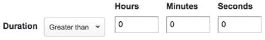

- 对于**每次会话浏览页数/屏幕数**目标，指定一个页面数量。如果一次会话包含的页面数量（对于移动应用则是屏幕数；参见第 13 章）超过该数字，GA 将计为一次目标转化。


- 对于**事件**目标，你可以指定一个或多个标准用于事件（如类别、操作、标签和值），以满足此标准的事件计为目标转化。如果你设置了多个标准，则必须所有标准都为真，才能计为一次目标转化。（关于事件及其属性的更多信息，请参见第 5 章。）

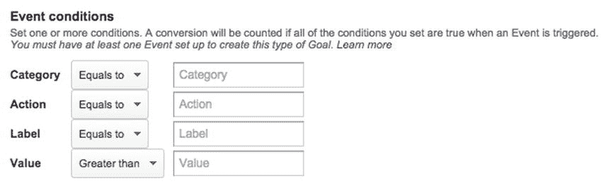

6. （可选）对于任何类型的目标，设置一个货币值。（对于事件目标，你还有额外的选项可以使用事件值作为目标值。）
7. 使用 **验证此目标** 选项来仔细检查你的目标设置。它会将你的目标设置与过去七天的数据进行比较，并显示本应记录的转化次数。如果得到 0 次，但你确定曾有转化发生，请检查你的设置是否存在 URL、事件属性等方面的拼写错误。
8. 选择 **创建目标** 按钮以保存目标。

从现在开始，GA 将开始在报告中计算此目标的转化。


### 删除目标

如果某个目标不再相关，您可以通过目标列表中的开关将其停用，这样它就 不会在报告中显示。

但请注意，没有删除目标的选项。与所有 GA（Google Analytics）数据一样，一旦数据进入报告，就无法回溯更改（包括删除现有目标数据）。不过，您可以通过更改目标的名称及其所有设置来重新使用该目标的“槽位”。从此以后，该目标槽位中的数据将归属于新目标，而历史数据则归属于旧目标。

**提示**  
GA 的报告界面中不会显示目标设置何时发生更改，因此您应该添加注释，并考虑在目标标题中注明日期，以清晰说明更改情况。

## 目标页面与渠道

GA 中最常见的目标类型是“目标页面”（Destination goal），它表示用户已到达某个特定页面（通过 URL 定义）。通常这是某个流程结束时到达的页面，即完成操作后的确认页面。不过，它也可以是您希望用户访问的任何重要页面。

对于具有一组步骤引导至最终目标的目标，您可以创建渠道。GA 将显示用户在该渠道中的行进进度，以便您了解流程中可能导致部分用户未能完成目标的“泄漏点”或“瓶颈”。

GA 中有两个报告会显示渠道数据，即“渠道可视化”和“目标流程”报告（均可在“转化” ➤ “目标”下找到）。这些报告提供了不同的可视化效果，以及对用户行为不同详细程度的洞察（见图 6-3）。

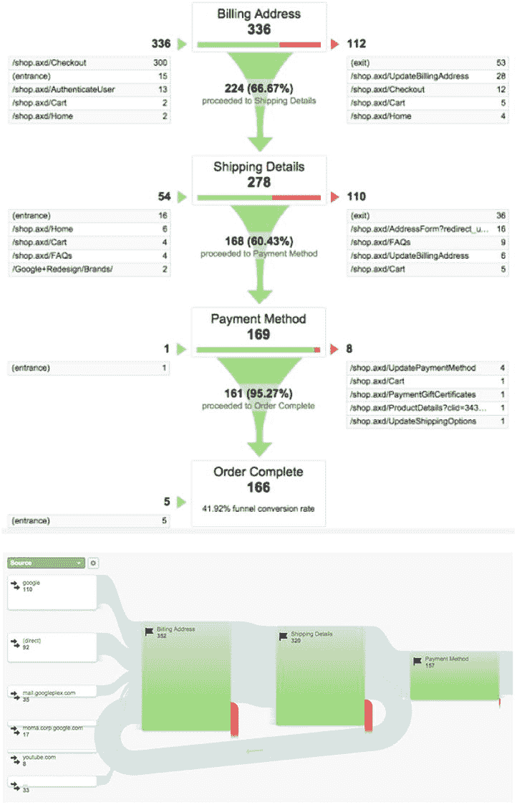

图 6-3.

“渠道可视化”（上方）和“目标流程”（下方）报告展示了用户在各渠道步骤中的行进进度。

**注意**  
目标的渠道设置仅影响这些渠道报告。GA 中基于该目标的所有其他指标（转化次数、转化率、价值）仅关注最终目标页面是否被到达。

渠道是为用户完成某个流程所需经历的一系列步骤而设计的。这个序列可能包含可选步骤，或者允许返回上一步，但渠道隐含着一个从第一步到最后一步的顺序。您只应将用户按特定顺序行进以达成目标的步骤包含在渠道中。如果页面可以按任意顺序查看，那么渠道报告将无法展示特别有用的数据。

### 设置渠道

在设置目标渠道之前，您需要知道流程中每一步的 URL。具体取决于流程是什么，您可能很容易在网站上手动操作（例如，填写联系表单并注明“抱歉，只是测试一下”）来查看 URL 是什么。在其他情况（如购买、账户注册等）下，流程可能更复杂或难以测试。您可能需要使用网站的测试版本，或查阅文档、咨询开发人员，以了解流程及其涉及的 URL 顺序。

在某些情况下，您可能会遇到一系列步骤，但它们之间在 URL 上没有区别。本章稍后将探讨如何处理这些问题。

#### 创建带渠道的目标页面

假设您已经收集了流程中各步骤的 URL 列表，那么我们来设置一个带渠道的目标页面目标。

完成“在 Google Analytics 中创建目标”的步骤 1-4，并选择`目标页面`作为目标类型。

对于目标页面目标，需要输入的第一个目标详情设置是目标的最终 URL（见下方截图）。这代表转化：如果用户到达此页面，则视为发生转化；否则未转化。

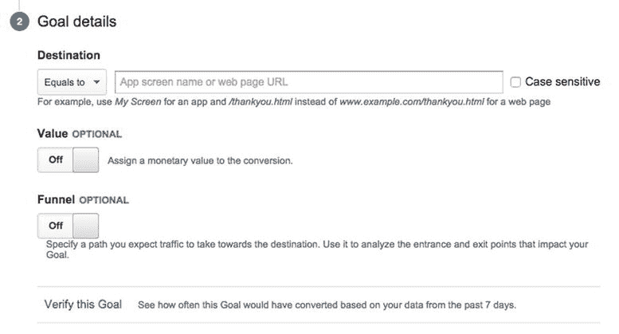

在此处输入 URL，应与 GA 报告中的显示形式一致，通常以路径开头（不含主机名）。有三种匹配选项：

*   **完全等于**：URL 必须与输入的内容完全匹配，不多不少。这是默认选项，在多数情况下适用，但当需要更大灵活性时，可使用以下两个选项。
*   **开头为**：URL 必须以输入的字符串开头，但 URL 末尾可以附加其他文本。这对于 URL 会根据用户选择或填写表单信息而出现多种变化的情况非常有用。例如：`/locations/retail?zipcode=` `12345` `/request-a-quote/thank-you` `?Industry=Education&Country=US`
*   **正则表达式**：URL 必须匹配正则表达式模式。这提供了从通用到特定模式的极大匹配灵活性。您还可以选择输入的 URL 是否应区分大小写（通常不需要）。输入最终目标页面的完整 URL、部分 URL 或正则表达式模式。

（可选）为目标分配一个货币价值。

要创建渠道，请将渠道选项切换为`开启`。将出现一个列表，供您为每个步骤输入标签和 URL（见下方截图）。

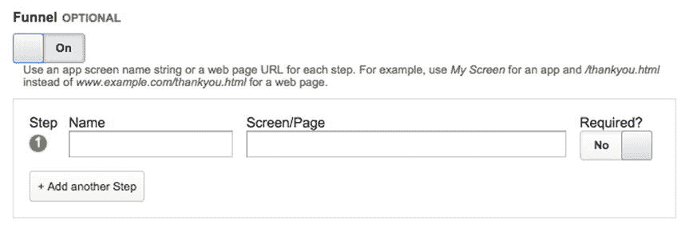

对于每个步骤，`名称`就是该步骤在渠道报告中的标签。`屏幕/页面`是该步骤的 URL 或正则表达式模式。渠道 URL 遵循与最终目标 URL 相同的规则——即之前在最终目标 URL 中选择的`完全等于`、`开头为`或`正则表达式`。您可以根据需要添加最终目标页面之前的任意多个步骤（最多 20 个，不过如果一个流程有 20 步，您可能需要重新考虑用户体验）。您无需在渠道步骤中重复目标 URL；最终目标 URL 始终被视为最后一步。最后，请注意第一步有一个额外的选项，即该步骤是否应为“必需”。本章稍后将进一步讨论这一点以及适用的情形。

使用`验证`按钮来检查目标。请注意，`验证`按钮仅测试最终的转化，不会测试每个单独的渠道步骤。（关于测试和验证渠道 URL 的更多建议将在后文提供）。

选择`创建目标`按钮以保存目标。

从此之后，GA 将开始在您的报告中计算此目标的转化次数和渠道数据。


## 测试目标和渠道漏斗 URL

目标设置期间的“验证”功能可快速检查您的目标 URL 是否合理。然而，它无法提供太多细节，也无法让您测试渠道步骤。测试目标设置中使用的 URL 模式的最佳方法是使用 Google Analytics 中的“行为”➤“网站内容”➤“所有页面”报告。此报告中显示的页面 URL 与 GA 用于比较目标设置和记录转化的 URL 相同。

您可以使用报表内过滤器上的高级选项（见图 6-4）来显示符合某些条件的 URL。请注意，可用的选项包括“完全匹配”、“开头为”和“正则表达式匹配”，这些对应于目标设置中的选项。您需要确保目标设置中的 URL 模式与您认为应该匹配的页面匹配（并且不与任何不应匹配的页面匹配）。

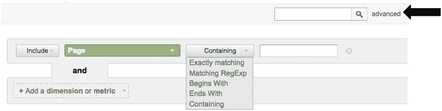

**图 6-4.** 在“所有页面”报告中，选择过滤器旁边的“高级”选项来测试目标 URL

在此过滤器中尝试使用 URL 或正则表达式，看看它们是否按预期工作，并根据需要进行优化。

如果某些目标 URL 模式过于宽泛，可能会导致渠道看起来像图 6-5。

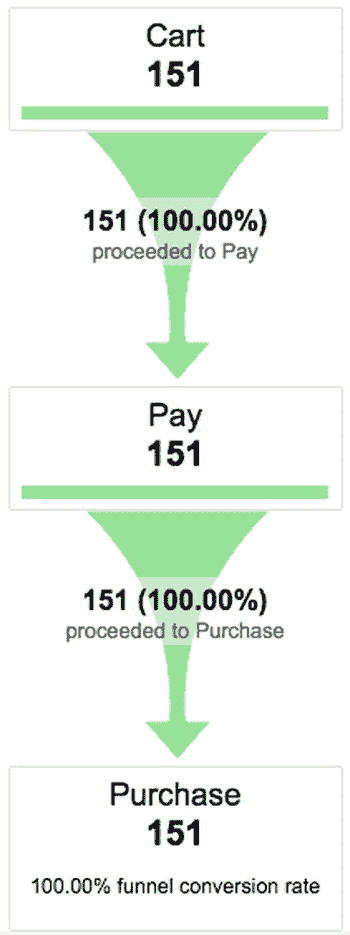

**图 6-5.** 一个可疑的渠道

这看起来有点好得令人难以置信，不是吗？虽然如果 100% 的会话都能一路完成转化漏斗，那将非常棒，但这些数据似乎有诈。

此类问题的原因在于 URL 模式匹配了多个步骤。考虑以下 URL 序列以及针对它们的目标设置：

|       | 渠道设置 | 页面 URL |
|-------|--------------|-------------|
| 步骤 1 | `/contact/`   | `/contact/` |
| 步骤 2 | `/contact/thank-you/` | `/contact/thank-you/` |

如果您使用的是“等于”选项，则一切正常。但是，如果使用“开头为”或“正则表达式”选项，请注意您的步骤 1 的渠道 URL 也匹配了步骤 2！您需要更加小心。在这种情况下，您可以使用正则表达式：

|       | 渠道设置 | 页面 URL |
|-------|--------------|-------------|
| 步骤 1 | `/contact/`   | `/contact/` $ |
| 步骤 2 | `/contact/thank-you/` | `/contact/thank-you/` |

通过使用带有 `$`（美元符号）的正则表达式，表示“以...结尾”，您可以确保步骤 1 不会匹配步骤 2 的 URL。问题解决！

### 必需的第一步

最后，还有一种在某些场景中有用的附加选项：第一个渠道步骤的“必需”选项。请注意，渠道报告会显示用户在流程的任何步骤进入渠道（见图 6-6）。通常，这是第一步，但也可能是后续步骤。

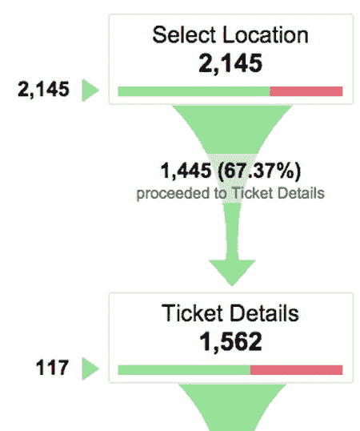

**图 6-6.** 在此部分渠道中，有 117 个会话从第二步进入

这是如何发生的？您可能认为这不可能；不经过第一步就无法进入注册过程的第二步！然而，这可能在各种边缘情况下发生，例如：

> 嘿，我们应该买票去爱丽丝仙境度假村！我去第一步。
> 等等，我应该问问疯帽匠是否愿意和我一起去。我先把这个页面开着，等我问完再说。
> 过了 30 多分钟，我的会话在 GA 中过期了。
> 好的，现在我已经准备好订票了！我进入第二步，但由于我的会话已过期，GA 显示我从第二步进入了渠道。

在大多数此类情况下，大部分用户从第一步进入，少数用户从后续步骤进入。然而，在某些场景中，您可能只希望看到完成了整个流程的用户。考虑图 6-7 中的渠道。

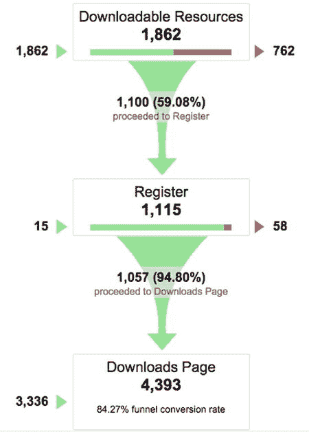

**图 6-7.** 一个许多用户从最后一页进入的渠道！

前两步是一个注册过程，允许用户访问包含一些可下载资源的页面。最后一页可以被这些用户收藏并返回，他们经常这样做（这就是为什么您看到这么多用户从最后一步进入）。但您真正感兴趣的用户只是那些实际在步骤 1 和 2 中注册的用户。

通过在渠道的第一步设置“必需”设置，渠道报告将仅向您显示从步骤 1 开始的用户。请注意，这仅影响渠道报告；目标的总体转化次数始终仅由最终目标 URL 决定。

## 没有明确 URL 的渠道

对于步骤可以通过 URL 轻松区分的渠道，目标设置非常简单。如果渠道步骤无法通过 URL 轻易区分，会发生什么情况呢？例如：

*   页面内出现一个模态弹窗
*   表单及其确认页面具有相同的 URL
*   结账或注册过程在单个页面内包含多个步骤，无需重新加载（即 AJAX）
*   一个或多个步骤发生在外部、未被跟踪的网站上的流程

在这些情况下设置渠道的方法是使用虚拟综合浏览量——也就是说，在某种交互（如表单提交或点击推进到下一步的按钮）时触发一个 GA 综合浏览量，并使用一个虚构的 URL 来表示该交互。GTM 的 GA 标签允许您使用“要设置的字段”部分中的 `page` 字段，用您选择的 URL 覆盖当前页面的 URL（图 6-8）。

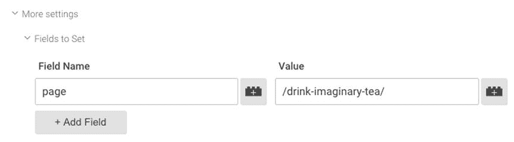

**图 6-8.** GTM 的 GA 标签中的 `page` 字段允许您覆盖记录在 GA 中的 URL

对于虚拟综合浏览量，选择了 `/drink-imaginary-tea` 作为要记录的 URL——这个 URL 在您的网站上并不实际存在，但您会在 GA 数据中看到它，用以代表所执行的操作。由于这些操作在 Google Analytics 中被记录为综合浏览量，您随后可以使用您选择的 URL 来设置渠道（并且您也能在“网站内容”报告中看到这些综合浏览量）。

> **注意：** 对于外部网站，例如第三方支付网站，如果您能够将 GTM 容器代码放置在该网站上，则可以使用跨域跟踪来捕获数据（请参见第 2 章和第 3 章）。如果第三方不允许您放置代码，用户在其网站上的活动对您来说是不可见的，但您至少可以跟踪用户离开您的网站前往那里的情况。


## 模态窗口与 iFrame

模态窗口是页面内弹出的一种窗口（而非浏览器中单独的标签页或窗口）。这种模态弹窗可能包含两种不同类型的信息：

- 通常它们会使用 HTML `iframe` 元素来简单集成另一个页面。
- 在其他情况下，例如作为图片灯箱，它们可能只是简单地显示/隐藏或重新设置页面内容的元素样式。

要检查网站上特定模态弹窗的内容，直接查看源代码即可。

如果使用了 `iframe` 元素，模态窗口的内容实际上是一个独立的页面。只要你的 GTM 容器在该页面中，你就可以像测量其他页面一样对其进行测量，并且该 URL 的页面浏览量会像其他所有页面一样出现在 GA 中。

> **注意：** 如果 `iframe` 中的页面位于不同的域名，你需要使用跨域跟踪。关于跨域 iframe 还有一些额外的浏览器和安全问题；处理此场景的详细信息请参阅 GA 开发者文档。¹

对于未使用 `iframe` 元素的模态窗口，你可以使用点击触发器（详见第 5 章）来触发标签。根据交互的性质以及希望在 GA 中查看数据的方式，由你决定是触发 GA 事件标签还是页面浏览量标签。对于灯箱中的图片，事件标签可能是最合适的。然而，如果模态弹窗中包含表单或其他多步骤流程，你可能希望使用页面浏览量，以便设置带有步骤的目标漏斗。

## 为点击触发虚拟页面浏览量

要为点击创建虚拟页面浏览量，请回顾第 5 章中概述的流程，即如何基于点击触发 GA 事件标签。在这里，你将改用 GA 页面浏览量标签。

1. 创建新标签。选择 **Google Analytics ➤ Universal Analytics** 作为类型。
2. 在 **跟踪 ID** 中填写你之前创建的 `{{GA Property ID}}` 变量。
3. 选择 **跟踪类型 ➤ 页面浏览量**。
4. 在 **更多设置 ➤ 基本配置** 下，你会找到一个标记为 **文档路径** 的字段（见图 6-8）。这是 GA 记录的 URL。默认使用当前页面路径，但你可以在此处覆盖该标签。（这就是你“虚拟页面浏览量”的本质：你创建了一个并不实际存在的 URL 来表示表单提交。）你可以使用文本和变量的任意组合来构建 URL。通常，使用当前页面（`{{Page Path}}` 变量）并在末尾附加一些标签是合理的：`{{Page Path}}/modal-newsletter-signup`
5. 现在为此标签指定触发器。选择 **点击**，然后点击 **新建** 按钮创建一个新的点击触发器。
6. 指定一些条件，将点击触发器限制在适当的链接、按钮或其他元素上。有关使用点击触发器的更多讨论和示例，请参阅第 5 章。
   > **注意：** 此处无需使用链接点击监听器的“等待标签”选项，因为点击后当前页面保持打开状态。
7. 选择 **创建触发器** 按钮，为触发器命名：“模态弹窗”。GTM 保存触发器并返回到标签创建页面。
8. 保存标签，为其命名：“GA – 页面浏览量 – 模态弹窗”。

## 表单与表单监听器

HTML `form` 元素允许用户填写多个 `input` 字段，然后提交表单。输入字段的内容会提交到由你的网站（在 HTML 中由表单元素的 `action` 属性表示）处理的 URL。

```html
<form id="red-queen" action="/off-with-her-head/">
  <input id="first-name" name="first-name" type="text" placeholder="Alice">
  <input type="submit" value="Submit!">
</form>
```

如果包含表单的页面与表单操作页面的 URL 不同，你可以轻松地在漏斗中区分这些步骤。然而，在某些情况下，表单的操作可能与当前页面相同。提交表单后，页面可能会显示不同的内容（例如确认消息），但 URL 保持不变。在无法通过 URL 区分表单的情况下，你可以使用 GTM 的表单触发器来跟踪表单提交。表单触发器类似于点击触发器（在第 5 章中描述），但它监听的是 HTML `form` 元素是否被提交。

> **注意：** 就像 GTM 为点击监听器包含内置变量（如 `{{Click ID}}` 和 `{{Click URL}}`）一样，它也为表单监听器提供了相同的变量集。在设置表单监听器之前，你需要确保在 GTM 的变量部分已启用这些变量。

## 为表单提交触发页面浏览量

让我们看看如何为表单提交创建标签和触发器。

1. 创建新标签。选择 **Google Analytics ➤ Universal Analytics** 作为类型。
2. 在 **跟踪 ID** 中填写你之前创建的 `{{GA Property ID}}` 变量。
3. 选择 **跟踪类型 ➤ 页面浏览量**。
4. 在 **更多设置 ➤ 基本配置** 下，你会找到一个标记为 **文档路径** 的字段（见图 6-8）。这是 GA 记录的 URL。默认仅填入当前页面路径，但你可以在此处覆盖该标签。（这就是你“虚拟页面浏览量”的本质：你创建了一个并不实际存在的 URL 来表示表单提交。）你可以使用文本和变量的任意组合来构建 URL。通常，使用当前页面（`{{Page Path}}` 变量）并在末尾附加一些标签是合理的：`{{Page Path}}/red-queen-submitted`
5. 现在为此标签指定触发器。选择 **表单**，然后点击 **新建** 按钮创建一个新的表单触发器。
6. 类似于链接，表单通常会提交到同一个浏览器窗口，替换当前页面。选择 **等待标签** 选项，并使用默认的最长两秒等待时间，以便在表单提交前给跟踪标签足够的执行时间。
7. 使用 **检查验证** 选项，仅在表单成功提交时触发。通常，表单包含验证检查，例如检查用户是否填写了必填字段并以正确格式输入了值。启用此选项后，触发器仅在验证成功且表单提交时才会操作。如果禁用此选项，无论验证是否成功，用户每次点击提交按钮时触发器都会操作。
8. 在“启用条件”下，筛选触发器监听的页面。该监听器仅需要在可能包含表单的页面上操作。如果该表单出现在网站的多个位置，你可以使用正则表达式匹配任何 URL：`{{Page URL}} – 匹配正则表达式 – .*` 否则，你可以进行更严格的限制，仅包含此表单出现的页面。
9. 在“触发条件”下，选择 **部分表单**，并指定一个或多个条件，将此触发器限制为你想要跟踪的表单。最常见的是，你可能使用表单 ID 或表单 URL 变量来限定特定表单。 `{{Form ID}} – 等于 – red-queen`
10. 选择 **创建触发器** 按钮，为触发器命名：“红皇后表单”。GTM 保存触发器并返回到标签创建页面。
11. 保存标签，为其命名：“GA – 页面浏览量 – 红皇后表单提交”。

现在，你已经为表单提交生成了一个独特的 URL，即可将该 URL 用作目标或漏斗步骤。


### AJAX 与动态流程

有时，多步骤流程可能会完全发生在同一个页面内，页面不会重新加载，URL 也不会改变。用户通过与内容交互来逐步完成流程，页面内容会动态变化，但用户始终停留在同一页面上。甚至有可能整个网站或网络应用都构建为单页面，当用户在其中“导航”时，内容发生变化，但页面从未完全重新加载或更改 URL。

这通常被称为 AJAX（即异步 JavaScript 和 XML 的缩写，尽管该术语现已涵盖多种相关技术，这些技术不一定异步，也不一定使用 XML）。对于动态内容而言，AJAX 是一种优雅且颇具吸引力的选择，但由于它与拥有独立页面和 URL 的“标准”网站存在差异，因此也引入了一些挑战。

由于页面不会完全刷新，GTM 仅会触发初始的单个网页浏览量。要捕获后续的交互，您必须使用其他事件监听器来触发代码。根据网站的设置方式，有几种可行的选项。

* **历史记录监听器。** 大多数现代 AJAX 设计对浏览器和搜索引擎都很友好：它们允许直接链接到动态内容，并允许浏览器的“后退”和“前进”按钮正常运行。它们通过多种不同的方式在浏览器历史记录中插入条目来实现这一点，从而跟踪用户的状态和路径。GTM 的历史记录监听器可以在这些更改发生时被触发。
* **点击监听器。** 对于简单情况，或者动态交互未在浏览器历史记录中反映出来的情况，您可以使用点击监听器来触发对特定按钮、链接或其他元素的点击。

这两种方法将在以下各节中描述。

> **注意：** 如果您不是网站上 AJAX 流程的创建者，请务必与开发人员沟通，了解其运作方式。GTM 的监听器是无害的，不太可能干扰页面功能，但您需要确保数据能准确反映您要捕获的交互。

### 历史记录监听器

动态页面在浏览器中跟踪页面状态主要有两种方法：URL 片段，或 HTML5 的 `window.history` API。

URL 片段是 URL 中井号（`#`）之后的部分。您可能对此很熟悉，它用于页面内的链接，以跳转到页面内的特定位置。URL 片段不会更改基本 URL，也不会触发页面重新加载。然而，由于浏览器会在其历史记录中跟踪这些片段，动态页面可以使用 URL 片段的人工标签作为支持“后退”和“前进”按钮的一种方式。使用 URL 片段的动态页面可能具有如下所示的 URL：

`/ticketing/registration.php#signup`

`/ticketing/registration.php#billing`

`/ticketing/registration.php#confirmation`

此外，HTML5 引入了 `window.history` API，该 API 允许动态页面直接将条目插入浏览器历史记录。`window.history.pushState()` 和 `window.history.replaceState()` 方法允许脚本在浏览器历史记录中插入条目，包括一个用于维护状态的 JSON 对象以及一个新的 URL。此外，`popstate` 事件允许监控历史状态的任何变化，包括使用“后退”和“前进”按钮。

为了涵盖这些情况，GTM 提供了一个历史记录监听器触发器，允许您在以下任何一种情况发生时触发代码：

* URL 片段发生变化
* 调用了 `window.history.pushState()` 或 `window.history.replaceState()` 方法
* 发生了 `popstate` 事件

当这些情况中的任何一种发生时，一条消息将被推送到数据层，如下所示：

```
dataLayer.push({
  'event': 'gtm.historyChange',
  'gtm.historyChangeSource': 'pushState',
  'gtm.newHistoryState': historyStateObject,
  'gtm.newUrlFragment': '',
  'gtm.oldHistoryState': null,
  'gtm.oldUrlFragment': ''
});
```

其中包含新、旧历史状态对象和 URL 片段（如果有的话），以及历史更改的来源（`pushState`、`replaceState` 或 `popstate`）。有几个内置变量可以访问这些信息；在使用历史记录监听器之前，请先在变量列表中启用它们。如果 `pushState` 或 `replaceState` 更改了 URL，`{{Page URL}}` 变量也会更新，并且您可以创建一个或多个变量来访问状态对象的属性（如果使用了的话）。

#### 为历史更改触发网页浏览量

让我们看看如何在 GTM 中为历史更改创建代码和触发器。

1. 创建一个新代码。选择 **Google Analytics > Universal Analytics** 作为类型。
2. 使用您之前创建的 `{{GA Property ID}}` 变量填写 **跟踪 ID**。
3. 选择 **跟踪类型 > 网页浏览量**。
4. 在 **更多设置 > 要设置的字段** 下，设置页面字段（GA 记录的 URL）。如果对 `pushState()` 或 `replaceState()` 的调用更改了 URL，您可以直接使用 `{{Page Path}}` 变量，或者使用来自状态对象的信息作为虚拟 URL。对于 URL 锚点部分的更改，您可以将 `{{New History Fragment}}` 与 `{{Page Path}}` 变量结合使用来构建一个虚拟 URL：`{{Page Path}}#{{New History Fragment}}`
5. 选择 **继续** 按钮为代码指定一个触发器。选择 **更多** 以查看所有监听器的列表。然后选择 **新建** 创建一个新触发器。
6. 选择 **历史更改** 作为触发器类型。
7. 您可以选择在 **所有历史更改** 上触发，这对于完全基于 AJAX 的网站可能是合适的选择。如果您只衡量特定页面或流程，可以指定一些条件来限制此触发器。根据具体场景，您可以通过 `{{Page URL}}` 变量将触发器限制在某些页面上，或者通过使用上述内置历史变量限制在特定类型的历史更改交互上。请指定反映您网站实际情况的条件。
8. 选择 **创建触发器** 按钮，并为触发器命名：“AJAX 预订页面”。GTM 会保存触发器并返回到代码创建界面。
9. 保存代码，并为其命名：“GA – 网页浏览量 – 票务预订”。

现在，您为动态流程中的各个步骤设置了不同的 URL，便可以将这些 URL 用作目标或漏斗步骤。

### 使用点击监听器

对于无 URL 更改的动态内容，另一种替代方法是使用点击监听器，这在第 5 章中讨论过。如果用户通过点击页面的某个元素引起页面的动态变化，点击监听器可以捕获该交互。这对于那些不使用 URL 片段或不使用 `window.history` API 来正确支持“后退”和“前进”按钮的 AJAX 流程来说，是一种特别有用的变通方法（如上一节所述）。

在这种情况下，您可以设置基于 URL、`id` 或其他属性等条件在链接上触发的触发器，正如第 5 章中所述，但您将使用本章示例中的网页浏览量代码，而不是使用 GA 事件代码。请记得为页面字段指定一个虚拟 URL 以标识该交互。


### Flash 及其他浏览器插件

页面中的交互式动态内容也可能通过浏览器插件以嵌入对象的形式呈现，例如使用 Adobe Flash 开发的内容。

在浏览器的 DOM 中，此类对象是一个黑盒：其内容无法通过 JavaScript 访问，因此 GTM 的内置监听器或自定义 JavaScript 都无法提供用户与 Flash 内容交互的详细信息。不过，可以在 Flash 对象本身中内置跟踪功能，利用 Flash 的脚本语言（`ActionScript`）与浏览器的 JavaScript 进行交互。

过去，Adobe 曾为 Google Analytics 中的 Flash 跟踪提供了一个半官方的 ActionScript 库，² 尽管该库已有一段时间未更新，并且在本节出版时，它尚未更新以支持 GA 最新的 Universal Analytics 跟踪。（作为 Flash 替代品的 Microsoft Silverlight 也处于类似境地，但微软已宣布终止对 Silverlight 的支持，因此其 GA 跟踪库 ³ 不太可能得到更新。）然而，Flash 对象中的 `ActionScript` 可以调用包含该对象的页面内的 JavaScript，因此你可以从 Flash 控件或应用中将事件推送到数据层以供 GTM 使用。然后，GTM 可以基于数据层消息触发代码（参见第 5 章）。

### 跨越会话的转化

GA 的转化模型包含一个在单个会话内发生的漏斗。对于某些更复杂的过程，用户可能在一个会话中完成几个步骤，然后在稍后的时间回来完成剩余部分。

以下是在账户注册或登记流程中可能发生的常见示例：

用户填写详细信息以创建账户，浏览网站上一个或多个表单页面（页面 A、B、C）。系统会向用户注册的电子邮件地址发送一封确认邮件。用户点击邮件中的链接，打开网站上的另一个页面，以确认并完成账户注册（页面 D）。

你可以创建一个包含从页面 A 到页面 D 整个漏斗的单一目标。然而，用户完全有可能在完成从页面 A 到页面 C 的步骤后，在稍后的时间，于一个新的会话中，返回页面 D（在收到邮件后）。更好的方法可能是设置两个独立的目标：一个针对页面 A 到页面 C，另一个针对页面 D。（此外，你甚至可以使用 `Measurement Protocol` 来测量邮件的打开情况；参见第 14 章。）

在其他场景中，你可能有一个漫长或复杂的过程，用户可以保存进度并在稍后返回。或者，你可能对同一用户是否在一周内返回两次感兴趣。在这种情况下，你可以使用 cookie 记录特定的行为或成就，并仅在完成一定累积成就时为目标触发一次页面浏览。你可以使用自定义 JavaScript（通过 `document.cookie` 属性）设置新 cookie，而 GTM 的变量类型包括从 cookie 读取值的能力。

一旦你基于设置的 cookie 值创建了 GTM 变量，就可以在触发器或虚拟页面浏览的 URL 中使用它们。（另请参见第 10 章了解跨设备跟踪用户，这在用户登录且你希望关联其行为（无论他们使用何种设备或浏览器访问网站）的场景中非常有用。）

## 总结

-   你可以在 GA 中设置目标，以便轻松对比转化指标。目标可以基于 URL、事件，或会话中的页面数量或时长。
-   基于目标 URL 的目标可以包含一个漏斗，该漏斗由一系列步骤组成（也通过 URL 指定），这些步骤指向最终的转化页面。
-   对于 URL 不发生变化的交互，你仍然可以使用带虚拟 URL 的页面浏览来设置基于 URL 的目标。GTM 中包含了用于表单提交的表单触发器、用于基于动态 AJAX 交互的历史记录更改触发器，以及之前讨论过的点击触发器。你可以使用变量或文本覆盖 GTM 中代码记录的 GA URL，以生成虚拟 URL 标签。

## 脚注

1  
[`https://developers.google.com/analytics/devguides/collection/analyticsjs/cross-domain#iframe`](https://developers.google.com/analytics/devguides/collection/analyticsjs/cross-domain#iframe)。

2  
[`https://code.google.com/p/gaforflash/`](https://code.google.com/p/gaforflash/)。

3  
[`http://msaf.codeplex.com/wikipage?title=Google%20Analytics`](http://msaf.codeplex.com/wikipage?title=Google%20Analytics)。


